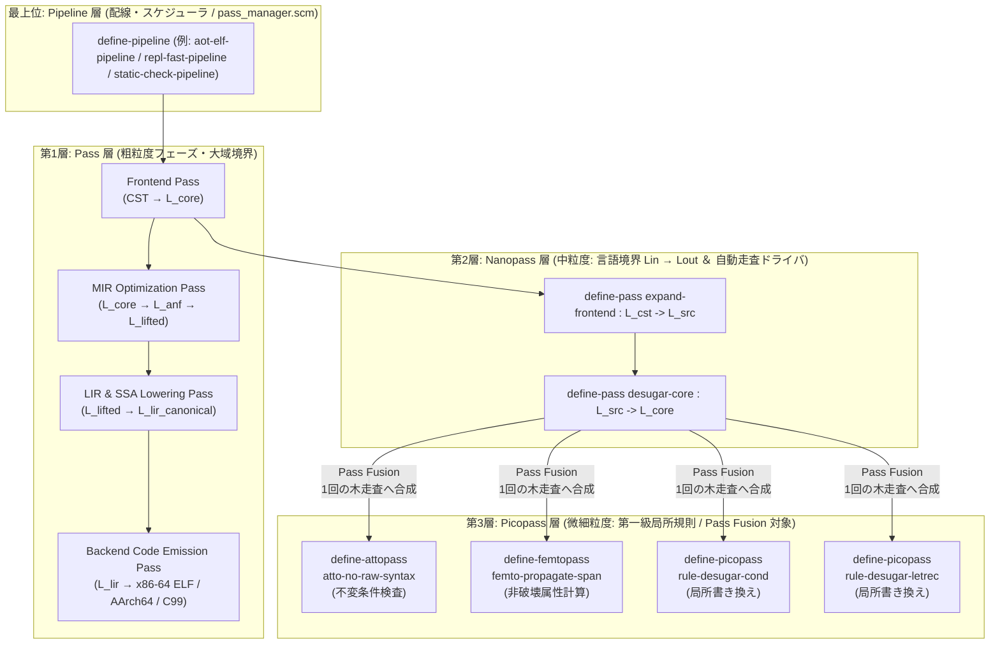
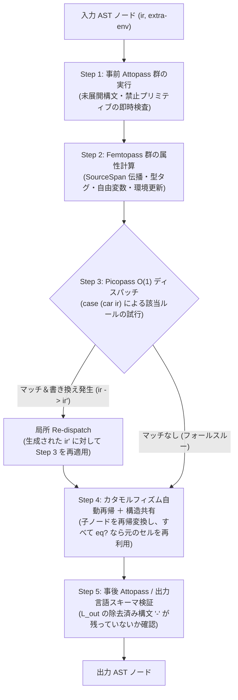
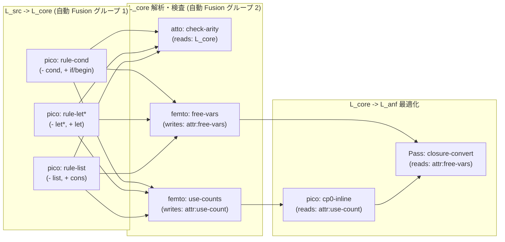
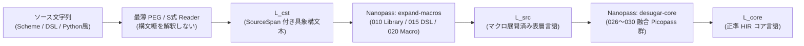
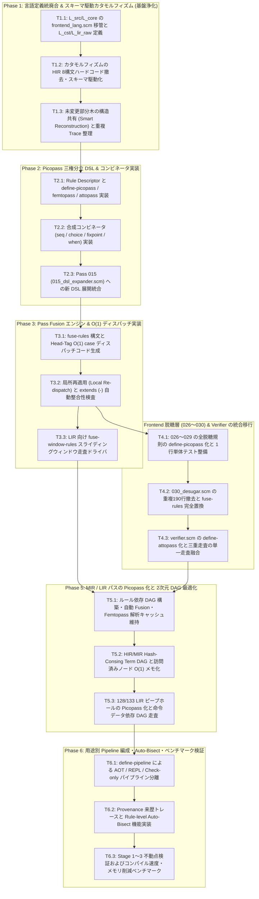

# [DSN-33-01] ULisp 階層型パス融合（Pipeline / Pass / Nanopass / Picopass）＆ DAG 最適化基盤設計書

- **文書番号**: `DSN-33-01`
- **上位文書**: [[DSN-33] ULISP 包括設計仕様書: S式メタコンパイラ基盤 ＆ 多重バックエンドトランスレーションアーキテクチャ](DSN-33-ulisp_underlying_x86_native_aot_compiler_architecture_specification.md)
- **文書ステータス**: `APPROVED`
- **対象サブシステム**:
  - `ulisp/compiler/` (`nanopass.scm`, `nanopass_meta.scm`, `pass_manager.scm`, `verifier.scm`, `driver.scm`, `scope.scm`, `dataflow.scm`)
  - `ulisp/frontend/` (`frontend_lang.scm`, `010_library.scm` 〜 `120_alias_escape.scm`)
  - `ulisp/lir/` (`lir_lang.scm`, `lir_verifier.scm`, `123_lir_closures.scm` 〜 `133_lir_peephole.scm`)
  - `ulisp/backend/` (`backend_lang.scm`, `140_backend_x86_64.scm` 〜 `160_backend_c.scm`)
- **関連設計書**:
  - [[DSN-31] ILisp R7RS Core Architecture Specification](DSN-31-ilisp_r7rs_intelligence_lisp_architecture_specification.md)
  - [[DSN-32] AILisp Agent Lisp Architecture Specification](DSN-32-ailisp_agent_lisp_architecture_specification.md)
  - [[DSN-37] Synapse Dual-Plane Concurrent Runtime Architecture](DSN-37-synapse_dual_plane_concurrent_runtime_architecture.md)
- **【主査・報告】 IT Specialist (Programming Languages & Compilers / PLC), Systems Architect (SA), Software Development (SWD)**
- **【共同主査】 Project Manager (PM), Software Quality Assurance Specialist (QA), Systems Auditor (AUD)**
- **【参画・協調】 16 大専門エージェント全員 (PM, SEC, SA, QA, DBA, NET, NLP, STR, SM, EMB, AUD, DES, EDU, SWD, APS, PLC)**

---

## 体系目次

- [1. エグゼクティブサマリー ＆ 設計哲学](#1-エグゼクティブサマリー--設計哲学)
  - [1.1 背景と解決すべき構造的課題（Nanopass の粒度ジレンマ）](#11-背景と解決すべき構造的課題nanopass-の粒度ジレンマ)
  - [1.2 4階層（Pipeline / Pass / Nanopass / Picopass）＋三権分立の基本思想](#12-4階層pipeline--pass--nanopass--picopass三権分立の基本思想)
- [2. 4階層アーキテクチャの責務と境界定義](#2-4階層アーキテクチャの責務と境界定義)
  - [2.1 Pipeline と 3層 Pass 粒度の比較マトリクス](#21-pipeline-と-3層-pass-粒度の比較マトリクス)
  - [2.2 フラクタルな包含・合成構造](#22-フラクタルな包含合成構造)
  - [2.3 各階層の厳密な責務と入出力契約](#23-各階層の厳密な責務と入出力契約)
- [3. Picopass 三権分立モデルと関数合成コンビネータ体系](#3-picopass-三権分立モデルと関数合成コンビネータ体系)
  - [3.1 3つの直交バリアント（`pico` / `femto` / `atto`）](#31-3つの直交バリアントpico--femto--atto)
  - [3.2 第一級ルール記述子（Rule Descriptor）の内部表現](#32-第一級ルール記述子rule-descriptorの内部表現)
  - [3.3 関数合成コンビネータ（Strategy Combinators）仕様](#33-関数合成コンビネータstrategy-combinators仕様)
- [4. Pass Fusion エンジンと高速走査ドライバ設計](#4-pass-fusion-エンジンと高速走査ドライバ設計)
  - [4.1 1ノード訪問時の5ステップ標準融合サイクル](#41-1ノード訪問時の5ステップ標準融合サイクル)
  - [4.2 先頭タグ（Head Symbol）による $O(1)$ ディスパッチ生成](#42-先頭タグhead-symbolによる-o1-ディスパッチ生成)
  - [4.3 多段脱糖のための局所再適用（Re-dispatch）と未変更部分木の構造共有](#43-多段脱糖のための局所再適用re-dispatchと未変更部分木の構造共有)
  - [4.4 2種類の走査ドライバ（`fuse-tree-rules` と `fuse-window-rules`）](#44-2種類の走査ドライバfuse-tree-rules-と-fuse-window-rules)
  - [4.5 性能（コンパイル速度・ヒープメモリ消費）の定量的予測モデル](#45-性能コンパイル速度ヒープメモリ消費の定量的予測モデル)
- [5. 2次元の DAG（有向非巡回グラフ）最適化・分析アーキテクチャ](#5-2次元の-dag有向非巡回グラフ最適化分析アーキテクチャ)
  - [5.1 次元1（メタレベル）：パス・ルール依存関係 DAG と自動スケジューリング](#51-次元1メタレベルパスルール依存関係-dag-と自動スケジューリング)
  - [5.2 次元2（IR レベル）：Hash-Consing Term DAG と LIR 命令データ依存 DAG](#52-次元2ir-レベルhash-consing-term-dag-と-lir-命令データ依存-dag)
- [6. フロントエンド〜ミドルエンド〜バックエンド垂直統合設計](#6-フロントエンドミドルエンドバックエンド垂直統合設計)
  - [6.1 フロントエンドのパスフレームワーク化（CST $\to$ HIR）](#61-フロントエンドのパスフレームワーク化cst-to-hir)
  - [6.2 エンドツーエンド中間言語階層と全パス配置マップ](#62-エンドツーエンド中間言語階層と全パス配置マップ)
  - [6.3 統合メタコンパイラ DSL リファレンス実装仕様](#63-統合メタコンパイラ-dsl-リファレンス実装仕様)
- [7. 観測性・テスタビリティ・自己修復デバッグ基盤](#7-観測性テスタビリティ自己修復デバッグ基盤)
  - [7.1 1行ユニットテストと REPL マイクロパイプライン](#71-1行ユニットテストと-repl-マイクロパイプライン)
  - [7.2 来歴追跡（Provenance Tracking）と細粒度 AST Diff](#72-来歴追跡provenance-trackingと細粒度-ast-diff)
  - [7.3 ルール単位の自動二分探索デバッグ（Rule-level Auto-Bisect）](#73-ルール単位の自動二分探索デバッグrule-level-auto-bisect)
- [8. 既存 Nanopass フレームワークの棚卸し・構造的課題と統廃合仕様](#8-既存-nanopass-フレームワークの棚卸し構造的課題と統廃合仕様)
  - [8.1 既存 Nanopass フレームワークの全機能インベントリ（6領域）](#81-既存-nanopass-フレームワークの全機能インベントリ6領域)
  - [8.2 コード監査で判明した「5つの構造的重複・設計上の歪み」](#82-コード監査で判明した5つの構造的重複設計上の歪み)
  - [8.3 `define-language` のすみわけと物理ファイル統廃合計画](#83-define-language-のすみわけと物理ファイル統廃合計画)
  - [8.4 既存機能の4階層フレームワークへの統廃合・再配置マトリクス](#84-既存機能の4階層フレームワークへの統廃合再配置マトリクス)
- [9. 実装タスク分解と段階的マイグレーション・ロードマップ（全6フェーズ・18タスク）](#9-実装タスク分解と段階的マイグレーションロードマップ全6フェーズ18タスク)
  - [9.1 ロードマップ全体俯瞰とタスク依存関係図](#91-ロードマップ全体俯瞰とタスク依存関係図)
  - [9.2 フェーズ別タスク詳細分解マトリクス（T1.1 〜 T6.3）](#92-フェーズ別タスク詳細分解マトリクスt11--t63)
  - [9.3 品質ゲートとセルフホスティング不動点保証規準](#93-品質ゲートとセルフホスティング不動点保証規準)

---

## 1. エグゼクティブサマリー ＆ 設計哲学

### 1.1 背景と解決すべき構造的課題（Nanopass の粒度ジレンマ）

本設計書は、上位仕様書 [[DSN-33] ULISP 包括設計仕様書](DSN-33-ulisp_underlying_x86_native_aot_compiler_architecture_specification.md) の第 2.5 節（直列 Nanopass 型アーキテクチャ）および第 2.6 節（統一 Pass Manager 基盤）を深化させ、ULisp コンパイラ全体の変換・解析・検証パイプラインを **Pipeline / Pass / Nanopass / Picopass の4階層モデル** および **2次元の DAG（有向非巡回グラフ）基盤** として体系化する詳細設計仕様である。

従来のコンパイラ設計および現行の ULisp 実装（`ulisp/compiler/nanopass.scm`, `ulisp/frontend/`, `ulisp/lir/`）には、以下の **「粒度と性能のジレンマ」** が存在していた。

1. **テスト容易性・保守性のための細分化と、走査コスト増大の衝突**:
   - Keep & Dybvig (2013) 流の Nanopass アプローチを純粋に推し進め、「1つの構文変化＝1つの `define-pass`」として数十〜百個のパスに分割すると、1つの極小規則を適用するたびに構文木全体の再帰走査（Catamorphism）とコンスセル再構築が発生する。
   - 現行 ULisp のフロントエンド脱糖層ではこの走査コストを回避するため、単体テスト用のモジュール（`026_desugar_constructors.scm`, `027_desugar_conditionals.scm`, `028_desugar_bindings.scm`, `029_desugar_dynamic.scm`）を個別に定義しつつ、本番実行用の `030_desugar.scm`（`desugar-all`）に **約190行のパターンマッチ節を手動で再集約（手動 Pass Fusion）** している。
2. **「書き換え」「属性計算」「不変条件検査」の混在と重複走査**:
   - 構文書き換えの中に未展開マクロ検査や予約語検査が混在する一方、AST 検証器（`verifier.scm`, `lir_verifier.scm`）や解析パス（`040_analysis.scm`, `080_annotator.scm`）が `define-pass` とは別の手書き再帰ループを持ち、同じ構文木を何度も別個に走査している。
3. **1次元命令リストに対するピープホール規則の組み合わせ爆発**:
   - LIR のピープホール最適化（`133_lir_peephole.scm`）において、基本ブロックを単なる1次元リストとして窓走査しているため、間に無関係な命令が1つ挟まるだけで別ルール（Rule 2b, Rule 2b-2, Rule 2b-3）を手書きしなければならない。

### 1.2 4階層（Pipeline / Pass / Nanopass / Picopass）＋三権分立の基本思想

これらの課題を根本から解決するため、ULisp は以下の3つの基本原則を導入する。

1. **「配線（Pipeline）」「フェーズ（Pass）」「走査境界（Nanopass）」「局所規則（Picopass）」の4階層分離**:
   - **人間（および AI）が記述・保守・単体テストする最小単位は、再帰走査を持たない極小の `Picopass` とする**。
   - **コンパイル実行時に構文木を走査する単位は、複数の Picopass を自動融合（Pass Fusion）した少数の `Nanopass` とする**。
2. **局所規則の三権分立（`pico` / `femto` / `atto`）**:
   - 木を書き換える規則（`define-picopass`）、木を変えずに属性を計算する規則（`define-femtopass`）、木を変えずに不変条件を検証する規則（`define-attopass`）を厳格に分離し、同一の Nanopass 走査へ相乗り融合させる。
3. **メタレベルと IR レベルの双方における DAG 化**:
   - 各規則の入出力メタデータ（Read/Write タグ集合）から **ルール依存関係 DAG** を構築し、並列融合と解析キャッシュ再利用を自動化する。
   - 走査ドライバを Picopass から完全に分離することで、Picopass 側のコードを1行も変えることなく、**Hash-Consing Term DAG（HIR/MIR）** および **命令データ依存 DAG（LIR）** 上での $O(|V|)$ 走査を実現する。

---

## 2. 4階層アーキテクチャの責務と境界定義

### 2.1 Pipeline と 3層 Pass 粒度の比較マトリクス

**Pipeline（配線・実行計画）** と **Pass / Nanopass / Picopass（変換の3粒度）** は明確に異なる概念として定義する。

| 評価軸 | 最上位：Pipeline（配線・器） | 第1層：Pass（粗粒度） | 第2層：Nanopass（中粒度） | 第3層：Picopass（微細粒度） |
| :--- | :--- | :--- | :--- | :--- |
| **本質的役割** | **全体経路の編成・スケジューラ** | **抽象度マイルストーン・大域処理** | **言語スキーマ境界・走査実行器** | **走査を持たない第一級局所規則** |
| **自身の変換処理** | **なし**（Pass の呼び出しと計測のみ） | 複数の Nanopass またはグラフ処理の統括 | 1回の木走査 / 窓走査（$L_{\text{in}} \to L_{\text{out}}$） | 単一構文ノードまたは命令窓の1ステップ処理 |
| **走査ループ** | Pass 間の直列・分岐ディスパッチ | フェーズ内の反復・大域グラフ走査 | **フレームワークが自動導出**（カタモルフィズム） | **一切持たない**（純粋なパターンマッチ） |
| **中間表現 (IR)** | 全 IR（CST $\to$ HIR $\to$ MIR $\to$ LIR $\to$ 機械語） | フェーズ間の大境界（HIR / MIR / LIR / ELF） | `extends` で差分定義された厳密な中間言語 | 親 Nanopass 内の特定非終端記号（`Expr`, `Inst` 等） |
| **状態・関心事** | `-O0`/`-O2`、ターゲット選択、時間/メモリ計測、IRダンプ | シンボル表、CFG/SSA、レジスタ割当、バイナリ構築 | 継承属性（`env` 等）・合成属性の伝播と構造共有 | 原則ステートレス（単一ノードの変換・属性・検査） |
| **DSL 表現** | `define-pipeline`, `run-pass-pipeline` | `register-pass!`, `make-pass-descriptor` | `define-language`, `define-pass` | `define-picopass`, `define-femtopass`, `define-attopass` |
| **テスト単位** | E2E コンパイル・ターゲットバイナリ実行 | フェーズ入出力検証・ベンチマーク | パス前後の AST 差分（AST Diff） | **S式断片1個の1行ユニットテスト** |

### 2.2 フラクタルな包含・合成構造

各階層は「直下の階層の要素を合成（Compose / Fuse）するコンテナ」として自己相似（フラクタル）構造をなす。



### 2.3 各階層の厳密な責務と入出力契約

#### (1)の最上位：Pipeline（パイプライン）
- **責務**: コンパイルの目的（AOT ネイティブ生成、対話型 REPL 評価、LSP/静的検査のみ、Dual-Plane 分割コンパイル）と最適化レベル（`-O0`, `-O1`, `-O2`）に応じて、実行すべき **Pass** の有向グラフ（Pipeline DAG）を編成・実行する。
- **禁止事項**: Pipeline 自身が特定の構文ノードや命令を直接検査・変更してはならない。
- **提供機能**:
  - 用途別パイプライン定義（`aot-native-pipeline`, `repl-eval-pipeline`, `static-check-pipeline`）
  - 前提条件（`prerequisites`）のトポロジカル検証（`validate-pipeline-prerequisites`）
  - 動的パス注入（`inject-pass-before!`, `inject-pass-after!`）とプロファイリング（`--time-passes`, `--dump-ir`）

#### (2) 第1層：Pass（粗粒度フェーズ）
- **責務**: Pipeline 上の1つの独立したマイルストーンとして、コンパイラの抽象度を大きく引き下げる（Frontend / MIR / LIR / Backend）。内部で1つ以上の **Nanopass** を順次または不動点反復で呼び出すか、木走査に収まらない大域グラフアルゴリズム（CFG 構築、Braun SSA 構築 `132_lir_braun_ssa.scm`、レジスタ割り当て、ELF64 バイナリ出力 `144_backend_x86_elf.scm`）を完結させる。
- **契約**: 入出力の言語スキーマ（`in-lang`, `out-lang`）と Verifier フェーズを `pass-descriptor` に明示し、フェーズ完了時に大域的不変条件（アフィン所有権の完結、未解決ラベルの不在等）を保証する。

#### (3) 第2層：Nanopass（中粒度・言語境界と走査ドライバ）
- **責務**: `define-language` によって定義された厳密な中間言語スキーマ境界（$L_{\text{in}} \to L_{\text{out}}$）を型付けし、構文木（または命令列）の走査コードを自動生成して実行する。
- **禁止事項**: Nanopass 本体に膨大な個別構文の変換ロジックを直接書き連ねるのではなく、原則として `Picopass` / `Femtopass` / `Attopass` を束ねる **Fusion コンテナ** として記述する。

#### (4) 第3層：Picopass（微細粒度・第一級局所規則）
- **責務**: **再帰走査ループを一切持たず**、単一の構文パターン（または連続する数命令のウィンドウ）に対するパターンマッチと局所変換・属性計算・アサーションのみを行う。
- **契約**: すべての Picopass は名前付きの第一級オブジェクト（Rule Descriptor）として定義され、単一の S 式を入力として直接ユニットテスト可能でなければならない。

---

## 3. Picopass 三権分立モデルと関数合成コンビネータ体系

### 3.1 3つの直交バリアント（`pico` / `femto` / `atto`）

単一のパスの中に「エラー検査」「型や自由変数の計算」「構文木の書き換え」が混在するのを防ぐため、微細粒度ルールを以下の3つのプリミティブに三権分立させる。

| プリミティブ | 役割（三権分立） | 木構造の変更 | 属性（Metadata）の変更 | 戻り値セマンティクス |
| :--- | :--- | :---: | :---: | :--- |
| **`define-picopass`** | **立法・変換（Transform）** | **あり** | 生成ノードへの継承のみ | マッチ時は変換後の新しい S 式テンプレート、非マッチ時は `#f`（フォールスルー） |
| **`define-femtopass`** | **行政・解析（Analyze / Annotate）** | **禁止** | **あり（計算・注釈）** | 計算された属性値（自由変数集合、利用回数、型タグ、生存区間、SourceSpan） |
| **`define-attopass`** | **司法・検査（Verify / Assert）** | **禁止** | **禁止** | 条件充足時は `#t`、不変条件違反時は構造化診断エラー（`picopass-fail`）を送出 |

### 3.2 第一級ルール記述子（Rule Descriptor）の内部表現

`define-picopass` / `define-femtopass` / `define-attopass` は、単体で関数として呼び出し可能であると同時に、Nanopass の Fusion エンジンおよび DAG スケジューラが静的に解析可能なメタデータを持つレコード（または属性付きクロージャ）へ展開される。

```scheme
;;; ルール記述子の論理構造
(make-rule-descriptor
  name        ; シンボル: 'rule-desugar-letrec
  kind        ; シンボル: 'pico | 'femto | 'atto
  nt-name     ; 対象非終端記号: 'Expr | 'Stmt | 'Inst
  head-tags   ; 先頭シンボル候補リスト: '(letrec) またはワイルドカード '*
  reads       ; 参照する構文タグ・属性集合: '(letrec)
  writes      ; 生成する構文タグ・属性集合: '(let begin set! void)
  eliminates  ; 完全に消去する構文タグ集合: '(letrec)
  clauses     ; 展開済みパターン節リスト: ((pat vars guard-expr body-expr) ...)
  proc)       ; 単体呼び出し・テスト用手続き: (lambda (ir . extra) ...)
```

この構造により、以下のハイブリッド動作が実現する：
- **単体テスト・REPL での直接呼び出し時**: `proc` を直接実行し、1つの S 式断片に対する変換・属性計算・検査結果を即座に返す。
- **Nanopass での Pass Fusion 時**: `head-tags` と `clauses` を取り出し、複数ルールのパターン節を先頭タグ別に束ねた単一の走査関数へとインライン合成する。

### 3.3 関数合成コンビネータ（Strategy Combinators）仕様

複数の Picopass / Femtopass / Attopass を関数合成して新たな複合ルールを構築するため、以下の4つの基本コンビネータを提供する。

```scheme
;;; 1. 直列合成 (Sequential Composition: p1 ▷ p2)
;;; p1 が発火して書き換えた結果に対し、続けて p2 を適用する
(picopass-seq rule-desugar-case rule-desugar-or)

;;; 2. 優先選択合成 (Deterministic Choice: p1 ⊕ p2)
;;; 特殊ケース p1 を先に試し、マッチしなかった場合のみ汎用ケース p2 を試す
(picopass-choice rule-max-binary-fastpath rule-max-variadic-fold)

;;; 3. 局所不動点反復 (Local Fixpoint: p*)
;;; 単一ノード上でルール p がマッチしなくなるまで（上限 max-steps 付きで）反復適用する
(picopass-fixpoint rule-flatten-nested-begin)

;;; 4. 契約・条件付き適用 (Guarded Composition: atto/femto ⇒ pico)
;;; 事前条件（attopass または femtopass の述語）を満たすときのみ picopass を適用する
(picopass-when atto-pure-expression? rule-dead-let-elim)
```

---

## 4. Pass Fusion エンジンと高速走査ドライバ設計

### 4.1 1ノード訪問時の5ステップ標準融合サイクル

Nanopass が `(fuse-rules ...)`（または `fuse-tree-rules`）によって複数の `atto` / `femto` / `pico` ルールを融合した際、生成される走査関数は1つの AST ノード `ir` を訪問するごとに以下の5ステップを厳密な順序で実行する。



### 4.2 先頭タグ（Head Symbol）による $O(1)$ ディスパッチ生成

現行の `nanopass.scm` における `nanopass-build-rules-cascade` は、登録された $R$ 個のルールを上から順番に `if` カスケードで試行するため、1ノードあたりの計算量が $O(R)$ となる（例えば `030_desugar.scm` の約100ルールでは、変数参照 `x` や定数ノードに対しても毎回100回の `nanopass-try-clause` が呼ばれる）。

Pass Fusion エンジンは、各 Picopass の `head-tags` メタデータを収集し、以下の **$O(1)$ バケット分岐コード** へとコンパイルする。

1. **アトム／ペアの即時分離**: `(if (not (pair? ir)) ...)` により、シンボルや定数リテラルに対してペア用パターンマッチ（100個のS式ルール）が一切走らないようにする。
2. **`case (car ir)` による先頭シンボル分岐**:
   - パターンが `((letrec ...) ...)` や `((cond ...) ...)` のように固定シンボル `sym` で始まるルールを、`sym` ごとのバケットに分類する。
   - 生成コードは `(case (car ir) ((letrec) <letrec用ルール群>) ((cond) <cond用ルール群>) ... (else <ワイルドカードルール群 + カタモルフィズム>))` となり、**ルール数が10個から200個に増えても、1ノードあたりのディスパッチコストは $O(1)$ のまま一定** となる。

### 4.3 多段脱糖のための局所再適用（Re-dispatch）と未変更部分木の構造共有

#### (1) 局所再適用（Local Re-dispatch）
例えば `rule-desugar-case` は `case` 式を `(let ((k key)) (if (or (eqv? k 'a) ...) ...))` へと展開する。この生成された内部の `or` 式も、同じ `desugar-core` Nanopass 内で `rule-desugar-or` によって `if` へと脱糖されなければならない。
Pass Fusion エンジンは、Picopass が新しいノード `ir'` を生成した際、子ノードへのカタモルフィズム再帰に入る前に **`ir'` 自身に対して同じ Nanopass のディスパッチを再適用（Re-dispatch）** する。これにより、各 Picopass の実装者は再帰呼び出し `(Expr ...)` を手書きすることなく、純粋な1ステップのテンプレート置換だけを記述すればよい。

#### (2) 未変更部分木の構造共有（Smart Reconstruction）
`nanopass-catamorphism-step` が子ノードへ再帰した際、変換後の子ノード `new-child` と変換前の子ノード `old-child` を `eq?` で比較する。すべての部分式が `eq?`（無変更）であった場合、`(list 'if new-c1 new-c2 new-c3)` のような新規コンスセル割り当てを行わず、**元の `ir` ポインタをそのまま返す**。

```scheme
;;; Smart Reconstruction によるゼロアロケーション再構築の例 (if ノード)
(let* ((c1 ( (cadr ir)))
       (c2 (call-recurse (caddr ir)))
       (c3 (call-recurse (cadddr ir))))
  (if (and (eq? c1 (cadr ir))
           (eq? c2 (caddr ir))
           (eq? c3 (cadddr ir)))
      ir  ; <-- 子が一切変わっていなければ新規コンスセルを割り当てず元の ir を返す
      (list 'if c1 c2 c3)))
```

### 4.4 2種類の走査ドライバ（`fuse-tree-rules` と `fuse-window-rules`）

HIR / MIR の木構造と LIR / アセンブリの命令列の双方を統一的に扱うため、`define-pass` は2種類の融合ドライバをサポートする。

| ドライバ構文 | 対象データ構造 | 走査アルゴリズム | 主な適用フェーズ |
| :--- | :--- | :--- | :--- |
| **`(fuse-rules ...)`**<br>（別名: `fuse-tree-rules`） | S式構文木（AST / ANF）または Term DAG | ボトムアップ／トップダウン再帰カタモルフィズム ＋ $O(1)$ Head-Tag ディスパッチ | Frontend（CST $\to$ HIR）、MIR（CP0, LVN, ANF, RTyper, Contify） |
| **`(fuse-window-rules ...)`** | 基本ブロック内の線形命令列または命令依存 DAG | スライディングウィンドウ走査（窓幅 $k = 1 \dots 4$）およびワークリスト不動点反復 | LIR 分岐融合（`128`）、LIR ピープホール（`133`）、x86/AArch64 ピープホール（`143`） |

### 4.5 性能（コンパイル速度・ヒープメモリ消費）の定量的予測モデル

AST の総ノード数を $N$、パイプライン内の走査パス数を $P$、1パスあたりのルール数を $R$、実際に書き換えが発生するノードの割合（変更率）を $\alpha$（通常 $0.05 \le \alpha \le 0.25$）とする。

| 評価指標 | 従来設計（線形カスケード＋全ノード再構築） | 本設計（Pass Fusion ＋ $O(1)$ Dispatch ＋ 構造共有） | 改善予測（ULisp セルフホスト時） |
| :--- | :--- | :--- | :--- |
| **ルール照合計算量** | $O(P \times N \times R)$ | **$O(P_{\text{fused}} \times N \times 1)$** | **コンパイル速度 2.0x 〜 4.0x 高速化** |
| **AST 再構築メモリ量** | $O(P \times N)$ セル（無変更でも毎回全複製） | **$O(P_{\text{fused}} \times \alpha N)$ セル**（変更ノードと祖先のみ） | **ヒープ割り当て量 40% 〜 60% 削減** |
| **Verifier 走査コスト** | 別パスとして $+O(P \times N)$ の追加走査 | **`attopass` 融合により追加走査 $0$ 回** | `--verify-ir` 有効時のオーバーヘッド激減 |

---

## 5. 2次元の DAG（有向非巡回グラフ）最適化・分析アーキテクチャ

Pipeline / Pass / Nanopass / Picopass の分離と「走査のフレームワークへの集約」により、コンパイラは **①パス・ルール自体の依存関係（メタレベル）** と **②プログラム IR のデータ構造（データレベル）** の2つの次元で DAG として最適化・分析される。

### 5.1 次元1（メタレベル）：パス・ルール依存関係 DAG と自動スケジューリング

各 Picopass / Femtopass / Attopass が持つ `reads`（参照する構文タグ・属性）と `writes` / `eliminates`（生成・消去する構文タグ・属性）のメタデータから、フレームワークは **ルール間のデータ依存 DAG** を構築する。



このメタレベル DAG により、以下の4つの自動化が実現する：
1. **アンチチェーン（独立集合）の自動 Pass Fusion**:
   - DAG 上で互いに到達可能性がない（依存辺を持たない）ルール群（例：`rule-cond`, `rule-let*`, `rule-list`）を自動検出し、1回の Nanopass 走査へと安全に融合する。
2. **Femtopass 解析キャッシュの維持と再計算回避（Invalidation Tracking）**:
   - ある Picopass が書き換える構文タグ集合 `writes` が、先行する Femtopass の参照集合 `reads` と交差しない場合、その Femtopass の解析結果（例：変更されなかったトップレベル関数の型シグネチャや自由変数集合）は無効化（Invalidate）されず、再計算なしで後続パスに引き継がれる。
3. **強連結成分（SCC）分解による局所不動点ループの抽出**:
   - 定数畳み込みとベータ簡約のように互いに発火機会を作り合うルール群（依存グラフ上の有向閉路）を強連結成分（SCC）として抽出し、その SCC 部分のみを `picopass-fixpoint` で反復させ、非循環部分は1回だけ走査する。
4. **分岐 Pipeline DAG による Dual-Plane ＆ マルチターゲット並列コンパイル**:
   - [[DSN-37] Synapse Dual-Plane](DSN-37-synapse_dual_plane_concurrent_runtime_architecture.md) における Layer 1（R7RS Control Plane）と Layer 2（Restricted Actor Plane）の分割検証や、`L_lir_canonical` から `x86-64 ELF`, `AArch64`, `C99` への同時コード生成を、分岐を持つ Pipeline DAG として表現・実行する。

### 5.2 次元2（IR レベル）：Hash-Consing Term DAG と LIR 命令データ依存 DAG

Picopass から再帰走査コードを完全に排除し、走査を Nanopass ドライバに集中させたことで、**Picopass の定義を一切変更せずに IR のデータ構造自体を木（Tree）から DAG へ昇格させることができる**。

#### (1) HIR / MIR における Hash-Consing Term DAG と $O(1)$ メモ化走査
- **課題**: マクロ展開やインライン展開によって同一の部分式が複数箇所に複製された場合、従来の木走査では同じ部分木を何度も重複して変換・型推論していた。
- **解決**:
  - AST ノード構築時に Hash-Consing（構造が等しい不変 S 式は同一のメモリアドレスを共有する）を適用し、構文木を **共有項グラフ（Shared Term DAG）** として保持する。
  - Nanopass の走査ドライバは、`eq?` ハッシュテーブルによる1パスメモ化（Visited Node Cache）を持つ。共有された部分木が一度変換・解析（`femtopass`）されれば、2回目以降の出現時は **$O(1)$ でキャッシュされた変換結果が返り、重複走査が完全に消滅**する。
  - さらに、構文木の等価性比較（`equal?` による $O(N)$ 再帰比較）が **ポインタ一致比較（`eq?` による $O(1)$ 比較）** に置き換わり、`060_lvn.scm`（局所値番号付け）や `nanopass-ast-diff` が劇的に高速化する。

#### (2) LIR における命令データ依存 DAG（SelectionDAG）走査
- **課題**: 現行の `133_lir_peephole.scm` では、スタックへの `%store` 直後の `%load` を除去するために、「連続する2命令（Rule 2b）」「間に別の `%store` が1つ挟まった3命令（Rule 2b-2 / 2b-3）」を別々の条件分岐として手書きしており、間に2命令以上挟まると最適化を取りこぼす。
- **解決**:
  - LIR の基本ブロックに対し、Nanopass のウィンドウ走査ドライバがレジスタおよびスタックスロット（`(%rsp + offset)`）の Read-After-Write（RAW）/ Write-After-Write（WAW）依存辺を解析し、**基本ブロック内データ依存 DAG** を構成する。
  - これにより、間に無関係な命令が何個挟まっていようとも、DAG 上では `(%store %rsp off src)` ノードとそれを読む `(%load dst %rsp off)` ノードが **直接1本のデータ依存エッジ** で結ばれる。
  - 結果として、Picopass 側はデータ依存エッジに対する **たった1つの規則（`rule-forward-stack-store-load`）** を定義するだけで、距離に依存しない完全な Store-Reload 転送・除去が達成される。

---

## 6. フロントエンド〜ミドルエンド〜バックエンド垂直統合設計

### 6.1 フロントエンドのパスフレームワーク化（CST $\to$ HIR）

従来のコンパイラでは「フロントエンド＝パーサで一気に AST を作るブラックボックス」と扱われがちであったが、本設計では **フロントエンド自体を Nanopass / Picopass のパイプラインとして再定義** する。



1. **パーサの極小化（CST 特化）**:
   - リーダー／PEG パーサの責務は、ファイル名・行番号・列番号（`SourceSpan`）を保持した具象構文木（`L_cst`）を1対1で構築することのみに限定する。
2. **多言語フロントエンドの低コスト合流**:
   - R7RS Scheme だけでなく、宣言的セキュリティ DSL や Python 風の内包表記・ループ構文を追加する場合でも、表層 CST を既存の `L_src` / `L_core` へ書き換える数個の `define-picopass` を追加するだけで、下流の MIR / LIR / ネイティブバックエンドを100%そのまま利用できる。
3. **フロントエンド境界での厳格な `attopass` 検証**:
   - これまで `010_library.scm` 〜 `025_top_level.scm` はすべて型無しの `L_src -> L_src`（Verifier なし）として扱われていたが、`L_cst -> L_expanded -> L_src -> L_core` の各境界に `atto-no-unexpanded-macro`（`let-syntax` / `syntax-rules` の残留禁止）や `atto-valid-top-level` を配置し、構文エラーを上流で即座に捕捉する。

### 6.2 エンドツーエンド中間言語階層と全パス配置マップ

ULisp コンパイラ全体の4階層構成と現行ファイル群の対応関係を以下に定める。

| Pipeline フェーズ (Pass) | Nanopass (`define-pass`) | 言語境界 ($L_{\text{in}} \to L_{\text{out}}$) | 内包される Picopass / Femtopass / Attopass 群 | 対応する現行ファイル |
| :--- | :--- | :--- | :--- | :--- |
| **Pass 1: Frontend Phase** | `expand-library-and-dsl` | $L_{\text{cst}} \to L_{\text{macro}}$ | `pico: expand-define-library`, `pico: expand-import`, `pico: expand-define-pass`, `femto: attach-source-span` | `010_library.scm`<br>`015_dsl_expander.scm` |
| | `expand-hygienic-macros` | $L_{\text{macro}} \to L_{\text{src}}$ | `femto: scope-sets-mark`, `pico: expand-syntax-rules`, `pico: rewrite-top-level`, `atto: atto-no-raw-syntax-rules` | `020_macro_expander.scm`<br>`025_top_level.scm` |
| | `desugar-core` | $L_{\text{src}} \to L_{\text{core}}$ | `pico: rule-cond`, `rule-case`, `rule-and`, `rule-or`, `rule-chain-cmp` (`027`)<br>`pico: rule-let*`, `rule-letrec*`, `rule-named-let`, `rule-do`, `rule-case-lambda` (`028`)<br>`pico: rule-list`, `rule-vector`, `rule-bytevector`, `rule-gcd-lcm`, `rule-max-min` (`026`)<br>`pico: rule-guard`, `rule-let-values`, `rule-parameterize`, `rule-delay` (`029`) | `026`〜`029` (Picopass 定義)<br>`030_desugar.scm` (Fusion コンテナ) |
| | `resolve-scope-and-arity` | $L_{\text{core}} \to L_{\text{core}}$ | `femto: alpha-rename-lexical`, `atto: atto-check-arity`, `atto: atto-no-unbound-vars` | `scope.scm`<br>`040_analysis.scm` |
| **Pass 2: MIR Phase** | `optimize-source-mir` | $L_{\text{core}} \to L_{\text{core}}$ | `femto: count-variable-uses`, `pico: rule-cp0-const-fold`, `pico: rule-cp0-beta-inline`, `pico: rule-lvn-cse` | `050_cp0.scm`<br>`060_lvn.scm` |
| | `normalize-anf` | $L_{\text{core}} \to L_{\text{anf}}$ | `pico: rule-anf-let`, `pico: rule-anf-if`, `pico: rule-anf-call`, `atto: atto-verify-anf-atomic-args` | `070_anf.scm`<br>`verifier.scm` |
| | `specialize-and-contify` | $L_{\text{anf}} \to L_{\text{anf}}$ | `femto: s-annotator-infer-types` (`080`), `pico: rule-rtyper-unbox` (`090`), `pico: rule-contify-tail-loops` (`100`), `atto: atto-check-affine-linearity` | `080_annotator.scm`<br>`090_rtyper.scm`<br>`100_contify.scm` |
| | `convert-closures-and-escape` | $L_{\text{anf}} \to L_{\text{lifted}}$ | `femto: analyze-free-vars`, `femto: analyze-escape-tbaa` (`120`), `pico: rule-flat-closure`, `pico: rule-stack-alloc-closure` | `110_closure_convert.scm`<br>`120_alias_escape.scm` |
| **Pass 3: LIR Phase** | `lower-to-lir` | $L_{\text{lifted}} \to L_{\text{lir\_raw}}$ | `pico: rule-lir-closure` (`123`), `rule-lir-call-abi` (`124`), `rule-lir-loop-shuffle` (`125`), `rule-lir-control` (`126`), `rule-lir-runtime` (`127`), `rule-lir-primitives` (`129`), `rule-lir-safepoint` (`131`) | `123`〜`127`, `129`, `131`<br>`130_lir.scm` (Orchestrator)<br>`132_lir_braun_ssa.scm` |
| | `optimize-lir-peephole` | $L_{\text{lir\_raw}} \to L_{\text{lir\_canonical}}$ | **[`fuse-window-rules`]** `pico: rule-fuse-cmp-branch` (`128`), `rule-elim-self-mov`, `rule-elim-roundtrip-mov`, `rule-forward-store-load` (`133`), `atto: atto-verify-lir-ssa` | `128_lir_branch_fusion.scm`<br>`133_lir_peephole.scm`<br>`lir_verifier.scm` |
| **Pass 4: Backend Phase** | `emit-target-code` | $L_{\text{lir\_canonical}} \to \text{Target}$ | x86-64 / Freestanding / ELF (`140`〜`144`), AArch64 (`150`), Portable C99 (`160`) のターゲット別命令選択 Picopass 群とバイナリ出力 | `backend/140`〜`160` |

### 6.3 統合メタコンパイラ DSL リファレンス実装仕様

`ulisp/compiler/nanopass.scm` において提供する統合 DSL の記述仕様を以下に示す。

```scheme
;;; =======================================================================
;;; 1. 微細粒度ルール定義: define-picopass / define-femtopass / define-attopass
;;; =======================================================================

;; [Picopass] 局所構文書き換え（再帰走査なし・単体テスト可能）
(define-picopass rule-desugar-and
  (Expr
    [(and) #t]
    [(and ,e) e]
    [(and ,e1 ,e2 ...) `(if ,e1 (and ,e2 ...) #f)]))

(define-picopass rule-desugar-letrec
  (Expr
    [(letrec ((,x ,e1) ...) ,body ...)
     `(let ((,x (void)) ...)
        (begin (set! ,x ,e1) ... ,body ...))]))

;; [Femtopass] 非破壊属性計算（木構造を変更せず属性を計算）
(define-femtopass femto-free-vars
  (Expr : (bound-env) -> (free-set)
    [,x (guard (symbol? x))
        (if (memq x bound-env) '() (list x))]
    [(lambda (,params ...) ,body)
     (femto-recurse body (append params bound-env))]))

;; [Attopass] 原子命題アサーション（不変条件の単体検査）
(define-attopass atto-no-unexpanded-syntax
  (Expr
    [(let-syntax ,_ ...)
     (picopass-fail "syntax-error [R7RS §4.3.1]: unexpanded let-syntax encountered" ir)]
    [(letrec-syntax ,_ ...)
     (picopass-fail "syntax-error [R7RS §4.3.1]: unexpanded letrec-syntax encountered" ir)]))

;;; =======================================================================
;;; 2. 中粒度走査ドライバ定義: define-pass + fuse-rules (Nanopass 層)
;;; =======================================================================

(define-pass desugar-core-pass : L_src (ir) -> L_core ()
  (entry Expr)
  (fuse-rules
    ;; Step 1: 事前アサーション (atto)
    atto-no-unexpanded-syntax
    ;; Step 2: 局所脱糖ルール群 (pico) -> O(1) case (car ir) ディスパッチへ自動融合
    rule-desugar-and
    rule-desugar-or
    rule-desugar-cond
    rule-desugar-case
    rule-desugar-let*
    rule-desugar-letrec))

;;; =======================================================================
;;; 3. LIR スライディングウィンドウ・依存融合: fuse-window-rules
;;; =======================================================================

(define-picopass rule-lir-self-mov-elim
  (InstWindow
    [((%mov ,r ,r) . ,rest) rest]))

(define-picopass rule-lir-store-load-forward
  (InstWindow
    [((%store %rsp ,off ,src) (%load ,dst %rsp ,off) . ,rest)
     (if (equal? dst src)
         `((%store %rsp ,off ,src) . ,rest)
         `((%store %rsp ,off ,src) (%mov ,dst ,src) . ,rest))]))

(define-pass lir-peephole-pass : L_lir_raw (lir) -> L_lir_canonical ()
  (entry InstructionList)
  (fuse-window-rules
    rule-lir-self-mov-elim
    rule-lir-store-load-forward))
```

---

## 7. 観測性・テスタビリティ・自己修復デバッグ基盤

### 7.1 1行ユニットテストと REPL マイクロパイプライン

すべての `picopass`, `femtopass`, `attopass` は第一級関数として直接呼び出し可能であるため、`%program` 全体のボイラープレートを用意することなく、1行の S 式アサーションで単体テストを記述できる。

```scheme
;; 単一 Picopass の 1 行ユニットテスト
(assert-equal (rule-desugar-and '(and a b)) '(if a (and b) #f))

;; コンビネータによる局所不動点テスト
(define desugar-and-full (picopass-fixpoint rule-desugar-and))
(assert-equal (desugar-and-full '(and a b c)) '(if a (if b c #f) #f))
```

### 7.2 来歴追跡（Provenance Tracking）と細粒度 AST Diff

`--trace-passes`（または `trace-define-pass`）有効時、従来の Nanopass トレーサは「パス全体のビフォー・アフターの S 式差分」のみを表示していた。
Picopass 統合後は、各ノードが書き換えられる際に **「どの Nanopass 内の、どの Picopass ルール（例: `desugar-core-pass :: rule-desugar-letrec`）が発火してこのノードを生成したか」** を `origin-rule` として記録・表示する。これにより、下流の LIR やコード生成で型エラーやアサーション違反が発生した際、元のソース位置（`SourceSpan`）だけでなく「原因となった変換ルール名」まで即座に逆引きできる。

### 7.3 ルール単位の自動二分探索デバッグ（Rule-level Auto-Bisect）

`pass_manager.scm` の `disable-pass!` を拡張し、Picopass 単位での有効・無効化 API（`disable-picopass!`, `enable-picopass!`）を提供する。
これにより、最適化有効時（`-O2`）にのみ発生する不具合に遭遇した際、融合された数十個の最適化 Picopass 群に対して自動的に二分探索（Delta Debugging）を実行し、**不具合を引き起こしている単一の Picopass ルールを数秒で特定する Auto-Bisect 機能** を実現する。

---

## 8. 既存 Nanopass フレームワークの棚卸し・構造的課題と統廃合仕様

本章では、現行の ULisp コードベース（`ulisp/compiler/nanopass.scm`, `nanopass_meta.scm`, `015_dsl_expander.scm`, `verifier.scm`, `pass_manager.scm` 等）に実装されている Nanopass 関連機能を全量棚卸しし、調査により判明した **5つの構造的課題（技術的負債・重複実装）** と、それらを4階層アーキテクチャへ統廃合する設計仕様を定める。

### 8.1 既存 Nanopass フレームワークの全機能インベントリ（6領域）

現在、ULisp の Nanopass 基盤は以下の6領域で構成されている。

| 領域 | 既存の機能・マクロ・API | 実装ファイル |
| :--- | :--- | :--- |
| **① 言語定義・リフレクション** | ・`define-language` (`extends`, `entry`, `nongenerative-id`, `terminals`, `+`/`-`)<br>・自動生成手続き: `parse-<L>`, `unparse-<L>`, `<L>?`<br>・補助マクロ: `define-parser`, `define-unparser`, `in-context`<br>・リフレクション API: `language->s-expression`, `language-diff`, `language-parent-chain`, `language-declaration`, `nanopass-get-all-languages` | `ulisp/compiler/nanopass.scm`<br>`ulisp/compiler/nanopass_meta.scm` |
| **② パス定義・パターンマッチ** | ・`define-pass`, `trace-define-pass`<br>・節構文: `(definitions ...)`, `(entry NT)`, `(NT : NT_in (ir ...) -> NT_out (...) ...)`<br>・パターン照合: `,var` (束縛), `,(var)` (再帰束縛), `_`, `...` (Ellipsis 反復), `(guard ...)`<br>・テンプレート展開: Quasiquote + `...` の自動 `map` / `nanopass-map2` / `nanopass-map3` 展開 | `ulisp/compiler/nanopass.scm`<br>`ulisp/compiler/nanopass_meta.scm` |
| **③ 自動走査（Catamorphism）** | ・`nanopass-catamorphism-step`<br>・変換モード（AST 再構築＋継承引数 `extra-args` 伝播）<br>・純粋解析モード（出力言語 `*` 指定時のアキュムレータ Fold 走査） | `ulisp/compiler/nanopass_meta.scm` |
| **④ 構文・不変条件検証（Verifier）** | ・言語スキーマ検証: `nanopass-verify-ast`, `nanopass-ast-valid?`<br>・フェーズ別手書き検証: `verify-desugared-ast`, `verify-anf-ast`, `verify-closure-ast`<br>・LIR 専用検証: `verify-lir-program` | `ulisp/compiler/nanopass_meta.scm`<br>`ulisp/compiler/verifier.scm`<br>`ulisp/lir/lir_verifier.scm` |
| **⑤ 観測性（Diff / Trace / Profile）** | ・AST 構造差分: `nanopass-ast-diff`, `nanopass-display-ast-diff`<br>・パス実行時間・ヒープ計測: `record-pass-timing!`, `print-pass-timing-report`, `dump-pass-ir` | `ulisp/compiler/nanopass_meta.scm`<br>`ulisp/compiler/pass_manager.scm` |
| **⑥ DSL ブートストラップ展開** | ・ホスト用 `define-macro` 群（ILisp インタプリタ実行用）<br>・Pass 015 `expand-dsl-forms`（AOT セルフホスト用の先行手続き展開） | `ulisp/compiler/nanopass.scm`<br>`ulisp/frontend/015_dsl_expander.scm` |

---

### 8.2 コード監査で判明した「5つの構造的重複・設計上の歪み」

既存の実装コードを精査した結果、段階的な機能追加の過程で生じた以下の **5つの構造的課題** が特定された。

#### 課題①：`nanopass-catamorphism-step` による HIR 8構文ハードコードと暗黙の脱糖副作用
- **現状の問題**: `nanopass_meta.scm` の `nanopass-catamorphism-step`（L948-990）は、引数として `lang-in` / `lang-out` を受け取っているにもかかわらず、`define-language` の生成規則メタデータを一切参照していない。代わりに **`quote`, `if`, `begin`, `lambda`, `let`, `letrec`, `set!`, `%program` の8個の HIR シンボルだけを `case op` でハードコード**して子ノードへ再帰している。
- **暗黙の副作用混入**: さらに同関数の `lambda`, `let`, `letrec` 分岐内（L958-980）に、「ボディが複数式であれば `(begin ...)` で包む」という **構文正規化（本来 `028_desugar_bindings.scm` / `030_desugar.scm` の責務である書き換え）がカタモルフィズムのフォールスルー処理にハードコード**されている。
- **悪影響**: LIR（`%block`, `%function`）や Backend（`%asm-program`, `%asm-function`）で `define-pass` を使用すると、上記8構文以外の構文がすべて `else` 節（一般の関数呼び出し `(e0 e1 ...)`）に落ち、命令オペコード自体に対して誤って再帰走査が呼ばれてしまう。

#### 課題②：Verifier（構文・不変条件検証）の三重実装・三重走査
- **現状の問題**:
  1. `define-pass` の展開コード内（`nanopass.scm` L143-151）で、パス入口（`entry`）と出口（`exit`）の2回 `nanopass-verify-ast` が呼ばれ、木全体を走査する。
  2. 直後に `pass_manager.scm`（L447-449）が `verify-pass-output` を呼び、`verifier.scm` の手書き再帰ループで **同じ木を3回目に走査** している。
  3. さらに `verifier.scm` の `*prohibited-desugared-keywords*`（L85-86）は、`L_core`（`nanopass.scm` L305-324）の `(- ...)` 除去構文リストと完全に重複しており、`verify-anf-ast`（L116-120）でも `nanopass-ast-valid?` を呼んだ直後に手書きループで再走査している。

#### 課題③：汎用言語チェッカ `nanopass-production-matches?` への特定パス（`L_lifted`）ロジックのハードコード混入
- **現状の問題**: `nanopass_meta.scm` の汎用文法照合エンジン `nanopass-production-matches?`（L379-389）の内部に、`(if (eq? (nanopass-lang-name lang) 'L_lifted) (and (not (has-unlifted-lambda? ...))))` という特定言語固有の検査コードが直接埋め込まれている。
- **解決方針**: 汎用スキーマエンジンから特定言語名の分岐を完全撤去し、このような構造横断の意味論的制約は `define-attopass`（`atto-no-unlifted-lambda`）として宣言的に定義する。

#### 課題④：トレーサ（`nanopass-display-ast-diff`）フックの二重発火
- **現状の問題**: `define-pass` が生成する関数内部（`nanopass.scm` L157-159）と、`pass_manager.scm` の `run-single-pass`（L441-442）の **双方に `nanopass-display-ast-diff` の呼び出しが存在** する。そのため、`run-pass-pipeline` でトレースを有効化すると、`define-pass` で定義されたパスのみ AST Diff が2回重複出力される。

#### 課題⑤：`parse-<Lang>` / `unparse-<Lang>` の形骸化と `<Lang>?` との重複
- **現状の問題**: 同図像性（S式 AST）を採用する ULisp では、`nanopass-unparse`（`nanopass_meta.scm` L467）は単なる恒等関数 `(lambda (ir) ir)` であり、`nanopass-parse`（L463）は `nanopass-ast-valid?` を呼んで元の S 式を返すだけのラッパーとなっている。

---

### 8.3 `define-language` のすみわけと物理ファイル統廃合計画

#### (1) `define-language` と Nanopass / Picopass / Attopass の役割すみわけ
- **`define-language`（Nanopass 層の契約）**:
  - **Nanopass（中粒度・1回の走査境界）** の入出力スキーマ（$L_{\text{in}} \to L_{\text{out}}$）としてのみ定義する。
  - **Picopass 単位では独自の `define-language` を作成しない**（`L_no_cond`, `L_no_let*` 等の微小言語乱立を防止し、親 Nanopass の非終端記号 `Expr`, `Inst` 等を共有する）。
  - **自動整合性クロスチェック**: Nanopass が `(fuse-rules ...)` で出力言語 $L_{\text{out}}$ へ変換する際、$L_{\text{out}}$ の `(- ...)` で除去宣言された全構文タグに対し、それを `eliminates` する Picopass が漏れなく含まれているかをマクロ展開時に自動検証する。
- **`define-attopass`（意味論的・文脈依存契約）**:
  - `define-language` が「文脈自由な木構造（BNF スキーマ）」を検証するのに対し、`define-attopass` は「未束縛変数の不在」「Named-let の不在」「Restricted 領域での `set!` 禁止」「SSA 単一代入性」など、文脈依存の不変条件を担当する。

#### (2) 物理ファイルの統廃合と `extends` 継承チェーンの一本化
現在、言語定義は以下の課題を抱えている：
1. 汎用フレームワークである `ulisp/compiler/nanopass.scm` の末尾（L269-324）に Scheme フロントエンド固有の `L_src` と `L_core` がハードコードされている。
2. `frontend_lang.scm` の `L_anf` が `L_core` を `extends` しておらず、継承チェーンが途切れている。
3. `pass_manager.scm`（L543）で参照されている `'L_lir_raw` の `define-language` 定義が存在しない（幽霊言語化している）。

これらを以下の **3つの言語定義ファイル・全9言語の連続した `extends` 体系** へと統廃合する。

| 配置ファイル | 定義する言語 (`define-language`) | 継承関係 (`extends`) | 統廃合アクション |
| :--- | :--- | :--- | :--- |
| **`ulisp/compiler/nanopass.scm`** | **なし**（純粋な DSL ＆ Fusion エンジンのみ） | ― | 末尾の `L_src`, `L_core` を `frontend_lang.scm` へ移管し、エンジンから特定言語知識を完全排除 |
| **`ulisp/frontend/frontend_lang.scm`** | 1. **`L_cst`**（具象構文木: ライブラリ・マクロ含む）<br>2. **`L_src`**（マクロ展開済み表層構文）<br>3. **`L_core`**（脱糖済み正準 HIR）<br>4. **`L_anf`**（3番地正規化 MIR）<br>5. **`L_lifted`**（クロージャ変換・Lambda Lift 済み MIR） | 基底<br>`(extends L_cst)`<br>`(extends L_src)`<br>`(extends L_core)`<br>`(extends L_anf)` | フロントエンド〜MIR の全5言語を `frontend_lang.scm` に集約し、途切れない1本の `extends` チェーンとして接続 |
| **`ulisp/lir/lir_lang.scm`** | 6. **`L_lir_raw`**（生成直後の未融合 LIR）<br>7. **`L_lir_canonical`**（分岐融合・ピープホール後の正準 LIR） | 基底（LIR 3番地命令列）<br>`(extends L_lir_raw)` | 未定義だった `L_lir_raw` を正式定義し、`L_lir_canonical` との差分を `extends` で明示 |
| **`ulisp/backend/backend_lang.scm`** | 8. **`L_asm_x86`**（x86-64 機械語 AST）<br>9. **`L_asm_aarch64`**（AArch64 機械語 AST） | ターゲット別基底 | 既存の `L_asm_x86` に加え、AArch64 バックエンド用スキーマを追加 |

---

### 8.4 既存機能の4階層フレームワークへの統廃合・再配置マトリクス

| 既存機能・関数 | 処遇 | 統廃合・再配置後の設計仕様 |
| :--- | :---: | :--- |
| **`nanopass-catamorphism-step` の HIR 8構文ハードコード** | **全面刷新** | ハードコードされた `case op` を撤去し、`define-language` の生成規則メタデータから「非終端記号の位置」を自動判定して再帰する**スキーマ駆動カタモルフィズム**へ刷新（LIR / Backend でも自動走査を可能化）。 |
| **カタモルフィズム内の暗黙 `lambda`/`let` ボディ `begin` 化** | **Picopass 移管** | `nanopass_meta.scm` 内の暗黙書き換えを廃止し、`rule-normalize-multi-body` Picopass（`028_desugar_bindings.scm`）へ一本化。 |
| **`nanopass-build-rules-cascade`（線形 `if` カスケード）** | **Fusion 化** | 先頭タグ（`head-tags`）別にルールをバケット分類し、$O(1)$ の `case (car ir)` ディスパッチ＋構造共有コードを生成する **Pass Fusion Builder** へ刷新。 |
| **`verifier.scm` の手書きループ群 ＆ `has-unlifted-lambda?`** | **`attopass` 統合** | BNF スキーマ検査は `define-language` に一本化し、文脈依存検査はすべて `define-attopass` として Nanopass 走査に融合（別パスとしての三重走査を廃止）。 |
| **`define-pass ... -> *`（純粋解析モード）** | **`femtopass` 統合** | 木を変更しない属性計算・集計走査を `define-femtopass` として第一級化し、変換パス（`picopass`）と同一走査内で合成可能にする。 |
| **`nanopass-display-ast-diff` の二重フック** | **Pipeline 統一** | `define-pass` 内の重複フックを整理して `pass_manager.scm`（および単体 `trace-define-pass`）に一元化し、発火した Picopass 名を表示する来歴トレースへ拡張。 |
| **`parse-<L>`, `unparse-<L>`, `define-parser`, `define-unparser`** | **互換維持・簡素化** | 既存テスト互換のため維持しつつ、標準の検証手段は `<L>?` スキーマ述語と `attopass` に統一。 |

---

## 9. 実装タスク分解と段階的マイグレーション・ロードマップ（全6フェーズ・18タスク）

本設計（`DSN-33-01`）を既存のセルフホスティングブートストラップ（Stage 1 〜 Stage 3）および全テストスイートを一度も壊すことなく完遂するため、以下の **全6フェーズ・18タスク（`T1.1` 〜 `T6.3`）** に分解して段階的に推進する。

### 9.1 ロードマップ全体俯瞰とタスク依存関係図



---

### 9.2 フェーズ別タスク詳細分解マトリクス（T1.1 〜 T6.3）

#### Phase 1：言語定義の統廃合 ＆ スキーマ駆動カタモルフィズムへの浄化
既存の歪み（8.2節 課題①・③・④・⑤、8.3節）を解消し、土台となる Nanopass エンジンをクリーン化する。

| タスク ID | Issue ID | タスク名 | 対象ファイル | 主な実装内容と完了条件 (DoD) |
| :---: | :---: | :--- | :--- | :--- |
| **T1.1** | [#753](../issues/closed/753-consolidate-define-language-files-and-establish-extends-chain.md) | 言語定義ファイルの統廃合と `extends` 連鎖の確立 | `compiler/nanopass.scm`<br>`frontend/frontend_lang.scm`<br>`lir/lir_lang.scm` | ・`nanopass.scm` 末尾の `L_src`, `L_core` を `frontend_lang.scm` へ移管。<br>・`L_cst -> L_src -> L_core -> L_anf -> L_lifted` の連続 `extends` チェーンを確立。<br>・`lir_lang.scm` に `L_lir_raw` を定義し、`L_lir_canonical` を `(extends L_lir_raw)` 化。 |
| **T1.2** | [#754](../issues/754-refactor-catamorphism-to-schema-driven-traversal.md) | カタモルフィズムの HIR ハードコード撤去・スキーマ駆動化 | `compiler/nanopass_meta.scm`<br>`frontend/028_desugar_bindings.scm` | ・`nanopass-catamorphism-step` 内の8構文ハードコードと暗黙の `lambda`/`let` ボディ `begin` 化を撤去（`028` 側の明示ルールに統一）。<br>・`define-language` の生成規則メタデータから非終端記号位置を判定する汎用再帰走査を実装。<br>・`nanopass-production-matches?` から `L_lifted` ハードコードを分離。 |
| **T1.3** | [#755](../issues/755-implement-catamorphism-structural-sharing-and-unify-trace-hooks.md) | 未変更部分木の構造共有（Smart Reconstruction）と重複 Trace 整理 | `compiler/nanopass_meta.scm`<br>`compiler/nanopass.scm`<br>`compiler/pass_manager.scm` | ・カタモルフィズム再帰で子ノードがすべて `eq?` の場合に元のセル `ir` をそのまま返す構造共有を実装。<br>・`define-pass` 内と `pass_manager.scm` で重複していた `nanopass-display-ast-diff` 呼び出しを一元化。 |

#### Phase 2：Picopass 三権分立 DSL（`pico` / `femto` / `atto`）＆ コンビネータ実装
微細粒度ルールを第一級オブジェクトとして定義・合成するプリミティブ群を実装する。

| タスク ID | Issue ID | タスク名 | 対象ファイル | 主な実装内容と完了条件 (DoD) |
| :---: | :---: | :--- | :--- | :--- |
| **T2.1** | [#756](../issues/756-implement-rule-descriptor-and-picopass-femtopass-attopass-dsl.md) | Rule Descriptor と `define-picopass` / `femtopass` / `attopass` 実装 | `compiler/nanopass.scm`<br>`compiler/nanopass_meta.scm` | ・ルール記述子レコード（`name`, `kind`, `nt-name`, `head-tags`, `reads`, `writes`, `eliminates`, `clauses`, `proc`）の実装。<br>・単体 S 式を直接渡して呼び出せる `define-picopass`, `define-femtopass`, `define-attopass` マクロの実装。 |
| **T2.2** | [#757](../issues/757-implement-picopass-strategy-combinators.md) | 関数合成コンビネータ群（Strategy Combinators）の実装 | `compiler/nanopass_meta.scm`<br>`tests/test_nanopass_framework.scm` | ・`picopass-seq`（直列）、`picopass-choice`（優先選択）、`picopass-fixpoint`（局所不動点）、`picopass-when`（契約付き適用）の4コンビネータを実装。<br>・単一 S 式に対するコンビネータ合成の単体テストスイートを追加。 |
| **T2.3** | [#758](../issues/758-integrate-picopass-dsl-into-pass-015-expander.md) | Pass 015（AOT 先行 DSL 展開器）への新 DSL 統合 | `frontend/015_dsl_expander.scm`<br>`tests/passes/test_015_dsl_expander.scm` | ・セルフホスト AOT パイプラインで `define-picopass`, `define-femtopass`, `define-attopass` が展開されるよう `015_dsl_expander.scm` を拡張。 |

#### Phase 3：Pass Fusion エンジン ＆ $O(1)$ Head-Tag ディスパッチ実装
複数の微細ルールを1回の高速走査へコンパイル時融合するコアエンジンを実装する。

| タスク ID | Issue ID | タスク名 | 対象ファイル | 主な実装内容と完了条件 (DoD) |
| :---: | :---: | :--- | :--- | :--- |
| **T3.1** | [#759](../issues/759-implement-fuse-rules-and-head-tag-o1-dispatch.md) | `fuse-rules` 構文と Head-Tag $O(1)$ `case` ディスパッチ生成 | `compiler/nanopass.scm`<br>`compiler/nanopass_meta.scm` | ・`define-pass` 内に `(fuse-rules ...)` 節を導入。<br>・登録された Picopass 群を先頭シンボル（`head-tags`）ごとにバケット分類し、アトム即時スキップ＋`case (car ir)` による $O(1)$ 分岐コードを生成。 |
| **T3.2** | [#760](../issues/760-implement-local-redispatch-and-extends-eliminates-validation.md) | 局所再適用（Re-dispatch）と `extends (-)` 自動整合性検査 | `compiler/nanopass.scm`<br>`compiler/nanopass_meta.scm` | ・5ステップ標準融合サイクル（事前 `atto` $\to$ `femto` $\to$ `pico` ＋局所 Re-dispatch $\to$ カタモルフィズム再帰 $\to$ 事後 `atto`）の実装。<br>・出力言語 $L_{\text{out}}$ の除去構文 `(- ...)` と融合された Picopass 群の `eliminates` の一致検証を実装。 |
| **T3.3** | [#761](../issues/761-implement-fuse-window-rules-for-lir-sliding-window.md) | LIR 向け `fuse-window-rules` スライディングウィンドウ走査ドライバ | `compiler/nanopass.scm`<br>`compiler/nanopass_meta.scm` | ・線形命令列に対する窓幅 $k=1\dots 4$ のスライディングウィンドウ走査およびワークリスト収束ドライバ `fuse-window-rules` を実装。 |

#### Phase 4：Frontend 脱糖層（`026`〜`030`）＆ Verifier の統合リファクタリング
実際のフロントエンドパス群を新フレームワークへ移行し、コード重複と三重走査を根絶する。

| タスク ID | Issue ID | タスク名 | 対象ファイル | 主な実装内容と完了条件 (DoD) |
| :---: | :---: | :--- | :--- | :--- |
| **T4.1** | [#762](../issues/762-migrate-desugar-passes-026-to-029-to-picopass.md) | `026`〜`029` の全脱糖規則の `define-picopass` 化 | `frontend/026_desugar_constructors.scm`<br>`frontend/027_desugar_conditionals.scm`<br>`frontend/028_desugar_bindings.scm`<br>`frontend/029_desugar_dynamic.scm` | ・Constructors (`026`)、Conditionals (`027`)、Bindings (`028`)、Dynamic (`029`) の各変換を独立した `define-picopass` 群として定義。<br>・既存の `test_026`〜`test_029` 単体テストが全件 PASS することを確認。 |
| **T4.2** | [#763](../issues/763-replace-desugar-030-duplicate-rules-with-fuse-rules.md) | `030_desugar.scm` の重複190行撤去と `fuse-rules` 完全置換 | `frontend/030_desugar.scm`<br>`tests/passes/test_030_desugar.scm` | ・`030_desugar.scm` の `desugar-all` から手動コピーされていた約190行のパターン節を削除し、`026`〜`029` の Picopass 群を `(fuse-rules ...)` で束ねる宣言的定義へ置換。 |
| **T4.3** | [#764](../issues/764-migrate-verifier-to-attopass-and-eliminate-triple-traversal.md) | `verifier.scm` の `define-attopass` 化と三重走査の解消 | `compiler/verifier.scm`<br>`frontend/040_analysis.scm`<br>`compiler/pass_manager.scm` | ・`verify-desugared-ast`, `verify-anf-ast`, `verify-closure-ast` 内の文脈検査を `define-attopass` に分解し、各 Nanopass の `fuse-rules` に融合。<br>・`--verify-ir` 有効時の重複全木走査を排除。 |

#### Phase 5：MIR / LIR パスの Picopass 化と 2次元 DAG 最適化の導入
メタレベル（ルール依存 DAG）と IR レベル（Term DAG / 命令依存 DAG）の双方で DAG 最適化を実装する。

| タスク ID | Issue ID | タスク名 | 対象ファイル | 主な実装内容と完了条件 (DoD) |
| :---: | :---: | :--- | :--- | :--- |
| **T5.1** | [#765](../issues/765-implement-rule-dependency-dag-and-femtopass-cache-invalidation.md) | ルール依存 DAG 自動構築・自動 Fusion・Femtopass キャッシュ維持 | `compiler/pass_manager.scm`<br>`compiler/nanopass_meta.scm` | ・Picopass / Femtopass の `reads` / `writes` メタデータから依存関係 DAG を構築し、独立ルールの自動 Fusion とトポロジカルソート、および未変更属性のキャッシュ再利用（Invalidation Tracking）を実装。 |
| **T5.2** | [#766](../issues/766-implement-hash-consing-term-dag-and-memoized-catamorphism.md) | HIR / MIR Hash-Consing Term DAG と訪問済みノード $O(1)$ メモ化 | `compiler/nanopass_meta.scm`<br>`frontend/050_cp0.scm`<br>`frontend/060_lvn.scm` | ・共有部分木を持つ Term DAG に対して、`eq?` メモ化テーブルにより同一部分木の重複変換・重複解析をスキップする DAG カタモルフィズムを実装。<br>・`050_cp0.scm`, `100_contify.scm` の最適化規則を Picopass 化。 |
| **T5.3** | [#767](../issues/767-migrate-lir-peephole-to-picopass-and-dependency-dag.md) | LIR 分岐融合・ピープホールの Picopass 化と命令データ依存 DAG 走査 | `lir/128_lir_branch_fusion.scm`<br>`lir/133_lir_peephole.scm`<br>`backend/143_backend_x86_peephole.scm` | ・`128` および `133` の手書き `cond` ループを `define-picopass` + `fuse-window-rules` へ移行。<br>・基本ブロック内の RAW/WAW データ依存 DAG エッジ走査を導入し、非隣接 Store-Reload 除去（旧 Rule 2b / 2b-2 / 2b-3）を単一の DAG Picopass 規則へ統合。 |

#### Phase 6：用途別 Pipeline 編成・Auto-Bisect・セルフホスティング性能実証
最上位の Pipeline 層と診断ツール群を完成させ、最終的な定量ベンチマークを実施する。

| タスク ID | Issue ID | タスク名 | 対象ファイル | 主な実装内容と完了条件 (DoD) |
| :---: | :---: | :--- | :--- | :--- |
| **T6.1** | [#768](../issues/768-implement-define-pipeline-for-aot-repl-and-check-modes.md) | `define-pipeline` による用途別パイプライン分離 | `compiler/pass_manager.scm`<br>`compiler/driver.scm` | ・`aot-native-pipeline`（フル最適化）、`repl-eval-pipeline`（高速対話評価）、`static-check-pipeline`（検証専用）を宣言的に定義・切り替え可能にする。 |
| **T6.2** | [#769](../issues/769-implement-picopass-provenance-tracing-and-auto-bisect.md) | Provenance 来歴トレースと Rule-level Auto-Bisect 実装 | `compiler/nanopass_meta.scm`<br>`compiler/pass_manager.scm`<br>`tests/test_nanopass_tracer.scm` | ・発火した Picopass 名を記録・表示する細粒度 AST Diff トレーサを実装。<br>・`disable-picopass!` と二分探索により不具合原因ルールを自動特定する Auto-Bisect 機能を実装。 |
| **T6.3** | [#770](../issues/770-verify-stage3-self-hosting-fixed-point-and-benchmark-pass-fusion.md) | 3段階セルフホスティング不動点検証 ＆ 性能ベンチマーク測定 | `ulisp/compiler.scm`<br>`ulisp/Makefile`<br>`benchmarks/` | ・`compiler.scm` を再生成し、Stage 1 〜 Stage 3 バイナリの完全一致（`diff` ゼロ）を検証。<br>・`--time-passes` によりコンパイル速度（2〜4倍高速化目標）とヒープ消費量（40〜60%削減目標）を計測・記録。 |

---

### 9.3 品質ゲートとセルフホスティング不動点保証規準

各フェーズ（Phase 1 〜 Phase 6）の完了時には、以下の4つの必須品質ゲート（Definition of Done）をすべて 100% PASS しなければならない。

1. **既存＋新規ユニットテスト完全 PASS**:
   - `ulisp/tests/test_nanopass_framework.scm`, `test_nanopass_tracer.scm`, `test_pass_manager.scm`, `test_verifier.scm`、および `ulisp/tests/passes/test_*.scm` 全件が PASS すること。
2. **セルフホスティング Stage 2 / Stage 3 バイナリ不動点一致**:
   - `ulisp/bootstrap.sh`（または `make bootstrap-check`）を実行し、Stage 2 と Stage 3 の生成コードが 1 バイトの差異もなく完全一致（Fixed-Point）すること。
3. **スキーマ・不変条件 100% 適合**:
   - `--verify-ir`（Strict モード）を有効化した状態で全テストスイートを実行し、すべての Nanopass 境界（$L_{\text{cst}} \to L_{\text{src}} \to L_{\text{core}} \to L_{\text{anf}} \to L_{\text{lifted}} \to L_{\text{lir\_raw}} \to L_{\text{lir\_canonical}}$）および `attopass` 契約の違反が 0 件であること。
4. **ドキュメント・相対リンク整合性**:
   - `make verify_quality`（Python 構文チェック、静的解析、相対パス規約検査）がエラー 0 件で PASS すること。


