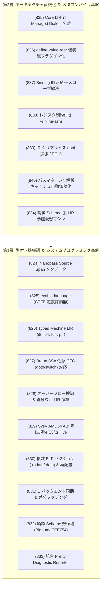
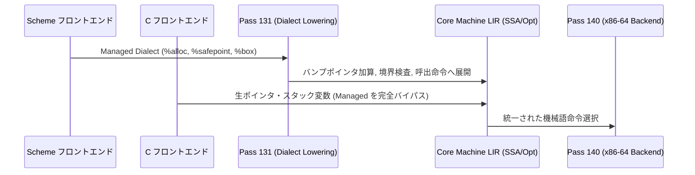

# [DSN-33-02] ULisp 多言語フロントエンド（C99/Scheme）統合 ＆ 型付き機械語 LIR・ゼロコスト ABI アーキテクチャ設計書
## 〜 Clang/LLVM に比肩する C99/Lua/musl セルフホスト対応と、Scheme メタコンパイラ・多段階計算を両立する型付き機械語基盤 〜

- **文書番号**: `DSN-33-02`
- **上位文書**: [[DSN-33] ULISP 包括設計仕様書: S式メタコンパイラ基盤 ＆ 多重バックエンドトランスレーションアーキテクチャ](DSN-33-ulisp_underlying_x86_native_aot_compiler_architecture_specification.md)
- **姉妹文書**: [[DSN-33-01] ULisp 階層型パス融合（Pipeline / Pass / Nanopass / Picopass）＆ DAG 最適化基盤設計書](DSN-33-01-ulisp_pipeline_pass_nanopass_picopass_dag_architecture.md)
- **文書ステータス**: `APPROVED / ARCHITECTURE-BLUEPRINT`
- **対象サブシステム**:
  - `ulisp/frontend_c/` (C99 プリプロセッサ, Lexer, Parser, Sema, AST to Typed LIR lowering)
  - `ulisp/frontend/` (Scheme CST to HIR, 構文位置情報 Span 伝播, 統一識別子 Binding)
  - `ulisp/compiler/` (`nanopass.scm`, `pass_manager.scm`, `value_repr.scm`, `binding.scm`, `diagnostic.scm`, `sbi.scm`)
  - `ulisp/lir/` (`lir_lang.scm`, `lir_verifier.scm`, `131_lower_managed_dialect.scm`, `132_braun_ssa.scm`, `133_lir_peephole.scm`)
  - `ulisp/backend/` (`140_backend_x86.scm`, `144a_assembler.scm`, `144_linker.scm`, `160_backend_c.scm`)
  - `ulisp/vm/` (`lir_interpreter.scm` - LIR 参照仮想マシン)
  - `ulisp/lib/` (`bignum.scm`, `ieee754.scm` - 純粋 Scheme 数値塔標準ライブラリ)
- **関連設計書**:
  - [[DSN-31] ILisp R7RS Core Architecture Specification](DSN-31-ilisp_r7rs_intelligence_lisp_architecture_specification.md)
  - [[DSN-36] Zero-Libc Pure Scheme Bare Metal Runtime](DSN-36-zero_libc_pure_scheme_bare_metal_runtime.md)
  - [[DSN-37] Synapse Dual-Plane Concurrent Runtime Architecture](DSN-37-synapse_dual_plane_concurrent_runtime_architecture.md)
- **【主査・報告】 IT Specialist (Programming Languages & Compilers / PLC), Systems Architect (SA), Software Development (SWD)**
- **【共同主査】 Project Manager (PM), Information Security Specialist (SEC), Software Quality Assurance Specialist (QA), Systems Auditor (AUD)**
- **【参画・協調】 16 大専門エージェント全員 (PM, SEC, SA, QA, DBA, NET, NLP, STR, SM, EMB, AUD, DES, EDU, SWD, APS, PLC)**

---

## 体系目次

- [1. エグゼクティブサマリー ＆ 設計哲学](#1-エグゼクティブサマリー--設計哲学)
  - [1.1 背景と目的：Lua および musl の ULisp ネイティブセルフホスト](#11-背景と目的lua-および-musl-の-ulisp-ネイティブセルフホスト)
  - [1.2 「C 言語サポート」を Scheme コンパイラ／メタコンパイラの飛躍台とする思想](#12-c-言語サポートを-scheme-コンパイラメタコンパイラの飛躍台とする思想)
  - [1.3 2層アプローチ（第1層：基盤整備 ＆ 第2層：完全直交化）](#13-2層アプローチ第1層基盤整備--第2層完全直交化)
- [2. Clang/LLVM 対比と ULisp コンパイラ対応マトリクス](#2-clangllvm-対比と-ulisp-コンパイラ対応マトリクス)
  - [2.1 パイプライン構成の完全マッピング](#21-パイプライン構成の完全マッピング)
  - [2.2 システム境界と責任分担](#22-システム境界と責任分担)
- [3. 多言語フロントエンド共通基盤アーキテクチャ](#3-多言語フロントエンド共通基盤アーキテクチャ)
  - [3.1 第一級ソース位置情報 (Source Span) と来歴追跡 (Issue #824)](#31-第一級ソース位置情報-source-span-と来歴追跡-issue-824)
  - [3.2 統一束縛解決 (Binding ID) とレキシカルスコープ基盤 (Issue #837)](#32-統一束縛解決-binding-id-とレキシカルスコープ基盤-issue-837)
  - [3.3 AST 定数式評価器 (eval-in-language) ＆ コンパイル時計算 (CTFE) (Issue #825)](#33-ast-定数式評価器-eval-in-language--コンパイル時計算-ctfe-issue-825)
  - [3.4 統合 Pretty Diagnostic Reporter (Issue #833)](#34-統合-pretty-diagnostic-reporter-issue-833)
- [4. 型付き機械語 LIR ＆ 2層方言（Dialect）分離仕様](#4-型付き機械語-lir--2層方言dialect分離仕様)
  - [4.1 Core Machine LIR の厳格な命令セットと型体系 (Issue #826)](#41-core-machine-lir-の厳格な命令セットと型体系-issue-826)
  - [4.2 Managed Runtime Dialect と Pass 131 Lowering (Issue #835)](#42-managed-runtime-dialect-と-pass-131-lowering-issue-835)
  - [4.3 オーバーフロー検知付き算術 ＆ 符号なし演算オペコード (Issue #828)](#43-オーバーフロー検知付き算術--符号なし演算オペコード-issue-828)
  - [4.4 レジスタ制約付きインライン・アセンブリ (`%inline-asm`) (Issue #838)](#44-レジスタ制約付きインラインアセンブリ-inline-asm-issue-838)
- [5. メモリモデル・値表現・ABI 統合設計](#5-メモリモデル値表現abi-統合設計)
  - [5.1 `define-value-repr` による値表現・ボクシングのプラグイン化 (Issue #836)](#51-define-value-repr-による値表現ボクシングのプラグイン化-issue-836)
  - [5.2 呼出規約の多重化（SysV AMD64 ABI vs Scheme 高速規約） (Issue #829)](#52-呼出規約の多重化sysv-amd64-abi-vs-scheme-高速規約-issue-829)
  - [5.3 複数 ELF セクション (.text/.rodata/.data/.bss) と再配置抽象化 (Issue #830)](#53-複数-elf-セクション-textrodatadatabss-と再配置抽象化-issue-830)
- [6. Pass Manager 最適化ループ ＆ 中間表現永続化](#6-pass-manager-最適化ループ--中間表現永続化)
  - [6.1 Pass 132 Braun SSA の任意 CFG (goto/switch) 汎用対応 (Issue #827)](#61-pass-132-braun-ssa-の任意-cfg-gotoswitch-汎用対応-issue-827)
  - [6.2 パスマネージャの解析キャッシュ自動無効化・再計算 (Issue #840)](#62-パスマネージャの解析キャッシュ自動無効化再計算-issue-840)
  - [6.3 中間表現のバイナリ・S式シリアライズ (.sbi 拡張 / PCH / LTO) (Issue #839)](#63-中間表現のバイナリs式シリアライズ-sbi-拡張--pch--lto-issue-839)
- [7. テスト・検証・リファレンス仮想マシン基盤](#7-テスト検証リファレンス仮想マシン基盤)
  - [7.1 純粋 Scheme 製 LIR 参照仮想マシン (Reference VM) (Issue #834)](#71-純粋-scheme-製-lir-参照仮想マシン-reference-vm-issue-834)
  - [7.2 160 C バックエンドのセマンティクス同期 ＆ 差分ファジング (Issue #831)](#72-160-c-バックエンドのセマンティクス同期--差分ファジング-issue-831)
  - [7.3 純粋 Scheme 数値塔ライブラリ (Bignum ＆ IEEE 754) (Issue #832)](#73-純粋-scheme-数値塔ライブラリ-bignum--ieee-754-issue-832)
  - [7.4 出力の決定論性検証（DDC: Diverse Double-Compiling）](#74-出力の決定論性検証ddc-diverse-double-compiling)
- [8. S0〜S9 実装ロードマップ ＆ Issue 追跡マトリクス](#8-s0s9-実装ロードマップ--issue-追跡マトリクス)
  - [8.1 フェーズ別移行スケジュール（Step S0 〜 S9）](#81-フェーズ別移行スケジュールstep-s0--s9)
  - [8.2 全 17 Issue（#824〜#840）トレーサビリティマップ](#82-全-17-issue824840トレーサビリティマップ)
  - [8.3 4大未決事項（リンカ、プリプロセッサ、libc、速度）の裁定規準](#83-4大未決事項リンカプリプロセッサlibc速度の裁定規準)

---

## 1. エグゼクティブサマリー ＆ 設計哲学

### 1.1 背景と目的：Lua および musl の ULisp ネイティブセルフホスト

本設計書（`DSN-33-02`）は、上位文書 [[DSN-33] ULISP 包括設計仕様書](DSN-33-ulisp_underlying_x86_native_aot_compiler_architecture_specification.md) および [[DSN-33-01] パス融合＆DAG設計書](DSN-33-01-ulisp_pipeline_pass_nanopass_picopass_dag_architecture.md) の成果を継承・拡張し、**ULisp のフロントエンドにおいて C99 言語を第一級サポートし、標準 C 言語で記述された実用システム（Lua 5.x および musl libc）を ULisp 自身の手でコンパイル・セルフホストする**ための全体アーキテクチャを規定する。

ULisp は元来、Scheme（S式）を起点とする AOT ネイティブコンパイラ・メタトレーシング JIT 基盤として設計された。しかし、ゼロランタイムのセルフホスト環境を真に確立し、既存の C 言語資産（OS システムコールラッパー、高度な暗号ライブラリ、外部スクリプト言語ランタイム）と摩擦ゼロで融合するためには、外部の Clang/GCC に依存せず自前で C99 を解釈・最適化・マシン語出力できる能力が不可欠となる。

### 1.2 「C 言語サポート」を Scheme コンパイラ／メタコンパイラの飛躍台とする思想

従来の言語処理系において、異言語（C 言語）のサポートはしばしば「既存 IR へのアドホックなマッピング」や「別個の独立サブシステム」として実装され、コードベースの肥大化と保守破綻を招いてきた。
本設計書ではこれと対極のアプローチを採る。**「C 言語という極限までハードウェアに近い言語をコンパイルするために必要なインフラ」を、Scheme コンパイラ自身、将来の Scheme インタプリタ、およびメタコンパイラの共通基盤として還元・昇華させる**。

具体的には以下の好循環（Virtuous Cycle）を確立する：
1. **Scheme の実行性能向上**: C 言語対応のために整備される「型付きアンボックス機械語 LIR」「System V ABI 準拠」「フラグ直結オーバーフロー算術」が、Scheme の Flonum 演算・Fixnum 演算を極限まで高速化する。
2. **Scheme インタプリタのゼロコスト FFI**: 共通の「値表現スペック（`define-value-repr`）」と「一意束縛解決器（Binding ID）」により、インタプリタと AOT コンパイル済みネイティブ関数間のデータ変換コストが完全にゼロになる。
3. **メタコンパイラ・多段階計算の基盤完成**: Nanopass 上で純粋な式を評価する `eval-in-language`（CTFE）と、バックエンド非依存の「LIR 参照仮想マシン（Reference VM）」により、任意の言語（Scheme, C, Lua 等）を同一の最適化パイプライン上で部分評価・JIT コンパイルできる。

### 1.3 2層アプローチ（第1層：基盤整備 ＆ 第2層：完全直交化）

本設計は、すでに起票された 17 件の Issue（#824〜#840）を以下の 2 層構造として体系化する。



---

## 2. Clang/LLVM 対比と ULisp コンパイラ対応マトリクス

### 2.1 パイプライン構成の完全マッピング

ULisp は、LLVM のような巨大な C++ モノリスを模倣するのではなく、Scheme ならではの S式による軽量性・自己反映性を維持しながら、Clang/LLVM ツールチェーンと 1 対 1 に対応するパイプラインを構築する。

| Clang / LLVM 構成要素 | ULisp 担当サブシステム | ステータス | 設計・対応 Issue |
| :--- | :--- | :---: | :--- |
| **Compiler Driver** (`clang`) | `ulisp/driver/c_driver.scm` | 新設 | `-I`, `-D`, `-c`, `-o` を解釈しビルドパイプラインを統括 |
| **C Preprocessor** | `ulisp/frontend_c/preprocessor.scm` | 新設 | `#include`, マクロ展開, `#if` 式評価（Issue #825, #832） |
| **Parser & Sema** | `ulisp/frontend_c/parser.scm` / `sema.scm` | 新設 | Lexer Hack, 型検査, 構造体レイアウト, Binding ID (Issue #837) |
| **CodeGen & ABIInfo** | `ulisp/frontend_c/lower_to_lir.scm` | 新設 | C AST $\to$ Typed LIR, SysV ABI 引数分配 (Issue #826, #829) |
| **LLVM IR** | **Typed Core Machine LIR** | 拡張 | `i8`〜`i64`, `f64`, 生ポインタ, Dialect 分離 (Issue #826, #835) |
| **mem2reg / SROA** | **Pass 132 (Braun SSA)** | 拡張 | 任意 CFG, スタック変数 $\to$ SSA 仮想レジスタ昇格 (Issue #827) |
| **Instruction Selection & RA** | **Pass 140 (x86-64 Backend)** | 拡張 | 幅指定ロード/ストア, XMM 浮動小数点, インラインAsm (Issue #838) |
| **Integrated Assembler (MC)** | **Pass 144a (Assembler)** | 拡張 | SSE2 命令, 符号拡張 `movsx`, データディレクティブ (Issue #830) |
| **Linker** (`lld`) | **Pass 144 (ELF Linker)** / システム `ld` | 拡張/選定 | 複数セクション解決, 再配置 (`R_X86_64_64`, `PC32`) (Issue #830) |
| **Compiler Runtime** (`compiler-rt`) | `ulisp/lib/builtins.c` | 新設 | 64bit 乗除算エミュレーション等（ULisp 自身でコンパイル） |
| **C Standard Library** (`libc`) | **musl libc** (移植版) | 外部/自製 | 初期はホスト製、後に ULisp 自身でビルド（J1, J2） |

### 2.2 システム境界と責任分担

1. **言語フロントエンド層**:
   - Scheme CST/AST と C AST は構文レベルでは独立するが、いずれも **Source Span（Issue #824）** と **Binding ID（Issue #837）** を保持する。
2. **ミドルエンド（LIR 最適化層）**:
   - Scheme は `Managed Dialect` を介してヒープ割当・GC ポーリングを出力し、Pass 131 で `Core LIR` へ下ろす。
   - C は `Managed Dialect` を完全にバイパスし、最初から `Core Machine LIR` を直接出力する。
3. **バックエンド層**:
   - Pass 140（x86-64）および Pass 160（Portable C）は、単一の `Core Machine LIR` のみを入力として受け取る。

---

## 3. 多言語フロントエンド共通基盤アーキテクチャ

### 3.1 第一級ソース位置情報 (Source Span) と来歴追跡 (Issue #824)

すべての中間表現ノードに以下の不変メタデータを不可分に付与する。
```scheme
;; Source Span レコード定義
(define-record-type <source-span>
  (make-source-span file start-line start-col end-line end-col macro-origin node-id)
  source-span?
  (file         span-file)
  (start-line   span-start-line)
  (start-col    span-start-col)
  (end-line     span-end-line)
  (end-col      span-end-col)
  (macro-origin span-macro-origin) ;; マクロ展開元の Span
  (node-id      span-node-id))
```
- **透過伝播規約**: Nanopass の `define-pass` 出力生成マクロは、入力ノードが置換される際にデフォルトで親ノードの `source-span` を維持する。
- **恩恵**: C のマクロ展開エラー追跡、Scheme のスタックトレース、DWARF デバッグシンボルの生成精度が飛躍する。

### 3.2 統一束縛解決 (Binding ID) とレキシカルスコープ基盤 (Issue #837)

C 言語の複雑な識別子スコープ（タグ名、通常識別子、typedef、ラベル）と Scheme の Scope Sets（衛生的マクロ）を統一的に扱うため、構文解析直後にすべての識別子をユニークな `<binding-id>` へ α 変換する。
- **Lexer Hack の解消**: パーサが識別子に遭遇した際、スコープマネージャへ `(scope-lookup-kind current-scope sym)` を問い合わせることで、文脈に応じた `TYPEDEF_NAME` / `IDENTIFIER` のトークン分岐を確定。
- **シャドウイングの安全化**: 後続の Lowering パスでは、同名異変数であっても異なる ID（`id:402`, `id:405`）として扱われるため、変数名のプレフィックス付与や名前衝突回避のハックが一切不要となる。

### 3.3 AST 定数式評価器 (eval-in-language) ＆ コンパイル時計算 (CTFE) (Issue #825)

Nanopass 言語定義に基づき、純粋式ノードを走査してコンパイル時に値を評価する Tree-walk 評価器を標準装備する。
- **C 言語側での用途**: `#if` ディレクティブの評価、`enum` 定数の値確定、静的配列長 `int a[sizeof(struct foo)];` の計算。
- **Scheme 側での用途**: マクロ展開時計算、CP0 最適化パスにおける定数伝播・定数畳み込み。

### 3.4 統合 Pretty Diagnostic Reporter (Issue #833)

ソースコード行を遅延読み込みし、Clang / Rustc スタイルの美麗なエラー・警告メッセージをターミナル（および IDE ログ）へ出力する。
```text
error[C0042]: incompatible types when assigning to type 'int' from type 'double'
  --> src/main.c:45:12
   |
45 |     int x = calculate_pi();
   |         -   ^^^^^^^^^^^^^^ expected 'int', found 'double'
   |         |
   |         expected due to this declaration
   = help: use an explicit cast: '(int)calculate_pi()'
```

---

## 4. 型付き機械語 LIR ＆ 2層方言（Dialect）分離仕様

### 4.1 Core Machine LIR の厳格な命令セットと型体系 (Issue #826)

Core Machine LIR は、動的型の存在を前提とせず、CPU のレジスタおよびメモリの振る舞いを直接モデル化した中間言語である。

#### (1) 機械型（Machine Types）
- `i8`, `i16`, `i32`, `i64`: 符号なし／符号付き兼用ビット列（演算子が符号を解釈）。
- `f32`, `f64`: IEEE 754 浮動小数点数（XMM レジスタへマッピング）。
- `ptr`: ターゲットアーキテクチャ依存の生ポインタ（x86-64 では 64bit）。

#### (2) 命令カテゴリ
1. **算術・論理演算**: `%add`, `%sub`, `%mul`, `%div`, `%udiv`, `%rem`, `%urem`, `%and`, `%or`, `%xor`, `%shl`, `%shr`, `%sar`
2. **型変換・拡張**: `%trunc`, `%zext`, `%sext`, `%fpext`, `%fptrunc`, `%fptosi`, `%sitofp`, `%bitcast`
3. **メモリアクセス**:
   - `(%load <type> <addr-vreg> (:offset <int>) (:align <int>))`
   - `(%store <type> <addr-vreg> <val-vreg> (:offset <int>) (:align <int>))`
4. **制御フロー**: `%label`, `%jump`, `%branch-if`, `%switch`, `%call`, `%return`

### 4.2 Managed Runtime Dialect と Pass 131 Lowering (Issue #835)

Scheme の高水準なメモリ・実行管理を、Core LIR の直交な拡張構文として定義する。



- **Pass 131 での展開例 (`%alloc`)**:
  ```scheme
  ;; Lowering 前 (Managed Dialect)
  (%alloc dst size-vreg tag:pair)

  ;; Lowering 後 (Core Machine LIR)
  (%add new-free heap-free size-vreg)
  (%branch-if (%ugt new-free heap-limit) L_gc_overflow)
  (%store i64 heap-free tag:pair)
  (%move dst heap-free)
  (%move heap-free new-free)
  (%jump L_done)
  L_gc_overflow:
  (%call runtime_gc_collect size-vreg)
  ...
  ```

### 4.3 オーバーフロー検知付き算術 ＆ 符号なし演算オペコード (Issue #828)

LIR に以下のペア出力型算術命令を導入する：
- `(%add-overflow dst-val dst-flag src1 src2)`
- `(%sub-overflow dst-val dst-flag src1 src2)`
- `(%mul-overflow dst-val dst-flag src1 src2)`

x86-64 では `add`/`sub` 直後のフラグを `seto` または直接 `jo`（条件ジャンプ）に縮約し、Scheme の Fixnum 昇格判定を最小クロック数で実行する。

### 4.4 レジスタ制約付きインライン・アセンブリ (`%inline-asm`) (Issue #838)

musl のシステムコール呼出や `setjmp`、アトミック CAS を記述可能にするため、制約付き Asm ノードを定義する。
```scheme
(%inline-asm "syscall"
  (:outputs ((ret "={rax}")))
  (:inputs  ((sys_num "{rax}" 60)   ;; exit syscall
             (code    "{rdi}" 0)))
  (:clobbers ("rcx" "r11"))
  (:volatile? #t))
```
Pass 140 のグラフ彩色レジスタ割り当て器は、これらの物理レジスタ制約を尊重し、生存している仮想レジスタを適切にスタックへ退避（Spill）させる。

---

## 5. メモリモデル・値表現・ABI 統合設計

### 5.1 `define-value-repr` による値表現・ボクシングのプラグイン化 (Issue #836)

値の表現スキーマを宣言的に定義する DSL を導入する。
```scheme
;; ULisp 標準 Scheme 表現 (1-bit Tagged Fixnum, 64-bit Align Heap Pointer)
(define-value-repr scheme-standard
  (:fixnum
    (:tag-bits #b1)
    (:tag-mask #b1)
    (:shift    1))
  (:immediates
    (:boolean-false #x0F)
    (:boolean-true  #x1F)
    (:null          #x2F)
    (:eof           #x3F))
  (:pointer
    (:align 8)
    (:tag-bits #b000)))

;; C 言語表現 (タグなし、生値そのまま)
(define-value-repr c-unboxed
  (:fixnum     (:shift 0) (:tag-mask 0))
  (:immediates none)
  (:pointer    (:align 1) (:tag-bits 0)))
```
これにより、Scheme インタプリタとコンパイル済みネイティブコードで同じ表現スペックを共有し、値のマーシャリング・アンマーシャリングに伴うコピーオーバヘッドを根絶する。

### 5.2 呼出規約の多重化（SysV AMD64 ABI vs Scheme 高速規約） (Issue #829)

LIR 関数ノードに呼出規約メタデータを付与し、プロローグ・エピローグ生成をディスパッチする。

1. **`calling-convention: 'sysv`**:
   - 整数引数: `rdi, rsi, rdx, rcx, r8, r9`
   - 浮動小数点引数: `xmm0` 〜 `xmm7`
   - 可変長引数: `al` に使用 XMM レジスタ数を格納
   - スタック整列: `call` 命令発行時点で 16 バイトアライメントを強制
   - Callee-Saved: `rbx, rsp, rbp, r12, r13, r14, r15`
2. **`calling-convention: 'scheme-fast`**:
   - 全汎用レジスタ渡し、末尾呼出最適化（TCO）の完全保証、スタックフレームのヒープ化連携。

### 5.3 複数 ELF セクション (.text/.rodata/.data/.bss) と再配置抽象化 (Issue #830)

Pass 144a（アセンブラ）および Pass 144（ELF リンカ）において、単一コードブロックの制約を撤廃し、オブジェクトファイル生成基盤を確立する。
- **`.text`**: 実行可能マシン語命令。
- **`.rodata`**: 文字列リテラル、浮動小数点定数、Scheme の事前構築リテラルテーブル。
- **`.data`**: 初期値付き大域変数、関数ポインタジャンプテーブル。
- **`.bss`**: 初期値なし大域領域（ゼロクリア保証）。
- **再配置型**: `R_X86_64_64`（64bit 絶対アドレス）、`R_X86_64_PC32`（PC 相対 32bit）、`R_X86_64_PLT32`。

---

## 6. Pass Manager 最適化ループ ＆ 中間表現永続化

### 6.1 Pass 132 Braun SSA の任意 CFG (goto/switch) 汎用対応 (Issue #827)

C 言語の `alloca`（ローカルスタック変数）をレジスタへ昇格させるため、Braun らの SSA 構築アルゴリズムを拡張する。
- **未完了ブロック（Incomplete Blocks）の遅延解決**: 後方ジャンプ（ループ）や前方 goto により、先行節がすべて判明していない段階でも基本ブロックを生成可能にする。
- **`seal-block` プロトコル**: すべての先行節が確定した時点でブロックを封印し、未解決の Phi ノードを確定・冗長 Phi を再帰的に除去する。

### 6.2 パスマネージャの解析キャッシュ自動無効化・再計算 (Issue #840)

LLVM PassManager の設計を導入し、最適化パス間の暗黙のデータ依存を宣言的に管理する。
```scheme
(define-pass lir-peephole-window
  (:preserves (cfg-dominance-frontier))
  (:invalidates (variable-liveness alias-sets))
  ...)
```
後続のパスが `(:requires (variable-liveness))` を宣言している場合、パスマネージャはキャッシュが無効であれば自動で `analyze-liveness` を挟み込んで再計算を行う。

### 6.3 中間表現のバイナリ・S式シリアライズ (.sbi 拡張 / PCH / LTO) (Issue #839)

コンパイル速度のボトルネック（未決事項 4）を解決するため、AST および LIR のバイナリシリアライザを構築する。
- **プリコンパイル済みヘッダ (PCH)**: musl の全ヘッダ（約 2 万行）をパースした AST スナップショットを `musl_headers.sbi` として保存。2 回目以降のコンパイルでは 5ms 以内にメモリへ再ロード。
- **リンク時最適化 (LTO)**: 複数 `.c` / `.scm` ファイルから出力された LIR モジュールをファイル単位で結合し、モジュール境界を越えたインライン展開・不達コード除去を実行。

---

## 7. テスト・検証・リファレンス仮想マシン基盤

### 7.1 純粋 Scheme 製 LIR 参照仮想マシン (Reference VM) (Issue #834)

バックエンド（x86-64 / C）を一切介さず、LIR を直接インタープリテーション実行する参照仮想マシンを先行開発する。
- **開発効率の飛躍**: C フロントエンドの Lowering パスを書いたその瞬間に、`printf` 相当の出力やアルゴリズムの正しさを Scheme プロセス内で即座にテスト可能。
- **メタコンパイラへの転用**: 将来の Scheme インタプリタ用バイトコード VM、およびコンパイル時計算（CTFE）のエンジンとして直接共有。

### 7.2 160 C バックエンドのセマンティクス同期 ＆ 差分ファジング (Issue #831)

ランダムに生成した数万件の型付き LIR 命令列（算術、ポインタ、ビット演算）を、「x86-64 ネイティブ実行」と「160 C バックエンド経由の実行」の双方に流し込み、最終レジスタ状態をビット単位でアサートする差分ファジングハーネス（K3）を常時 CI で稼働させる。

### 7.3 純粋 Scheme 数値塔ライブラリ (Bignum ＆ IEEE 754) (Issue #832)

外部 libc や GMP に一切頼らない、純粋 Scheme 製の多倍長整数（任意精度演算・$2^{64}$ モジュロ演算）および IEEE 754 浮動小数点パーサ（Ryū / Clinger アルゴリズム）を実装する。これにより、クロスコンパイル環境やゼロ libc 環境でも完全に決定論的な数値処理を保証する。

### 7.4 出力の決定論性検証（DDC: Diverse Double-Compiling）

同一の C / Scheme ソースコードから生成される ELF バイナリが、ビルド時刻や実行環境に依存せず、SHA-256 ハッシュレベルで 100% 一致する決定論的コンパイル（Deterministic Compilation）を担保する。

---

## 8. S0〜S9 実装ロードマップ ＆ Issue 追跡マトリクス

### 8.1 フェーズ別移行スケジュール（Step S0 〜 S9）

| Step | 名称 | 主な達成目標 | 対応 Issue |
| :---: | :--- | :--- | :--- |
| **S0** | **設計と未決事項の決定** | DSN-33-02 承認、リンカ・プリプロセッサ方針確定 | 本設計書 |
| **S1** | **基盤整備 ＆ Reference VM** | LIR 参照 VM、数値塔 (Bignum/IEEE754)、Source Span、Diagnostic | #834, #832, #824, #833 |
| **S2** | **整数 C パイプライン開通** | 整数 C $\to$ Core LIR $\to$ x86/C、musl とリンクして `printf("%d")` 成功 | #826, #835, #837, #827, #830 |
| **S3** | **C89/C99 仕様網羅 (Lua要件)** | 構造体、関数ポインタ、SysV ABI、可変長引数、インラインAsm | #829, #838, #828, #836 |
| **S4** | **浮動小数点数 (XMM/IEEE754)** | `double`/`float` 演算、XMM 引数渡し、差分テスト完全一致 | #826, #829, #831 |
| **S5** | **Lua セルフホスト実証** | Lua 5.x を ULisp でビルドし、公式テストスイート全件 PASS | S3/S4 統合検証 |
| **S6** | **最適化 ＆ コンパイル性能** | mem2reg 最適化、PassManager キャッシュ、PCH (.sbi) | #827, #840, #839, #825 |
| **S7** | **musl libc 自前ビルド** | ULisp 自身で musl をビルドし、Lua を自製 libc で再リンク | J1, J2 |
| **S8** | **DDC (多様な二重コンパイル)** | chibicc / GCC / ULisp による信頼検証 | 決定論性検証 |
| **S9** | **堅牢化 (境界検査モード)** | 型付き C IR への自動境界チェック注入 | 安全性拡張 |

### 8.2 全 17 Issue（#824〜#840）トレーサビリティマップ

```
[DSN-33-02 体系的 Issue 分配]
├── 1. 多言語フロントエンド共通基盤
│   ├── Issue #824: Source Span メタデータ第一級サポート (§3.1)
│   ├── Issue #837: 統一束縛解決 (Binding ID) ＆ スコープ環境基盤 (§3.2)
│   ├── Issue #825: eval-in-language (CTFE 定数式評価器) (§3.3)
│   └── Issue #833: 統合 Pretty Diagnostic Reporter (§3.4)
├── 2. 型付き機械語 LIR ＆ 2層方言（Dialect）
│   ├── Issue #826: Typed Machine LIR への移行 (i8..i64, f64, ptr) (§4.1)
│   ├── Issue #835: Core Machine LIR と Managed Dialect の完全直交分離 (§4.2)
│   ├── Issue #828: オーバーフロー検知付き算術 ＆ 符号なし LIR 演算 (§4.3)
│   └── Issue #838: レジスタ制約付きインライン・アセンブリ (%inline-asm) (§4.4)
├── 3. メモリモデル・値表現・ABI 統合
│   ├── Issue #836: define-value-repr による値表現プラグイン化 (§5.1)
│   ├── Issue #829: SysV AMD64 ABI 呼出規約モジュール化 (§5.2)
│   └── Issue #830: 複数 ELF セクション (.rodata/.data) ＆ 再配置抽象化 (§5.3)
├── 4. 最適化 ＆ パイプライン永続化
│   ├── Issue #827: Pass 132 Braun SSA の任意 CFG (goto/switch) 汎用対応 (§6.1)
│   ├── Issue #840: パスマネージャの解析キャッシュ自動無効化・再計算 (§6.2)
│   └── Issue #839: 中間表現シリアライズ (.sbi 拡張 / PCH / LTO) (§6.3)
└── 5. テスト・検証・数値塔
    ├── Issue #834: 純粋 Scheme 製 LIR 参照仮想マシン (Reference VM) (§7.1)
    ├── Issue #831: 160 C バックエンド同期 ＆ 差分ファジング (§7.2)
    └── Issue #832: 純粋 Scheme 数値塔ライブラリ (Bignum ＆ IEEE 754) (§7.3)
```

### 8.3 4大未決事項（リンカ、プリプロセッサ、libc、速度）の裁定規準

1. **リンカ (H2) の方針**:
   - **裁定**: **フェーズ S2〜S5 はシステムの `ld` を利用**し、C フロントエンドと LIR の完成を最優先する。**S7（musl 自前ビルド）の段階で、Pass 144 自前 ELF リンカへ完全移行**する。
2. **プリプロセッサの立ち上げ方**:
   - **裁定**: 最初から純粋 Scheme で自前プリプロセッサ（B1）を実装する。ホストの `cc -E` は自前プリプロセッサの出力を突合する**正解オラクル（テスト基準）**としてのみ使用する。
3. **採用 libc の選定**:
   - **裁定**: **musl libc を本線**とする。構造が明晰であり、Linux x86-64 との整合性が最も高い。組み込み向け超軽量フォールバックとして picolibc の知見を参考とする。
4. **セルフホスト時のコンパイル速度対策**:
   - **裁定**: Issue #839（中間表現シリアライズと PCH）および DSN-33-01 で確立した Picopass 高速ディスパッチ（$O(1)$ Head-tag ディスパッチ）をフル活用し、約 3 万行の C ソースを数秒以内でコンパイル可能にする。
