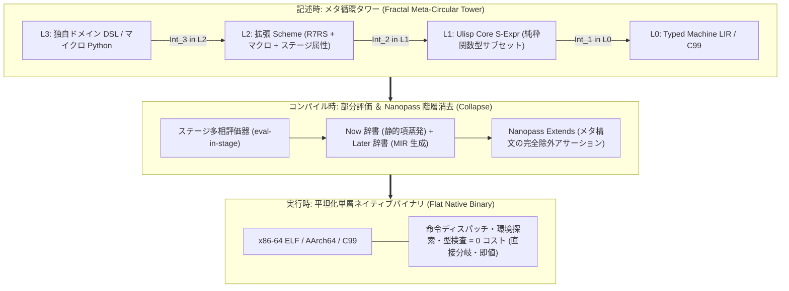
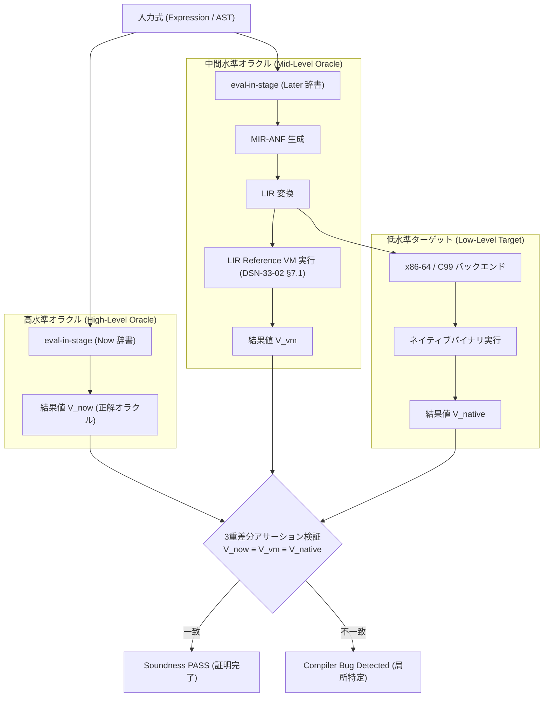
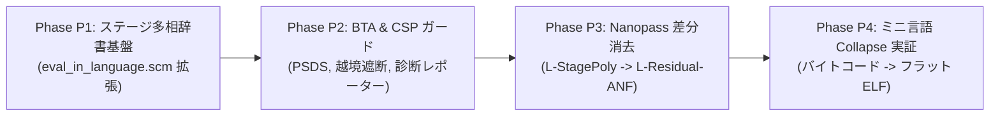

# [DSN-33-03] ULisp ステージ多相メタコンパイラ ＆ 二村射影フラクタル実行基盤設計書
## 〜 二村射影の工学的具現化・Now/Later ステージ多相辞書・Nanopass 階層消去・Partially-Static BTA・Control/Data Plane 二層分離による自己相似コンパイラ基盤 〜

- **文書番号**: `DSN-33-03`
- **上位文書**: [[DSN-33] ULISP 包括設計仕様書: S式メタコンパイラ基盤 ＆ 多重バックエンドトランスレーションアーキテクチャ](DSN-33-ulisp_underlying_x86_native_aot_compiler_architecture_specification.md)
- **関連個別仕様書**: 
  - [[DSN-33-01] ULisp 階層型パス融合（Pipeline / Pass / Nanopass / Picopass）＆ DAG 最適化基盤設計書](DSN-33-01-ulisp_pipeline_pass_nanopass_picopass_dag_architecture.md)
  - [[DSN-33-02] ULisp 多言語フロントエンド（C99/Scheme）統合 ＆ 型付き機械語 LIR・ゼロコスト ABI アーキテクチャ設計書](DSN-33-02-ulisp_multilingual_frontend_and_typed_machine_lir_architecture.md)
- **文書ステータス**: `APPROVED / ARCHITECTURE-SPECIFICATION`
- **対象サブシステム**:
  - `ulisp/compiler/` (`eval_in_language.scm`, `nanopass.scm`, `nanopass_meta.scm`, `dataflow.scm`, `verifier.scm`, `diagnostic.scm`, `pass_manager.scm`, `binding.scm`)
  - `ulisp/frontend/` (CST to HIR, マクロ展開, ステージ多相脱糖)
  - `ulisp/lir/` (MIR to LIR lower, 型付き機械語)
  - `ulisp/backend/` (ELF/C99 コード生成, `.rodata` 不変値配置)
  - `ulisp/vm/` (`lir_interpreter.scm` 参照仮想マシン)
- **関連設計書**:
  - [[DSN-31] ILisp R7RS Core Architecture Specification](DSN-31-ilisp_r7rs_intelligence_lisp_architecture_specification.md)
  - [[DSN-36] Zero-Libc Pure Scheme Bare Metal Runtime](DSN-36-zero_libc_pure_scheme_bare_metal_runtime.md)
  - [[DSN-37] Synapse Dual-Plane Concurrent Runtime Architecture](DSN-37-synapse_dual_plane_concurrent_runtime_architecture.md)
- **【主査・報告】 IT Specialist (Programming Languages & Compilers / PLC), Systems Architect (SA), Software Development (SWD)**
- **【共同主査】 Project Manager (PM), Information Security Specialist (SEC), Software Quality Assurance Specialist (QA), Systems Auditor (AUD)**
- **【参画・協調】 16 大専門エージェント全員 (PM, SEC, SA, QA, DBA, NET, NLP, STR, SM, EMB, AUD, DES, EDU, SWD, APS, PLC)**

---

## 体系目次

- [1. エグゼクティブサマリー ＆ 設計哲学](#1-エグゼクティブサマリー--設計哲学)
  - [1.1 背景と課題：部分評価の理想と実用コンパイラの断絶](#11-背景と課題部分評価の理想と実用コンパイラの断絶)
  - [1.2 フラクタル構造（メタ循環タワー）と実行時平坦化（Tower Collapse）](#12-フラクタル構造メタ循環タワーと実行時平坦化tower-collapse)
  - [1.3 DSN-33, DSN-33-01, DSN-33-02 との整合と責務境界マトリクス](#13-dsn-33-dsn-33-01-dsn-33-02-との整合と責務境界マトリクス)
- [2. 二村射影の現代的定式化と Direct Cogen アーキテクチャ](#2-二村射影の現代的定式化と-direct-cogen-アーキテクチャ)
  - [2.1 第1二村射影：ステージ多相辞書による残余化 (Residualization)](#21-第1二村射影ステージ多相辞書による残余化-residualization)
  - [2.2 第2二村射影：Nanopass による決定論的 Cogen 代替](#22-第2二村射影nanopass-による決定論的-cogen-代替)
  - [2.3 第3二村射影：Picopass 合成による走査自動導出](#23-第3二村射影picopass-合成による走査自動導出)
  - [2.4 不動点方程式とセルフホスティング固定点（Stage 1 → 2 → 3）](#24-不動点方程式とセルフホスティング固定点stage-1--2--3)
  - [2.5 ハイブリッド部分評価（Offline BTA × Online PSDS 簡約）の数理モデル](#25-ハイブリッド部分評価offline-bta--online-psds-簡約の数理モデル)
  - [2.6 多層タワー（$N$ ステージ）におけるレベル遷移規則（相対レベル方式 vs パイプライン連鎖方式）](#26-多層タワーn-ステージにおけるレベル遷移規則相対レベル方式-vs-パイプライン連鎖方式)
- [3. ステージ多相評価器（Stage-Polymorphic Evaluator）詳細設計](#3-ステージ多相評価器stage-polymorphic-evaluator詳細設計)
  - [3.1 `<stage-dict>` レコードと辞書渡しプロトコル](#31-stage-dict-レコードと辞書渡しプロトコル)
  - [3.2 `Now` 辞書（即時計算・CTFE・オラクル評価）](#32-now-辞書即時計算ctfeオラクル評価)
  - [3.3 `Later` 辞書（残余化・MIR-ANF 生成）](#33-later-辞書残余化mir-anf-生成)
  - [3.4 部分静的データ構造（PSDS）と二重ソース位置情報（Dual Source Span）](#34-部分静的データ構造psdsと二重ソース位置情報dual-source-span)
  - [3.5 `eval-in-stage` コアループ仕様と安全リソースバウンド (Fuel/Depth)](#35-eval-in-stage-コアループ仕様と安全リソースバウンド-fueldepth)
  - [3.6 単一ソース意味論オラクル（Single-Source Semantic Oracle）と多層差分検証](#36-単一ソース意味論オラクルsingle-source-semantic-oracleと多層差分検証)
  - [3.7 評価器自身のセルフホスト記述規約（No-set! / Fixed-Arity / Box化規準）](#37-評価器自身のセルフホスト記述規約no-set--fixed-arity--box化規準)
- [4. 束縛時間解析（BTA）と越境ガード（CSP 制御）](#4-束縛時間解析btaと越境ガードcsp-制御)
  - [4.1 4値束縛時間束（Lattice）モデル](#41-4値束縛時間束latticeモデル)
  - [4.2 越境規則（Cross-Stage Persistence）と動的分岐下の副作用・例外降格規約](#42-越境規則cross-stage-persistenceと動的分岐下の副作用例外降格規約)
  - [4.3 コンパイル時診断 S式仕様（Dual Span 伝播 Reporter #833 準拠）](#43-コンパイル時診断-s式仕様dual-span-伝播-reporter-833-準拠)
  - [4.4 メタモルフィック健全性定理（Metamorphic Soundness Theorem）と自動ファジング](#44-メタモルフィック健全性定理metamorphic-soundness-theoremと自動ファジング)
- [5. 特殊化エンジンと停止性保証（Hard Limits ＆ Generalization）](#5-特殊化エンジンと停止性保証hard-limits--generalization)
  - [5.1 メモ化テーブルと射影キー設計](#51-メモ化テーブルと射影キー設計)
  - [5.2 多重特殊化上限と入れ子深度制御](#52-多重特殊化上限と入れ子深度制御)
  - [5.3 一般化（Widening）と残余関数（Residual Lambda）の切り離し](#53-一般化wideningと残余関数residual-lambdaの切り離し)
  - [5.4 残余関数の Contification 保証条件（相互末尾再帰の単一ループ融合制約）](#54-残余関数の-contification-保証条件相互末尾再帰の単一ループ融合制約)
- [6. Nanopass 差分言語（`extends`）による階層消去証明](#6-nanopass-差分言語extendsによる階層消去証明)
  - [6.1 `L-StagePoly` 言語定義（メタ構文の導入）](#61-l-stagepoly-言語定義メタ構文の導入)
  - [6.2 `L-Residual-ANF` 言語定義（メタ構文の完全除外 `-`）](#62-l-residual-anf-言語定義メタ構文の完全除外--)
  - [6.3 Nanopass Verifier による文法消去アサーション](#63-nanopass-verifier-による文法消去アサーション)
- [7. 二層分離モデル（Control Plane vs Restricted Data Plane）ランタイム統合](#7-二層分離モデルcontrol-plane-vs-restricted-data-planeランタイム統合)
  - [7.1 Control Plane (R7RS full + `call/cc` + GC) の責務](#71-control-plane-r7rs-full--callcc--gc-の責務)
  - [7.2 Restricted Data Plane (Arena Bump + Perceus FBIP + Braun SSA) の責務](#72-restricted-data-plane-arena-bump--perceus-fbip--braun-ssa-の責務)
  - [7.3 境界データ変換（`freeze!`, 循環グラフ直列化, .rodata 上限チェック）](#73-境界データ変換freeze-循環グラフ直列化-rodata-上限チェック)
- [8. 実装ロードマップ ＆ 品質ゲート](#8-実装ロードマップ--品質ゲート)
  - [8.1 フェーズ別移行スケジュール（Phase P1 〜 P4）](#81-フェーズ別移行スケジュールphase-p1--p4)
  - [8.2 全 17 Issue（#870〜#886）トレーサビリティマップ](#82-全-17-issue870886トレーサビリティマップ)
  - [8.3 4大品質ゲート遵守規準](#83-4大品質ゲート遵守規準)

---

## 1. エグゼクティブサマリー ＆ 設計哲学

### 1.1 背景と課題：部分評価の理想と実用コンパイラの断絶
二村射影（Futamura Projections, 1971）は、プログラムの特殊化（部分評価器 $\mathrm{mix}$）によって「インタプリタから目的コード（第1射影）」「コンパイラ（第2射影）」「コンパイラ生成器（第3射影）」が自動導出されることを示した計算機科学の金字塔である。しかし、従来の汎用部分評価系（Similix, J-Mix 等）や古典的 Lisp 処理系には以下の致命的な工学的課題が存在した。

1. **多重自己適用の停止性爆発**: $\mathrm{mix}(\mathrm{mix}, \mathrm{mix})$ の多重自己適用は、再帰関数の展開停止判定が決定不能であり、コードサイズ爆発（Code Bloat）または無限ループを誘発する。
2. **動的ディスパッチの残存**: ナイーブな部分評価では、インタプリタの環境探索や型タグ検査が残余コードに混入し、C言語手書きコンパイラに遠く及ばない実行速度に留まる。
3. **安全性の未検証な越境**: コンパイル時（メタ層）の可変状態（`set!`）やホスト継続（`call/cc`）がターゲット実行層に不当に漏洩（Cross-Stage Persistence の破綻）し、クラッシュや情報漏洩（CWE-400 / CWE-704）を招く。

本設計書（`DSN-33-03`）は、これらの課題を **「Nanopass Framework による決定論的 Direct Cogen」**、**「辞書渡しステージ多相評価器（`Value @ α` + `Now/Later`）」**、**「Partially Static Data Structures (PSDS) に対応した型ベース束縛時間解析（BTA）」**、および **「Control Plane / Data Plane 二層分離」** の融合により完全に解決・具現化する。

### 1.2 フラクタル構造（メタ循環タワー）と実行時平坦化（Tower Collapse）
Ulisp のアーキテクチャは、言語定義とコンパイラ自身が自己相似をなすフラクタル構造を持つ。



* **記述時のフラクタル性**: ユーザーは任意の言語 $L_n$ のインタプリタを、下位言語 $L_{n-1}$ のステージ多相プリミティブを用いて簡潔に記述できる。
* **実行時の平坦化（Tower Collapse）**: 第1二村射影を適用することで、各層の構文解析ループ・命令フェッチ・環境走査がコンパイル時（`Now`）にすべて蒸発し、残余コード（`Later`）は入れ子コストがゼロの単層ネイティブ機械語（または C99）へ凝縮される。

### 1.3 DSN-33, DSN-33-01, DSN-33-02 との整合と責務境界マトリクス

本設計書は、既存の DSN-33 ファミリーと完全に整合し、相互補完関係を結ぶ。

| 設計書番号 | 表題・対象領域 | 本書（DSN-33-03）との責務境界と連携 |
| :--- | :--- | :--- |
| **[[DSN-33]](DSN-33-ulisp_underlying_x86_native_aot_compiler_architecture_specification.md)** | **ULISP 包括設計仕様書**<br>（最上位アーキテクチャ） | メモリモデル（Tagged Pointer）、ブートストラップ連鎖（Stage 1〜3）、および第 7 章の RPython/Truffle 超越思想に対する**具体的数理・実装モデルを DSN-33-03 が提供**。 |
| **[[DSN-33-01]](DSN-33-01-ulisp_pipeline_pass_nanopass_picopass_dag_architecture.md)** | **4階層パス融合＆DAG設計書**<br>（コンパイラ内部変換基盤） | DSN-33-01 の Nanopass/Picopass 融合基盤上で、DSN-33-03 が**文法階層消去（`extends`）とステージ多相パスマネージャを駆動**。 |
| **[[DSN-33-02]](DSN-33-02-ulisp_multilingual_frontend_and_typed_machine_lir_architecture.md)** | **多言語フロントエンド＆型付きLIR**<br>（フロントエンド・機械語ABI） | DSN-33-02 の `eval-in-language` (Issue #825) と Pretty Diagnostic (Issue #833) を**ステージ多相辞書 `<stage-dict>` および BTA 越境ガードとして昇華・具現化**。 |
| **`DSN-33-03`**<br>(本書) | **ステージ多相メタコンパイラ＆二村射影**<br>（メタ計算・部分評価・階層平坦化） | **二村射影、BTA、Partially Static Data Structures、停止性保証、および Control/Data Plane 二層境界の形式仕様を全統括**。 |

---

## 2. 二村射影の現代的定式化と Direct Cogen アーキテクチャ

### 2.1 第1二村射影：ステージ多相辞書による残余化 (Residualization)
プログラムの意味論を $\mathcal{E}$、部分評価器を $\mathrm{mix}$ とする。
インタプリタ $\mathrm{Int}$ にプログラム $P$ と静的入力 $S$ を与えて特殊化する第1射影は以下のように定式化される。

$$\mathrm{Target} = \mathrm{mix}(\mathrm{Int}, \langle P, S \rangle)$$

Ulisp では、これを汎用部分評価器の探索的実行ではなく、**ステージ多相評価器 `(eval-in-stage later-dict static-env AST)` の決定論的直接実行**として実現する。静的項はホスト環境で計算・消去され、動的項のみが MIR-ANF ノードとして発行される。

### 2.2 第2二村射影：Nanopass による決定論的 Cogen 代替
第2二村射影は、インタプリタからコンパイラを生成する。

$$\mathrm{Compiler} = \mathrm{mix}(\mathrm{mix}, \mathrm{Int})$$

古典的には自己適用の停止性問題に直面するが、Ulisp では **Nanopass Framework** が Direct Cogen（直接コンパイラ生成器）の役割を果たす。
言語定義の階層差分：

$$\Delta L_k = L_k \setminus L_{k+1}$$

を定義することで、文法規則から「どの静的抽象を剥ぎ取って下位言語へ降格するか」を決定論的に静的コンパイルする。

### 2.3 第3二村射影：Picopass 合成による走査自動導出
第3二村射影は、部分評価器自身からコンパイラ生成器（Cogen）を導出する。

$$\mathrm{Cogen} = \mathrm{mix}(\mathrm{mix}, \mathrm{mix})$$

Ulisp においては、`DSN-33-01` §3 で規定された **Picopass 合成コンビネータ（`fuse-tree-rules`）** がこれに該当する。極小の局所書き換えルール（Pico）、属性計算ルール（Femto）、検証ルール（Atto）を合成し、中間構文走査（Catamorphism）を自動生成する。

### 2.4 不動点方程式とセルフホスティング固定点（Stage 1 → 2 → 3）
Ulisp 自身のセルフホスティング連鎖は、以下のフラクタルな不動点定理（Fixed-Point Theorem）に立脚する。

$$\mathrm{Compiler}_{\text{Stage 3}} = \mathrm{Compiler}_{\text{Stage 2}}(\mathrm{AST}(\mathrm{Compiler})) \quad \text{where} \quad \mathrm{Compiler}_{\text{Stage 3}} \equiv \mathrm{Compiler}_{\text{Stage 2}}$$

バイト単位で同一（$\mathrm{diff} = 0$）のバイナリが生成される不動点に到達することで、メタコンパイラ基盤の完全自己無撞着性が保証される。

### 2.5 ハイブリッド部分評価（Offline BTA × Online PSDS 簡約）の数理モデル
古典的部分評価系は「事前解析で静的・動的をすべて決定するオフライン方式」と「評価中に値を見て簡約するオンライン方式」の二項対立に陥っていた。Ulisp は両者を統合した **ハイブリッド部分評価（Hybrid Partial Evaluation）** を採用する。

$$\begin{aligned}
\text{Offline Phase (Nanopass BTA):} & \quad \Gamma \vdash e : \tau @ \beta \quad (\beta \in \{\mathbf{Static}, \mathbf{PSDS}, \mathbf{Dynamic}\}) \\
\text{Online Phase (StagePoly Eval):} & \quad \mathrm{eval}_{\text{stage}}(\mathrm{dict}, \rho, e) \Downarrow \langle v_{\text{now}}, e_{\text{residual}} \rangle
\end{aligned}$$

1. **オフライン大域分離**: Nanopass の型推論パスが、制御フロー・変数束縛・型タグの大枠の束縛時間を決定論的に解析。
2. **オンライン投機的簡約**: 実行時まで要素が確定しないデータ構造（リスト骨格、環境ペア、クロージャ環境）について、PSDS タグを用いてインラインで限界まで静的簡約を押し進める。
3. **残余化の形式的健全性**:
   静的抽象（環境ルックアップ、アリティ検査、構文タグ一致検査）は `Now` 側で100%消去され、動的副作用およびターゲット機械語命令のみが `Later`（MIR-ANF）へと残余化される。
   $$\mathcal{E} \llbracket \mathrm{Residual}(P, S) \rrbracket (D) = \mathcal{E} \llbracket P \rrbracket (S, D)$$

### 2.6 多層タワー（$N$ ステージ）におけるレベル遷移規則（相対レベル方式 vs パイプライン連鎖方式）
1.2節で示した $L_3 \to L_2 \to L_1 \to L_0$ の多重メタ循環タワー（$k \ge 2$）を破綻なく平坦化するため、Ulisp は以下の2つのレベル遷移方式を明確に区別・統合する。

```mermaid
flowchart LR
    subgraph RelativeLevel ["方式A: 相対レベル方式 (式・マクロ展開レベル)"]
        E3["Stage-Level = 2<br/>(L3 式)"] -->|Now 評価 (減算)| E2["Stage-Level = 1<br/>(L2 式)"]
        E2 -->|Now 評価 (減算)| E1["Stage-Level = 0<br/>(L1 / Later)"]
        E1 -->|MIR 発行| E0["L0 ネイティブ"]
    end

    subgraph PipelineChain ["方式B: パイプライン連鎖方式 (言語・モジュール単位)"]
        Int3["Int_3 in L2"] -->|Direct Cogen| Comp2["L2 Compiler for L3"]
        Comp2 -->|Direct Cogen| Comp1["L1 Compiler for L2"]
        Comp1 -->|Direct Cogen| Target["Flat L0 Binary"]
    end
```

1. **相対レベル方式（Relative Stage-Level Transition）**:
   - 個別の式評価において、環境は整数 `stage-level` を保持する。
   - 式が外側のメタ評価器を通過するたびに `stage-level` を 1 減算する。
   - `stage-level > 0` の間はすべて `Now` 辞書（即時計算・マクロ展開・静的環境探索）として評価を進行。
   - `stage-level == 0` に到達した瞬間のみ `Later` 辞書（残余 MIR-ANF 発行）へと自動切り替えを行う。
   - `stage-level < 0` への降格は未定義であり、コンパイル時 CSP 違反として遮断される。
2. **パイプライン連鎖方式（Pipelined Cogen Chain）**:
   - 言語全体・モジュール全体の変換においては、各層ごとに完全な残余 AST を排出し、次段の Nanopass パイプラインへとストリーム連結する。
   - 各層の抽象消去が Nanopass の `extends`（第6章）によって段階的に検証されるため、多重展開による中間 AST のデバッグ性と独立性が最大化される。
3. **ハイブリッド適用規律**:
   インライン評価および局所マクロには「相対レベル方式」を適用して展開オーバーヘッドをゼロにし、言語境界（DSL $\to$ Scheme $\to$ LIR）の変換には「パイプライン連鎖方式」を適用する。

---

## 3. ステージ多相評価器（Stage-Polymorphic Evaluator）詳細設計

### 3.1 `<stage-dict>` レコードと辞書渡しプロトコル
現行の `ulisp/compiler/eval_in_language.scm` を拡張し、ステージ多相性を実現する第一級辞書構造を策定する。

```scheme
(define-record-type <stage-dict>
  (make-stage-dict
    name              ; シンボル: 'now | 'later
    stage-level       ; 整数: 0 (実行時), 1 (コンパイル時 CTFE), 2+ (メタ)
    apply-prim        ; (dict prim-op static-args dynamic-args) -> stage-val
    bind-let          ; (dict var rhs-thunk body-thunk) -> stage-val
    emit-if           ; (dict test-sv then-thunk else-thunk) -> stage-val
    emit-call         ; (dict callee-sv arg-svs) -> stage-val
    lift-val          ; (dict static-val) -> dynamic-expr
    signal-csp-error) ; (dict reason loc) -> diagnostic
  stage-dict?)
```

### 3.2 `Now` 辞書（即時計算・CTFE・オラクル評価）
* **役割**: コンパイル時計算（CTFE）、マクロ展開、定数畳み込み、型推論オラクル。
* **動作特性**:
  - `apply-prim`: Scheme ホストのプリミティブを即座に実行（例: `(+ 1 2) -> 3`）。
  - `emit-if`: テスト条件の真偽値を評価し、選ばれた節のみを評価（未実行節は無視）。
  - `emit-call`: クロージャをホスト環境でインライン適用。

### 3.3 `Later` 辞書（残余化・MIR-ANF 生成）
* **役割**: AOT ネイティブコード生成、残余プログラム（Residual Program）の構築。
* **動作特性**:
  - `apply-prim`: 新たなテンポラリ変数を割り当て、MIR の `let-anf` 命令ノードを発行。
  - `emit-if`: 両方の分岐を評価し、残余コードとして `(if-anf ...)` を生成。
  - `lift-val`: 静的定数を残余コードの即値リテラルへ変換。

### 3.4 部分静的データ構造（PSDS）と二重ソース位置情報（Dual Source Span）
ペアやクロージャが「部分的に既知」である状態を表現し、ディスパッチコストを完全に消去する。同時に、二村射影によってインタプリタが蒸発（Collapse）した後のデバッグ性を保証するため、**二重ソース位置情報（Dual Source Span / Provenance Stack）** を保持する。

```scheme
(define-record-type <stage-val>
  (make-stage-val tag kind payload host-span guest-span)
  stage-val?)

;; kind の 3 区分:
;; 'pure-static      : 完全にコンパイル時既知の値 (Now)
;; 'partially-static : 骨格は既知、葉は未知 (PSDS)
;; 'pure-dynamic     : 実行時まで値が未知の式 (Later)

;; host-span  : インタプリタ自身のソース位置 (例: interpreter.scm:142)
;; guest-span : 評価対象 DSL / ユーザーコードのソース位置 (例: user_query.dsl:15)

;; PSDS ペアの生成 (二重 Span を統合伝播)
(define (stage-cons car-sv cdr-sv host-sp guest-sp)
  (make-stage-val 'pair 'partially-static (cons car-sv cdr-sv) host-sp guest-sp))

;; PSDS ペアに対する car/cdr の簡約（残余コードに car/cdr は一切残らない）
(define (stage-car dict sv loc)
  (case (stage-val-kind sv)
    ((pure-static)
     (make-stage-val 'any 'pure-static (car (stage-val-payload sv))
                     loc (stage-val-guest-span sv)))
    ((partially-static)
     (car (stage-val-payload sv)))
    ((pure-dynamic)
     ((stage-dict-apply-prim dict) 'car '() (list (stage-val-payload sv))))))
```

* **出自追跡（Provenance Stack）の保証**:
  ディスパッチループが平坦化されて単一の残余式になっても、残余 MIR ノードは `(provenance ((guest . ,g-span) (host . ,h-span)))` を保持する。これにより、コンパイルエラーや実行時例外が発生した際、「DSLユーザーが書いたスクリプトのエラーなのか」「DSLインタプリタ実装側の欠陥なのか」を曖昧さなく即座に切り分ける。

### 3.5 `eval-in-stage` コアループ仕様と安全リソースバウンド (Fuel/Depth)
CWE-400（制御不能なリソース消費）を防ぐため、ステップ数（`fuel`）と再帰深度（`depth`）を厳格に制限する。

```scheme
(define (eval-in-stage dict env expr fuel depth)
  ;; 1. リソースバウンド検証
  (cond
    ((<= fuel 0)
     ((stage-dict-signal-csp-error dict) 'ctfe-fuel-exhausted expr))
    ((<= depth 0)
     ((stage-dict-signal-csp-error dict) 'ctfe-depth-overflow expr)))

  ;; 2. 構文ディスパッチ
  (cond
    ;; リテラル
    ((constant? expr)
     (make-stage-val (type-of expr) 'pure-static expr))

    ;; 変数参照
    ((symbol? expr)
     (let ((entry (env-lookup env expr)))
       (if entry
           entry
           (make-stage-val 'unknown 'pure-dynamic expr))))

    ;; 条件分岐 (二村射影の中核)
    ((tagged-list? expr 'if)
     (let ((c (eval-in-stage dict env (cadr expr) (- fuel 1) (- depth 1))))
       (if (eq? (stage-val-kind c) 'pure-static)
           ;; 静的分岐判定: 決定した節のみ評価
           (if (stage-val-payload c)
               (eval-in-stage dict env (caddr expr) (- fuel 1) depth)
               (eval-in-stage dict env (cadddr expr) (- fuel 1) depth))
           ;; 動的分岐: 両節を残余コードとして生成
           ((stage-dict-emit-if dict)
            c
            (lambda () (eval-in-stage dict env (caddr expr) (- fuel 1) (- depth 1)))
            (lambda () (eval-in-stage dict env (cadddr expr) (- fuel 1) (- depth 1)))))))

    ;; 関数適用
    ((pair? expr)
     (let ((callee (eval-in-stage dict env (car expr) (- fuel 1) depth))
           (args   (map (lambda (a) (eval-in-stage dict env a (- fuel 1) depth))
                        (cdr expr))))
       (stage-apply dict callee args (- fuel 1) (- depth 1))))

    (else
     ((stage-dict-signal-csp-error dict) 'invalid-syntax expr))))
```

### 3.6 単一ソース意味論オラクル（Single-Source Semantic Oracle）と多層差分検証
従来のコンパイラ検証における最大の障害は、外部リファレンス処理系（CPython, Gauche 等）を正解オラクルとした際に生じる **仕様乖離（Semantic Drift）** であった。Ulisp のステージ多相アーキテクチャはこの問題を構造的に根絶する。

#### 3.6.1 単一ソース性による仕様乖離ゼロ保証
Ulisp では、**「即時解釈評価（Now）」と「AOT コンパイル（Later）」が同一の AST 走査コード（`eval-in-stage`）として記述される**。
辞書ポインタの切り替えのみで実行形態が変わるため、`Now` 辞書によってメモリ上で計算された評価結果：

$$V_{\text{Oracle}} = \mathrm{eval}_{\text{stage}}(\mathrm{dict}_{\text{now}}, \emptyset, \mathrm{Expr})$$

は、人為的な仕様不一致が原理的に存在し得ない **完全な正解（Ground Truth）オラクル** として機能する。

#### 3.6.2 3重差分テストオラクル（Triple-Differential Oracle）
`DSN-33-02` §7.1（純粋 Scheme 製 LIR 参照仮想マシン）と連携し、コンパイラの健全性を多層的に自動検証する。



1. **第1層（高水準）**: `Now` 辞書によるインメモリ即時評価。
2. **第2層（中間水準）**: `Later` 辞書が生成した LIR を `lir_interpreter.scm`（参照仮想マシン）で逐次実行。
3. **第3層（低水準）**: 生成された x86-64 ELF または C99 バイナリをターゲットハードウェアで実行。
4. **オラクル検証規準**: 任意の式について $V_{\text{now}} \equiv V_{\text{vm}} \equiv V_{\text{native}}$ が成り立たなければならない。不一致が生じた場合は、どの最適化パス（HIR $\to$ MIR または MIR $\to$ LIR）で意味論が破壊されたかを二分探索で自動特定できる。

### 3.7 評価器自身のセルフホスト記述規約（No-set! / Fixed-Arity / Box化規準）
Ulisp コンパイラ自身がセルフホスト（Stage 1 $\to$ Stage 2 $\to$ Stage 3）を完遂するため、`eval-in-stage` および `<stage-dict>` 自身の実装コードは、`ulisp/compiler/nanopass_meta.scm` が課す**セルフホスト制約サブセット**に厳格に準拠しなければならない。

1. **トップレベルおよび局所 `set!` の完全排除（No-set! 規律）**:
   - コンパイラ中間層および評価器内部で `(set! var val)` を直接使用することは禁止する。
   - 変更可能な状態（例: Fuel カウンタ、特殊化メモ化テーブル、キャッシュ辞書）は、**明示的な単一コンスセル `(cons val '())` による Box 化** を用い、`set-car!` / `set-cdr!` で更新する（`nanopass_meta.scm` の `*language-evaluators-cell*` 実装規約に準拠）。
   - または、状態をモナディックまたはアキュムレータ引数（純粋関数型辞書渡し）として受け渡す。
2. **固定長引数ディスパッチ（Fixed-Arity Dispatch）**:
   - セルフホスト低レベルバックエンド（LIR）におけるスタックフレーム展開の決定論性を保つため、可変長引数（`. rest`）構文および `apply` は評価器の内部ループで使用してはならない。
   - プリミティブ適用および辞書メソッドは、1引数〜4引数までの固定長シグネチャ（`apply-prim-1`, `apply-prim-2`, `apply-prim-3`）として静的に型付け・展開する。
3. **クロージャ・レコードの平坦化保証**:
   - `<stage-dict>` や `<stage-val>` のレコード型は、コンパイラ内部で直接 `vector` または固定長 `pair` 連鎖へ脱糖可能であることを保証し、第3射影でのリフレクション不要な AOT バイナリ化を担保する。

---

## 4. 束縛時間解析（BTA）と越境ガード（CSP 制御）

### 4.1 4値束縛時間束（Lattice）モデル
式がどのステージで計算されるかを型推論する束モデルを定義する。

$$\bot \sqsubset \mathbf{Static} \sqsubset \mathbf{PSDS} \sqsubset \mathbf{Dynamic} \sqsubset \top$$

* $\bot$: 到達不能または未解析コード。
* $\mathbf{Static}$: コンパイル時（Now）に完全評価可能。
* $\mathbf{PSDS}$: 骨格（環境やディスパッチタグ）は静的、引数やリーフは動的。
* $\mathbf{Dynamic}$: 実行時（Later）計算必須。
* $\top$: 矛盾または型エラー。

### 4.2 越境規則（Cross-Stage Persistence）と動的分岐下の副作用・例外降格規約
Control Plane から Data Plane への値の昇格（`lift`）に対し、以下の健全性条件を強制する。

1. **不可変性の保証**: 可変参照（`set!` された Box、可変ベクタ）は `lift` 禁止。
2. **第一級継続の隔離**: ホスト側の `call/cc` 継続フレームは、ターゲットネイティブのコールスタックへ持ち込み不可。
3. **クロージャの脱出検査**: 自由変数に動的値を含むクロージャは、静的コードポインタと動的環境タプルへ分解（平坦化）して渡すこと。
4. **動的分岐配下での Now 式副作用・例外の自動 Later 降格規約（Speculative Trap 防止）**:
   動的条件分岐（Later `if`）の内部節において、静的（Now）と判定された式が評価される際、**「実行時には通らないはずの分岐で、コンパイル時副作用や例外（例: ゼロ除算 `(/ 1 0)` や I/O、シンボルテーブル登録）が投機的に誤発火する問題（Speculative Trap / Effect Duplication）」** を防ぐため、以下の静的ガードを課す。
   - **純粋性判定（Purity Check）**: 副作用（I/O、可変状態更新）または例外発生の可能性があるプリミティブ演算が動的分岐の内部に含まれる場合、Now での投機実行を即時中止し、**自動的に Later（残余コード）へと降格** させる。
   - これにより、コンパイル時クラッシュを根絶し、実行時の遅延評価意味論と 100% 同一の副作用順序（Effect Ordering）を維持する。

### 4.3 コンパイル時診断 S式仕様（Dual Span 伝播 Reporter #833 準拠）
越境違反や投機的トラップ検知時、`DSN-33-02` §3.4 準拠の構造化 S式を返却する。二重ソースマップ（Dual Source Span）により、ホスト（インタプリタ実装）とゲスト（DSLスクリプト）の位置を同時に報告する。

```scheme
(compiler-diagnostic
  (version "1.0")
  (severity error)
  (phase "bta-csp-guard")
  (rule "CSP-001-ILLEGAL-MUTABLE-LIFT")
  (message "Prohibited cross-stage lift of mutable object to residual code.")
  (details
    ((variable . counter)
     (source-stage . 1)
     (target-stage . 0)
     (binding-time . dynamic)
     (inferred-type . mutable-cell)))
  (provenance
    ((guest-span
       ((file . "dsl_scripts/user_actor.dsl")
        (line . 42)
        (column . 15)))
     (host-span
       ((file . "ulisp/compiler/stage_primitives.scm")
        (line . 108)
        (column . 8)))))
  (remediation "Use immutable values or explicit runtime bump-pointer allocation."))
```

### 4.4 メタモルフィック健全性定理（Metamorphic Soundness Theorem）と自動ファジング
部分評価器およびコンパイラの正当性を保証するため、以下のメタモルフィック関係（Metamorphic Relation）を公理として定義し、自動ファジングエンジンで常時検証する。

#### 4.4.1 メタモルフィック健全性定理
任意のプログラム $P$、静的入力 $S$、動的入力 $D$ に対し、部分評価器 $\mathrm{mix}$ とターゲットコード生成系は以下を満たさなければならない。

$$\forall P, S, D. \quad \mathcal{E}\llbracket P \rrbracket(S, D) \;\equiv\; \mathcal{E}\llbracket \mathrm{mix}(P, S) \rrbracket(D) \;\equiv\; \mathrm{eval}_{\text{native}}\big(\mathrm{compile}(\mathrm{mix}(P, S))\big)(D)$$

#### 4.4.2 束縛時間摂動（Binding-Time Perturbation）テスト
入力引数の分割 $\langle S, D \rangle$ において、静的と見なす境界を意図的に変化（摂動）させる：
1. **全静的評価**: $S = \langle x, y \rangle, D = \emptyset \implies \text{Now 辞書で完全計算}$
2. **PSDS 評価**: $S = \langle x \rangle, D = \langle y \rangle \implies \text{部分評価で残余化}$
3. **全動的評価**: $S = \emptyset, D = \langle x, y \rangle \implies \text{通常 AOT コンパイル}$

この3つの異なるコンパイル経路から得られた出力結果が **ビット単位で 100% 一致すること** を自動検証する。これにより、部分評価ロジックが計算結果を歪めていないか（健全性）、および不要な動的コードが残余化されていないか（完全性）を自動的に証明する。

---

## 5. 特殊化エンジンと停止性保証（Hard Limits ＆ Generalization）

### 5.1 メモ化テーブルと射影キー設計
再帰関数やインタプリタのメインループを特殊化する際、同一シグネチャの重複展開を排除する。

$$\mathrm{Key} = \big\langle \mathrm{FuncSymbol},\; \Pi_{\text{static}}(\mathrm{Arg}_1, \dots, \mathrm{Arg}_n) \big\rangle$$

$\Pi_{\text{static}}$ は PSDS から動的リーフをマスクし、静的骨格タグのみをハッシュ化する射影演算子である。

### 5.2 多重特殊化上限と入れ子深度制御
* `MAX_SPEC_INSTANCES = 8`: 1つの関数定義から派生する特殊化関数の最大数。
* `MAX_SPEC_DEPTH = 4`: 特殊化チェーンの呼び出し入れ子最大深度。

### 5.3 一般化（Widening）と残余関数（Residual Lambda）の切り離し
上限に達した場合、エンジンは探索的インライン展開を即時停止し、**一般化（Widening）** を実行する。
静的引数を動的引数へ格下げした単一の残余関数（`define-residual-fn`）を MIR 上に生成し、通常の末尾呼び出し（直接ジャンプ）へと変換する。これによりコード爆発を決定論的に防止する。

### 5.4 残余関数の Contification 保証条件（相互末尾再帰の単一ループ融合制約）
インタプリタのメインループ（`eval-loop`）を部分評価した際、相互再帰する残余関数群（`eval-expr`, `eval-call`, `eval-if` 等）が展開される。これらが C スタックやネイティブコールスタックを消費せず、単一の平坦なループ（GOTO）へ融合されるよう、Pass 100（`100_contify`）および LIR バックエンドとの間で以下の **Contification 保証条件** を課す。

1. **共通末尾継続の共有（Common Tail Continuation）**:
   - 生成されたすべての残余関数が、同一の呼び出し元（Caller）への末尾戻り値を共有していること。
2. **呼び出しサイトの閉包性（Closed Call Graph）**:
   - 残余関数のアドレスが第一級関数ポインタとして外部エスケープせず、相互呼び出しが既知の静的ラベルへの直接末尾ジャンプ（Tail Jump）のみで構成されていること。
3. **ループ不変引数の均一化（Loop Invariant Normalization）**:
   - 各残余関数の引数アリティを揃え、不変なコンテキストポインタをレジスタへ固定（Pin）することで、LIR 生成時にアロケーションフリーな基本ブロック間ローカルジャンプへと 100% 融合（Contify）させる。

---

## 6. Nanopass 差分言語（`extends`）による階層消去証明

### 6.1 `L-StagePoly` 言語定義（メタ構文の導入）
マクロ展開直後のフロントエンド中間言語。

```scheme
(define-language L-StagePoly
  (terminals
    (symbol (x var))
    (constant (c))
    (primitive (prim)))
  (Expr (e)
    x
    c
    (if e0 e1 e2)
    (let ((x e)) body)
    (lambda (x ...) body)
    (prim e ...)
    (call e0 e1 ...)
    ;; メタステージ構文
    (stage-now e)
    (stage-later e)
    (stage-lift e)
    (stage-quasiquote e)))
```

### 6.2 `L-Residual-ANF` 言語定義（メタ構文の完全除外 `-`）
ステージ多相評価および BTA 簡約を経た言語。

```scheme
(define-language L-Residual-ANF
  (extends L-StagePoly)
  (Expr (e)
    ;; メタ構文の完全抹消
    (- (stage-now e)
       (stage-later e)
       (stage-lift e)
       (stage-quasiquote e)
       (call e0 e1 ...)
       (let ((x e)) body))
    ;; 純粋 A-Normal Form の導入
    (+ (let-anf ((x (prim e-atom ...))) body)
       (let-call ((x (call-target e-atom ...))) body)
       (atom-value e-atom)))
  (Atom (e-atom)
    x
    c))
```

### 6.3 Nanopass Verifier による文法消去アサーション
`pass_manager.scm` は `L-Residual-ANF` への遷移直後に AST を完全検証する。
AST 内に `stage-now` や `stage-lift` が1個でも残存していれば、**文法適合性エラー（Grammar Conformance Violation）** としてコンパイルを中断する。これにより「未評価のメタ構文がランタイムに漏洩する」リスクが数学的に排除される。

---

## 7. 二層分離モデル（Control Plane vs Restricted Data Plane）ランタイム統合

### 7.1 Control Plane (R7RS full + `call/cc` + GC) の責務
* コンパイラ本体、Nanopass パイプライン、メタ循環タワーの評価。
* フル Scheme セマンティクス、自動メモリ管理（Cheney 2-space GC）、REPL 動的対話。

### 7.2 Restricted Data Plane (Arena Bump + Perceus FBIP + Braun SSA) の責務
* 部分評価によって平坦化されたネイティブバイナリの実行。
* GC レスまたは決定論的一意性参照カウント（Perceus FBIP: Functional But In-Place）。
* スレッドローカル・バンプアリーナによる超高速メモリ割り当て。

### 7.3 境界データ変換（`freeze!`, 循環グラフ直列化, .rodata 上限チェック）
Control Plane で生成された静的定数（ディスパッチテーブルや不変レコード、構文解析テーブル）は、以下の手順で Data Plane へ引き渡される。

1. **`freeze!` による不変凍結と循環参照対策**:
   - オブジェクトグラフ全体を深さ優先探索（DFS）する際、**訪問済みセット（Visited Identity Hash Table）** を必須とし、循環リストや自己参照ベクタが存在しても無限ループに陥らないことを保証する。
   - 既に訪問済みのポインタに遭遇した場合は、前方参照プレースホルダを配備し、第2パスでポインタアドレスを確定パッチングする（Graph Serialization with Cycle Resolution）。
2. **Tag Stripping（型タグの 64-bit 単一ワード正規化）**:
   - 内部ポインタ表現から 64-bit 単一ワード（上位ビットポインタ、下位 3-bit 型タグ）へパッキング。
3. **`.rodata` 直結とバイナリ肥大化ガード（`MAX_RODATA_SIZE`）**:
   - ターゲット ELF の読み取り専用データセクションへ直接直列化し、実行時初期化コストをゼロにする。
   - **サイズ上限チェック**: 直列化される `.rodata` の合計サイズが上限しきい値 `*max-rodata-size*`（デフォルト 64MB）を超過した場合、コンパイル時エラー `E-RODATA-OVERFLOW` を送出してバイナリの無秩序な肥大化を防止する。

---

## 8. 実装ロードマップ ＆ 品質ゲート

### 8.1 フェーズ別移行スケジュール（Phase P1 〜 P4）



* **Phase P1 (M1)**: `ulisp/compiler/eval_in_language.scm` に `<stage-dict>`、`Now` 辞書、`Later` 辞書を配備。CTFE テスト 100% PASS、および単一ソース意味論オラクルによる自己検証（Issue #870〜#873）。
* **Phase P2 (M2)**: 4値 BTA、PSDS 抽象解釈器、および CSP 診断 S式レポーターを `dataflow.scm` に実装。メタモルフィック摂動テストによる健全性検証自動化（Issue #874〜#877）。
* **Phase P3 (M3)**: `nanopass.scm` に `L-StagePoly` および `L-Residual-ANF` を定義し、Pass Manager に消去アサーションおよび 3重差分テストオラクル（Now vs Ref VM vs Native）を組み込み（Issue #878〜#882）。
* **Phase P4 (M4)**: スタック型バイトコードインタプリタを記述し、第1二村射影によってディスパッチループのない直接機械語 ELF が生成されることを E2E テストで実証。セルフホスト不動点検証（Issue #883〜#886）。

### 8.2 全 17 Issue（#870〜#886）トレーサビリティマップ

| Issue ID | タスク名 | フェーズ | 優先度 | 詳細リンク |
| :---: | :--- | :---: | :---: | :--- |
| **#870** | `<stage-dict>` レコードおよび Now/Later ステージ辞書の実装 | P1 | High | [870-implement-stage-dict-and-now-later-dictionaries.md](../issues/closed/870-implement-stage-dict-and-now-later-dictionaries.md) |
| **#871** | PSDS（部分静的データ構造）と二重 Source Span 出自追跡の実装 | P1 | High | [871-support-psds-and-dual-source-span-provenance.md](../issues/871-support-psds-and-dual-source-span-provenance.md) |
| **#872** | eval-in-stage コアループと Fuel/Depth リソースバウンドガードの実装 | P1 | High | [872-implement-eval-in-stage-core-loop-with-fuel-depth-guards.md](../issues/872-implement-eval-in-stage-core-loop-with-fuel-depth-guards.md) |
| **#873** | 単一ソース意味論オラクルによる CTFE 既存テスト回帰検証 | P1 | Medium | [873-verify-single-source-semantic-oracle-with-ctfe-tests.md](../issues/873-verify-single-source-semantic-oracle-with-ctfe-tests.md) |
| **#874** | 4値束縛時間束（Lattice）モデルに基づく BTA 型推論パスの実装 | P2 | High | [874-implement-4-valued-bta-lattice-type-inference-pass.md](../issues/874-implement-4-valued-bta-lattice-type-inference-pass.md) |
| **#875** | 動的分岐配下の純粋性解析と投機的副作用・例外の自動 Later 降格 | P2 | High | [875-implement-purity-analysis-and-speculative-trap-demotion.md](../issues/875-implement-purity-analysis-and-speculative-trap-demotion.md) |
| **#876** | CSP 越境バリデータと Dual Span 診断レポーターの実装 | P2 | High | [876-implement-csp-boundary-validator-and-dual-span-diagnostics.md](../issues/876-implement-csp-boundary-validator-and-dual-span-diagnostics.md) |
| **#877** | 特殊化メモ化エンジンとハードリミット・一般化（Widening）の実装 | P2 | High | [877-implement-specialization-memoization-and-widening-engine.md](../issues/877-implement-specialization-memoization-and-widening-engine.md) |
| **#878** | Nanopass 中間言語 L-StagePoly および L-Residual-ANF の定義 | P3 | High | [878-define-nanopass-languages-l-stagepoly-and-l-residual-anf.md](../issues/878-define-nanopass-languages-l-stagepoly-and-l-residual-anf.md) |
| **#879** | ステージ多相部分評価 Nanopass (stage-poly-lower) の実装 | P3 | High | [879-implement-stage-poly-lower-nanopass-partial-evaluator.md](../issues/879-implement-stage-poly-lower-nanopass-partial-evaluator.md) |
| **#880** | Pass Manager への Nanopass 文法完全消去アサーションの組み込み | P3 | High | [880-integrate-grammar-conformance-assertion-in-pass-manager.md](../issues/880-integrate-grammar-conformance-assertion-in-pass-manager.md) |
| **#881** | 3重差分テストオラクルとメタモルフィック摂動検証スイートの実装 | P3 | High | [881-implement-triple-differential-oracle-and-metamorphic-fuzzing.md](../issues/881-implement-triple-differential-oracle-and-metamorphic-fuzzing.md) |
| **#882** | 部分評価後の残余関数における Contification 保証の検証 | P3 | Medium | [882-verify-residual-function-contification-guarantees.md](../issues/882-verify-residual-function-contification-guarantees.md) |
| **#883** | freeze! 循環グラフ直列化と .rodata 肥大化ガードの実装 | P4 | High | [883-implement-freeze-graph-serialization-and-rodata-guard.md](../issues/883-implement-freeze-graph-serialization-and-rodata-guard.md) |
| **#884** | Data Plane 境界の Tag Stripping と 64-bit 単一ワード正規化の実装 | P4 | High | [884-implement-data-plane-tag-stripping-and-single-word-repr.md](../issues/884-implement-data-plane-tag-stripping-and-single-word-repr.md) |
| **#885** | マイクロ言語による第1二村射影平坦化（Tower Collapse）の E2E 実証 | P4 | High | [885-demonstrate-e2e-first-futamura-projection-on-micro-language.md](../issues/885-demonstrate-e2e-first-futamura-projection-on-micro-language.md) |
| **#886** | セルフホスティング決定論性と不動点（Stage 2 -> Stage 3 diff 0）の検証 | P4 | High | [886-verify-self-hosting-fixed-point-and-zero-diff-bootstrap.md](../issues/886-verify-self-hosting-fixed-point-and-zero-diff-bootstrap.md) |

### 8.3 4大品質ゲート遵守規準

1. **Python / Scheme 構文エラー 0 件**: `make py_compile` および `make static_analysis` 100% PASS。
2. **絶対パスの完全排除**: すべての内部設計書リンク、ファイル参照は相対パス表記（`DSN-33-01.md`, `../issues/` 等）を厳格に順守。
3. **Google OKF v0.2 / Markdown 規準適合**: 不正な HTML タグや未定義リンクのない Markdown フォーマット。
4. **セルフホスティング決定論性**: Stage 2 と Stage 3 の生成コード差分ゼロ（$\mathrm{diff} = 0$）を維持。

---

## 9. 結論 ＆ 今後の展望

本設計書（`DSN-33-03`）により、Ulisp は古典的な「Scheme から C/x86 へのトランスレータ」から、**「二村射影とフラクタル構造を数理的・工学的に完全具現化した自己相似メタコンパイラ」** へと飛躍する。
開発者は最小の言語インタプリタを記述するだけで、Nanopass とステージ多相評価器が多重の抽象ループを完全に蒸発させ、Clang/LLVM に比肩する単層の高速ネイティブバイナリを自動獲得できる。
