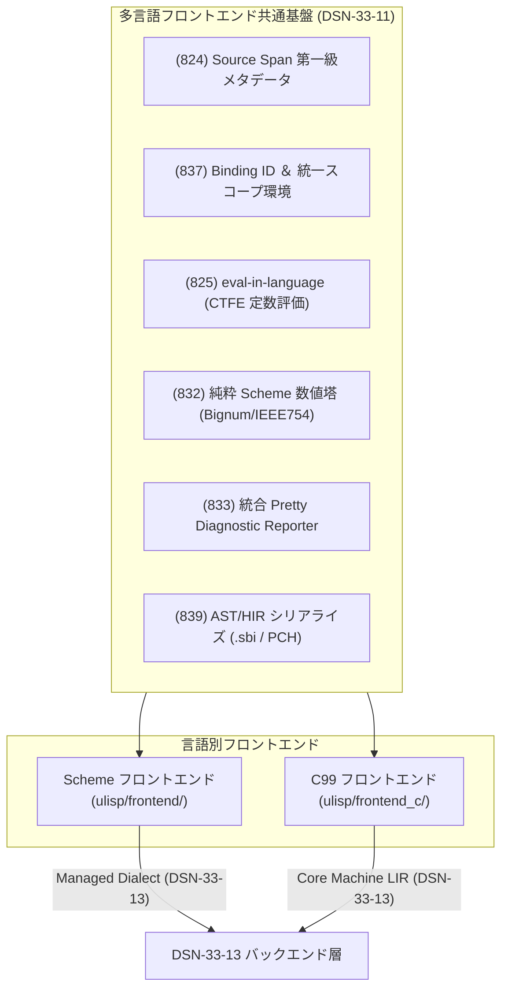

# [DSN-33-11] ULisp 多言語フロントエンド（C99 / Scheme）共通基盤 ＆ 構文・意味解析・CTFE アーキテクチャ設計書
## 〜 第一級ソース位置情報・統一束縛解決・AST 定数式評価・純粋 Scheme 数値塔・C99 構文/意味解析を統合し、DSN-33-13 バックエンドへ繋ぐ多言語フロントエンド基盤 〜

> [!NOTE]
> **【設計書体系の責務分離（Issue #911）】**  
> 本設計書（`DSN-33-11`）は **多言語フロントエンド（Scheme ＆ C99）の共通基盤・構文解析・意味解析・CTFE・AST→LIR 降格境界** を規定する。  
> - 型付き機械語 LIR・2層 Dialect 分離・`define-value-repr`・SysV ABI・Braun SSA・ELF リンカ・C バックエンド・Reference VM については **[[DSN-33-13] ULisp 型付き機械語 LIR ＆ 多重バックエンド設計書](DSN-33-13-ulisp_typed_machine_lir_and_multi_target_backend_architecture.md)** へ移管・整理した。  
> - 本設計書の C99 フロントエンドと `DSN-33-13` バックエンドを用いた Lua 5.x C コードベースおよび musl libc のコンパイル・セルフホスト実証（S0〜S9 ロードマップ）については **[[DSN-33-32] ULisp Lua (C言語実装) コンパイル ＆ musl libc セルフホスト実証設計書](DSN-33-32-ulisp_lua_c_codebase_compilation_and_self_hosting_architecture.md)** へ移管・整理した。

- **文書番号**: `DSN-33-11` *(旧 `DSN-33-02`)*
- **上位文書**: [[DSN-33] ULISP 包括設計仕様書: S式メタコンパイラ基盤 ＆ 多重バックエンドトランスレーションアーキテクチャ](DSN-33-ulisp_underlying_x86_native_aot_compiler_architecture_specification.md)
- **関連個別仕様書**: 
  - [[DSN-33-12] ULisp 階層型パス融合（Pipeline / Pass / Nanopass / Picopass）＆ DAG 最適化基盤設計書](DSN-33-12-ulisp_pipeline_pass_nanopass_picopass_dag_architecture.md)
  - [[DSN-33-13] ULisp 型付き機械語 LIR・2層 Dialect 分離・ゼロコスト ABI ＆ 多重バックエンド（x86-64 / Portable C / ELF リンカ / 参照 VM）アーキテクチャ設計書](DSN-33-13-ulisp_typed_machine_lir_and_multi_target_backend_architecture.md)
  - [[DSN-33-21] ULisp ステージ多相メタコンパイラ ＆ 二村射影フラクタル実行基盤設計書](DSN-33-21-ulisp_stage_polymorphic_metacompiler_and_futamura_projection_architecture.md)
  - [[DSN-33-22] ULisp 言語ワークベンチ（Language Workbench）: ゲスト言語オブジェクトモデル・PEG構文解析フロントエンド・Direct Cogen コンパイラ自動生成 ＆ デバッグ透過性アーキテクチャ設計書](DSN-33-22-ulisp_language_workbench_interpreter_generator_and_guest_runtime_architecture.md)
  - [[DSN-33-23] ULisp 内因的メタトレーシング JIT アーキテクチャ包括設計書](DSN-33-23-ulisp_endogenous_meta_tracing_jit_architecture.md)
  - [[DSN-33-31] ULisp Zero-libc / Freestanding Pure Scheme ベアメタルランタイム包括設計書](DSN-33-31-ulisp_zero_libc_pure_scheme_bare_metal_runtime.md)
  - [[DSN-33-32] ULisp Lua (C言語実装) コンパイル ＆ musl libc セルフホスト実証アーキテクチャ設計書](DSN-33-32-ulisp_lua_c_codebase_compilation_and_self_hosting_architecture.md)
  - [[DSN-33-41] ILisp・ULisp AOT・ULisp JIT 3種実行系 継続的性能評価・ベンチマーク基盤設計書](DSN-33-41-ulisp_ilisp_aot_jit_continuous_benchmarking_framework.md)
- **文書ステータス**: `APPROVED / ARCHITECTURE-BLUEPRINT`
- **対象サブシステム**:
  - `ulisp/frontend/` (Scheme CST to HIR, 構文位置情報 Span 伝播, 統一識別子 Binding)
  - `ulisp/frontend_c/` (`preprocessor.scm`, `parser.scm`, `sema.scm`, `lower_to_lir.scm`)
  - `ulisp/driver/` (`c_driver.scm`)
  - `ulisp/compiler/` (`nanopass.scm`, `binding.scm`, `diagnostic.scm`, `sbi.scm`)
  - `ulisp/lib/` (`bignum.scm`, `ieee754.scm` - 純粋 Scheme 数値塔標準ライブラリ)
- **関連設計書**:
  - [[DSN-31] ILisp R7RS Core Architecture Specification](DSN-31-ilisp_r7rs_intelligence_lisp_architecture_specification.md)
  - [[DSN-37] Synapse Dual-Plane Concurrent Runtime Architecture](DSN-37-synapse_dual_plane_concurrent_runtime_architecture.md)
- **【主査・報告】 IT Specialist (Programming Languages & Compilers / PLC), Systems Architect (SA), Software Development (SWD)**
- **【共同主査】 Project Manager (PM), Information Security Specialist (SEC), Software Quality Assurance Specialist (QA), Systems Auditor (AUD)**
- **【参画・協調】 16 大専門エージェント全員 (PM, SEC, SA, QA, DBA, NET, NLP, STR, SM, EMB, AUD, DES, EDU, SWD, APS, PLC)**

---

## 体系目次

- [1. エグゼクティブサマリー ＆ 設計哲学](#1-エグゼクティブサマリー--設計哲学)
  - [1.1 目的：Scheme と C99 を共通基盤で捌く多言語フロントエンド](#11-目的scheme-と-c99-を共通基盤で捌く多言語フロントエンド)
  - [1.2 「C 言語サポート」を Scheme コンパイラ／メタコンパイラの飛躍台とする思想](#12-c-言語サポートを-scheme-コンパイラメタコンパイラの飛躍台とする思想)
- [2. Clang フロントエンド対比 ＆ サブシステム責務マトリクス](#2-clang-フロントエンド対比--サブシステム責務マトリクス)
  - [2.1 フロントエンドパイプライン構成の完全マッピング](#21-フロントエンドパイプライン構成の完全マッピング)
  - [2.2 フロントエンドとバックエンド（DSN-33-13）のシステム境界](#22-フロントエンドとバックエンドdsn-33-08のシステム境界)
- [3. 多言語フロントエンド共通基盤アーキテクチャ](#3-多言語フロントエンド共通基盤アーキテクチャ)
  - [3.1 第一級ソース位置情報 (Source Span) と来歴追跡 (Issue #824)](#31-第一級ソース位置情報-source-span-と来歴追跡-issue-824)
  - [3.2 統一束縛解決 (Binding ID) とレキシカルスコープ基盤 (Issue #837)](#32-統一束縛解決-binding-id-とレキシカルスコープ基盤-issue-837)
  - [3.3 AST 定数式評価器 (`eval-in-language`) ＆ コンパイル時計算 (CTFE) (Issue #825)](#33-ast-定数式評価器-eval-in-language--コンパイル時計算-ctfe-issue-825)
  - [3.4 純粋 Scheme 数値塔ライブラリ (Bignum ＆ IEEE 754) (Issue #832)](#34-純粋-scheme-数値塔ライブラリ-bignum--ieee-754-issue-832)
  - [3.5 統合 Pretty Diagnostic Reporter (Issue #833)](#35-統合-pretty-diagnostic-reporter-issue-833)
- [4. C99 フロントエンド詳細構成 ＆ LIR Lowering 境界仕様](#4-c99-フロントエンド詳細構成--lir-lowering-境界仕様)
  - [4.1 Compiler Driver ＆ 純粋 Scheme C99 プリプロセッサ](#41-compiler-driver--純粋-scheme-c99-プリプロセッサ)
  - [4.2 C99 Lexer / Parser / Sema と構造体・関数ポインタ型検査](#42-c99-lexer--parser--sema-と構造体関数ポインタ型検査)
  - [4.3 `lower_to_lir.scm` と DSN-33-13 Core Machine LIR 接続契約](#43-lower_to_lirscm-と-dsn-33-08-core-machine-lir-接続契約)
- [5. プリコンパイル済みヘッダ (PCH / `.sbi` 拡張) による高速化 (Issue #839)](#5-プリコンパイル済みヘッダ-pch--sbi-拡張-による高速化-issue-839)
- [6. フロントエンド関連 Issue トレーサビリティ ＆ 関連仕様書への委譲マップ](#6-フロントエンド関連-issue-トレーサビリティ--関連仕様書への委譲マップ)

---

## 1. エグゼクティブサマリー ＆ 設計哲学

### 1.1 目的：Scheme と C99 を共通基盤で捌く多言語フロントエンド

本設計書（`DSN-33-11`）は、上位文書 [[DSN-33] ULISP 包括設計仕様書](DSN-33-ulisp_underlying_x86_native_aot_compiler_architecture_specification.md) および [[DSN-33-12] パス融合＆DAG設計書](DSN-33-12-ulisp_pipeline_pass_nanopass_picopass_dag_architecture.md) を継承し、**ULisp のフロントエンドにおいて Scheme（S式）と C99 言語を共通のコンパイラ基盤（Span・Binding ID・CTFE・数値塔・Diagnostic）上で統一的に処理し、[[DSN-33-13]](DSN-33-13-ulisp_typed_machine_lir_and_multi_target_backend_architecture.md) のバックエンドへ引き渡すフロントエンドアーキテクチャ**を規定する。

なお、本設計書の C99 フロントエンドを用いて実際に **C 言語版 Lua 5.x および musl libc をコンパイル・セルフホスト実証する全体計画と Lua 特有要件** は、[[DSN-33-32]](DSN-33-32-ulisp_lua_c_codebase_compilation_and_self_hosting_architecture.md) に独立して規定する。

### 1.2 「C 言語サポート」を Scheme コンパイラ／メタコンパイラの飛躍台とする思想

従来の言語処理系において、異言語（C 言語）のサポートはしばしば「別個の独立サブシステム」として実装され、コードベースの肥大化と保守破綻を招いてきた。本設計書ではこれと対極のアプローチを採る。**「C 言語という厳密な型・プリプロセッサ・スコープ規則を持つ言語をコンパイルするために必要なフロントエンド基盤」を、Scheme コンパイラ自身、Scheme インタプリタ、およびメタコンパイラの共通資産として還元・昇華させる**。



これにより以下の好循環を確立する：
1. **共通の誤り報告・来歴追跡**: `Source Span`（#824）と `Pretty Diagnostic Reporter`（#833）により、C マクロ展開エラーと Scheme 衛生的マクロ展開エラーを同一フォーマット・同一精度で報告できる。
2. **レキシカル解決の統一**: `Binding ID`（#837）により、C の複雑な名前空間（`typedef`・タグ名・ラベル）と Scheme の Scope Sets を同一の $\alpha$ 変換基盤へ統合する。
3. **クロスコンパイル決定論性**: 外部 libc/GMP に依存しない純粋 Scheme 数値塔（#832）と AST 定数評価器（#825）により、コンパイル時の定数式評価（C の `#if` や Scheme の `cp0` 畳み込み）がホスト環境に左右されず 100% 決定論的に動作する。

---

## 2. Clang フロントエンド対比 ＆ サブシステム責務マトリクス

### 2.1 フロントエンドパイプライン構成の完全マッピング

| Clang 構成要素 | ULisp フロントエンド担当サブシステム | ステータス | 対応 Issue |
| :--- | :--- | :---: | :---: |
| **Compiler Driver** (`clang`) | `ulisp/driver/c_driver.scm` | 新設 | `-I`, `-D`, `-c`, `-o` 解釈、パイプライン統括 |
| **C Preprocessor** | `ulisp/frontend_c/preprocessor.scm` | 新設 | `#include`, マクロ展開, `#if` 式評価（#825, #832） |
| **Parser & Sema** | `ulisp/frontend_c/parser.scm` / `sema.scm` | 新設 | Lexer Hack 解消, 型検査, 構造体レイアウト, Binding ID（#837） |
| **PCH** (`.pch`) | `ulisp/compiler/sbi.scm` | 拡張 | パース済みヘッダ AST の高速スナップショット保存（#839） |
| **CodeGen Frontend** | `ulisp/frontend_c/lower_to_lir.scm` | 新設 | C AST $\to$ `DSN-33-13` Core Machine LIR 降格 |
| **Diagnostics** | `ulisp/compiler/diagnostic.scm` | 統合 | Clang/Rustc 準拠エラー・警告レンダリング（#833） |

### 2.2 フロントエンドとバックエンド（DSN-33-13）のシステム境界

1. **言語フロントエンド層（本書 `DSN-33-11` の範囲）**:
   - Scheme CST/AST と C99 AST は構文レベルでは独立するが、いずれも **Source Span（#824）** と **Binding ID（#837）** を保持し、**Diagnostic（#833）** を通じて診断を出力する。
2. **LIR への出力契約（`DSN-33-13` への引き渡し境界）**:
   - Scheme フロントエンドは GC・タグ付き値を扱う `Managed Dialect`（[[DSN-33-13 §2.2]](DSN-33-13-ulisp_typed_machine_lir_and_multi_target_backend_architecture.md#22-managed-runtime-dialect-と-pass-131-lowering-issue-835)）を出力する。
   - C99 フロントエンドは `Managed Dialect` を完全にバイパスし、最初から `Core Machine LIR`（[[DSN-33-13 §2.1]](DSN-33-13-ulisp_typed_machine_lir_and_multi_target_backend_architecture.md#21-core-machine-lir-の厳格な命令セットと型体系-issue-826)）を直接出力する。

---

## 3. 多言語フロントエンド共通基盤アーキテクチャ

### 3.1 第一級ソース位置情報 (Source Span) と来歴追跡 (Issue #824)

すべての中間表現ノードに以下の不変メタデータを不可分に付与する。
```scheme
;; Source Span レコード定義
(define-record-type <source-span>
  (make-source-span file start-line start-col end-line end-col macro-origin node-id)
  source-span?
  (file         span-file)
  (start-line   span-start-line)
  (start-col    span-start-col)
  (end-line     span-end-line)
  (end-col      span-end-col)
  (macro-origin span-macro-origin) ;; マクロ展開元の Span
  (node-id      span-node-id))
```
- **透過伝播規約**: Nanopass の `define-pass` 出力生成マクロは、入力ノードが置換される際にデフォルトで親ノードの `source-span` を自動維持する。
- **恩恵**: C の `#define` マクロ展開エラー追跡、Scheme の構文エラー・スタックトレース、および [[DSN-33-22]](DSN-33-22-ulisp_language_workbench_interpreter_generator_and_guest_runtime_architecture.md) の DWARF デバッグシンボル生成精度が飛躍する。

### 3.2 統一束縛解決 (Binding ID) とレキシカルスコープ基盤 (Issue #837)

C 言語の複雑な識別子スコープ（通常識別子、タグ名 `struct`/`union`/`enum`、`typedef` 名、ラベル名）と Scheme の Scope Sets（衛生的マクロ）を統一的に扱うため、構文解析直後にすべての識別子をユニークな `<binding-id>` と属性メタデータへ $\alpha$ 変換する共通環境管理フレームワーク（`ulisp/compiler/binding.scm`）を整備する。
- **Lexer Hack のクリーンな解消**: C パーサが識別子に遭遇した際、スコープマネージャへ `(scope-lookup-kind current-scope sym)` を問い合わせることで、文脈に応じた `TYPEDEF_NAME` / `IDENTIFIER` のトークン分岐を即座に確定する。
- **シャドウイングと名前衝突の完全根絶**: 後続の Lowering パスでは、同名異変数であっても異なる一意 ID（`id:402`, `id:405`）として扱われるため、変数名のプレフィックス付与や名前衝突回避のアドホックなハックが一切不要となる。

### 3.3 AST 定数式評価器 (`eval-in-language`) ＆ コンパイル時計算 (CTFE) (Issue #825)

Nanopass 言語定義に基づき、純粋式ノードを走査してコンパイル時に値を評価する Tree-walk 評価器を標準装備する（ステージ多相メタコンパイラ [[DSN-33-21]](DSN-33-21-ulisp_stage_polymorphic_metacompiler_and_futamura_projection_architecture.md) の `eval-in-stage` と統合済み）。
- **C 言語側での用途**: `#if` / `#elif` プリプロセッサ定数式の評価、`enum` 列挙定数の値確定、静的配列長 `int a[sizeof(struct foo)];` や `offsetof` のコンパイル時計算。
- **Scheme 側での用途**: マクロ展開時計算、CP0 最適化パスにおける定数伝播・定数畳み込み。

### 3.4 純粋 Scheme 数値塔ライブラリ (Bignum ＆ IEEE 754) (Issue #832)

外部 libc や GMP に一切頼らない、純粋 Scheme 製の多倍長整数（任意精度演算・$2^{64}$ モジュロ演算）および IEEE 754 浮動小数点パーサ（Ryū / Clinger アルゴリズム）を `ulisp/lib/bignum.scm` および `ulisp/lib/ieee754.scm` として実装する。
- **フロントエンドでの用途**: C ソースコード内の巨大な 64bit 整数リテラル（`0xFFFFFFFFFFFFFFFFULL`）、16進浮動小数点リテラル（`0x1.8p+1`）、および `#if` 内の 64bit 符号付き／符号なし定数式を、ホスト処理系の数値表現の制約を受けずに正確かつ決定論的にパース・計算する。

### 3.5 統合 Pretty Diagnostic Reporter (Issue #833)

ソースコード行を遅延読み込みし、Clang / Rustc スタイルの美麗なエラー・警告メッセージをターミナルおよびログへ出力する。
```text
error[C0042]: incompatible types when assigning to type 'int' from type 'double'
  --> src/main.c:45:12
   |
45 |     int x = calculate_pi();
   |         -   ^^^^^^^^^^^^^^ expected 'int', found 'double'
   |         |
   |         expected due to this declaration
   = help: use an explicit cast: '(int)calculate_pi()'
```

---

## 4. C99 フロントエンド詳細構成 ＆ LIR Lowering 境界仕様

C99 フロントエンド（`ulisp/frontend_c/`）は、C 言語で書かれた実用アプリケーション（[[DSN-33-32]](DSN-33-32-ulisp_lua_c_codebase_compilation_and_self_hosting_architecture.md) で扱う Lua 5.x および musl libc）をコンパイルするための 4 段構成パイプラインを採る。

### 4.1 Compiler Driver ＆ 純粋 Scheme C99 プリプロセッサ

1. **`ulisp/driver/c_driver.scm`**: `-I`（インクルードパス）、`-D`（マクロ定義）、`-U`、`-c`（オブジェクト出力）、`-o` 等の標準 C コンパイラフラグを解釈し、複数翻訳単位のビルドを統括する。
2. **`ulisp/frontend_c/preprocessor.scm`**: 最初から純粋 Scheme で実装する（ホストの `cc -E` はテスト用オラクルとしてのみ使用）。オブジェクト／関数マクロ、可変長マクロ（`...`, `__VA_ARGS__`）、`#` 文字列化、`##` トークン連結、Blue-painted 再帰ガード、および `#if` 定数評価（#825）を処理し、トークン単位の `Source Span`（#824）を維持したまま Lexer/Parser へ渡す。

### 4.2 C99 Lexer / Parser / Sema と構造体・関数ポインタ型検査

1. **`parser.scm`**: 再帰下降（演算子順位構文解析併用）による C89/C99 構文解析。`Binding ID` スコープ表（#837）と協調して `typedef` 曖昧性を解消し、型付き準備 AST を構築する。
2. **`sema.scm`**:
   - **型検査・暗黙変換**: 整数昇格（Integer Promotion）、通常の算術変換、暗黙ポインタ変換、明示的キャスト検証。
   - **複合型レイアウト計算**: SysV AMD64 ABI 準拠の `struct` / `union` メンバオフセット、アライメント、パディング、ビットフィールド幅の確定。
   - **関数ポインタと可変長引数**: `int (*)(lua_State *)` 等の関数ポインタ型シグネチャと `<stdarg.h>` 組み込み型の解決。

### 4.3 `lower_to_lir.scm` と DSN-33-13 Core Machine LIR 接続契約

`ulisp/frontend_c/lower_to_lir.scm` は、型検査済み C AST を `DSN-33-13` の **Core Machine LIR** へ変換するフロントエンド最終段である。
- ローカル変数は `%alloca` として宣言し、アドレス取得（`&var`）されない純粋スカラ変数を `DSN-33-13` の Pass 132 Braun SSA へ委ねる。
- 制御構造（`if`, `while`, `for`, `do-while`, `switch-case`, `goto`）はすべて基本ブロックと `%jump` / `%branch-if` / `%switch` に展開する。
- 外部関数および C 関数定義には `'sysv` 呼出規約（[[DSN-33-13 §3.2]](DSN-33-13-ulisp_typed_machine_lir_and_multi_target_backend_architecture.md#32-呼出規約の多重化sysv-amd64-abi-vs-scheme-高速規約-issue-829)）を明示付与し、一切の GC ランタイム命令（Managed Dialect）を出力しない。

---

## 5. プリコンパイル済みヘッダ (PCH / `.sbi` 拡張) による高速化 (Issue #839)

C の巨大な標準ヘッダ群（musl libc ヘッダ等 約 2 万行）や Lua 共通ヘッダを翻訳単位ごとにゼロからプリプロセス・構文解析するオーバーヘッドを排除するため、既存の `.sbi`（Scheme Binary Interface）機構をフロントエンド AST スナップショットへ拡張する（`ulisp/compiler/sbi.scm`）。
- よく参照される標準ヘッダ群を一度だけパース・意味解析（Binding ID・型テーブル確定）した結果を `musl_headers.sbi` 等として永続化。
- 2 回目以降の翻訳単位コンパイルでは 5ms 以内にメモリへ再ロードし、3 万行規模の C ソースを数秒以内で処理できるスループットを担保する。

---

## 6. フロントエンド関連 Issue トレーサビリティ ＆ 関連仕様書への委譲マップ

### 6.1 本設計書（DSN-33-11 フロントエンド基盤）担当 Issue 一覧

| Issue ID | 概要 | 対応章節 | ステータス |
| :---: | :--- | :---: | :---: |
| **#824** | Nanopass Source Span メタデータ第一級サポート | §3.1 | Closed |
| **#825** | `eval-in-language` (CTFE 定数式評価器) | §3.3 | Closed |
| **#832** | 純粋 Scheme 数値塔ライブラリ (Bignum ＆ IEEE 754) | §3.4 | Closed |
| **#833** | 統合 Pretty Diagnostic Reporter | §3.5 | Closed |
| **#837** | 統一束縛解決 (Binding ID) ＆ スコープ環境基盤 | §3.2 | Closed |
| **#839** | 中間表現シリアライズ (`.sbi` 拡張 / PCH) | §5 | Closed |

### 6.2 関連設計書への責務委譲マップ

- **バックエンド・LIR・ABI・ELF リンカ・参照 VM**: [[DSN-33-13] ULisp 型付き機械語 LIR ＆ 多重バックエンド設計書](DSN-33-13-ulisp_typed_machine_lir_and_multi_target_backend_architecture.md)（Issue #826, #827, #828, #829, #830, #831, #834, #835, #836, #838, #840, #889, #890）
- **C99 フロントエンド経由の Lua 5.x コンパイル ＆ musl libc セルフホスト実証（S0〜S9 ロードマップ・4大裁定規準・DDC）**: [[DSN-33-32] ULisp Lua (C言語実装) コンパイル ＆ musl libc セルフホスト実証設計書](DSN-33-32-ulisp_lua_c_codebase_compilation_and_self_hosting_architecture.md)
