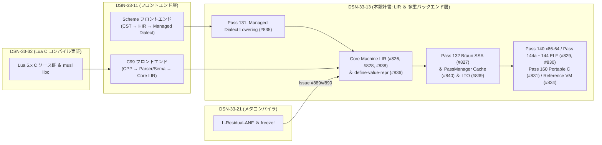
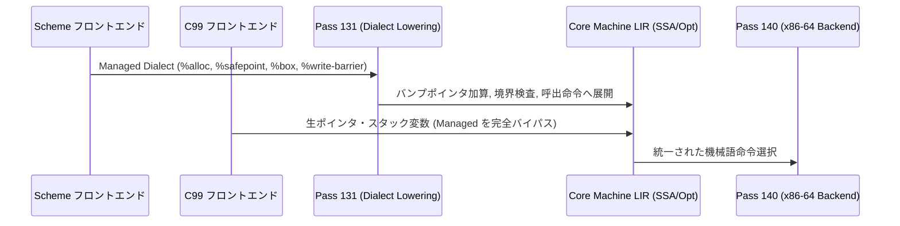

# [DSN-33-13] ULisp 型付き機械語 LIR・2層 Dialect 分離・ゼロコスト ABI ＆ 多重バックエンド（x86-64 / Portable C / ELF リンカ / 参照 VM）アーキテクチャ設計書
## 〜 Pure Scheme / C99 / ステージ多相メタコンパイラを統一的に支える Core Machine LIR 最適化・実行バックエンド基盤 〜

- **文書番号**: `DSN-33-13` *(旧 `DSN-33-08`)*
- **上位文書**: [[DSN-33] ULISP 包括設計仕様書: S式メタコンパイラ基盤 ＆ 多重バックエンドトランスレーションアーキテクチャ](DSN-33-ulisp_underlying_x86_native_aot_compiler_architecture_specification.md)
- **関連個別仕様書**: 
  - [[DSN-33-11] ULisp 多言語フロントエンド（C99/Scheme）共通基盤 ＆ 構文・意味解析・CTFE アーキテクチャ設計書](DSN-33-11-ulisp_multilingual_frontend_and_ctfe_architecture.md)
  - [[DSN-33-12] ULisp 階層型パス融合（Pipeline / Pass / Nanopass / Picopass）＆ DAG 最適化基盤設計書](DSN-33-12-ulisp_pipeline_pass_nanopass_picopass_dag_architecture.md)
  - [[DSN-33-21] ULisp ステージ多相メタコンパイラ ＆ 二村射影フラクタル実行基盤設計書](DSN-33-21-ulisp_stage_polymorphic_metacompiler_and_futamura_projection_architecture.md)
  - [[DSN-33-22] ULisp 言語ワークベンチ（Language Workbench）: ゲスト言語オブジェクトモデル・PEG構文解析フロントエンド・Direct Cogen コンパイラ自動生成 ＆ デバッグ透過性アーキテクチャ設計書](DSN-33-22-ulisp_language_workbench_interpreter_generator_and_guest_runtime_architecture.md)
  - [[DSN-33-23] ULisp 内因的メタトレーシング JIT アーキテクチャ包括設計書](DSN-33-23-ulisp_endogenous_meta_tracing_jit_architecture.md)
  - [[DSN-33-31] ULisp Zero-libc / Freestanding Pure Scheme ベアメタルランタイム包括設計書](DSN-33-31-ulisp_zero_libc_pure_scheme_bare_metal_runtime.md)
  - [[DSN-33-32] ULisp Lua (C言語実装) コンパイル ＆ musl libc セルフホスト実証アーキテクチャ設計書](DSN-33-32-ulisp_lua_c_codebase_compilation_and_self_hosting_architecture.md)
  - [[DSN-33-41] ILisp・ULisp AOT・ULisp JIT 3種実行系 継続的性能評価・ベンチマーク基盤設計書](DSN-33-41-ulisp_ilisp_aot_jit_continuous_benchmarking_framework.md)
- **文書ステータス**: `APPROVED / ARCHITECTURE-BLUEPRINT`
- **対象サブシステム**:
  - `ulisp/compiler/` (`pass_manager.scm`, `value_repr.scm`, `sbi.scm`)
  - `ulisp/lir/` (`lir_lang.scm`, `lir_verifier.scm`, `131_lower_managed_dialect.scm`, `132_braun_ssa.scm`, `133_lir_peephole.scm`)
  - `ulisp/backend/` (`140_backend_x86.scm`, `144a_assembler.scm`, `144_linker.scm`, `160_backend_c.scm`)
  - `ulisp/vm/` (`lir_interpreter.scm` - LIR 参照仮想マシン)
- **関連設計書**:
  - [[DSN-31] ILisp R7RS Core Architecture Specification](DSN-31-ilisp_r7rs_intelligence_lisp_architecture_specification.md)
  - [[DSN-37] Synapse Dual-Plane Concurrent Runtime Architecture](DSN-37-synapse_dual_plane_concurrent_runtime_architecture.md)
- **【主査・報告】 IT Specialist (Programming Languages & Compilers / PLC), Systems Architect (SA), Software Development (SWD)**
- **【共同主査】 Project Manager (PM), Information Security Specialist (SEC), Software Quality Assurance Specialist (QA), Systems Auditor (AUD)**
- **【参画・協調】 16 大専門エージェント全員 (PM, SEC, SA, QA, DBA, NET, NLP, STR, SM, EMB, AUD, DES, EDU, SWD, APS, PLC)**

---

## 体系目次

- [1. エグゼクティブサマリー ＆ 設計哲学](#1-エグゼクティブサマリー--設計哲学)
  - [1.1 目的：多言語フロントエンドを単一の型付き機械語バックエンドへ収束させる](#11-目的多言語フロントエンドを単一の型付き機械語バックエンドへ収束させる)
  - [1.2 責務境界：DSN-33-11（フロントエンド）および DSN-33-32（Lua C コンパイル）との分離](#12-責務境界dsn-33-02フロントエンドおよび-dsn-33-09lua-c-コンパイルとの分離)
  - [1.3 LLVM ミドルエンド・バックエンド対比マトリクス](#13-llvm-ミドルエンドバックエンド対比マトリクス)
- [2. 型付き機械語 LIR ＆ 2層方言（Dialect）分離仕様](#2-型付き機械語-lir--2層方言dialect分離仕様)
  - [2.1 Core Machine LIR の厳格な命令セットと型体系 (Issue #826)](#21-core-machine-lir-の厳格な命令セットと型体系-issue-826)
  - [2.2 Managed Runtime Dialect と Pass 131 Lowering (Issue #835)](#22-managed-runtime-dialect-と-pass-131-lowering-issue-835)
  - [2.3 オーバーフロー検知付き算術 ＆ 符号なし演算オペコード (Issue #828)](#23-オーバーフロー検知付き算術--符号なし演算オペコード-issue-828)
  - [2.4 レジスタ制約付きインライン・アセンブリ (`%inline-asm`) (Issue #838)](#24-レジスタ制約付きインラインアセンブリ-inline-asm-issue-838)
- [3. メモリモデル・値表現・ABI 統合設計](#3-メモリモデル値表現abi-統合設計)
  - [3.1 `define-value-repr` による値表現・ボクシングのプラグイン化 (Issue #836)](#31-define-value-repr-による値表現ボクシングのプラグイン化-issue-836)
  - [3.2 呼出規約の多重化（SysV AMD64 ABI vs Scheme 高速規約） (Issue #829)](#32-呼出規約の多重化sysv-amd64-abi-vs-scheme-高速規約-issue-829)
- [4. LIR 最適化ループ・解析キャッシュ・永続化（LTO）](#4-lir-最適化ループ解析キャッシュ永続化lto)
  - [4.1 Pass 132 Braun SSA の任意 CFG (goto/switch) 汎用対応 (Issue #827)](#41-pass-132-braun-ssa-の任意-cfg-gotoswitch-汎用対応-issue-827)
  - [4.2 パスマネージャの解析キャッシュ自動無効化・再計算 (Issue #840)](#42-パスマネージャの解析キャッシュ自動無効化再計算-issue-840)
  - [4.3 LIR モジュールのバイナリ・S式シリアライズ ＆ LTO (Issue #839)](#43-lir-モジュールのバイナリs式シリアライズ--lto-issue-839)
- [5. ターゲットコード生成・ELF リンカ・メタコンパイラ統合](#5-ターゲットコード生成elf-リンカメタコンパイラ統合)
  - [5.1 Pass 140 (x86-64 Backend): 命令選択・XMM SSE2・レジスタ割当](#51-pass-140-x86-64-backend-命令選択xmm-sse2レジスタ割当)
  - [5.2 複数 ELF セクション (.text/.rodata/.data/.bss) と再配置抽象化 (Issue #830)](#52-複数-elf-セクション-textrodatadatabss-と再配置抽象化-issue-830)
  - [5.3 DSN-33-21 ステージ多相メタコンパイラとの LIR/ELF 統合ブリッジ (Issue #889, #890)](#53-dsn-33-03-ステージ多相メタコンパイラとの-lirelf-統合ブリッジ-issue-889-890)
- [6. テスト・検証・リファレンス仮想マシン基盤](#6-テスト検証リファレンス仮想マシン基盤)
  - [6.1 純粋 Scheme 製 LIR 参照仮想マシン (Reference VM) (Issue #834)](#61-純粋-scheme-製-lir-参照仮想マシン-reference-vm-issue-834)
  - [6.2 Pass 160 Portable C バックエンドのセマンティクス同期 ＆ 差分ファジング (Issue #831)](#62-pass-160-portable-c-バックエンドのセマンティクス同期--差分ファジング-issue-831)
  - [6.3 出力の決定論性検証](#63-出力の決定論性検証)
- [7. バックエンド関連 Issue トレーサビリティマトリクス](#7-バックエンド関連-issue-トレーサビリティマトリクス)

---

## 1. エグゼクティブサマリー ＆ 設計哲学

### 1.1 目的：多言語フロントエンドを単一の型付き機械語バックエンドへ収束させる

本設計書（`DSN-33-13`）は、上位文書 [[DSN-33] ULISP 包括設計仕様書](DSN-33-ulisp_underlying_x86_native_aot_compiler_architecture_specification.md) における **ミドルエンド後半（LIR 最適化層）からバックエンド（x86-64 ネイティブ機械語生成・ELF リンカ・Portable C 生成・LIR 参照 VM）** までの全体アーキテクチャを規定する。

Scheme、C99（[[DSN-33-11]](DSN-33-11-ulisp_multilingual_frontend_and_ctfe_architecture.md)）、およびステージ多相部分評価器（[[DSN-33-21]](DSN-33-21-ulisp_stage_polymorphic_metacompiler_and_futamura_projection_architecture.md)）から出力される多様な中間表現を、**単一の型付き機械語 LIR（Core Machine LIR）** に収束させ、バックエンド側の重複実装やランタイム依存を排除する。

### 1.2 責務境界：DSN-33-11（フロントエンド）および DSN-33-32（Lua C コンパイル）との分離



1. **フロントエンド（`DSN-33-11`）**: ソースコードの字句・構文・意味解析（Span、Binding ID、CTFE、C99 プリプロセッサ/型検査）を担い、Scheme は `Managed Dialect` へ、C99 は `Core Machine LIR` へ降格する。
2. **バックエンド（`DSN-33-13`: 本書）**: 降格後の `Managed Dialect` / `Core Machine LIR` を受け取り、SSA 構築・レジスタ割り当て・SysV ABI 整合・ELF バイナリ生成または Portable C / Reference VM 実行を行う。
3. **Lua C コンパイル（`DSN-33-32`）**: `DSN-33-11` と `DSN-33-13` の両基盤を組み合わせ、Lua 5.x の C ソース群と `musl libc` をビルド・検証する統合応用プロジェクトを規定する。

### 1.3 LLVM ミドルエンド・バックエンド対比マトリクス

| LLVM 構成要素 | ULisp バックエンド担当サブシステム | 責務概要 | 対応 Issue |
| :--- | :--- | :--- | :---: |
| **LLVM IR / MachineIR** | **Typed Core Machine LIR** (`ulisp/lir/lir_lang.scm`) | `i8`〜`i64`, `f32`/`f64`, `ptr` と Dialect 分離 | #826, #835 |
| **mem2reg / SROA** | **Pass 132 (Braun SSA)** (`ulisp/lir/132_braun_ssa.scm`) | 任意 CFG のスタック変数 $\to$ SSA 仮想レジスタ昇格 | #827 |
| **PassManager Analysis** | **PassManager Cache** (`ulisp/compiler/pass_manager.scm`) | `:preserves`/`:invalidates`/`:requires` 宣言に基づく自動再計算 | #840 |
| **LLVM Bitcode (LTO)** | **LIR シリアライザ** (`ulisp/compiler/sbi.scm`) | 複数モジュール（`.c`/`.scm`）の IR 結合とモジュール間最適化 | #839 |
| **ISel / RegAlloc / ABI** | **Pass 140 (x86-64 Backend)** (`ulisp/backend/140_backend_x86.scm`) | 幅指定ロード/ストア、XMM SSE2、グラフ彩色 RA、SysV ABI、`%inline-asm` | #828, #829, #838 |
| **MC Assembler** | **Pass 144a (Assembler)** (`ulisp/backend/144a_assembler.scm`) | SSE2 命令、符号拡張 `movsx`、複数セクションデータ出力 | #830 |
| **Linker (`lld`)** | **Pass 144 (ELF Linker)** (`ulisp/backend/144_linker.scm`) | `.text`/`.rodata`/`.data`/`.bss` 解決、再配置 (`R_X86_64_64`, `PC32`) | #830 |
| **C Backend / Interpreter** | **Pass 160 (`160_backend_c.scm`) / Reference VM (`lir_interpreter.scm`)** | 差分ファジング用 C 生成 ＆ バックエンド非依存 LIR 実行 VM | #831, #834 |

---

## 2. 型付き機械語 LIR ＆ 2層方言（Dialect）分離仕様

### 2.1 Core Machine LIR の厳格な命令セットと型体系 (Issue #826)

Core Machine LIR は、動的型・GC・ボクシングの前提を一切持たず、CPU のレジスタおよびメモリの振る舞いを直接モデル化した純粋な低水準中間言語である。

#### (1) 機械型（Machine Types）
- **整数型**: `i8`, `i16`, `i32`, `i64`（ビット幅のみを規定し、符号の有無は各演算オペコード側が解釈する）。
- **浮動小数点型**: `f32`, `f64`（IEEE 754 単精度・倍精度。x86-64 では XMM レジスタへマッピング）。
- **ポインタ型**: `ptr`（ターゲットアーキテクチャ依存の生メモリアドレス。x86-64 では 64bit 幅）。

#### (2) 命令カテゴリ
1. **算術・論理演算**: `%add`, `%sub`, `%mul`, `%div`, `%udiv`, `%rem`, `%urem`, `%and`, `%or`, `%xor`, `%shl`, `%shr`, `%sar`（および浮動小数点演算 `%fadd`, `%fsub`, `%fmul`, `%fdiv`, `%fcmp`）
2. **型変換・拡張**: `%trunc`, `%zext`, `%sext`, `%fpext`, `%fptrunc`, `%fptosi`, `%sitofp`, `%uitofp`, `%fptoui`, `%bitcast`
3. **メモリアクセス・スタック割当**:
   - `(%alloca <type> <count>)`（スタックフレーム上の局所領域確保）
   - `(%load <type> <addr-vreg> (:offset <int>) (:align <int>))`
   - `(%store <type> <addr-vreg> <val-vreg> (:offset <int>) (:align <int>))`
4. **制御フロー**: `%label`, `%jump`, `%branch-if`, `%switch`, `%call`, `%tailcall`, `%return`

### 2.2 Managed Runtime Dialect と Pass 131 Lowering (Issue #835)

Scheme ランタイム固有のヒープ管理・GC セーフポイント・タグ操作を `Managed Runtime Dialect` として Core Machine LIR から直交分離する。



- **アーキテクチャ上の利点**:
  - C フロントエンドは `Managed Dialect` をそもそも経由せず `Core Machine LIR` へ直接降りるため、「C コードに GC 命令が混入していないか」といった事後禁止チェックが構造的に不要となる。
  - 将来、リージョン割り当て（Arena）やコピー GC プロトコルを差し替える場合も、変更は `Pass 131` に完全に局所化される。
- **Pass 131 での展開例 (`%alloc`)**:
  ```scheme
  ;; Lowering 前 (Managed Dialect)
  (%alloc dst size-vreg tag:pair)

  ;; Lowering 後 (Core Machine LIR)
  (%add new-free heap-free size-vreg)
  (%branch-if (%ugt new-free heap-limit) L_gc_overflow)
  (%store i64 heap-free tag:pair)
  (%move dst heap-free)
  (%move heap-free new-free)
  (%jump L_done)
  L_gc_overflow:
  (%call runtime_gc_collect size-vreg)
  ...
  ```

### 2.3 オーバーフロー検知付き算術 ＆ 符号なし演算オペコード (Issue #828)

ハードウェアのキャリー／オーバーフローフラグに直接対応するペア出力型算術命令と符号なし比較・除算命令を LIR に装備する。
- `(%add-overflow dst-val dst-flag src1 src2)`
- `(%sub-overflow dst-val dst-flag src1 src2)`
- `(%mul-overflow dst-val dst-flag src1 src2)`
- 符号なし演算・比較: `%udiv`, `%urem`, `%ult`, `%ule`, `%ugt`, `%uge`

x86-64 バックエンドでは `add`/`sub`/`imul` 直後の `OF`/`CF` フラグを `seto` または直接 `jo`（条件ジャンプ）に縮約し、Scheme の Fixnum $\to$ Bignum 昇格判定と C 言語の符号なし整数セマンティクスを高効率に両立する。

### 2.4 レジスタ制約付きインライン・アセンブリ (`%inline-asm`) (Issue #838)

Linux システムコール、`setjmp`/`longjmp`、アトミック命令（CAS）などの低水準記述を可能にするため、LIR レベルで入出力レジスタ制約付きの `%inline-asm` ノードをサポートする。

```scheme
(%inline-asm "syscall"
  (:outputs ((ret "={rax}")))
  (:inputs  ((sys_num "{rax}" 60)   ;; exit syscall
             (code    "{rdi}" 0)))
  (:clobbers ("rcx" "r11" "memory"))
  (:volatile? #t))
```

Pass 140 のグラフ彩色レジスタ割り当て器（RA）は、指定された固定レジスタ制約と `clobbers` リストを干渉グラフに組み込み、生存中の仮想レジスタを自動的に別レジスタ移動またはスタック退避（Spill）する。

---

## 3. メモリモデル・値表現・ABI 統合設計

### 3.1 `define-value-repr` による値表現・ボクシングのプラグイン化 (Issue #836)

値のビットレイアウト仕様（タグビット幅、即値エンコーディング、ポインタアライメント）を単一の宣言的スペックに集約し、ボクシング／アンボクシングの LIR 命令列を自動導出する。

```scheme
;; ULisp 標準 Scheme 表現 (1-bit Tagged Fixnum, 64-bit Align Heap Pointer)
(define-value-repr scheme-standard
  (:fixnum
    (:tag-bits #b1)
    (:tag-mask #b1)
    (:shift    1))
  (:immediates
    (:boolean-false #x0F)
    (:boolean-true  #x1F)
    (:null          #x2F)
    (:eof           #x3F))
  (:pointer
    (:align 8)
    (:tag-bits #b000)))

;; C 言語表現 (タグなし、生値そのまま)
(define-value-repr c-unboxed
  (:fixnum     (:shift 0) (:tag-mask 0))
  (:immediates none)
  (:pointer    (:align 1) (:tag-bits 0)))
```

これにより、Scheme インタプリタ・AOT コンパイラ・C FFI 境界・将来のゲスト言語（[[DSN-33-22]](DSN-33-22-ulisp_language_workbench_interpreter_generator_and_guest_runtime_architecture.md) の NaN-boxing 表現）を単一の値表現フレームワーク上で統一的に取り扱う。

### 3.2 呼出規約の多重化（SysV AMD64 ABI vs Scheme 高速規約） (Issue #829)

LIR 関数ノードに `calling-convention` メタデータを付与し、Pass 140 のプロローグ・エピローグおよびコールサイト展開を切り替える。

1. **`calling-convention: 'sysv` (C / 外部 ABI 準拠)**:
   - 整数・ポインタ引数: `rdi, rsi, rdx, rcx, r8, r9`（第7引数以降はスタック渡し）
   - 浮動小数点引数: `xmm0` 〜 `xmm7`
   - 戻り値: `rax`（および `rdx`）、浮動小数点は `xmm0`（および `xmm1`）
   - 可変長引数呼出規約: `%al` に使用した XMM レジスタ個数（0〜8）を格納
   - スタック整列: `call` 命令発行直前の `rsp` 16バイトアライメント保証
   - Callee-Saved レジスタ: `rbx, rsp, rbp, r12, r13, r14, r15`
   - 構造体値渡し・戻り値: SysV AMD64 ABI の 8 バイト境界クラス分類（MEMORY / INTEGER / SSE クラス、16 バイト超の Hidden `sret` ポインタ渡し）をサポート
2. **`calling-convention: 'scheme-fast` (Scheme 内部高速規約)**:
   - 汎用レジスタ優先の引数渡し、末尾呼出最適化（TCO）の完全保証、GC 用スタックマップ連携。

---

## 4. LIR 最適化ループ・解析キャッシュ・永続化（LTO）

### 4.1 Pass 132 Braun SSA の任意 CFG (goto/switch) 汎用対応 (Issue #827)

C 言語のローカルスタック変数（`%alloca`）や任意ジャンプ（`goto` / `switch` / ループ `break` / `continue`）を含む制御フローグラフを効率的にレジスタ昇格（`mem2reg`）するため、Braun らの SSA 構築アルゴリズムを拡張する。
- **未完了ブロック（Incomplete Blocks）の遅延解決**: 後方ジャンプや前方 `goto` により先行ブロック（Predecessor）がすべて判明していない段階でも、ブロックの仮生成と変数読み書きの記録を進行可能にする。
- **`seal-block` プロトコル**: ブロックへのすべての先行エッジが確定した時点で `seal-block` を呼び出し、未解決の Phi ノード（またはブロック引数）を確定させるとともに、単一または自己参照のみの冗長な Phi を再帰的に除去する。
- **アドレス取得変数の分離**: エスケープ解析によりアドレス（`&x`）が取得された変数は `%alloca` としてスタック上に残し、純粋なスカラ変数のみを SSA 仮想レジスタへ昇格させる。

### 4.2 パスマネージャの解析キャッシュ自動無効化・再計算 (Issue #840)

Pass 間で共有される解析情報（生存区間 Liveness、支配木 Dominance、エイリアス集合 Alias Sets、エスケープ情報）の整合性を自動維持するため、PassManager（[[DSN-33-12]](DSN-33-12-ulisp_pipeline_pass_nanopass_picopass_dag_architecture.md)）へ宣言的依存管理を導入する。

```scheme
(define-pass lir-peephole-window
  (:requires    (cfg-dominance))
  (:preserves   (cfg-dominance-frontier))
  (:invalidates (variable-liveness alias-sets))
  ...)
```

後続のパスが `(:requires (variable-liveness))` を宣言した際、前段のパスによってキャッシュが無効化されていれば、パスマネージャが自動的に `analyze-liveness` をスケジュール・再計算する。これにより、`mem2reg` $\to$ `peephole` $\to$ `branch-fusion` などの反復最適化パイプラインを安全に構成できる。

### 4.3 LIR モジュールのバイナリ・S式シリアライズ ＆ LTO (Issue #839)

`ulisp/compiler/sbi.scm` のバイナリシリアライズ機構を LIR モジュールレベルへ拡張し、フロントエンドの PCH（[[DSN-33-11]](DSN-33-11-ulisp_multilingual_frontend_and_ctfe_architecture.md)）と連動したリンク時最適化（LTO: Link-Time Optimization）を実現する。
- 複数の `.c` および `.scm` 翻訳単位から生成された型付き LIR モジュールを中間形式で保存・結合し、翻訳単位の境界を越えた関数インライン展開、定数伝播、およびデッドコード除去（DCE）を実行可能とする。

---

## 5. ターゲットコード生成・ELF リンカ・メタコンパイラ統合

### 5.1 Pass 140 (x86-64 Backend): 命令選択・XMM SSE2・レジスタ割当

1. **データ幅対応メモリアクセス**: `i8`/`i16`/`i32`/`i64` に応じた `movzbl`/`movsbl`/`movzwl`/`movswl`/`movl`/`movq` 等の符号・ゼロ拡張ロード／幅指定ストア命令選択。
2. **SSE2 浮動小数点命令選択**: `f32`/`f64` 型に対する XMM レジスタ割り当てと `movss`/`movsd`/`addsd`/`subsd`/`mulsd`/`divsd`/`ucomisd`/`cvttsd2si`/`cvtsi2sd` 命令生成。
3. **グラフ彩色レジスタ割り当て**: `%inline-asm` の固定レジスタ制約や SysV ABI の Caller-Saved / Callee-Saved 規約を完全に遵守したスピルコード生成。

### 5.2 複数 ELF セクション (.text/.rodata/.data/.bss) と再配置抽象化 (Issue #830)

Pass 144a（統合アセンブラ）および Pass 144（ELF リンカ）において、単一コードセクションの制約を撤廃し、標準的な ELF64 オブジェクトファイル（`.o`）および実行バイナリ生成基盤を確立する。

- **サポートセクション**:
  - **`.text`**: 実行可能機械語命令（`SHF_ALLOC | SHF_EXECINSTR`）。
  - **`.rodata`**: C 文字列リテラル、IEEE 754 浮動小数点定数、`switch` ジャンプテーブル、Scheme/メタコンパイラの凍結データ（`SHF_ALLOC`）。
  - **`.data`**: 初期値付き大域・静的変数、関数ポインタテーブル（`SHF_ALLOC | SHF_WRITE`）。
  - **`.bss`**: 初期値なし大域・静的変数（仮想サイズのみ確保しゼロクリア保証、`SHT_NOBITS`）。
- **サポート再配置型（Relocation Types）**:
  - `R_X86_64_64`: 64bit 絶対アドレス解決（大域変数・関数ポインタ初期化子）。
  - `R_X86_64_PC32`: PC（RIP）相対 32bit 参照（`.rodata`/`.data`/`.bss` へのデータアクセス）。
  - `R_X86_64_PLT32`: 外部関数シンボルおよび動的ライブラリ呼び出し解決。

### 5.3 DSN-33-21 ステージ多相メタコンパイラとの LIR/ELF 統合ブリッジ (Issue #889, #890)

[[DSN-33-21]](DSN-33-21-ulisp_stage_polymorphic_metacompiler_and_futamura_projection_architecture.md) で定義された残余中間表現を本バックエンドへ直接接続する。

1. **`L-Residual-ANF` $\to$ `L_lir_raw` 降格ブリッジ (Issue #889)**:
   - `stage-poly-lower` が出力する `let-anf` / `let-call` 構文木を、Core Machine LIR（または Managed Dialect 経由）の仮想レジスタ形式へとダイレクトに降格するブリッジアダプター。
2. **`freeze-serialize-to-rodata` の `.rodata` 直接配置 (Issue #890)**:
   - 部分評価で凍結された定数グラフの直列化バイト列を、Pass 144a/144 の `.rodata` セクションへ直接注入し、`[rip + symbol_rodata]` によるゼロコスト参照を保証する。

---

## 6. テスト・検証・リファレンス仮想マシン基盤

### 6.1 純粋 Scheme 製 LIR 参照仮想マシン (Reference VM) (Issue #834)

x86-64 アセンブラや C バックエンドを介さず、LIR 命令セットを直接解釈実行する純粋 Scheme 製 LIR 参照仮想マシン（`ulisp/vm/lir_interpreter.scm`）を配備する。
- **フロントエンドとバックエンドの独立検証**: x86-64 コード生成の不具合とフロントエンドの Lowering 不具合を完全に切り分け、C99 フロントエンド出力 LIR の正しさを即座に実行検証できる。
- **CTFE / バイトコード VM との連携**: LIR レベルでの正確なビット幅・符号拡張・オーバーフロー・メモリモデル参照オラクルとして機能する。

### 6.2 Pass 160 Portable C バックエンドのセマンティクス同期 ＆ 差分ファジング (Issue #831)

- **セマンティクス完全同期**: Typed Machine LIR の全命令（符号なし演算、ビット幅切り詰め、オーバーフロー検知、構造体ポインタ演算）を `160_backend_c.scm` に厳密実装し、x86-64 ネイティブコードと意味論を一致させる（C の未定義動作である符号付きオーバーフロー等は `uint64_t` キャスト等で回避する）。
- **差分ファジングハーネス (K3)**: ランダム生成または実アプリケーション由来の型付き LIR プログラムを「Reference VM（Issue #834）」「Pass 140 x86-64 ネイティブ実行」「Pass 160 Portable C（GCC/Clang コンパイル実行）」の 3 者で実行し、終了コード・出力・最終状態をビット単位で突合する。

### 6.3 出力の決定論性検証

同一の LIR モジュールから Pass 140 / 144a / 144 が生成する ELF64 オブジェクトファイルおよびバイナリは、タイムスタンプやメモリ番地の非決定性に依存せず、SHA-256 ハッシュレベルで 100% 再現可能（Deterministic）であることを保証する。

---

## 7. バックエンド関連 Issue トレーサビリティマトリクス

| Issue ID | 概要 | 対応章節 | ステータス |
| :---: | :--- | :---: | :---: |
| **#826** | Typed Machine LIR (`i8..i64, f32, f64, ptr`) 導入 | §2.1 | Closed |
| **#827** | Pass 132 Braun SSA 任意 CFG (`goto`/`switch`) 対応 | §4.1 | Closed |
| **#828** | オーバーフロー検知算術 ＆ 符号なし LIR オペコード | §2.3 | Closed |
| **#829** | 呼出規約多重化（SysV AMD64 ABI vs Scheme Fast） | §3.2 | Closed |
| **#830** | 複数 ELF セクション (`.text/.rodata/.data/.bss`) ＆ 再配置 | §5.2 | Closed |
| **#831** | Pass 160 C バックエンド同期 ＆ 差分ファジング | §6.2 | Closed |
| **#834** | 純粋 Scheme 製 LIR 参照仮想マシン (Reference VM) | §6.1 | Closed |
| **#835** | Core Machine LIR と Managed Dialect の直交分離 | §2.2 | Closed |
| **#836** | `define-value-repr` 値表現・ボクシングのプラグイン化 | §3.1 | Closed |
| **#838** | レジスタ制約付き `%inline-asm` の LIR 統合 | §2.4 | Closed |
| **#839** | LIR シリアライズ (`.sbi` 拡張 / LTO) | §4.3 | Closed |
| **#840** | PassManager 解析キャッシュ自動無効化・再計算 | §4.2 | Closed |
| **#889** | `L-Residual-ANF` $\to$ LIR 降格ブリッジ | §5.3 | Closed |
| **#890** | `freeze-serialize-to-rodata` ＆ `.rodata` リンカ配線 | §5.3 | Closed |
