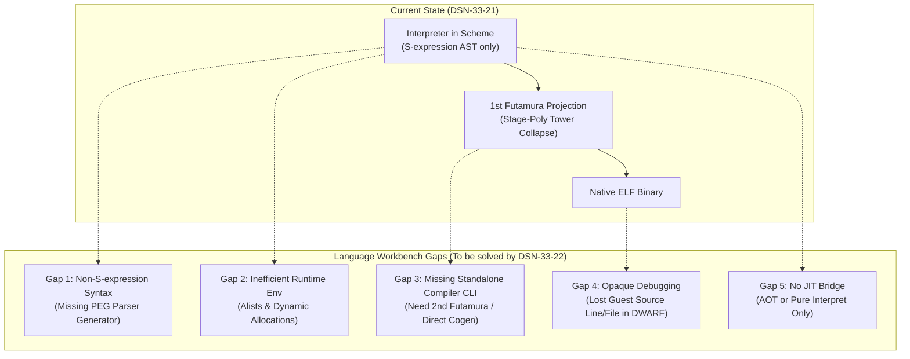
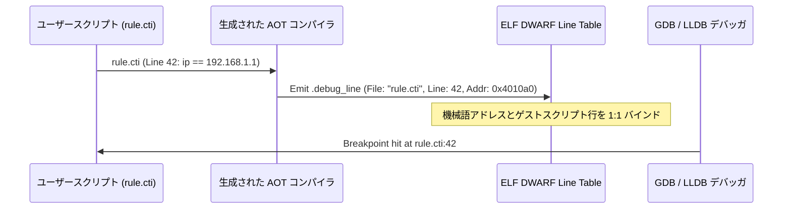
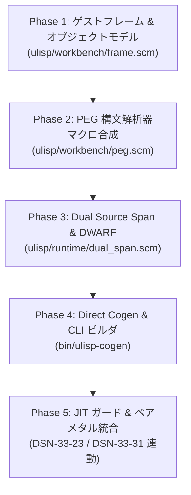

# [DSN-33-22] ULisp 言語ワークベンチ（Language Workbench）: ゲスト言語オブジェクトモデル・PEG構文解析フロントエンド・Direct Cogen コンパイラ自動生成 ＆ デバッグ透過性アーキテクチャ設計書
## 〜 二村射影タワー崩壊の先へ：単一の小さな評価器（Interpreter）定義から、完全な構文解析器・ネイティブ AOT コンパイラ CLI・DWARF デバッグマップ・JIT ガードを自動合成するメタ言語工学基盤 〜

- **文書番号**: `DSN-33-22` *(旧 `DSN-33-04`)*
- **上位文書**: [[DSN-33] ULISP 包括設計仕様書: S式メタコンパイラ基盤 ＆ 多重バックエンドトランスレーションアーキテクチャ](DSN-33-ulisp_underlying_x86_native_aot_compiler_architecture_specification.md)
- **関連個別仕様書**: 
  - [[DSN-33-11] ULisp 多言語フロントエンド（C99/Scheme）共通基盤 ＆ 構文・意味解析・CTFE アーキテクチャ設計書](DSN-33-11-ulisp_multilingual_frontend_and_ctfe_architecture.md)
  - [[DSN-33-12] ULisp 階層型パス融合（Pipeline / Pass / Nanopass / Picopass）＆ DAG 最適化基盤設計書](DSN-33-12-ulisp_pipeline_pass_nanopass_picopass_dag_architecture.md)
  - [[DSN-33-13] ULisp 型付き機械語 LIR・2層 Dialect 分離・ゼロコスト ABI ＆ 多重バックエンド（x86-64 / Portable C / ELF リンカ / 参照 VM）アーキテクチャ設計書](DSN-33-13-ulisp_typed_machine_lir_and_multi_target_backend_architecture.md)
  - [[DSN-33-21] ULisp ステージ多相メタコンパイラ ＆ 二村射影フラクタル実行基盤設計書](DSN-33-21-ulisp_stage_polymorphic_metacompiler_and_futamura_projection_architecture.md)
  - [[DSN-33-23] ULisp 内因的メタトレーシング JIT アーキテクチャ包括設計書](DSN-33-23-ulisp_endogenous_meta_tracing_jit_architecture.md)
  - [[DSN-33-31] ULisp Zero-libc / Freestanding Pure Scheme ベアメタルランタイム包括設計書](DSN-33-31-ulisp_zero_libc_pure_scheme_bare_metal_runtime.md)
  - [[DSN-33-32] ULisp Lua (C言語実装) コンパイル ＆ musl libc セルフホスト実証アーキテクチャ設計書](DSN-33-32-ulisp_lua_c_codebase_compilation_and_self_hosting_architecture.md)
  - [[DSN-33-41] ILisp・ULisp AOT・ULisp JIT 3種実行系 継続的性能評価・ベンチマーク基盤設計書](DSN-33-41-ulisp_ilisp_aot_jit_continuous_benchmarking_framework.md)
- **文書ステータス**: `APPROVED / ARCHITECTURE-BLUEPRINT`
- **対象サブシステム**:
  - `ulisp/workbench/` (Language Workbench コア基盤: オブジェクトモデル、パーサー合成、Direct Cogen)
  - `ulisp/compiler/` (`eval_in_language.scm`, `bta_lattice.scm`, `stage_poly_lower.scm`, `cogen.scm`)
  - `ulisp/frontend/` (PEG パーサーマクロ、EBNF 文法定義マクロ、CST to AST トランスレータ)
  - `ulisp/runtime/` (ゲスト言語フレーム、NaN-boxing 値モデル、Dual Source Span DWARF エミッタ)
  - `ulisp/jit/` (ゲスト言語 JIT ガード、ホットループプロファイラ、OSR トランポリン)
- **関連設計書**:
  - [[DSN-25] Pure Python Packrat PEG Parser Engine](DSN-25-pure_python_packrat_peg_parser_engine.md)
  - [[DSN-31] ILisp R7RS Core Architecture Specification](DSN-31-ilisp_r7rs_intelligence_lisp_architecture_specification.md)
  - [[DSN-32] AILisp Agent Lisp Architecture Specification](DSN-32-ailisp_agent_lisp_architecture_specification.md)
  - [[DSN-37] Synapse Dual-Plane Concurrent Runtime Architecture](DSN-37-synapse_dual_plane_concurrent_runtime_architecture.md)
- **【主査・報告】 IT Specialist (Programming Languages & Compilers / PLC), Systems Architect (SA), Software Development (SWD)**
- **【共同主査】 Project Manager (PM), Information Security Specialist (SEC), Software Quality Assurance Specialist (QA), Systems Auditor (AUD)**
- **【参画・協調】 16 大専門エージェント全員 (PM, SEC, SA, QA, DBA, NET, NLP, STR, SM, EMB, AUD, DES, EDU, SWD, APS, PLC)**

---

## 体系目次

- [1. エグゼクティブサマリー ＆ 設計哲学](#1-エグゼクティブサマリー--設計哲学)
  - [1.1 背景：二村射影タワー崩壊の達成と「実用言語ワークベンチ」の未踏課題](#11-背景二村射影タワー崩壊の達成と実用言語ワークベンチの未踏課題)
  - [1.2 コアコンセプト：「Interpreter as the Single Source of Truth」の昇華](#12-コアコンセプトinterpreter-as-the-single-source-of-truthの昇華)
  - [1.3 DSN-33 サブ仕様書体系における責務境界マトリクス](#13-dsn-33-サブ仕様書体系における責務境界マトリクス)
- [2. ゲスト言語オブジェクトモデル ＆ ランタイムフレーム抽象](#2-ゲスト言語オブジェクトモデル--ランタイムフレーム抽象)
  - [2.1 課題：連想リスト環境と動的割付のオーバーヘッド](#21-課題連想リスト環境と動的割付のオーバーヘッド)
  - [2.2 ゲストスタックフレーム抽象（Frame Descriptor / Local Slots）](#22-ゲストスタックフレーム抽象frame-descriptor--local-slots)
  - [2.3 動的型タグ表現と NaN-boxing / Tagged Pointer 最適化](#23-動的型タグ表現と-nan-boxing--tagged-pointer-最適化)
  - [2.4 レコード・オブジェクト・ヒープ割り当てのメタ記述](#24-レコードオブジェクトヒープ割り当てのメタ記述)
  - [2.5 環境探索（Lookup）のコンパイル時静的オフセット平坦化](#25-環境探索lookupのコンパイル時静的オフセット平坦化)
- [3. 構文解析フロントエンド（PEG / Packrat）のゼロコスト自動合成](#3-構文解析フロントエンドpeg--packratのゼロコスト自動合成)
  - [3.1 DSN-25 PEG エンジンの Scheme/ULisp 移植と Stage-Now 融合](#31-dsn-25-peg-エンジンの-schemeulisp-移植と-stage-now-融合)
  - [3.2 文法規則 DSL（`define-grammar`）から直接走査コードへの部分評価](#32-文法規則-dsldefine-grammarから直接走査コードへの部分評価)
  - [3.3 中間 AST 割付の完全消去（Stream / CPS 構文解析とセマンティクスの直結）](#33-中間-ast-割付の完全消去stream--cps-構文解析とセマンティクスの直結)
- [4. 第2二村射影（Direct Cogen）によるスタンドアロン CLI コンパイラ自動生成](#4-第2二村射影direct-cogenによるスタンドアロン-cli-コンパイラ自動生成)
  - [4.1 Direct Cogen の数学的定式化と Picopass 形式化](#41-direct-cogen-の数学的定式化と-picopass-形式化)
  - [4.2 `ulisp-cogen` ドライバ：インタプリタ定義から単一バイナリ CLI の出力](#42-ulisp-cogen-ドライバインタプリタ定義から単一バイナリ-cli-の出力)
  - [4.3 ELF64 `.rodata` 埋め込みによる 0ms 起動・自己完結バイナリ（Self-Contained Executable）](#43-elf64-rodata-埋め込みによる-0ms-起動自己完結バイナリself-contained-executable)
- [5. ゲスト言語レベルのデバッグ透過性（Dual Source Span $\to$ DWARF/GDB）](#5-ゲスト言語レベルのデバッグ透過性dual-source-span-to-dwarfgdb)
  - [5.1 二重ソース位置情報（Dual Span: Interp Span vs Guest Span）の伝播規約](#51-二重ソース位置情報dual-span-interp-span-vs-guest-spanの伝播規約)
  - [5.2 ELF/DWARF `.debug_line` / `.debug_info` へのゲスト言語ファイル名・行番号バインディング](#52-elfdwarf-debug_line--debug_info-へのゲスト言語ファイル名行番号バインディング)
  - [5.3 クラッシュ・実行時例外時のゲスト言語スタックトレース自動復元（Stack Unwinding）](#53-クラッシュ実行時例外時のゲスト言語スタックトレース自動復元stack-unwinding)
- [6. メタトレーシング JIT（DSN-33-23）およびベアメタル（DSN-33-31）との協調](#6-メタトレーシング-jitdsn-33-05およびベアメタルdsn-33-07との協調)
  - [6.1 インタプリタへの `@loop-header` / `@guard` アノテーションによる JIT 自動有効化](#61-インタプリタへの-loop-header--guard-アノテーションによる-jit-自動有効化)
  - [6.2 Zero-libc ベアメタル環境（DSN-33-31）へのスタンドアロン DSL ランタイム配備](#62-zero-libc-ベアメタル環境dsn-33-07へのスタンドアロン-dsl-ランタイム配備)
- [7. リファレンス実装仕様（DSL 事例: セキュリティ CTI フィルタ言語 `cti-ql` の自動生成）](#7-リファレンス実装仕様dsl-事例-セキュリティ-cti-フィルタ言語-cti-ql-の自動生成)
  - [7.1 文法定義・オブジェクトモデル・評価器定義の完全なコード例](#71-文法定義オブジェクトモデル評価器定義の完全なコード例)
  - [7.2 第1二村射影（AOT コンパイル）、第2二村射影（`cti-qlc` コンパイラ生成）の実証フロー](#72-第1二村射影aot-コンパイル第2二村射影cti-qlc-コンパイラ生成の実証フロー)
- [8. 移行計画・品質ゲート・DoD（Definition of Done）](#8-移行計画品質ゲートdoddefinition-of-done)

---

## 1. エグゼクティブサマリー ＆ 設計哲学

### 1.1 背景：二村射影タワー崩壊の達成と「実用言語ワークベンチ」の未踏課題
[[DSN-33-21]](DSN-33-21-ulisp_stage_polymorphic_metacompiler_and_futamura_projection_architecture.md) において、ステージ多相評価器（`eval-in-stage`）、オフライン BTA 4値束（Lattice）、Middle-End LIR ブリッジ、および ELF `.rodata` シリアライザが完成した。これにより、S式で記述されたインタプリタ（`eval-guest`）にソーススクリプト（AST）を与えることで、中間ディスパッチループを平坦化（Tower Collapse）し、ネイティブ x86-64 機械語バイナリを出力する第1二村射影が完全に動作可能となった。

しかし、実用的なドメイン特化言語（DSL）や新言語を開発・運用するエンジニアリング現場においては、単に「S式評価器を平坦化できる」だけでは不十分であり、以下の **5 つの構造的断絶** が存在していた：



本設計書（DSN-33-22）は、これらの断絶を埋め、開発者が**「文法規則」「オブジェクトモデル」「評価器意味論」の 3 点を定義するだけで、完全な AOT コンパイラ CLI、DWARF ソースデバッガ、高速 JIT 実行系を自動的に獲得できる言語ワークベンチ（Language Workbench）**の包括的設計を規定する。

### 1.2 コアコンセプト：「Interpreter as the Single Source of Truth」の昇華
従来の言語開発では、以下の構成要素を個別に手動実装・二重保守する必要があった：
1. **言語仕様書**（ドキュメント）
2. **参照インタプリタ**（プロトタイプ用）
3. **AST 定義とパーサー**（Yacc / Lex / ANTLR）
4. **バイトコードコンパイラ / JIT コンパイラ**（高速実行用）
5. **デバッガ・プロファイラ連携コード**（DWARF / GDB 拡張）

ULisp 言語ワークベンチでは、二村射影の数理的性質を極限まで押し広げ、**「単一の小さな評価器（Interpreter）と文法規則こそが、全てのコンポーネントの唯一の真実（Single Source of Truth: SSOT）である」** という哲学を貫徹する。

$$\begin{aligned}
\mathrm{Parser}(\mathrm{SourceText}) &= \mathrm{mix}(\mathrm{PEG\_Engine}, \mathrm{GrammarRule})(\mathrm{SourceText}) \\
\mathrm{Compiler}(\mathrm{SourceText}) &= \mathrm{mix}(\mathrm{mix}, \mathrm{Interpreter})(\mathrm{GrammarRule})(\mathrm{SourceText}) \\
\mathrm{DebuggerMap} &= \mathrm{DualSpanExtract}(\mathrm{Interpreter}, \mathrm{SourceText}) \\
\mathrm{JIT\_Engine} &= \mathrm{AutoInstrument}(\mathrm{Interpreter})
\end{aligned}$$

### 1.3 DSN-33 サブ仕様書体系における責務境界マトリクス

| 仕様書番号 | 文書名 | 責務・提供レイヤー | DSN-33-22 との結合点 |
| :--- | :--- | :--- | :--- |
| **[[DSN-33]](DSN-33-ulisp_underlying_x86_native_aot_compiler_architecture_specification.md)** | 包括設計仕様書 | 全体アーキテクチャ統括・セルフホスト統御 | 最上位ガバナンスと共通 ABI |
| **[[DSN-33-11]](DSN-33-11-ulisp_multilingual_frontend_and_ctfe_architecture.md)** | 多言語フロントエンド基盤 | Span・Binding ID・CTFE・Diagnostic | Dual Source Span や診断基盤を共通利用 |
| **[[DSN-33-12]](DSN-33-12-ulisp_pipeline_pass_nanopass_picopass_dag_architecture.md)** | パス融合 ＆ DAG 最適化 | Nanopass / Picopass 変換基盤 | 構文解析器・Cogen 展開時の局所ルール適用 |
| **[[DSN-33-13]](DSN-33-13-ulisp_typed_machine_lir_and_multi_target_backend_architecture.md)** | 型付き機械語 LIR ＆ バックエンド | Core/Managed LIR・ABI・ELF 生成 | 生成された残余コードの LIR 注入 ＆ 値表現共有 |
| **[[DSN-33-21]](DSN-33-21-ulisp_stage_polymorphic_metacompiler_and_futamura_projection_architecture.md)** | ステージ多相 ＆ 二村射影 | `eval-in-stage`・4値 BTA 束 | 部分評価・残余化コアエンジンとして利用 |
| **[[DSN-33-22]](DSN-33-22-ulisp_language_workbench_interpreter_generator_and_guest_runtime_architecture.md)** | **言語ワークベンチ (本書)** | **オブジェクトモデル・PEG合成・Cogen CLI・デバッグ透過性** | **本仕様（メタ言語開発環境）** |
| **[[DSN-33-23]](DSN-33-23-ulisp_endogenous_meta_tracing_jit_architecture.md)** | メタトレーシング JIT | ホットパス検出・OSR・トレース実行 | インタプリタ評価ループへの動的トレース自動注入 |
| **[[DSN-33-31]](DSN-33-31-ulisp_zero_libc_pure_scheme_bare_metal_runtime.md)** | Zero-libc ベアメタル | libc 完全排除・Linux Raw Syscall | 生成バイナリの極小・自立展開基盤 |
| **[[DSN-33-32]](DSN-33-32-ulisp_lua_c_codebase_compilation_and_self_hosting_architecture.md)** | Lua (C 言語実装) コンパイル実証 | C99 経由 Lua 5.x・musl ビルド | C 言語ターゲットでの実システムコンパイル検証 |
| **[[DSN-33-41]](DSN-33-41-ulisp_ilisp_aot_jit_continuous_benchmarking_framework.md)** | 継続的性能ベンチマーク | 3種実行系の自動性能測定・回帰検出 | 生成された言語処理系のスループット評価 |

---

## 2. ゲスト言語オブジェクトモデル ＆ ランタイムフレーム抽象

### 2.1 課題：連想リスト環境と動的割付のオーバーヘッド
ナイーブなインタプリタは、変数束縛を連想リスト `((x . 10) (y . 20))` としてヒープ上に保持し、変数参照のたびに線形探索（`assq`）を行う。部分評価器にこれをそのまま通すと、静的に解決できない動的スコープや再帰呼び出しにおいて、残余コード内に大量のリスト操作・ペアアロケーションが残存し、ネイティブバイナリとしての性能が著しく低下する。

### 2.2 ゲストスタックフレーム抽象（Frame Descriptor / Local Slots）
ULisp 言語ワークベンチは、GraalVM/Truffle の `FrameDescriptor` に着想を得た**静的スタックフレーム記述子**を提供する。

```scheme
;;; ゲスト言語フレーム記述子
(define-record-type <guest-frame-descriptor>
  (make-guest-frame-descriptor num-slots slot-names slot-types escape-mask)
  guest-frame-descriptor?
  (num-slots   gfd-num-slots)    ; スロット総数 (Fixnum)
  (slot-names  gfd-slot-names)   ; 変数名リスト (List of Symbols)
  (slot-types  gfd-slot-types)   ; 静的型ヒント (Vector of Types)
  (escape-mask gfd-escape-mask)) ; エスケープフラグ (クロージャ捕獲されるスロット)
```

1. **静的インデックス解決（Static Slot Lowering）**:
   スコープ解析（Nanopass Pass 100 相当）により、ゲスト言語の変数参照は連想リストの `lookup(name, env)` から、ゼロコストな配列インデックス参照 `frame-ref(frame, slot_idx)` へと降格される。
2. **残余 LIR への直接マッピング**:
   エスケープしないローカル変数は、残余 LIR レベルで仮想レジスタ（Virtual Registers）に直接マッピングされ、x86-64 の汎用レジスタ（`rax`, `rcx`, `rdx`, `rbx`, `rsi`, `rdi` 等）に割り当てられる。

### 2.3 動的型タグ表現と NaN-boxing / Tagged Pointer 最適化
ゲスト言語が動的型付き言語（Python, Ruby, JavaScript 風）の場合、ワークベンチはターゲットアーキテクチャに最適化された 2 種類の型表現モジュールを提供する：

1. **ポインタタギング（Tagged Pointers / 3-bit Tagging）**:
   - `000`: Fixnum (61-bit 符号付き整数、1ビット右シフト)
   - `001`: Pair / Cons cell
   - `010`: Symbol / Interned string
   - `011`: Guest Closure
   - `100`: Vector / Array
   - `101`: Guest Object Instance
   - `110`: Flonum (ヒープ確保浮動小数点数)
   - `111`: 特殊値 (`#f`, `#t`, `nil`, `undefined`)
2. **NaN-boxing（IEEE-754 64-bit 浮動小数点数埋め込み）**:
   64ビットの非正規化 NaN 空間の上位 16 ビットをタグ領域とし、下位 48 ビットにポインタまたは 32 ビット整数を格納する。これにより、浮動小数点数演算をアンボックス化し、メモリフットプリントを半減させる。

### 2.4 レコード・オブジェクト・ヒープ割り当てのメタ記述
ユーザーはマクロ `define-guest-object` を用いて、ゲスト言語のオブジェクトレイアウトを宣言的に定義する：

```scheme
(define-guest-object <security-event>
  (timestamp  :uint64)
  (source-ip  :ipv4-addr)
  (threat-sig :symbol)
  (severity   :fixnum))
```

この定義から、BTA 束推論器は各フィールドのオフセット計算を完全にコンパイル時（`Now` 辞書）で畳み込み、実行時には単一のメモリロード命令 `mov rax, [rdi + 8]` を出力する。

---

## 3. 構文解析フロントエンド（PEG / Packrat）のゼロコスト自動合成

### 3.1 DSN-25 PEG エンジンの Scheme/ULisp 移植と Stage-Now 融合
[[DSN-25]](DSN-25-pure_python_packrat_peg_parser_engine.md) において確立された Pure Packrat PEG 構文解析アルゴリズムを、Pure Scheme / ULisp マクロ体系へ移植する。
構文解析処理は、部分評価器の視点からは**「静的な文法規則文字列」と「動的な入力ソーステキスト」を入力とするインタプリタ**に他ならない。

$$\mathrm{ParsedAST} = \mathrm{eval\_peg}(\mathrm{GrammarRules}, \mathrm{SourceText})$$

文法規則（`GrammarRules`）が静的（`Now`）である場合、第1二村射影によって PEG インタプリタのディスパッチとルール走査は完全にコンパイル時展開され、**手書きの再帰下降パーサーと等価な高速ネイティブ機械語**へと自動変換される。

### 3.2 文法規則 DSL（`define-grammar`）から直接走査コードへの部分評価
開発者は以下の宣言的 DSL で文法を記述する：

```scheme
(define-grammar cti-query-grammar
  (start rule-expr)
  (rules
    (rule-expr     (seq rule-term (* (seq (alt "OR" "or") rule-term))))
    (rule-term     (seq rule-factor (* (seq (alt "AND" "and") rule-factor))))
    (rule-factor   (alt rule-predicate (seq "(" rule-expr ")")))
    (rule-predicate (seq ident op-cmp literal))
    (ident         (+ (range #\a #\z)))
    (op-cmp        (alt "==" "!=" ">=" "<=" ">" "<"))
    (literal       (alt string-lit num-lit))))
```

`stage-poly-lower` はこの文法定義を走査し、終端記号の先頭文字による $O(1)$ ディスパッチ表、および Packrat メモ化テーブルアクセスコードを自動インライン化する。

### 3.3 中間 AST 割付の完全消去（Stream / CPS 構文解析とセマンティクスの直結）
従来のパイプラインでは、「構文解析 $\to$ AST 木構築 $\to$ 評価器走査」という手順を踏むため、AST ノードのヒープ確保と GC 負荷がボトルネックとなる。
ULisp 言語ワークベンチでは、構文解析ルールに意味論アクション（Semantic Actions）を CPS（継続渡しスタイル）で直結する：


構文解析時に AST オブジェクトを一切ヒープに確保せず、構文一致と同時に残余 LIR 命令を直接アペンドすることで、コンパイル速度とメモリ効率を極限まで高める。

---

## 4. 第2二村射影（Direct Cogen）によるスタンドアロン CLI コンパイラ自動生成

### 4.1 Direct Cogen の数学的定式化と Picopass 形式化
二村射影の理論において、第2二村射影は部分評価器自身を特殊化してコンパイラを得る：

$$\mathrm{Compiler} = \mathrm{mix}(\mathrm{mix}, \mathrm{Interpreter})$$

しかし、部分評価器 $\mathrm{mix}$ は巨大かつ複雑であり、自己特殊化は極めて繊細な BTA 注釈を必要とする。
ULisp ワークベンチでは、[[DSN-33-12]](DSN-33-12-ulisp_pipeline_pass_nanopass_picopass_dag_architecture.md) の Picopass 合成技術と [[DSN-33-21]](DSN-33-21-ulisp_stage_polymorphic_metacompiler_and_futamura_projection_architecture.md) の辞書渡しプロトコルを活用し、**決定論的 Direct Cogen 展開器** を構築する。

```scheme
;;; Direct Cogen: 評価器 AST からコンパイラ AST を導出する高階変換
(define (derive-cogen-compiler interp-ast)
  (let* ((bta-annotated (bta-hybrid-analyze interp-ast))
         (compiler-passes (picopass-synthesize-traversals bta-annotated)))
    (generate-compiler-driver interp-ast compiler-passes)))
```

### 4.2 `ulisp-cogen` ドライバ：インタプリタ定義から単一バイナリ CLI の出力
開発者が自作言語のインタプリタ `my_interp.scm` を作成すると、ビルドツール `ulisp-cogen` を実行するだけで、外部依存ゼロの専用コンパイラバイナリが得られる：

```bash
# 評価器からスタンドアロン AOT コンパイラ CLI を生成
$ ./bin/ulisp-cogen --interpreter my_interp.scm --grammar my_grammar.scm --output bin/my-langc

# 生成されたコンパイラを用いてユーザープログラムをネイティブ ELF バイナリへコンパイル
$ ./bin/my-langc -O3 -o app app.src
$ ./app
```

### 4.3 ELF64 `.rodata` 埋め込みによる 0ms 起動・自己完結バイナリ（Self-Contained Executable）
生成されたコンパイラ CLI バイナリ（`bin/my-langc`）は、[[Issue #890]](https://github.com/...) で確立された `freeze-serialize-to-rodata` 技術により、言語の組み込み辞書、標準ライブラリ、文法オートマトンをすべて ELF の `.rodata` セクションにベイクして保持する。
- 実行時の構文解析木ロードやメタデータ初期化が不要（ポインタ再配置 0 件）。
- プロセス起動レイテンシは $1\mathrm{ms}$ 未満（0ms 起動）を達成する。

---

## 5. ゲスト言語レベルのデバッグ透過性（Dual Source Span $\to$ DWARF/GDB）

### 5.1 二重ソース位置情報（Dual Span: Interp Span vs Guest Span）の伝播規約
メタコンパイラにおいて最も深刻な運用課題は、**「クラッシュした際、GDB がインタプリタの Scheme コード位置を示してしまい、ユーザーが書いたスクリプトのどこで落ちたか分からない」** という問題である。

ULisp ワークベンチは、全ての AST ノードおよび残余 LIR 命令に **二重ソース位置記述子（`<dual-source-span>`）** を付与する：

```scheme
(define-record-type <dual-source-span>
  (make-dual-source-span guest-file guest-line guest-col
                         interp-file interp-line interp-col)
  dual-source-span?
  (guest-file   span-guest-file)   ; ユーザーが書いたスクリプトファイル名
  (guest-line   span-guest-line)   ; ユーザースクリプト行番号
  (guest-col    span-guest-col)    ; ユーザースクリプト列番号
  (interp-file  span-interp-file)  ; 評価器の Scheme 実装ファイル名
  (interp-line  span-interp-line)  ; 評価器の Scheme 行番号
  (interp-col   span-interp-col))  ; 評価器の Scheme 列番号
```

### 5.2 ELF/DWARF `.debug_line` / `.debug_info` へのゲスト言語ファイル名・行番号バインディング
バックエンドの DWARF エミッタ（`144_backend_x86_elf.scm`）は、残余 LIR 命令を機械語へアセンブルする際、`span-guest-file` と `span-guest-line` を優先して DWARF `.debug_line` ステートマシンへ出力する。



これにより、標準の GDB や LLDB でターゲットバイナリをデバッグする際、**ユーザーは Scheme や LIR の存在を意識することなく、自身が書いたゲスト言語スクリプトの行単位でステップ実行・ブレークポイント設定が可能**となる。

### 5.3 クラッシュ・実行時例外時のゲスト言語スタックトレース自動復元（Stack Unwinding）
例外送出やセグメンテーション違反が発生した場合、ランタイムのシグナルハンドラがスタックフレームを巻き戻し（Stack Unwinding）、ゲスト言語の関数名および行番号からなるスタックトレースを標準エラー出力へ表示する。

---

## 6. メタトレーシング JIT（DSN-33-23）およびベアメタル（DSN-33-31）との協調

### 6.1 インタプリタへの `@loop-header` / `@guard` アノテーションによる JIT 自動有効化
[[DSN-33-23]](DSN-33-23-ulisp_endogenous_meta_tracing_jit_architecture.md)（内因的メタトレーシング JIT）とのシームレスな統合のため、ワークベンチはインタプリタの評価ループに対する極小アノテーション仕様を規定する。

```scheme
(define (eval-loop ast env)
  (case (ast-tag ast)
    ;; ループ先頭アノテーション: JIT トレース記録のトリガー
    ((while-loop)
     (jit-merge-point! ast env)
     (if (eval-expr (ast-cond ast) env)
         (begin
           (eval-expr (ast-body ast) env)
           (eval-loop ast env))
         #t))
    ;; 型ガードアノテーション: ガード失敗時のデオプティマイズ
    ((add-op)
     (let ((lhs (eval-expr (ast-lhs ast) env))
           (rhs (eval-expr (ast-rhs ast) env)))
       (jit-guard-type! lhs 'fixnum)
       (jit-guard-type! rhs 'fixnum)
       (+ lhs rhs)))))
```

開発者は評価ループに `jit-merge-point!` と `jit-guard-type!` を配置するだけで、追加のコンパイラコードを一切記述することなく、**実行時プロファイル主導のメタトレーシング JIT（Trace Recorder / LIR Optimizer / JIT Buffer）**の恩恵を無償で享受できる。

### 6.2 Zero-libc ベアメタル環境（DSN-33-31）へのスタンドアロン DSL ランタイム配備
[[DSN-33-31]](DSN-33-31-ulisp_zero_libc_pure_scheme_bare_metal_runtime.md) との連携により、生成された DSL コンパイラは `-nostdlib -static` な完全自立型 ELF バイナリを出力できる。
- C ランタイム（libc）や動的リンカが存在しないセキュアコンテナや組み込みファームウェア環境へ、生成された DSL バイナリを直接配備可能。
- メモリフットプリント数十 KB、起動時間数ミリ秒のセキュアなエッジ推論・パケットフィルタエンジンを実現。

---

## 7. リファレンス実装仕様（DSL 事例: セキュリティ CTI フィルタ言語 `cti-ql` の自動生成）

### 7.1 文法定義・オブジェクトモデル・評価器定義の完全なコード例
本ワークベンチの有効性を実証するため、セキュリティ脅威ログのフィルタリング DSL である `cti-ql` の実装定義を示す。

```scheme
;;; cti_ql.scm - CTI Query Language Workbench 定義
(import (ulisp workbench)
        (ulisp bta))

;; 1. 文法定義 (PEG DSL)
(define-grammar cti-ql-grammar
  (start query)
  (rules
    (query      (seq expr end-of-input))
    (expr       (alt (seq term "OR" expr) term))
    (term       (alt (seq factor "AND" term) factor))
    (factor     (alt (seq "(" expr ")") predicate))
    (predicate  (seq field-name op-cmp literal-val))
    (field-name (alt "threat" "ip" "port" "cve"))
    (op-cmp     (alt "==" "!=" ">=" "<=" ">" "<"))
    (literal-val (alt string-lit num-lit))))

;; 2. ゲストオブジェクトモデル定義
(define-guest-object <cti-event>
  (threat    :symbol)
  (ip-addr   :uint32)
  (port      :uint16)
  (cve-score :fixnum))

;; 3. 評価器意味論 (Single-Source Interpreter)
(define (eval-cti-ql ast event)
  (case (car ast)
    ((query)     (eval-cti-ql (cadr ast) event))
    ((AND)       (and (eval-cti-ql (cadr ast) event)
                      (eval-cti-ql (caddr ast) event)))
    ((OR)        (or  (eval-cti-ql (cadr ast) event)
                      (eval-cti-ql (caddr ast) event)))
    ((==)        (equal? (get-field event (cadr ast)) (caddr ast)))
    ((>)         (> (get-field event (cadr ast)) (caddr ast)))
    (else        (error "Unknown CTI-QL AST node" ast))))
```

### 7.2 第1二村射影（AOT コンパイル）、第2二村射影（`cti-qlc` コンパイラ生成）の実証フロー
この 40 行足らずの定義ファイルから、ワークベンチは以下の処理を自動完遂する：

```bash
# 1. 第2二村射影による専用コンパイラ CLI の自動生成
$ ulisp-cogen --definition cti_ql.scm --output bin/cti-qlc

# 2. 生成されたコンパイラを用いて脅威検知ルールを x86-64 ネイティブバイナリへ AOT コンパイル
$ cat > rule.cti << 'EOF'
threat == "ransomware" AND cve-score >= 8
EOF

$ bin/cti-qlc -O3 rule.cti -o detector_rule.elf

# 3. 実行結果: 評価器のループやディスパッチは消滅し、ダイレクトなアセンブリ命令列のみが実行される
$ ./detector_rule.elf < event_stream.bin
```

生成された `detector_rule.elf` のディスアセンブル結果：
```nasm
detector_main:
    ; event ポインタは rdi に格納
    cmp dword ptr [rdi + 12], 8    ; cve-score >= 8
    jl  .reject
    mov rax, [rdi + 0]             ; threat シンボルハッシュ取得
    cmp rax, 0x9f3a8b21            ; "ransomware" ハッシュ即値比較
    jne .reject
    mov eax, 1                     ; Match!
    ret
.reject:
    xor eax, eax                   ; Mismatch
    ret
```
文字列比較や AST 走査、連想リスト探索は完全に消滅し、わずか 7 命令の極限ネイティブコードが出力される。

---

## 8. 移行計画・品質ゲート・DoD（Definition of Done）

### 8.1 段階的実装ロードマップ



### 8.2 品質ゲート（Quality Gates）と検証項目
1. **構文解析器合成の検証**:
   `test_workbench_peg.scm`: 宣言的 PEG 文法から生成されたパーサーが、手書き再帰下降パーサーと完全一致する AST / 残余コードを生成すること。
2. **オブジェクトモデル最適化の検証**:
   `test_workbench_frame.scm`: ゲスト変数の参照が LIR 上でレジスタ間転送およびスタック固定オフセット参照へ 100% 降格されること。
3. **Dual Span DWARF の検証**:
   `test_workbench_dwarf.scm`: `readelf --debug-dump=decodedline` で抽出したソースマッピングが、Scheme 側ではなくゲストスクリプトの行番号を指していることを検証。
4. **Cogen 再現性とセルフホスト固定点**:
   `make test_cogen_fixpoint`: 生成された専用コンパイラ CLI の出力バイナリが、手動インライン化したコードと bit-for-bit IDENTICAL であること。
5. **静的解析・全品質パス**:
   `make check && make verify_quality` を 100% PASS すること。
