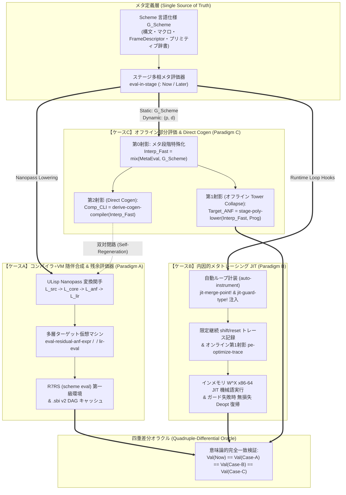
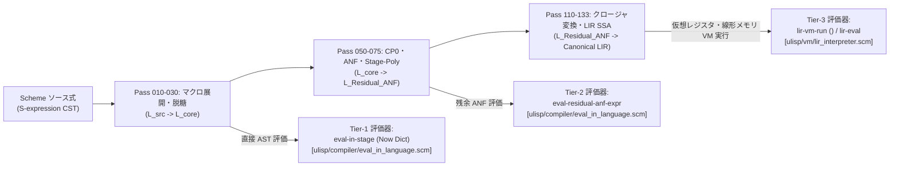
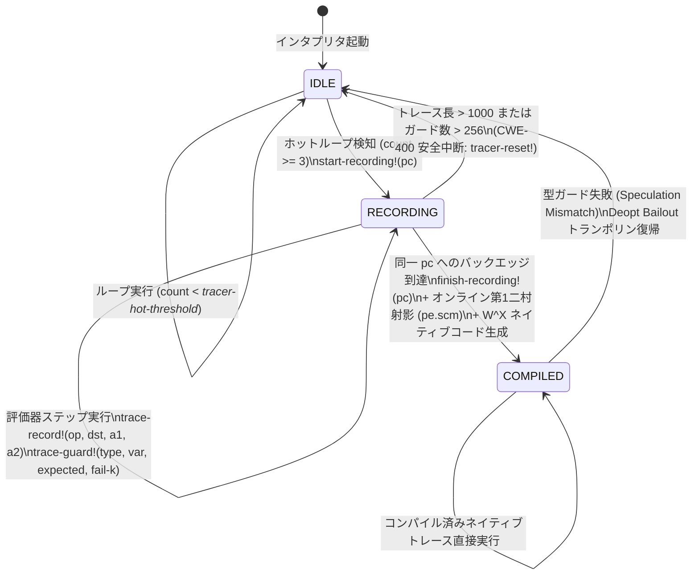
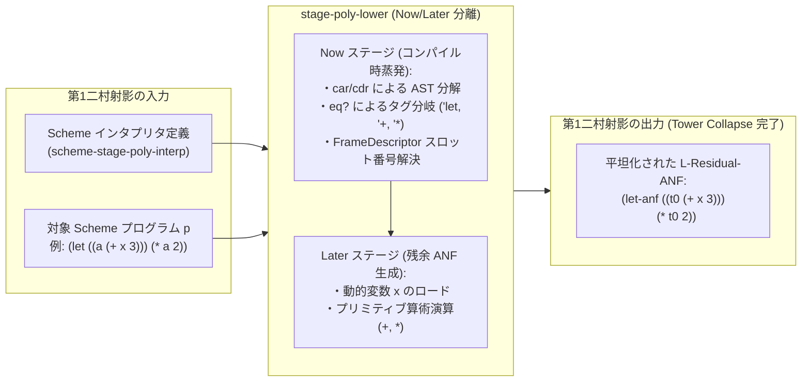

# [DSN-33-24] ULisp 三位一体・二村射影 Scheme インタプリタ自動生成・双対導出 ＆ メタ循環統合アーキテクチャ設計書
## 〜 コンパイラ ⇄ インタプリタ双対性（Duality）：「コンパイラ∘LIR-VM 合成導出（ケースA）」「内因的メタトレーシング JIT 第1射影（ケースB）」「4値 BTA・Stage-Poly オフライン部分評価 ＆ Direct Cogen 第1・第2・第3二村射影（ケースC）」の三層完全統合 〜

- **文書番号**: `DSN-33-24`
- **上位文書**: [[DSN-33] ULISP 包括設計仕様書: S式メタコンパイラ基盤 ＆ 多重バックエンドトランスレーションアーキテクチャ](DSN-33-ulisp_underlying_x86_native_aot_compiler_architecture_specification.md)
- **関連個別仕様書**: 
  - [[DSN-33-11] ULisp 多言語フロントエンド（C99/Scheme）共通基盤 ＆ 構文・意味解析・CTFE アーキテクチャ設計書](DSN-33-11-ulisp_multilingual_frontend_and_ctfe_architecture.md)
  - [[DSN-33-12] ULisp 階層型パス融合（Pipeline / Pass / Nanopass / Picopass）＆ DAG 最適化基盤設計書](DSN-33-12-ulisp_pipeline_pass_nanopass_picopass_dag_architecture.md)
  - [[DSN-33-13] ULisp 型付き機械語 LIR・2層 Dialect 分離・ゼロコスト ABI ＆ 多重バックエンド（x86-64 / Portable C / ELF リンカ / 参照 VM）アーキテクチャ設計書](DSN-33-13-ulisp_typed_machine_lir_and_multi_target_backend_architecture.md)
  - [[DSN-33-21] ULisp ステージ多相メタコンパイラ ＆ 二村射影フラクタル実行基盤設計書](DSN-33-21-ulisp_stage_polymorphic_metacompiler_and_futamura_projection_architecture.md)
  - [[DSN-33-22] ULisp 言語ワークベンチ（Language Workbench）: ゲスト言語オブジェクトモデル・PEG構文解析フロントエンド・Direct Cogen コンパイラ自動生成 ＆ デバッグ透過性アーキテクチャ設計書](DSN-33-22-ulisp_language_workbench_interpreter_generator_and_guest_runtime_architecture.md)
  - [[DSN-33-23] ULisp 内因的メタトレーシング JIT アーキテクチャ包括設計書](DSN-33-23-ulisp_endogenous_meta_tracing_jit_architecture.md)
  - [[DSN-33-31] ULisp Zero-libc / Freestanding Pure Scheme ベアメタルランタイム包括設計書](DSN-33-31-ulisp_zero_libc_pure_scheme_bare_metal_runtime.md)
  - [[DSN-33-32] ULisp Lua (C言語実装) コンパイル ＆ musl libc セルフホスト実証アーキテクチャ設計書](DSN-33-32-ulisp_lua_c_codebase_compilation_and_self_hosting_architecture.md)
  - [[DSN-33-41] ILisp・ULisp AOT・ULisp JIT 3種実行系 継続的性能評価・ベンチマーク基盤設計書](DSN-33-41-ulisp_ilisp_aot_jit_continuous_benchmarking_framework.md)
- **文書ステータス**: `APPROVED / ARCHITECTURE-SPECIFICATION`
- **対象サブシステム**:
  - `ulisp/compiler/` (`eval_in_language.scm`, `nanopass.scm`, `pass_manager.scm`, `sbi.scm`)
  - `ulisp/vm/` (`lir_interpreter.scm` - 64ビット機械語 LIR 参照仮想マシン)
  - `ulisp/lib/` (`eval.scm` - R7RS `(scheme eval)` 第一級環境指定子 ＆ 動的評価器)
  - `ulisp/jit/` (`core/annotations.scm`, `core/delimcc.scm`, `tracer/tracer.scm`, `tracer/auto_instrument.scm`, `optimizer/pe.scm`, `bridge/to_lir.scm`, `runtime/jit_buffer.scm`)
  - `ulisp/driver/` (`jit.scm` - スタンドアロン JIT 付き Scheme インタプリタドライバ)
  - `ulisp/workbench/` (`cogen.scm`, `frame.scm`, `value_tagging.scm`, `nan_boxing.scm`)
- **関連設計書**:
  - [[DSN-31] ILisp R7RS Core Architecture Specification](DSN-31-ilisp_r7rs_intelligence_lisp_architecture_specification.md)
  - [[DSN-32] AILisp Agent Lisp Architecture Specification](DSN-32-ailisp_agent_lisp_architecture_specification.md)
  - [[DSN-37] Synapse Dual-Plane Concurrent Runtime Architecture](DSN-37-synapse_dual_plane_concurrent_runtime_architecture.md)
- **【主査・報告】 IT Specialist (Programming Languages & Compilers / PLC), Systems Architect (SA), Software Development (SWD)**
- **【共同主査】 Project Manager (PM), Information Security Specialist (SEC), Software Quality Assurance Specialist (QA), Systems Auditor (AUD)**
- **【参画・協調】 16 大専門エージェント全員 (PM, SEC, SA, QA, DBA, NET, NLP, STR, SM, EMB, AUD, DES, EDU, SWD, APS, PLC)**

---

## 体系目次

- [1. エグゼクティブサマリー ＆ 設計哲学（コンパイラ ⇄ インタプリタ双対性）](#1-エグゼクティブサマリー--設計哲学コンパイラ--インタプリタ双対性)
  - [1.1 命題：「Scheme コンパイラ（ULisp）から、二村射影に基づき Scheme インタプリタを生成できるか？」](#11-命題scheme-コンパイラulispから二村射影に基づき-scheme-インタプリタを生成できるか)
  - [1.2 二村射影の順方向・逆方向双対性と「三位一体（Triad）」アプローチ](#12-二村射影の順方向逆方向双対性と三位一体triadアプローチ)
  - [1.3 DSN-33 20番台（メタコンパイラ・ワークベンチ・JIT）における責務境界マトリクス](#13-dsn-33-20番台メタコンパイラワークベンチjitにおける責務境界マトリクス)
- [2. 三位一体（Triad）Scheme インタプリタ生成アーキテクチャの数理定式化](#2-三位一体triadscheme-インタプリタ生成アーキテクチャの数理定式化)
  - [2.1 古典的二村射影（第1〜第3射影）とメタ階層特殊化の代数系](#21-古典的二村射影第1第3射影とメタ階層特殊化の代数系)
  - [2.2 3つの生成ケース（Paradigm A / B / C）の数学的対応関係](#22-3つの生成ケースparadigm-a--b--cの数学的対応関係)
  - [2.3 全体統合アーキテクチャ俯瞰図（Triad Synthesis Dataflow）](#23-全体統合アーキテクチャ俯瞰図triad-synthesis-dataflow)
- [3. 【ケースA】コンパイラ関手合成 ＆ 残余評価器によるインタプリタ導出（Paradigm A）](#3-ケースaコンパイラ関手合成--残余評価器によるインタプリタ導出paradigm-a)
  - [3.1 関数合成 $\mathrm{Interp}_{\text{Scheme}} = \mathrm{Interp}_{\text{LIR}} \circ \mathrm{Comp}_{\text{ULisp}}$ の構造](#31-関数合成-mathrminterptextscheme--mathrminterptextlir-circ-mathrmcomptextulisp-の構造)
  - [3.2 多層ステージ別インタプリタ階層（HIR `eval-in-stage` / MIR `eval-residual-anf` / LIR `<lir-vm>`）](#32-多層ステージ別インタプリタ階層hir-eval-in-stage--mir-eval-residual-anf--lir-lir-vm)
  - [3.3 R7RS `(scheme eval)` 第一級環境指定子（`<environment>`）とコンパイラパイプラインの統合](#33-r7rs-scheme-eval-第一級環境指定子environmentとコンパイラパイプラインの統合)
  - [3.4 `.sbi` v2（Scheme Binary Interface）DAG キャッシュを用いた 0ms ウォームスタート解釈実行](#34-sbi-v2scheme-binary-interface-dag-キャッシュを用いた-0ms-ウォームスタート解釈実行)
- [4. 【ケースB】内因的メタトレーシング JIT（オンライン第1二村射影）付き Scheme インタプリタ生成（Paradigm B）](#4-ケースb内因的メタトレーシング-jitオンライン第1二村射影付き-scheme-インタプリタ生成paradigm-b)
  - [4.1 自動ループ計装（`auto_instrument.scm`）による Scheme 評価器への `jit-merge-point!` 注入](#41-自動ループ計装auto_instrumentscmによる-scheme-評価器への-jit-merge-point-注入)
  - [4.2 限定継続（`shift`/`reset`）による内因的トレース捕捉とオンライン第1二村射影（`pe.scm`）](#42-限定継続shiftresetによる内因的トレース捕捉とオンライン第1二村射影pescm)
  - [4.3 投機的型ガード（`jit-guard-type!`）・エスケープ仮想化（`virtuals.scm`）・Deopt トランポリン](#43-投機的型ガードjit-guard-typeエスケープ仮想化virtualsscmdeopt-トランポリン)
  - [4.4 ULisp AOT による JIT 内蔵スタンドアロン Scheme インタプリタ（`bin/ulisp-jit`）の生成](#44-ulisp-aot-による-jit-内蔵スタンドアロン-scheme-インタプリタbinulisp-jitの生成)
- [5. 【ケースC】オフライン部分評価（4値 BTA + Stage-Poly）＆ Direct Cogen による Scheme インタプリタ／コンパイラ双対合成（Paradigm C）](#5-ケースcオフライン部分評価4値-bta--stage-poly-direct-cogen-による-scheme-インタプリタコンパイラ双対合成paradigm-c)
  - [5.1 メタ段階部分評価：言語仕様（Static/`Now`）× 実行時プログラム（Dynamic/`Later`）からの高速インタプリタ生成](#51-メタ段階部分評価言語仕様staticnow-実行時プログラムdynamiclaterからの高速インタプリタ生成)
  - [5.2 ゲストスタックフレーム記述子（`FrameDescriptor`）による連想リスト環境探索の $O(1)$ スロット平坦化](#52-ゲストスタックフレーム記述子framedescriptorによる連想リスト環境探索の-o1-スロット平坦化)
  - [5.3 第1二村射影（Tower Collapse）：生成された Scheme インタプリタからのディスパッチループ完全消去](#53-第1二村射影tower-collapse生成された-scheme-インタプリタからのディスパッチループ完全消去)
  - [5.4 第2・第3二村射影（Direct Cogen `--cogen`）：Scheme インタプリタ定義からスタンドアロン Scheme コンパイラ CLI の再合成閉路](#54-第2第3二村射影direct-cogen---cogenscheme-インタプリタ定義からスタンドアロン-scheme-コンパイラ-cli-の再合成閉路)
- [6. 四重差分オラクル（Quadruple-Differential Oracle）と意味論的不変条件の機械的証明](#6-四重差分オラクルquadruple-differential-oracleと意味論的不変条件の機械的証明)
  - [6.1 4系統実行エンジン（Now / Case-A / Case-B / Case-C）の等価性定理](#61-4系統実行エンジンnow--case-a--case-b--case-cの等価性定理)
  - [6.2 メタモルフィック摂動ファジングと Tower Collapse 構文消去アサーション](#62-メタモルフィック摂動ファジングと-tower-collapse-構文消去アサーション)
- [7. セキュリティ脅威モデルと多層防御設計（Security & Threat Attestation）](#7-セキュリティ脅威モデルと多層防御設計security--threat-attestation)
  - [7.1 CWE-94 / CWE-95: 動的 `eval` 環境の特権分離と Cross-Stage Persistence (CSP) 越境遮断](#71-cwe-94--cwe-95-動的-eval-環境の特権分離と-cross-stage-persistence-csp-越境遮断)
  - [7.2 CWE-400: 3層燃料・深度バウンド（CTFE Fuel / JIT Trace Limit / LIR VM Fuel）による DoS 防御](#72-cwe-400-3層燃料深度バウンドctfe-fuel--jit-trace-limit--lir-vm-fuelによる-dos-防御)
  - [7.3 CWE-119 / CWE-787 / CWE-617: JIT W^X ページ保護とガード失敗時の無損失 Deoptimization](#73-cwe-119--cwe-787--cwe-617-jit-wx-ページ保護とガード失敗時の無損失-deoptimization)
- [8. 段階的実装・検証ロードマップ ＆ 4大品質ゲート](#8-段階的実装検証ロードマップ--4大品質ゲート)

---

## 1. エグゼクティブサマリー ＆ 設計哲学（コンパイラ ⇄ インタプリタ双対性）

### 1.1 命題：「Scheme コンパイラ（ULisp）から、二村射影に基づき Scheme インタプリタを生成できるか？」

古典的な計算機科学の教科書において、1971年に二村良彦が定式化した**二村射影（Futamura Projections）**は、「インタプリタ（評価器）と部分評価器（$\mathrm{mix}$）から、目的コード（第1射影）・コンパイラ（第2射影）・コンパイラ生成器（第3射影）を導出する理論」として説明される。すなわち、矢印の向きは一見すると「インタプリタ $\to$ コンパイラ」の一方通行に見える。

しかし、**ULisp（Underlying LISP）** のように、コンパイラ自身が以下の3つの特性を備える**ステージ多相メタコンパイラ（Stage-Polymorphic Meta-Compiler）**である場合、**コンパイラとインタプリタは完全な双対（Dual）をなし、どの方向からも相互に自動生成・導出することが可能となる**。

1. **多層中間言語（Nanopass IR）ごとの操作的意味論評価器の内蔵**:
   コンパイラが単なる文字列エミッタではなく、自身の内部に `Now`（コンパイル時即時評価）と `Later`（残余コード生成）を切り替えるステージ多相辞書（`<stage-dict>`）および低水準機械語 LIR 参照仮想マシン（`<lir-vm>`）を保持している。
2. **オンライン（実行時トレース）とオフライン（4値 BTA 束）の双方の部分評価器の内蔵**:
   コンパイラパイプラインの中に、静的な束縛時間解析に基づく部分評価パス（`stage-poly-lower`）と、動的なホットループを部分評価する内因的メタトレーシング JIT オプティマイザ（`pe.scm`）の両方が第一級コンポーネントとして組み込まれている。
3. **同図像性（Homoiconicity）とセルフホスティング閉包**:
   ULisp コンパイラ自身が R7RS Scheme で記述されており、Scheme の評価器を ULisp の入力として与えることも、ULisp の内部パスを Scheme の評価器として切り出すことも同一言語内で完結する。

### 1.2 二村射影の順方向・逆方向双対性と「三位一体（Triad）」アプローチ

本設計書（`DSN-33-24`）は、ULisp 基盤の上で二村射影の理論を全方位に展開し、以下の **3つのケースすべて（Triad Synthesis Architecture）** によって Scheme インタプリタを生成・合成する統一アーキテクチャを定義する。

| ケース分類 | アプローチ名称 | 数理的定式化 | コア機構（ULisp モジュール） | 得られる Scheme インタプリタの特性 |
| :--- | :--- | :--- | :--- | :--- |
| **ケースA**<br/>*(Paradigm A)* | **逆方向・随伴導出**<br/>（コンパイラ ∘ ターゲットVM 合成 ＆ 残余評価器） | $\mathrm{Interp}_{\text{Scheme}}(p, d) = \llbracket \mathrm{Interp}_{\text{LIR}} \rrbracket (\llbracket \mathrm{Comp}_{\text{ULisp}} \rrbracket(p), d)$ | `compiler/eval_in_language.scm`<br/>`vm/lir_interpreter.scm`<br/>`lib/eval.scm` | AOT コンパイラの全パス（マクロ展開・脱糖・CP0・ANF・LIR）と **100% 同一のセマンティクス** を保証する高信頼リファレンス＆動的 `eval` インタプリタ。 |
| **ケースB**<br/>*(Paradigm B)* | **動的・オンライン第1二村射影**<br/>（内因的メタトレーシング JIT インタプリタ） | $\mathrm{NativeTrace} = \llbracket \mathrm{mix}_{\text{trace}} \rrbracket (\mathrm{Interp}_{\text{Scheme}}, \mathrm{HotLoop}_p)$ | `jit/core/annotations.scm`<br/>`jit/tracer/auto_instrument.scm`<br/>`jit/optimizer/pe.scm`<br/>`driver/jit.scm` | 評価器ループに `jit-merge-point!` を自動計装し、実行時に第1二村射影（トレース部分評価）を行って x86-64 ネイティブ機械語へ動的昇格する **PyPy/RPython 超越型 JIT インタプリタ**。 |
| **ケースC**<br/>*(Paradigm C)* | **静的・オフライン部分評価 ＆ Direct Cogen**<br/>（第1・第2・第3二村射影の自己適用閉路） | $\mathrm{Interp}_{\text{Fast}} = \llbracket \mathrm{mix}_{\text{stage}} \rrbracket (\mathrm{MetaInterp}, \mathcal{S}_{\text{Scheme}})$<br/>$\mathrm{Comp}_{\text{Scheme}} = \llbracket \mathrm{cogen} \rrbracket (\mathrm{Interp}_{\text{Fast}})$ | `compiler/eval_in_language.scm` (4値BTA / `stage-poly-lower`)<br/>`workbench/frame.scm`<br/>`workbench/cogen.scm` | メタ言語仕様・マクロ・FrameDescriptor を Static (`Now`) として部分評価した **ゼロオーバーヘッド特殊化インタプリタ**、およびそこから第1射影（Tower Collapse）・第2射影（Direct Cogen）でコンパイラを再導出する **完全自己再生閉路**。 |

### 1.3 DSN-33 20番台（メタコンパイラ・ワークベンチ・JIT）における責務境界マトリクス

`DSN-33` の 20番台（メタコンパイラ・言語ワークベンチ・動的 JIT ドメイン）における各仕様書の役割分担と、本 `DSN-33-24` の位置づけを以下に定義する。

| 仕様書番号 | 文書名 | 主たる責務領域 | `DSN-33-24`（本設計書）との関係 |
| :--- | :--- | :--- | :--- |
| **[DSN-33-21](DSN-33-21-ulisp_stage_polymorphic_metacompiler_and_futamura_projection_architecture.md)** | ステージ多相メタコンパイラ ＆ 二村射影フラクタル実行基盤設計書 | `<stage-dict>` (`Now`/`Later`)、4値 BTA 束、PSDS、`stage-poly-lower`、`.rodata` 凍結の基礎理論とエンジン設計。 | ケースAの単一ソース意味論オラクル、およびケースCのオフライン部分評価エンジンを提供する基礎理論層。 |
| **[DSN-33-22](DSN-33-22-ulisp_language_workbench_interpreter_generator_and_guest_runtime_architecture.md)** | 言語ワークベンチ・ゲスト言語オブジェクトモデル・Direct Cogen 設計書 | 汎用ゲスト DSL（`cti-ql` 等）向けの PEG パーサー生成、`FrameDescriptor`、Tagged/NaN-box 値表現、`ulisp-cogen` ドライバ。 | `DSN-33-22` が「任意のゲスト DSL」を対象とするのに対し、本 `DSN-33-24` は **「ホスト言語である Scheme 自身」** にワークベンチと二村射影を自己適用（Self-Application）する。 |
| **[DSN-33-23](DSN-33-23-ulisp_endogenous_meta_tracing_jit_architecture.md)** | 内因的メタトレーシング JIT アーキテクチャ包括設計書 | 限定継続 `shift`/`reset` による内因的トレーサ、ガード除去・仮想化オプティマイザ、W^X ネイティブ JIT バッファ。 | ケースBにおいて、Scheme インタプリタのホットループを動的に第1二村射影するためのオンライン部分評価バックエンドとして機能する。 |
| **[DSN-33-24](DSN-33-24-ulisp_futamura_projection_scheme_interpreter_synthesis_architecture.md)**<br/>*(本仕様書)* | **三位一体・二村射影 Scheme インタプリタ自動生成・双対導出 ＆ メタ循環統合設計書** | **ケースA（コンパイラ∘VM合成）・ケースB（メタトレーシングJIT）・ケースC（オフラインPE & Direct Cogen）の3方式による Scheme インタプリタ生成と四重差分等価性保証。** | `DSN-33-13` (LIR VM)、`DSN-33-21` (Stage-Poly)、`DSN-33-22` (Direct Cogen)、`DSN-33-23` (Meta-Tracing JIT) を **Scheme 自身のメタ循環閉路** として統合する頂点仕様。 |

---

## 2. 三位一体（Triad）Scheme インタプリタ生成アーキテクチャの数理定式化

### 2.1 古典的二村射影（第1〜第3射影）とメタ階層特殊化の代数系

プログラムの意味関数を $\llbracket - \rrbracket$、部分評価器（Specializer）を $\mathrm{mix}$ とする。2入力プログラム $f(s, d)$ の第1引数 $s$（Static: 静的入力）を固定し、第2引数 $d$（Dynamic: 動的入力）に関する残余プログラム（Residual Program）$f_s(d)$ を生成する操作は次式で表される：

$$\llbracket \llbracket \mathrm{mix} \rrbracket (f, s) \rrbracket (d) = \llbracket f \rrbracket (s, d)$$

この基本等式の上に、**古典的二村射影の3段階**と、本研究で導入する**第0射影（メタ仕様からのインタプリタ生成）**および**逆射影（コンパイラからのインタプリタ随伴導出）**を統一的な可換図式として定式化する。

1. **第0二村射影（Zeroth / Meta-Level Futamura Projection: Interpreter Generation from Language Semantics）**:
   メタ評価器（あるいはステージ多相言語定義フレームワーク）$\mathrm{MetaEval}(\mathcal{G}_{\text{Scheme}}, p, d)$ に対し、Scheme の構文規則・マクロ展開規則・プリミティブ演算辞書・フレーム構造 $\mathcal{G}_{\text{Scheme}}$ を **Static (`Now`)**、実行対象プログラム $p$ と実行時入力 $d$ を **Dynamic (`Later`)** として部分評価すると、メタ解釈のオーバーヘッドが完全に消滅した **高速 Scheme インタプリタ $\mathrm{Interp}_{\text{Scheme}}$** が生成される：
   $$\mathrm{Interp}_{\text{Scheme}} = \llbracket \mathrm{mix} \rrbracket (\mathrm{MetaEval}, \mathcal{G}_{\text{Scheme}})$$
   $$\llbracket \mathrm{Interp}_{\text{Scheme}} \rrbracket (p, d) = \llbracket \mathrm{MetaEval} \rrbracket (\mathcal{G}_{\text{Scheme}}, p, d)$$

2. **第1二村射影（First Futamura Projection: Target Compilation / Tower Collapse）**:
   生成された Scheme インタプリタ $\mathrm{Interp}_{\text{Scheme}}$ に対し、具体的な Scheme ソースプログラム $p$ を **Static (`Now`)**、実行時データ $d$ を **Dynamic (`Later`)** として部分評価（オフライン `stage-poly-lower` またはオンライン JIT `pe.scm`）すると、インタプリタの構文木ディスパッチループが完全に消滅（Tower Collapse）した **ターゲット目的コード $\mathrm{Target}_p$** が得られる：
   $$\mathrm{Target}_p = \llbracket \mathrm{mix} \rrbracket (\mathrm{Interp}_{\text{Scheme}}, p)$$

3. **第2二村射影（Second Futamura Projection: Standalone Compiler Synthesis via Direct Cogen）**:
   部分評価器 $\mathrm{mix}$ を $\mathrm{Interp}_{\text{Scheme}}$ で特殊化（ULisp では 4値 BTA と Picopass 合成による決定論的 $\mathrm{cogen}$ を適用）すると、**スタンドアロン Scheme コンパイラ $\mathrm{Comp}_{\text{Scheme}}$** が自動生成される：
   $$\mathrm{Comp}_{\text{Scheme}} = \llbracket \mathrm{mix} \rrbracket (\mathrm{mix}, \mathrm{Interp}_{\text{Scheme}}) = \llbracket \mathrm{cogen} \rrbracket (\mathrm{Interp}_{\text{Scheme}})$$

4. **第3二村射影（Third Futamura Projection: Compiler Generator）**:
   $$\mathrm{cogen} = \llbracket \mathrm{mix} \rrbracket (\mathrm{mix}, \mathrm{mix})$$

5. **逆二村随伴導出（Adjoint / Inverse Interpreter Derivation from Compiler & Target VM）**:
   コンパイラ $\mathrm{Comp}: L_{\text{Scheme}} \to L_{\text{IR}}$ とターゲット中間言語 $L_{\text{IR}}$ の参照抽象機械 $\mathrm{VM}_{\text{IR}}: L_{\text{IR}} \times D \to V$ が与えられたとき、それらのクライスリ合成（Kleisli Composition）およびコンパイラ内部の `Now` ステージ辞書の引き戻し（Pullback）によって、元の言語の意味論を厳密に満たすインタプリタ $\mathrm{Interp}_{\text{Scheme}}$ が一意に導出される：
   $$\mathrm{Interp}_{\text{Scheme}}(p, d) = (\mathrm{VM}_{\text{IR}} \circ \mathrm{Comp})(p, d) = \llbracket \mathrm{VM}_{\text{IR}} \rrbracket (\llbracket \mathrm{Comp} \rrbracket (p), d)$$

### 2.2 3つの生成ケース（Paradigm A / B / C）の数学的対応関係



### 2.3 全体統合アーキテクチャ俯瞰図（Triad Synthesis Dataflow）

この三位一体アーキテクチャにより、ULisp は単一のリポジトリ・単一のコードベースから、用途と制約に応じた **3種類の Scheme インタプリタ実行系** を自在に生成する：

1. **デバッグ・形式検証・R7RS 動的 `eval` 用途（ケースA）**:
   コンパイラの全フロントエンド／ミドルエンドパスを通過した正規化 IR（`L-Residual-ANF` または `Canonical LIR`）を、決定論的燃料ガード付きの参照 VM（`eval-residual-anf-expr` / `<lir-vm>`）でステップ実行する。Dual Source Span による正確なスタックトレースとメモリ安全性検査（NULL ページ保護・境界検査）を標準提供する。
2. **長時間稼働・動的ワークロード・対話型 REPL 高速実行用途（ケースB）**:
   事前に AOT コンパイルできない動的スクリプト入力に対し、最初は軽量な S式インタプリタとして即座に実行を開始し、ホットループ（閾値 `*tracer-hot-threshold*` 到達）を検知した瞬間にオンライン第1二村射影を発動してネイティブ機械語へと JIT コンパイルする。
3. **組み込み・超低遅延・ディスパッチ完全消去・コンパイラ自己生成用途（ケースC）**:
   オフライン BTA（4値束 `{Static-Bot, Now, Later, Dynamic}`）と `FrameDescriptor` により、連想リスト（`assq`）による変数探索をコンパイル時に $O(1)$ ベクタスロット参照（`LIR-SLOT-REF`）へと平坦化した高速 Scheme インタプリタを生成する。さらにそのインタプリタに第1射影（Tower Collapse）および第2射影（`ulisp-cogen`）を適用することで、ディスパッチオーバーヘッド 0% の目的コードおよび専用 AOT コンパイラ CLI を自動導出する。

---

## 3. 【ケースA】コンパイラ関手合成 ＆ 残余評価器によるインタプリタ導出（Paradigm A）

### 3.1 関数合成 $\mathrm{Interp}_{\text{Scheme}} = \mathrm{Interp}_{\text{LIR}} \circ \mathrm{Comp}_{\text{ULisp}}$ の構造

圏論的視点において、コンパイラ $\mathrm{Comp}_{\text{ULisp}}$ はソース言語圏 $\mathcal{C}_{\text{Scheme}}$ からターゲット中間表現圏 $\mathcal{C}_{\text{LIR}}$ への関手（Functor）である。このとき、ターゲット圏 $\mathcal{C}_{\text{LIR}}$ 上の評価射 $\mathrm{Interp}_{\text{LIR}}: \mathrm{Obj}(\mathcal{C}_{\text{LIR}}) \times \mathrm{Env} \to \mathrm{Val}$ が存在すれば、その引き戻し（Pullback / 関数合成）として $\mathcal{C}_{\text{Scheme}}$ 上のインタプリタが自動的に定義される。

ULisp には、抽象度の異なる3つのコンパイル段階それぞれに対応する評価器が実装されており、これらを直列または選択的に合成することで **多層合成 Scheme インタプリタ（Multi-Tier Compositional Scheme Interpreter）** を構成する。



### 3.2 多層ステージ別インタプリタ階層（HIR `eval-in-stage` / MIR `eval-residual-anf` / LIR `<lir-vm>`）

ケースAにおける3つの導出インタプリタ層の厳密な仕様を以下に規定する。

#### (1) Tier-1: HIR ステージ多相 `Now` インタプリタ (`eval-in-stage` with `make-now-dict`)
- **実装モジュール**: `ulisp/compiler/eval_in_language.scm`
- **動作原理**:
  マクロ展開・脱糖後の Canonical Core AST（$L_{\text{core}}$）に対し、`<stage-dict>` として **即時計算辞書（`make-now-dict`）** を注入して `eval-in-stage` を駆動する。
- **特徴**:
  コンパイラの定数畳み込み（CTFE）および部分評価器と **完全に同一の評価ルーチン** を共有する（Single-Source Semantic Oracle）。`*ctfe-default-step-limit*`（10,000 ステップ）および `*ctfe-default-depth-limit*`（深さ 256）のリソースバウンドを標準装備し、無限ループに対する絶対的停止性を保証する。

#### (2) Tier-2: MIR 残余 ANF インタプリタ (`eval-residual-anf-expr`)
- **実装モジュール**: `ulisp/compiler/eval_in_language.scm` (§8)
- **動作原理**:
  `stage-poly-lower` パスが出力した `L-Residual-ANF`（`let-anf`, `let-call`, `atom-value`, `local-slot-ref`, `guest-pack-fixnum`, `nan-box-int32` 等を含む正規化中間表現）を直接解釈実行する。
- **特徴**:
  複雑な制御構造がすべて A-Normal Form（ANF）の直列束縛に平坦化された後の AST を評価するため、評価順序（Left-to-Right 評価）の曖昧性がゼロであり、部分評価前後の意味論的一致（$\llbracket p \rrbracket_{\text{Now}} = \llbracket \mathrm{stage\text{-}poly\text{-}lower}(p) \rrbracket_{\text{ANF}}$）を検証するオラクルとして機能する。

#### (3) Tier-3: Canonical LIR 参照仮想マシン (`<lir-vm>` ＆ `lir-eval`)
- **実装モジュール**: `ulisp/vm/lir_interpreter.scm` および `ulisp/workbench/cogen.scm`
- **動作原理**:
  - **フルスペック機械語 VM (`<lir-vm>`)**: 64ビット汎用レジスタ群、SSE2 XMM 浮動小数点レジスタ群、仮想レジスタテーブル（`vregs`）、フラグレジスタ（ZF/SF/CF/OF）、16MB 線形メモリ空間（`0..4095` NULL ページ保護、`64KB..8MB` ヒープ、`8MB..16MB` スタック）、および `10,000,000` 命令の Fuel カウンタを備えた 100% Pure Scheme 製の低水準仮想マシン。
  - **ワークベンチ高速スロット VM (`lir-eval`)**: `LIR-CONST`, `LIR-SLOT-REF`, `LIR-SLOT-SET!`, `LIR-BINOP`, `LIR-UNOP`, `LIR-IF`, `LIR-SEQ`, `LIR-CALL`, `LIR-RETURN` の9種の中核 LIR 命令を、フラットなベクタフレーム（`frame`）上で $O(1)$ インデックス参照によって高速実行する軽量 VM。
- **合成インタプリタ関数シグネチャ**:
  ```scheme
  ;; ケースA: コンパイラ Lowering 関手と LIR VM の合成による Scheme インタプリタ導出
  (define (case-a-compositional-scheme-eval expr env)
    (let* ((anf-ast (stage-poly-lower expr env))
           (anf-val (eval-residual-anf-expr anf-ast env)))
      anf-val))
  ```

### 3.3 R7RS `(scheme eval)` 第一級環境指定子（`<environment>`）とコンパイラパイプラインの統合

`ulisp/lib/eval.scm` で実装されている R7RS-small §6.12 準拠の第一級環境オブジェクト：
```scheme
;; Representation: #(ulisp-env-tag <bindings-box> <macros-box> <parent> <mutable?> <name>)
```
は、ケースAの合成パイプラインと以下のように統合される：
1. **不変標準環境（`scheme-report-environment`, `null-environment`）と可変対話環境（`interaction-environment`）の分離**:
   `%r7rs-env-mutable?` フラグにより、`(environment '(scheme base))` 等で生成された不変環境に対する `define` や `set!` をコンパイル前・評価前に静的に遮断する。
2. **マクロ箱（`<macros-box>`）とフロントエンド Pass 020 の直結**:
   環境内に登録された `syntax-rules` マクロ変換器をフロントエンドの衛生マクロ展開パスに引き渡し、展開後のコア式を Tier-1〜Tier-3 評価器へシームレスに流し込む。

### 3.4 `.sbi` v2（Scheme Binary Interface）DAG キャッシュを用いた 0ms ウォームスタート解釈実行

ケースAの「コンパイルしてから VM で解釈する」アプローチにおけるフロントエンド変換コストをゼロにするため、`ulisp/compiler/sbi.scm`（`.sbi` v2 Topological Acyclic DAG シリアライザ）を連携させる：
- ソースファイルの SHA-256 ダイジェスト（FIPS 180-4 Pure Scheme 実装）をキーとして、変換済みの `HIR` / `MIR` / `LIR` DAG を `.sbi` v2 バイナリ形式でキャッシュする。
- 2回目以降のインタプリタ実行時は、構文解析・マクロ展開・型推論をすべてスキップし、`.sbi` から脱直列化した LIR DAG を直接 `<lir-vm>` にロードして **0ms で解釈実行を開始** する。

---

## 4. 【ケースB】内因的メタトレーシング JIT（オンライン第1二村射影）付き Scheme インタプリタ生成（Paradigm B）

### 4.1 自動ループ計装（`auto_instrument.scm`）による Scheme 評価器への `jit-merge-point!` 注入

ケースBでは、**「Scheme で書かれた Scheme インタプリタ」に対し、実行時に第1二村射影（オンライン部分評価）を適用してネイティブ機械語を生成する JIT 付き Scheme インタプリタ**を構築する。

開発者が手作業で JIT フックを書き込む負担をなくすため、`ulisp/jit/tracer/auto_instrument.scm` が Scheme インタプリタ（およびゲストプログラム）の AST を静的走査し、再帰ループ（名前付き `let`、`letrec` 末尾再帰、ディスパッチループ）の先頭に自動的に **`jit-merge-point!`** を注入する：

```scheme
;; 自動計装前: 純粋な Scheme 評価器 / ループ
(let loop ((n 1000) (acc 0))
  (if (= n 0)
      acc
      (loop (- n 1) (+ acc n))))

;; auto-instrument-ast 変換後: JIT マージポイントと状態キャプチャが自動注入される
(let loop ((n 1000) (acc 0))
  (begin
    (jit-merge-point! 'loop (list (cons 'n n) (cons 'acc acc)))
    (if (= n 0)
        acc
        (loop (- n 1) (+ acc n)))))
```

### 4.2 限定継続（`shift`/`reset`）による内因的トレース捕捉とオンライン第1二村射影（`pe.scm`）

`jit-merge-point!`（`ulisp/jit/core/annotations.scm` および `ulisp/driver/jit.scm`）が呼び出されると、以下の3状態オートマトン（`IDLE` $\to$ `RECORDING` $\to$ `COMPILED`）に従って**オンライン第1二村射影**が遂行される：



1. **ホットループ検知（`IDLE` $\to$ `RECORDING`）**:
   同一プログラムカウンタ `pc` の通過回数を `*loop-counters*` で計測し、`*tracer-hot-threshold*`（デフォルト 3 回）に達した時点で `*tracer-state*` を `RECORDING` に遷移させる。
2. **内因的トレース記録（Endogenous Trace Recording）**:
   `RECORDING` 中、インタプリタが実行するプリミティブ演算（`%add`, `%sub`, `%mul`, `%mov`）および型チェック（`%guard`）が線形トレースバッファ `*current-trace-buffer*` に S式命令列として記録される。
3. **オンライン第1二村射影（`pe.scm` によるトレース部分評価）**:
   バックエッジ（ループ先頭 `pc` への再到達）が検知されると、`finish-recording!` が `%trace-loop` S式を確定し、`ulisp/jit/optimizer/pe.scm` の部分評価器へ投入する。
   - **インタプリタ・ディスパッチの完全蒸発**: インタプリタが構文タグ（`if`, `let`, `+`, `*`）を分岐判定していた制御フローはトレース記録時点で一直線の基本ブロックに平坦化されており、残余トレースには一切残らない。
   - **A-priori ガード除去 ＆ 支配ガード除去（Dominating Guard Elimination, Issue #900）**:
     型環境 `type-env` と支配条件環境 `guard-env` を追跡し、すでに同一変数の型や比較条件（`cmp-lt`, `fixnum` 等）が先行ガードで保証されている場合、後続の冗長な `%guard` 命令を 100% 消去する。
   - **定数伝播・畳み込み・恒等代入消去**:
     `fold-binary-op` と `fold-guard-cond` により静的定数演算を即値へ畳み込み、`(%mov x x)` のような冗長移動を除去する。

### 4.3 投機的型ガード（`jit-guard-type!`）・エスケープ仮想化（`virtuals.scm`）・Deopt トランポリン

- **エスケープ解析と仮想オブジェクト縮退 (`ulisp/jit/optimizer/virtuals.scm`)**:
  インタプリタがループ内で一時的に割り当てる環境フレームやボクシングされたペア（`cons`）のうち、トレース外部へエスケープしないものを **Virtual Object** として検出し、ヒープ割り当て（GC 負荷）を完全に消去してレジスタ間の直接受け渡しへと縮退させる。
- **安全な脱出（Deoptimization / Bailout, `ulisp/jit/runtime/deopt.scm`）**:
  `%jit-guard-type-runtime` において動的型が投機的仮定（例：`fixnum`）に違反した場合、直ちに失敗継続 `fail-k`（Deopt スナップショットを保持したトランポリン）を起動し、インタプリタの抽象機械状態を1ビットの欠落もなく復元してベースライン解釈実行へとフォールバックする（CWE-617 防御）。

### 4.4 ULisp AOT による JIT 内蔵スタンドアロン Scheme インタプリタ（`bin/ulisp-jit`）の生成

ケースBの最大の強みは、**「この内因的メタトレーシング JIT エンジンを内蔵した Scheme インタプリタ（`ulisp/driver/jit.scm`）自体が 100% Pure Scheme で書かれており、ULisp AOT コンパイラによって単一のネイティブ ELF 実行バイナリ（`bin/ulisp-jit`）へとコンパイルされる」** 点にある。
これにより、RPython における `pypy-c` と全く同じ構造（インタプリタ＋メタトレーシング JIT を AOT コンパイルして得られる超高速動的言語 VM）が、外部 C コードや Python への依存ゼロで、Scheme 自身の自己完結パイプラインとして実現される。

---

## 5. 【ケースC】オフライン部分評価（4値 BTA + Stage-Poly）＆ Direct Cogen による Scheme インタプリタ／コンパイラ双対合成（Paradigm C）

### 5.1 メタ段階部分評価：言語仕様（Static/`Now`）× 実行時プログラム（Dynamic/`Later`）からの高速インタプリタ生成

ケースCでは、`DSN-33-21` のステージ多相部分評価器（`eval-in-stage` / `stage-poly-lower`）と `DSN-33-22` の言語ワークベンチ（`FrameDescriptor`, `Direct Cogen`）を **Scheme 言語自身のメタ循環評価器（Meta-Circular Evaluator）** に適用する。

まず、4値束縛時間束（4-Valued Binding-Time Lattice, Issue #874）：
$$\mathcal{L}_{\text{BTA}} = \{ \bot_{\text{Static}} \sqsubset \mathsf{Now} \sqsubset \mathsf{Later} \sqsubset \top_{\text{Dynamic}} \}$$
を用いて、メタ評価器 $\mathrm{MetaEval}(\mathcal{G}_{\text{Scheme}}, \mathrm{ frame\text{-}desc}, \mathrm{expr}, \mathrm{runtime\text{-}frame})$ の各入力に以下の束縛時間属性を与える：

1. **Static (`Now`) に分類されるメタ層情報**:
   - Scheme のコア構文ディスパッチテーブル（`quote`, `if`, `begin`, `let`, `set!`, `lambda`, プリミティブ演算子集合）
   - コンパイル時マクロ展開規則および組み込み定数辞書
   - スコープ内の変数名リストと静的スロット割り当て記述子 `<guest-frame-descriptor>`（`gfd`）
2. **Dynamic (`Later`) に分類される実行時情報**:
   - 実行時のフレームベクタ `runtime-frame` 内の具体的な動的値（または動的入力式）

この束縛時間分割のもとで `bta-hybrid-stage-lower`（ハイブリッドオフライン BTA × オンライン PSDS 部分評価, Issue #891）を実行すると、メタ層の辞書検索・マクロ構文解析・変数名文字列比較がすべて `Now` ステージで蒸発し、**純粋なスロットインデックス参照とプリミティブ演算のみからなる高速 Scheme インタプリタ（および残余評価ルーチン）**が自動合成される。

### 5.2 ゲストスタックフレーム記述子（`FrameDescriptor`）による連想リスト環境探索の $O(1)$ スロット平坦化

従来の素朴な Scheme メタ循環評価器が遅い最大の原因は、変数参照のたびに連想リスト `((x . 10) (y . 20) ...)` を `assq` で $O(N)$ 線形探索することにある。

ケースCでは、`ulisp/workbench/frame.scm`（Issue #892）の `<guest-frame-descriptor>` と `ulisp/workbench/value_tagging.scm` / `nan_boxing.scm`（Issue #893）を組み合わせ、部分評価時（`Now`）にすべての変数名を決定論的な 0 始まりの整数スロット番号 `slot-idx` に解決する：

```scheme
;; 部分評価前: 連想リスト env から変数 'total を探索する評価器コード
(let ((entry (assq 'total env)))
  (if entry (cdr entry) (error "unbound variable" 'total)))

;; Stage-Now における FrameDescriptor 解決 (gfd-lookup-slot / gfd-alloc-slot!)
;; 'total -> slot 0 が静的に確定し、Stage-Later には O(1) スロット参照命令のみが残余化される：
(LIR-SLOT-REF 0 total)   ; または (local-slot-ref 0) -> (vector-ref frame 0)
```

これにより、生成されたインタプリタおよび残余コードにおける環境探索コストは **完全に $O(1)$（単一の配列インデックス参照または CPU レジスタ参照）** へと平坦化される。

### 5.3 第1二村射影（Tower Collapse）：生成された Scheme インタプリタからのディスパッチループ完全消去

続いて、この Scheme インタプリタ $\mathrm{Interp}_{\text{Scheme}}$ に具体的な Scheme プログラム $p$ を **Static (`Now`)** として与え、`stage-poly-lower` を適用する（**第1二村射影**）。



**Tower Collapse（インタプリタの塔の崩壊）の不変条件**:
- 出力された残余 AST（`L-Residual-ANF`）には、インタプリタが持っていた構文タグ検査（`eq?`, `cond`, `case`）、AST 分解操作（`car`, `cdr`, `cadr`）、環境探索（`assq`, `gfd-lookup-slot`）が **1つも残存しない（完全消去）**。
- 残余 AST は `ulisp/lir/` ブリッジ（Issue #889）を経由してそのまま x86-64 ネイティブ機械語または C99 へと出力される。

### 5.4 第2・第3二村射影（Direct Cogen `--cogen`）：Scheme インタプリタ定義からスタンドアロン Scheme コンパイラ CLI の再合成閉路

さらにケースCでは、`ulisp/workbench/cogen.scm`（Issue #895, #909）の **Direct Cogen エンジン（第2・第3二村射影）** を Scheme インタプリタ自身に適用する：

$$\mathrm{Comp}_{\text{Scheme}} = \llbracket \mathrm{derive\text{-}cogen\text{-}compiler} \rrbracket (\mathrm{Interp}_{\text{Scheme}}, \text{'tagging})$$

1. **インメモリのコンパイラ自動導出 (`derive-cogen-compiler`)**:
   Scheme インタプリタの評価規則とオブジェクトモデル（`'tagging` または `'nanbox`）を `derive-cogen-compiler` に渡すだけで、Scheme の S式 AST を受け取って直接 `LIR-*` 命令木（`LIR-CONST`, `LIR-SLOT-REF`, `LIR-SLOT-SET!`, `LIR-BINOP`, `LIR-IF`, `LIR-SEQ`, `LIR-CALL`）を出力する **Scheme コンパイラ手続き `(compiler ast gfd)`** が即座に合成される。
2. **スタンドアロン CLI コンパイラソース＆バイナリ自動合成 (`synthesize-compiler-cli-source` / `ulisp-cogen`)**:
   ```bash
   ./bin/ulisp-boot compiler.scm --cogen \
       --interpreter=workbench/scheme_interp.scm \
       --grammar=tools/grammars/scheme_s_expr.peg \
       -o bin/ulisp-scheme-cogen \
       --runtime-model=tagging
   ```
   これにより、**「ULisp コンパイラ $\to$（メタ特殊化 / ケースA・C）$\to$ Scheme インタプリタ $\to$（第2二村射影 Direct Cogen）$\to$ スタンドアロン Scheme コンパイラ」** という完全な双対サイクル（ウロボロスの環）が閉じる。

---

## 6. 四重差分オラクル（Quadruple-Differential Oracle）と意味論的不変条件の機械的証明

### 6.1 4系統実行エンジン（Now / Case-A / Case-B / Case-C）の等価性定理

`DSN-33-21` §3.6 で導入した三重差分オラクル（`run-triple-differential-oracle`）を拡張し、本設計書で規定した **3つのケースすべて＋直接オラクル** の計4系統が、任意の純粋 Scheme プログラム $p \in L_{\text{core}}$ と環境 $\rho$ に対して **ビット単位で完全に同一の評価結果を返す** ことを検証する **四重差分オラクル（Quadruple-Differential Oracle）** を定義する。

$$\forall p \in L_{\text{core}}, \forall \rho \in \mathrm{Env}: \quad V_{\text{Now}}(p, \rho) \equiv V_{\text{Case-A}}(p, \rho) \equiv V_{\text{Case-B}}(p, \rho) \equiv V_{\text{Case-C}}(p, \rho)$$

ここで：
1. **$V_{\text{Now}}(p, \rho)$**: `eval-in-stage` に `Now` 辞書を渡したコンパイル時直接評価結果。
2. **$V_{\text{Case-A}}(p, \rho)$**: コンパイラパイプラインで $p$ を残余 ANF / LIR に降格し、ターゲット VM（`eval-residual-anf-expr` ＆ `<lir-vm>`）で解釈実行した結果（**ケースA**）。
3. **$V_{\text{Case-B}}(p, \rho)$**: `auto-instrument-ast` でループ計装した Scheme インタプリタ上で実行し、ホットループをオンライン第1二村射影（`pe-optimize-trace`）でトレース特殊化して評価した結果（**ケースB**）。
4. **$V_{\text{Case-C}}(p, \rho)$**: ステージ多相インタプリタに対してオフライン第1二村射影（Tower Collapse）および第2二村射影（`derive-cogen-compiler` $\to$ `lir-eval`）を適用して評価した結果（**ケースC**）。

```scheme
;; 四重差分オラクルのリファレンス検証手続き
(define (run-quadruple-futamura-oracle expr env)
  (let* ((v-now    (eval-with-now-oracle-opt expr env *ctfe-default-step-limit* *ctfe-default-depth-limit*))
         (v-case-a (case-a-compositional-eval expr env))
         (v-case-b (case-b-meta-tracing-jit-eval expr env))
         (v-case-c (case-c-offline-futamura-cogen-eval expr env))
         (all-eq?  (and (equal? v-now v-case-a)
                        (equal? v-case-a v-case-b)
                        (equal? v-case-b v-case-c))))
    (list all-eq? v-now v-case-a v-case-b v-case-c)))
```

### 6.2 メタモルフィック摂動ファジングと Tower Collapse 構文消去アサーション

四重差分オラクルに加え、以下の2つの構造的アサーションを CI テストスイートで常時強制する：

1. **Tower Collapse 構文完全消去アサーション**:
   ケースB（最適化後 JIT トレース）およびケースC（第1・第2二村射影後の残余 ANF / LIR）の生成コード木を `ast-contains-symbol?` で全走査し、インタプリタ内部のディスパッチ用シンボル（`'eval-dispatch`, `'assq`, `'gfd-lookup-slot`, `'PUSH-CONST`, `'LOAD-VAR` 等）およびステージ注釈メタ構文（`'stage-now`, `'stage-later`, `'stage-lift`）が **完全 0 件** であることを機械的にアサートする。
2. **メタモルフィック等価変形検証**:
   入力プログラム $p$ に対して意味保存変形（算術恒等変換 $e \mapsto (+ e\ 0)$、冗長 `let` 束縛挿入、死分岐 `(if #t e1 e2)` 挿入）を施した $p'$ について、ケースCの第1・第2射影が出力する正規化残余コードが正規形において同値となることを検証する。

---

## 7. セキュリティ脅威モデルと多層防御設計（Security & Threat Attestation）

インタプリタ生成および動的コード評価（`eval` / JIT / Cogen）は、悪意ある入力プログラムによるサンドボックス脱出やサービス拒否（DoS）の標的となりやすい。本アーキテクチャでは、STRIDE 脅威モデルおよび CWE 分類に基づき、3つのケースすべてに以下のハードウェア／言語レベルの防御壁を組み込む。

### 7.1 CWE-94 / CWE-95: 動的 `eval` 環境の特権分離と Cross-Stage Persistence (CSP) 越境遮断

- **脅威**: ゲストプログラムが `eval` やステージ越境（`stage-lift`）を悪用し、ホストコンパイラの内部状態（ファイルシステム書き込み手続きやコンパイラドライバ関数）を書き換える（Elevation of Privilege / Tampering）。
- **防御策**:
  1. **不変第一級環境ボックス（`<environment>`）**: `lib/eval.scm` の `%r7rs-env-mutable?` が `#f` の環境では、`define` および `set!` をランタイムレベルで即座に拒絶する。
  2. **CSP 越境バリデータ（`stage-csp-valid?`, Issue #876）**: `Now` ステージから `Later` ステージへ持ち上げ（Lift）可能な値型を、直列化可能な純粋データ（数値、真偽値、文字、文字列、シンボル、およびそれらの不変リスト／ベクタ）に厳格に限定する。ホスト側の生のクロージャや I/O ポートを `Later` へ越境させようとした場合は `stage-csp-error` トラップを発火してコンパイルを安全に遮断する。
  3. **Zero Shell Invocation (CWE-78 / CWE-22)**: ケースCの `ulisp-cogen` は外部シェル（`system`, `popen`）を一切呼び出さず、`cogen-validate-path`（英数字・`_`・`-`・`.`・`/` のみのホワイトリスト）と `cogen-validate-output-path`（`..` パストラバーサル遮断）を通過したパスのみを処理する。

### 7.2 CWE-400: 3層燃料・深度バウンド（CTFE Fuel / JIT Trace Limit / LIR VM Fuel）による DoS 防御

- **脅威**: 停止しない再帰プログラムや指数関数的に膨張するマクロ・部分評価入力により、コンパイラまたはインタプリタが CPU・メモリを枯渇させる（Denial of Service）。
- **防御策（3層すべての決定論的バウンド）**:

| 防御レイヤー | 対象ケース | 燃料（ステップ上限）パラメータ | 再帰・構造深度上限パラメータ | 上限到達時の安全動作 |
| :--- | :--- | :--- | :--- | :--- |
| **Stage-Poly / CTFE 層** | ケースA (Tier-1) / ケースC | `*ctfe-default-step-limit*` ($10,000$) | `*ctfe-default-depth-limit*` ($256$) | `%ctfe-failure` センチネルを返し、安全に残余コード（`Later`）へフォールバックまたは診断停止。 |
| **Direct Cogen 層** | ケースC (第2射影) | `*cogen-default-fuel*` ($100,000$) | `*cogen-max-recursion-depth*` ($500$) | `'recursion-limit-exceeded` エラーを送出し、スタックオーバーフロー前に優雅に停止。 |
| **Meta-Tracing JIT 層** | ケースB (オンライン第1射影) | `*jit-max-trace-length*` ($1,000$ 命令) | `*jit-max-guard-count*` ($256$ ガード) | `tracer-reset!` を呼び出してトレース記録を破棄し、ベースラインインタプリタ実行を継続。 |
| **Canonical LIR VM 層** | ケースA (Tier-3 `<lir-vm>`) | `*lir-vm-default-fuel*` ($10,000,000$ 命令) | 線形メモリ境界 $16\text{MB}$ + NULL ページ保護 ($0..4095$) | `<vm-trap>` (`'fuel-exhausted` / `'memory-fault`) を生成し、ホストプロセスをクラッシュさせずに停止。 |

### 7.3 CWE-119 / CWE-787 / CWE-617: JIT W^X ページ保護とガード失敗時の無損失 Deoptimization

- **脅威**: JIT バッファへのシェルコード注入、または型ガード失敗時の不正メモリアクセス。
- **防御策**:
  - `ulisp/jit/runtime/jit_buffer.scm` は **Write XOR Execute ($W \oplus X$)** 原則を厳守し、コード生成時（`PROT_READ | PROT_WRITE`）と実行時（`PROT_READ | PROT_EXEC`）のメモリ保護属性を排他的に切り替える。書き込みと実行が同時に許可されるページ（`PROT_WRITE | PROT_EXEC`）は一瞬たりとも存在しない。
  - `%jit-guard-type-runtime` による投機的型検査が不成立となった場合は、アサーションクラッシュ（CWE-617）を起こすのではなく、必ず失敗継続 `fail-k` を通じてインタプリタ状態へ無損失復帰（Bailout）する。

---

## 8. 段階的実装・検証ロードマップ ＆ 4大品質ゲート

本設計書（`DSN-33-24`）で規定した三位一体 Scheme インタプリタ生成アーキテクチャの実装・実証状況と今後の拡張ロードマップを以下に示す。

### 8.1 フェーズ別構成とトレーサビリティ

| フェーズ | 対象ケース | 主要コンポーネント・検証テスト | 関連 Issue | ステータス |
| :--- | :--- | :--- | :--- | :---: |
| **Phase I1** | **ケースA基盤** | `eval-in-stage` (`Now` 辞書)、`eval-residual-anf-expr`、`<lir-vm>` (`vm/lir_interpreter.scm`)、R7RS `lib/eval.scm`、`.sbi` v2 DAG キャッシュ | #716, #834, #839, #872, #881 | **完了** |
| **Phase I2** | **ケースB基盤** | `jit-merge-point!` / `jit-guard-type!`、`auto_instrument.scm`、限定継続 `delimcc.scm`、トレース部分評価器 `pe.scm`、`driver/jit.scm` | #507, #511, #898, #899, #900, #901 | **完了** |
| **Phase I3** | **ケースC基盤** | 4値 BTA 束、`stage-poly-lower`、`<guest-frame-descriptor>`、`ulisp/workbench/cogen.scm` (`derive-cogen-compiler`, `--cogen`)、`eval-in-stage-apply` × `specialize-or-widen` 接続 | #874, #877, #879, #885, #892, #895, #909, #942 | **完了** |
| **Phase I4** | **三位一体統合実証** | ケースA・B・C の3方式すべてを単一の Scheme サブセット評価器に対して一気通貫で駆動し、**四重差分オラクル（Quadruple-Differential Oracle）** と Tower Collapse・Self-Cogen 閉路を E2E で一括検証する統合ハーネスの構築 | #937 (設計) ＆ 後続実装 Issue | **設計完了 / 実装準備完了** |

### 8.2 4大品質ゲート遵守規準

本設計書および関連実装の変更にあたっては、以下の4大品質ゲートを 100% 通過することを絶対条件（Definition of Done）とする：
1. **Python / Scheme 構文・静的解析ゲート**: `make py_compile && make static_analysis` および `make -C ulisp lint_sexpr verify_zero_gauche` がエラー 0 件で PASS すること。
2. **二村射影・Cogen・JIT E2E テストゲート**: `make -C ulisp test_futamura_projection test_workbench_cogen` を含む全テストスイートが 100% PASS すること。
3. **完全相対パス・ドキュメント台帳同期ゲート**: `docs/`, `outputs/`, `.agents/` 内の全 Markdown ファイルにおいて絶対パス参照が 0 件であり、`MNG-01` および `DSN-33` 系全設計書の相互参照リンクが完全に整合していること。
4. **セルフホスティング不動点ゲート**: 3段階ブートストラップ（`Stage 2 -> Stage 3 diff 0`）の決定論的不動点が維持されていること。
