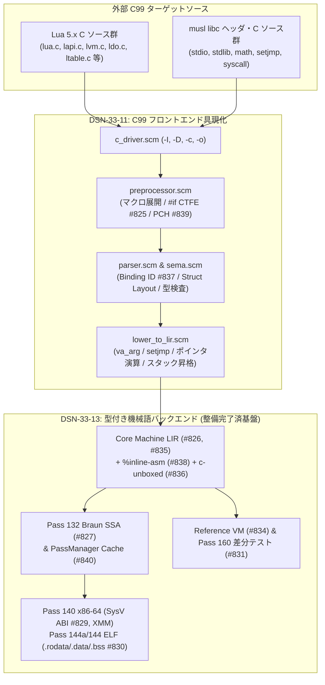

# [DSN-33-32] ULisp Lua (C言語実装) コンパイル ＆ musl libc セルフホスト実証アーキテクチャ設計書
## 〜 DSN-33-11 (C99 フロントエンド) と DSN-33-13 (型付き機械語 LIR / バックエンド) の統合による、Lua 5.x 公式 C ソースコード群および musl libc のネイティブビルド・完全動作確認 〜

> [!IMPORTANT]
> **【本設計書の明確なスコープ定義】**  
> 本設計書における「Lua サポート」とは、ULisp フロントエンドで Lua 言語自体の構文（`.lua` スクリプト）を直接パース・コンパイルする機能（それは [[DSN-33-22]](DSN-33-22-ulisp_language_workbench_interpreter_generator_and_guest_runtime_architecture.md) 言語ワークベンチの領分）を意味するものでは**ない**。  
> **[[DSN-33-11]](DSN-33-11-ulisp_multilingual_frontend_and_ctfe_architecture.md) で規定した C99 フロントエンドと [[DSN-33-13]](DSN-33-13-ulisp_typed_machine_lir_and_multi_target_backend_architecture.md) で規定した型付き機械語 LIR バックエンドを用いて、ANSI C / C99 で記述された公式 Lua 5.x 処理系の C ソースコード一式（`lua.c`, `lapi.c`, `lvm.c`, `ltable.c`, `lgc.c` 等 約3万行）および `musl libc` を ULisp 自身でコンパイル・リンクし、実用的なネイティブ `lua` バイナリを完動させること**を目的とする。

- **文書番号**: `DSN-33-32` *(旧 `DSN-33-09`)*
- **上位文書**: [[DSN-33] ULISP 包括設計仕様書: S式メタコンパイラ基盤 ＆ 多重バックエンドトランスレーションアーキテクチャ](DSN-33-ulisp_underlying_x86_native_aot_compiler_architecture_specification.md)
- **関連個別仕様書**: 
  - [[DSN-33-11] ULisp 多言語フロントエンド（C99/Scheme）共通基盤 ＆ 構文・意味解析・CTFE アーキテクチャ設計書](DSN-33-11-ulisp_multilingual_frontend_and_ctfe_architecture.md)
  - [[DSN-33-12] ULisp 階層型パス融合（Pipeline / Pass / Nanopass / Picopass）＆ DAG 最適化基盤設計書](DSN-33-12-ulisp_pipeline_pass_nanopass_picopass_dag_architecture.md)
  - [[DSN-33-13] ULisp 型付き機械語 LIR・2層 Dialect 分離・ゼロコスト ABI ＆ 多重バックエンド（x86-64 / Portable C / ELF リンカ / 参照 VM）アーキテクチャ設計書](DSN-33-13-ulisp_typed_machine_lir_and_multi_target_backend_architecture.md)
  - [[DSN-33-21] ULisp ステージ多相メタコンパイラ ＆ 二村射影フラクタル実行基盤設計書](DSN-33-21-ulisp_stage_polymorphic_metacompiler_and_futamura_projection_architecture.md)
  - [[DSN-33-22] ULisp 言語ワークベンチ（Language Workbench）: ゲスト言語オブジェクトモデル・PEG構文解析フロントエンド・Direct Cogen コンパイラ自動生成 ＆ デバッグ透過性アーキテクチャ設計書](DSN-33-22-ulisp_language_workbench_interpreter_generator_and_guest_runtime_architecture.md)
  - [[DSN-33-23] ULisp 内因的メタトレーシング JIT アーキテクチャ包括設計書](DSN-33-23-ulisp_endogenous_meta_tracing_jit_architecture.md)
  - [[DSN-33-31] ULisp Zero-libc / Freestanding Pure Scheme ベアメタルランタイム包括設計書](DSN-33-31-ulisp_zero_libc_pure_scheme_bare_metal_runtime.md)
  - [[DSN-33-41] ILisp・ULisp AOT・ULisp JIT 3種実行系 継続的性能評価・ベンチマーク基盤設計書](DSN-33-41-ulisp_ilisp_aot_jit_continuous_benchmarking_framework.md)
- **文書ステータス**: `APPROVED / ARCHITECTURE-BLUEPRINT`
- **対象サブシステム**:
  - `ulisp/frontend_c/` (`c_driver.scm`, `preprocessor.scm`, `parser.scm`, `sema.scm`, `lower_to_lir.scm` - `DSN-33-11` 準拠の C99 フロントエンド具現化)
  - `ulisp/lib/builtins.c` (Compiler Runtime: 64bit 補助演算等)
  - 外部コンパイルターゲット: `Lua 5.x` C ソースツリー ＆ `musl libc` 移植ソースツリー
- **【主査・報告】 IT Specialist (Programming Languages & Compilers / PLC), Systems Architect (SA), Software Development (SWD)**
- **【共同主査】 Project Manager (PM), Information Security Specialist (SEC), Software Quality Assurance Specialist (QA), Systems Auditor (AUD)**
- **【参画・協調】 16 大専門エージェント全員 (PM, SEC, SA, QA, DBA, NET, NLP, STR, SM, EMB, AUD, DES, EDU, SWD, APS, PLC)**

---

## 体系目次

- [1. エグゼクティブサマリー ＆ 設計哲学](#1-エグゼクティブサマリー--設計哲学)
  - [1.1 目的：なぜ「C言語版 Lua」と「musl libc」のコンパイルが究極の実証ベンチマークなのか](#11-目的なぜc言語版-luaとmusl-libcのコンパイルが究極の実証ベンチマークなのか)
  - [1.2 DSN-33-11（C99 フロントエンド）と DSN-33-13（バックエンド）の結合アーキテクチャ](#12-dsn-33-02c99-フロントエンドと-dsn-33-08バックエンドの結合アーキテクチャ)
- [2. Lua 5.x C コードベースの技術要件分析](#2-lua-5x-c-コードベースの技術要件分析)
  - [2.1 Lua 5.x 構成モジュールと要求される C99 機能マトリクス](#21-lua-5x-構成モジュールと要求される-c99-機能マトリクス)
  - [2.2 ULisp 既存基盤（Issue #824〜#840）と未実装ギャップの整理](#22-ulisp-既存基盤issue-824840と未実装ギャップの整理)
- [3. C99 フロントエンド具現化要件（Lua 対応のために事前に実装すべき要素）](#3-c99-フロントエンド具現化要件lua-対応のために事前に実装すべき要素)
  - [3.1 C99 プリプロセッサ（CPP）の完全実装](#31-c99-プリプロセッサcppの完全実装)
  - [3.2 構造体・共用体・ビットフィールドと SysV アライメントレイアウト](#32-構造体共用体ビットフィールドと-sysv-アライメントレイアウト)
  - [3.3 関数ポインタ型と Lua C API 境界](#33-関数ポインタ型と-lua-c-api-境界)
  - [3.4 暗黙の整数昇格と明示的キャスト](#34-暗黙の整数昇格と明示的キャスト)
- [4. Lua ランタイムを支える低レイヤ ABI・LIR Lowering 仕様](#4-lua-ランタイムを支える低レイヤ-abilir-lowering-仕様)
  - [4.1 アドレス取得変数のスタックエスケープと Braun SSA 昇格](#41-アドレス取得変数のスタックエスケープと-braun-ssa-昇格)
  - [4.2 非局所脱出 (`setjmp` / `longjmp`) の `%inline-asm` 実装](#42-非局所脱出-setjmp--longjmp-の-inline-asm-実装)
  - [4.3 可変長引数 (`<stdarg.h>`: `va_list`, `va_start`, `va_arg`) の SysV ABI 展開](#43-可変長引数-stdarg-h-va_list-va_start-va_arg-の-sysv-abi-展開)
  - [4.4 `lvm.c` 巨大 `switch`/`goto` ディスパッチと XMM 倍精度浮動小数点数 (`lua_Number`)](#44-lvmc-巨大-switchgoto-ディスパッチと-xmm-倍精度浮動小数点数-lua_number)
- [5. musl libc 統合 ＆ 4大未決事項の裁定規準](#5-musl-libc-統合--4大未決事項の裁定規準)
  - [5.1 4大未決事項（リンカ・プリプロセッサ・libc・コンパイル速度）の裁定規準](#51-4大未決事項リンカプリプロセッサlibcコンパイル速度の裁定規準)
  - [5.2 musl libc 移植・自前ビルド戦略 (J1 / J2)](#52-musl-libc-移植自前ビルド戦略-j1--j2)
- [6. S0〜S9 段階的実装ロードマップ ＆ 検証戦略](#6-s0s9-段階的実装ロードマップ--検証戦略)
  - [6.1 フェーズ別移行スケジュール（Step S0 〜 S9）](#61-フェーズ別移行スケジュールstep-s0--s9)
  - [6.2 実証ベンチマーク：Lua 公式テストスイート（Step S5）](#62-実証ベンチマークlua-公式テストスイートstep-s5)
  - [6.3 DDC（Diverse Double-Compiling）による決定論性・信頼性検証（Step S8）](#63-ddcdiverse-double-compilingによる決定論性信頼性検証step-s8)
  - [6.4 境界検査モードによる安全性拡張（Step S9）](#64-境界検査モードによる安全性拡張step-s9)
- [7. 実装 Issue トレーサビリティマトリクス（#913〜#930）](#7-実装-issue-トレーサビリティマトリクス913930)

---

## 1. エグゼクティブサマリー ＆ 設計哲学

### 1.1 目的：なぜ「C言語版 Lua」と「musl libc」のコンパイルが究極の実証ベンチマークなのか

自作 C コンパイラが玩具レベル（フィボナッチや `printf("Hello")` のみ）を超えて実用レベルの完成度に達したことを証明する最良のリトマス試験紙は、**ANSI C / C99 の仕様を隅々まで駆使して書かれた現実のシステムソフトウェアをビルド・完動させること**である。

**Lua 5.x（公式 C 実装）** は、約 2.5〜3 万行というコンパクトなコードサイズでありながら、複雑なプリプロセッサマクロ、タグ付き共用体（`TValue`）、独自ガベージコレクタ（`lgc.c`）、`setjmp`/`longjmp` による例外機構（`ldo.c`）、可変長引数（`<stdarg.h>`）、IEEE 754 倍精度浮動小数点と 64bit 整数の混合演算、関数ポインタによる拡張 API、巨大な仮想マシン `switch` ディスパッチ（`lvm.c`）をすべて内包している。

Lua 5.x の C ソースツリーを ULisp 自身でコンパイルして公式テストスイート全件を PASS させ、さらに `musl libc` を自前ビルドしてリンク（セルフホスト）できれば、ULisp の C99 フロントエンド（[[DSN-33-11]](DSN-33-11-ulisp_multilingual_frontend_and_ctfe_architecture.md)）と型付き機械語バックエンド（[[DSN-33-13]](DSN-33-13-ulisp_typed_machine_lir_and_multi_target_backend_architecture.md)）の実用性と堅牢性が完全に証明される。

### 1.2 DSN-33-11（C99 フロントエンド）と DSN-33-13（バックエンド）の結合アーキテクチャ

---

## 2. Lua 5.x C コードベースの技術要件分析

### 2.1 Lua 5.x 構成モジュールと要求される C99 機能マトリクス

| Lua C モジュール | 主な役割 | 要求される C99 フロントエンド ＆ LIR/ABI 機能 |
| :--- | :--- | :--- |
| **`luaconf.h` / `llimits.h`** | プラットフォーム設定・マクロ定義 | 条件付き `#if` 定数評価、関数形式マクロ、`##` トークン連結、`#` 文字列化 |
| **`lobject.h` / `lstate.h`** | `TValue`, `Value`, `lua_State` 定義 | ネストされた `struct`/`union`、ビットマスク/アライメント計算、`typedef` 名前空間 |
| **`lvm.c`** | バイトコード仮想マシン (`luaV_execute`) | 巨大 `switch-case` / `goto` CFG、整数/浮動小数点混合、`overflow` 回避、Braun SSA 昇格 |
| **`ldo.c`** | スタック管理と保護付き呼び出し (`lua_pcall`) | `setjmp` / `longjmp` コンテキスト退避・復元（`%inline-asm` または ABI 準拠実装） |
| **`lapi.c` / `lauxlib.c`** | C API ＆ 補助ライブラリ | `lua_CFunction` 関数ポインタ、`<stdarg.h>` (`va_list`, `va_start`, `va_arg`) |
| **`ltable.c` / `lstring.c`** | ハッシュテーブルと文字列インターン | ポインタ加減算・スケーリング配列参照、符号なし整数 (`size_t`, `uint32_t`) 演算 |
| **`lmathlib.c` / `llex.c`** | 数値演算ライブラリ・字句解析器 | IEEE 754 `double` 演算・`strtod`（Issue #832 数値塔 / XMM SSE2 命令） |
| **`loslib.c` / `liolib.c`** | OS / I/O 標準ライブラリ | `musl libc`（またはホスト `libc`）との SysV AMD64 ABI 外部シンボルリンク |

### 2.2 ULisp 既存基盤（Issue #824〜#840）と未実装ギャップの整理

`DSN-33-11`（フロントエンド共通基盤）および `DSN-33-13`（バックエンド基盤）において、**Issue #824〜#840 の基盤設計・バックエンド機構はすでに整備・完了**している。
したがって、ULisp で Lua の C コードを実際にコンパイル可能にするために**事前に実装すべき焦点**は、フロントエンド具現化層（`ulisp/frontend_c/`）およびターゲット固有の C Lowering 規則に明確に絞られる：

1. **C99 プリプロセッサ（`preprocessor.scm`）**の構築
2. **C99 Lexer / Parser / Sema（`parser.scm`, `sema.scm`）**と構造体・関数ポインタ型システムの構築
3. **C AST $\to$ Core Machine LIR Lowering（`lower_to_lir.scm`）**の構築（アドレス取得エスケープ、`va_list`、`setjmp`/`longjmp`）
4. **XMM 倍精度浮動小数点（`lua_Number`）の E2E 配線**（Step S4）

---

## 3. C99 フロントエンド具現化要件（Lua 対応のために事前に実装すべき要素）

### 3.1 C99 プリプロセッサ（CPP）の完全実装

Lua の C ソースコードは、型キャスト `cast(t, exp)`、タグ操作 `setobj(L, obj1, obj2)`、GC バリア `luaC_barrier`、アサーション `lua_assert` 等を高度にネストしたマクロとして定義している。
- **インクルード解決**: `-I` パス探索、`#include "..."` と `#include <...>` の区別、インクルードガードの高速バイパス（`#ifndef H ... #define H` パターン最適化および `.sbi` PCH #839 活用）。
- **マクロ展開アルゴリズム**: 青塗り（Blue-painted / Hide-set）規則に基づく自己参照マクロの無限再帰防止、関数形式マクロ、`...` / `__VA_ARGS__` 可変長マクロ、トークン連結 `##` と文字列化 `#`。
- **条件付きコンパイル**: `#if`, `#elif`, `#ifdef`, `#ifndef`, `defined(...)` の評価に、`DSN-33-11` の `eval-in-language`（Issue #825 CTFE）および `DSN-33-13` と共有する純粋 Scheme 数値塔（Issue #832: 64bit 整数演算）を利用する。

### 3.2 構造体・共用体・ビットフィールドと SysV アライメントレイアウト

Lua のデータモデルの中核である `TValue` と `lua_State` を正確にメモリ配置するため、`sema.scm` は SysV AMD64 ABI 準拠のメモリレイアウト計算エンジンを実装する。
- **アライメントとパディング**: 各メンバの型アライメント（`char`: 1, `short`: 2, `int`: 4, `long`/`double`/`ptr`: 8）に従ってオフセットを算出し、構造体全体のサイズを最大メンバアライメントの倍数へ切り上げる。
- **共用体 (`union`)**: オフセット 0 に全メンバを重ね合わせ、サイズは最大メンバサイズ（かつ最大アライメントの倍数）とする。`sizeof(TValue)` や `offsetof` がコンパイル時定数式（CTFE #825）で即座に解決できなければならない。
- **無名構造体・共用体・ビットフィールド**: Lua / musl ヘッダ内で使われるビットフィールド（例: `lu_byte marked : 8;` 等）をビットシフト・マスク演算へ降格する。

### 3.3 関数ポインタ型と Lua C API 境界

Lua の拡張性と VM コールバックは `typedef int (*lua_CFunction) (lua_State *L);` などの関数ポインタ配列・構造体メンバに依存する。
- 関数指示子（Function Designator）から関数ポインタ型への暗黙変換と、間接呼び出し `(*fp)(arg)` / `fp(arg)` の統一的な Core LIR `(%call-indirect ...)` 命令への変換。
- 複数ファイル間で共有される外部関数プロトタイプと、`calling-convention: 'sysv`（Issue #829）の整合チェック。

### 3.4 暗黙の整数昇格と明示的キャスト

C99 の通常の算術変換（Usual Arithmetic Conversions）および整数昇格（Integer Promotion）を型検査パス（`sema.scm`）で明示的なノードへ挿入する。
- `i8`/`i16` の演算前 `i32` 昇格、符号付き（`%sext`）と符号なし（`%zext`）の厳密な区別。
- ポインタ演算 `p + n` における `n * sizeof(*p)` の自動スケーリングと、ポインタ減算 `p1 - p2` の `sizeof(*p)` 除算。

---

## 4. Lua ランタイムを支える低レイヤ ABI・LIR Lowering 仕様

### 4.1 アドレス取得変数のスタックエスケープと Braun SSA 昇格

Lua のコードでは `&status` や `&tt` のようにローカル変数のアドレスを別関数へ渡すパターンが頻出する。
- `lower_to_lir.scm` はまず全ローカル変数を `%alloca` として宣言し、アドレス取得演算子 `&` の対象となる変数を「アドレスエスケープ変数」としてマークする。
- エスケープしない純粋なローカル変数に対してのみ、`DSN-33-13` の **Pass 132 Braun SSA（Issue #827）** がロード・ストアを仮想レジスタの定義・参照および Phi ノードへ昇格させる。

### 4.2 非局所脱出 (`setjmp` / `longjmp`) の `%inline-asm` 実装

Lua は C++ 例外を使わず、`ldo.c` の `luaD_rawrunprotected` において `setjmp` / `longjmp` を用いてエラー復旧（`lua_error`, `lua_pcall`）を行う。
- コンパイラ最適化（SSA 昇格）と `setjmp` の共存には、**`setjmp` 呼び出しを含む関数において `jmp_buf` の前後で生きているローカル変数のレジスタ退避（または volatile / スタック退避）** が不可欠となる。
- x86-64 版 `setjmp` / `longjmp`（`musl` 実装または ULisp 内蔵 `builtins`）は、Issue #838 の **`%inline-asm`** を用いて Callee-Saved レジスタ（`rbx, rbp, r12, r13, r14, r15`）、スタックポインタ `rsp`、戻りアドレス `rip` を `jmp_buf` 構造体へ直接保存・復元する。

### 4.3 可変長引数 (`<stdarg.h>`: `va_list`, `va_start`, `va_arg`) の SysV ABI 展開

`lua_pushfstring` や `luaL_error`、`printf` 系関数の呼び出しを支えるため、SysV AMD64 ABI 規定の可変長引数メカニズムを Lowering する。
- **レジスタ保存領域（Register Save Area）**: 可変長引数関数のプロローグで、`rdi, rsi, rdx, rcx, r8, r9` および（`%al > 0` の場合）`xmm0..xmm7` をスタック上の連続領域へ退避する。
- **`va_list` 構造体**: `{ gp_offset (i32), fp_offset (i32), overflow_arg_area (ptr), reg_save_area (ptr) }` の 24 バイト構造体として `va_start` で初期化する。
- **`va_arg(ap, type)`**: `gp_offset < 48`（または浮動小数点の場合 `fp_offset < 176`）を検査し、Register Save Area から読み出すか、溢れている場合は `overflow_arg_area` から読み出してオフセットを加算する分岐 LIR を生成する。

### 4.4 `lvm.c` 巨大 `switch`/`goto` ディスパッチと XMM 倍精度浮動小数点数 (`lua_Number`)

- **`switch` と `goto` の Lowering**: `lvm.c` の `luaV_execute` にある 80 種以上のオペコード `switch` 分岐および `goto` ラベルを、Core Machine LIR の `%switch`（ジャンプテーブルまたは二分木展開）と `%label`/`%jump` へ変換し、Pass 132 Braun SSA の `incomplete-block` / `seal-block` プロトコルで破綻なく SSA 化する。
- **倍精度浮動小数点数 (`double`)**: Lua のデフォルト数値型 `lua_Number`（`double` / `f64`）および `lua_Integer`（`long long` / `i64`）の相互変換、さらに NaN チェックや `-0.0` の扱い（`fptosi`, `sitofp`, `ucomisd`）を Pass 140（XMM SSE2）と Pass 160 C バックエンドで完全に一致させる。

---

## 5. musl libc 統合 ＆ 4大未決事項の裁定規準

### 5.1 4大未決事項（リンカ・プリプロセッサ・libc・コンパイル速度）の裁定規準

Lua と musl libc のセルフホストを破綻なく達成するため、以下の 4 大技術方針を確定・遵守する：

1. **リンカ (H2) の方針**:
   - **裁定**: **フェーズ S2〜S5（Lua ビルド実証まで）はシステムの `ld` を利用**し、C フロントエンドと LIR 生成の完成を最優先する。**S7（musl 自前ビルド）の段階で、Pass 144 自前 ELF リンカ（Issue #830）へ完全移行**する。
2. **プリプロセッサの立ち上げ方**:
   - **裁定**: 最初から純粋 Scheme で自前プリプロセッサ（`preprocessor.scm`）を実装する。ホストの `cc -E` は自前プリプロセッサの出力を突合する**正解オラクル（テスト基準）**としてのみ使用する。
3. **採用 libc の選定**:
   - **裁定**: **musl libc を本線**とする。構造が明晰であり、Linux x86-64 との整合性が最も高い。組み込み向け超軽量フォールバックとして picolibc の知見を参考とする。
4. **セルフホスト時のコンパイル速度対策**:
   - **裁定**: Issue #839（中間表現シリアライズと `.sbi` PCH）および `DSN-33-12` で確立した Picopass 高速ディスパッチ（$O(1)$ Head-tag ディスパッチ）をフル活用し、Lua の約 3 万行の C ソースを数秒以内でコンパイル可能にする。

### 5.2 musl libc 移植・自前ビルド戦略 (J1 / J2)

- **J1（musl ヘッダ・最小ソース適応）**: x86-64 ターゲットのシステムコール（`syscall_arch.h` 等）や `setjmp` のインラインアセンブリを、`DSN-33-13` の `%inline-asm` 仕様（Issue #838）と整合させてコンパイル可能にする。
- **J2（完全自前リンク）**: Pass 144 ELF リンカにより、`crt1.o`, `libc.a` (musl 自前ビルド), および Lua オブジェクトファイル群を外部 GCC/Clang ツールチェーン一切なしで単一静的 ELF バイナリへ結合する。

---

## 6. S0〜S9 段階的実装ロードマップ ＆ 検証戦略

### 6.1 フェーズ別移行スケジュール（Step S0 〜 S9）

| Step | 名称 | 主な達成目標 | 依存仕様 / Issue |
| :---: | :--- | :--- | :---: |
| **S0** | **設計と未決事項の決定** | `DSN-33-11` / `13` / `32` 体系承認、4大裁定規準確定 | 本設計書体系 (**完了済**) |
| **S1** | **基盤整備 ＆ Reference VM** | LIR 参照 VM、数値塔 (Bignum/IEEE754)、Source Span、Diagnostic | #834, #832, #824, #833 (**完了済**) |
| **S2** | **整数 C パイプライン開通** | CPP + PEG ベース整数 C Parser/Sema $\to$ Core LIR $\to$ x86/C、musl/libc とリンクして `printf("%d")` 成功 | **#913, #914, #915, #916, #917, #931** (基盤: #826, #835, #837, #827, #830) |
| **S3** | **C89/C99 仕様網羅 (Lua要件)** | 構造体・共用体レイアウト、関数ポインタ、SysV ABI、可変長引数、`setjmp`/`longjmp` | **#918, #919, #920, #921, #922** (基盤: #829, #838, #828, #836) |
| **S4** | **浮動小数点数 (XMM/IEEE754)** | `double`/`float` 演算、XMM 引数渡し、差分テスト完全一致 | **#923, #924** (基盤: #826, #829, #831) |
| **S5** | **Lua 5.x ビルド ＆ 公式テスト実証** | Lua 5.x 公式 C ソース全ファイルを ULisp でビルドし、Lua 公式テストスイート全件 PASS | **#925, #926** |
| **S6** | **最適化 ＆ コンパイル性能** | mem2reg 最適化、PassManager キャッシュ、PCH (`.sbi`) による Lua ビルド高速化 | **#927** (基盤: #827, #840, #839, #825) |
| **S7** | **musl libc 自前ビルド** | ULisp 自身で musl をビルドし、Pass 144 リンカで Lua を自製 libc と再リンク | **#928** (J1, J2) |
| **S8** | **DDC (多様な二重コンパイル)** | GCC / Clang / ULisp による相互ビルド決定論性・信頼検証 | **#929** |
| **S9** | **堅牢化 (境界検査モード)** | 型付き C IR への自動境界検査注入（メモリ安全性強化オプション） | **#930** |

### 6.2 実証ベンチマーク：Lua 公式テストスイート（Step S5）

Step S5 の完了基準（Definition of Done）として、ULisp でビルドされた `lua` 実行バイナリ上で公式テストスイート（`all.lua`：コルーチン、メタテーブル、クロージャ、GC ストレステスト、ビット演算、数学関数、`string.pack`/`unpack`、エラー回復 `pcall`/`xpcall` 等）を実行し、全項目をエラーゼロで完走させる。

### 6.3 DDC（Diverse Double-Compiling）による決定論性・信頼性検証（Step S8）

- ULisp 自身でコンパイルした `lua` バイナリと、システム標準 GCC/Clang でビルドした Reference `lua` で同一 Lua ベンチマーク・テスト群を実行し、出力結果が完全に一致することを確認する。
- さらに ULisp のブートストラップ連鎖における ELF 出力のビット一致（Deterministic Compilation）により、バックエンドやリンカに由来する未定義動作や非決定性が存在しないことを証明する。

### 6.4 境界検査モードによる安全性拡張（Step S9）

型付き C AST（`DSN-33-11`）および Core LIR 境界を活用し、コンパイル時フラグにより配列境界チェックや NULL ポインタ参照トラップを自動注入できる安全モード（Sanitizer 相当）を設け、セキュリティプラットフォームとしての信頼性を担保する。

---

## 7. 実装 Issue トレーサビリティマトリクス（#913〜#930）

| Issue ID | フェーズ | タイトル | 優先度 | 詳細リンク |
| :---: | :---: | :--- | :---: | :--- |
| **#913** | S2 (T1) | C99 字句解析器 (Lexer) および Source Span 付きトークンストリームの実装 | High | [913](../issues/913-implement-c99-lexer-and-token-stream-with-source-span.md) |
| **#914** | S2 (T2) | 純粋 Scheme 製 C99 プリプロセッサ (CPP) の実装 | High | [914](../issues/914-implement-pure-scheme-c99-preprocessor-cpp.md) |
| **#915** | S2 (T3) | C99 構文解析器 (Parser) および Nanopass C-AST 言語定義の実装 | High | [915](../issues/915-implement-c99-parser-and-nanopass-c-ast-definitions.md) |
| **#916** | S2 (T4) | C99 基本型検査・整数昇格 (Sema Core) および整数 LIR Lowering | High | [916](../issues/916-implement-c99-sema-core-and-integer-subset-lir-lowering.md) |
| **#917** | S2 (T5) | C コンパイラドライバ (`c_driver.scm`) およびホストリンカ連携 | High | [917](../issues/917-implement-c-compiler-driver-and-host-ld-integration.md) |
| **#918** | S3 (T6) | C99 構造体・共用体・列挙型・ビットフィールドの SysV レイアウト計算 | High | [918](../issues/918-implement-c99-struct-union-enum-bitfield-sysv-layout.md) |
| **#919** | S3 (T7) | ポインタスケーリング演算・配列退化およびスタックエスケープ処理 | High | [919](../issues/919-implement-c99-pointer-scaling-array-decay-and-escape-analysis.md) |
| **#920** | S3 (T8) | 関数ポインタ間接呼び出しおよび巨大 `switch`/`goto` の Braun SSA Lowering | High | [920](../issues/920-implement-c99-function-pointers-and-switch-goto-cfg-lowering.md) |
| **#921** | S3 (T9) | `<stdarg.h>` 可変長引数 (`va_list`/`va_start`/`va_arg`) SysV ABI Lowering | High | [921](../issues/921-implement-sysv-amd64-stdarg-va-list-lowering.md) |
| **#922** | S3 (T10) | 非局所脱出 (`setjmp`/`longjmp`) `%inline-asm` ＆ 生存変数スピル保護 | High | [922](../issues/922-implement-setjmp-longjmp-inline-asm-and-stack-spill-protection.md) |
| **#923** | S4 (T11) | C99 浮動小数点型 (`double`/`float`) Sema ＆ IEEE 754 / LIR 変換 | High | [923](../issues/923-implement-c99-floating-point-sema-and-lir-conversion-lowering.md) |
| **#924** | S4 (T12) | SSE2 XMM 命令・SysV XMM ABI 配線と 3者差分ファジング検証 | High | [924](../issues/924-verify-sse2-xmm-abi-and-floating-point-differential-fuzzing.md) |
| **#925** | S5 (T13) | Lua 5.x 全 C ソースファイルの ULisp 一括ビルドパイプライン構築 | High | [925](../issues/925-build-lua-5x-c-codebase-compilation-pipeline-with-ulisp.md) |
| **#926** | S5 (T14) | ULisp ビルド版 Lua バイナリによる公式テストスイート完走 E2E 実証 | High | [926](../issues/926-verify-lua-5x-official-test-suite-e2e-selfhost-ci.md) |
| **#927** | S6 (T15) | C ヘッダ `.sbi` PCH および mem2reg 反復最適化によるビルド高速化 | Medium | [927](../issues/927-implement-c-header-sbi-pch-and-iterative-mem2reg-optimization.md) |
| **#928** | S7 (T16) | `musl libc` 自前ビルドおよび Pass 144 自前 ELF リンカ静的リンク移行 | Medium | [928](../issues/928-compile-musl-libc-with-ulisp-and-migrate-to-pass-144-elf-linker.md) |
| **#929** | S8 (T17) | DDC (Diverse Double-Compiling) 決定論性・ビット一致検証ハーネス | Medium | [929](../issues/929-implement-ddc-diverse-double-compiling-determinism-verification.md) |
| **#930** | S9 (T18) | C99 配列境界検査・NULL 参照トラップ自動注入 (`--sanitize-bounds`) | Medium | [930](../issues/930-implement-c99-bounds-checking-sanitizer-mode.md) |
| **#931** | S2 (PEG) | PEG による C99 文法仕様 (`tools/grammars/c99.peg`) ＆ パーサー自動合成 | High | [931](../issues/931-implement-c99-peg-grammar-specification-and-parser-synthesis.md) |
