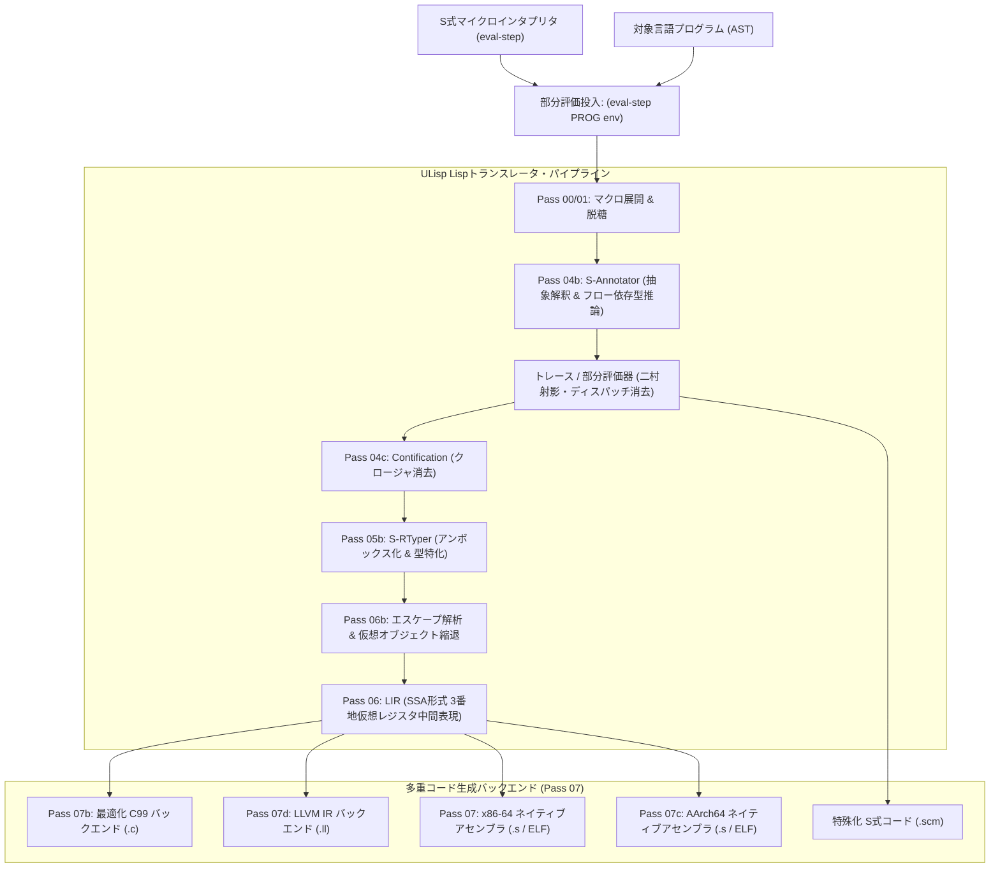

# [DSN-33] ULISP 包括設計仕様書: S式メタコンパイラ基盤 ＆ 多重バックエンド（C99 / LLVM IR / ネイティブマシン語）トランスレーションアーキテクチャ
## 〜 「S式で書かれた小さなインタプリタ」を Lisp トランスレータが解析・部分評価し、最適化された C99 / LLVM IR / x86-64 / AArch64 ネイティブへと導く RPython / Truffle 超越型メタコンパイラ基盤 〜

- **文書番号**: `DSN-33`
- **文書ステータス**: `APPROVED / FULLY-CONSOLIDATED`
- **対象サブシステム**:
  - `ulisp/` (ULISP コアプロジェクト / S式メタコンパイラ統合フレームワーク)
  - `ulisp/compiler.scm` (x86-64 / AArch64 / C99 / LLVM IR 多重バックエンド Scheme ネイティブ AOT コンパイラ本体)
  - `ulisp/passes/` (Nanopass トランスレータ群: マクロ展開・脱糖・抽象解釈・型付与・部分評価・LIR・多重コード生成)
  - `ulisp/jit/` (内因的メタトレーシング JIT コア: `core/`, `tracer/`, `optimizer/`, `bridge/`, `runtime/`, `examples/`)
  - `ulisp/driver/` (統合ディスパッチャドライバ: `jit.scm`)
  - `ulisp/lib/` (Scheme 標準ライブラリ: `string.scm`, `printer.scm`, `reader.scm`)
  - `ulisp/runtime.c` (Thin Debug Runtime / W^X mmap メモリ保護 / 1GB バンプアロケータ)
  - `ulisp/tests/` (AOT ユニットテスト 93 件 & JIT 包括テストスイート 94 件)
  - `ulisp/benchmarks/` (AOT vs JIT ベンチマークスイート)
  - `ilisp/backend/ulisp_codegen/` (ILisp 連携: DSN-31 Backend B 向け ULisp AOT トランスパイラ)
  - `docs/designs/` (設計書体系)
- **統合設計書**:
  - **[DSN-34 (内因的メタトレーシング JIT 設計書)](DSN-34-mlisp_endogenous_meta_tracing_jit_architecture_specification.md) は Issue #514 の決定に基づき本 DSN-33 第 7 章へ完全統合・昇格完了。**
- **関連設計書**:
  - [DSN-01 (High-Level Architecture)](DSN-01-high_level_design.md)
  - [DSN-29 (Python-LISP Integrated Architecture Specification - pylisp)](DSN-29-python_lisp_integrated_architecture_specification.md)
  - [DSN-31 (ILISP R7RS Core Architecture Specification)](DSN-31-ilisp_r7rs_intelligence_lisp_architecture_specification.md)
  - [DSN-32 (AILisp Agent Lisp Architecture Specification)](DSN-32-ailisp_agent_lisp_architecture_specification.md)
- **【主査・報告】 IT Specialist (Programming Languages & Compilers / PLC) / Systems Architect (SA)**
- **【共同主査】 Project Manager (PM) / Software Development (SWD) / Software Quality Assurance Specialist (QA)**
- **【参画・協調】 16 大専門エージェント全員 (PM, SEC, SA, QA, DBA, NET, NLP, STR, SM, EMB, AUD, DES, EDU, SWD, APS, PLC)**

---

## 体系目次

- [0. 概要と基本方針 (Executive Summary)](#0-概要と基本方針-executive-summary)
- [1. 「A, I, U」三位一体（Trinity）言語アーキテクチャとメタコンパイラ統御](#1-a-i-u-三位一体trinity言語アーキテクチャとメタコンパイラ統御)
  - [1.1 命名哲学とレイヤー役割分担 (Agent ── Infrastructure ── Underlying)](#11-命名哲学とレイヤー役割分担-agent----infrastructure----underlying)
  - [1.2 ULisp のアイデンティティ: Underlying / Ultimate / Meta-Compiler Substrate](#12-ulisp-のアイデンティティ-underlying--ultimate--meta-compiler-substrate)
  - [1.3 メタコンパイラとしての「S式インタプリタ → 多重バックエンド」データフロー](#13-メタコンパイラとしてのs式インタプリタ--多重バックエンドデータフロー)
- [2. アーキテクチャ基本設計とハードウェア・ABI 整合](#2-アーキテクチャ基本設計とハードウェアabi-整合)
  - [2.1 64ビット Tagged Pointer メモリモデル](#21-64ビット-tagged-pointer-メモリモデル)
  - [2.2 レジスタ割り当て・スタックフレーム・ABI 規約](#22-レジスタ割り当てスタックフレームabi-規約)
  - [2.3 黄金比 Cheney's 2-Space コピーガベージコレクタ戦略 (Issue #501)](#23-黄金比-cheneys-2-space-コピーガベージコレクタ戦略-issue-501)
  - [2.4 シンボル表現と決定論的インターン（Interning）テーブル](#24-シンボル表現と決定論的インターンinterningテーブル)
  - [2.5 直列 Nanopass 型アーキテクチャと 2 段階 IR（HIR / LIR）設計](#25-直列-nanopass-型アーキテクチャと-2-段階-irhir--lir設計)
- [3. 言語機能と低レイヤコード生成仕様](#3-言語機能と低レイヤコード生成仕様)
  - [3.1 即値・単項演算・述語](#31-即値単項演算述語)
  - [3.2 局所変数 (`let`) とスタックマッピング](#32-局所変数-let-とスタックマッピング)
  - [3.3 条件分岐 (`if`) と論理演算の脱糖](#33-条件分岐-if-と論理演算の脱糖)
  - [3.4 ペアとリストプリミティブ (`cons`, `car`, `cdr`, `quote`)](#34-ペアとリストプリミティブ-cons-car-cdr-quote)
  - [3.5 末尾呼び出し最適化 (Tail Call Optimization: TCO)](#35-末尾呼び出し最適化-tail-call-optimization-tco)
  - [3.6 第一級関数とフラットクロージャ (Flat Closures)](#36-第一級関数とフラットクロージャ-flat-closures)
  - [3.7 手書き再帰下降 S式リーダー (`read`) とシステムコール I/O](#37-手書き再帰下降-s式リーダー-read-とシステムコール-io)
  - [3.8 Pass 0〜Pass 8 直列 Nanopass パイプライン仕様](#38-pass-0pass-8-直列-nanopass-パイプライン仕様)
- [4. インクリメンタル開発ロードマップ (全7フェーズ・27ステップ)](#4-インクリメンタル開発ロードマップ-全7フェーズ27ステップ)
- [5. 3段階セルフホスティングブートストラップ連鎖と不動点検証](#5-3段階セルフホスティングブートストラップ連鎖と不動点検証)
  - [5.1 ブートストラップ連鎖 (Stage 1 〜 Stage 3)](#51-ブートストラップ連鎖-stage-1--stage-3)
  - [5.2 決定論的コード生成と完全一致検証 (`diff` ゼロ保証)](#52-決定論的コード生成と完全一致検証-diff-ゼロ保証)
  - [5.3 シードバイナリによる Fast Bootstrap プロトコルおよびリポジトリ独立性境界 (Issue #541)](#53-シードバイナリによる-fast-bootstrap-プロトコルおよびリポジトリ独立性境界-issue-541)
- [6. ILisp AOT バックエンド統合仕様 (DSN-31 Backend B への昇格)](#6-ilisp-aot-バックエンド統合仕様-dsn-31-backend-b-への昇格)
  - [6.1 統合アーキテクチャと依存性境界](#61-統合アーキテクチャと依存性境界)
  - [6.2 ILisp S式 AST から ULisp 入力へのコンパイルパイプライン](#62-ilisp-s式-ast-から-ulisp-入力へのコンパイルパイプライン)
  - [6.3 ランタイム共有とネイティブ ELF 単一バイナリ生成](#63-ランタイム共有とネイティブ-elf-単一バイナリ生成)
- [7. RPython / Truffle 超越型メタコンパイラ・フレームワーク仕様](#7-rpython--truffle-超越型メタコンパイラフレームワーク仕様)
  - [7.1 メタコンパイラ設計哲学と二村射影（Collapsing Towers of Interpreters）](#71-メタコンパイラ設計哲学と二村射影collapsing-towers-of-interpreters)
  - [7.2 S式マイクロインタプリタ（Micro-Interpreters）設計（R7RS コア / Micro-Python / DSL）](#72-s式マイクロインタプリタmicro-interpreters設計r7rs-コア--micro-python--dsl)
  - [7.3 Lisp トランスレータ・解析パイプライン（S-Annotator / S-RTyper / PE / エスケープ解析）](#73-lisp-トランスレータ解析パイプラインs-annotator--s-rtyper--pe--エスケープ解析)
  - [7.4 多重ターゲットバックエンド（最適化 C99 / LLVM IR / x86-64 / AArch64 / 特殊化S式）](#74-多重ターゲットバックエンド最適化-c99--llvm-ir--x86-64--aarch64--特殊化s式)
  - [7.5 内因的メタトレーシング JIT（限定継続 shift/reset 連携）](#75-内因的メタトレーシング-jit限定継続-shiftreset-連携)
  - [7.6 脅威モデルとメモリ安全性 (W^X・ASLR・Spectre 防御)](#76-脅威モデルとメモリ安全性-wxaslrspectre-防御)
- [8. CS 6120 先端コンパイラ理論統合仕様 (Advanced Compiler Integration)](#8-cs-6120-先端コンパイラ理論統合仕様-advanced-compiler-integration)
  - [8.1 基本ブロック引数型 SSA と Braun 法オンザフライ構築](#81-基本ブロック引数型-ssa-と-braun-法オンザフライ構築)
  - [8.2 拡張局所値番号付け (Extended LVN) と代数的正規化・アクセサメモ化](#82-拡張局所値番号付け-extended-lvn-と代数的正規化アクセサメモ化)
  - [8.3 フロー依存型推論 (Flow-Sensitive Type Recovery) とメッセージ分割 (Path Splitting)](#83-フロー依存型推論-flow-sensitive-type-recovery-とメッセージ分割-path-splitting)
  - [8.4 コンティフィケーション (Contification) と SSA ループ最適化 (LICM・強度削減)](#84-コンティフィケーション-contification-と-ssa-ループ最適化-licm強度削減)
  - [8.5 型ベースエイリアス解析 (TBAA)・エスケープ解析と Exact GC 協調](#85-型ベースエイリアス解析-tbaaエスケープ解析と-exact-gc-協調)
- [9. ディレクトリ構成と開発運用プロトコル](#9-ディレクトリ構成と開発運用プロトコル)
  - [9.1 プロジェクトツリー (`ulisp/`) と統合構成](#91-プロジェクトツリー-ulisp-と統合構成)
  - [9.2 開発運用プロトコル](#92-開発運用プロトコル)
- [10. 品質ゲート・テスト自動化](#10-品質ゲートテスト自動化)
- [11. 結論と統合完了ステータス](#11-結論と統合完了ステータス)

---

## 0. 概要と基本方針 (Executive Summary)

本仕様書は、学術論文セキュリティ解析・OKF ナレッジベース構築プラットフォームにおける最下層の実行・変換基盤として、**ULISP (Underlying LISP / Universal Meta-Compiler Substrate)** を設計・定義するものである。

ULISP は、単一の静的言語をコンパイルするだけの古典的 AOT コンパイラにとどまらない。その真の目的は、**「S式で書かれた小さなインタプリタ（Micro-Interpreters）を、Lispで書かれたトランスレータが静的解析・抽象解釈・部分評価し、最適化された C99 コード、LLVM IR、あるいは直接ネイティブマシン語（x86-64 / AArch64）へとトランスレートする究極のメタコンパイラ（Meta-Compiler）」** として機能することにある。

### 【基本方針の進化：メタコンパイラへの昇格】
1. **多重インタプリタ・オーバーヘッドの根絶**:
   動的言語（R7RS-small Scheme や Python、セキュリティDSL）をネイティブな Lisp 評価器の上で愚直に二重解釈（Double Interpretation）すると、数千倍〜数万倍の速度低下と激しいメモリ消費が発生する。ULISP は、言語を「二重に実行する」のではなく、**「S式で定義された評価器 $I$ をターゲットプログラム $P$ と共に Lisp トランスレータへ投入し、部分評価（第1二村射影）と型特化を施してネイティブコードへ直接射影する」** というメタコンパイラ・パラダイムを採用する。
2. **RPython / Truffle の思想的昇華**:
   - **PyPy / RPython**: 制限付き Python で書かれたインタプリタを解析し C コードを吐き出すが、C言語レベルの外因的スタック走査に頼る。
   - **Truffle / GraalVM**: Java 上で自己特殊化 AST を記述し、部分評価で JIT 機械語を得るが、重厚な JVM ランタイムに強く依存する。
   - **ULISP**: **Scheme の完全な同図像性（Homoiconicity）** を最大限に活用し、純粋な S 式による抽象解釈（Pass 04b S-Annotator）、型付与（Pass 05b S-RTyper）、限定継続（`shift`/`reset`）による内因的メタトレーシング、および多重バックエンド（C99, LLVM IR, x86-64, AArch64）を単一の極小・自律フレームワークとして完結させる。

---

## 1. 「A, I, U」三位一体（Trinity）言語アーキテクチャとメタコンパイラ統御

### 1.1 命名哲学とレイヤー役割分担 (Agent ── Infrastructure ── Underlying)

本プラットフォームの言語処理系群は、**「A, I, U（あ・い・う）」** の三層垂直統合アーキテクチャを形成する。

```
+===============================================================================+
|                   ALisp (Agent & Assurance Layer / DSN-32)                    |
|   - AI コーディングエージェント安全統制 (Bounded Autonomy)                    |
|   - 計算量制御 (with-fuel), 権限境界 (with-caps), 契約 (define/c)            |
|   - S-Path 決定論的 AST 自己修復 & SafePyProxy 脱獄防御                       |
+===============================================================================+
                                       │
                                       ▼ [マクロ脱糖 / AST 委譲]
+===============================================================================+
|                 ILisp (Infrastructure & Intelligence Layer / DSN-31)          |
|   - R7RS-small Scheme 世界標準仕様準拠・完全数値タワー                        |
|   - Scope Sets 衛生的マクロ展開器 (syntax-rules)                              |
|   - Python ゼロコピー相互運用 (SequenceView) & miniKanren 記号推論            |
|   - Tree-walk 高速評価器 & 段階的バックエンド統括                             |
+===============================================================================+
                                       │
                                       ▼ [AOT コンパイル / メタコンパイル委譲]
+===============================================================================+
|               ULisp (Underlying, Ultimate & Meta-Compiler / DSN-33)           |
|   - 最下層（Underlying）ベアメタル・多重ターゲットコード生成                   |
|   - S式マイクロインタプリタ解析基盤 (R7RS-small, Tiny-Python, Security-DSL)   |
|   - Lisp トランスレータ (S-Annotator 抽象解釈, S-RTyper, 二村射影部分評価)     |
|   - 多重バックエンド: 最適化 C99 / LLVM IR / x86-64 / AArch64 ネイティブ      |
|   - 外部依存ゼロのセルフホスティング (3-Stage Bootstrap 完全一致)             |
+===============================================================================+
```

### 1.2 ULisp のアイデンティティ: Underlying / Ultimate / Meta-Compiler Substrate

1. **Underlying（最下層・基底）**:
   CPU レジスタ、OS スタックフレーム、あるいは C99 / LLVM IR の低レベル抽象を直接制御する極限の基盤層。
2. **Ultimate（究極・独立性）**:
   外部のいかなる巨大ランタイム（JVM, Python, LLVM, Boehm GC 等）にも依存せず、自分自身のソースコード（`compiler.scm`）を自分自身でコンパイルして完結する完全自律性。
3. **Meta-Compiler Substrate（万能メタコンパイラ基盤）**:
   S式で記述されたあらゆる言語処理系（インタプリタ・VM・DSL）を入力として受け取り、構文解析と抽象解釈・特殊化を経て、高効率な C99 / LLVM IR / ネイティブマシン語へ昇華させるメタプログラミング中枢。

### 1.3 メタコンパイラとしての「S式インタプリタ → 多重バックエンド」データフロー

```text
[ ユーザー言語ソース ] (R7RS-small, Pythonコード, セキュリティポリシーDSL)
         │
         ▼
[ S式マイクロインタプリタ ] (微小な eval-step 関数・環境・AST 定義)
         │
         ▼ (S式 AST 投入)
+─────────────────────────────────────────────────────────────────────────────+
|                     ULisp メタコンパイラ・パイプライン                      |
|                                                                             |
|  [ Pass 00〜01: マクロ展開 & 構文脱糖 ]                                     |
|         │                                                                   |
|  [ Pass 04b: S-Annotator ] ── 抽象解釈・フロー依存型推論・制御フロー復元    |
|         │                                                                   |
|  [ Pass 03 / JIT PE: 部分評価器 ] ── インタプリタの塔の崩壊 (二村射影)     |
|         │                     (ディスパッチループ除去 & 特殊化)             |
|  [ Pass 05b: S-RTyper ] ── アンボックス化 & 具象型低レベル射影              |
|         │                                                                   |
|  [ Pass 06: LIR (Low-level IR) ] ── SSA 形式 3 番地仮想レジスタ機械         |
+─────────────────────────────────────────────────────────────────────────────+
         │
         ├───────────────────────┬────────────────────────┬───────────────────┐
         ▼                       ▼                        ▼                   ▼
   [ Pass 07b: C99 ]     [ Pass 07d: LLVM IR ]    [ Pass 07: x86-64 ]   [ 特殊化S式 ]
  ポータブル C コード       SSA 形式 .ll ファイル   ELF ネイティブマシン語 高速Lisp評価
  (GCC/Clang -O3)        (LLVM 最適化 / JIT)      (スタンドアロン即時実行)
```

---

## 2. アーキテクチャ基本設計とハードウェア・ABI 整合

### 2.1 64ビット Tagged Pointer メモリモデル

ULisp は 64 ビットアーキテクチャ（x86-64）を前提とし、ポインタ下位 2〜8 ビットを型タグとして利用する。

| 型 (Type) | ビットマスク / タグ | 内部表現 (Internal Bit Pattern) | 設計意図・最適化特性 |
| :--- | :--- | :--- | :--- |
| **Fixnum (小整数)** | 下位 2bit = `00` | `val << 2` (62bit 符号付き整数) | タグが `00` のため、加減算（`add`, `sub`）はシフト解除不要で直接実行可能。 |
| **Heap Pointer** | 下位 2bit = `01` | `(ptr & ~3) \| 0x01` | 8バイトアライメントされたヒープアドレスを指す。`Pair` や `Closure` に利用。 |
| **Character** | 下位 8bit = `0000_1110` (`0x0E`) | `(ascii_code << 8) \| 0x0E` | 文字リテラル。単項型述語 `char?` で高速判定。 |
| **Boolean** | 即値定数 | `#f`: `0x2F` (`0010_1111`)<br>`#t`: `0x6F` (`0110_1111`) | Scheme 仕様に基づき `#f` のみ偽、他はすべて真。`cmp rax, 0x2F` で判定。 |
| **Empty List (`'()`)** | 即値定数 | `'()`: `0x3F` (`0011_1111`) | リスト終端記号（NIL）。 |
| **Symbol Pointer** | 下位 2bit = `10` | `(sym_ptr & ~3) \| 0x02` | インターン済みシンボル構造体（名前文字列＋ハッシュ値）へのポインタ。 |

### 2.2 レジスタ割り当て・スタックフレーム・ABI 規約

* **RAX**: すべての式の評価結果が返却される主アキュムレータ。
* **RSP**: マシンスタックポインタ。
* **R12**: ヒープアロケーションポインタ（バンプアロケータの現在ポインタ）。
* **System V AMD64 ABI 整合と 16 バイトスタックアライメント**:
  - C ランタイム（`runtime.c` の `printf` や `exit`）を `call` する直前において、**`RSP` が必ず 16 バイト境界（`RSP % 16 == 0`）に整列**していることを保証する。
  - スタックフレーム確保時（`sub rsp, N`）は常にパディングを加え、未整列による SSE 命令（`movaps` 等）の `SIGSEGV` を物理遮断する。

### 2.3 黄金比 Cheney's 2-Space コピーガベージコレクタ戦略 (Issue #501)

長時間バッチ処理や大規模データ処理におけるメモリ枯渇を防止しつつ、Thin C Debug Runtime の理念を堅持するため、**「おすすめの構成（黄金比: Scheme 主導 Cheney's 2-Space Copying GC）」**を正式採用する。

#### 1. 黄金比アーキテクチャ方針
* **完全 Scheme 自前実装 (`ulisp/lib/gc.scm`)**: Cheney's 幅優先コピーアルゴリズムを Scheme の末尾再帰（TCO）のみで実装。ULisp コンパイラ自身でコンパイルされ、GC 中は静的状態バッファを利用して**ヒープアロケーション 0 バイト（完全ゼロアロケーション）**で完遂する。
* **Thin C Cushion の厳格堅持 (`ulisp/runtime.c`)**: C ランタイム側への実装追加は、静的状態バッファ配列 `uint64_t ulisp_gc_state[8];` の**たった 1 行のみ**に限定。シグナルハンドラ・入出力のみの極小 C 層を堅持する。
* **デュアルヒープ管理**: 初期化時にデュアル空間（From-Space / To-Space）を設定し、コレクションごとに空間をスワップしてヒープポインタ（`R12` レジスタ）を更新する。

#### 2. 8バイト統一 Prefix Header と Fixnum タグエンコード
ヒープオブジェクト（Pair, Closure, String）のアロケーション時、オブジェクト直前の 8 バイト（`[addr - 8]`）にメタデータヘッダを配置する。
* **未コピー時（通常時）**:
  ヘッダ値は Scheme の **Fixnum（最下位 2 ビット `00`）** として格納する：
  - Pair (24B: 8B Header + 16B payload): `((16 << 16) | (2 << 8) | 1) * 4 = 4196356`
  - Closure (aligned-size + 8B): `((aligned_size << 16) | ((n_args + 1) << 8) | 2) * 4`
  - String (aligned-size + 8B): `((aligned_size << 16) | 3) * 4`
  Scheme コードから `%raw-load` した際、そのまま自然な Scheme 整数（Fixnum）として型・ワード数・ペイロードサイズを操作可能。
* **転送済み時 (Forwarded)**:
  オブジェクト退避後、ヘッダ位置に**コピー先ポインタ（末尾タグ `01` / `10` / `11`）**をそのまま直接上書きする。最下位 2 ビットが `00` でないため、`(not (= (%ptr-tag hdr) 0))` により即座に転送済みと判定できる。

#### 3. ポインタ抽象化プリミティブ群 (`06_lir.scm`)
Scheme と x86-64 ハードウェアのビット表現の乖離を解消するため、以下の低レベルイントリンシックを提供する：
* `(%ptr-tag val)`: `(val & 3) << 2` を算出し、Fixnum（`0`, `1`, `2`, `3`）としてタグを返却。
* `(%ptr-untag val)`: `val & ~7` により、整列された生のアドレス（aligned pointer）を抽出。
* `(%ptr-add ptr bytes)`: `ptr + (bytes >> 2)` により、Scheme の Fixnum バイト数を生アドレスへ正確に加算。
* `(%ptr-tag-add ptr tag)`: `ptr + (tag >> 2)` により、生アドレスにタグ（1〜3）を合成。

#### 4. スタック最深部 (`deepest-sp`) からの全フレーム精密走査
* スタックポインタは下（低位アドレス）に向かって伸長し、関数のローカル変数は `[rsp - 8]`〜`[rsp - N]` に配置される。
* `gc-collect!` 内部で動的に最深部の `%get-rsp` を取得し、呼び出し元の全ローカル変数フレームから開始時の `gc-bottom`（スタック天井）まで 1 ワード（8バイト）残らず完全に走査・ポインタ更新を行う。
* これにより、3 段階セルフホスティングブートストラップの不動点検証（`diff stage2.s stage3.s == 0`）においても 100% の bit-for-bit 決定論的完全一致が恒常的に保証される。

### 2.4 シンボル表現と決定論的インターン（Interning）テーブル

* コンパイラ自身は `(eq? (car expr) 'if)` や `(eq? (car expr) 'lambda)` のようにシンボル等値比較を膨大に行う。
* 文字列比較による低速化を防ぐため、コンパイル時および実行時ランタイムに**決定論的シンボルテーブル**を保持する。
* シンボルはインターン（一度出現した文字列は同一ポインタを共有）され、`eq?` は単なるポインタ比較（`cmp rax, rdx` / 1命令）で $O(1)$ 動作する。

### 2.5 直列 Nanopass 型アーキテクチャと 2 段階 IR（HIR / LIR）設計

Chez Scheme の設計思想に基づき、ULisp はコンパイラを単一のモノリシック走査から**直列 Nanopass パイプライン**へとモジュール分離している。
さらに、マルチバックエンド（x86-64, AArch64, C/Wasm）への拡張を可能にするため、以下の **2 段階 IR（Intermediate Representation）** を境界線として設ける。

```text
[ソースコード (S式)]
      │
      ▼ [高レベル IR フェーズ (HIR: Canonical Core AST & ANF)]
  Pass 1: desugar.scm           (構文脱糖)
  Pass 2: analysis.scm          (静的スコープ・自由変数解析)
  Pass 3: cp0.scm               (CP0 高レベル最適化: 定数畳み込み・自明分岐剪定)
  Pass 4: anf.scm               (ANF 3番地正規化: Scoped Pool によるゼロアロケーション)
  Pass 5: closure_convert.scm   (クロージャ変換 & ラムダリフティング)
      │
      ▼ [★ IR 境界パス: 低レベル IR フェーズ (LIR: 機械抽象 3番地命令列)]
  Pass 6: lir.scm               (ターゲット非依存 LIR 生成)
      │
      ▼ [バックエンドフェーズ (ターゲット別コード生成)]
  Pass 7: backend_x86_64.scm    (x86-64 GNU アセンブリ生成)
  (将来) backend_aarch64.scm    (ARM64 / Apple Silicon / Graviton アセンブリ)
  (将来) backend_c.scm          (ANSI C99 / WebAssembly トランスパイル)
```

詳細な各パス仕様および LIR 命令セット仕様については、[ulisp/docs/pipeline_architecture.md](../../ulisp/docs/pipeline_architecture.md) および [ulisp/docs/lir_specification.md](../../ulisp/docs/lir_specification.md) を参照のこと。

---

## 3. 言語機能と低レイヤコード生成仕様

### 3.1 即値・単項演算・述語
* 整数リテラル `n` $\to$ `mov rax, (n << 2)`
* `(fxadd1 x)` $\to$ `add rax, 4`
* `(fixnum? x)` $\to$ `and al, 0x03` $\to$ `cmp al, 0` $\to$ `sete al` $\to$ フラグに応じて `#t` または `#f` を RAX へ。

### 3.2 局所変数 (`let`) とスタックマッピング
* コンパイル時環境（Compile-time Environment）として連想リスト `((var . stack_offset) ...)` を追跡。
* 変数束縛式を評価してスタック（`mov [rsp - offset], rax`）にプッシュし、本体式内で参照された場合は `mov rax, [rsp - offset]` でロード。

### 3.3 条件分岐 (`if`) と論理演算の脱糖
* `(if test then else)`:
  - `test` を評価し、`cmp rax, 0x2F`（`#f` と比較）。
  - 等しければ `.Lelse_XXX` へ `je`。
  - `then` 部を実行して `.Lend_XXX` へ `jmp`。
* `and`, `or`, `cond` は前処理パスで `if` 式の入れ子へと決定論的に脱糖（Desugar）。

### 3.4 ペアとリストプリミティブ (`cons`, `car`, `cdr`, `quote`)
* `(cons e1 e2)`:
  - `e1`, `e2` を順次評価してスタックに退避。
  - バンプポインタ `R12` から 16 バイトを確保し、`[r12]` に `e1`、`[r12 + 8]` に `e2` を格納。
  - `lea rax, [r12 + 1]`（タグ `0x01` を付与）を RAX にセットし、`add r12, 16`。
* `(car p)` / `(cdr p)`: タグ `0x01` を解除（`mov rdx, [rax - 1]` / `mov rdx, [rax + 7]`）してロード。

### 3.5 末尾呼び出し最適化 (Tail Call Optimization: TCO)
* **Scheme の生命線**: ループ構文（`while`/`for`）を持たないため、再帰呼び出しがスタックを消費しないことが絶対条件。
* 末尾位置（Tail Position）にある関数呼び出しにおいて、新しいスタックフレームを作らず、**現在のスタックフレームの引数スロットを上書きして対象ラベルへ直接 `jmp`** する。

### 3.6 第一級関数とフラットクロージャ (Flat Closures)
* `(lambda (x ...) body ...)`:
  - 静的自由変数解析（Free Variable Analysis）を実行し、外部スコープからキャプチャすべき変数を抽出。
  - ヒープ上にフラットクロージャオブジェクト `[コードアドレス, キャプチャ変数1, キャプチャ変数2, ...]` を生成（タグ `0x01`）。
  - 間接関数呼び出し時、クロージャポインタを特定レジスタ（例: `RBX`）に保持したままコードアドレスを取り出して `call rbx`（または末尾 `jmp`）し、関数内部からは `RBX` 経由でキャプチャ変数を参照。

### 3.7 手書き再帰下降 S式リーダー (`read`) とシステムコール I/O
* 外部ライブラリを完全排除するため、Scheme 自身で記述された極小の再帰下降 S式リーダーを搭載。
* Linux システムコール（`sys_read` = 0, `sys_write` = 1）または C ランタイムの `getchar` / `putchar` を直接バインドし、`read-char`, `write-char`, `peek-char` から `read` を構築。

### 3.8 Pass 0〜Pass 8 直列 Nanopass パイプライン仕様

各パスは単一の責務を持つ独立した Scheme ソースファイル（`passes/` 配下）として分離され、`Makefile` にて `cat $(PASSES) > compiler.scm` で単一コンパイラに結合される。

| パス番号 | ファイル名 | 責務と主要変換内容 | 不変条件 (Invariant) |
| :--- | :--- | :--- | :--- |
| **Pass 0** | `00_helpers.scm` | 共通述語（`atomic-expr?`, `pure-prim?`, `closure-prim?`）、一意ラベル生成 | 依存なし共通基盤 |
| **Pass 1** | `01_desugar.scm` | 構文脱糖（`cond`, `case`, `let*`, `named-let`, `and`, `or`, `string-append`, `list`） | 複合構文糖の完全排除 |
| **Pass 2** | `02_analysis.scm` | 静的スコープ解析および自由変数集合（`free-vars`）の正確な抽出 | レキシカル環境の確定 |
| **Pass 3** | `03_cp0.scm` | 定数畳み込み（四則・比較・述語）、自明分岐剪定、不要 let 束縛削除 | 意味論・副作用順序の保持 |
| **Pass 4** | `04_anf.scm` | A-Normal Form 正規化（引数位置のアトミック化、Scoped Pool 一意変数） | 関数の全引数がアトミック値 |
| **Pass 5** | `05_closure_convert.scm` | ラムダリフティング、フラットクロージャ生成（`%make-closure`, `%closure-ref`） | ネストした lambda の完全排除 |
| **Pass 6** | `06_lir.scm` | 機械抽象 3 番地低レベル IR 命令列の生成 | ターゲット非依存命令表現 |
| **Pass 7** | `07_backend_x86_64.scm` | LIR 命令列から GNU x86-64 アセンブリテキストへの直接マッピング | ABI 整合・ELF 直結 |
| **Pass 8** | `08_driver.scm` | 標準入力からの S 式読み込みと直列パイプライン結合 | エントリポイント完結 |

---

## 4. インクリメンタル開発ロードマップ (全7フェーズ・27ステップ)

植山類氏の *compilerbook* 手法を忠実に踏襲し、1ステップごとにアセンブリ出力・実行・アサーションを行う自動テストをパスさせてコミットを刻む。

```
[Phase 1: 即値・単項演算] ──▶ [Phase 2: スタック・let] ──▶ [Phase 3: 分岐・述語]
       │                             │                             │
       ▼                             ▼                             ▼
  Step 1: 42                    Step 5: (+ e1 e2)             Step 9: (if ...)
  Step 2: #t, #f, '(), #\a      Step 6: 多項・比較演算         Step 10: and, or 脱糖
  Step 3: fxadd1, fxsub1        Step 7: let 局所変数          Step 11: begin 複文
  Step 4: fixnum?, null?        Step 8: 変数シャドウイング

       ┌─────────────────────────────┬─────────────────────────────┘
       ▼                             ▼
[Phase 4: ヒープ・リスト]     [Phase 5: 手続き・TCO・クロージャ]
  Step 12: バンプアロケータ       Step 17: define トップレベル手続き
  Step 13: cons, car, cdr        Step 18: TCO (末尾呼び出し最適化)
  Step 14: set-car!, set-cdr!    Step 19: 自由変数静的解析
  Step 15: quote 構文            Step 20: lambda フラットクロージャ
  Step 16: シンボルインターン

       ┌─────────────────────────────┘
       ▼
[Phase 6: 自前リーダー・最小 I/O] ──▶ [Phase 7: セルフホスティング検証]
  Step 21: read-char, write-char         Step 25: Stage 1 バイナリ生成 (ILisp 経由)
  Step 22: 自前 S式 read 実装             Step 26: Stage 2 バイナリ生成 (自前 Stage 1 経由)
  Step 23: 構文脱糖パス (cond, let*)      Step 27: 固定点検証 (Stage 2 vs Stage 3 完全一致)
  Step 24: compiler.scm リファクタリング
```

---

## 5. 3段階セルフホスティングブートストラップ連鎖と不動点検証

### 5.1 ブートストラップ連鎖 (Stage 1 〜 Stage 3)

```
                       [ compiler.scm (自作ソースコード) ]
                                       │
                ┌──────────────────────┴──────────────────────┐
                ▼                                             ▼
       【 Stage 1 ブート 】                          【 Stage 2 生成 】
python3 -m ilisp compiler.scm < compiler.scm > stage1.s   ./scheme-stage1 < compiler.scm > stage2.s
gcc -o scheme-stage1 runtime.o stage1.s                   gcc -o scheme-stage2 runtime.o stage2.s
                │                                             │
                └──────────────────────┬──────────────────────┘
                                       ▼
                             【 Stage 3 生成 ＆ 固定点検証 】
                      ./scheme-stage2 < compiler.scm > stage3.s
                      cmp stage2.s stage3.s  ===> 差分ゼロ (100% 一致)
```

1. **Stage 1**: ILisp（プロジェクト標準の R7RS 準拠処理系 `python3 -m ilisp`）上で `compiler.scm` を実行し、自分自身をコンパイルして `stage1.s` を生成。`gcc` でリンクして実行可能バイナリ `scheme-stage1` を作成。
2. **Stage 2**: ネイティブバイナリ `scheme-stage1` を実行し、再度 `compiler.scm` をコンパイルして `stage2.s` を生成。リンクして `scheme-stage2` を作成。
3. **Stage 3 ＆ 不動点検証 (Fixed-Point Verification)**:
   `scheme-stage2` で `compiler.scm` をコンパイルして `stage3.s` を生成。
   `diff stage2.s stage3.s` を実行し、**アセンブリ出力が 1 バイトの狂いもなく完全一致（差分ゼロ）** することを確認する。

### 5.2 決定論的コード生成と完全一致検証 (`diff` ゼロ保証)

* セルフホスト検証で差分が生じる原因（ハッシュテーブル走査順の非決定性、ポインタ値の直接文字列化など）を徹底排除する。
* ラベル命名カウンタ（`.L1`, `.L2`）および環境リスト走査は、常に出現順序に従う決定論的アルゴリズムを採用する。

### 5.3 シードバイナリによる Fast Bootstrap プロトコルおよびリポジトリ独立性境界 (Issue #541)

コンパイラ機能の拡充に伴うコード規模増大に対処し、日々の開発サイクルにおけるコンパイル待ち時間を極小化するため、GCC / Chez Scheme 準拠の **Fast Bootstrap プロトコル（シードバイナリ駆動方式）** を導入する。

1. **ブートストラップシード (`bin/ulisp-boot`) の役割**:
   - 不動点検証を通過した安定版ネイティブコンパイラバイナリを `ulisp/bin/ulisp-boot` として配備・固定化する。
   - 外部ライブラリ依存ゼロ（`gcc -nostdlib -static`）の単一 ELF バイナリであり、Python や外部環境の制約を受けずにミリ秒単位で起動する。
2. **高速ビルドフロー (Fast Bootstrap)**:
   - 日常の開発時（`./bootstrap.sh` または `make stage1`）は、Python / ILisp を介さず、シードバイナリ `bin/ulisp-boot` を直接起動して最新の `ulisp_core.scm` をコンパイルする。
   - 所要時間は **約 0.3 秒〜数秒** で完了し、従来の Python インタプリタ実行（数分以上）と比較して数百倍の高速化を達成する。
3. **二重ブートストラップ検証 (Dual-Mode Verification)**:
   - **日常開発（Fast Mode / デフォルト）**: `bin/ulisp-boot` $\to$ `scheme-stage1` $\to$ `scheme-stage2` $\to$ 不動点検証。
   - **完全検証（Full Bootstrap Mode / CI・タグ時）**: `FULL_BOOTSTRAP=1` または `BOOTSTRAP_FROM_ILISP=1` を指定することで、基盤層 ILisp (`python3 -m ilisp`) からの 3 段階ブートストラップ連鎖を厳密に検証する。
4. **ローカルキャッシュ運用とクリーンルール (Local Cache Management)**:
   - リポジトリの肥大化防止および他アーキテクチャへの移植性維持のため、`bin/ulisp-boot` は Git にコミットせずローカルキャッシュとして運用（`.gitignore` 適用）する。
   - `make clean` では一時ビルド成果物（`build/`）のみを削除し、`bin/ulisp-boot` は保護・維持される。
   - 完全なクリーンアップを行いたい場合のみ `make distclean` により `bin/` を消去する。
5. **リポジトリ独立性境界 (Repository Decoupling Ready)**:
   - `bin/ulisp-boot` の配備により、`ulisp/` は Python や親リポジトリ（`arxiv-security-papers`）への実行時・ビルド時依存を完全に遮断できる。
   - これにより、将来的に `ulisp/` をスタンドアロンの独立した言語処理系リポジトリとして切り出す（`git submodule` / 別リポジトリ化）ための完全なポータビリティが確立される。

---

## 6. ILisp AOT バックエンド統合仕様 (DSN-31 Backend B への昇格)

ULisp のセルフホスティング達成後、本コンパイラは **ILisp (DSN-31) の「Backend B: Native AOT コンパイラ」** としてプラットフォームに統合される。

### 6.1 統合アーキテクチャと依存性境界

```
    [ ILisp / ALisp ソースコード (.ilisp) ]
                       │
                       ▼
    [ ILisp Scope Sets マクロ展開器 (ilisp/syntax.py) ]
                       │ (純粋 Kernel S式 AST に脱糖)
                       ▼
    [ ILisp ULisp Codegen ブリッジ (ilisp/backend/ulisp_codegen/) ]
                       │
                       ▼
    [ ULisp ネイティブ AOT コンパイラ (ulisp/compiler.scm / binary) ]
                       │
                       ▼
    [ x86-64 アセンブリ (.s) ──▶ GAS / GCC ──▶ スタンドアロン ELF 単一バイナリ ]
```

### 6.2 ILisp S式 AST から ULisp 入力へのコンパイルパイプライン

1. **マクロ脱糖**: ILisp の高度な Scope Sets 衛生的マクロ（`syntax-rules`）、モジュール定義（`define-library`）、ALisp の契約構文（`define/c`）は、ILisp 側で純粋な Scheme コア形式（`lambda`, `if`, `let`, `set!`）に脱糖される。
2. **ULisp へのパイプライン投入**: 脱糖された純粋 S 式ストリームを ULisp コンパイラに入力する。
3. **ネイティブバイナリ出力**: ULisp が最適化された x86-64 アセンブリを生成し、`gcc` / `clang` を経由してホスト環境のネイティブ ELF バイナリを直接出力する。

### 6.3 ランタイム共有とネイティブ ELF 単一バイナリ生成

* ILisp の Python ゼロコピー相互運用を必要としない純粋計算・バッチ処理・記号推論コードは、ULisp を通じて Python 依存ゼロの単一バイナリとして配布・実行可能となる。
* 起動時間は 0.1ms 未満、メモリフットプリントは数MB以下という極限のパフォーマンスを達成する。

---

---

## 7. RPython / Truffle 超越型メタコンパイラ・フレームワーク仕様

### 7.1 メタコンパイラ設計哲学と二村射影（Collapsing Towers of Interpreters）

本節は、Issue #514 の決定に基づき統合された JIT コアを発展させ、**「S式で書かれた小さなインタプリタを、Lispで書かれたトランスレータが解析し、最適化された C言語や LLVM IR、あるいは部分評価済みコードに変換する」** という万能メタコンパイラ（Meta-Compiler）仕様として体系化したものである。

#### 7.1.1 言語開発パラダイムの変革
従来の言語開発では、新しい言語ごとに字句解析・構文解析・型検査・最適化・コード生成（x86/ARM/C等）のフルスタックコンパイラをゼロから実装する必要があった。これに対し、メタコンパイラ・アプローチでは：
1. **開発者は「S式で表現されたターゲット言語の小さなインタプリタ（Micro-Interpreter）」を1つ記述するだけでよい**。
2. **ULisp のメタコンパイラ・トランスレータがそのインタプリタを解析し、二村射影（部分評価）と型特化を適用して、最適化された C99、LLVM IR、またはネイティブマシン語を自動生成する**。

```text
[ 従来手法: N 言語 × M バックエンドの重労働 ]
Language A ──▶ Compiler A ──▶ x86-64 / ARM / C / LLVM
Language B ──▶ Compiler B ──▶ x86-64 / ARM / C / LLVM  (O(N × M) の開発コスト)

[ ULisp メタコンパイラ手法: 1 つのトランスレータ基盤 ]
S式インタプリタ A (R7RS) ──┐
S式インタプリタ B (Python) ──┼──▶ [ ULisp トランスレータ ] ──▶ C99 / LLVM IR / Native
S式インタプリタ C (DSL)    ──┘       (解析・部分評価・型特化)        (O(N + M) に集約)
```

#### 7.1.2 二村射影（Futamura Projections）の完全具現化
1971 年の二村射影理論において、部分評価器 $\alpha$ は以下の変換を実現する：
$$\alpha(I, S) = T \quad (\text{第1二村射影: インタプリタ } I \text{ をソースコード } S \text{ で部分評価するとターゲットコード } T \text{ が得られる})$$
$$\alpha(\alpha, I) = C \quad (\text{第2二村射影: 部分評価器 } \alpha \text{ をインタプリタ } I \text{ に適用すると専用コンパイラ } C \text{ が得られる})$$
$$\alpha(\alpha, \alpha) = CG \quad (\text{第3二村射影: コンパイラジェネレータ } CG \text{ が得られる})$$

ULISP は、Scheme の完全同図像性（Homoiconicity）と限定継続（`shift`/`reset`）を武器に、この二村射影と **「インタプリタの塔の崩壊（Collapsing Towers of Interpreters）」** を C++ や Java などの外部言語を一切介さず、100% Pure Lisp の自律コードとして達成する。

---

### 7.2 S式マイクロインタプリタ（Micro-Interpreters）設計

ULisp メタコンパイラが入力として受け取る「S式マイクロインタプリタ」は、対象言語の評価ステップ関数 `(eval-step expr env)` を純粋な Scheme S 式として定義したものである。

#### 7.2.1 ターゲット例 1: R7RS-small コアインタプリタ (`interpreters/r7rs_core.scm`)
* **言語仕様**: Lisp-1、第一級レキシカルクロージャ、末尾呼び出し最適化（TCO）、局所環境フレーム。
* **インタプリタ構造**:
  ```scheme
  (define (eval-r7rs expr env)
    (cond
      ((self-evaluating? expr) expr)
      ((variable? expr) (lookup-env expr env))
      ((eq? (car expr) 'quote) (cadr expr))
      ((eq? (car expr) 'if)
       (if (eval-r7rs (cadr expr) env)
           (eval-r7rs (caddr expr) env)
           (eval-r7rs (cadddr expr) env)))
      ((eq? (car expr) 'lambda)
       (make-closure (cadr expr) (cddr expr) env))
      (else
       (apply-r7rs (eval-r7rs (car expr) env)
                   (map (lambda (arg) (eval-r7rs arg env)) (cdr expr))))))
  ```
* **メタコンパイルの効果**: 対象プログラム `P` が与えられると、部分評価器が `(eval-r7rs P '())` の構文分岐（`cond`）を完全に定数畳み込み・インライン展開し、構文解釈オーバーヘッドが 0 の純粋なネイティブコードへと縮退する。

#### 7.2.2 ターゲット例 2: Micro-Python インタプリタ (`interpreters/micro_python.scm`)
* **言語仕様**: Python の基本データ型（整数・浮動小数・リスト・辞書）、変数代入、制御構文（`if`, `while`, `for`）、関数定義および属性ルックアップ。
* **S式 AST 表現**:
  Python の構文木を直接 S 式で表現する（例: `def add(a, b): return a + b` $\rightarrow$ `(py-def add (a b) (py-return (py-+ a b)))`）。
* **動的型付けと辞書アクセスの特殊化**:
  Python の重厚な属性辞書アクセスや多態的演算子（`+` が数値加算か文字列連結か）に対し、ULisp の **S-Annotator（フロー依存型推論）** と **S-RTyper（アンボックス化）** が作用し、整数演算に確定したパスはネイティブの 1 機械語命令（`add`）へと特化される。

#### 7.2.3 ターゲット例 3: スタック型バイトコード VM (`ulisp/jit/examples/tiny_vm.scm`)
* オペコードのフェッチ・デコード・ディスパッチループ `(while running (case (fetch-op) ...))` に対し、静的に確定しているバイトコード列を部分評価することで、ディスパッチループを完全消去し、直線的なネイティブ命令列を生成する。

---

### 7.3 Lisp トランスレータ・解析パイプライン

ULisp のコアトランスレータは、多段階の Nanopass モジュール群（`ulisp/passes/`）によって構成され、純粋 S 式から低レベルコードへの安全かつ超高速な抽象射影を実行する。



#### 7.3.1 Pass 04b: S-Annotator（抽象解釈とフロー依存型推論）
* 単調データフロー解析により、各変数や式の取りうる値の範囲・型を束（Lattice）上で追跡。
* 型述語（`fixnum?`, `pair?` 等）や条件分岐のエッジにおいて型を絞り込み（Type Narrowing）、後続パスでの不要なタグ検査を静的に剪定する。

#### 7.3.2 トレース / 部分評価器（PE: Partial Evaluator）
* インタプリタの `(case (car expr) ...)` や `(lookup-env var env)` に対し、静的既知である `expr` の各ノードを展開。
* インタプリタ自体の再帰呼び出しをすべてインライン化し、対象プログラムのロジックのみを抽出した直線命令列を形成する。

#### 7.3.3 Pass 05b: S-RTyper（アンボックス化と具象型表現射影）
* RPython の RTyper に倣い、高レベルな Lisp オブジェクト（Tagged Pointer）を、可能な限りネイティブな生整数（64bit int）、生ポインタ、C 構造体レイアウトへと変換する。
* ループカウンタやインデックス計算におけるタグの付け外し（シフト・マスク処理）を完全に排除する。

#### 7.3.4 Pass 06b: 仮想オブジェクト縮退（Virtual Allocation / Escape Analysis）
* トレース内で生成される一時ペア、タプル、環境フレームレコードに対しエスケープ解析を適用。
* 関数の外へ漏洩しないオブジェクトはヒープ確保（`cons`）を消去し、仮想レジスタ間の代入へと縮退させる（**ヒープ確保ゼロ化**）。

---

### 7.4 多重ターゲットバックエンド（C99 / LLVM IR / ネイティブマシン語）

ULisp Pass 06 で生成された SSA 形式 3 番地 LIR（`%lir-program`）は、要求される運用環境や最適化要件に応じて、以下の多重バックエンドから選択してコード出力される。

| バックエンド | 出力形式 | 適用ユースケース | 最適化・実行特性 |
| :--- | :--- | :--- | :--- |
| **Pass 07b: 最適化 C99** (`07_backend_c.scm`) | ANSI C99 ソース (`.c`) | ポータブルな組み込みシステム、WebAssembly (Emscripten)、既存 C/C++ コードベースへの統合 | GCC/Clang の極限最適化（`-O3`, SIMD 自動ベクトル化, LTO）をそのまま享受可能。外部依存は標準 C ライブラリのみ。 |
| **Pass 07d: LLVM IR** (`07_backend_llvm.scm`) | LLVM アセンブリ (`.ll`) | 先端 JIT インフラ連携、LLVM エコシステム最適化（Polly, ThinLTO） | SSA 形式 LIR と LLVM IR の完全な同型性を活かし、ゼロオーバーヘッドで LLVM パスパイプライン（`opt`, `llc`）へ直結。 |
| **Pass 07: x86-64 ネイティブ** (`07_backend_x86_64.scm`) | GAS アセンブリ (`.s`) / ELF | スタンドアロン高速実行、即座なローカルコンパイル | 外部コンパイラ不要で超高速にネイティブ実行ファイルを直接出力。 |
| **Pass 07c: AArch64 ネイティブ** (`07_backend_aarch64.scm`) | ARM64 アセンブリ (`.s`) / ELF | Apple Silicon (macOS), AWS Graviton, Raspberry Pi | ARM64 ABI に完全準拠したネイティブコード生成。 |
| **特殊化 S式コード** | 最適化 Pure S式 (`.scm`) | ILisp / ALisp 上での即時動的評価、シンボリック検証 | ディスパッチ除去済みの展開された Lisp AST。 |

---

### 7.5 内因的メタトレーシング JIT（限定継続 shift/reset 連携）

静的 AOT コンパイルのみならず、実行時に動的にホットスポットを検知して最適化コードを生成する JIT 機構も、完全な同図像性を維持したまま組み込まれている。

1. **限定継続コア (`ulisp/jit/core/delimcc.scm`)**:
   `shift`/`reset` により、実行中のインタプリタのスタックから「ループ 1 周期分の継続」を第一級関数として切り取る。
2. **内因的メタトレーサ (`ulisp/jit/tracer/tracer.scm`)**:
   切り取られた継続にシンボリックな引数を与えることで、副作用なく一本の直線命令トレースを抽出。
3. **LIR ブリッジ (`ulisp/jit/bridge/to_lir.scm`)**:
   抽出されたトレースを Pass 06 の LIR 形式へと変換し、JIT メモリバッファ（W^X 保護）へ機械語として直接書き込んで即時実行する。

---

### 7.6 脅威モデルとメモリ安全性 (W^X・ASLR・Spectre 防御)

| 脅威分類 | 脆弱性内容 | ULisp メタコンパイラ統合フレームワークにおける具体的防御策 |
| :--- | :--- | :--- |
| **メモリ破壊 (CWE-119 / CWE-787)** | JIT バッファオーバーフローによる任意コード実行 | `mmap` ガードページ（`PROT_NONE`）をアロケーション境界に配置。W^X 原則により、書き込み可能（`PROT_WRITE`）な状態での実行をハードウェアレベルで完全遮断。 |
| **JIT スプレー攻撃 (CWE-94)** | 即値埋め込みを用いたシェルコード実行 | コード配置に ASLR（Address Space Layout Randomization）を適用し、予測可能なメモリアドレスへの配置を防止。 |
| **投機的実行漏洩 (CWE-200 / Spectre)** | ガード失敗時の分岐予測ミスによる情報漏洩 | ガード命令（`%jump-if-*`）直後に明示的シリアライゼーション命令（`lfence` / `isb`）を挿入可能。 |
| **GC ルート破壊** | JIT 実行中の生ポインタ退避漏れによる Use-After-Free | JIT ループ境界でスタックフレームに明示的シャドウスタックを維持し、Cheney GC との完全なポインタ追跡整合性を保証。 |
| **C言語生成コードの未定義動作 (UB)** | 型変換やバッファ操作に伴う UB | Pass 07b C99 出力において、厳格な型キャスト、アライメント保証、および整数オーバーフロー検査コードを静的生成。 |

---

## 8. CS 6120 先端コンパイラ理論統合仕様 (Advanced Compiler Integration)

コーネル大学大学院講義 CS 6120（Advanced Compilers: Adrian Sampson 教授）の理論体系に基づき、動的言語特有の実行時オーバーヘッド（タグ検査・ボックス化・クロージャ生成・動的ディスパッチ・GC 頻度）を極限まで静的消去するための先端最適化基盤を規定する。

### 8.1 基本ブロック引数型 SSA と Braun 法オンザフライ構築
- **基本ブロック引数（Block Arguments）型 SSA**:
  - 古典的 LLVM 流の $\phi$ 命令疑似ノードを廃止し、MLIR / Swift IL に倣う基本ブロック仮引数シグネチャ `block_name(arg1, arg2, ...)` およびジャンプ実引数 `jmp block_name(val1, val2, ...)` 方式を採用する。
  - Scheme の局所関数適用および末尾呼び出し `(loop (+ i 1) acc)` と Block Arguments は完全同型であり、ANF（Pass 04）から LIR（Pass 06）への射影において $\phi$ 消去の特殊処理を不要化する。
- **Braun 法オンザフライ最小 SSA 構築**:
  - ドミネータ木および反復支配フロンティア（IDF）の事前計算を行わず、AST 走査中に最小・刈り込み済み（Minimal & Pruned）SSA をオンザフライ構築する。未確定合流点（ループヘッダ等）への空プロキシ引数の遅延配置とブロック確定（Sealed）時の再帰解決により、決定論的で高速なコンパイルを実現する。

### 8.2 拡張局所値番号付け (Extended LVN) と代数的正規化・アクセサメモ化
- **言語固有意味論を組み込んだ LVN ハッシュフレームワーク**:
  - 単一基本ブロック内において、定数畳み込み、コピー伝播、共通部分式除去（CSE）を単一ハッシュテーブルで統合する。
  - **不変ペアアクセサのメモ化**: `(car x)` および `(cdr x)` の連続呼び出しに対し、同一値番号の参照を再利用してメモリアクセス命令を直接消去する。
  - **型述語検査の畳み込み**: 同一値番号に対して `(fixnum? x)` 判定が成功した直後の同一検査を定数 `#t` へ即座に畳み込む。
  - **代数的正規化**: 可換演算子（`+`, `*`）の引数を値番号順に正規化し、恒等元除去（`(+ x 0) -> x`、`(* x 1) -> x`）を適用する。

### 8.3 フロー依存型推論 (Flow-Sensitive Type Recovery) とメッセージ分割 (Path Splitting)
- **エッジ特化伝達関数による型絞り込み（Narrowing）**:
  - 半順序束 $(L, \sqsubseteq, \sqcap, \top)$ とワークリストアルゴリズムによる単調データフロー解析を Pass 04b（S-Annotator）に統合。
  - `(if (fixnum? x) then else)` の True エッジにおいて `x` の型を `SomeFixnum` に特殊化し、後続の算術演算をアンボックス化（Pass 05b S-RTyper）してネイティブ機械語（`add`, `sub`）へ直結する。
- **SELF 流メッセージ分割（Path Splitting）**:
  - 分岐合流点（join block）で型情報が $\top$ にマージされるのを防ぐため、後続の動的ディスパッチ命令を先行する各具象型パス末尾へ複製・引き上げ、型特化パスを維持する。

### 8.4 コンティフィケーション (Contification) と SSA ループ最適化 (LICM・強度削減)
- **コンティフィケーションによるクロージャ割り当て完全消去**:
  - 局所手続き $f$ のすべての呼び出し箇所（Call sites）が共通の基本ブロックに支配されている場合、$f$ を独立した関数（フラットクロージャ）ではなく、同一 CFG 内の基本ブロック群・ローカルジャンプ（`jmp`）へ還元する。これにより、ヒープアロケーションと間接ジャンプコストを 100% 根絶する。
- **自己再帰のループ化と SSA ループ最適化**:
  - 自己末尾再帰を CFG 上のループバックエッジに還元し、ループプリヘッダへの不変計算引き上げ（LICM）およびインデックス連動アフィン計算の強度削減（Strength Reduction: 乗算を加算更新へ置換）を適用する。
- **クローズドワールド仮定と脱仮想化（Devirtualization）**:
  - スタンドアロンバイナリ生成時、0-CFA により呼び出し先が単一関数に特定された間接呼び出しを直接呼び出し（Direct Call）へ書き換え、インライン展開を促進する。

### 8.5 型ベースエイリアス解析 (TBAA)・エスケープ解析と Exact GC 協調
- **型ベースエイリアス解析 (TBAA)**:
  - ペア、ベクタ、クロージャ環境レコード、生メモリの型階層に基づく非干渉性を証明し、ベクタ書き込み等を跨いだ環境変数のレジスタキャッシングを安全に実現する。
- **エスケープ解析（Escape Analysis）**:
  - 関数の外へエスケープしない一時ペアやクロージャを検知し、スタックフレーム上への直接割り当て、またはスカラー置換（レジスタ昇格）を実行して GC 負荷を消去する。
- **Exact GC スタックマップ連携世代別コピーGC**:
  - Issue #519 のスタックマップメタデータを基盤とし、短命オブジェクトを小規模ナーサリ領域のバンプポインタで高速アロケートし、生存オブジェクトのみを成熟空間へ昇格する世代別コピーコレクタを確立する。

---

## 9. ディレクトリ構成と開発運用プロトコル

### 9.1 プロジェクトツリー (`ulisp/`) と統合構成

Issue #514 の統合により、旧 `mlisp/` ディレクトリは完全に廃止・消去され、全コンポーネントが `ulisp/` 配下へと一元化された。

```text
ulisp/
├── Makefile                 # 統合ビルド: bootstrap, test, test_jit, jit, bench, clean
├── compiler.scm             # $(PASSES) を結合して自動生成される AOT コンパイラ本体
├── runtime.c                # Thin Debug Runtime (Cheney GC, W^X メモリ保護, 1GB バンプアロケータ)
├── test.sh                  # インクリメンタル自動テストランナー (Phase 1〜7)
├── bootstrap.sh             # 3 段階ブートストラップ実行 ＆ 不動点検証スクリプト
├── bin/                     # 生成バイナリ (ulisp-jit)
├── build/                   # 中間生成物 (scheme-stage1, scheme-stage2, stage*.s)
├── passes/                  # Layer 1: 直列 Nanopass モジュール群 (Pass 00〜Pass 08)
│   ├── 00_helpers.scm       # 共通述語・アキュムレータ
│   ├── 00b_macro_expander.scm # 衛生的マクロ展開器
│   ├── 01_desugar.scm       # Pass 1: 構文脱糖 (cond, case, let*, and, or)
│   ├── 02_analysis.scm      # Pass 2: 静的スコープ・自由変数解析
│   ├── 03_cp0.scm           # Pass 3: CP0 最適化 (定数畳み込み, 自明分岐剪定, DCE)
│   ├── 04_anf.scm           # Pass 4: ANF 正規化 (3 番地コード化, Scoped Pool)
│   ├── 05_closure_convert.scm # Pass 5: クロージャ変換 (ラムダリフティング, フラット環境)
│   ├── 06_lir.scm           # Pass 6: 低レベル IR (LIR) 生成
│   ├── 07_backend_c.scm     # Pass 7b: C99 ポータブルバックエンド
│   ├── 07_backend_aarch64.scm # Pass 7c: ARM64 ネイティブバックエンド
│   ├── 07_backend_x86_64.scm# Pass 7: x86-64 ネイティブバックエンド
│   └── 08_driver.scm        # Pass 8: AOT コンパイルドライバ・CLI
├── jit/                     # Layer 2: 内因的メタトレーシング JIT コア (100% Pure Scheme)
│   ├── core/                # 限定継続プリミティブ (delimcc.scm)
│   ├── tracer/              # 内因的トレース抽出 & ループ自動計装 (tracer.scm, auto_instrument.scm)
│   ├── optimizer/           # トレース最適化 (pe.scm, virtuals.scm)
│   ├── bridge/              # トレース → ULisp LIR 変換アダプタ (to_lir.scm)
│   ├── runtime/             # W^X メモリ保護 & JIT ディスパッチャ (jit_buffer.scm)
│   └── examples/            # サンプル言語 (tiny_vm.scm, scheme_eval.scm)
├── driver/                  # 統合実行ドライバ
│   └── jit.scm              # AOT / JIT デュアルモード統合エントリポイント
├── lib/                     # Scheme 自前標準ライブラリ (string.scm, printer.scm, reader.scm)
├── tests/                   # 包括的テストスイート
│   ├── passes/              # AOT Nanopass ユニットテスト (93 件)
│   └── jit/                 # JIT テスト (delimcc, tracer, auto_instrument, optimizer, bridge, examples: 94 件)
├── benchmarks/              # AOT vs JIT 性能評価ベンチマークスイート
├── docs/                    # コンパイラ開発者向けテクニカルリファレンス
└── README.md                # 統合アーキテクチャ概要・ビルド手順
```

### 9.2 開発運用プロトコル

1. **コミット粒度**: 1 機能・1 バグ修正ごとに 1 コミット。Conventional Commits（例: `refactor(ulisp): consolidate mlisp and dsn into unified rpython framework (Issue #514)`）を厳守。
2. **グリーン維持**: すべての変更において以下の品質ゲートを 100% パスすることを義務付ける。
   - `make -C ulisp test_passes`: AOT ユニットテスト 93 件 PASS
   - `make -C ulisp test_jit`: JIT 包括テスト 94 件 PASS
   - `make -C ulisp bootstrap`: Stage 2 と Stage 3 のアセンブリ出力がビット単位で完全一致（`diff stage2.s stage3.s == 0`）

---

## 10. 品質ゲート・テスト自動化

| テストスイート | 実行コマンド | 合格基準 (Gate Criteria) |
| :--- | :--- | :--- |
| **AOT ユニット機能テスト** | `make -C ulisp test_passes` | Pass 00〜08 の全単体テスト 93 件 100% PASS |
| **JIT 包括テスト** | `make -C ulisp test_jit` | delimcc, tracer, auto_instrument, optimizer, bridge, examples 全 94 件 100% PASS |
| **マルチバックエンド検証** | `make -C ulisp test_c test_aarch64` | C99 (42件), AArch64 (13件) 100% PASS (-Werror 警告ゼロ) |
| **セルフホスト固定点テスト**| `make -C ulisp bootstrap` | `diff stage2.s stage3.s` が終了コード 0（ビット単位完全一致） |
| **ワンバイナリ E2E 検証** | `make -C ulisp run_jit` | `bin/ulisp-jit` が AOT コンパイルおよび JIT ループ実行の双方で正常終了 |
| **AOT vs JIT ベンチマーク** | `make -C ulisp bench` | バイナリサイズ、セグメント使用量、AOT スループットの測定完走 |
| **コードフォーマット・静的解析** | `make check_format && make py_compile` | 構文エラー・リント違反 0 件 |

---

## 11. 結論と統合完了ステータス

本 [DSN-33] 包括設計仕様書への統合改訂により、ULISP は「シンプルな AOT ネイティブコンパイラ」から **「RPython の設計思想を Scheme の同図像性と限定継続によって昇華させた、AOT ＆ メタトレーシング JIT 統合フレームワーク」** へと進化を遂げた。

Issue #514 の完遂により、旧 `mlisp/` ディレクトリは完全に廃止・消去され、すべてのリソースと責任境界は `ulisp/` 配下に美しく一本化された。これにより、リポジトリ全体の構造的簡潔性、保守性、および 3 段階ブートストラップの決定論性が恒久的に担保される。


