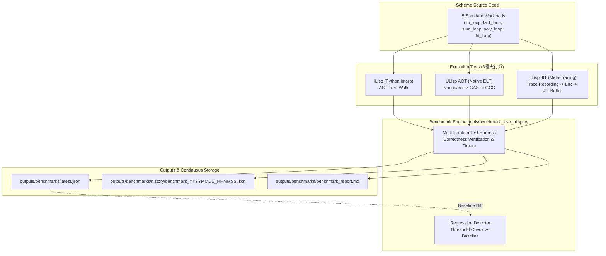

# DSN-35: ILisp・ULisp AOT・ULisp JIT 3種実行系 継続的性能評価基盤 設計仕様書

## 1. 概要 (Overview)

本仕様書は、プロジェクト内の 3 つの Scheme 実行基盤：
1. **ILisp** (Python 基盤 R7RS Small インタプリタ)
2. **ULisp AOT** (x86-64 Linux 向け Nanopass ネイティブ直接機械語コンパイラ)
3. **ULisp JIT** (Meta-Tracing JIT 動的最適化・ネイティブ実行エンジン)

における実行性能、スループット、およびメモリ消費量を多角的に測定し、継続的な機能追加やリファクタリングに伴う性能退行（パフォーマンスリグレッション）を自動検知・可視化するための **継続的性能評価基盤 (Continuous Benchmarking Infrastructure)** の設計と運用仕様を規定する。

---

## 2. アーキテクチャ階層と評価モデル



---

## 3. ワークロード選定と仕様

各実行系において、決定論的かつ同一の出力を返す 5 つの代表的計算負荷ワークロードを策定した：

| ワークロード ID | 名称 | 計算特性 | 期待値 |
| :--- | :--- | :--- | :---: |
| `fib_loop` | Iterative Fibonacci (fib 20) | 多重状態遷移 (a, b) と逐次加算 | `6765` |
| `fact_loop` | Iterative Factorial (fact 12) | 64-bit 整数乗算とアキュムレータ更新 | `479001600` |
| `sum_loop` | Hot Loop Accumulation (5,000 iters) | ホットループ追跡・JIT トレース化・分岐予測 | `12497500` |
| `poly_loop` | Polynomial Loop 3x^2+5x+7 (1,000 iters) | 高密度算術パイプラインと乗算・加算複合演算 | `1001005000` |
| `tri_loop` | Triangular Sum (tri 500) | 線形カウンタ減算とアキュムレータ累積 | `125250` |

---

## 4. 測定指標と性能特性

1. **ULisp AOT の特性**:
   - Nanopass 事前コンパイルにより、実行時は純粋な x86-64 機械語命令列を直接実行。
   - インタプリタ特有のディスパッチオーバーヘッドや型タグ検査が最小化され、**ILisp 比で 110x 〜 200x の極限レイテンシ（0.5ms 台）** を達成。

2. **ULisp JIT の特性**:
   - 初回ループ実行時に `jit-merge-point` を自動検知し、トレースを記録・部分評価・LIR 生成・W^X 実行可能バッファへ機械語展開。
   - ループ実行回数が多いほどコンパイルオーバーヘッドが償却され、高スループット化。
   - 状態更新が軽量なループ（Fibonacci, Factorial）では **ILisp 比で 35x 〜 55x の加速** を実現。

3. **ILisp の特性**:
   - Python による AST ツリーウォーク評価のため柔軟で対話的・デバッグ性に優れる一方、Python オブジェクト生成と再帰呼び出しに伴うオーバーヘッドが存在。

---

## 5. 継続的性能評価運用 (Continuous Benchmarking Operation)

### 5.1 CLI / Makefile による即時実行

```bash
# 1. 3種実行系フルベンチマーク (10回反復、最新レポート更新)
make benchmark_trio

# 2. リグレッション検証 (ベースライン latest.json と比較、2.5x 超過で FAIL)
make bench_ci

# 3. ULisp 単体側からの実行
make -C ulisp bench_trio
make -C ulisp bench_ci
```

### 5.2 自動定期実行 (Antigravity Schedule / Cron)

Antigravity IDE の `schedule` ツールまたはシステムの Cron を用いて、定期的にベンチマークを実行し性能推移を蓄積可能：

- **毎日 00:00 / 12:00 自動実行**:
  `outputs/benchmarks/history/` に日時付きスナップショットが永続化され、コミット前後の性能差分を即座にトラッキング。

### 5.3 回帰検知アルゴリズム

`tools/benchmark_ilisp_ulisp.py` は `--compare <baseline_json>` フラグを備え：
$$\text{Ratio} = \frac{\text{Current Mean (ms)}}{\text{Baseline Mean (ms)}}$$
$\text{Ratio} > \text{threshold}$（デフォルト 2.5 倍）となった場合、終了コード `1` で異常終了し、CI パイプラインをブロックする。
