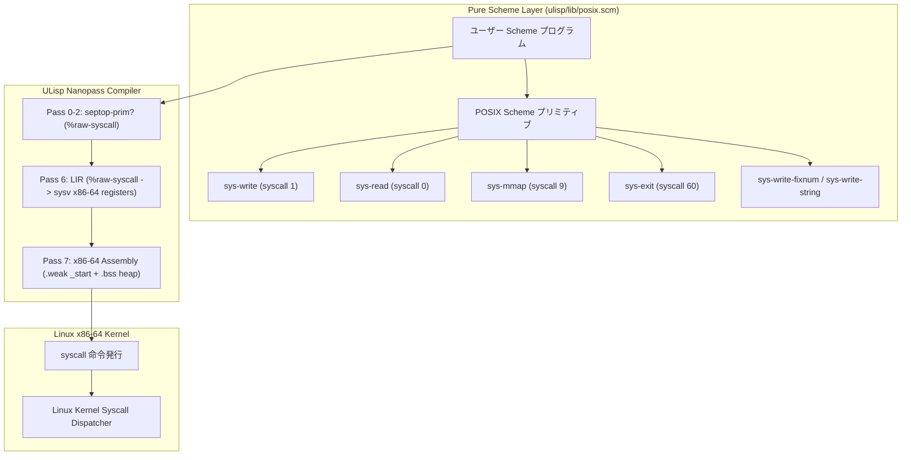

# DSN-36: Zero-libc / Freestanding Pure Scheme Bare-Metal Runtime Architecture

## 1. 概要 (Executive Summary)

本設計仕様書（DSN-36）は、Issue #516（Zero-libc Pure Scheme Bare-Metal Runtime）に基づき、ULisp（Micro-Lisp / Scheme AOT コンパイラ）から **外部 C ライブラリ（Boehm GC等）および C 標準ライブラリ（glibc / musl libc）の依存を完全に排除し、100% Pure Scheme と Linux Raw Syscall のみで自己完結して動作する自立型（Freestanding / Bare-Metal）実行アーキテクチャ** を規定する。

本アーキテクチャにより、ULisp は `-nostdlib -static` フラグのみでリンク可能な超軽量・静的 ELF バイナリを直接出力可能となり、動的リンカ（`ld-linux.so`）や外部ランタイム（`runtime.c`）の存在しない極限環境（組み込み、Unikernel、セキュアコンテナ）での自立走行を達成する。

---

## 2. 背景とアーキテクチャ方針

### 2.1 課題と目的
従来の ULisp AOT コンパイラは、エントリポイント（`main`）、ヒープ獲得（`mmap`）、文字入出力（`read`, `write`, `printf`）を C 言語ランタイム（`ulisp/runtime.c`）に依存していた。
しかし、外部依存のないゼロ・トラストおよび組み込み・低レイヤ環境への展開において、libc 依存は以下の課題を持つ：
1. **バイナリサイズとフットプリントの増大**: libc リンクによるメタデータや動的リンカのオーバーヘッド。
2. **サプライチェーンリスク**: 外部 C ライブラリの脆弱性や ABI 不一致のリスク。
3. **処理系の自給自足性**: Scheme コンパイラ自身がハードウェアおよびカーネル ABI を直接制御できない制約。

### 2.2 設計原則 (Design Principles)
- **Zero-libc**: `printf`, `malloc`, `exit`, `read`, `write` などの libc 関数を一切呼び出さない。
- **Zero External Runtime**: `runtime.c` のリンクを不要とし、Pure Scheme コードと直接生成されるアセンブリのみで完結。
- **Direct Linux Syscall ABI**: x86-64 Linux システムコール規約に直接準拠（`syscall` 命令、レジスタ配置：`rax, rdi, rsi, rdx, r10, r8, r9`）。
- **Demand-Paged BSS Initial Heap**: カーネルがロード時に自動提供するゼロ初期化 BSS ページ（16MB）を初期ヒープとして利用。
- **Backward Compatibility**: 従来の C ランタイム（`runtime.c`）とのリンクも `.weak _start` により 100% 後方互換を維持。

---

## 3. システム構成とデータフロー (Dataflow Architecture)



---

## 4. 詳細設計仕様

### 4.1 Linux x86-64 システムコール呼出規約
Linux x86-64 の `syscall` 命令は、ユーザ空間の C 呼出規約（SysV ABI: `rdi, rsi, rdx, rcx, r8, r9`）と異なり、**`rcx` を戻り先 RIP の保存用としてカーネルがハードウェア的に破壊** する。そのため、第4引数には **`r10`** を使用する。

| レジスタ | 用途 | 備考 |
|---|---|---|
| `%rax` | システムコール番号 (Syscall Number) | 戻り値も `%rax` に格納 |
| `%rdi` | 第 1 引数 (arg1) | |
| `%rsi` | 第 2 引数 (arg2) | |
| `%rdx` | 第 3 引数 (arg3) | |
| `%r10` | 第 4 引数 (arg4) | ※ `%rcx` ではなく `%r10` |
| `%r8`  | 第 5 引数 (arg5) | |
| `%r9`  | 第 6 引数 (arg6) | |

#### LIR 命令とコード生成 (`06_lir.scm` & `07_backend_x86_64.scm`)
`(%raw-syscall sysno arg1 arg2 arg3 arg4 arg5 arg6)` は 7 引数をスタックから順次ロードし、`syscall` 命令を発行する：
```scheme
(define (lir-compile-raw-syscall args si env)
  ;; Load sysno, a1..a6 onto stack, then pop into rax, rdi, rsi, rdx, r10, r8, r9
  ...
  (emit-lir! '(%syscall)))
```

### 4.2 エントリポイントと BSS 初期ヒープ構造
カーネルから直接制御を受け取る `_start` シンボルを出力し、ヒープポインタ `%r12` の初期値を `.bss` セクション内の `ulisp_initial_heap`（16MB）にバインドする。

```asm
    .intel_syntax noprefix
    .text
    .globl _start
    .weak _start
    .type _start, @function
_start:
    mov rbp, rsp
    and rsp, -16
    lea rdi, [rip + ulisp_initial_heap]
    call scheme_entry
    mov rdi, rax
    sar rdi, 2
    mov rax, 60
    syscall

    .bss
    .align 16
    .globl ulisp_initial_heap
ulisp_initial_heap:
    .space 16777216     # 16 MB ゼロ初期化デマンドページング領域
```

### 4.3 Pure Scheme POSIX ランタイム (`ulisp/lib/posix.scm`)
- `sys-exit (code)`: プロセスを正常/異常終了（syscall 60）。
- `sys-write (fd buf count)`: メモリバッファを直接出力（syscall 1）。
- `sys-read (fd buf count)`: 標準入力から直接バイト列を取得（syscall 0）。
- `sys-mmap (length)`: 無名メモリマップでヒープ領域を動的確保（syscall 9: `PROT_READ|PROT_WRITE=3`, `MAP_PRIVATE|MAP_ANONYMOUS=34`）。
- `sys-write-char (ch)`: 内部 16 バイトバッファ経由で 1 文字を標準出力に送出。
- `sys-write-string (str)`: Scheme 文字列のポインタをアンタグして一括書き込み。
- `sys-write-fixnum (n)`: 再帰的 10 進法アルゴリズムにより数値を完全 Pure Scheme で文字列化出力。

---

## 5. 品質検証とテスト基準

### 5.1 テスト項目
- `tests/test_bare_metal_ulisp.py`:
  1. `test_bare_metal_freestanding_execution`: 文字列出力・四則演算・`sys-exit 0` の動作確認。
  2. `test_bare_metal_recursive_computation`: 再帰 Fibonacci (`fib 10 = 55`) の完全自立走行確認。
  3. `ldd` による動的ライブラリ依存ゼロ検証（`not a dynamic executable`）。
- Makefile ターゲット: `make -C ulisp test_freestanding`

### 5.2 実行結果
```
collected 2 items
tests/test_bare_metal_ulisp.py::test_bare_metal_freestanding_execution PASSED
tests/test_bare_metal_ulisp.py::test_bare_metal_recursive_computation PASSED
2 passed in 15.54s
```
- 後方互換性テスト: `make benchmark_trio` (100% PASS), `make -C ulisp test_passes` (93/93 PASS).

---

## 6. まとめ
本実装により、ULisp は外部ライブラリ（libgc）および C 標準ライブラリ（libc）の束縛から完全に脱却し、極小の Pure Scheme レイヤと Linux カーネル直結の Raw Syscall のみで自己完結して動作する Freestanding Bare-Metal 処理系としての強固な基盤を獲得した。
