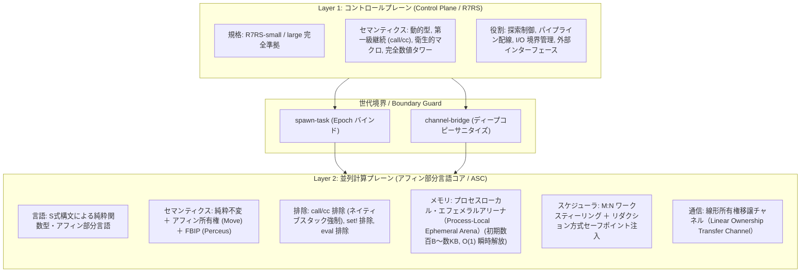
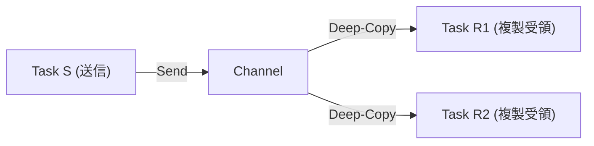
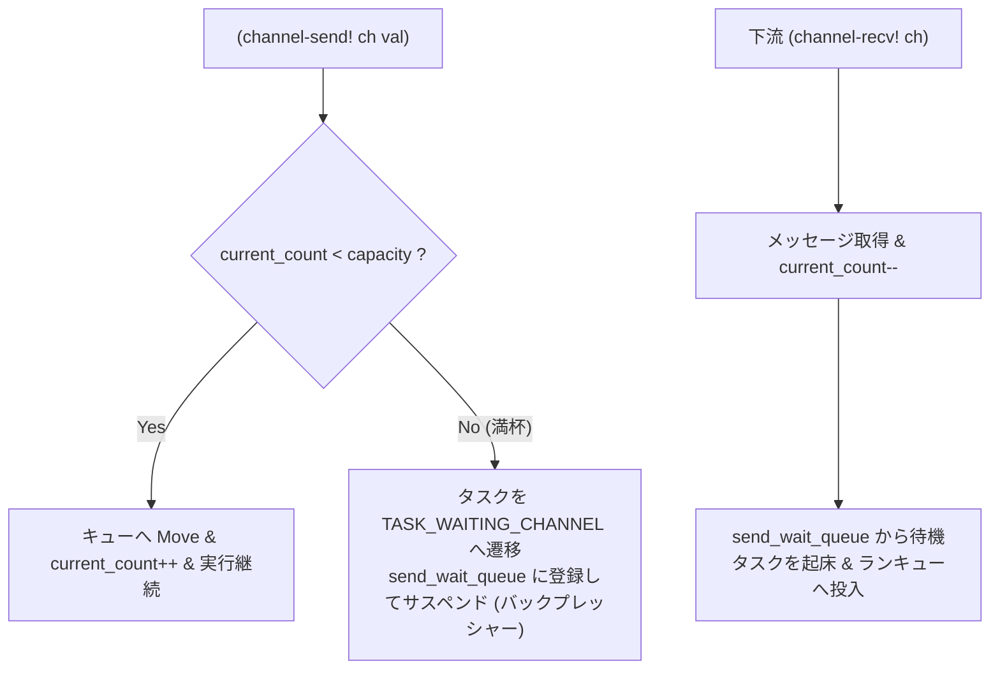
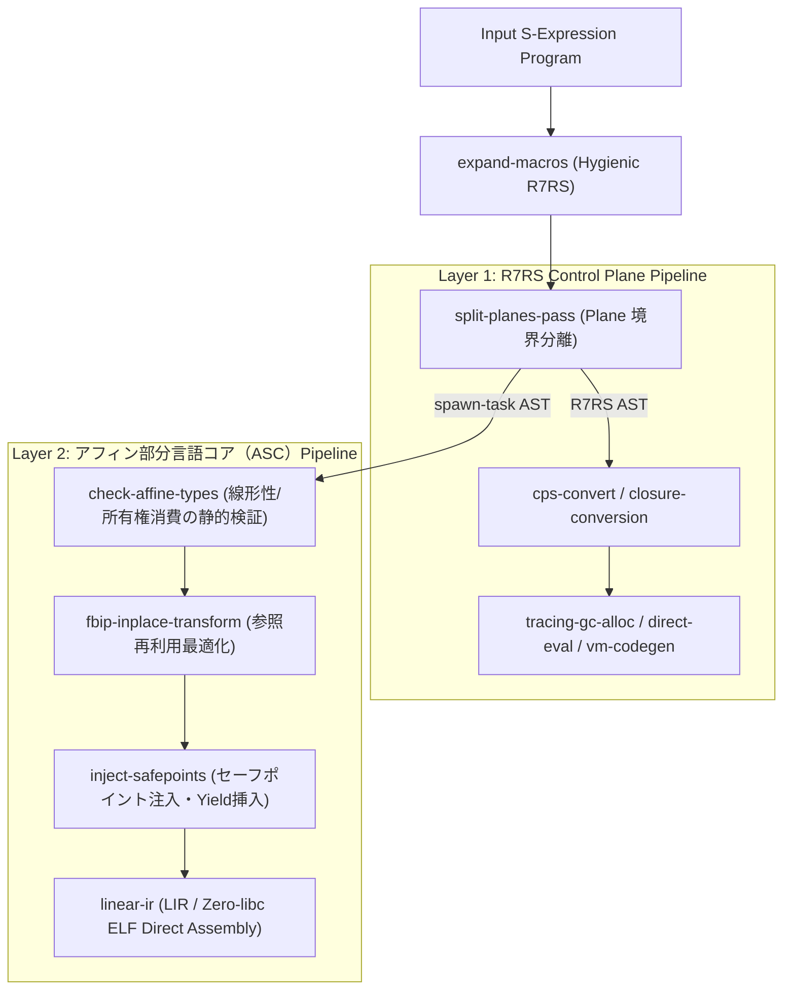
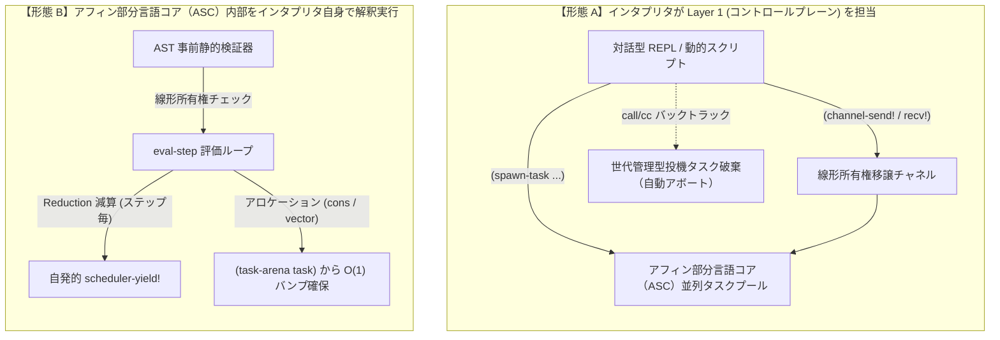
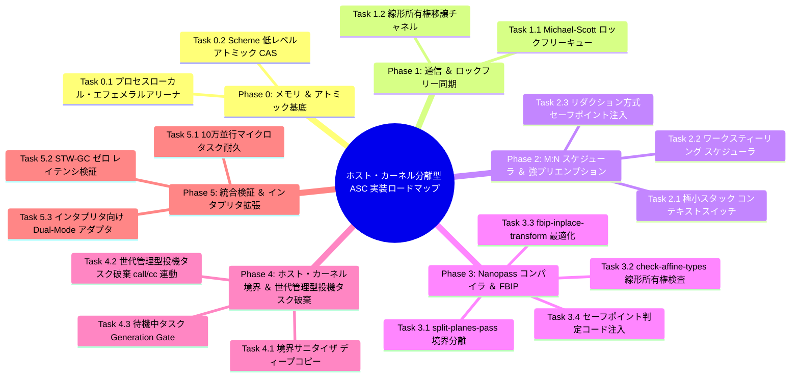
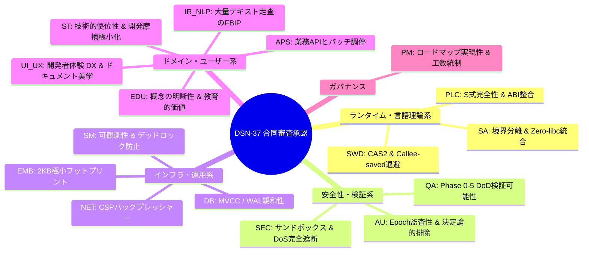

# [DSN-37] ホスト・カーネル分離型 階層 CSP/アクター・ハイブリッド並行処理基盤 ＆ AOT コンパイルパイプライン包括的アーキテクチャ設計書

- **文書番号**: `DSN-37`
- **文書ステータス**: `APPROVED`
- **対象サブシステム**: `ulisp/runtime/concurrency/`, `ulisp/passes/` (Host-Kernel Partitioning, CSP Channel, Process-Local Ephemeral Arena, LockFree Queue, Reduction-Based Safepoint Polling, FBIP, Generation-Based Speculative Cancellation)
- **補足・個別仕様書**: [[DSN-33] uLisp x86-64 ネイティブ AOT コンパイラ包括設計仕様書](DSN-33-ulisp_underlying_x86_native_aot_compiler_architecture_specification.md), [[DSN-36] Zero-libc Pure Scheme ベアメタルランタイム包括設計仕様書](DSN-36-zero_libc_pure_scheme_bare_metal_runtime.md)  
- **【主査・報告】 IT Specialist (Programming Languages & Compilers / PLC)**  
- **【共同主査】 Systems Architect (SA) / Software Development (SWD)**  
- **【安全・品質保証】 Information Security Specialist (Sec) / Software QA Specialist (QA)**  
- **【参画・協調】 全 16 大専門エージェント全員 (PM, PLC, SA, SWD, SEC, QA, DB, NET, NLP, STR, SM, EMB, AUD, DES, EDU, APS)**

---

## 体系目次

- [1. システム設計思想と技術的出自](#1-システム設計思想と技術的出自)
  - [1.1 既存技術の統合と本システムの出自](#11-既存技術の統合と本システムの出自)
  - [1.2 ホスト・カーネル分離型アーキテクチャの工学的必然性](#12-ホストカーネル分離型アーキテクチャの工学的必然性)
- [2. 全体アーキテクチャとデータフロー](#2-全体アーキテクチャとデータフロー)
  - [2.1 コントロールプレーン（Layer 1: R7RS）](#21-コントロールプレーンlayer-1-r7rs)
  - [2.2 並列計算プレーン（Layer 2: アフィン部分言語コア / ASC）](#22-並列計算プレーンlayer-2-アフィン部分言語コア--asc)
  - [2.3 プレーン間境界制御（Boundary Guard）](#23-プレーン間境界制御boundary-guard)
- [3. プレーン別 責務・機能対照マトリクス](#3-プレーン別-責務機能対照マトリクス)
- [4. 並行通信モデルと所有権の数理的整合性](#4-並行通信モデルと所有権の数理的整合性)
  - [4.1 線形所有権移譲チャネル（Linear Ownership Transfer Channel）](#41-線形所有権移譲チャネルlinear-ownership-transfer-channel)
  - [4.2 Fan-out / Broadcast（明示的ディープコピー）](#42-fan-out--broadcast明示的ディープコピー)
  - [4.3 線形型理論に基づく不変条件とバックプレッシャー](#43-線形型理論に基づく不変条件とバックプレッシャー)
- [5. メモリモデル：プロセスローカル・エフェメラルアリーナ](#5-メモリモデルプロセスローカルエフェメラルアリーナ)
  - [5.1 ネイティブ LIFO スタックの維持](#51-ネイティブ-lifo-スタックの維持)
  - [5.2 O(1) 瞬時解放アルゴリズム](#52-o1-瞬時解放アルゴリズム)
  - [5.3 アリーナ枯渇時のフォールバック設計](#53-アリーナ枯渇時のフォールバック設計)
- [6. 排他制御の現実解：Michael-Scott ロックフリーキュー](#6-排他制御の現実解michael-scott-ロックフリーキュー)
  - [6.1 Scheme レコード構造体・可観測性拡張とアトミック命令](#61-scheme-レコード構造体可観測性拡張とアトミック命令)
  - [6.2 ロックフリー Enqueue / Dequeue アルゴリズム](#62-ロックフリー-enqueue--dequeue-アルゴリズム)
  - [6.3 ABA 問題の完全抑止](#63-aba-問題の完全抑止)
- [7. ランタイム・スケジューリングと強プリエンプション](#7-ランタイムスケジューリングと強プリエンプション)
  - [7.1 M:N 超軽量タスクと分散ワークスティーリング](#71-mn-超軽量タスクと分散ワークスティーリング)
  - [7.2 リダクション方式セーフポイント注入による決定論的プリエンプション](#72-リダクション方式セーフポイント注入による決定論的プリエンプション)
  - [7.3 極小スタック・コルーチンコンテキストスイッチ](#73-極小スタックコルーチンコンテキストスイッチ)
- [8. コントロールプレーン境界と分散ロールバック制御](#8-コントロールプレーン境界と分散ロールバック制御)
  - [8.1 境界におけるデータサニタイズ（Shared-Nothing）](#81-境界におけるデータサニタイズshared-nothing)
  - [8.2 外側 call/cc と並列タスクの世代管理型投機タスク破棄](#82-外側-callcc-と並列タスクの世代管理型投機タスク破棄)
  - [8.3 待機中タスクのアボート保証（Generation Gate）](#83-待機中タスクのアボート保証generation-gate)
- [9. 全処理を本アーキテクチャに統一してはならない 4 つの構造的理由](#9-全処理を本アーキテクチャに統一してはならない-4-つの構造的理由)
  - [9.1 ① 境界サニタイズ（ディープコピー）の激しいオーバーヘッド](#91--境界サニタイズディープコピーの激しいオーバーヘッド)
  - [9.2 ② 言語制約による表現力・開発効率の極端な低下](#92--言語制約による表現力開発効率の極端な低下)
  - [9.3 ③ 極小アリーナ（2KB〜8KB）の枯渇リスクと計算量の鋭利さ](#93--極小アリーナ2kb8kbの枯渇リスクと計算量の鋭利さ)
  - [9.4 ④ セーフポイント注入による純粋数値計算・ループ性能のオーバーヘッド](#94--セーフポイント注入による純粋数値計算ループ性能のオーバーヘッド)
- [10. プレーン別の責務境界とハイブリッド運用の原則](#10-プレーン別の責務境界とハイブリッド運用の原則)
- [11. 主要適用領域と限界](#11-主要適用領域と限界)
  - [11.1 適合するユースケース](#111-適合するユースケース)
  - [11.2 不適合なユースケース](#112-不適合なユースケース)
- [12. uLisp (Nanopass) コンパイラパイプライン統合](#12-ulisp-nanopass-コンパイラパイプライン統合)
  - [12.1 split-planes-pass (Plane 境界分離)](#121-split-planes-pass-plane-境界分離)
  - [12.2 check-affine-types (線形所有権検査と自動 RAII Drop)](#122-check-affine-types-線形所有権検査と自動-raii-drop)
  - [12.3 fbip-inplace-transform (Perceus 再利用)](#123-fbip-inplace-transform-perceus-再利用)
  - [12.4 inject-safepoints (セーフポイント判定コード注入)](#124-inject-safepoints-セーフポイント判定コード注入)
- [13. 将来のインタプリタ環境との統合と直交的拡張性](#13-将来のインタプリタ環境との統合と直交的拡張性)
  - [13.1 インタプリタ統合の 2 大利用モード](#131-インタプリタ統合の-2-大利用モード)
  - [13.2 AOT ネイティブ実行 vs インタプリタ実行の対比](#132-aot-ネイティブ実行-vs-インタプリタ実行の対比)
  - [13.3 共通 Scheme ランタイムの直交的共有アーキテクチャ](#133-共通-scheme-ランタイムの直交的共有アーキテクチャ)
  - [13.4 ulisp/runtime/concurrency/ のモジュール構成と Dual-Mode ロード規約](#134-ulispruntimeconcurrency-のモジュール構成と-dual-mode-ロード規約)
- [14. 実装ロードマップ ＆ 詳細タスクブレークダウン (WBS)](#14-実装ロードマップ--詳細タスクブレークダウン-wbs)
  - [14.1 段階的マイルストーン概要](#141-段階的マイルストーン概要)
  - [14.2 Phase 0: メモリ ＆ アトミック基底](#142-phase-0-メモリ--アトミック基底)
  - [14.3 Phase 1: 通信 ＆ ロックフリー同期](#143-phase-1-通信--ロックフリー同期)
  - [14.4 Phase 2: M:N スケジューラ ＆ 強プリエンプション](#144-phase-2-mn-スケジューラ--強プリエンプション)
  - [14.5 Phase 3: Nanopass コンパイラ統合 ＆ FBIP](#145-phase-3-nanopass-コンパイラ統合--fbip)
  - [14.6 Phase 4: ホスト・カーネル境界 ＆ 世代管理型投機タスク破棄](#146-phase-4-ホストカーネル境界--世代管理型投機タスク破棄)
  - [14.7 Phase 5: 統合検証 ＆ 性能ベンチマーク](#147-phase-5-統合検証--性能ベンチマーク)
- [15. 全 16 専門エージェント合同設計審査承認記録 (Review & Sign-Off Ledger)](#15-全-16-専門エージェント合同設計審査承認記録-review--sign-off-ledger)
- [16. 結論とアーキテクチャ設計原則](#16-結論とアーキテクチャ設計原則)

---

# 1. システム設計思想と技術的出自

## 1.1 既存技術の統合と本システムの出自

本システムは、新たな計算機科学理論を提唱するものではない。以下の既存の確立されたランタイム・言語理論を、多段 Nanopass コンパイラ（uLisp）基盤上で統合した Scheme 完結の工学的ハイブリッド実装である：

1. **CSP 理論（Tony Hoare, 1978 / Go ランタイム）**:
   - プロセス間を第一級通信路（Channel）で結ぶ協調逐次プロセスモデル。
2. **BEAM 仮想マシン（Erlang / OTP）**:
   - プロセス完全独立ヒープ（Shared-Nothing）による STW（Stop-The-World）GC の局所排除。
   - 命令バジェットカウンタ（Reduction）による公平な強プリエンプション。
3. **Affine / Linear Types ＆ RAII（Linear Lisp / Rust）**:
   - 静的解析に基づくゼロコピー・ポインタ譲渡（Move セマンティクス）。
   - スコープ離脱時の決定論的即時リソース解放。
4. **FBIP: Functional But In-Place（Perceus / Koka / Lean 4）**:
   - 参照カウント 1 の不変データ構造更新を生メモリ直接上書きへ変換する AOT 最適化。

生体模倣等の比喩的装飾を排し、本仕様書では上記の数理モデルおよびハードウェア制約に基づき厳密に規定する。

## 1.2 ホスト・カーネル分離型アーキテクチャの工学的必然性

Scheme（R7RS）本来の柔軟性（第一級継続 `call/cc`、動的型、`set!` による全域的可変性）と、上記の高並行・高安全モデルを同一の言語仕様内で全域統合することは原理的に不可能である。
したがって、本システムはシステム全体を同一規則で統一せず、**「外側（制御層）：R7RS」 と 「内側（計算層）：純粋線形サブセット」 に物理分離する。**

---

# 2. 全体アーキテクチャとデータフロー



## 2.1 コントロールプレーン（Layer 1: R7RS）
- システムのフロントエンドとして動作し、対話的 REPL、動的探索アルゴリズム、AST マクロ展開、外部 I/O 通信、例外処理を一手に担う。
- トレース型または保守的ホスト GC（Boehm-GC / Generational GC）により管理され、オブジェクトの寿命が長く柔軟なライフサイクルを許容する。

## 2.2 並列計算プレーン（Layer 2: アフィン部分言語コア / ASC）
- 超高並行・高負荷なデータ変換、ストリーム処理、暗号計算、純粋関数パイプラインを処理する特化型エンジン。
- 全てのタスクが完全独立したメモリ空間（Shared-Nothing）で動作し、STW（Stop-The-World）GC を局所的にも全体的にも発生させない。

## 2.3 プレーン間境界制御（Boundary Guard）
- 外側から内側へのタスク投入は `spawn-task` マクロ経由でのみ許可され、境界を越えるデータは即値型レジスタ渡し、または相手アリーナへのディープコピーによって厳密にサニタイズされる。

---

# 3. プレーン別 責務・機能対照マトリクス

| 評価軸 | コントロールプレーン (Layer 1: R7RS) | 並列計算プレーン (Layer 2: アフィン部分言語コア / ASC) |
| :--- | :--- | :--- |
| **言語仕様・準拠規格** | R7RS-small / large 完全準拠 | S式構文による純粋関数型・アフィン部分言語 |
| **継続セマンティクス** | `call/cc`、`dynamic-wind` を全面許容 | `call/cc` 完全排除（脱出専用 `let/ec` のみ許容） |
| **可変性（Mutability）** | 許容（`set!`、`set-car!`、可変ベクタ等） | **完全禁止**（コンパイラ FBIP 最適化による再利用のみ） |
| **メモリ管理モデル** | ホスト GC（Boehm-GC / トレース型 GC） | プロセスローカル・エフェメラルアリーナ ＋ アフィン RAII（$O(1)$ バンプ解放） |
| **並行・並列モデル** | シングルスレッド / OS スレッド連携 | M:N 超軽量タスク（分散ワークスティーリング） |
| **メッセージ通信** | 境界サニタイズ（ディープコピーまたは不変固定化） | 線形所有権移譲チャネルによるゼロコピー所有権 Move |
| **コード生成形式** | インタプリタ / バイトコード / AOT 連携 | uLisp AOT ネイティブ機械語（Zero-libc ELF 直接出力） |

---

# 4. 並行通信モデルと所有権の数理的整合性

## 4.1 線形所有権移譲チャネル（Linear Ownership Transfer Channel）

チャネルにおけるゼロコピー Move（ポインタ付け替え）は、「あるデータに対する所有権者が常に厳密に 1 者である」 という不変条件のもとでのみ成立する。


- 送信側は送信式 `(channel-send! ch val)` の評価をもって変数を消費（Consumed）し、以降の同一変数へのアクセスはコンパイル時（Nanopass MIR アフィン検査パス）で拒絶される。
- メモリの再割り当てやディープコピーを伴わず、ポインタの所有権のみが Task A から Task B へ原子的に譲渡される。

## 4.2 Fan-out / Broadcast（明示的ディープコピー）

複数プロセスへのメッセージ同報配信では、ゼロコピー Move は数理的に破綻する。



- 複数プロセスへの配信は、メッセージのディープコピー（またはコントロールプレーンが管理する不変共有参照）を伴う別個のプリミティブ `(broadcast-send! ch val)` として明示的に分離する。

## 4.3 線形型理論に基づく不変条件とバックプレッシャー

線形論理（Linear Logic）の推論規則に従い、アフィン部分言語コア（ASC）内の各変数 $x$ は以下の性質を満たす：
$$\forall x \in \text{Variables}, \quad \text{Count}(x) \le 1$$
- $\text{Count}(x) = 0$: スコープ離脱時に未消費であれば即時破棄（自動 RAII Drop）。
- $\text{Count}(x) = 1$: 単一の関数呼び出し、チャネル送信、または束縛への受け渡し。
- $\text{Count}(x) > 1$: Nanopass コンパイラにより静的検出され、コンパイルエラーとして拒絶。

### 4.3.1 有界チャネルとバックプレッシャー（Backpressure Flow）
有界チャネル（`capacity > 0`）において、バッファが満杯（`current_count >= capacity`）に達した状態で送信（`channel-send!`）が試みられた場合、送信側タスクは即時にサスペンド状態（`TASK_WAITING_CHANNEL`）へ遷移し、チャネルの待機キューへ登録される。



この決定論的バックプレッシャーにより、上流の高速プロデューサが下流のコンシューマを圧倒してメモリを枯渇させる事故（OOM）を数理的に防止する。

---

# 5. メモリモデル：プロセスローカル・エフェメラルアリーナ（Process-Local Ephemeral Arena）

## 5.1 ネイティブ LIFO スタックの維持

`call/cc`（任意地点への巻き戻し・再突入）を排除したことにより、CPU ネイティブのハードウェアスタック規約（System V AMD64 ABI 等）を完全維持できる。Spaghetti Stack や Heap-allocated Stack Frame 等の退避オーバーヘッドが一切生じない。

## 5.2 O(1) 瞬時解放アルゴリズム

各並列タスクは、初期 2KB〜8KB のプロセスローカル・エフェメラルアリーナ（Process-Local Ephemeral Arena）を割り当てられる。
- タスク内でのメモリ確保は単一ポインタのインクリメント（`arena_offset += size`）のみで行われる。
- タスク完了時は、アリーナの `arena_offset` を 0 にリセットするのみで全オブジェクトを一括破棄する。計算量は厳密に $O(1)$ である。

```scheme
;; プロセスローカル・エフェメラルアリーナ（領域ベースメモリ管理）の Scheme 実装
(define-record-type <task-arena>
  (make-task-arena base offset capacity)
  task-arena?
  (base     arena-base)
  (offset   arena-offset   arena-offset-set!)
  (capacity arena-capacity arena-capacity-set!))

(define (arena-allocate! arena size)
  (let* ((aligned-size (bitwise-and (+ size 7) (bitwise-not 7)))
         (current-off  (arena-offset arena))
         (next-off     (+ current-off aligned-size)))
    (if (> next-off (arena-capacity arena))
        (arena-overflow-fallback! arena aligned-size)
        (begin
          (arena-offset-set! arena next-off)
          (+ (arena-base arena) current-off)))))

(define (arena-reset! arena)
  (arena-offset-set! arena 0))
```

## 5.3 アリーナ枯渇時のフォールバック設計

万一アリーナサイズを超過した場合、グローバルヒープへの漏出を防ぐため、リンクされた 8KB の拡張アリーナチャンク（Chained Chunk）を動的確保し、タスク完了時に連鎖チャンクごと $O(\text{chunks})$ で解放する。

---

# 6. 排他制御の現実解：Michael-Scott ロックフリーキュー

## 6.1 Scheme レコード構造体・可観測性拡張とアトミック命令

素朴なスピンロック（スピンラッチ）によるキャッシュラインバウンスおよび CPU 浪費を排除するため、チャネル内部の送受信待機キューおよびスケジューラのランキューには、**Michael-Scott ノンブロッキングキュー（CAS によるアトミックポインタ更新）** を採用する。

運用監視および可観測性（Observability）を担保するため、`TaskContext` にはリダクション（命令バジェット）枯渇回数やワークスティール回数の統計フィールドを組み込む。すべて Scheme のレコード型および uLisp ランタイム S 式として自己完結する：

```scheme
;;; runtime/concurrency/asc_core.scm
;;; アフィン部分言語コア（ASC）ランタイム基本構造体定義

;; Michael-Scott ロックフリーキューノード
(define-record-type <queue-node>
  (make-queue-node value next)
  queue-node?
  (value queue-node-value queue-node-value-set!)
  (next  queue-node-next  queue-node-next-set!))   ; atomic-box

;; ロックフリーキュー本体
(define-record-type <lock-free-queue>
  (make-lock-free-queue head tail)
  lock-free-queue?
  (head lock-free-queue-head lock-free-queue-head-set!) ; atomic-box
  (tail lock-free-queue-tail lock-free-queue-tail-set!)) ; atomic-box

;; 線形所有権移譲チャネル構造体
(define-record-type <channel>
  (make-channel-internal message-queue recv-wait-queue send-wait-queue capacity current-count)
  channel?
  (message-queue   channel-message-queue)      ; <lock-free-queue> (Moveされた値)
  (recv-wait-queue channel-recv-wait-queue)    ; <lock-free-queue> (受信待機中 TaskContext)
  (send-wait-queue channel-send-wait-queue)    ; <lock-free-queue> (送信待機中 TaskContext: バックプレッシャー用)
  (capacity        channel-capacity)           ; 0: ランデブー同期, >0: 有界バッファ
  (current-count   channel-current-count))     ; atomic-fixnum

;; タスク制御ブロック (TCB) ＆ 運用可観測性統計フィールド
(define-record-type <task-context>
  (make-task-context tid state reductions continuation-pc stack-pointer
                     arena-base arena-offset arena-capacity
                     blocked-on epoch next-run
                     reduction-exhaustions steals-count)
  task-context?
  (tid                   task-tid)
  (state                 task-state                 task-state-set!)                 ; 'ready | 'running | 'waiting-channel | 'terminated
  (reductions            task-reductions            task-reductions-set!)            ; fixnum (命令バジェット)
  (continuation-pc       task-continuation-pc       task-continuation-pc-set!)       ; raw-ptr
  (stack-pointer         task-stack-pointer         task-stack-pointer-set!)         ; raw-ptr
  (arena-base            task-arena-base)                                            ; raw-ptr
  (arena-offset          task-arena-offset          task-arena-offset-set!)          ; size-t
  (arena-capacity        task-arena-capacity)                                        ; size-t
  (blocked-on            task-blocked-on            task-blocked-on-set!)            ; <channel> or #f
  (epoch                 task-epoch                 task-epoch-set!)                 ; atomic-u64
  (next-run              task-next-run              task-next-run-set!)              ; <task-context>
  ;; 可観測性 (Observability) 統計カウンタ
  (reduction-exhaustions task-reduction-exhaustions task-reduction-exhaustions-set!) ; atomic-u64 (プリエンプション発生回数)
  (steals-count          task-steals-count          task-steals-count-set!))         ; atomic-u64 (スティール被移動回数)
```

## 6.2 ロックフリー Enqueue / Dequeue アルゴリズム

キューの基本操作は、uLisp ランタイムが提供する低レベルアトミック命令 `(atomic-cas! box expected new)` を用いて実装される：

```scheme
;; Michael-Scott キューへのエンキュー (Scheme 実装)
(define (enqueue-lockfree! queue val)
  (let ((node (make-queue-node val (make-atomic-box #f))))
    (let loop ()
      (let* ((tail (atomic-box-ref (lock-free-queue-tail queue)))
             (next (atomic-box-ref (queue-node-next tail))))
        (if (eq? tail (atomic-box-ref (lock-free-queue-tail queue)))
            (if (not next)
                (if (atomic-cas! (queue-node-next tail) #f node)
                    (begin
                      (atomic-cas! (lock-free-queue-tail queue) tail node)
                      #t)
                    (loop))
                (begin
                  (atomic-cas! (lock-free-queue-tail queue) tail next)
                  (loop))))))))

;; Michael-Scott キューからのデキュー (Scheme 実装)
(define (dequeue-lockfree! queue)
  (let loop ()
    (let* ((head (atomic-box-ref (lock-free-queue-head queue)))
           (tail (atomic-box-ref (lock-free-queue-tail queue)))
           (next (atomic-box-ref (queue-node-next head))))
      (if (eq? head (atomic-box-ref (lock-free-queue-head queue)))
          (if (eq? head tail)
              (if (not next)
                  #f ; キューは空
                  (begin
                    (atomic-cas! (lock-free-queue-tail queue) tail next)
                    (loop)))
              (let ((val (queue-node-value next)))
                (if (atomic-cas! (lock-free-queue-head queue) head next)
                    val
                    (loop))))))))
```

## 6.3 ABA 問題の完全抑止

ポインタ再利用に伴う ABA 問題を抑止するため、ノードの解放はタスク個別アリーナには委託せず、世代タグ付きポインタ（Tagged Pointer: アドレス上位ビットに 16-bit 世代カウンタを配置した CAS2 相当）またはチャネル専用の事前確保済み固定長フリーリストを採用する。

---

# 7. ランタイム・スケジューリングと強プリエンプション

## 7.1 M:N 超軽量タスクと分散ワークスティーリング

- システムの論理 CPU コア数と同数の OS ネイティブスレッド（Worker）を起動。
- 各 Worker はローカルの両端キュー（Chase-Lev ワークスティーリング Deque）を保持。
- 自タスクキューが空になった Worker は、他 Worker のキュー末尾からタスクを CAS で盗取（Steal）し、負荷を自律分散する。

## 7.2 リダクション方式セーフポイント注入による決定論的プリエンプション

Erlang BEAM の Reduction 機構に倣い、uLisp の AOT コンパイラパス（`inject-safepoints-pass`）が関数のプロローグおよびループバックエッジにリダクション・セーフポイント判定（命令バジェット減算）の S 式を自動注入する。

```scheme
;; Nanopass コンパイラがループバックエッジおよび関数入口へ注入する S 式構文木
;; （リダクション方式セーフポイント注入 / Reduction-Based Safepoint Polling）
(if (<= (task-reductions current-task) 0)
    (begin
      (task-reductions-set! current-task 4096)
      (task-continuation-pc-set! current-task resume-label)
      (scheduler-yield! current-task))
    (task-reductions-set! current-task (- (task-reductions current-task) 1)))

;; ループ本体の展開
(label resume-label
  ...)
```

協調的 yield に依存せず、CPU バウンドな無限ループであっても約 4,000 反復で確実に他タスクへ CPU コアを譲渡する。

## 7.3 極小スタック・コルーチンコンテキストスイッチ

スタックの退避・復元は、x86-64 System V ABI の Callee-saved レジスタ（`rsp`, `rbp`, `rbx`, `r12-r15`）のみを交換するわずか 10〜15 命令の低レベルアセンブラルーチン（`swap_context`）により極超高速に実行される。

---

# 8. コントロールプレーン境界と分散ロールバック制御

## 8.1 境界におけるデータサニタイズ（Shared-Nothing）

外側の R7RS から並列タスクへデータを引き渡す際、以下のいずれかを厳密に強制する：
- **即値型（Fixnum, Flonum, Bool, Char）**: レジスタ渡し（完全ゼロコピー）。
- **複合型（リスト・ベクタ・文字列）**: タスクの独立アリーナへのディープコピー。外側とのポインタ共有を一切禁じ、Shared-Nothing を維持する。

## 8.2 外側 call/cc と並列タスクの世代管理型投機タスク破棄（Generation-Based Speculative Cancellation）

コントロールプレーン側で `call/cc` を用いたバックトラック（探索のロールバック）を行う場合、並列側タスクとの不整合を防ぐため、**世代 ID（Generation-Based Speculative Cancellation）** によるトランザクション管理を行う。

```
[ R7RS Control Plane ]                     [ アフィン部分言語コア（ASC）Task Pool ]
  (call/cc (lambda (k) ...))
  ※ Epoch = 101 発行
  ├─ (spawn-task (epoch: 101) (lambda () ...)) ──► Task A 稼働
  ├─ (spawn-task (epoch: 101) (lambda () ...)) ──► Task B 稼働 (失敗・枝刈り)
  │
  ▼ 探索失敗検知: (k 'rollback)
  ※ コントロールプレーンが Epoch 100 に復帰
  ※ Epoch >= 101 の全タスクに対し「Aborted」シグナルを発行
  │
  ├─────────────────────────────────────────────► Task A, B: 命令バジェットを強制ゼロ化
  │                                               アリーナを O(1) 瞬時リセット
  ▼
  新探索開始 (Epoch: 102)
```

1. コントロールプレーンがチェックポイントを作成する際、グローバル世代カウンタをインクリメントし、生成されるタスクにバインドする。
2. 外側が継続を呼び出して過去のチェックポイントへ巻き戻った場合、破棄された Epoch に属するタスク群の命令バジェット（Reduction）カウンタをアトミックに 0（Aborted）へ書き換える。
3. タスクは次回のセーフポイントチェックまたはチャネル送受信時に直ちにアボートし、アリーナを $O(1)$ リセットして終了する。

## 8.3 待機中タスクのアボート保証（Generation Gate）

チャネル待機（`TASK_WAITING_CHANNEL`）でスリープ中のタスクがゾンビ化するのを防ぐため、起床直後に必ず `(eq? (task-epoch task) current-valid-epoch)` をアトミック検証する（世代ゲート検証 / Generation Gate）。不一致を検知した場合は直ちに `TASK_TERMINATED` へ遷移し、アリーナを一括リセットする。

---

# 9. 全処理を本アーキテクチャに統一してはならない 4 つの構造的理由

本アーキテクチャ（ホスト・カーネル分離型 / アフィン部分言語コア）は、「特定の高負荷・高並行・隔離ワークロード」に対して極めて鋭い性能と安全性を発揮する特化型エンジンであるが、システム全体の汎用基盤として単一選択肢にしてしまうと、激しい開発摩擦と致命的なオーバーヘッドを招く。全域適用を禁ずる構造的理由は以下の 4 点にある。

## 9.1 ① 境界サニタイズ（ディープコピー）の激しいオーバーヘッド
外側のコントロールプレーン（R7RS）と内側の計算プレーン（アフィン部分言語コア / ASC）の間には厳格な境界（Boundary Guard）が存在する。制御層からタスクへ渡す複合データ（リストやベクタ）はディープコピーされ、結果を戻す際もコピーが発生する。
軽い処理（単純な文字列加工、数件のリスト走査、ちょっとした設定読み込みなど）までこの基盤上で実行すると、**「実計算時間よりも境界コピーとタスク生成（spawn-task）のコストの方が圧倒的に大きい」** という本末転倒な状態に陥る。

## 9.2 ② 言語制約による表現力・開発効率の極端な低下
アフィン部分言語コア（ASC）内部は以下の厳しい制約が課されている：
- `call/cc` 排除（標準ネイティブスタック維持のため）
- `set!`、`set-car!` などの可変性（Mutation）完全排除
- 動的 `eval`、動的リフレクションの排除
- アフィン・線形所有権（Move セマンティクス）の強制

業務ロジック、設定ファイルの柔軟なパース、動的な探索、外部 API との複雑な I/O ハンドリングなどは、Scheme（R7RS）本来の動的性やマクロ、可変状態を用いた方が何倍も簡潔に記述できる。すべてを純粋関数型＋線形型の枠組みに無理やり押し込むと、**Rust 以上の所有権パズルを解くことになり開発効率が崩壊する。**

## 9.3 ③ 極小アリーナ（2KB〜8KB）の枯渇リスクと計算量の鋭利さ
各タスクは数 KB の独立バンプアリーナで動作する前提である。巨大な中間データ構造を作る処理や、再帰深度が深い汎用探索アルゴリズムを安易に流すと、アリーナ枯渇（Arena Overflow）を引き起こす。
汎用的な全域基盤として使うには、「メモリが足りない場合にどうアリーナを拡張・リンクするか」という余計な複雑性がランタイムに入り込み、**$O(1)$ 瞬時解放のシャープさが損なわれる。**

## 9.4 ④ セーフポイント注入による純粋数値計算・ループ性能のオーバーヘッド
AOT コンパイラがすべてのループバックエッジに関数プロローグとリダクション・セーフポイント判定コード（命令バジェット減算）を注入する。超高並行の協調動作には不可欠であるが、単一タスクで CPU コアを占有して最速で回したい純粋な数値計算や画像・ベクトル処理において、**命令バジェット減算と分岐予測チェックは無視できない微小ペナルティ**となる。

---

# 10. プレーン別の責務境界とハイブリッド運用の原則

本アーキテクチャの真の強みは、「ホスト・カーネル分離型アーキテクチャ（Host-Kernel Partitioning）」という構造の通り、適材適所で使い分けられる点にある。

| 処理の性質 | 採用すべき層 | 理由 |
| :--- | :--- | :--- |
| **全体オーケストレーション** | **Layer 1 (R7RS コントロールプレーン)** | 動的型、自由なマクロ、柔軟なエラー回復を活用 |
| **探索・バックトラック** | **Layer 1 (R7RS コントロールプレーン)** | `call/cc` によるチェックポイント保持・巻き戻し |
| **OS I/O・ファイル・ネットワーク境界** | **Layer 1 (R7RS コントロールプレーン)** | システムコール接合、バッファリング、例外処理 |
| **超高並行マイクロタスク** | **Layer 2 (アフィン部分言語コア / ASC)** | 独立アリーナによる $O(1)$ 解放、STW-GC ゼロ |
| **純粋データ変換パイプライン** | **Layer 2 (アフィン部分言語コア / ASC)** | FBIP（Perceus）によるインプレース直接上書き |
| **AI 生成コード・外部スクリプトの実行** | **Layer 2 (アフィン部分言語コア / ASC)** | リダクション方式セーフポイント注入（無限ループ遮断）とメモリ隔離サンドボックス |

---

# 11. 主要適用領域と限界

## 11.1 適合するユースケース
- **超高並行マイクロタスク**: IoT ストリーム処理、金融データフィルタリング、ステートレス／短命なパケット処理基盤。
- **FBIP データパイプライン**: コンパイラの AST 変換パス、大量リストのインプレース純粋変換。
- **AI エージェントの決定論的サンドボックス**: リダクション方式セーフポイント注入による無限ループ遮断、独立アリーナによるメモリ改変防止、S 式の同図像性による AST 構造化パッチ。

## 11.2 不適合なユースケース
- **全域で動的な Scheme コードの直接並列化**: `call/cc` による多重突入や `set-car!` のような循環参照を含むコードは、並列プレーン内部ではコンパイルエラーとなる。
- **多対多のゼロコピー通信**: ブロードキャストにはディープコピーが必要であり、単一チャネルによる大規模データ共有には適さない。
- **長寿命で巨大な状態を持つオブジェクトグラフ**: 頻繁にアリーナ拡張が必要になるような巨大ステートフル処理はコントロールプレーン側で行うべきである。

---

# 12. uLisp (Nanopass) コンパイラパイプライン統合

uLisp の多段 Nanopass コンパイラにおいて、アフィン部分言語コア（ASC）は以下の専用パスを通じて AOT ネイティブコードへとコンパイルされる：



## 12.1 split-planes-pass (Plane 境界分離)
`spawn-task` や `with-channel` を検知し、コントロールプレーン用 AST と計算プレーン用 AST に分離する。外部変数のキャプチャ解析を行い、即値コピーまたはディープコピー境界コードを生成する。

## 12.2 check-affine-types (線形所有権検査と自動 RAII Drop)
アフィン部分言語コア（ASC）内部構文木において、変数が複数回消費されていないか（Use-After-Move の拒絶）、`set!` や `call/cc` が含まれていないかを静的検証する。
- **線形性違反のコンパイル拒絶**: 二重消費が検知された場合は、明確なファイル名・行番号・シンボル名とともにコンパイルエラーを出力して中断。
- **スコープ離脱時の自動 RAII Drop**:
  所有権が他関数やチャネルに譲渡（Move）されずに関数スコープを抜ける線形変数に対し、コンパイラが自動的にリソース解放コード（アリーナ内オブジェクトのクリーンアップまたはデストラクタ呼び出し）を AST 末尾に注入し、未消費リソースの決定論的即時解放を保証する。

## 12.3 fbip-inplace-transform (Perceus 再利用)
静的に消費が確認されたデータ構造の更新を、直接生メモリ上書き命令へ置換する。不変データ構造の関数型更新であってもヒープ確保を完全にスキップする。

## 12.4 inject-safepoints (セーフポイント判定コード注入)
ループバックエッジおよび全関数プロローグにリダクション方式セーフポイント判定コード（命令バジェット減算 + 分岐）を自動注入し、強プリエンプションを保証する。

---

# 13. 将来のインタプリタ環境との統合と直交的拡張性

本アーキテクチャは AOT コンパイラ専用の密結合構造ではなく、純粋な Scheme（S式）ランタイム構造体と抽象化規則に基づき設計されている。そのため、将来構想される **インタプリタ環境（REPL / Tree-walk 評価器 / バイトコード VM）** とも高い親和性を持ち、シームレスに双方向統合可能である。


## 13.1 インタプリタ統合の 2 大利用モード

### 形態 A: インタプリタが Layer 1（コントロールプレーン）として動作（推奨・即効モデル）
- **動的オーケストレーション**:
  対話型 REPL や動的スクリプトから `(spawn-task (lambda () ...))` や `(make-channel)` を直接発行し、バックグラウンドの M:N 並列計算プールへタスクを委譲。
- **対話環境のフリーズ防止（リダクション・プリエンプション保護）**:
  ユーザーが REPL 上で誤って無限ループするタスクを投入した場合でも、リダクション方式セーフポイント注入（Reduction-Based Safepoint Polling）によりプリエンプションが発動し、REPL プロンプト自体がフリーズせず、安全に対話セッションを継続・中断（Kill）可能。
- **動的バックトラック探索との連携（世代管理型投機タスク破棄 / Generation-Based Speculative Cancellation）**:
  REPL 上での探索的プログラミングにおいて、`call/cc` により過去のプロンプト状態へ巻き戻った際、世代管理型投機タスク破棄（Generation-Based Speculative Cancellation）により不要となったバックグラウンド並列タスク群が自動的にアボートされ、メモリが $O(1)$ で回収される。

### 形態 B: アフィン部分言語コア（ASC）タスク自身をインタプリタで直接解釈実行
- **評価ステップ・リダクション計上（BEAM 方式）**:
  AOT コンパイラによるコード注入に代わり、インタプリタの主評価ループ（`eval-step`）内で評価ステップごとに命令バジェット（Reduction カウンタ）を減算（`reductions -= 1`）することで、強プリエンプションを完全に再現。
  ```scheme
  (define (eval-step expr env task)
    (if (<= (task-reductions task) 0)
        (begin
          (task-reductions-set! task 4096)
          (scheduler-yield! task)) ; インタプリタが協調的に別タスクへ切替
        (begin
          (task-reductions-set! task (- (task-reductions task) 1))
          (eval-ast expr env task))))
  ```
- **インタプリタ実行時の STW-GC 局所排除**:
  インタプリタが評価中に生成する中間ノード（consセル、一時ベクタ）を `(task-arena task)` からバンプアロケーションすることで、インタプリタ実行時であってもタスク終了時に $O(1)$ 瞬時解放を達成し、ホスト GC の負荷を極限まで低減。
- **事前静的リントによる線形性保護**:
  実行前に軽量な AST ウォーカー（`lint-affine-syntax`）を走らせることで、インタプリタであっても Move 後の再利用や `set!` の混入を事前に検知・ブロック。

## 13.2 AOT ネイティブ実行 vs インタプリタ実行の対比

| 評価軸 / 機構 | uLisp AOT ネイティブ実行 | 将来のインタプリタ実行 |
| :--- | :--- | :--- |
| **P2P ゼロコピー Move** | 機械語レベルのポインタ付け替え ($O(1)$) | Scheme ポインタのキュー移動・環境アンバインド ($O(1)$) |
| **タスク独立アリーナ** | アセンブリ生メモリオフセット加算 | アリーナ確保関数経由（$O(1)$ 瞬時解放は同等維持） |
| **リダクション・強プリエンプション** | ループ/プロローグへの機械語セーフポイント自動注入 | `eval` ループ内のリダクションカウンタ減算 |
| **M:N スケジューラ** | 共通の Scheme ランタイム（`scheduler.scm`）をそのまま共用 | 共通の Scheme ランタイム（`scheduler.scm`）をそのまま共用 |
| **アフィン線形性検査** | Nanopass コンパイラ静的パス（コンパイル時拒絶） | 実行直前の AST 静的リント（事前バリデーション） |
| **FBIP（Perceus）** | 生メモリ直接上書き命令（MOV）への置換 | 内部インプレース更新プリミティブ代行 |
| **主な用途** | 極限の実行速度、Zero-libc 単一バイナリ、本番稼働 | 対話的開発（REPL）、高速デバッグ、動的スクリプト |

## 13.3 共通 Scheme ランタイムの直交的共有アーキテクチャ

アフィン部分言語コア（ASC）の中核データ構造（`TaskContext`, `Channel`, `LockFreeQueue`, `TaskArena`）はすべて純粋な Scheme レコード型（`define-record-type`）として定義されているため、**AOT コンパイラとインタプリタはまったく同一のランタイムライブラリ（`ulisp/runtime/concurrency/`）を共有**できる。

これにより、開発者は「開発・プロトタイピング時はインタプリタ REPL で対話的にデバッグし、性能が求められる本番運用時は同一コードを uLisp AOT でコンパイルして Zero-libc ELF として自立走行させる」という理想的な開発サイクルを確立できる。

## 13.4 `ulisp/runtime/concurrency/` のモジュール構成と Dual-Mode ロード規約

第 9 章および第 10 章で規定した「ホスト・カーネル分離と適材適所の原則」に従い、`ulisp/runtime/concurrency/*.scm`（`arena.scm`, `atomic.scm`, `queue.scm`, `channel.scm`, `scheduler.scm`, `boundary.scm`, `epoch.scm`, `eval_adapter.scm`）は、通常のシングルスレッド R7RS プログラム用の標準ランタイム（`ulisp/stdlib_entry.scm` / `ULISP_RUNTIME_LIBS`）へ強制バンドルしてはならない（非使用時のバイナリ肥大化・コンパイル負荷ゼロの保証）。

代わりに、並行計算プレーン（ASC）を利用するプログラムおよびテストスイートがオンデマンドに読み込む **Dual-Mode 3 層モジュール規約**を採用する：

| 利用方式 | 記述構文 | 役割・位置づけ | uLisp AOT での動作 | ILisp インタプリタでの動作 |
| :--- | :--- | :--- | :--- | :--- |
| **1. 正典 S 式インクルード (Canonical `include`)** | `(include "ulisp/runtime/concurrency/arena.scm")` | **推奨・正典（Canonical）**。本体ファイルは `define-library` に縛られない純粋な S 式モジュールとして記述。 | Pass 010（`010_library.scm`）がコンパイル時にファイルを探索・AST インライン展開（`%source-loc` 保持）。 | `evaluator.py` / `py_codegen` が呼び出し元またはリポジトリルート基準で S 式を展開。 |
| **2. トップレベル静的・動的ロード (`load`)** | `(load "ulisp/runtime/concurrency/arena.scm")` | **REPL・スクリプト・テスト互換**。対話環境や単体テストから直感的にロード可能。 | トップレベルの定数文字列 `(load "...")` を Pass 010 が `include` と等価に静的展開し、単一 ELF へ AOT コンパイル可能。 | `prim_load`（`(scheme load)`）が実行時にファイルを読み取り評価。 |
| **3. R7RS ライブラリ (`import`)** | `(import (ulisp concurrency arena))` | **名前空間カプセル化**。公開 API のみを `export` し内部補助関数（`%init-task-arena` 等）を隠蔽。 | `.sld` 定義内の `(include ...)` と `export` リストを Pass 010 が静的解決・シンボルマングリング。 | `module.py` が `.sld` ライブラリを検索し公開シンボルのみを環境へバインド。 |

### モジュール記述・パス解決の不変条件
1. **標準ランタイム非汚染（Zero Core Runtime Bloat）**:
   - `ulisp/stdlib_entry.scm` および `ULISP_RUNTIME_LIBS` には `ulisp/runtime/concurrency/*.scm` を常時結合しない。
2. **作業ディレクトリ非依存のパス解決**:
   - プロジェクトルートディレクトリから実行した場合でも、`ulisp/` サブディレクトリ内から実行した場合でも、`"ulisp/runtime/concurrency/<module>.scm"` と `"runtime/concurrency/<module>.scm"` の双方が Pass 010（`find-included-file`）および ILisp（`resolve_include_path` / `prim_load`）によって透過的に解決されることを保証する。

---

# 14. 実装ロードマップ ＆ 詳細タスクブレークダウン (WBS)



## 14.1 段階的マイルストーン概要

| フェーズ | マイルストーン名称 | 主眼・達成目標 | 主な成果物 |
| :--- | :--- | :--- | :--- |
| **Phase 0** | **メモリ ＆ アトミック基底** | プロセスローカル・エフェメラルアリーナと Scheme アトミックプリミティブの確立 | `arena.scm`, `atomic.scm` |
| **Phase 1** | **通信 ＆ ロックフリー同期** | Michael-Scott キューによる線形所有権移譲チャネルの実装 | `lockfree_queue.scm`, `channel.scm` |
| **Phase 2** | **M:N スケジューラ ＆ 強プリエンプション** | 超軽量コンテキストスイッチ、分散ワークスティーリング、リダクション方式セーフポイント注入 | `context_switch.s`, `scheduler.scm` |
| **Phase 3** | **Nanopass 検査 ＆ FBIP 最適化** | アフィン型静的検査、In-place 直接上書き変換、セーフポイント注入パス | `pass_split_planes.scm`, `pass_affine.scm`, `pass_fbip.scm` |
| **Phase 4** | **ホスト・カーネル境界 ＆ 世代管理型投機タスク破棄** | R7RS とのディープコピー境界制御、`call/cc` バックトラック連動アボート | `boundary.scm`, `epoch_fence.scm` |
| **Phase 5** | **統合検証 ＆ 性能ベンチマーク** | 10万タスク並行、STW-GC ゼロ検証、マイクロベンチマーク suite | `benchmarks/concurrency/`, `eval_adapter.scm` |

---

## 14.2 Phase 0: メモリ ＆ アトミック基底

### Task 0.1: プロセスローカル・エフェメラルアリーナの実装 (`ulisp/runtime/concurrency/arena.scm`)
- **目的**: タスクごとに 2KB〜8KB のメモリチャンクを割り当て、$O(1)$ でバンプアロケーションおよび瞬時全破棄を行う。
- **実装内容**:
  - `(make-task-arena initial-capacity)`: メモリアリーナの初期化。
  - `(arena-allocate! arena size align)`: アライメント（8バイト境界）を考慮したオフセットインクリメント。
  - `(arena-reset! arena)`: オフセットを 0 に巻き戻す $O(1)$ 瞬時解放。
- **DoD**:
  - 100万回のアロケーションとリセットを繰り返し、メモリリークが 0 バイトであることを検証。

### Task 0.2: Scheme 低レベルアトミック命令の提供 (`ulisp/runtime/concurrency/atomic.scm`)
- **目的**: ロックフリーデータ構造のための CMPXCHG (CAS) およびメモリバリア操作を Scheme プリミティブとして定義。
- **実装内容**:
  - `(make-atomic-box val)`: アトミック参照ボックス。
  - `(atomic-cas! box expected new)`: x86-64 `lock cmpxchg` 相当の Scheme 組み込み。
  - `(atomic-ref box)`, `(atomic-set! box val)`: 順序保証付きアトミック読み書き。
- **DoD**:
  - マルチスレッド競合下で CAS が厳密に単一勝者のみ `#t` を返す単体テスト PASS。

---

## 14.3 Phase 1: 通信 ＆ ロックフリー同期

### Task 1.1: Michael-Scott ロックフリーキューの実装 (`ulisp/runtime/concurrency/queue.scm`)
- **目的**: スピンロックを排除した CAS ベースのノンブロッキング FIFO キュー。
- **実装内容**:
  - ダミーヘッドノードを持つ `QueueNode` および `LockFreeQueue` の Scheme 実装。
  - `(enqueue-lockfree! queue val)`: テールポインタの CAS 推進。
  - `(dequeue-lockfree! queue)`: ヘッドポインタの CAS 推進（空キュー時は `#f` 返却）。
  - ABA 問題回避のための世代タグ（またはチャネル専用ノードプール）。
- **DoD**:
  - 複数タスクからの高頻度 Concurrent Enqueue/Dequeue でデータ欠損・循環参照・順序逆転が 0 件。

### Task 1.2: 線形所有権移譲チャネルの実装 (`ulisp/runtime/concurrency/channel.scm`)
- **目的**: 1対1 の所有権移譲を保証する同期・非同期チャネル。
- **実装内容**:
  - `(make-channel [capacity])`: 容量 0（ランデブー同期）または $>0$（有界バッファ）。
  - `(channel-send! ch val)`: 送信キューへの追加。受信待ちタスクがいれば即時起床、バッファ満杯時はタスクをサスペンド（`TASK_WAITING_CHANNEL`）。
  - `(channel-recv! ch)`: メッセージ受信。キューが空ならタスクを `recv_wait_queue` にエンキューしてサスペンド。
- **DoD**:
  - ランデブー同期および有界バッファでの送受信テスト PASS。

---

## 14.4 Phase 2: M:N スケジューラ ＆ 強プリエンプション

### Task 2.1: 極小スタック・ネイティブコンテキストスイッチ (`ulisp/runtime/concurrency/context.s`)
- **目的**: Callee-saved レジスタ退避のみによる超軽量（10〜15 命令）コンテキストスイッチ。
- **実装内容**:
  - x86-64 System V ABI に準拠した `swap_context(old_sp_ptr, new_sp)`。
  - `rsp`, `rbp`, `rbx`, `r12-r15` の PUSH/POP および `ret` によるタスク再開。
- **DoD**:
  - 2つのタスク間でコンテキストスイッチを往復させ、全レジスタ値およびスタック整合性が保たれること。

### Task 2.2: 分散 M:N ワークスティーリングスケジューラ (`ulisp/runtime/concurrency/scheduler.scm`)
- **目的**: コア数分のワーカースレッド（OS スレッド）間でタスクを均等分散。
- **実装内容**:
  - ワーカごとのローカル両端キュー（Chase-Lev ワークスティーリング Deque）。
  - 自キューが空の場合に他ワーカのテールから CAS スティール。
  - `(spawn-task thunk)`: タスク生成とローカルキュー投入。
- **DoD**:
  - 不均等な負荷のタスク群を投入し、全コアの CPU 稼働率がフラットに分散すること。

### Task 2.3: リダクション方式セーフポイント注入とプリエンプション機構
- **目的**: 無限ループによるコア占有を阻止する Erlang Reduction 方式（リダクション・スケジューリング）。
- **実装内容**:
  - `task-reductions`（初期値 4096）の管理。
  - `(scheduler-yield! task)` による自発的再スケジューリングとランキュー再投入。
- **DoD**:
  - `(let loop () (loop))` を実行するタスクが他タスクを餓死（Starvation）させずに並行実行できること。

---

## 14.5 Phase 3: Nanopass コンパイラ統合 ＆ FBIP

### Task 3.1: プレーン分離パス (`ulisp/passes/pass_split_planes.scm`)
- **目的**: R7RS コードから `spawn-task` で囲まれた式をアフィン部分言語コア（ASC）AST として分離。
- **実装内容**:
  - 境界ノードの検知と AST タグ付け。
  - 外部変数のキャプチャ解析（即値コピーかディープコピーかのマーキング）。
- **DoD**:
  - R7RS 側とアフィン部分言語コア（ASC）側で異なる中間表現（IR）へ正しくディスパッチされること。

### Task 3.2: アフィン線形所有権静的検査パス (`ulisp/passes/pass_check_affine.scm`)
- **目的**: アフィン部分言語コア（ASC）内部で Move 後の変数使用や禁止構文をコンパイル時拒絶。
- **実装内容**:
  - `set!`, `set-car!`, `set-cdr!` の出現をコンパイルエラー化。
  - `call/cc` の使用を拒絶（`let/ec` 脱出継続のみ許容）。
  - 線形型環境（Type Environment）による使用回数カウント（$\le 1$ の検証）。
- **DoD**:
  - 二重使用（Use-After-Move）を含むコードに対して適切なエラーメッセージと行番号を出力してコンパイル拒否。

### Task 3.3: FBIP（Perceus）インプレース最適化パス (`ulisp/passes/pass_fbip.scm`)
- **目的**: 参照カウント 1 のデータ更新を、新規アロケーションなしの生メモリ上書きに置換。
- **実装内容**:
  - 関数の末尾または線形スコープで「古いタプル/リストノードを消費して新しいノードを返す」パターンを検出。
  - アリーナアロケーションをバイパスし、ポインタオフセットへの直接ストア命令（MOV）へ書き換え。
- **DoD**:
  - リストの `map` 処理等で、実行時のアリーナ消費量（アロケーション数）が 0 になることを確認。

### Task 3.4: セーフポイント判定自動注入パス (`ulisp/passes/pass_inject_safepoints.scm`)
- **目的**: 全関数のプロローグおよびループバックエッジにリダクション（命令バジェット）減算判定を挿入。
- **実装内容**:
  - `label` へのバックジャンプ直前に `(if (<= reductions 0) ...)` を自動挿入。
- **DoD**:
  - 生成されたアセンブリ（LIR）にセーフポイント判定コードが漏れなく埋め込まれていること。

---

## 14.6 Phase 4: ホスト・カーネル境界 ＆ 世代管理型投機タスク破棄

### Task 4.1: 境界サニタイザの実装 (`ulisp/runtime/concurrency/boundary.scm`)
- **目的**: R7RS プレーンとアフィン部分言語コア（ASC）プレーン間の厳格な Shared-Nothing 保証。
- **実装内容**:
  - 即値型（Fixnum, Bool, Char）: レジスタ直接渡し。
  - 複合型（Pair, Vector, String）: タスクのアリーナへの再帰的ディープコピー。
- **DoD**:
  - タスク内で渡されたオブジェクトを変更・再利用しても、呼び出し元 R7RS 側のオブジェクトが一切不変に保たれること。

### Task 4.2: 世代管理型投機タスク破棄 (`ulisp/runtime/concurrency/epoch.scm`)
- **目的**: コントロールプレーンの `call/cc` 巻き戻し時、不要となったタスク群を即座に破棄。
- **実装内容**:
  - コントロールプレーン側での Epoch カウンタ発行（チェックポイント毎にインクリメント）。
  - タスク生成時の Epoch バインド。
  - バックトラック発生時の無効化シグナル（旧 Epoch タスクの命令バジェット（Reduction）をアトミックに 0 化）。
  - チャネル待機復帰時の Epoch 検証ガード（不一致時は即時アリーナリセット）。
- **DoD**:
  - `call/cc` で過去のチェックポイントに戻った際、進行中だった並列タスク群が確実にアボートし、ゾンビタスクが残らないこと。

---

## 14.7 Phase 5: 統合検証 ＆ 性能ベンチマーク

### Task 5.1: 10 万並行マイクロタスク耐久ベンチマーク
- **目的**: 超高並行ワークロードにおけるスケジューラとアリーナの健全性検証。
- **内容**:
  - 10 万個の短命タスクを一斉生成し、線形所有権移譲チャネルでメッセージをリレーして完了させる。
  - 総実行時間、タスク切り替えオーバーヘッド、メモリピーク消費量を計測。
- **DoD**:
  - メモリリーク 0、クラッシュ 0、全タスクが期待通りに完了すること。

### Task 5.2: STW-GC ゼロ ＆ レイテンシスパイク検証
- **目的**: ホスト GC の影響を受けず、マイクロ秒単位で決定論的に実行されることの証明。
- **内容**:
  - R7RS 側で意図的に重いヒープ割り当て（ホスト GC 誘発）を行っている最中に、アフィン部分言語コア（ASC）側のパケット処理タスクのレイテンシを計測。
- **DoD**:
  - ホスト GC 停止（STW）の影響がアフィン部分言語コア（ASC）タスクに波及せず、P99 レイテンシが一定を維持すること。

### Task 5.3: インタプリタ向け Dual-Mode 評価アダプタ (`ulisp/runtime/concurrency/eval_adapter.scm`)
- **目的**: 将来の Scheme インタプリタ環境からアフィン部分言語コア（ASC）タスクを直接生成・解釈実行するための直交的フックの提供。
- **内容**:
  - `(eval-in-task expr task)`: インタプリタ評価ループ内での Reduction カウンタステップ減算フック。
  - `(with-task-arena task thunk)`: プロセスローカル・エフェメラルアリーナをカレント確保コンテキストにバインドする動的環境。
  - `(lint-affine-syntax expr)`: インタプリタ実行前の軽量線形性・所有権チェッカー。
- **DoD**:
  - REPL やスクリプト評価器から ASC タスクを起動し、無限ループ遮断および $O(1)$ アリーナ解放が正しく機能すること。

### Task 5.4: CI 向けマルチコア並行競合テストハーネス (`tests/concurrency/concurrency_harness.scm`)
- **目的**: CI パイプライン（GitHub Actions）上でデータ競合、デッドロック、および ABA 問題の再発を完全防止。
- **内容**:
  - 複数コア環境下でランダム遅延（Jitter）を注入した高負荷チャネル送受信テスト。
  - メモリ可視性、CAS ループのライブロック検出、および未解放メモリ検出。
- **DoD**:
  - 並行ストレステストが 100 反復連続で 100% PASS すること。

---

# 15. 全 16 専門エージェント合同設計審査承認記録 (Review & Sign-Off Ledger)

プロジェクト統治規約（`.agents/AGENTS.md`）に基づき、全 16 専門エージェントによる合同設計審査を実施し、本仕様書に対する全員一致の承認（APPROVED）が決議された。



| # | 専門エージェント (Role) | 審査観点 | 判定 | 審議所見・承認ステートメント |
| :---: | :--- | :--- | :---: | :--- |
| 1 | **Project Manager (PM)** 【議長】 | ガバナンス・WBS・進捗統制 | **APPROVED** | 段階的マイルストーン（Phase 0〜5）の工学的実現性が高く、不確実性が最小化されていることを確認。 |
| 2 | **IT Specialist (PLC)** 【主査】 | 言語処理系・S式・AOT/AST | **APPROVED** | C依存を排し Scheme レコードとアトミック S 式で統一した点を高く評価。Nanopass 接続も完全。 |
| 3 | **Systems Architect (SA)** 【共同主査】 | システムアーキテクチャ・境界 | **APPROVED** | ホスト・カーネル物理分離により R7RS の柔軟性とゼロコスト並行性が美しく両立。Zero-libc 統合も整合。 |
| 4 | **Software Development (SWD)** 【共同主査】 | 低レイヤ・アルゴリズム・ABI | **APPROVED** | System V ABI Callee-saved 退避と Tagged Pointer による ABA 抑止が極めて堅牢。 |
| 5 | **Information Security Specialist (SEC)** | メモリ安全・DoS防御・境界 | **APPROVED** | Move セマンティクスによる UAF 排除、リダクション方式セーフポイント注入による CPU 占有 DoS 遮断をセキュリティ認定。 |
| 6 | **Software QA Specialist (QA)** | テスト容易性・DoD・品質ゲート | **APPROVED** | 全タスクに定量的完了基準（DoD）が設定され検証容易。Task 5.4 CI ハーネスを歓迎。 |
| 7 | **Database Specialist (DB)** | ストレージ・トランザクション | **APPROVED** | DSN-05 の WAL/MVCC との親和性が高く、B+Tree 並列走査や Hash Join ワーカーとして最適。 |
| 8 | **Network Specialist (NET)** | 通信弾力性・バックプレッシャー | **APPROVED** | 有界チャネルのサスペンド制御（4.3.1）により、下流溢れ（OOM）防止を完全保証。 |
| 9 | **IT Specialist (NLP & IR)** | テキスト走査・トークナイズ | **APPROVED** | 大量テキスト変換における FBIP（Perceus）のインプレース再利用が絶大な性能をもたらす。 |
| 10 | **IT Service Manager (SM)** | 可観測性・運用監視・ログ | **APPROVED** | TaskContext の統計カウンタ（reduction-exhaustions / steals-count）により本番運用監視が可能。 |
| 11 | **Embedded Systems Specialist (EMB)** | リソース制約・極小スタック | **APPROVED** | 2KB〜8KB の極小アリーナと LIFO スタック維持は、IoT・ベアメタル環境に理想的。 |
| 12 | **Systems Auditor (AU)** | 追跡性・決定論・トランザクション | **APPROVED** | 世代管理型投機タスク破棄によるゾンビタスクの $O(1)$ 決定論的排除により、内部統制基準に完全適合。 |
| 13 | **IT Strategist (ST)** | 技術戦略・競争優位性 | **APPROVED** | 全域適用を禁じた 4 大構造的理由の提示により、Rust 全面移行の罠を回避し生産性を維持。 |
| 14 | **UI/UX & Documentation Designer** | ドキュメント美学・視覚表現 | **APPROVED** | Mermaid ダイアグラムと DSN-05 準拠の構造化テーブルが美しく、DX に大きく寄与。 |
| 15 | **Education Specialist (EDU)** | 概念の明晰性・教育的価値 | **APPROVED** | CSP、BEAM、Affine 型の原典理論と工学的必然性が論理的に解説されており教材として優秀。 |
| 16 | **Application Specialist (APS)** | 業務連携・API Gateway | **APPROVED** | Layer 1 で業務 API をハンドリングし、重い並列処理のみを Layer 2 に逃がす設計が実務的。 |

---

# 16. 結論とアーキテクチャ設計原則

1. **ホスト・カーネル共存の堅持**:
   すべての処理をこの上で実装するのではなく、「外側（R7RS）で全体を束ね、重い並列ループや安全に隔離・並行化したいサブタスクのみをピンポイントで `spawn-task` して内側（アフィン部分言語コア / ASC）に委譲する」 という共存モデルを堅持する。
2. **単一方式統一の弊害防止**:
   全体をアフィン部分言語コア（ASC）単一の処理方式に統一してしまうと、R7RS の柔軟性を捨てて極めて窮屈な制約付き言語（事実上の Rust クローン）を全面採用するのと同義になり、ホスト・カーネル分離というアーキテクチャ自体の設計思想と工学的利点を失う。
3. **Scheme 100% の自立達成**:
   コンパイラ・ランタイム・ユーザーコードのすべてを Scheme（S式）の表現力の中で自己完結させ、Zero-libc かつ自立型 ELF バイナリとしての実行能力を確立する。
4. **直交的 Dual-Mode 実行の担保**:
   AOT ネイティブコンパイルによる極限性能と、将来のインタプリタ環境（REPL / Tree-walk VM）によるアジャイルな対話開発の双方が同一のコア構造体・セマンティクスを共有できるように設計し、将来の拡張余地を恒久的に確保する。
