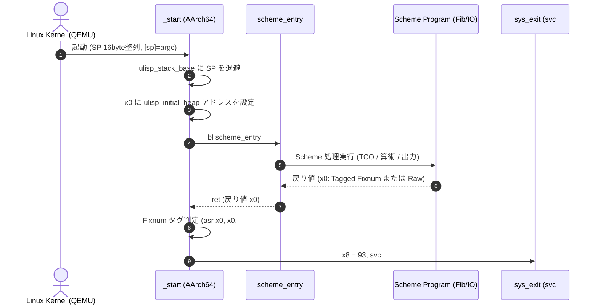

# [FEAT] ULisp AArch64 AOT コンパイラ出力の結合検証および QEMU エミュレーション実行の確立 (ID: 691)

## 1. 概要 / Summary
Pass 150（[`ulisp/backend/150_backend_aarch64.scm`](../../ulisp/backend/150_backend_aarch64.scm)）による AArch64 GNU アセンブリ出力と、抽象化された POSIX システムコール基盤（[`ulisp/lib/posix.scm`](../../ulisp/lib/posix.scm)）を結合し、クロスアセンブラ・リンカ（`aarch64-linux-gnu-as` / `ld`）を用いて完全静的実行バイナリ（ELF64 Zero-libc Freestanding Binary）をビルド・実行可能な環境を確立する。

現在、Pass 150 は LIR から AArch64 GNU アセンブリの基本命令を出力可能であるものの、以下の重要課題が存在する：
1. **ブランチフュージョン命令 `%jump-cond` の欠落**:
   - Pass 128（Branch Fusion）が生成する比較・分岐融合命令（`(%jump-cond "jg" .L_else)` 等）が Pass 150 で未実装のため、条件分岐を伴う関数（Fibonacci 等）のコンパイルが Pass 150 で中断する。
2. **ベアメタルエントリポイント `_start` および初期ヒープの未出力**:
   - `scheme_entry:` のみが出力され、カーネルが直接起動する `_start:`、スタック初期化、ヒープ領域（`.bss` 16MB）、および終了コード処理が未実装であるため、単体で実行可能バイナリにリンクできない。
3. **AAPCS64 スタックポインタ 16 バイト整列（SP Alignment）の厳格遵守**:
   - AArch64 ABI（AAPCS64 §5.2.1.2）では、SP が参照されるすべての局面で 16 バイト整列がハードウェア的に要求される。関数呼び出し時（`%c-call`, `%direct-call`, `%call-closure`）のフレーム退避（`total-shift`）が 16 バイト境界を維持するよう是正する。
4. **Zero-libc 薄層 I/O ルーチンの組み込み**:
   - Scheme 標準の `(write-char ...)`, `(write-string ...)` を C ランタイム非依存で動作させるための最小 AArch64 アセンブリ I/O ルーチン（`ulisp_write_char`, `ulisp_write_string`）を提供し、標準出力表示を完結させる。

本 Issue では、上記を包括的に実装・是正し、スモークテストスイート（算術計算、文字・文字列 I/O、クロージャ、局所変数、末尾再帰 TCO、フィボナッチ再帰）を作成して `qemu-aarch64` 上で 100% PASS することを実証する。

---

## 2. トレーサビリティ / Traceability
- **DSN-33 (ULisp Bare-Metal Architecture & Nanopass Pipeline)**:
  - §2.2: ハードウェアおよび ABI 整合性（AArch64 AAPCS64 呼び出し規約、SP 16 バイト整列、レジスタ割付）
  - §3.5: 末尾呼び出し最適化（TCO: Tail Call Optimization）
  - §4.3: Pass 150 AArch64 バックエンドコードジェネレータ
- **DSN-36 (Zero-libc Pure Scheme Bare-Metal Runtime)**:
  - §2.1: ベアメタル `_start` エントリポイントと `.bss` 初期ヒープ
  - §3.2: Raw Syscall 直結 I/O プリミティブ
- **関連 Issue**:
  - [Issue #503: Implement AArch64 Backend via LIR](closed/503-implement-ulisp-aarch64-backend-via-lir.md)
  - [Issue #516: Bare-Metal Linux Runtime without libc](closed/516-implement-zero-libc-pure-scheme-bare-metal-runtime.md)
  - [Issue #689: Setup QEMU User and Cross Toolchain Verification Environment](closed/689-setup-qemu-user-and-cross-toolchain-verification-environment.md)
  - [Issue #690: Abstract POSIX Syscall Layer for Multi-Architecture Support](closed/690-abstract-posix-syscall-layer-for-multi-architecture-support.md)
  - [Issue #692: Implement AArch64 Native Context Switch for Concurrency Runtime](692-implement-aarch64-native-context-switch-for-concurrency-runtime.md)
  - [Issue #693: Integrate QEMU AArch64 Automated Regression Test Suite into Makefile](693-integrate-qemu-aarch64-automated-regression-test-suite-into-makefile.md)

---

## 3. セキュリティ考慮事項・脅威分析 / Security & Threat Analysis
- **CWE-693 (Protection Mechanism Failure / SP Alignment Fault & Hardware Exception)**:
  - AAPCS64 に違反しスタックポインタが 16 バイト非整列の状態でメモリアクセス命令（`str x30, [sp]` 等）を実行した場合、AArch64 ハードウェアのアライメントチェック機構（`SCTLR_EL1.SA0`）により即座にアライメントフォルト例外（SIGBUS/SIGSEGV）が発生しプロセスが強制終了する。
  - **対策**: 関数呼出し時およびスタックフレーム拡張時、`align-16` 計算を用いて常に SP の 16 バイト倍数オフセット移動を強制する。
- **CWE-119 / CWE-787 (Out-of-bounds Write / Heap Buffer Overflow)**:
  - Zero-libc ベアメタル環境において、ヒープ確保（`%alloc`）が初期バッファ境界を超過した場合、隣接する `.bss` 変数やコード領域を破壊する恐れがある。
  - **対策**: `.bss` 内に十分な 16MB ゼロ初期化バッファ `ulisp_initial_heap` を確保し、初期限界ポインタ `ulisp_heap_limit` を明示設定する。
- **CWE-704 (Incorrect Type Conversion or Cast / Exit Code Corruption)**:
  - Scheme の計算結果（Fixnum: 下位 2 ビットタグ `00`）をそのまま `sys_exit` に渡すと、値が 4 倍されてプロセスの終了コードが不正になる（例: 42 が 168 になる）。
  - **対策**: `_start` の終了処理において、返却値が Fixnum タグを持つ場合は右算術シフト `asr x0, x0, #2` でタグ解除してからシステムコールを発行する。
- **CWE-391 (Unchecked Error Condition / Unhandled LIR Opcode Crash)**:
  - フロントエンドや中間最適化パスで生成された `%jump-cond` やアライメントディレクティブがバックエンドで捕捉されず未定義命令例外でコンパイルが異常終了する。
  - **対策**: Pass 128 の全出力パターン（`je`, `jne`, `jl`, `jle`, `jg`, `jge`, `jz`, `jnz`）に対するディスパッチテーブルを網羅し、静的・動的テストで漏れがないことを検証する。

---

## 4. 影響範囲と関連ファイル / Scope and Affected Files
- [ ] [ulisp/backend/150_backend_aarch64.scm](../../ulisp/backend/150_backend_aarch64.scm):
  - `%jump-cond` 分岐条件命令の実装（`b.eq`, `b.ne`, `b.lt`, `b.le`, `b.gt`, `b.ge`）
  - ベアメタル `_start:` エントリポイントおよび終了処理（`sys_exit`=93）の出力
  - `.bss` 内の初期ヒープ領域 `ulisp_initial_heap`（16MB）の定義
  - AAPCS64 準拠の 16 バイト SP アライメント調整（`total-shift` の 16 バイト整列）
  - 薄層 I/O ルーチン（`ulisp_write_char`, `ulisp_write_string`）の埋め込み
- [ ] [ulisp/scripts/test_aarch64_qemu_smoke.sh](../../ulisp/scripts/test_aarch64_qemu_smoke.sh):
  - Scheme コードの AOT コンパイル、クロスアセンブル、静的リンク、QEMU 実行、標準出力・終了コード自動判定スクリプト
- [ ] [ulisp/tests/test_aarch64_qemu_smoke.scm](../../ulisp/tests/test_aarch64_qemu_smoke.scm):
  - スモークテスト用 Scheme ソースコード群（算術計算、文字・文字列出力、Fibonacci、クロージャ、TCO ループ）
- [ ] [ulisp/Makefile](../../ulisp/Makefile):
  - `test_aarch64_qemu` ターゲットの追加と自動テスト連携
- [ ] [docs/issues/README.md](README.md):
  - Issue 台帳ステータス管理

---

## 5. アーキテクチャ設計・AAPCS64 仕様 / Architecture Design & AAPCS64 Specification

### 5.1 AArch64 条件分岐コード対照表 (Pass 128 -> Pass 150)
| LIR 条件名 | 意味 | AArch64 アセンブリ命令 |
| :--- | :--- | :--- |
| `"je"` / `"jz"` | 等しい / ゼロ | `b.eq <label>` |
| `"jne"` / `"jnz"` | 等しくない / 非ゼロ | `b.ne <label>` |
| `"jl"` | 小なり (符号付き) | `b.lt <label>` |
| `"jle"` | 以下 (符号付き) | `b.le <label>` |
| `"jg"` | 大なり (符号付き) | `b.gt <label>` |
| `"jge"` | 以上 (符号付き) | `b.ge <label>` |

### 5.2 ベアメタル起動シーケンス (`_start`)


### 5.3 AAPCS64 スタックポインタ 16 バイト整列仕様
AArch64 では `sub sp, sp, #N` でスタックを動かす際、`N` は必ず 16 の倍数でなければならない：
$$\text{aligned\_shift} = \left\lceil \frac{\text{frame\_shift} + 16}{16} \right\rceil \times 16$$
関数呼び出し時のリターンアドレス退避（`str x30, [sp]`）は、常に 16 バイト境界の `sp` に対して行われる。

---

## 6. 実装方針 / Implementation Plan
Target Branch: `feat/691-verify-ulisp-aarch64-aot-codegen`

### Step 1: `ulisp/backend/150_backend_aarch64.scm` の機能拡張
1. **`%jump-cond` 命令ハンドラの実装**:
   ```scheme
   ((%jump-cond)
    (let ((cond-op (cadr inst))
          (lbl (caddr inst)))
      (let ((lbl-str (if (symbol? lbl) (symbol->string lbl) lbl))
            (cc (cond ((or (string=? cond-op "je") (string=? cond-op "jz")) "eq")
                      ((or (string=? cond-op "jne") (string=? cond-op "jnz")) "ne")
                      ((string=? cond-op "jl") "lt")
                      ((string=? cond-op "jle") "le")
                      ((string=? cond-op "jg") "gt")
                      ((string=? cond-op "jge") "ge")
                      (else (error "Unknown jump-cond in AArch64:" cond-op)))))
        (emit (string-append "    b." cc " " lbl-str)))))
   ```
2. **AAPCS64 スタック整列（16 バイト）の保証**:
   - `((%direct-call) ...)`, `((%call-closure) ...)`, `((%c-call) ...)` における `total-shift` の計算を更新：
   ```scheme
   (let* ((raw-shift (+ frame-shift 16))
          (rem (modulo raw-shift 16))
          (total-shift (if (= rem 0) raw-shift (+ raw-shift (- 16 rem)))))
     ...)
   ```
3. **ベアメタル `_start` および初期ヒープの出力**:
   - `(not (module-mode?))` 時、`_start:` エントリポイントを出力。
   - `.bss` に `ulisp_initial_heap: .zero 16777216`（16MB）および `ulisp_heap_limit` を定義。
   - `scheme_entry` 呼出し後、Fixnum タグ解除を行い `sys_exit`（93）を発行。
4. **薄層 I/O ルーチンの組み込み**:
   - `ulisp_write_char`: `x0` の文字を標準出力（fd 1）に `sys_write`（64）で出力。
   - `ulisp_write_string`: `x0`（tag 3）をポインタ化し、文字列長分 `sys_write` で出力。

### Step 2: QEMU スモークテストハーネスの実装
1. `ulisp/scripts/test_aarch64_qemu_smoke.sh` の作成：
   - 複数のテストケース（Scheme コード）を順次コンパイル：
     `gosh compiler.scm --target=aarch64 input.scm -o output.s`
   - `aarch64-linux-gnu-as output.s -o output.o`
   - `aarch64-linux-gnu-ld -static output.o -o output`
   - `qemu-aarch64 ./output` を実行し、終了コードおよび標準出力をアサート。
2. テストケース群の策定：
   - Case 1 (Exit 42): 算術計算 `(+ 40 2)` -> Exit 42
   - Case 2 (Fibonacci): 再帰フィボナッチ `(fib 10)` -> Exit 55
   - Case 3 (Strings & I/O): `(write-string "Hello AArch64 Pure Scheme!\n")` -> Stdout 一致 & Exit 0
   - Case 4 (Higher-Order Closures): `((lambda (x) ((lambda (y) (+ x y)) 12)) 30)` -> Exit 42
   - Case 5 (TCO Loop): `(loop 100000 42)` -> 10万回末尾再帰がスタックオーバーフローせず Exit 42

### Step 3: `ulisp/Makefile` への統合と品質検証
1. `ulisp/Makefile` に `test_aarch64_qemu` ターゲットを追加：
   ```makefile
   test_aarch64_qemu:
   	@bash scripts/test_aarch64_qemu_smoke.sh
   ```
2. `make -C ulisp test_aarch64_qemu` の実行と 100% PASS 確認。
3. `make -C ulisp test_aarch64` および `make -C ulisp test_all_passes` の実行（既存テストへのデグレ皆無を確認）。
4. `make check_format` および `make static_analysis` の品質ゲート検証。

---

## 7. 完了条件 / Success Criteria (DoD)
- [ ] Pass 150（AArch64 バックエンド）に `%jump-cond` ハンドラが実装され、Pass 128（Branch Fusion）の出力が正常にアセンブリ変換されること。
- [ ] `(not (module-mode?))` 時に独立実行可能な `_start` エントリポイントと `.bss` 初期ヒープ（16MB）が出力されること。
- [ ] AAPCS64 に準拠し、関数呼出し時の SP が常に 16 バイト境界に整列され、SP Alignment Fault が一切発生しないこと。
- [ ] 薄層 I/O ルーチン（`ulisp_write_char`, `ulisp_write_string`）が組み込まれ、`write-string` が AArch64 で正常動作すること。
- [ ] スモークテスト（Case 1: 算術, Case 2: Fibonacci, Case 3: 文字列 I/O, Case 4: クロージャ, Case 5: TCO ループ）が `qemu-aarch64` 上で全件 PASS すること。
- [ ] `make -C ulisp test_aarch64_qemu` が Makefile からワンコマンドで実行可能であること。
- [ ] 既存の全テストスイート（`make -C ulisp test_all_passes`, `make check_format`, `make static_analysis`）にデグレがないこと。
- [ ] `docs/issues/README.md` のステータスが `In Progress` に更新されていること。
