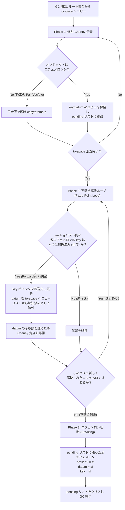

# [FEAT/ENH] SRFI 124 エフェメロン ((scheme ephemeron)) と 2-Space GC 協調回収の実装 (ID: 856)

## 1. 概要 / Summary

R7RS-large Red Edition に規定される **SRFI 124 (Ephemerons)** は、Barry Hayes (1997) の論文 *"Ephemerons: a New Finalization Mechanism"* に基づく高度な弱参照対機構である。

一般的な弱参照（Weak Reference）や弱ハッシュテーブル（Weak Hash Table）は「値がキーを参照している」ような循環参照において回収不能（メモリリーク）を引き起こすという根本的欠点を持つ。エフェメロンは **「キーがエフェメロン外部から到達可能である場合に限り値（datum）も保持するが、キーが外部から到達不能になった時点で値への参照を自動切断し破棄する」** という協調回収意味論（ephemeron semantics）を提供することで、オブジェクトにメタデータを安全に関連付ける弱キーキャッシュやアソシエーションの完全な自律回収を実現する。

ULisp の 2-Space コピー GC / 世代別 GC (`ulisp/lib/gc.scm`) においてはエフェメロン未対応であったため、通常の Cheney 走査ではキーと値が無条件に到達可能としてコピーされてしまい、弱参照の意味論が成立しなかった。本 Issue では、侵入型リンクリスト（Intrusive Linked List）による **GC 中ヒープ割り当てゼロ（Zero Heap Allocation）** を厳格に保ちながら、Dual-Space および Generational Cheney 走査と協調するマルチフェーズ・エフェメロン回収エンジンを構築し、R7RS-large `(scheme ephemeron)` および `(srfi 124)` を完全準拠で提供する。

---

## 2. トレーサビリティ / Traceability

- **関連標準仕様**:
  - R7RS-large Red Edition: `(scheme ephemeron)`
  - SRFI 124: *Ephemerons* (Arthur A. Gleckler)
  - Barry Hayes, *"Ephemerons: a New Finalization Mechanism"*, OOPSLA '97
- **リポジトリ内仕様書・設計書**:
  - [ref_r7rs_compliance.md](../../ulisp/docs/ref_r7rs_compliance.md) §2.1 (SRFI 124 エントリ)
  - [DSN-33 (ULisp 包括設計仕様書)](../designs/DSN-33-ulisp_underlying_x86_native_aot_compiler_architecture_specification.md) §8.5 (Dual-Space Copying Garbage Collector)
  - Issue #525 (Generational Copying GC)
  - Issue #568 (Hybrid Exact-Conservative Scanner)

---

## 3. 実装対象 API 一覧 / Specification

R7RS-large Red Edition `(scheme ephemeron)` および `(srfi 124)` で規定される全 6 種の標準手続きを完全実装する。

| 手続き名 | 引数 | 戻り値 | 仕様詳細 |
|---|---|---|---|
| `make-ephemeron` | `key datum` | `ephemeron` | 新しいエフェメロンを生成する。キー `key` と値 `datum` を保持する。 |
| `ephemeron?` | `obj` | `boolean` | `obj` がエフェメロンであれば `#t`、そうでなければ `#f` を返す。 |
| `ephemeron-broken?` | `ephemeron` | `boolean` | エフェメロンのキーが GC により到達不能と判定されて破壊（broken）された場合は `#t`、依然として生存している場合は `#f` を返す。 |
| `ephemeron-key` | `ephemeron` | `key / #f` | エフェメロンのキーを返す。エフェメロンが broken である場合は `#f` を返す。 |
| `ephemeron-datum` | `ephemeron` | `datum / #f` | エフェメロンの値を返す。エフェメロンが broken である場合は `#f` を返す。 |
| `reference-barrier` | `key` | `unspecified` | この手続き呼び出し時点まで `key` が最適化コンパイラ等により破棄されず、確実に生存（reachable）していることを保証するメモリ/最適化バリア。 |

---

## 4. アーキテクチャおよび GC 協調設計 / Architecture & GC Coordination

### 4.1 エフェメロンのヒープ表現 (ゼロ・ヒープ割り当て前提)

エフェメロンは専用のレコードタグ `%%record-type-<ephemeron>` を持つベクタ型オブジェクト（Type 5）として表現する。

```scheme
;; レコード構造: 5 スロット固定長ベクタ
#(%%record-type-<ephemeron> key datum broken? next)
;; slot 0: レコード型タグシンボル
;; slot 1: key (任意の Scheme オブジェクト)
;; slot 2: datum (任意の Scheme オブジェクト)
;; slot 3: broken? (#f または #t)
;; slot 4: next (GC 内部侵入型単方向リンクリスト用ポインタ: 通常は #f)
```

- **侵入型リンクリスト (Intrusive List)**:
  - GC 実行中のヒープ割り当ては厳禁（ゼロ・アロケーション原則）であるため、Cheney スキャン中に発見された未処理エフェメロンをキューイングする際、`cons` によるリスト作成は行えない。
  - エフェメロンの slot 4 (`next`) を内部チェーン用フィールドとして確保し、静的ポインタ `*gc-pending-ephemerons*` を先頭とする単方向リンクリストとして追跡する。

### 4.2 3 フェーズ GC 協調スキャン・アルゴリズム

`ulisp/lib/gc.scm` の Cheney 走査ルーチン (`gc-cheney-scan!` および `gc-minor-cheney-scan!`) を 3 フェーズ協調アーキテクチャに拡張する。



#### Phase 1: 保留型 Cheney スキャン (Initial Scan)
- Cheney スキャン中、Type 5 (Vector) で先頭タグが `%%record-type-<ephemeron>` であるオブジェクトを検出した場合：
  - slot 0 (タグシンボル) のみ通常通り転送・確認する。
  - **slot 1 (`key`) および slot 2 (`datum`) はこの時点ではコピーしない**。
  - 当該エフェメロンの slot 4 (`next`) に現在の `*gc-pending-ephemerons*` を格納し、先頭ポインタを更新して保留キューに prepend する。

#### Phase 2: 不動点解決ループ (Fixed-Point Resolution)
- 通常のルート・オブジェクト走査が完了した直後に開始：
  1. `resolved_count = 0` で初期化。
  2. `*gc-pending-ephemerons*` を走査し、各エフェメロン `E` の `key` を検査：
     - `key` が即値（fixnum, boolean, char, nil, uninterned-immediate）である場合：外部参照に関わらず常に到達可能。
     - `key` がヒープポインタである場合：元のヘッダ `(%raw-load (%ptr-add (untag key) -8) 0)` を確認。転送ポインタ（forwarding pointer）が書き込まれているか判定。
  3. `key` が生存（転送済み / 即値）と判明した場合：
     - `E` の `key` スロットを転送後のポインタに更新。
     - `E` の `datum` を `(gc-copy-if-heap datum)` で to-space へコピー。
     - `resolved_count = resolved_count + 1`。
     - 当該エフェメロンを保留リストからアンリンク（除外）。
     - コピーされた `datum` が新たなオブジェクトを参照している可能性があるため、追加されたオブジェクト群に対して Cheney スキャンを直ちに実行。
  4. 1 回の全エフェメロン走査で `resolved_count > 0` であれば、再び 2 へ戻る。`resolved_count == 0`（不動点）に達したら Phase 2 を終了。

#### Phase 3: 切断フェーズ (Breaking Phase)
- 不動点ループ完了後、なお `*gc-pending-ephemerons*` に残存しているエフェメロンは、「すべての直接・間接ルートから `key` が到達しなかった」ことが確定している。
- 残存する各エフェメロンに対して：
  - slot 2 (`datum`) を `#f` に設定（これにより `datum` の被参照が完全に絶たれ、次回の GC または回収でリークせず破棄される）。
  - slot 1 (`key`) を `#f` に設定。
  - slot 3 (`broken?`) を `#t` に設定。
  - slot 4 (`next`) を `#f` にリセット。
- `*gc-pending-ephemerons*` を `#f`（空）にして GC を完了。

### 4.3 世代別 GC (Generational Mode 1) への対応

- **Nursery / Mature 空間**:
  - Minor GC 時：Nursery 内のエフェメロンおよび Mature 空間のエフェメロンで Nursery オブジェクトを指すもの（Remembered Set 経由）を対象とする。
  - Major GC 時：全空間（Nursery + Mature）を対象とし、同様の 3 フェーズ走査を適用。

### 4.4 `reference-barrier` の設計

- コンパイラの dead-code elimination や register allocation により、プログラマが意図したエフェメロン参照完了前に `key` へのローカル変数が早期破棄されることを防止する。
- ULisp コンパイラにおいて `reference-barrier` は副作用を持つ組み込みオペレーションまたはインライン展開コードとして扱い、セーフポイント通過時まで `key` のレジスタ/スタックスロット生存を強制する。

---

## 5. セキュリティおよび堅牢性設計 / Security & Robustness

| 脅威 / リスク | CWE 分類 | 対策方針 |
|---|---|---|
| **Use-After-Free (UAF)** | CWE-416 | 切断されたエフェメロンの `datum` / `key` ポインタが古い from-space を指し続けないよう、破壊時に確実に `#f` をストアして無効化する。 |
| **メモリリーク (循環弱参照)** | CWE-401 | エフェメロンのキーと値が互いを参照し合っている場合でも、外部ルートからの参照が消滅すれば不動点ループで解決されず Phase 3 で確実に切断・回収されることを検証。 |
| **未初期化ポインタ走査** | CWE-125 | `*gc-pending-ephemerons*` の侵入型リンクリストを辿る際、ポインタの有効範囲チェック (`gc-in-heap?`) を実施。 |
| **最適化による早期破棄** | CWE-362 | `reference-barrier` による生存期間の確実な固定。 |

---

## 6. 影響範囲と関連ファイル / Scope and Affected Files

```
ulisp/
├── lib/
│   ├── gc.scm                   # Cheney スキャン拡張 (Phase 1/2/3 エフェメロン協調回収ロジック)
│   ├── ephemeron.scm            # 新規: SRFI 124 手続き群、<ephemeron> レコード定義
│   ├── scheme/
│   │   └── ephemeron.sld        # 新規: R7RS (scheme ephemeron) ライブラリ定義
│   └── srfi/
│       └── 124.sld              # 新規: (srfi 124) ライブラリ定義
├── tests/
│   └── test_gc_ephemeron.scm    # 新規: エフェメロン機能・GC協調包括テストスイート
├── docs/
│   └── ref_r7rs_compliance.md   # SRFI 124 準拠状況の更新 (× -> ◎)
└── Makefile                     # テストターゲットおよび依存関係追加
```

---

## 7. 実装手順 / Implementation Steps

### Target Branch: `feat/856-implement-srfi-124-ephemerons-and-gc-coordination`

1. **Step 1: 作業ブランチの作成と基盤準備**
   - `git checkout -b feat/856-implement-srfi-124-ephemerons-and-gc-coordination`
   - `docs/issues/README.md` のステータスを `In Progress` に更新。

2. **Step 2: エフェメロン型定義と基本 API の実装 (`ulisp/lib/ephemeron.scm`)**
   - `<ephemeron>` レコード型定義 (`make-ephemeron`, `ephemeron?`, `ephemeron-broken?`, `ephemeron-key`, `ephemeron-datum`)。
   - `reference-barrier` の実装。

3. **Step 3: GC 協調回収ロジックの実装 (`ulisp/lib/gc.scm`)**
   - 静的状態ポインタ `*gc-pending-ephemerons*` の導入。
   - `gc-cheney-scan!` / `gc-minor-cheney-scan!` にエフェメロン分岐を追加（Phase 1）。
   - 不動点解決ループ `gc-resolve-ephemerons!` の実装（Phase 2）。
   - 切断処理 `gc-break-ephemerons!` の実装（Phase 3）。
   - メジャー GC およびマイナー GC サイクル末尾への統合。

4. **Step 4: R7RS / SRFI モジュール定義**
   - `ulisp/lib/scheme/ephemeron.sld` の作成。
   - `ulisp/lib/srfi/124.sld` の作成。
   - `ulisp/lib/stdlib_entry.scm` への組み込み。

5. **Step 5: 包括的テストスイートの作成 (`ulisp/tests/test_gc_ephemeron.scm`)**
   - 基本型述語・アクセサテスト。
   - 単純 GC 回収テスト（キー生存時はデータ保持、キー破棄時は GC 後に broken となる）。
   - 弱キー連想キャッシュ（Weak Key Associative Table）テスト。
   - 循環参照（Key -> Datum -> Key）の完全回収テスト。
   - `reference-barrier` による回収抑止テスト。
   - GC ストレスモード下での連続テスト。

6. **Step 6: R7RS 準拠ドキュメントおよび Makefile の更新**
   - `ulisp/docs/ref_r7rs_compliance.md` の SRFI 124 欄を ◎ (完全準拠) に更新。
   - `ulisp/Makefile` に `test-ephemeron` ターゲットを追加し、`make test-std` に組み込み。

7. **Step 7: 品質ゲート検証**
   - `make -C ulisp py_compile` および `make -C ulisp static_analysis` の合格確認。
   - 既存の全テスト (`make -C ulisp test`) および新規テストの 100% PASS 確認。

---

## 8. 完了条件 / Definition of Done (DoD)

- [ ] `(scheme ephemeron)` および `(srfi 124)` がロード・利用可能であること。
- [ ] 全 6 手続き (`make-ephemeron`, `ephemeron?`, `ephemeron-broken?`, `ephemeron-key`, `ephemeron-datum`, `reference-barrier`) が仕様通り動作すること。
- [ ] キーが外部から到達可能な間は、GC が実行されてもエフェメロンが保持されデータが維持されること。
- [ ] キーが外部から到達不能になった場合、GC 実行後に `ephemeron-broken?` が `#t` となり、データが回収され `ephemeron-key`/`ephemeron-datum` が `#f` を返すこと。
- [ ] キーと値の循環参照が存在する場合でも、外部参照がなくなれば漏れなく回収されること。
- [ ] GC 実行中に新たなヒープメモリの割り当てが一切発生しないこと（侵入型リンクリストによるゼロ・アロケーション保証）。
- [ ] `ulisp/tests/test_gc_ephemeron.scm` の全テストが PASS すること。
- [ ] 既存の 2-Space GC テスト、世代別 GC テスト、ストレスプロファイルテストがすべて PASS すること。
- [ ] `ulisp/docs/ref_r7rs_compliance.md` が更新されていること。
- [ ] 絶対パス（`/workspace/` 等）が一切含まれていないこと。
