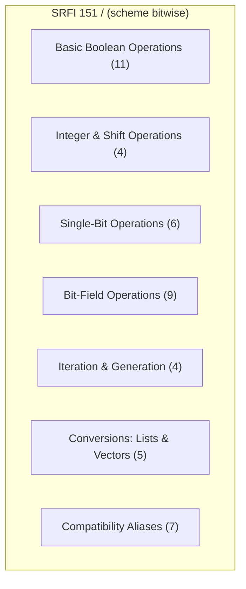

# [FEAT/ENH] SRFI 151 ビット演算包括ライブラリおよび (scheme bitwise) の実装 (ID: 857)

## 1. 概要 / Summary
R7RS-large Tangerine Edition においてビット操作の標準仕様とされている SRFI 151 (Bitwise Operations) は、整数の2進ビット表現（2の補数表現）に対する包括的演算手続き群（全 60 余の手続き）を規定する。
現在の ULisp では、コンパイラ内部プリミティブとして 2 引数版の `bitwise-and`, `bitwise-ior` が存在するのみであり、標準ライブラリとしての `(scheme bitwise)` や `(srfi 151)` は未提供である。

本 Issue では、SRFI 151 に準拠した全手続き群（基本論理演算、可変長 n-ary 演算、シフト・計数、単一ビット操作、ビットフィールド操作、ビット反復・生成、ブールリスト・ベクタ相互変換、および SRFI 33 / 60 互換別名）を完全実装し、R7RS-large Tangerine Edition 規格適合ライブラリとして提供する。

---

## 2. トレーサビリティ / Traceability
- **規格準拠**:
  - R7RS-large Tangerine Edition: `(scheme bitwise)`
  - SRFI 151: Bitwise Operations
  - SRFI 33 / SRFI 60: Integers as Bits (互換別名)
  - [ref_r7rs_compliance.md](../../ulisp/docs/ref_r7rs_compliance.md) §2.2
  - [DSN-33 (ULisp 包括設計仕様書)](../designs/DSN-33-ulisp_underlying_x86_native_aot_compiler_architecture_specification.md)
- **関連 Issue**:
  - [Issue #848: マクロ限定 I/O 手続きおよびベクタ操作の第一級手続き化](closed/848-reify-macro-only-io-and-vector-operations-to-first-class-procedures.md)
  - [Issue #853: SRFI 133 ベクタ操作ライブラリおよび (scheme vector) モジュールの完全実装](closed/853-implement-srfi-133-vector-library-and-scheme-vector-module.md)
  - [Issue #855: SRFI 135 不変テキストライブラリ ((scheme text)) の実装](closed/855-implement-srfi-135-immutable-texts.md)
  - [Issue #858: SRFI 143 Fixnums 特化高速演算ライブラリおよび (scheme fixnum) の実装](858-implement-srfi-143-fixnums-and-scheme-fixnum.md)
  - [Issue #868: lib/vector.scm と lib/srfi/133.scm のモジュール分離と依存関係解消](closed/868-modularize-r7rs-vector-and-srfi-133-libraries.md)
  - [Issue #869: bootstrap.sh および Makefile におけるマルチコア並列ビルドの標準化による自己ホスト高速化](closed/869-enable-parallel-modular-compilation-for-fast-bootstrap.md)
- **対象ソースコード**:
  - [ulisp/lib/bitwise.scm](../../ulisp/lib/bitwise.scm) (新規作成)
  - [ulisp/lib/scheme/bitwise.sld](../../ulisp/lib/scheme/bitwise.sld) (新規作成)
  - [ulisp/lib/srfi/151.sld](../../ulisp/lib/srfi/151.sld) (新規作成)
  - [ulisp/Makefile](../../ulisp/Makefile)
  - [ulisp/tests/test_srfi_151.scm](../../ulisp/tests/test_srfi_151.scm) (新規作成)

---

## 3. 影響範囲と関連ファイル / Scope and Affected Files
- [ ] [ulisp/lib/bitwise.scm](../../ulisp/lib/bitwise.scm) : SRFI 151 規定の全手続き実装（基本論理、シフト、計数、フィールド操作、反復・生成、リスト/ベクタ変換）
- [ ] [ulisp/lib/scheme/bitwise.sld](../../ulisp/lib/scheme/bitwise.sld) : R7RS-large `(scheme bitwise)` モジュール定義
- [ ] [ulisp/lib/srfi/151.sld](../../ulisp/lib/srfi/151.sld) : SRFI 151 `(srfi 151)` モジュール定義
- [ ] [ulisp/Makefile](../../ulisp/Makefile) : `test_srfi_151` ターゲットおよび `lint_sexpr` 検査対象への追加
- [ ] [ulisp/tests/test_srfi_151.scm](../../ulisp/tests/test_srfi_151.scm) : SRFI 151 網羅的テストスイート作成

---

## 4. 詳細仕様と実装方針 / Detailed Specification & Implementation Plan

Target Branch: `feat/857-implement-srfi-151-bitwise-operations-and-scheme-bitwise`

### 4.1 手続き群の分類とエクスポート一覧

#### 1. Basic Boolean Operations (11)
- `bitwise-not` : `(- -1 i)`
- `bitwise-and` : 任意個数引数 (n-ary)。0引数は -1。
- `bitwise-ior` : 任意個数引数 (n-ary)。0引数は 0。
- `bitwise-xor` : 任意個数引数 (n-ary)。0引数は 0。`(- (bitwise-ior a b) (bitwise-and a b))`
- `bitwise-eqv` : 任意個数引数 (n-ary)。ビット単位の等価。0引数は -1。
- `bitwise-nand` : `(bitwise-not (bitwise-and i j))`
- `bitwise-nor` : `(bitwise-not (bitwise-ior i j))`
- `bitwise-andc1` : `(bitwise-and (bitwise-not i) j)`
- `bitwise-andc2` : `(bitwise-and i (bitwise-not j))`
- `bitwise-orc1` : `(bitwise-ior (bitwise-not i) j)`
- `bitwise-orc2` : `(bitwise-ior i (bitwise-not j))`

#### 2. Integer & Shift Operations (4)
- `arithmetic-shift` : `(arithmetic-shift i count)`
  - `count > 0`: `(* i (expt 2 count))` (左シフト)
  - `count < 0`: `(floor (/ i (expt 2 (- count))))` (算術右シフト)
  - `count = 0`: `i`
- `bit-count` : 2進表現で 1 であるビット数（非負時）。負数の場合は 0 であるビット数 `(bit-count (bitwise-not i))`。
- `integer-length` : 2の補数表現で表すのに必要な最小ビット数（符号ビット除く）。
- `bitwise-if` : `(bitwise-ior (bitwise-and mask i) (bitwise-and (bitwise-not mask) j))`

#### 3. Single-Bit Operations (6)
- `bit-set?` : `(bit-set? index i)` -> 指定ビットが 1 か否か（ブール値）
- `copy-bit` : `(copy-bit index i boolean)` -> 指定ビットを 0/1 に設定した整数
- `bit-swap` : `(bit-swap index1 index2 i)` -> 2 つのビット位置を交換した整数
- `any-bit-set?` : `(not (zero? (bitwise-and test-bits i)))`
- `every-bit-set?` : `(= (bitwise-and test-bits i) test-bits)`
- `first-set-bit` : 最下位の 1 であるビットのインデックス（`i = 0` の場合は `-1`）

#### 4. Bit-Field Operations (9)
- `bit-field` : `(bit-field i start end)` -> `[start, end)` のビットを抽出し右詰め
- `bit-field-any?` : `(not (zero? (bit-field i start end)))`
- `bit-field-every?` : `(= (bit-field i start end) (- (arithmetic-shift 1 (- end start)) 1))`
- `bit-field-clear` : `[start, end)` を 0 にクリア
- `bit-field-set` : `[start, end)` を 1 にセット
- `bit-field-replace` : `dst` の `[start, end)` を `src` の下位 `(end - start)` ビットで置換
- `bit-field-replace-same` : `dst` の `[start, end)` を `src` の同じ位置 `[start, end)` で置換
- `bit-field-rotate` : `[start, end)` 内で `count` ビット巡回シフト
- `bit-field-reverse` : `[start, end)` 内のビット順序を反転

#### 5. Bitwise Iteration & Generation (4)
- `bitwise-fold` : `(bitwise-fold proc seed i)`
- `bitwise-for-each` : `(bitwise-for-each proc i)`
- `bitwise-unfold` : `(bitwise-unfold stop? mapper successor seed)`
- `make-bitwise-generator` : `(make-bitwise-generator i)`

#### 6. Conversions (5)
- `bits->list` : `(bits->list i [len])` -> ブール値リスト
- `list->bits` : `(list->bits bool-list)` -> 整数
- `bits->vector` : `(bits->vector i [len])` -> ブール値ベクタ
- `vector->bits` : `(vector->bits bool-vector)` -> 整数
- `bits` : `(bits bool ...)` -> 整数

#### 7. Compatibility Aliases (7)
- `bitwise-merge` -> `bitwise-if`
- `extract-bit-field` -> `bit-field`
- `test-bit-field?` -> `bit-field-any?`
- `clear-bit-field` -> `bit-field-clear`
- `replace-bit-field` -> `bit-field-replace`
- `copy-bit-field` -> `(bit-field-copy dst start end src)`
- `ash` -> `arithmetic-shift`

---

## 5. 実装計画 / Implementation Steps

### Step 1: `ulisp/lib/bitwise.scm` の実装
1. プリミティブ `bitwise-and` および `bitwise-ior` をラップし、0引数・1引数・任意引数に対応する n-ary 手続きを定義。
2. 2の補数表現に基づく基本ブール論理手続き（`bitwise-not`, `bitwise-xor`, `bitwise-eqv`, `bitwise-nand`, `bitwise-nor`, `bitwise-andc1`, `bitwise-andc2`, `bitwise-orc1`, `bitwise-orc2`）を定義。
3. `arithmetic-shift`, `bit-count`, `integer-length`, `bitwise-if` を実装。
4. 単一ビット手続き（`bit-set?`, `copy-bit`, `bit-swap`, `any-bit-set?`, `every-bit-set?`, `first-set-bit`）を実装。
5. ビットフィールド手続き群（`bit-field`, `bit-field-any?`, `bit-field-every?`, `bit-field-clear`, `bit-field-set`, `bit-field-replace`, `bit-field-replace-same`, `bit-field-rotate`, `bit-field-reverse`）を実装。
6. ビット反復・ジェネレータ手続き（`bitwise-fold`, `bitwise-for-each`, `bitwise-unfold`, `make-bitwise-generator`）およびリスト/ベクタ変換手続き（`bits->list`, `list->bits`, `bits->vector`, `vector->bits`, `bits`）を実装。
7. SRFI 33 / 60 互換別名を定義。

### Step 2: モジュール定義 (`.sld`) の作成
1. [ulisp/lib/scheme/bitwise.sld](../../ulisp/lib/scheme/bitwise.sld) を作成し、全 60 余の手続きをエクスポート。
2. [ulisp/lib/srfi/151.sld](../../ulisp/lib/srfi/151.sld) を作成し、同手続きをエクスポート。

### Step 3: テストスイートの作成と Makefile 統合
1. [ulisp/tests/test_srfi_151.scm](../../ulisp/tests/test_srfi_151.scm) を作成し、SRFI 151 の全手続き群（境界値、負数、2の補数、Fixnum 上限）に対する包括的単体テストを記述。
2. `ulisp/Makefile` に `test_srfi_151` ターゲットを追加し、`lint_sexpr` の検査対象に `lib/bitwise.scm` を追加。

### Step 4: ビルド・検証とブートストラップ
1. `make -C ulisp lint_sexpr` で全ファイルの S 式括弧整合性を検証。
2. `make -C ulisp test_srfi_151` を実行し、全テスト PASS を確認。
3. `make -C ulisp bootstrap` を実行し、高速並列モジュラービルド（20秒台）での自己ホスト固定点収束を検証。
4. `make -C ulisp test_c` を実行し、既存テスト群にリグレッションがないことを確認。
5. 全品質ゲート（`make py_compile`, `make check_format`, `make static_analysis`）および相対パスガバナンス（絶対パス 0 件）を確認。

---

## 6. 完了条件 / Success Criteria (DoD)
- [ ] `ulisp/lib/bitwise.scm` に SRFI 151 規定の全手続き（62 手続き + 7 別名）が正しく実装されていること。
- [ ] `(scheme bitwise)` および `(srfi 151)` から全手続きがインポート可能であること。
- [ ] 正数・負数（2の補数表現）および 62-bit Fixnum の全域でビット演算が数学的に正しく動作すること。
- [ ] `make -C ulisp test_srfi_151` がエラー 0 件で 100% PASS すること。
- [ ] `make -C ulisp lint_sexpr` が全ファイルで PASS すること。
- [ ] `make -C ulisp bootstrap` による 5 モジュール並列自己ホスト固定点が完全一致すること。
- [ ] リポジトリ全域において絶対パス違反が 0 件であること。
- [ ] Conventional Commits 規約に準拠したコミットが作成され、Issue がクローズされること。
