# [FEAT/ENH] bootstrap.sh および Makefile におけるマルチコア並列ビルドの標準化による自己ホスト高速化 (ID: 869)

## 1. 概要 / Summary
`make -C ulisp bootstrap` による自己ホスト固定点検証は、現在シングルスレッド直列（`BOOTSTRAP_MODULAR=0`）で単一巨大ソースファイル（`compiler_entry.scm`）を 3 ステージコンパイルしており、完了まで約 44〜48 秒を要している。
一方、プロジェクトには Issue #608 において 5 モジュール並列インクリメンタルコンパイルを行う `--modular` モード（`make -j$JOBS`）が導入されており、これを用いると約 20 秒（55% 以上の時間短縮 / 2.3 倍高速化）で全 5 モジュール（`compiler_base`, `frontend_passes`, `lir_passes`, `backend_passes`, `compiler_driver`）のビット完全一致固定点検証およびシード更新を達成できる。

本 Issue では、`bootstrap.sh` において利用可能コア数および実行モードを自動判定（`BOOTSTRAP_MODULAR=auto`）し、純粋自己ホスト分離モード（`--pure`）や単一ソースモード（`--monolithic`）などの明示的直列指定を除き、デフォルトでマルチコア並列モジュラービルドを標準動作化する。
これにより、開発者の日常のブートストラップサイクル、PR 品質ゲート、および CI/CD パイプラインにおける自己ホストビルド性能を劇的に高速化する。

---

## 2. トレーサビリティ / Traceability
- **アーキテクチャ仕様**:
  - DSN-33 Architecture Specification: 5-Module Modular Architecture
  - ULisp Separate Compilation & ABI Contract Specification
- **関連 Issue**:
  - [Issue #608: 5 モジュール分割インクリメンタルコンパイルおよび ABI シグネチャ生成の実装](closed/608-implement-modular-separate-compilation-and-incremental-build.md)
  - [Issue #617: Pure Self-Contained Bootstrap ツールチェーン隔離検証スイートの実装](closed/617-implement-pure-self-contained-bootstrap-isolation-test.md)
  - [Issue #846: uLisp modular compilation および bootstrap 引数整合性の修正](closed/846-fix-ulisp-modular-and-bootstrap-arity.md)
  - [Issue #866: test_c.sh のライブラリ過剰 include 解消による C バックエンドテスト大幅高速化](closed/866-optimize-test-c-library-includes-for-high-speed-execution.md)
  - [Issue #867: make-vector および make-bytevector 充填コンストラクタのインライン脱糖](closed/867-inline-desugar-make-vector-and-make-bytevector-constructors.md)
  - [Issue #868: lib/vector.scm と lib/srfi/133.scm のモジュール分離と依存関係解消](closed/868-modularize-r7rs-vector-and-srfi-133-libraries.md)
- **対象ソースコード**:
  - [ulisp/bootstrap.sh](../../ulisp/bootstrap.sh)
  - [ulisp/Makefile](../../ulisp/Makefile)

---

## 3. 影響範囲と関連ファイル / Scope and Affected Files
- [ ] [ulisp/bootstrap.sh](../../ulisp/bootstrap.sh) : `BOOTSTRAP_MODULAR` のデフォルト値を `auto` に変更し、マルチコア並列パイプラインを標準化。ヘルプメッセージの更新。
- [ ] [ulisp/Makefile](../../ulisp/Makefile) : `bootstrap` ターゲットの並列性伝達の強化、および直列フォールバックターゲット（`bootstrap_serial`）の追加。
- [ ] [ulisp/tests/test_pure_bootstrap.sh](../../ulisp/tests/test_pure_bootstrap.sh) : ホストツール遮断環境下での `--pure` 直列動作の健全性確認（影響なしであることを検証）。

---

## 4. 根本原因と設計方針 / Root Cause & Design Approach

### 4.1 現状のボトルネック分析
`./bootstrap.sh` の直列 split-link では、単一の巨大 S 式ファイル `build/compiler_input.scm`（`compiler_entry.scm` + stdlib マクロ、約 12,000 行）を毎回 1 プロセスで直列に 3 ステージコンパイルする。

```mermaid
graph TD
    subgraph Serial_Bootstrap ["Current Serial Bootstrap (44-48s)"]
        S1["Stage 1: compile compiler_entry.scm (1 process)"]
        S2["Stage 2: compile compiler_entry.scm (1 process)"]
        S3["Stage 3: compile compiler_entry.scm (1 process)"]
        S1 --> S2 --> S3
    end

    subgraph Parallel_Modular_Bootstrap ["New Default Modular Bootstrap (20s)"]
        subgraph Stage1_Par ["Stage 1 Parallel (make -j$JOBS)"]
            M1_1["compiler_base"]
            M1_2["frontend_passes"]
            M1_3["lir_passes"]
            M1_4["backend_passes"]
            M1_5["compiler_driver"]
        end
        subgraph Stage2_Par ["Stage 2 Parallel (make -j$JOBS)"]
            M2_1["compiler_base"]
            M2_2["frontend_passes"]
            M2_3["lir_passes"]
            M2_4["backend_passes"]
            M2_5["compiler_driver"]
        end
        subgraph Stage3_Par ["Stage 3 Parallel (make -j$JOBS)"]
            M3_1["compiler_base"]
            M3_2["frontend_passes"]
            M3_3["lir_passes"]
            M3_4["backend_passes"]
            M3_5["compiler_driver"]
        end
        Stage1_Par --> Stage2_Par --> Stage3_Par
    end
```



### 4.2 自動判定（Auto-Detection）ロジックの設計
単に `BOOTSTRAP_MODULAR=1` をハードコードすると、`test_pure_bootstrap.sh` のようにホストツール（`make`, `as`, `ld`, `gcc` 等）がスタブで完全に遮断された環境においてエラーが発生する。
そのため、以下のインテリジェントな自動判定ルールを適用する：

```bash
# Default to auto
BOOTSTRAP_MODULAR="${BOOTSTRAP_MODULAR:-auto}"

# After CLI argument parsing:
if [ "$BOOTSTRAP_MODULAR" = "auto" ]; then
    if [ "${BOOTSTRAP_PURE:-0}" = "1" ] || \
       [ "${BOOTSTRAP_PURE_ELF:-0}" = "1" ] || \
       [ "${USE_BUILTIN_TOOLS:-0}" = "1" ] || \
       [ "${BOOTSTRAP_SPLIT_LINK:-1}" = "0" ] || \
       [ "${BOOTSTRAP_FROM_ILISP:-0}" = "1" ] || \
       [ "${BOOTSTRAP_WITH_GOSH:-0}" = "1" ]; then
        # Toolchain isolation / pure mode or non-split monolithic mode requires serial compilation
        BOOTSTRAP_MODULAR=0
    else
        # Standard native environment: activate high-speed parallel modular bootstrap
        BOOTSTRAP_MODULAR=1
    fi
fi
```

### 4.3 CLI オプションの整合性
| オプション / フラグ | `BOOTSTRAP_MODULAR` | 動作説明 |
| :--- | :---: | :--- |
| なし (`./bootstrap.sh`) | `1` (auto) | **【デフォルト】** 5 モジュール並列コンパイル（`make -j$JOBS`、所要約 20 秒） |
| `--modular` | `1` | 明示的なモジュラー並列コンパイル |
| `--split-link` | `0` | 明示的な直列 split-link コンパイル（従来のフォールバック動作） |
| `--monolithic` | `0` | 単一モノリシック `entry_core.scm` の直列コンパイル |
| `--pure`, `--pure-elf` | `0` | ホストツール遮断環境での組み込みツール直列コンパイル |
| `--quick`, `-q` | `1` (auto) | Stage 1 Modular 並列ビルド後に即座に検証終了（高速スモーク） |

---

## 5. 実装計画 / Implementation Steps

Target Branch: `feat/869-fast-modular-bootstrap`

### Step 1: `ulisp/bootstrap.sh` の自動判定とデフォルト標準化
1. `BOOTSTRAP_MODULAR="${BOOTSTRAP_MODULAR:-auto}"` を設定。
2. CLI オプションループ完了後に上記の `auto` 解決ロジックを実装。
3. `--split-link` オプション処理時に明示的に `BOOTSTRAP_MODULAR=0` を設定（既存の `BOOTSTRAP_SPLIT_LINK=1` に加え、直列強制フラグとして機能）。
4. `--help` の表示内容を更新し、`--modular` がデフォルトであり、`--split-link` が直列フォールバックであることを明記。

### Step 2: `ulisp/Makefile` のターゲット整備
1. `bootstrap:` ターゲットを確認し、必要に応じて親 Make の並列フラグ伝達を最適化。
2. 直列実行を明示したい開発者のために `bootstrap_serial:` ターゲット（`./bootstrap.sh --split-link`）を追加。

### Step 3: 自己ホスト固定点および全品質ゲートの検証
1. `time make -C ulisp bootstrap` を実行し、所要時間が 48 秒から約 20 秒へと半減し、5 モジュールの固定点収束および `bin/ulisp-boot` 更新が正常に行われることを確認。
2. `make -C ulisp bootstrap_quick` が数秒で正常完了することを確認。
3. `make -C ulisp test_pure_bootstrap`（全 10 テスト）が 100% PASS することを確認。
4. `time make -C ulisp test_c`（全 143 テスト）が 100% PASS（約 62 秒）することを確認。
5. リポジトリ品質ゲート（`make py_compile`, `make check_format`, `make static_analysis`）および相対パスガバナンス（絶対パス 0 件）を確認。

---

## 6. 完了条件 / Success Criteria (DoD)
- [ ] `ulisp/bootstrap.sh` が追加オプションなし（デフォルト）で 5 モジュール並列ビルドを実行すること。
- [ ] `make -C ulisp bootstrap` の所要時間が従来の 44〜48 秒から 23 秒以下（実測約 20 秒）へと半減すること。
- [ ] 全 5 モジュール（`compiler_base`, `frontend_passes`, `lir_passes`, `backend_passes`, `compiler_driver`）の固定点（Stage 2 vs Stage 3）がビット完全一致で検証されること。
- [ ] `--pure` モードおよび `make -C ulisp test_pure_bootstrap`（全 10 テスト）がエラーなく 100% PASS すること。
- [ ] `ulisp/Makefile` に `bootstrap_serial` ターゲットが提供され、直列フォールバックが可能であること。
- [ ] リポジトリ全域において絶対パス違反が 0 件であること。
- [ ] Conventional Commits 規約に準拠したコミットが作成され、Issue がクローズされること。
