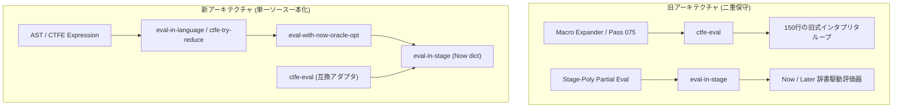

# [FEAT] 旧 ctfe_eval の eval-in-stage (Now dict) への一本化と二重実装解消 (ID: 888)

## 1. 概要 / Summary
DSN-33-03 §3.2, §3.6（単一ソース意味論オラクル）および DSN-33-01 Phase 7 に基づき、`ulisp/compiler/eval_in_language.scm` 内で旧来から存在していたマクロ展開・DSL 定数畳み込み用の `ctfe-eval` ループ（旧来の約150行に及ぶ独立インタプリタ）を、新設されたステージ多相評価器 `eval-in-stage`（`<stage-dict>` の `Now` 辞書即時計算モード）へと完全一本化・統合する。

コンパイル時計算（CTFE）のセマンティクスが旧 `ctfe-eval` と新 `eval-in-stage` で二重管理されていた状態を解消し、コンパイラ全体の意味論的ドリフト（Semantic Drift）を根絶（0件化）するとともに、保守性とコードベースの洗練度を向上させる。

---

## 2. トレーサビリティ / Traceability
- **関連個別仕様書**:
  - [DSN-33-03 §3.2 (Now 辞書: 即時計算・CTFE オラクル評価)](../designs/DSN-33-03-ulisp_stage_polymorphic_metacompiler_and_futamura_projection_architecture.md#32-now-辞書即時計算ctfeオラクル評価)
  - [DSN-33-03 §3.6 (単一ソース意味論オラクル: Zero Semantic Drift)](../designs/DSN-33-03-ulisp_stage_polymorphic_metacompiler_and_futamura_projection_architecture.md#36-単一ソース意味論オラクルによる回帰検証zero-semantic-drift)
  - [DSN-33-01 Phase 7 (ステージ多相部分評価パスの常設統合と CTFE 一本化)](../designs/DSN-33-01-ulisp_pipeline_pass_nanopass_picopass_dag_architecture.md#phase-7dsn-33-03-ステージ多相部分評価パスの常設統合と-ctfe-一本化)
- **関連 Issue**:
  - #870 (Stage-Dict レコードおよび Now/Later 辞書の実装)
  - #872 (eval-in-stage コアループと Fuel/Depth ガードの実装)
  - #873 (単一ソース意味論オラクルによる CTFE 既存テスト回帰検証)
  - #887 (Pass Manager への pass-075-stage-poly-lower 常設登録)

---

## 3. 影響範囲と関連ファイル / Scope and Affected Files
- [x] [ulisp/compiler/eval_in_language.scm](../../ulisp/compiler/eval_in_language.scm) (旧 `ctfe-eval` ループの廃止、`eval-in-stage` への一本化)
- [x] [ulisp/tests/test_eval_in_language.scm](../../ulisp/tests/test_eval_in_language.scm) (CTFE 言語評価スイートの回帰確認)
- [x] [ulisp/tests/test_single_source_oracle.scm](../../ulisp/tests/test_single_source_oracle.scm) (単一ソースオラクル等価性検証)
- [x] [ulisp/tests/test_stage_oracle.scm](../../ulisp/tests/test_stage_oracle.scm) (メタモルフィック・オラクル検証)
- [x] [ulisp/tests/test_pass_manager.scm](../../ulisp/tests/test_pass_manager.scm) (Pass Manager パイプライン連携確認)

---

## 4. セキュリティ要件と脅威分析 (CWE-400 リソース枯渇防御)
- **脅威ベクトル**:
  - 悪意あるマクロやコンパイル時計算（CTFE 式）において、無限ループ（例: `(letrec ((f (lambda () (f)))) (f))`）や再帰爆縮（Deep Nesting）を注入することによるコンパイラハングアップ・DoS 攻撃。
- **セキュリティ要件**:
  - `Now` 辞書による `eval-in-stage` 実行時、ステップ数上限（`*ctfe-default-step-limit*` = 10,000）および再帰深度上限（`*ctfe-default-depth-limit*` = 512）を厳格に順守すること。
  - 上限枯渇時は例外クラッシュやセグフォを起こさず、安全に `*ctfe-failure*` または未簡約ノード（`#f`）を返却してフォールバックすること。

---

## 5. 実装方針 / Implementation Plan
Target Branch: `feat/888-consolidate-legacy-ctfe-eval-into-stage-poly-evaluator`



### ステップ 1: `ctfe-eval` を `eval-in-stage` 委譲ラッパーへ置換
- `ulisp/compiler/eval_in_language.scm` の 306〜455 行に存在する旧式再帰ループを削除。
- 以下の軽量な統一委譲関数として再定義：
  ```scheme
  (define (ctfe-eval expr env fuel depth)
    (let* ((now-d (make-now-dict))
           (res (eval-in-stage now-d env expr fuel depth)))
      (cond
        ((stage-csp-error? res) *ctfe-failure*)
        ((stage-val? res) (stage-val-payload res))
        (else *ctfe-failure*))))
  ```

### ステップ 2: `now-dict-apply-prim` / クロージャ呼び出しの整合性向上
- `now-dict-apply-prim`（845行付近）における `%ctfe-closure` の呼び出し部分において、直接 `eval-in-stage` または `ctfe-eval` 経由で Now 辞書コンテキストを保持したまま呼び出しが行われるよう確認・整合。

### ステップ 3: `ctfe-try-reduce` および言語評価器レジストリの直結
- `ctfe-try-reduce` を `eval-with-now-oracle` へ直結。
- `'L_core` および `'Scheme` の評価器ハンドラを `eval-with-now-oracle-opt` を直接呼び出す形へリファクタリング。

### ステップ 4: 単体テスト・回帰テストスイートの実行
- `make -C ulisp test_eval_in_language`
- `make -C ulisp test_single_source_oracle`
- `make -C ulisp test_stage_oracle`
- `make -C ulisp test_pass_manager`

### ステップ 5: セルフホスト固定点（Bootstrap）の検証
- `./bootstrap.sh` を実行し、Stage 2 と Stage 3 の出力アセンブリが 0 バイト差分（bit-for-bit IDENTICAL）で収束することを確認。

---

## 6. 完了条件 / Success Criteria (DoD)
- [ ] 旧 `ctfe-eval` の重複インタプリタループ（約150行）が全廃され、`eval-in-stage (Now dict)` への薄い委譲アダプタへ一本化されていること。
- [ ] `L_core` および `Scheme` の評価ハンドラが `eval-with-now-oracle-opt` に統一され、二重実装が解消されていること。
- [ ] `test_eval_in_language` (158行), `test_single_source_oracle` (111行), `test_stage_oracle` が 100% PASS すること。
- [ ] `make -C ulisp bootstrap` による Stage 2 == Stage 3 の bit-for-bit IDENTICAL 不動点が保証されること。
- [ ] `make -C ulisp test_srfi1` を含む主要テストスイートが正常終了すること。
