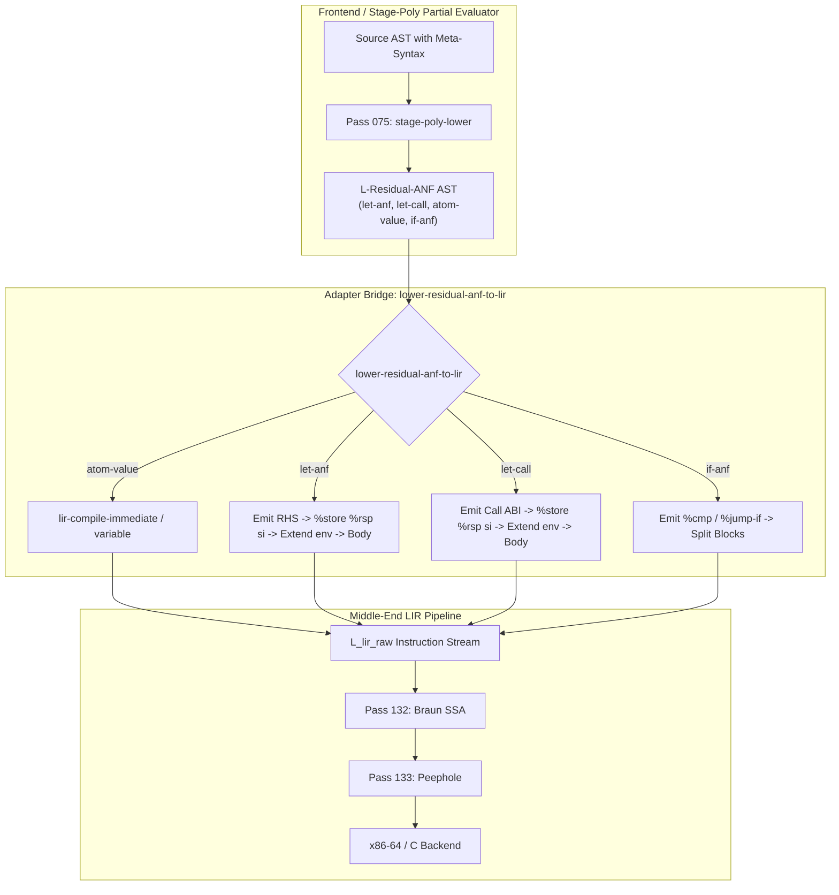

# [FEAT] L-Residual-ANF から Middle-End LIR へのローワリング・アダプターブリッジ実装 (ID: 889)

## 1. 概要 / Summary
DSN-33-03 §6.2, §8.1 (Phase P5) および DSN-33-02 §8.4 に基づき、`pass-075-stage-poly-lower` が出力する `L-Residual-ANF` 構文木（`let-anf`, `let-call`, `atom-value`, `if-anf`）を、既存の Middle-End である `pass-130-lir`（`generate-lir`）が要求する仮想レジスタ LIR 形式（`L_lir_raw`）へと直接降格・接続するアダプターブリッジ `lower-residual-anf-to-lir` を実装する。

これにより、第1二村射影（Futamura Projection）によって特化・部分評価された残余プログラムが、追加のパースや外部変換を介することなく直接 LIR へ流れ込み、Braun SSA 最適化（Pass 132）、覗き穴最適化（Pass 133）、および x86-64 / C ネイティブコード生成器へシームレスに到達可能となる。

---

## 2. トレーサビリティ / Traceability
- **関連個別仕様書**:
  - [DSN-33-03 §6.2 (L-Residual-ANF 言語定義: メタ構文の完全除外)](../designs/DSN-33-03-ulisp_stage_polymorphic_metacompiler_and_futamura_projection_architecture.md#62-l-residual-anf-言語定義メタ構文の完全除外--)
  - [DSN-33-03 §8.1 Phase P5 (実パイプライン統合と二重化解消)](../designs/DSN-33-03-ulisp_stage_polymorphic_metacompiler_and_futamura_projection_architecture.md#81-マイルストーン分割p1p6)
  - [DSN-33-02 §4.1 (Core Machine LIR の厳格な命令セットと型体系)](../designs/DSN-33-02-ulisp_multilingual_frontend_and_typed_machine_lir_architecture.md#41-core-machine-lir-の厳格な命令セットと型体系-issue-826)
  - [DSN-33-02 §8.4 (DSN-33-03 ステージ多相メタコンパイラとの LIR/ELF 統合拡張 Phase P5)](../designs/DSN-33-02-ulisp_multilingual_frontend_and_typed_machine_lir_architecture.md#84-dsn-33-03-ステージ多相メタコンパイラとの-lirelf-統合拡張phase-p5)
- **関連 Issue**:
  - #878 (Nanopass 中間言語 L-StagePoly および L-Residual-ANF の定義)
  - #879 (ステージ多相 Lowering ナノパス部分評価器の実装)
  - #880 (Pass Manager への文法消去アサーションの組み込み)
  - #885 (マイクロ言語による第1二村射影平坦化の E2E 実証)
  - #887 (Pass Manager への pass-075-stage-poly-lower 常設登録)
  - #888 (旧 ctfe_eval の eval-in-stage への一本化)

---

## 3. 影響範囲と関連ファイル / Scope and Affected Files
- [x] [ulisp/lir/130_lir.scm](../../ulisp/lir/130_lir.scm) (`lir-compile-expr` への `atom-value`, `let-anf`, `let-call`, `if-anf` ハンドラ追加、`lower-residual-anf-to-lir` 実装)
- [x] [ulisp/compiler/eval_in_language.scm](../../ulisp/compiler/eval_in_language.scm) (`L-Residual-ANF` 生成と LIR ブリッジのシグネチャ整合)
- [x] [ulisp/compiler/helpers.scm](../../ulisp/compiler/helpers.scm) (ブリッジ関数のエクスポートシンボル登録)
- [x] [ulisp/tests/test_residual_anf_to_lir.scm](../../ulisp/tests/test_residual_anf_to_lir.scm) (新規単体・統合テストスイート)
- [x] [ulisp/Makefile](../../ulisp/Makefile) (`test_residual_anf_to_lir` ターゲット追加)

---

## 4. セキュリティ要件と脅威分析 (CWE-119 / CWE-787 / CWE-400 防御)
- **脅威ベクトル**:
  - 特化・部分評価後の残余 ANF コードにおいて、一時変数の一意性が崩壊したり、深い `let-anf` 連続束縛によりスタックフレームサイズ（Frame Size）の計算がオーバーフローし、メモリ破壊や不正アクセスが発生するリスク（CWE-119, CWE-787）。
  - 未束縛な残余変数が LIR へ漏洩し、実行時ヌルポインタデリファレンスや予期せぬジャンプを引き起こすリスク。
- **セキュリティ要件 & 防御**:
  - **厳格なスタック境界追跡**: `track-lir-si!` を通じてすべての `let-anf` / `let-call` 束縛ごとにスタックインデックス `si` を減算追跡し、関数のエピローグで 16 バイト境界アライメント（`align-frame-shift`）を強制。
  - **Nanopass Verifier 整合性**: LIR 出力前に `L-Residual-ANF` の文法適合性（メタ構文完全排除）を保証。
  - **未束縛シンボル即時トラップ**: `lir-compile-variable` の診断ハンドラと連動し、未解決な残余変数はコンパイル時に確定エラーとして排除。

---

## 5. 実装方針 / Implementation Plan
Target Branch: `feat/889-implement-residual-anf-to-lir-lowering-bridge`



### ステップ 1: `lir-compile-expr` の直接 ANF ハンドラ配備 (`ulisp/lir/130_lir.scm`)
`lir-compile-expr` に `L-Residual-ANF` の 4 大構文ノードを直接処理する節を追加：
1. **`(atom-value v)`**:
   - `(immediate? v)` $\to$ `(lir-compile-immediate v)`
   - `(symbol? v)` $\to$ `(lir-compile-variable v env)`
   - `(pair? v)` $\to$ `(lir-compile-expr v si env tail?)`
2. **`(let-anf ((var rhs)) body)`**:
   - `rhs` を `si` で評価: `(lir-compile-expr rhs si env #f)`
   - `%rax` をスタックへ退避: `(emit-lir! (list '%store '%rsp si '%rax))`
   - 環境 `env` を `(cons (cons var si) env)` で拡張
   - `(track-lir-si! (- si 8))`
   - `body` を再帰的に評価: `(lir-compile-expr body (- si 8) new-env tail?)`
3. **`(let-call ((var (fn . args))) body)`**:
   - 関数呼出を ABI に従って評価: `(lir-compile-expr (cons fn args) si env #f)`
   - `%rax` をスタックへ退避: `(emit-lir! (list '%store '%rsp si '%rax))`
   - 環境を拡張して `body` を再帰的に評価。
4. **`(if-anf cnd thn els)`**:
   - `cnd` の評価および条件ジャンプ命令（`%cmp`, `%jump-if`）の発行。

### ステップ 2: 独立変換ブリッジ `lower-residual-anf-to-lir` の実装
- 単体式およびプログラム全体（`(%program defs main)`）を入力として受け取り、LIR 命令列または `%lir-program` を直接生成する独立高水準 API を提供：
  ```scheme
  (define (lower-residual-anf-to-lir residual-ast)
    ...)
  ```

### ステップ 3: 単体・統合テストスイートの作成 (`ulisp/tests/test_residual_anf_to_lir.scm`)
- Group 1: 基本アトム値（`atom-value`）の LIR 変換検証
- Group 2: `let-anf` 逐次プリミティブ計算の LIR 命令列および実行検証
- Group 3: `let-call` 関数呼び出し連鎖の LIR 変換と引数渡し検証
- Group 4: `if-anf` 条件分岐と合流ブロックの LIR 検証
- Group 5: `stage-poly-lower` 特化出力から LIR への一貫結合と LIR Verifier（`validate-lir`）適合性検証

### ステップ 4: Makefile へのテストターゲット登録 & テスト実行
- `make -C ulisp test_residual_anf_to_lir`
- `make -C ulisp test_lir`
- `make -C ulisp test_lir_verifier`
- `make -C ulisp test_futamura_projection`

### ステップ 5: セルフホスト固定点（Bootstrap）の検証
- `cd ulisp && ./bootstrap.sh` を実行し、Stage 2 == Stage 3 の bit-for-bit IDENTICAL を確認。

---

## 6. 完了条件 / Success Criteria (DoD)
- [ ] `lir-compile-expr` が `L-Residual-ANF` の 4 大構文（`atom-value`, `let-anf`, `let-call`, `if-anf`）をネイティブにサポートしていること。
- [ ] 独立ブリッジ関数 `lower-residual-anf-to-lir` が配備され、残余 ANF AST から `%lir-program` を直接生成可能であること。
- [ ] `test_residual_anf_to_lir.scm` の全テストケースが 100% PASS すること。
- [ ] 生成された LIR が `validate-lir`（LIR Verifier）を完全にパスすること。
- [ ] `make -C ulisp bootstrap` による Stage 2 == Stage 3 の bit-for-bit IDENTICAL 不動点が維持されること。
