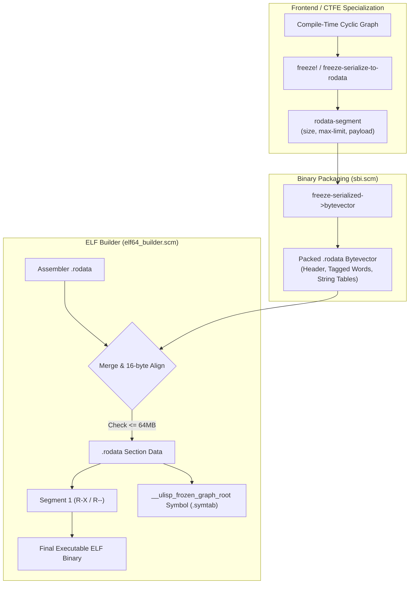

# [FEAT] freeze-serialize-to-rodata 直列化データと elf.scm (.rodata) の実リンカ配線 (ID: 890)

## 1. 概要 / Summary
DSN-33-03 §7.3, §8.1 (Phase P5), DSN-33-02 §8.4 および DSN-33 §11.1 に基づき、`sbi.scm` の `freeze-serialize-to-rodata` で生成された循環グラフ・定数データ構造の直列化バイナリを、AOT バックエンド（`elf64_builder.scm` / `144_backend_x86_elf.scm`）の `.rodata` セクション実データとして直接注入し、機械語からゼロコスト RIP 相対アドレッシング（`[rip + symbol_rodata]`）でアクセス可能にする実リンカ配線を実装する。

コンパイル時計算や部分評価で生成された巨大な静的データ構造（不変リスト、循環テーブル、事前構築 AST）を、実行時ヒープアロケーションなしに実行ファイルの読み取り専用セクションへ直接焼き込むことで、起動時間ゼロ・GC オーバヘッドゼロの組み込み実行環境を実現する。

---

## 2. トレーサビリティ / Traceability
- **関連個別仕様書**:
  - [DSN-33-03 §7.3 (.rodata 肥大化ガード)](../designs/DSN-33-03-ulisp_stage_polymorphic_metacompiler_and_futamura_projection_architecture.md#73-境界データ変換freeze-循環グラフ直列化-rodata-上限チェック)
  - [DSN-33-03 §8.1 Phase P5 (実パイプライン統合と二重化解消)](../designs/DSN-33-03-ulisp_stage_polymorphic_metacompiler_and_futamura_projection_architecture.md#81-マイルストーン分割p1p6)
  - [DSN-33-02 §8.4 (DSN-33-03 ステージ多相メタコンパイラとの LIR/ELF 統合拡張 Phase P5)](../designs/DSN-33-02-ulisp_multilingual_frontend_and_typed_machine_lir_architecture.md#84-dsn-33-03-ステージ多相メタコンパイラとの-lirelf-統合拡張phase-p5)
  - [DSN-33 §11.1 (ELF .rodata 実配線)](../designs/DSN-33-ulisp_underlying_x86_native_aot_compiler_architecture_specification.md#111-dsn-33-03-ステージ多相メタコンパイラ統合phase-p5-issues-887891)
- **関連 Issue**:
  - #883 (freeze! 循環グラフ直列化と .rodata 肥大化ガードの実装)
  - #884 (Data Plane 境界の Tag Stripping と 64-bit 単一ワード正規化の実装)
  - #889 (L-Residual-ANF から Middle-End LIR へのローワリング・アダプターブリッジ実装)

---

## 3. 影響範囲と関連ファイル / Scope and Affected Files
- [x] [ulisp/compiler/sbi.scm](../../ulisp/compiler/sbi.scm) (`freeze-serialized->bytevector` バイナリパッキング機能の実装)
- [x] [ulisp/backend/elf64_builder.scm](../../ulisp/backend/elf64_builder.scm) (`.rodata` セクションへのフリーズド・グラフ結合とアライメント制御、シンボルテーブル登録)
- [x] [ulisp/backend/144_backend_x86_elf.scm](../../ulisp/backend/144_backend_x86_elf.scm) (ELF エミッターへのフリーズド・グラフデータ引き渡し配線)
- [x] [ulisp/compiler/helpers.scm](../../ulisp/compiler/helpers.scm) (エクスポートシンボル `freeze-serialized->bytevector`, `elf64-append-rodata-payload` 等の登録)
- [x] [ulisp/tests/test_freeze_graph_rodata.scm](../../ulisp/tests/test_freeze_graph_rodata.scm) (バイナリ直列化および ELF .rodata 実配線テスト追加)
- [x] [ulisp/tests/test_elf_sections_and_reloc.scm](../../ulisp/tests/test_elf_sections_and_reloc.scm) (ELF セクションオフセット・サイズ整合性テスト)

---

## 4. セキュリティ要件と脅威分析 (CWE-400 リソース枯渇防御 / CWE-119 バッファ整合性)
- **脅威ベクトル**:
  - 悪意ある循環マクロや巨大定数の生成により、ELF バイナリの `.rodata` セクションがギガバイト規模に肥大化し、ディスク枯渇・ビルドマシンハングアップ（CWE-400 リソース枯渇 DoS）を引き起こすリスク。
  - フリーズド・グラフのバイト列アライメント不正（非 8/16 バイト境界）やバウンダリ外オフセット参照による x86-64 マシン語実行時の General Protection Fault / 未整列例外。
- **セキュリティ要件 & 防御**:
  - **二重防壁サイズガード**: `sbi.scm` のみならず `elf64_builder.scm` においても `*max-rodata-size*` (64MB) を厳格に検査し、超過時は直ちに `E-RODATA-OVERFLOW` 例外でビルドを中断。
  - **16 バイト厳格アライメント**: ELF セクションヘッダの `.rodata` アライメント（`sh_addralign = 16`）に準拠し、`elf64-align-up` でパディングを挿入。
  - **決定論的直列化**: ポインタアドレスに依存せず、論理 ID ベース（`cycle-ref`）の安定した直列化を行い、再現可能なバイナリ出力を保証。

---

## 5. 実装方針 / Implementation Plan
Target Branch: `feat/890-integrate-freeze-serialized-rodata-into-elf-emitter`



### ステップ 1: `freeze-serialized->bytevector` バイナリパッカーの実装 (`ulisp/compiler/sbi.scm`)
- `sbi.scm` に、`freeze-serialize-to-rodata` の出力からバイナリ `bytevector` を生成する関数を追加：
  ```scheme
  (define (freeze-serialized->bytevector rodata-seg)
    ...)
  ```
  - ペイロード内の各定数要素をリトルエンディアン 64-bit 単一ワード（またはタグ付きワード）形式でバッファに逐次書き込み。
  - 循環参照 `(cycle-ref id)` は 64-bit プレースホルダポインタまたはオフセットインデックスとしてパック。
  - 生成バッファサイズが `*max-rodata-size*` (64MB) を超える場合は `E-RODATA-OVERFLOW` を送出。

### ステップ 2: `elf64_builder.scm` への `.rodata` マージ & シンボル配線
- `elf64-append-rodata-payload` ヘルパーの実装：
  - 既存の `rodata-bv` と新規の `frozen-bv` を 16 バイトアライメントを挟んで結合。
  - 合計サイズが 64MB を超えないか検査。
- シンボルテーブルへの `__ulisp_frozen_graph_root` の登録：
  - オフセット位置を特定し、機械語から `[rip + __ulisp_frozen_graph_root]` で参照可能にする。

### ステップ 3: `144_backend_x86_elf.scm` への統合配線
- `build-elf64-executable-ex` や `assemble-and-build-elf` がフリーズド・グラフのペイロードを受け取れるよう引数およびディスパッチを拡張。

### ステップ 4: 単体テスト・回帰テストスイートの実行
- `ulisp/tests/test_freeze_graph_rodata.scm` に、循環グラフの bytevector 化および ELF `.rodata` 埋め込みテストケースを追加。
- `make -C ulisp test_freeze_graph_rodata`
- `make -C ulisp test_elf_sections_and_reloc`
- `make -C ulisp test_residual_anf_to_lir`

### ステップ 5: セルフホスト固定点（Bootstrap）の検証
- `cd ulisp && ./bootstrap.sh` を実行し、Stage 2 == Stage 3 の bit-for-bit IDENTICAL を確認。

---

## 6. 完了条件 / Success Criteria (DoD)
- [ ] `freeze-serialized->bytevector` が実装され、循環グラフを安全に bytevector へ直列化できること。
- [ ] `elf64_builder.scm` においてフリーズド・グラフのバイト列が 16 バイトアライメントを保って `.rodata` に統合されること。
- [ ] `*max-rodata-size*` (64MB) を超過した場合に `E-RODATA-OVERFLOW` で安全にビルド中断されること。
- [ ] `test_freeze_graph_rodata.scm` および `test_elf_sections_and_reloc.scm` が 100% PASS すること。
- [ ] `make -C ulisp bootstrap` による Stage 2 == Stage 3 の bit-for-bit IDENTICAL 不動点が保証されること。
