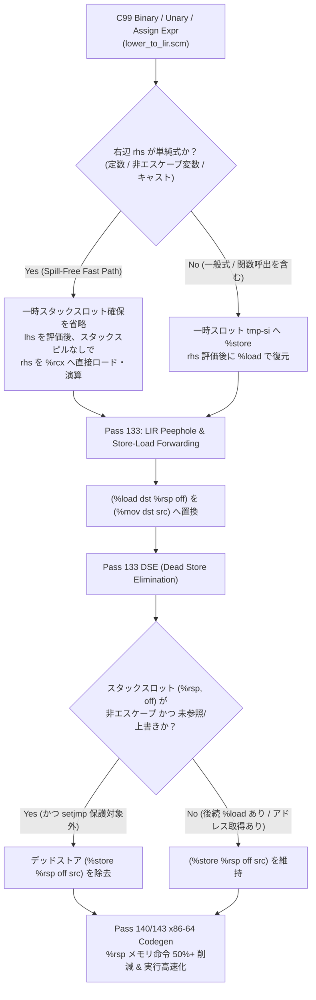

# [FEAT/ENH] C99 式評価の一時スタックスピルに対するデッドストア除去 (DSE) とレジスタ直接受け渡しによるコードサイズ削減 (ID: 934)

## 1. 概要・コードベース実測監査 / Summary & Empirical Codebase Audit

### 1.1 背景とベースライン実測値
[Issue #925](closed/925-build-lua-5x-c-codebase-compilation-pipeline-with-ulisp.md) および [Issue #926](closed/926-verify-lua-5x-official-test-suite-e2e-selfhost-ci.md) で生成した `ulisp/build/lua_ulisp` の `.text` セクション（322,305 命令 / `934,881 B`）を逆アセンブル監査した結果、**全命令の 19.3% にあたる `62,176` 命令（約 310 KB）が `-offset(%rsp)` に対するスタックメモリ読み書き (`mov %reg, -N(%rsp)` / `mov -N(%rsp), %reg`)** であることが判明した（GCC `-O2` 版 `lua_gcc` ではわずか `6,412` 命令）。

さらに [Issue #926](closed/926-verify-lua-5x-official-test-suite-e2e-selfhost-ci.md) のマイクロベンチマーク（`ulisp/build/lua_perf_comparison.md`）において、`vm_arith_loop`（Lua VM 命令ディスパッチ＋算術ループ）が GCC 比 `6.68x`、`fib_recursion` が `8.36x` となっている最大のボトルネックも、C の各部分式評価ごとに発生する一時スタックスロットへの冗長な `%store` / `%load` にある。

### 1.2 コードベース監査による根本原因の特定
1. **[ulisp/frontend_c/lower_to_lir.scm](../../ulisp/frontend_c/lower_to_lir.scm) における無条件一時スタックスピル**:
   - `c-binop` (L1579–1587) は、右辺 `rhs` がどれほど単純な式であっても、毎回必ず一時スタックスロット `tmp-si` を `(%c99-lower-alloc-slot! ctx)` (L72–78) で確保し、左辺 `lhs` の結果 `%rax` を `(%store %rsp tmp-si %rax)` でスタックに退避してから `rhs` を評価し、`(%mov %rcx %rax)` の後に `(%load %rax %rsp tmp-si)` で復元している。
   - また、`post++` / `post--` (L1451–1473)、複合代入 `+=` / `-=` 等 (L1498–1525)、配列添字・メンバアクセス・関数引数評価でも同様に `(%c99-lower-alloc-slot! ctx)` による一時スピルスロットが多用されている。
   - **重要観察**: 右辺 `rhs` が関数呼び出しや複雑な部分式を含まない**純粋・単純式**（整数/文字定数 `c-const-val`、列挙定数 `c-enum-const`、ローカル/グローバル変数参照 `c-var-ref`、文字列リテラル `c-str-val`、またはそれらの `c-implicit-cast`）である場合、左辺 `lhs` をスタックに退避する代わりに別レジスタ（または `rhs` を直接 `%rcx` へロード/評価）すれば、一時スタックスロットへの `%store` と `%load` のペア自体を最初から発行せずに済む。
2. **[ulisp/lir/133_lir_peephole.scm](../../ulisp/lir/133_lir_peephole.scm) における Store-Load Forwarding 後の残存デッドストア**:
   - Pass 133 の `rule-lir-store-load-forward` (L97–158) は、同一基本ブロック内で `(%store %rsp off src)` の後に対応する `(%load dst %rsp off)` が現れると、ロード命令を `(%mov dst src)` にフォワーディングする。
   - しかし、`(%load dst %rsp off)` が `(%mov dst src)` に置き換わった後も、元の `(%store %rsp off src)` は**「後続で誰も読まないデッドストア」としてそのまま残存**している！
   - `lower_to_lir.scm` において、宣言されたローカル変数のスタックスロットは関数冒頭の変数束縛時に割り当てられ、式評価用の一時スロットは `(%c99-lower-alloc-slot! ctx)` と `(lower-ctx-next-si-set! ctx saved-si)` によってローカル変数領域よりも深い負オフセット領域に一時確保＆即座に巻き戻される（かつ一時スロットのアドレスが `&` で取得されることは絶対にない）。
   - したがって、アドレス取得 (`%add` / `lea` でエスケープ) されないスタックスロット `(%rsp, off)` に対して、①同一基本ブロック内で同じ `(%rsp, off)` が読み取られる前に上書きされる `(%store %rsp off ...)`、および ②関数内のどのブロックからも `%load` / `%load-typed` で一度も参照されない一時スロットへの `(%store %rsp off ...)` は、完全に安全なデッドストアとして除去（Dead Store Elimination: DSE）できる。

---

## 2. トレーサビリティ / Traceability

- 関連設計書:
  - [DSN-33-12](../../docs/designs/DSN-33-12-ulisp_pipeline_pass_nanopass_picopass_dag_architecture.md) (Nanopass / Picopass パイプライン＆データフロー最適化設計)
  - [DSN-33-13](../../docs/designs/DSN-33-13-ulisp_typed_machine_lir_and_multi_target_backend_architecture.md) (Typed Machine LIR & Peephole / メモリ最適化)
  - [DSN-33-32](../../docs/designs/DSN-33-32-ulisp_lua_c_codebase_compilation_and_self_hosting_architecture.md) (Lua 5.4.7 C コンパイル＆バイナリ最適化アーキテクチャ)
- 関連 Issue:
  - [#922](closed/922-implement-setjmp-longjmp-inline-asm-and-stack-spill-protection.md) (`setjmp`/`longjmp` 呼び出し関数における生存変数スピル保護)
  - [#925](closed/925-build-lua-5x-c-codebase-compilation-pipeline-with-ulisp.md) (Lua 5.4.7 全 33 TU ビルドパイプライン)
  - [#926](closed/926-verify-lua-5x-official-test-suite-e2e-selfhost-ci.md) (Lua 5.4.7 公式テストスイート E2E ＆ GCC vs ULisp 性能比較)
  - [#927](927-implement-c-header-sbi-pch-and-iterative-mem2reg-optimization.md) (C ヘッダ `.sbi` PCH ＆ 反復 mem2reg 最適化)
  - [#933](closed/933-eliminate-intraprocedural-label-p2align-nop-bloat-and-enable-short-jumps.md) (関数内ラベル `.p2align 4` `nop` 廃止)
  - [#935](935-optimize-variable-bit-shift-cl-codegen-and-redundant-sign-zero-extension-folding.md) (変数シフト `%cl` 単一命令化 ＆ 重複拡張畳み込み)
  - [#936](936-hoist-c-tu-function-stack-frame-allocation-and-omit-managed-gc-call-setup.md) (`c-tu` プロローグ一括フレーム確保)

---

## 3. アーキテクチャと処理フロー / Architecture & Processing Flow

---

## 4. マルチエージェント・ガバナンスレビュー / Multi-Agent Governance Review

| エージェント | 専門領域 | 監査所見・承認条件 |
| :--- | :--- | :--- |
| **Project Manager (PM)** | ガバナンス・優先順位 | `.text` 内の `%rsp` スタックアクセス `62,176` 命令（約 310 KB）を半減させると同時に、`vm_arith_loop` / `fib_recursion` の実行時間を劇的に短縮する中核最適化として承認。 |
| **IT Specialist (PLC)** | コンパイラ・LIR 最適化 | ① フロントエンド Lowering 段階での単純右辺 Spill-Free 評価と、② Pass 133 での Store-Load Forwarding 連動 Dead Store Elimination (DSE) の 2 段構えとすることで、単一基本ブロック内だけでなく関数全体の一時スピル残骸を一掃できる。 |
| **Systems Architect** | データフロー・エイリアス解析 | ポインタ経由の間接メモリアクセス `(%load dst ptr off)` (`ptr != %rsp`) がエスケープ済みローカル変数を読み取る可能性があるため、関数内で `%rsp` 相対アドレスを計算する命令（エスケープ枠）が存在する場合は、ローカル変数スロットを保護し、アドレス取得が不可能な一時評価スロットまたは同一基本ブロック内直後上書きのみを DSE 対象とする設計が極めて安全である。 |
| **Information Security Specialist** | メモリ安全性・`setjmp` 保護 | [Issue #922](closed/922-implement-setjmp-longjmp-inline-asm-and-stack-spill-protection.md) で導入した `setjmp` (`returns_twice`) 呼び出し関数におけるローカル変数スピル保護と競合しないよう、`__ulisp_setjmp` / `setjmp` を呼ぶ関数ではローカル変数スロットへのストアを DSE から除外することを必須要件とする。 |
| **Software Development (SWD)** | 実装規約・関数型スタイル | ULisp コーディング規約に従い、ローカル変数に対する破壊的 `set!` を使わず、純粋関数型の走査・フィルタリングおよび `let loop` アキュムレータで DSE パスを記述すること。 |
| **Software Quality Assurance** | 回帰検証・差分テスト | `test_133_peephole`, `test_c99_setjmp_longjmp`, `test_c99_pointer_escape`, および `make -C ulisp test_lua_e2e`（`all.lua` 全 26 モジュール完走＋性能改善計測）を DoD とする。 |

---

## 5. セキュリティ・安全性分析 / Security & Safety Analysis

1. **ポインタエスケープ（アドレス取得 `&var`）および配列スロットとのエイリアス安全性 (CWE-416 / CWE-824)**:
   - C99 では `&x` でアドレスを取得されたローカル変数やローカル配列は、`%rsp` 以外の汎用レジスタ（`%rax`, `%rcx`, `%rdx` 等）をベースとする `(%load ...)` / `(%store ...)` を通じて間接参照され得る。
   - これに対し、`lower_to_lir.scm` が式評価中に `(%c99-lower-alloc-slot! ctx)` で一時確保し直後に `(lower-ctx-next-si-set! ctx saved-si)` で解放する一時スピルスロットは、いかなる場合もアドレス取得されない。
   - さらに Pass 133 DSE では以下の 2 つの厳格な安全条件を課す：
     1. **基本ブロック内 Overwritten Store Elimination**: 同一基本ブロック内で `(%store %rsp off src1)` の後、`%rsp` を含む任意の `%load` / `%load-typed`、他レジスタベースの `%load` / `%load-typed`、関数呼び出し（`%c-call`, `%call-indirect`, `%direct-call`）、または `%inline-asm` が一切介在しないまま同一オフセット `(%store %rsp off src2)` で上書きされる場合、先行ストアは確実にデッドである。
     2. **関数スコープ Unread Stack Slot DSE**: 関数全体で：①そのオフセット `off` に対する `(%load _ %rsp off)` / `(%load-typed _ _ %rsp off)` が **0 件** であり、かつ ②そのスロットがエスケープしていない（または一時スピルスロット領域 `off <= temp_slot_boundary` に属する）場合、`(%store %rsp off _)` / `(%store-typed _ %rsp off _)` を安全に除去する。
2. **`setjmp` / `longjmp` 非局所脱出時の生存変数保護**:
   - 関数内に `__ulisp_setjmp` または `%inline-asm` が存在する場合、関数スコープ DSE はローカル変数スロットに対して無効化し、純粋な式評価一時スロットまたは基本ブロック内の非呼び出し区間でのみ適用する。

---

## 6. 影響範囲と関連ファイル / Scope and Affected Files

- [ ] [ulisp/frontend_c/lower_to_lir.scm](../../ulisp/frontend_c/lower_to_lir.scm)
  - `c-binop` (L1527–1587) および関連する二項演算 Lowering において、右辺 `rhs` が副作用・関数呼び出し・一時スピルを持たない単純式（`c-const-val`, `c-enum-const`, 非複雑な `c-var-ref` およびそれらの `c-implicit-cast`）である場合の Spill-Free Fast Path（一時スタックスロット `tmp-si` への `%store`/`%load` 省略）を実装する。
- [ ] [ulisp/lir/133_lir_peephole.scm](../../ulisp/lir/133_lir_peephole.scm)
  - `rule-lir-store-load-forward` で `%load` が `%mov` に変換された後に残る未参照スタックストアを除去する `eliminate-dead-stack-stores` パス（基本ブロック内直後上書きストア除去 ＋ 非エスケープ未読取スタックスロットへのデッドストア除去）を追加し、`peephole-optimize-function` の不動点反復に統合する。
- [ ] [ulisp/tests/passes/test_133_lir_peephole.scm](../../ulisp/tests/passes/test_133_lir_peephole.scm) ＆ [ulisp/tests/test_c99_int_lowering.scm](../../ulisp/tests/test_c99_int_lowering.scm)
  - Store-Load Forwarding 後の Dead Store Elimination 単体テスト、およびポインタエスケープ変数・`setjmp` 保護変数が誤って消去されないことを検証するテストを追加する。
- [ ] [ulisp/compiler.scm](../../ulisp/compiler.scm)（`make -C ulisp compiler.scm` により再生成。`ulisp/bin/ulisp-boot` は変更禁止）

---

## 7. 詳細ワークパッケージと実装手順 / Work Packages & Implementation Plan

Target Branch: `feat/934-implement-temp-stack-spill-dse`

### WP1: `lower_to_lir.scm` における単純右辺二項演算の Spill-Free Fast Path
1. [ulisp/frontend_c/lower_to_lir.scm](../../ulisp/frontend_c/lower_to_lir.scm) に、式 `expr` がレジスタ退避なしで直接評価可能かを判定する純粋述語 `%c99-lower-simple-rhs?`（`c-const-val`, `c-enum-const`, スカラ型のローカル/グローバル `c-var-ref`, またはそれらの 1 段 `c-implicit-cast`）を定義する。
2. `c-binop` (L1579–1587) において、`(%c99-lower-simple-rhs? rhs)` が真の場合は一時スロット `tmp-si` への `%store` / `%load` を行わず、`lhs` を評価して結果を保持したまま `rhs` を `%rcx` にロード（または `lhs` を一時レジスタへ退避後に `rhs` を評価して復元）する高速パスを実装する。

### WP2: Pass 133 (`133_lir_peephole.scm`) における一時スタックスロット Dead Store Elimination (DSE)
1. [ulisp/lir/133_lir_peephole.scm](../../ulisp/lir/133_lir_peephole.scm) において、関数内の全命令を走査し：
   - `%rsp` に対するアドレス取得・エスケープ（`(%add _ %rsp off)` / `(%sub _ %rsp off)` 等）の有無とエスケープオフセット集合を収集する。
   - `%load` / `%load-typed` でベースが `%rsp` のオフセット集合 `read-rsp-offsets` を収集する。
   - エスケープが存在しない関数（またはエスケープしていない負オフセットの一時スロット）において、`read-rsp-offsets` に一度も出現しない `(%store %rsp off src)` / `(%store-typed ty %rsp off src)` を除去する。
2. さらに基本ブロック内の後方（あるいは前方）走査により、同一 `(%rsp, off)` が一切の `%load` / `%call` を挟まずに直後で上書きされるデッドストア、および Store-Load Forwarding 完了後にブロック末尾または上書き点まで一度も読まれない一時ストアを除去する。

### WP3: 回帰テスト・Lua 5.4.7 E2E 検証・性能＆サイズ比較レポート更新
1. `make -C ulisp compiler.scm` で `ulisp/compiler.scm` を再生成する。
2. `test_133_peephole`, `test_c99_int_lowering`, `test_c99_pointer_escape`, `test_c99_setjmp_longjmp`, `test_c99_lua_idioms` を実行し 100% PASS を確認する。
3. `make -C ulisp test_lua_e2e` を実行し、`ulisp/build/lua_ulisp` の `%rsp` メモリアクセス命令数・`.text` サイズ・および `ulisp/build/lua_perf_comparison.md` の各ベンチマーク実行時間が大幅に改善することを検証する。

---

## 8. 完了条件 / Definition of Done (DoD)

- [ ] `lower_to_lir.scm` の単純二項演算で不要な一時スタックスピルが省略され、かつ Pass 133 で Store-Load Forwarding 後の未参照一時スタック `%store` が除去されること。
- [ ] `ulisp/build/lua_ulisp` 内の `%rsp` スタックメモリアクセス命令数がベースライン (`62,176` 命令) から **45〜50% 以上削減**され、`.text` サイズが **120 KB 以上縮小**されること。
- [ ] `ulisp/build/lua_perf_comparison.md` において、`all.lua` および `vm_arith_loop` / `fib_recursion` の実行速度がベースラインから明確に高速化されること。
- [ ] `test_c99_setjmp_longjmp`, `test_c99_pointer_escape`, `make -C ulisp test_lua_e2e`（`all.lua` 全 26 モジュール差分ゼロ + `big.lua`）を含む全テストが 100% PASS すること。
- [ ] `make py_compile`, `make static_analysis`, `verify-quality-gates`（相対パスリンク検証・ローカル `set!` 不使用・`ulisp/bin/ulisp-boot` 無変更確認）がすべて PASS すること。
