# [FEAT/ENH] C99 変数ビットシフトの x86-64 %cl 単一命令化および重複ゼロ・符号拡張 (%zext/%sext/%trunc) の畳み込み最適化 (ID: 935)

## 1. 概要・コードベース実測監査 / Summary & Empirical Codebase Audit

### 1.1 背景とベースライン実測値
[Issue #925](closed/925-build-lua-5x-c-codebase-compilation-pipeline-with-ulisp.md) および [Issue #926](closed/926-verify-lua-5x-official-test-suite-e2e-selfhost-ci.md) でビルドした `ulisp/build/lua_ulisp`（`.text` `934,881 B` / `322,305` 命令）の逆アセンブル監査により、以下の 2 つのコード生成パターンが `.text` サイズと Lua VM 実行性能を大きく圧迫していることが判明した：

1. **変数ビットシフト (`<<` / `>>`) の 6 段条件分岐展開**:
   - [ulisp/frontend_c/lower_to_lir.scm](../../ulisp/frontend_c/lower_to_lir.scm) の `%c99-lower-emit-var-shift!` (L385–395) が、非定数シフト量を x86-64 の `shl`/`shr`/`sar %reg, %cl` の 1 命令ではなく、`1, 2, 4, 8, 16, 32` の **6 段のビットマスク・テスト・条件ジャンプ・即時シフト（1 箇所あたり約 35 命令 + 6 個のローカルラベル）**に展開している。
   - Lua 5.4.7 はハッシュテーブルサイズ計算 (`twoto`, `sizenode`, `lmod`, `luaO_ceillog2`)、GC マークビット操作、文字列ハッシュ、および Lua VM のビットシフト命令 (`OP_SHL`, `OP_SHR`) で変数シフトを極めて高頻度に実行するため、コードサイズ膨張だけでなく分岐予測ミスによる実行速度低下を招いている。
2. **暗黙型変換連鎖による同一ゼロ拡張・符号拡張命令の重複発行 (`15,924` 命令)**:
   - `%c99-lower-emit-binop!` (L826) の末尾で演算結果型への `(%c99-lower-emit-cast! ctx lhs-ty)` が発行され、さらに外側の `c-implicit-cast` (L1379) や代入・引数変換で全く同じ型への `(%c99-lower-emit-cast! ctx to-ty)` が重ねて発行されるため、`(%zext u32 %rax %rax)` (`mov %eax, %eax`)、`(%sext i32 %rax %rax)` (`movslq %eax, %rax`)、`(%zext u8 %rax %rax)` (`movzbl %al, %eax`) が 2〜3 回連続して重複出力されている箇所が `lua_ulisp` 全体で `15,924` 命令存在する。

### 1.2 コードベース監査による既存基盤の対応状況確認
全バックエンドおよび LIR パイプラインを詳細に監査した結果、**アセンブラと VM は既にレジスタシフトに対応済み**であり、残る配線は極めて局所的であることが確認された：

| コンポーネント | ファイル・行番号 | 現在の実装状況と必要な変更 |
| :--- | :--- | :--- |
| **Pass 144a x86-64 アセンブラ** | [144a_x86_assembler.scm](../../ulisp/backend/144a_x86_assembler.scm) L1425–1441 | **対応済み**: `shl`/`shr`/`sar reg, cl` を `#xD3 /ext` (`REX.W D3 E0/E8/F8`) としてネイティブ機械語にエンコードするロジックが既に実装されている。 |
| **Reference LIR VM** | [lir_interpreter.scm](../../ulisp/vm/lir_interpreter.scm) L1380–1402 | **対応済み**: `%shl`/`%shr`/`%sar` の第 2 オペランド `cnt-op` を `(vm-eval-operand vm cnt-op)` で評価し `(bitwise-and ... 63)` でマスクしてシフトしており、即値と `%rcx` レジスタの双方でそのまま動作する。 |
| **LIR Verifier** | [lir_verifier.scm](../../ulisp/lir/lir_verifier.scm) L588–613 | 現在 `(integer? (caddr inst))` のみ許可している。`(or (integer? (caddr inst)) (eq? (caddr inst) '%rcx))` を許可するよう拡張する。 |
| **Nanopass Meta (Use/Def 解析)** | [nanopass_meta.scm](../../ulisp/compiler/nanopass_meta.scm) L511–513 | `lir-inst-extract-uses` の `(%shl %shr %sar)` が `(list (cadr inst))` のみ返しているため、`(caddr inst)` がシンボル（`%rcx`）の場合は `(list (cadr inst) (caddr inst))` を返すようにして Pass 133 が `%rcx` 定義を誤消去しないようにする。 |
| **Pass 140 x86-64 Backend** | [140_backend_x86_64.scm](../../ulisp/backend/140_backend_x86_64.scm) L1196–1217, L2184–2189 | `emit-x86-inst` がシフト量を `(small-int->string (caddr inst))` で文字列化している。`(caddr inst)` が `'%rcx` / `'rcx` / `'cl` の場合は `"cl"` を出力するように拡張する。 |
| **Pass 160 Portable C Backend** | [160_backend_c.scm](../../ulisp/backend/160_backend_c.scm) L1131–1149 | `(number->string count)` を `(if (number? count) (number->string count) (string-append "(" (c-operand->str count) " & 63)"))` に拡張する。 |
| **C99 LIR Lowering** | [lower_to_lir.scm](../../ulisp/frontend_c/lower_to_lir.scm) L385–395, L817–826 | `%c99-lower-emit-var-shift!` の 6 段分岐ループを廃止し、32-bit 型の右シフト (`%shr`/`%sar`) 時は先に左辺 `%rax` を 32-bit 正規化 (`%zext u32` / `%sext i32`) した上で、単一の `(list shift-op '%rax '%rcx)` + 結果型キャストを発行する。 |
| **Pass 133 & Pass 143 Peephole** | [133_lir_peephole.scm](../../ulisp/lir/133_lir_peephole.scm) / [143_backend_x86_peephole.scm](../../ulisp/backend/143_backend_x86_peephole.scm) | 連続する同一の `(%zext ty r r)` / `(%sext ty r r)` / `(%trunc ty r r)`（および直前の同一型拡張結果に対する冗長拡張）を 1 命令に畳み込む Picopass ルールを追加する。 |

---

## 2. トレーサビリティ / Traceability

- 関連設計書:
  - [DSN-33-12](../../docs/designs/DSN-33-12-ulisp_pipeline_pass_nanopass_picopass_dag_architecture.md) (Picopass Peephole 書き換え規則アーキテクチャ)
  - [DSN-33-13](../../docs/designs/DSN-33-13-ulisp_typed_machine_lir_and_multi_target_backend_architecture.md) (Typed Machine LIR 命令仕様・全バックエンド意味論同期)
  - [DSN-33-32](../../docs/designs/DSN-33-32-ulisp_lua_c_codebase_compilation_and_self_hosting_architecture.md) (Lua 5.4.7 C コンパイル＆バイナリ最適化アーキテクチャ)
- 関連 Issue:
  - [#831](closed/831-synchronize-typed-lir-semantics-in-c-backend-and-enable-differential-fuzzing.md) (Typed LIR セマンティクス同期)
  - [#916](closed/916-implement-c99-sema-core-and-integer-subset-lir-lowering.md) (C99 整数昇格・シフト演算 Lowering)
  - [#925](closed/925-build-lua-5x-c-codebase-compilation-pipeline-with-ulisp.md) (Lua 5.4.7 全 33 TU ビルドパイプライン)
  - [#926](closed/926-verify-lua-5x-official-test-suite-e2e-selfhost-ci.md) (Lua 5.4.7 公式テストスイート E2E ＆ GCC vs ULisp 性能比較)
  - [#933](closed/933-eliminate-intraprocedural-label-p2align-nop-bloat-and-enable-short-jumps.md) (関数内ラベル `.p2align 4` `nop` 廃止)
  - [#934](934-implement-temporary-stack-spill-dead-store-elimination-and-expr-register-forwarding.md) (一時スタックスピル DSE)
  - [#936](936-hoist-c-tu-function-stack-frame-allocation-and-omit-managed-gc-call-setup.md) (`c-tu` プロローグ一括フレーム確保)

---

## 3. アーキテクチャと処理フロー / Architecture & Processing Flow

```mermaid
flowchart TD
    subgraph VarShift["1. C99 変数ビットシフト (%cl 単一命令化)"]
        A1["C99 式: lhs << rhs / lhs >> rhs<br/>(rhs が非定数)"] --> A2["lhs を %rax, rhs を %rcx に評価"]
        A2 --> A3["右シフトかつ 32-bit 以下の場合<br/>事前に (%zext u32 / %sext i32 %rax %rax)"]
        A3 --> A4["単一 LIR 命令を発行:<br/>(%shl / %shr / %sar %rax %rcx)"]
        A4 --> A5["結果型へ正規化キャスト<br/>(%c99-lower-emit-cast! ctx lhs-ty)"]
        A5 --> A6["Pass 140 / 144a:<br/>shl / shr / sar rax, cl (3 bytes: 48 D3 E0/E8/F8)"]
    end

    subgraph ExtFold["2. 重複ゼロ・符号拡張 (%zext/%sext/%trunc) 畳み込み"]
        B1["LIR 命令列:<br/>(%zext u32 %rax %rax)<br/>(%zext u32 %rax %rax)"] --> B2["Pass 133: rule-lir-redundant-ext-elim"]
        B2 --> B3["連続する同一型拡張・切り詰めを<br/>単一の (%zext u32 %rax %rax) に畳み込み"]
        B3 --> B4["Pass 143: x86-64 Peephole<br/>連続 mov eax, eax / movslq / movzbl 除去"]
    end
```

---

## 4. マルチエージェント・ガバナンスレビュー / Multi-Agent Governance Review

| エージェント | 専門領域 | 監査所見・承認条件 |
| :--- | :--- | :--- |
| **Project Manager (PM)** | ガバナンス・優先順位 | 変数シフト 1 箇所あたり 35 命令（+ 6 ラベル）を 1〜2 命令（3 バイト）へ圧縮し、さらに 15,924 個の重複拡張を除去する高 ROI タスクとして承認。 |
| **IT Specialist (PLC)** | LIR 仕様・データフロー | `nanopass_meta.scm` の `lir-inst-extract-uses` で `(%shl dst cnt)` の `cnt` が `%rcx` の場合に必ず `uses` リストへ含めること。これを怠ると Pass 133 の Store-Load Forwarding や DCE が `%rcx` のロードをデッドコードと誤認するリスクがあるため、WP1 で確実に更新する。 |
| **Systems Architect** | マルチターゲット一貫性 | x86-64 (Pass 140/144a)、Portable C (Pass 160)、LIR Reference VM、および LIR Verifier の 4 系統すべてで `(%shl/%shr/%sar reg %rcx)` を一貫してサポートすること。 |
| **Information Security Specialist** | C99 整数幅・CWE-197/681 | 64-bit レジスタ `%rax` 上で 32-bit `unsigned int` の右論理シフト `x >> n` を行う際、`%rax` の上位 32 ビットにゴミが残っていると `shr rax, cl` で下位 32 ビットへ流入する（CWE-681）。そのため、右シフト前に必ず `(%c99-lower-emit-cast! ctx lhs-ty)` で `%rax` の上位ビットをゼロ拡張（符号付きなら符号拡張）してから `%shr`/`%sar` を実行すること（実は旧 6 段シフト実装でも行われていなかった潜在バグの修正にもなる）。 |
| **Software Quality Assurance** | 品質ゲート・検証 | 32-bit / 64-bit の符号付き・符号なし変数シフト境界テスト（シフト量 0, 1, 31, 32, 63）および Lua 5.4.7 `bwcoercion.lua` / `bitwise.lua` / `all.lua` での完全検証を必須とする。 |

---

## 5. セキュリティ・意味論的安全性分析 / Security & Semantic Safety Analysis

1. **64-bit レジスタ上での 32-bit 変数右シフトにおける上位ビット流入防止 (CWE-681)**:
   - ULisp の LIR ではすべての演算が 64-bit 汎用レジスタ `%rax` 上で行われ、`shl`/`shr`/`sar rax, cl` は 64-bit 幅（`REX.W D3`）で実行される。
   - 左シフト (`<<`) の場合は上位へシフトした後に `(%c99-lower-emit-cast! ctx lhs-ty)` で 32-bit 切り詰め・符号拡張すれば正しい結果が得られる。
   - 右シフト (`>>`) の場合は、シフト実行前に `%rax` を `lhs-ty`（例: `unsigned int` なら `(%zext u32 %rax %rax)`、`int` なら `(%sext i32 %rax %rax)`）で正規化しておくことで、64-bit `shr`/`sar rax, cl` を実行しても上位 32 ビットから不正なビットが流入せず、シフト後の `(%c99-lower-emit-cast! ctx lhs-ty)` と合わせて ISO C99 §6.5.7 の仕様に 100% 合致する。
2. **Pass 133 `nanopass_meta.scm` における `%rcx` Use 追跡**:
   - `lir-inst-extract-uses` (L511) と `lir-inst-uses-reg?` (L443) の双方で、`(%shl/%shr/%sar dst cnt)` の第 2 引数 `cnt` がレジスタシンボルの場合に読み取りレジスタとして追跡されることを確認する（`lir-inst-uses-reg?` は既に `(memq reg (cdr inst))` で全オペランドを検査済み；`lir-inst-extract-uses` のみ `(if (symbol? (caddr inst)) (list (cadr inst) (caddr inst)) (list (cadr inst)))` に更新する）。

---

## 6. 影響範囲と関連ファイル / Scope and Affected Files

- [ ] [ulisp/compiler/nanopass_meta.scm](../../ulisp/compiler/nanopass_meta.scm)
  - `lir-inst-extract-uses` (L511–513)：`(%shl %shr %sar)` の第 2 オペランド `(caddr inst)` がシンボルの場合も使用レジスタリストに含める。
- [ ] [ulisp/lir/lir_verifier.scm](../../ulisp/lir/lir_verifier.scm)
  - `%shl` / `%shr` / `%sar` 検証規則 (L588–613)：シフト量オペランド `(caddr inst)` として整数即値または `'%rcx` を許可する。
- [ ] [ulisp/backend/140_backend_x86_64.scm](../../ulisp/backend/140_backend_x86_64.scm)
  - `lower-lir-instruction` (L1196–1217) および `emit-x86-inst` (L2184–2189)：シフト量 `cnt` が `'%rcx` / `'rcx` / `'cl` の場合にアセンブリオペランド `"cl"` を出力する。
- [ ] [ulisp/backend/160_backend_c.scm](../../ulisp/backend/160_backend_c.scm)
  - `%shl` / `%shr` / `%sar` C 生成 (L1131–1149)：シフト量 `count` が数値でない場合は `((count_str) & 63)` として出力する。
- [ ] [ulisp/frontend_c/lower_to_lir.scm](../../ulisp/frontend_c/lower_to_lir.scm)
  - `%c99-lower-emit-var-shift!` (L385–395)：6 段条件分岐ループを廃止し、`(%c99-lower-emit-cast! ctx lhs-ty)` + `(list shift-op '%rax '%rcx)` + `(%c99-lower-emit-cast! ctx lhs-ty)` に置き換える。
- [ ] [ulisp/lir/133_lir_peephole.scm](../../ulisp/lir/133_lir_peephole.scm) ＆ [ulisp/backend/143_backend_x86_peephole.scm](../../ulisp/backend/143_backend_x86_peephole.scm)
  - 連続する同一の `(%zext ty r r)` / `(%sext ty r r)` / `(%trunc ty r r)`、および x86 レベルで連続する同一の拡張命令（`mov eax, eax`, `movslq eax, rax`, `movzbl al, eax` 等）を畳み込む Picopass ルールを追加する。
- [ ] [ulisp/compiler.scm](../../ulisp/compiler.scm)（`make -C ulisp compiler.scm` により再生成。`ulisp/bin/ulisp-boot` は変更禁止）

---

## 7. 詳細ワークパッケージと実装手順 / Work Packages & Implementation Plan

Target Branch: `feat/935-optimize-variable-shift-cl-and-ext-folding`

### WP1: LIR `%shl`/`%shr`/`%sar` における `%rcx` (`%cl`) レジスタシフト量の全パイプライン解禁
1. [ulisp/compiler/nanopass_meta.scm](../../ulisp/compiler/nanopass_meta.scm) L511–513 の `lir-inst-extract-uses` を更新し、シフト量がシンボルの場合に `uses` に含める。
2. [ulisp/lir/lir_verifier.scm](../../ulisp/lir/lir_verifier.scm) L588–613 でシフト量に `'%rcx` を許可する。
3. [ulisp/backend/140_backend_x86_64.scm](../../ulisp/backend/140_backend_x86_64.scm) L2184–2189 および [ulisp/backend/160_backend_c.scm](../../ulisp/backend/160_backend_c.scm) L1131–1149 で `%rcx` シフトカウントをそれぞれ `"cl"` および `(rcx & 63)` として出力する。
4. [ulisp/frontend_c/lower_to_lir.scm](../../ulisp/frontend_c/lower_to_lir.scm) L385–395 の `%c99-lower-emit-var-shift!` を単一の `(list shift-op '%rax '%rcx)` ベースに簡素化する。

### WP2: Pass 133 & Pass 143 における重複ゼロ・符号拡張 (`%zext`/`%sext`/`%trunc`) の冪等畳み込み
1. [ulisp/lir/133_lir_peephole.scm](../../ulisp/lir/133_lir_peephole.scm) に `rule-lir-redundant-ext-elim` を追加し、連続する同一オペランド・同一型の `(%zext ty r r)`, `(%sext ty r r)`, `(%trunc ty r r)` を 1 命令に畳み込む。
2. [ulisp/backend/143_backend_x86_peephole.scm](../../ulisp/backend/143_backend_x86_peephole.scm) においても、連続する同一の `(movzx dst src)` / `(movsx dst src)` / `(movsxd dst src)`（`dst` と `src` が同じレジスタファミリーで冪等なもの）を 1 命令に畳み込むルールを追加する。

### WP3: 単体テスト・Lua 5.4.7 ビット演算＆全テスト検証・性能比較レポート更新
1. `make -C ulisp compiler.scm` で `ulisp/compiler.scm` を再生成する。
2. `test_133_peephole`, `test_140`, `test_143`, `test_160_c_backend`, `test_c99_int_lowering`, `test_c99_lua_idioms` を実行し 100% PASS を確認する。
3. `make -C ulisp test_lua_e2e` を実行し、`bwcoercion.lua`、`bitwise.lua` を含む `all.lua` 全 26 モジュール完走と、`.text` サイズおよび実行時間の削減を `ulisp/build/lua_perf_comparison.md` で確認する。

---

## 8. 完了条件 / Definition of Done (DoD)

- [ ] `%c99-lower-emit-var-shift!` の 6 段条件分岐展開が廃止され、`shl`/`shr`/`sar rax, cl` 単一命令に置き換わっていること。
- [ ] Pass 133 および Pass 143 により、連続する同一の `%zext` / `%sext` / `%trunc` 命令が 1 命令に畳み込まれていること。
- [ ] `ulisp/build/lua_ulisp` の `.text` サイズが **35〜50 KB 以上追加縮小**され、連続重複拡張命令が解消されていること。
- [ ] `test_c99_int_lowering`, `test_133_peephole`, `test_160_c_backend`, および `make -C ulisp test_lua_e2e`（`bwcoercion.lua` + `all.lua` 全 26 モジュール差分ゼロ + `big.lua`）が 100% PASS すること。
- [ ] `make py_compile`, `make static_analysis`, `verify-quality-gates`（相対パスリンク検証・ローカル `set!` 不使用・`ulisp/bin/ulisp-boot` 無変更確認）がすべて PASS すること。
