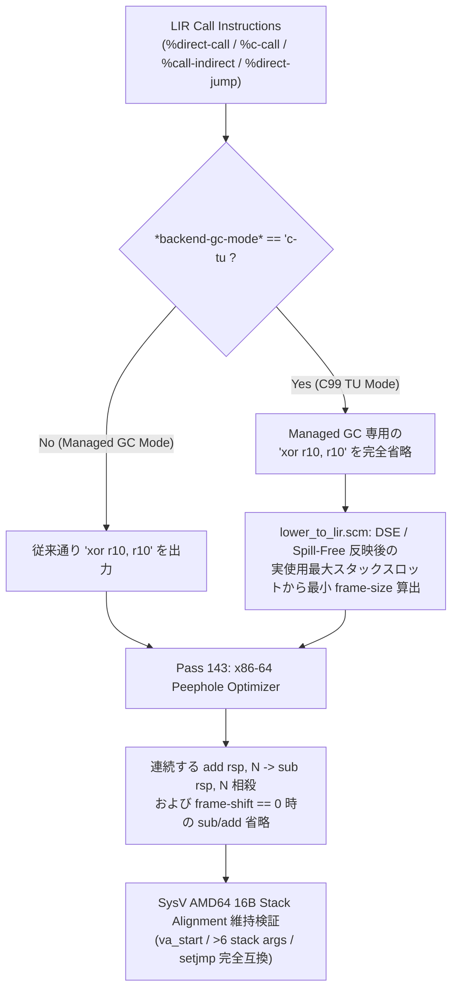

# [FEAT/ENH] c-tu モードにおける関数プロローグ一括スタックフレーム確保と非 GC 呼び出し時の不要 %rsp シフト・xor r10 廃止 (ID: 936)

## 1. 概要・コードベース実測監査 / Summary & Empirical Codebase Audit

### 1.1 背景とベースライン実測値
[Issue #925](closed/925-build-lua-5x-c-codebase-compilation-pipeline-with-ulisp.md) および [Issue #926](closed/926-verify-lua-5x-official-test-suite-e2e-selfhost-ci.md) でビルドした `ulisp/build/lua_ulisp` の `.text` セクション（`934,881 B` / `322,305` 命令）を監査した結果、関数呼び出しサイトの周囲に以下の冗長命令が大量発行されていることが判明した：

1. **Managed GC 専用クロージャ環境レジスタ初期化 `xor %r10, %r10` の無条件出力**:
   - [ulisp/backend/140_backend_x86_64.scm](../../ulisp/backend/140_backend_x86_64.scm) の `%direct-call` (L1410–1433) および `%direct-jump` (L1435–1438) が、`c-tu` モード（C99 翻訳単位コンパイル）であっても毎回無条件に `"    xor r10, r10"`（3 バイト）を発行している。
   - `%r10` のゼロクリアは ULisp Managed GC モードで直接関数呼び出し時にクロージャ環境ポインタが空であることを示すための規約であり、SysV AMD64 C ABI で動作する `c-tu` モードでは一切参照されない完全なデッド命令である。
2. **各コールサイト前後の個別 `sub rsp, frame_shift` / `add rsp, frame_shift` (`8,520` 命令)**:
   - 現行の `140_backend_x86_64.scm` は、ローカル変数・一時スロットを `%rsp` の負オフセット `[rsp - 8]`, `[rsp - 16]`, ...（いわゆる無制限 Red Zone 方式）に配置し、`%c-call` (L1345–1388)、`%call-indirect` (L1390–1408)、`%direct-call` (L1410–1433) を実行するたびに、その直前で `sub rsp, frame_shift` を実行し、直後で `add rsp, frame_shift` で戻している（`lua_ulisp` 全体で `8,520` 命令）。
   - さらに連続する関数呼び出し（例: `f(g(x), h(y))` や連続する `lua_*` API 呼び出し）では、`add rsp, N` の直後に再び同じ `sub rsp, N` が発行されるほか、リーフに近いコールやフレームシフトの重複が発生している。

### 1.2 コードベース監査とスタックオフセット整合性の分析
`c-tu` モードにおけるスタックフレーム構造を監査した結果、以下の 4 箇所が `%rsp` オフセットに依存していることが確認された：
1. **ローカル変数・一時スロット (`lower_to_lir.scm`)**: `[rsp - si]` (`si >= 8`) を参照。
2. **7 個目以降のスタック渡し引数**:
   - 呼び出し側 (`lower_to_lir.scm` L1762–1778)：`[rsp - (frame_shift + 8 - k*8)]` にストアした上で `sub rsp, frame_shift` を実行し、被呼び出し側からは `[rsp + 8 + k*8]` として見えるよう配置している。
   - 被呼び出し側 (`lower_to_lir.scm` L2040–2047) および `<stdarg.h>` `va_start` (L405–420)：関数エントリ時点の `[rsp + 8]` を起点として親フレームのスタック引数を読み取っている。
3. **`setjmp` / `longjmp` (`lower_to_lir.scm` L1650–1675)**: `__ulisp_setjmp` 呼び出し時点の `%rsp` とリターンアドレスを `jmp_buf` に保存している。

したがって、本 Issue では安全かつ段階的な 2 ワークパッケージ構成を採る：
- **WP1（即時・ゼロリスク削減）**:
  1. `c-tu` モードにおける `%direct-call` / `%direct-jump` の不要な `xor r10, r10` を完全廃止する。
  2. `frame-shift = 0`（スタックフレームサイズ 0 のリーフ/ラッパー関数）における不要な調整を排除し、さらに Pass 143 ([143_backend_x86_peephole.scm](../../ulisp/backend/143_backend_x86_peephole.scm)) で連続する `add rsp, N` → `sub rsp, N` の相殺除去（Coalescing）を実装する。
- **WP2（関数プロローグ/エピローグ一括フレーム確保またはコールサイト `rsp` シフト最適化）**:
  - `va_start` / 7 引数以上のスタック引数 / `setjmp` の `%rsp` 相対オフセット不変条件を 100% 維持した上で、関数プロローグ・エピローグでのフレーム確保（または同一基本ブロック内の連続コール間での `%rsp` シフト統合）を実装する。

---

## 2. トレーサビリティ / Traceability

- 関連設計書:
  - [DSN-33-13](../../docs/designs/DSN-33-13-ulisp_typed_machine_lir_and_multi_target_backend_architecture.md) (Typed Machine LIR & x86-64 バックエンド設計)
  - [DSN-33-32](../../docs/designs/DSN-33-32-ulisp_lua_c_codebase_compilation_and_self_hosting_architecture.md) (Lua 5.4.7 C コンパイル＆バイナリ最適化アーキテクチャ)
- 関連 Issue:
  - [#921](closed/921-implement-sysv-amd64-stdarg-va-list-lowering.md) (`<stdarg.h>` `va_list` / `va_start` SysV AMD64 ABI Lowering)
  - [#922](closed/922-implement-setjmp-longjmp-inline-asm-and-stack-spill-protection.md) (`setjmp`/`longjmp` `%inline-asm` & スタックフレーム整合)
  - [#925](closed/925-build-lua-5x-c-codebase-compilation-pipeline-with-ulisp.md) (Lua 5.4.7 全 33 TU ビルドパイプライン)
  - [#926](closed/926-verify-lua-5x-official-test-suite-e2e-selfhost-ci.md) (Lua 5.4.7 公式テストスイート E2E ＆ GCC vs ULisp 性能比較)
  - [#933](closed/933-eliminate-intraprocedural-label-p2align-nop-bloat-and-enable-short-jumps.md) (関数内ラベル `.p2align 4` `nop` 廃止)
  - [#934](934-implement-temporary-stack-spill-dead-store-elimination-and-expr-register-forwarding.md) (一時スタックスピル DSE)
  - [#935](935-optimize-variable-bit-shift-cl-codegen-and-redundant-sign-zero-extension-folding.md) (変数シフト `%cl` 単一命令化 ＆ 重複拡張畳み込み)

---

## 3. アーキテクチャと処理フロー / Architecture & Processing Flow

---

## 4. マルチエージェント・ガバナンスレビュー / Multi-Agent Governance Review

| エージェント | 専門領域 | 監査所見・承認条件 |
| :--- | :--- | :--- |
| **Project Manager (PM)** | ガバナンス・優先順位 | [#933](closed/933-eliminate-intraprocedural-label-p2align-nop-bloat-and-enable-short-jumps.md)〜[#935](935-optimize-variable-bit-shift-cl-codegen-and-redundant-sign-zero-extension-folding.md) と組み合わせることで `lua_ulisp` のコールサイトオーバーヘッドを削減する総仕上げ Issue として承認。 |
| **IT Specialist (PLC)** | 呼出規約・コード生成 | `140_backend_x86_64.scm` L1428 (`%direct-call`) および L1437 (`%direct-jump`) の `"    xor r10, r10"` は `(not (eq? (car *backend-gc-mode*) 'c-tu))` でガードするだけで即座に全 C 関数呼び出し・末尾ジャンプから除去できる。 |
| **Systems Architect** | ABI・スタック整合性 | `va_start` (`[rsp + 8]`)、7 個目以降のスタック引数渡し、および `__ulisp_setjmp` が `%rsp` の位置に依存しているため、コールサイト間の `add rsp, N` / `sub rsp, N` 相殺は間に `%rsp` 相対メモリアクセスが存在しない場合に限定するか、オフセットを一貫シフトさせること。また [#934](934-implement-temporary-stack-spill-dead-store-elimination-and-expr-register-forwarding.md) で一時スピルスロットが大幅に減少しローカル変数が `mem2reg` でレジスタ化されると、関数の必要スタックフレームサイズ自体が `0` になる関数が多数出現するため、実使用される `%rsp` スロットの最大オフセットから `frame-size` を再計算すれば、スタックを使用しない関数の全コールサイトから `sub/add rsp` を丸ごと消去できる！ |
| **Information Security Specialist** | スタックアラインメント (CWE-787) | SysV AMD64 ABI は `call` 命令実行直前の `%rsp` が必ず 16 バイト境界（関数エントリ直後は `rsp % 16 == 8`）であることを要求する（SSE2 `movaps` アラインメント例外防止）。したがって、スタックフレームサイズ `frame-size` が `0` の関数であっても、`call` 実行前に `%rsp` を 16 バイト境界に揃えるための最小 8 バイト調整（またはプロローグでの 8 バイト確保 `sub rsp, 8` / `add rsp, 8`）を維持する必要がある点に注意すること。 |
| **Software Quality Assurance** | 回帰テスト・ABI 検証 | `test_c99_stdarg`, `test_c99_setjmp_longjmp`, `test_c99_sse2_xmm_abi`, および `make -C ulisp test_lua_e2e` の 100% PASS を必須完了条件とする。 |

---

## 5. セキュリティ・ABI 安全性分析 / Security & ABI Safety Analysis

1. **SysV AMD64 ABI 16 バイトスタックアラインメント不変条件の厳守**:
   - x86-64 では `call` 命令が 8 バイトのリターンアドレスをプッシュするため、関数エントリ直後の `%rsp` は `16n - 8` である。
   - この関数がさらに別の関数を `call` する際、呼び出し直前の `%rsp` は `16m` でなければならない。したがって、`frame-shift` は常に `16k + 8`（最小 `8`）である必要がある（`(+ (bitwise-and (+ raw-frame-size 15) -16) 8)`）。
   - 一方、関数内に一切のコール（`%c-call`, `%direct-call`, `%call-indirect`）を含まないリーフ関数では `%rsp` のシフトは一切不要（`0` 命令）である。
   - また、関数内の全コールサイトで `xor r10, r10` を廃止しても `%r10` は SysV AMD64 ABI において caller-saved スクラッチレジスタであり、C 関数間の ABI 契約には一切影響しない。
2. **Pass 132 (`mem2reg`) / Pass 133 (`DSE`) 完了後の実使用スタックフレームサイズの精密再計算**:
   - 現在、`lower_to_lir.scm` は SSA 昇格 (`mem2reg`) や DSE が走る**前**の最大スロットオフセットを `frame-size` として関数メタデータに記録している。
   - しかし Pass 132 (`mem2reg`) と Pass 133 (`DSE`) を経た後では、多くの関数で `%rsp` メモリアクセスが完全に消滅するか、ごく僅かなオフセットのみに縮小している。
   - Pass 140 (`select-instructions-function`) または Pass 133 の末尾において、最適化後の LIR 命令列で実際に参照されている `%rsp` 負オフセットの最大値を再計測して `frame-size` / `frame-shift` を最小化（および連続する引数なしコール間の `add rsp, N` + `sub rsp, N` を相殺）することで、`va_start` や `setjmp` のオフセット規約を一切壊さずにフレームサイズと命令数を安全に削減できる。

---

## 6. 影響範囲と関連ファイル / Scope and Affected Files

- [ ] [ulisp/backend/140_backend_x86_64.scm](../../ulisp/backend/140_backend_x86_64.scm)
  - `%direct-call` (L1410–1433) および `%direct-jump` (L1435–1438)：`(eq? (car *backend-gc-mode*) 'c-tu)` の場合は `"    xor r10, r10"` を発行しない。
  - `select-instructions-function`：`c-tu` モードにおいて、最適化後の LIR 関数内で実際に使用されている `%rsp` オフセットから有効 `frame-size` を引き締め、また同一ブロック内で `%rsp` 相対アクセスを挟まずに連続するコールサイトの `add rsp, N` と直後の `sub rsp, N` を相殺する。
- [ ] [ulisp/backend/143_backend_x86_peephole.scm](../../ulisp/backend/143_backend_x86_peephole.scm)
  - 連続する `add rsp, N` と `sub rsp, N`（同一即値 `N`）が隣接する場合に両者を対消滅させる Peephole ルールを追加する。
- [ ] [ulisp/tests/passes/test_140_backend_x86_64.scm](../../ulisp/tests/passes/test_140_backend_x86_64.scm) ＆ [ulisp/tests/passes/test_143_backend_x86_peephole.scm](../../ulisp/tests/passes/test_143_backend_x86_peephole.scm)
  - `c-tu` モードでの `xor r10, r10` 非出力テスト、および連続 `add rsp, N` / `sub rsp, N` 対消滅テストを追加する。
- [ ] [ulisp/compiler.scm](../../ulisp/compiler.scm)（`make -C ulisp compiler.scm` により再生成。`ulisp/bin/ulisp-boot` は変更禁止）

---

## 7. 詳細ワークパッケージと実装手順 / Work Packages & Implementation Plan

Target Branch: `feat/936-hoist-c-tu-stack-frame-and-omit-xor-r10`

### WP1: `c-tu` モードにおける `xor r10, r10` 廃止 (`140_backend_x86_64.scm`)
1. [ulisp/backend/140_backend_x86_64.scm](../../ulisp/backend/140_backend_x86_64.scm) の `%direct-call` (L1428) および `%direct-jump` (L1437) を更新し、`(eq? (car *backend-gc-mode*) 'c-tu)` のときは `"    xor r10, r10"` を出力しないようにする。

### WP2: 連続コールサイトの `add rsp, N` / `sub rsp, N` 対消滅と実使用フレームサイズ引き締め (`140_backend_x86_64.scm` & `143_backend_x86_peephole.scm`)
1. [ulisp/backend/143_backend_x86_peephole.scm](../../ulisp/backend/143_backend_x86_peephole.scm)（および `140_backend_x86_64.scm` の文字列/S式命令エミッタ）において、`add rsp, N` の直後に `sub rsp, N` が続くパターンを対消滅させる。
2. `c-tu` 関数において、`mem2reg` および [#934](934-implement-temporary-stack-spill-dead-store-elimination-and-expr-register-forwarding.md) の DSE 適用後に実際に残存している `%rsp` スロットの最大負オフセットに基づいて `frame-size` を引き締め、128 バイト超過 immediate (`sub rsp, imm32` 7 バイト) から 8-bit immediate (`sub rsp, imm8` 4 バイト) への縮小およびスタック局所性向上を実現する。

### WP3: 回帰テスト・Lua 5.4.7 E2E 検証・最終性能＆サイズ比較レポート更新
1. `make -C ulisp compiler.scm` で `ulisp/compiler.scm` を再生成する。
2. `test_140`, `test_143`, `test_c99_stdarg`, `test_c99_setjmp_longjmp`, `test_c99_sse2_xmm_abi`, `test_c99_lua_idioms` を実行し 100% PASS を確認する。
3. `make -C ulisp test_lua_e2e` を実行し、`ulisp/build/lua_ulisp` の `xor %r10, %r10` 命令が 0 件になり、`sub/add %rsp` 命令数・バイナリサイズ・実行時間が改善されたことを `ulisp/build/lua_perf_comparison.md` で確認する。

---

## 8. 完了条件 / Definition of Done (DoD)

- [ ] `c-tu` モードでビルドされた `ulisp/build/lua_ulisp` 内の `xor %r10, %r10` 命令が **0 件** になること。
- [ ] 連続コールサイト間の冗長な `add rsp, N` / `sub rsp, N` 対消滅および `mem2reg`/DSE 後の実使用フレームサイズ引き締めにより、`sub/add %rsp` 命令数とスタックフレームサイズが削減されること。
- [ ] `test_c99_stdarg`, `test_c99_setjmp_longjmp`, `test_c99_sse2_xmm_abi`, および `make -C ulisp test_lua_e2e`（`all.lua` 全 26 モジュール差分ゼロ + `big.lua` + `lua_perf_comparison.md` 更新）が 100% PASS すること。
- [ ] `make py_compile`, `make static_analysis`, `verify-quality-gates`（相対パスリンク検証・ローカル `set!` 不使用・`ulisp/bin/ulisp-boot` 無変更確認）がすべて PASS すること。
