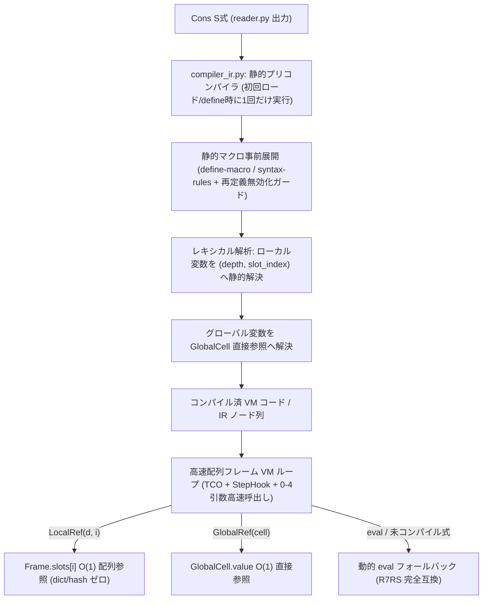

# [FEAT/ENH] ILISP Phase 2: 事前コンパイルドクロージャ・静的マクロ展開およびレキシカルスロット配列 VM の実装 (ID: 940)

## 1. 概要 / Summary & 実測プロファイリング監査結果

Phase 1 ([Issue #939](closed/939-optimize-ilisp-evaluator-hotpath-native-primitives-and-fast-reader.md)) により即時ボトルネックを除去した後のさらなる抜本的高速化（通算 20×〜40×）を実現するため、デフォルトの `ilisp` 実行系（`--backend=interp`）において **関数定義・ロード時の 1 回限りの事前コンパイル（マクロ事前展開・AST 正規化・レキシカルスロット解決）＋配列ベース `Frame` ＆ `GlobalCell` 直接参照 VM** を導入する。

### 実測ベースライン (`cProfile` 監査結果 — 辞書・シンボル探索オーバーヘッド)

[c_driver_runner.scm](../../ulisp/build/c_driver_runner.scm)（3.19 MB / 3,734 フォーム）で `tiny.c` をコンパイルした際のプロファイリングでは、評価器が実行のたびに生 S 式を再解析し、変数解決のたびに `dict` と親フレーム連結リストを辿っていることが消費時間の大部分を占めている:

| ボトルネック項目 | 呼び出し回数 | 時間コスト | 根本原因 |
|---|---:|---:|---|
| `eval_expr` ([evaluator.py:264](../../ilisp/evaluator.py#L264)) | 14,509,442 | **55.263 s (`tottime`)** | 呼び出しごとに生 `Cons` 構文木を再解析 |
| `dict.get` | 18,273,905 | **9.457 s (`tottime`)** | レキシカル環境・グローバル環境の毎回ハッシュ探索 |
| `Environment.lookup` ([env.py:205](../../ilisp/env.py#L205)) | 8,249,656 | **17.801 s (`cumtime`)** | 平均 2.2 段以上の親 `Environment` 連結リスト走査 |
| `Symbol.__hash__` ([types.py:58](../../ilisp/types.py#L58)) | 27,415,703 | **2.982 s (`tottime`)** | Python `__hash__` メソッド呼出し＋辞書キー探索 |
| `_bind_procedure_call` ([evaluator.py:1213](../../ilisp/evaluator.py#L1213)) | 686,126 | **4.738 s (`cumtime`)** | 関数呼出しごとに `dict(zip(params, args))` 生成 |
| `_apply_procedure` ([evaluator.py:1240](../../ilisp/evaluator.py#L1240)) | 370,081 | **100.284 s (`cumtime`)** | 動的ディスパッチ＋静的展開不可による毎回AST構築 |

これらは Phase 1 だけでは根本解消できないため、Phase 2 としてコンパイル済み IR（またはバイトコード＋レキシカルスロット VM）を導入し、実行時のハッシュ探索・フレーム `dict` 生成・S 式再解析をゼロにする。

---

## 2. トレーサビリティ / Traceability

- **依存関係・関連 Issue**:
  - 前提 Phase 1: [#939](closed/939-optimize-ilisp-evaluator-hotpath-native-primitives-and-fast-reader.md)（特殊形式・ネイティブ手続・高速リーダー最適化）
  - 関連 Phase 3: [#941](941-complete-ilisp-py-ast-backend-r7rs-compilation-for-ulisp.md)（`--backend=py_ast` CPython バイトコード生成）
  - 動機検証: [#929](closed/929-implement-ddc-diverse-double-compiling-determinism-verification.md)（DDC Tier 1 `ilisp` バッチ ~22 分の大幅短縮）
- **関連コンポーネント**:
  - [evaluator.py](../../ilisp/evaluator.py), [env.py](../../ilisp/env.py), [types.py](../../ilisp/types.py), [syntax.py](../../ilisp/syntax.py)

---

## 3. アーキテクチャ設計 / Architecture

---

## 4. 影響範囲と関連ファイル / Scope and Affected Files

- [ ] `../../ilisp/compiler_ir.py`（新規作成: 事前コンパイラ・静的マクロ展開・レキシカルスロット解析・IR/VM 命令定義）
- [ ] [evaluator.py](../../ilisp/evaluator.py) — コンパイル済みクロージャ実行・専用 VM ループ統合、`StepHook` / `call/cc` / `guard` 互換維持
- [ ] [env.py](../../ilisp/env.py) — ルート環境向け `GlobalCell` 管理、レキシカル `Frame` とのブリッジ
- [ ] [types.py](../../ilisp/types.py) — `CompiledProcedure` / `Frame` / `GlobalCell` (`__slots__`) 定義
- [ ] [syntax.py](../../ilisp/syntax.py) — 事前展開フェーズとのマクロ環境連携
- [ ] `../../tests/ilisp/test_lexical_vm.py`（新規作成: レキシカルアドレッシング・クロージャ捕捉・`set!`・動的マクロ再定義・ベンチマーク検証）

---

## 5. 実装方針 / Implementation Plan

Target Branch: `feat/940-implement-ilisp-precompiled-lexical-slot-vm`

1. **コンパイル時事前展開・正規化パス (`ilisp/compiler_ir.py` 新規作成)**
   - トップレベルフォームおよび `(lambda ...)` / `(define (fn ...) ...)` 本体を定義・ロード時に 1 回だけコンパイルし、不変の IR / 命令列（`Const`, `LocalRef`, `LocalSet`, `GlobalRef`, `GlobalSet`, `If`, `Begin`, `Closure`, `Call`, `TailCall`, `PrimCall1/2` 等）へ変換する。
   - `define-macro` および `syntax-rules` マクロがコンパイル時環境に存在する場合は静的に事前展開して IR に焼き込む。
   - **セキュリティ・動的再定義安全性**: マクロやトップレベル特殊構文の束縛が後から動的に `define` / `set!` / `import` で上書きされた場合をエポック番号（`macro_epoch`）で検知し、影響を受ける手続きのみ安全に再コンパイルまたはフォールバックする仕組みを備える。

2. **レキシカルアドレッシング `(depth, slot_index)` とフラット配列フレーム (`Frame`)**
   - [ilisp/types.py](../../ilisp/types.py) に `__slots__ = ("parent", "slots")` を持つ `Frame` クラスと `__slots__ = ("sym", "value", "is_macro")` を持つ `GlobalCell` クラスを導入する。
   - コンパイル時の静的スコープテーブル（各 `lambda` / `let` / `let*` / `letrec` / Named `let` ブロックの仮引数名リスト配列）により、レキシカル変数の参照と `set!` を `(depth, slot_index)` へ解決する。
   - 関数呼出し時は `dict(zip(...))` の代わりに配列そのまま（例: `[a, b]` や未初期化スロット）で `Frame(parent, args_list)` を O(1) 生成し、不変ローカル変数に対する不要な `Cell` ボクシングを廃止する（実行時 `dict.get` 1,827 万回および `Symbol.__hash__` 2,742 万回を根絶）。

3. **トップレベル `GlobalCell` 直接参照キャッシュ ([ilisp/env.py](../../ilisp/env.py))**
   - ルート環境で変数が参照・定義される際、未定義シンボルでも事前に空マーカー（`UNBOUND` センチネル）を持つ `GlobalCell` を発行・共有できる機構を設け、相互再帰や後方参照関数をコンパイルする時点でも `GlobalRef(cell)` を確定可能にする。
   - 参照時は `cell.value` が `UNBOUND` でないか 1 回 `is` 比較するだけで解決し、`eval`・`interaction-environment`・`define-library`/`import` と 100% 整合する。

4. **高速ディスパッチ・特化アリティ呼出し・TCO VM ループ ([ilisp/evaluator.py](../../ilisp/evaluator.py))**
   - コンパイル済み `Procedure` 実行用のタイトなトランポリンループを実装し、`car`/`cdr`/`cons`/`null?`/`pair?`/`eq?`/`+`/`-`/`=`/`<` などの最頻出 1〜2 引数プリミティブおよび 0〜4 引数関数呼出しに対して一時 `list` (`eval_args`) を作らない専用パスを設ける。
   - `StepHook` ([evaluator.py:46](../../ilisp/evaluator.py#L46))、`call/cc`・`dynamic-wind`・`guard`・`with-exception-handler`（`EscapeContinuation` 及び `SchemeException` 巻き戻し）と完全に互換する形を保つ。
   - 文字列からの動的 `(eval expr env)` や未コンパイル拡張フォームは既存評価器へフォールバック可能とする。

5. **検証テストスイートの構築 (`tests/ilisp/test_lexical_vm.py`)**
   - ネストしたクロージャでの変数捕捉・`set!` 共有、`letrec` 相互再帰、末尾再帰スタック消費ゼロ、マクロ動的再定義時のエポック無効化、および性能ゲートを自動検証する。

---

## 6. 完了条件 / Success Criteria (DoD)

- [ ] `pytest tests/ilisp/`（`test_chibi_r7rs_compliance.py`・`test_scope_sets.py`・`test_dynamic_wind_and_parameters.py`・新規 `test_lexical_vm.py` を含む全テスト）が 100% PASS すること。
- [ ] 純 Scheme マイクロベンチ（`fib 20`, `sum-loop 50000`, `list-ops 20000`, `cond-dispatch 20000`）がオリジナルベースライン `10.770 s` から **`0.8 s` 以下**（13× 以上高速化）になること。
- [ ] [c_driver_runner.scm](../../ulisp/build/c_driver_runner.scm) ロード + `tiny.c` コンパイル合計時間がオリジナルベースライン `94.407 s` から **`5.0 s` 以下**（18×〜40× 高速化）になること。
- [ ] [test_c_ddc_determinism.sh](../../ulisp/tests/test_c_ddc_determinism.sh) Tier 1（`gosh` vs `ilisp`）全体が従来の約 22 分から **`30 s` 以内** で完了し、全成果物（`.sbi` / `.o` / `ddc_app_static`）の SHA-256 ビット一致を 100% 維持すること。
- [ ] `make py_compile && make static_analysis` がエラー 0 件で PASS すること。
