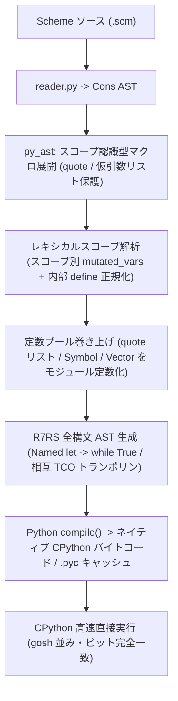

# [FEAT/ENH] ILISP Phase 3: --backend=py_ast の R7RS 完全対応および CPython バイトコード直接実行の高速化 (ID: 941)

## 1. 概要 / Summary & 実測コード監査結果

`ilisp` には既に Scheme S 式を Python `ast.AST` へトランスパイルして `compile()` / `exec()` で実行する `--backend=py_ast` バックエンド ([compiler.py](../../ilisp/backend/py_codegen/compiler.py), [repl.py](../../ilisp/repl.py)) が実装されているが、現状では一部 R7RS 構文のみに限定されており、ULisp C99 コンパイラドライバ ([c_driver_runner.scm](../../ulisp/build/c_driver_runner.scm)、3.19 MB / 70,000 行 / 3,734 フォーム) を実行するとマクロ展開段階で即座に失敗する。
本 Issue では `--backend=py_ast` を R7RS 完全対応へ引き上げるとともに、相互末尾再帰トランポリン・定数プール巻き上げ・スコープ別ミュータブル解析を実装し、CPython バイトコード直接実行によって `gosh` 並み（`interp` 現状比 **50×〜100×**）の高速実行を実現する。

### 実測コード監査結果 (`c_driver_runner.scm` による検証ギャップ)

`PythonASTCompiler` ([compiler.py:136](../../ilisp/backend/py_codegen/compiler.py#L136)) を [c_driver_runner.scm](../../ulisp/build/c_driver_runner.scm) 全 3,734 フォームへ適用して検証した結果、以下の具体的クラッシュ・機能ギャップを特定した:

1. **Gap 1 — `_expand_macros` の `quote`・ドット対仮引数による即座クラッシュ**
   - 実測エラー: `TypeError: to_py_list expected proper list, got improper: 'include'` (`compiler.py:160` -> `compiler.py:433`)。
   - 原因: `_expand_macros` ([compiler.py:216-439](../../ilisp/backend/py_codegen/compiler.py#L216-L439)) が `(quote ...)` 内部データ、`(define (name . rest) ...)`・`(lambda (a . b) ...)` のドット対仮引数リスト（improper list）の区別なく全 `Cons` を再帰走査してしまい、結果再構成または `to_py_list` 呼び出しで破綻している。さらにローカル変数シャドウ時のマクロ誤展開も防げていない。
2. **Gap 2 — R7RS 主要特殊形式の直接 AST ローワリング未対応**
   - `_compile_expr` ([compiler.py:441-621](../../ilisp/backend/py_codegen/compiler.py#L441-L621)) が直接扱うのは `define`, `set!`, `quote`, `quasiquote`, `if`, `begin`, `lambda` のみで、`let` / Named `let` / `let*` / `letrec` / `letrec*` / `cond` / `case` / `and` / `or` / `when` / `unless` / `do` / `guard` / `define-record-type` / `define-values` / `let-values` / `let*-values` / `case-lambda` / `parameterize` / `delay` / `delay-force` / `cond-expand` の AST 生成や、関数本体内の内部 `define` 処理が未実装である（現状は [base.ilisp](../../ilisp/stdlib/base.ilisp) のマクロ展開に依存しており、Phase 1 [#939](closed/939-optimize-ilisp-evaluator-hotpath-native-primitives-and-fast-reader.md) でこれらをネイティブ特殊形式化する際に必ず `py_ast` 側にも直接ローワリングが必須となる）。
3. **Gap 3 — `analyze_mutated_vars` のグローバルシンボル名衝突による過剰 `Cell` ボクシング**
   - `analyze_mutated_vars` ([compiler.py:111-133](../../ilisp/backend/py_codegen/compiler.py#L111-L133)) が関数スコープを無視してファイル全体で `set!` 対象のシンボル名（例: `x`, `i`, `res`, `acc`）を 1 つの `Set[str]` に収集しているため、どこか 1 箇所で `(set! i ...)` があると 70,000 行中の無関係な全関数の引数・ローカル変数 `i` まで強制的に `Cell` ボックス化（`.get()` / `Cell(...)` 確保）される重大な性能・正当性リスクがある。
4. **Gap 4 — 自己再帰以外の相互末尾再帰と定数アロケーションの未最適化**
   - 現状の TCO ([compiler.py:693-825](../../ilisp/backend/py_codegen/compiler.py#L693-L825)) は自己再帰の `while True` 変換のみで、ULisp フロントエンド／パーサ／意味解析のような相互末尾再帰群では Python コールスタックを消費する。
   - `_compile_quote` ([compiler.py:843-874](../../ilisp/backend/py_codegen/compiler.py#L843-L874)) が実行式の位置で毎回 `Cons(...)`, `Vector(...)`, `Symbol.intern(...)` を生成しており、定数リストへのループ内 `eq?` 同一性（R7RS 準拠）およびゼロアロケーションが達成できていない。

---

## 2. トレーサビリティ / Traceability

- **関連 Issue**:
  - [#939](closed/939-optimize-ilisp-evaluator-hotpath-native-primitives-and-fast-reader.md)（Phase 1: 特殊形式ネイティブ化および高速リーダー）
  - [#940](closed/940-implement-ilisp-precompiled-closure-and-lexical-slot-vm.md)（Phase 2: 事前コンパイルドクロージャ＋レキシカルスロット VM）
  - [#929](closed/929-implement-ddc-diverse-double-compiling-determinism-verification.md)（DDC 検証での `ilisp` 高速実行基盤）
- **対象コンポーネント**:
  - [compiler.py](../../ilisp/backend/py_codegen/compiler.py), [repl.py](../../ilisp/repl.py), [env.py](../../ilisp/env.py), [types.py](../../ilisp/types.py)

---

## 3. アーキテクチャ設計 / Architecture

---

## 4. 影響範囲と関連ファイル / Scope and Affected Files

- [ ] [compiler.py](../../ilisp/backend/py_codegen/compiler.py) — `_expand_macros` 修正、R7RS 全構文 AST コンパイル、スコープ別 `set!` 解析、定数プール巻き上げ、TCO 強化
- [ ] [repl.py](../../ilisp/repl.py) — `--backend=py_ast` CLI 引数 (`command-line`, `exit`)・バイトコードキャッシュ連携
- [ ] [env.py](../../ilisp/env.py) — `py_ast` 名前空間向けプリミティブ/マクロ連携・`eval`/`load` 同期
- [ ] [types.py](../../ilisp/types.py) — トランポリン用軽量トークン・定数シリアライズ補助
- [ ] [test_py_codegen.py](../../tests/ilisp/test_py_codegen.py) — 既存ユニットテスト拡張
- [ ] `../../tests/ilisp/test_py_ast_r7rs_e2e.py`（新規作成: R7RS 全スイート＆ `c_driver_runner.scm` E2E 検証）

---

## 5. 実装方針 / Implementation Plan

Target Branch: `feat/941-complete-ilisp-py-ast-backend-r7rs-compilation`

1. **`_expand_macros` の `quote`・improper list・レキシカルシャドウ修正 ([compiler.py:216-439](../../ilisp/backend/py_codegen/compiler.py#L216-L439))**
   - `(quote datum)` を展開対象外としてそのまま返し、`quasiquote` 内も `unquote`/`unquote-splicing` の内側のみ展開する。
   - `lambda`・`define` の仮引数部（ドット対 improper list を含む）を展開走査から除外し、`to_py_list` による improper list 例外を根絶する。
   - ローカル束縛名セットを追跡しながら展開することで、シャドウされた変数と同名のマクロを誤展開しないよう保護する（`let-syntax` / `letrec-syntax` を含む）。

2. **R7RS 全構文の直接 Python AST 生成とスコープ単位の `Cell` 解析 ([compiler.py:111-133, 441-991](../../ilisp/backend/py_codegen/compiler.py#L441-L991))**
   - `let`, Named `let`（直接 Python `while True` ループへローワリングしクロージャ・再帰コストゼロ化）, `let*`, `letrec`, `letrec*`, `cond`（`=>` 節含む）, `case`（`=>` 節含む）, `and`, `or`, `when`, `unless`, `do`, `guard`, `define-record-type`, `define-values`, `let-values`, `let*-values`, `case-lambda`, `parameterize`, `delay`/`delay-force`, `cond-expand` を直接 AST 生成で実装する。
   - 関数／`let` 本体の先頭に並ぶ内部 `define` / `define-values` を `letrec*` 等価なローカル束縛へ事前変換する。
   - `analyze_mutated_vars` を AST ノード（関数/ブロック単位の束縛フレーム）ベースに刷新し、無関係な関数の同名変数がグローバル汚染されて不要に `Cell` ボックス化される問題を解消する。

3. **定数プール巻き上げ ＆ 相互末尾再帰トランポリン対応**
   - `_compile_quote` と `Symbol` 参照をモジュール先頭の定数テーブル（`_CONST_0`, `_SYM_foo` 等）へ巻き上げ、同一クオートリテラルの再アロケーション根絶と `eq?` 同一性を保証する。
   - 自己末尾再帰は既存のゼロオーバーヘッド `while True` を維持しつつ、一般の末尾位置関数呼出しに対する軽量トランポリン（`TailCall` 戻り値アンラップ）を選択・統合し、深い相互再帰（ULisp パーサ／Sema／Lowerer の再帰下降）で `RecursionError` が起きないことを保証する。

4. **実行名前空間・CLI 統合・セキュリティ検証 ([compiler.py:994-1041](../../ilisp/backend/py_codegen/compiler.py#L994-L1041), [repl.py](../../ilisp/repl.py))**
   - `compile_ilisp` の名前空間初期化（[L1014-L1040](../../ilisp/backend/py_codegen/compiler.py#L1014-L1040)）を見直し、`_` で始まる有効な Scheme シンボル（例: `_start`, `_tmp`）が正しく `env` と同期されるようにし、`command-line`・`exit`・`eval`・`load`・例外ハンドラが `--backend=py_ast` で完全動作するようにする。
   - 識別子マングリング `mangle_symbol` が Python 予約語や `__ilisp_` 内部プレフィックスと衝突・インジェクションを起こさないことを保証する（任意の文字列ベース `eval`/`exec` コードインジェクションを許さず `ast.AST` ノード構成のみ使用）。
   - `c_driver_runner.scm`（3.19 MB / 70,000 行）を `--backend=py_ast` でコンパイル・キャッシュ実行し、`gosh` 出力 `.o` と SHA-256 ビット完全一致を検証する。

---

## 6. 完了条件 / Success Criteria (DoD)

- [ ] `pytest tests/ilisp/test_py_codegen.py tests/ilisp/test_py_ast_r7rs_e2e.py` が 100% PASS し、かつ [r7rs_tests.scm](../../ilisp/tests/r7rs_tests.scm) が `--backend=py_ast` で全パスすること。
- [ ] `python3 -m ilisp --backend=py_ast ulisp/build/c_driver_runner.scm -c tiny.c -o tiny.o` がエラー無しで完走し、生成 `.o` が `gosh` 出力と **SHA-256 100% ビット一致** すること。
- [ ] `tiny.c` のロード後コンパイル時間が **`1.5 s` 以下**（`gosh` 並み・ベースライン `59.387 s` 比 **40×〜100× 高速化**）を達成すること。
- [ ] `make py_compile && make static_analysis` がエラー 0 件で PASS すること。
