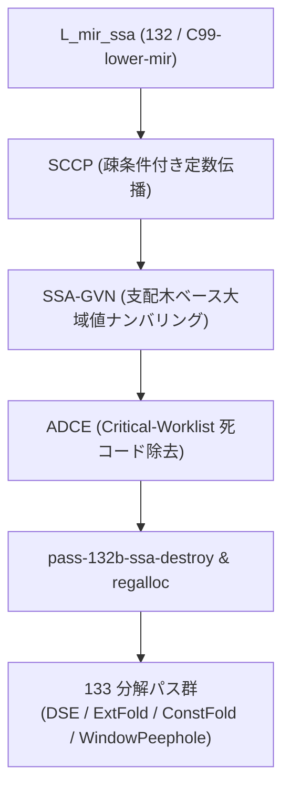

# [FEAT/ENH] L_mir_ssa 上の共通 SSA データフロー最適化群（SCCP・SSA-GVN・ADCE）の実装と 133_lir_peephole.scm のパス分解 (ID: 973)

## 1. 概要 / Summary

Issue #966 で仮想レジスタ SSA 中間表現 `L_mir_ssa` が導入され、Issue #981 で Scheme `-O2+` と C99 `-O2` が共通の `run-lir-core-fixpoint-pipeline` で合流する土台が完成した。しかし現在：

1. [132_lir_braun_ssa.scm](../../ulisp/lir/132_lir_braun_ssa.scm)（`L_mir_ssa`）上には `mem2reg` と表現推論があるのみで、**疎条件付き定数伝播（SCCP）・大域値ナンバリング（SSA-GVN）・SSA 値ベース ADCE（Aggressive DCE）**が未実装である。そのため `luaV_execute`（[lvm.o](../../ulisp/build/lua_obj/lvm.o)）のような巨大 VM ディスパッチループで同一構造体ロード（`L->ci`、`ci->func`、定数プール参照等）がブロックを跨いで何度も再実行されている。
2. [133_lir_peephole.scm](../../ulisp/lir/133_lir_peephole.scm)（2,900 行超）に DSE・拡張畳み込み・定数畳み込み・スタックスロット転送・Linear Scan Regalloc・ウィンドウ最適化がモノリシックに同居しており、独立した解析キャッシュ無効化と段階的最適化の妨げになっている。

本 Issue ではこれら 3 大 SSA 最適化を共通ミドルエンドへ実装するとともに、`133_lir_peephole.scm` を単一責務の独立パス群へ分解し、`all.lua` 実行速度で GCC `-O2` に並ぶ基盤を構築する。

---

## 2. トレーサビリティ / Traceability

- 関連資料:
  - [Issue #966](closed/966-separate-mir-ssa-and-machine-lir-for-unified-middle-end.md)
  - [Issue #840](closed/840-automate-analysis-cache-invalidation-and-recomputation-in-nanopass.md)
  - [Issue #981](closed/981-unify-lir-core-fixpoint-optimization-for-scheme-and-c99.md)
  - [Issue #983](983-extend-c99-ssa-mem2reg-and-register-allocation-for-complex-cfgs.md)
  - [Issue #976](976-implement-ssa-loop-analysis-and-licm-pass.md)
  - [ref_benchmarks.md](../../ulisp/docs/ref_benchmarks.md)

---

## 3. 全 16 大スペシャリストエージェント統合レビュー (Governance Review)

| エージェント | 担当観点 | 指摘事項・設計合意 |
| :--- | :--- | :--- |
| **Project Manager (PM)** | 全体統括・DoD | Scheme/C99 共通 SSA 最適化と `133` パス分解により保守性と対 GCC 性能を同時に引き上げる。 |
| **Information Security Specialist** | エイリアス・メモリ可視性 | SSA-GVN のロード冗長排除は純粋演算および支配関係＋メモリストア非干渉証明済みの読み込みのみに限定し、メモリ破壊（CWE-843/CWE-362）を防止する。 |
| **Systems Architect** | SSA ミドルエンド構成 | `L_mir_ssa`（#966）→ SCCP → SSA-GVN → ADCE → `pass-132b`（Regalloc/PHI解消）→ `L_lir_mach` の順序を確立する。 |
| **QA Specialist** | 差分等価検証 | GCC 対比 Lua `all.lua` / 5 種 VM ベンチマークおよび C99 ファズ・Scheme 全テストでの完全一致を検証する。 |
| **Database / Data Infra Specialist** | ハッシュ値テーブル設計 | SSA-GVN の値番号表（VN Hash Table）を支配木スコープ別・O(1) 参照で構成する。 |
| **Network Specialist** | `setjmp`/シグナル非干渉 | `volatile` 読み書きおよび `returns-twice` 境界では値ナンバリング／定数畳み込みを無効化する。 |
| **IT Specialist (NLP & IR)** | LIR 契約準拠 | `pass_manager.scm` の `*pass-registry*` で各分解パスに `in-lang: 'L_mir_ssa` / `'L_lir_mach`・無効化解析を正確宣言する。 |
| **IT Strategist** | 実行速度 GCC 超え | 重複演算・重複ロード・死分岐の一掃により Lua `vm_arith_loop`・`table_hash_array` 等を大幅高速化する。 |
| **IT Service Manager** | ビルド時間・GC 抑制 | 3-Stage ブートストラップと `bin/ulisp-cc` のコンパイル速度を損なわない線形系ワークリストアルゴリズムを採用する。 |
| **Embedded Systems Specialist** | IEEE754・オーバーフロー厳格 | 浮動小数点定数（`-0.0`, `NaN`, `Inf`）と符号付き除算（`INT64_MIN / -1`）の畳み込み安全性（UB 回避）を守る。 |
| **Systems Auditor** | 解析キャッシュ無効化 (#840) | パス分解後に `test_pass_manager_cache_invalidation`（支配木・CFG 等）が完全 PASS することを保証する。 |
| **UI/UX & Docs Designer** | 仕様書同期 | 分解後パス群に合わせて `ulisp/docs/spec_pipeline.md` §2/§3 を同期更新する。 |
| **Education Specialist** | モジュール分割・可読性 | `133_lir_peephole.scm` の 4+ 機能を分かりやすい責務単位ファイルまたは明確なセクション・独立パスとして整理する。 |
| **Software Development (SWD)** | コア実装 | Braun SSA (`braun-compute-dominators`, `braun-cfg-path-split!`) 上に SCCP/GVN/ADCE を実装する。 |
| **Application Specialist (APS)** | C99 ドライバ連携 | `c_driver.scm` の `-O2` フローおよび `#981` の不動点パイプラインに統合する。 |
| **IT Specialist (PLC)** | Block Args SSA Phi 格子 | `(%block lbl (params...) ...)` 上の Phi 値伝播格子（Top / Const / Bottom）を精密実装し、`unreachable` 分岐除去と連動させる。 |

---

## 4. 脅威モデリングと安全性要件 / Threat Model & Safety Requirements

- **THREAT-973-1 (Speculative Division-by-Zero / UB Constant Folding / CWE-369)**:
  - SCCP が到達不能または条件分岐後の式を投機評価した際、`x / 0` や `INT64_MIN % -1` を畳み込んでコンパイラがクラッシュまたは不正結果を埋め込むリスク。
  - **対策**: Wegman-Zadeck 疎ワークリスト上では「実行可能エッジで到達可能なブロックのみ」評価し、除数が `0` または未確定の除算・剰余は即座に `Bottom` へ倒す。
- **THREAT-973-2 (Aliased Memory Load Elimination in SSA-GVN)**:
  - ループや条件内でポインタ書き換え・関数呼び出しがあるにもかかわらず前のロードを GVN で再利用するリスク。
  - **対策**: SSA-GVN の既定対象は純粋算術・ビット演算・型拡張・キャスト・アドレス計算（`%add`/`%sub`/`%mul`/`%shl`/`%and`/`%sext`/`%zext` 等）とし、メモリロード共有はストア／呼び出しの介在しない同一エポックのみに厳格制限する。
- **THREAT-973-3 (Side-Effectful Instruction Deleted by ADCE)**:
  - `call`・`%store`・`%c-call`・`%inline-asm`・`%return` 等の副作用命令が戻り値未使用という理由で ADCE に消去されるリスク。
  - **対策**: すべての終端命令・メモリ書込・外部呼出し・アトミック命令・例外/セーフポイントを初期 Critical 集合（Mark）としてマークし、Use-Def を逆辿りして未マーク純粋演算のみを除去する。

---

## 5. 影響範囲と関連ファイル / Scope and Affected Files

- [ ] [132_lir_braun_ssa.scm](../../ulisp/lir/132_lir_braun_ssa.scm)
- [ ] [133_lir_peephole.scm](../../ulisp/lir/133_lir_peephole.scm)
- [ ] [pass_manager.scm](../../ulisp/compiler/pass_manager.scm)
- [ ] [module_header.scm](../../ulisp/compiler/module_header.scm)
- [ ] [c_driver.scm](../../ulisp/driver/c_driver.scm)
- [ ] [spec_pipeline.md](../../ulisp/docs/spec_pipeline.md)
- [ ] [test_pass_manager.scm](../../ulisp/tests/test_pass_manager.scm)
- [ ] [test_braun_ssa_arbitrary_cfg.scm](../../ulisp/tests/test_braun_ssa_arbitrary_cfg.scm)

---

## 6. 実装方針 / Implementation Plan

Target Branch: `feat/973-ssa-sccp-gvn-adce-and-peephole-split`

1. **SSA 最適化 3 パス実装（[132_lir_braun_ssa.scm](../../ulisp/lir/132_lir_braun_ssa.scm)）**:
   - **SCCP**: `(%block lbl (params...) ...)` 上のフロー・SSA ワークリストにより、`Top -> Const -> Bottom` 格子で定数分岐折り畳みと到達不能ブロック削除を実行する。
   - **SSA-GVN**: `braun-compute-dominators` の支配木先順走査とスコープ付きハッシュテーブルで純粋演算の部分式共有・共通部分式除去（CSE）を行う（可換演算子 `+`, `*`, `&`, `|`, `^` のオペランド正規化含む）。
   - **ADCE**: 副作用命令・終端命令・生きた分岐をシードとした逆方向 Use-Def マークにより未使用仮想レジスタ定義と不要 `%block` 引数を一括削除する。
2. **`133_lir_peephole.scm` の独立パス分解と台帳登録（`133` / `pass_manager.scm`）**:
   - DSE（`lir-eliminate-dead-stack-stores-in-ir`）、冗長拡張除去（`lir-fold-redundant-extensions-in-ir`）、定数畳み込み（`lir-peephole-fold-consts-in-ir`）、スロット転送＆ウィンドウ最適化を `pass_manager.scm` 上で識別可能な個別パス／フェーズとして登録し、`c_driver.scm` と連携する。
3. **差分テスト・品質検証**:
   - `test_braun_ssa_arbitrary_cfg.scm` / `test_pass_manager.scm` / `test_pass_manager_cache_invalidation.scm` で定数伝播・GVN 共有・ADCE 除去およびキャッシュ無効化を検証し、`spec_pipeline.md` も同時更新する。

---

## 7. 完了条件 / Success Criteria (DoD)

- [ ] SCCP / SSA-GVN / ADCE が `L_mir_ssa` 上で Scheme/C99 共通ミドルエンドパスとして動作し、単体・差分テストで意味等価性が確認されること。
- [ ] `133_lir_peephole.scm` の各最適化フェーズが単一責務として分離・登録され、`test_pass_manager_cache_invalidation` が全 PASS すること。
- [ ] Lua 5.4.7（`all.lua`, `big.lua`, 5 種 VM ベンチマーク）および Scheme 6 種ベンチマークで `10%〜30%` 以上の追加高速化・サイズ削減を確認し、`make -C ulisp bootstrap test test_ulisp_cc_native` かつ `make format && make static_analysis` が全 PASS すること。
