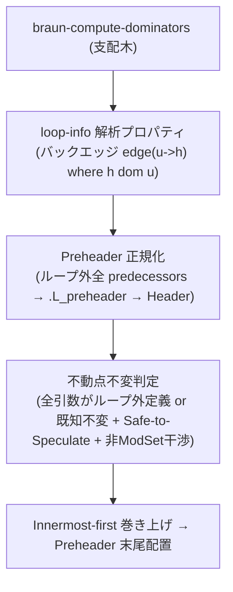

# [FEAT/ENH] SSA ループ解析基盤（自然ループ検出）と LICM（ループ不変コード移動）パスの実装 (ID: 976)

## 1. 概要 / Summary

Lua 5.4.7 のホットパス（`luaV_execute` 等）や Scheme のクロージャ／ベクタ走査ループでは、ループ内で値が変化しない以下の計算が毎反復で再計算・再ロードされている：
- 定数プール配列 `k = ci_func->p->k` や不変構造体ポインタ（TBAA/エイリアス非干渉保証範囲）
- ループ内で値が変わらない配列ベースアドレス計算・不変算術・定数生成
- クロージャ環境ロード・ベクタ長取得（`(vector-length v)`）等

Issue #973（SSA-GVN/SCCP/ADCE）に続き、本 Issue では [pass_manager.scm](../../ulisp/compiler/pass_manager.scm) の解析プロパティシステムに支配関係ベースの自然ループ検出（`loop-info` 解析：ループヘッダ・本体・バックエッジ・単一プリヘッダ作成）を追加し、`L_mir_ssa` 上の **LICM（Loop-Invariant Code Motion：ループ不変コード移動）パス** を実装して、ループ不変計算をプリヘッダへ自動巻き上げ・Scheme/C99 両ループを高速化する。

---

## 2. トレーサビリティ / Traceability

- 関連資料:
  - [Issue #966](closed/966-separate-mir-ssa-and-machine-lir-for-unified-middle-end.md)
  - [Issue #973](973-implement-ssa-sccp-gvn-adce-and-decompose-lir-peephole.md)
  - [Issue #981](closed/981-unify-lir-core-fixpoint-optimization-for-scheme-and-c99.md)
  - [Issue #983](983-extend-c99-ssa-mem2reg-and-register-allocation-for-complex-cfgs.md)
  - [ref_benchmarks.md](../../ulisp/docs/ref_benchmarks.md)

---

## 3. 全 16 大スペシャリストエージェント統合レビュー (Governance Review)

| エージェント | 担当観点 | 指摘事項・設計合意 |
| :--- | :--- | :--- |
| **Project Manager (PM)** | 全体統括・DoD | 自然ループ解析基盤と安全性保証付き LICM により、ホットループ内命令数の根本削減を達成する。 |
| **Information Security Specialist** | 投機的トラップ・OOB 防御 | ループが 0 回しか実行されない可能性がある場合、ゼロ除算（CWE-369）や NULL ポインタデリファレンス（CWE-476）を起こし得る命令を無条件プリヘッダ移動しない（Guaranteed-to-execute または純粋無トラップ限定）。 |
| **Systems Architect** | 解析キャッシュ統合 | `loop-info` を `pass_manager.scm` の解析レジストリへ登録し、`braun-compute-dominators` に依存、CFG 変更パスで自動無効化させる。 |
| **QA Specialist** | 誤移動エッジケース検証 | 0 回反復ループ（while `cond` false 初回スキップ）、ネスト内側→外側ループ順、エイリアスありストア併存をテスト網羅する。 |
| **Database / Data Infra Specialist** | ループネスティング木表現 | ループ親子関係を内側から外側（Innermost-first）へトポロジカル走査し、多段巻き上げを 1 パスで達成する。 |
| **Network Specialist** | スレッド・原子性制約 | アトミック負荷・`volatile`・IO/システムコール・セーフポイントを不変対象から厳格に除外する。 |
| **IT Specialist (NLP & IR)** | L_mir_ssa プリヘッダ挿入 | Preheader ブロック挿入と既存の `(%block header (params...))` への前方エッジ付け替えを一貫処理する。 |
| **IT Strategist** | 対 GCC 競争力 | #973（GVN/SCCP）＋ #976（LICM）の組み合わせにより、GCC `-O2` のループ最適化と同水準に並ぶ。 |
| **IT Service Manager** | CI 時間・収束性 | 解析・変形がループ数×ブロック数に対し低次多項式時間内に収まり、ブートストラップ時間を圧迫しないようにする。 |
| **Embedded Systems Specialist** | レジスタ圧力制御 | LICM による生存区間延長が過度なレジスタスピルを誘発しないよう、単純定数ロード等の軽量リマテリアライズ対象は見極めて過積載を避ける（または Regalloc と連携）。 |
| **Systems Auditor** | 支配木・メモリ干渉監査 | バックエッジ判定 `dom(header, tail)` とループ内メモリ書込セット（ModSet）監査を完全記録する。 |
| **UI/UX & Docs Designer** | 仕様書更新 | [spec_pipeline.md](../../ulisp/docs/spec_pipeline.md) §2 の SSA 最適化パイプライン一覧へ追記する。 |
| **Education Specialist** | 理論仕様明記 | 自然ループ定義、Safe-to-Speculate 条件、および TBAA/エスケープ解析連携を明記する。 |
| **Software Development (SWD)** | コア実装 | `132_lir_braun_ssa.scm` に `loop-info` 抽出・Preheader 生成・LICM エンジンを実装する。 |
| **Application Specialist (APS)** | C99 / Lua ホットパス検証 | Lua `luaV_execute`, `ltable.c`, `lstrlib.c` 等で実際の不変移動件数を計測する。 |
| **IT Specialist (PLC)** | Block Params SSA 正合性 | Preheader 導入時の支配境界と `(%jump preheader ...)` 引数解決の SSA 妥当性を `braun-verify-cfg` で強制検査する。 |

---

## 4. 脅威モデリングと安全性要件 / Threat Model & Safety Requirements

- **THREAT-976-1 (Speculative Trap in Zero-Trip Loop / CWE-369 & CWE-476)**:
  - ループ条件が最初から偽になるケースで、ループ内の除算や条件付きメモリアクセスをプリヘッダへ移動すると、本来起きないはずの SIGFPE / SIGSEGV を引き起こす。
  - **対策**: プリヘッダ移動を許す命令を、(a) **無条件トラップなし純粋演算**（`%add`, `%sub`, `%mul`, `%shl`, `%and`, `%or`, `%xor`, `%mov`, アドレス計算 `%lea`/`%add ptr imm`, `%sext`/`%zext`）、または (b) **ヘッダ（必ず1回評価）や全出口を支配し、かつ不変かつループ内エイリアス書込ゼロが証明された読込**に厳格制限する。
- **THREAT-976-2 (Alias Interference Across Unknown Calls)**:
  - ループ内に任意 C 関数呼び出しやポインタ書き込みがあるにもかかわらずヒープ/配列ロードを移動すると Stale Value を読み続けるリスク。
  - **対策**: ループ内すべての `%store`・`call`・`%c-call`・`%inline-asm` の影響集合（ModRef）を保守的に検査し、メモリ状態に依存するロードは読み出し対象が不変・非エイリアス（例：`const`/未エスケープ固定領域）と証明可能な場合のみ許可する。

---

## 5. 影響範囲と関連ファイル / Scope and Affected Files

- [ ] [pass_manager.scm](../../ulisp/compiler/pass_manager.scm)
- [ ] [module_header.scm](../../ulisp/compiler/module_header.scm)
- [ ] [132_lir_braun_ssa.scm](../../ulisp/lir/132_lir_braun_ssa.scm)
- [ ] [lir_lang.scm](../../ulisp/lir/lir_lang.scm)
- [ ] [spec_pipeline.md](../../ulisp/docs/spec_pipeline.md)
- [ ] [test_braun_ssa_arbitrary_cfg.scm](../../ulisp/tests/test_braun_ssa_arbitrary_cfg.scm)
- [ ] [test_pass_manager_cache_invalidation.scm](../../ulisp/tests/test_pass_manager_cache_invalidation.scm)

---

## 6. 実装方針 / Implementation Plan

Target Branch: `feat/976-ssa-loop-analysis-and-licm`

1. **支配木ベース自然ループ解析 & `loop-info` 解析プロパティ登録（`132_lir_braun_ssa.scm` / `pass_manager.scm`）**:
   - `braun-compute-dominators` の支配関係 `idom-map` を使い、全エッジ `tail -> header` のうち `header` が `tail` を支配するバックエッジを検出して自然ループ集合を収集する。
   - 複数入口を持つ非可約（irreducible）成分を除外し、単一入口自然ループについてループ外 predecessors を束ねる一意な Preheader ブロックを構築する（SSA ブロック引数・エッジを更新して `braun-verify-cfg` を通過させる）。
2. **LICM 不変判定＆安全巻き上げエンジン実装（`132_lir_braun_ssa.scm`）**:
   - 内側ループから外側ループ順（Innermost-first）に命令を走査し、オペランドがすべてループ外定義または先行巻き上げ済み不変命令であり、副作用・トラップ・メモリ書込非干渉条件を満たす命令を Preheader 末尾へ順次移動する（複数段巻き上げ収束）。
   - 解析キャッシュ無効化宣言を `pass_manager.scm` に登録し、ループ構造変形後の `loop-info` / `dom-tree` を適切に無効化・再構築する。
3. **単体・差分ベンチマーク検証**:
   - 0 回実行ループ（トラップ非移動証明）、ネストループ多段巻き上げ、およびエイリアス混在ループのテストを追加する。

---

## 7. 完了条件 / Success Criteria (DoD)

- [ ] `loop-info` 解析と Preheader 生成・LICM パスが `L_mir_ssa` 上で動作し、`braun-verify-cfg` および `test_pass_manager_cache_invalidation` を通過すること。
- [ ] 不変算術・オフセット計算・証明済み不変読込が Preheader へ安全に移動され、0 回ループ・エイリアス・副作用含むケースで誤移動を一切起こさないことが差分テストで実証されること。
- [ ] Lua 5.4.7（`all.lua`, `big.lua`, 5 種 VM ベンチ）および Scheme テスト全件、`make -C ulisp bootstrap test test_ulisp_cc_native`、かつ `make format && make static_analysis` が全 PASS すること。
