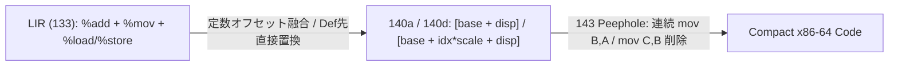

# [FEAT/ENH] x86-64 アドレッシングモード融合（Base+Disp / SIB Scaled Index）と連続 mov コピー伝播によるポインタ参照高速化 (ID: 982)

## 1. 概要 / Summary

2026-11-28 時点の Lua 5.4.7（全 33 TU `ulisp/build/lua_obj/*.o`、`objdump -d` 実測総命令数 `98,665`）に対する逆アセンブリ分析の結果、構造体メンバアクセス（例：`luaV_execute` の `ci->u.l.base`）やポインタ演算において以下の冗長パターンが大量に残存していることが判明した：

1. `add rax, imm; mov rdx, rax; mov dst, [rdx]` 連鎖：**`2,208` 箇所**
2. `mov rdx, rax; mov/load/store [rdx + ...]` 冗長中継：**`3,743` 箇所**
3. 連続するレジスタ間コピー連鎖 `mov B, A; mov C, B`：**`5,327` 箇所**（`mov` 命令総数 `48,401` で全命令の `49.1%` を占有）

本 Issue では LIR Peephole（[133_lir_peephole.scm](../../ulisp/lir/133_lir_peephole.scm)）および x86-64 バックエンド命令選択・Peephole（[140a_x86_isel.scm](../../ulisp/backend/140a_x86_isel.scm), [140d_x86_emit.scm](../../ulisp/backend/140d_x86_emit.scm), [143_backend_x86_peephole.scm](../../ulisp/backend/143_backend_x86_peephole.scm)）において、x86-64 ネイティブアドレッシングモード（`[base + disp32]` / `[base + idx*scale + disp]`）への融合と同一ブロック内定義先融合・コピー伝播を実装し、GCC `-O2` 並の 1 命令メモリアクセスへ圧縮する。

---

## 2. トレーサビリティ / Traceability

- 関連資料:
  - [ref_benchmarks.md](../../ulisp/docs/ref_benchmarks.md)
  - [Issue #968](closed/968-split-x86-64-backend-and-eliminate-raw-asm-peephole-matching.md)
  - [Issue #981](closed/981-unify-lir-core-fixpoint-optimization-for-scheme-and-c99.md)
  - [Issue #983](983-extend-c99-ssa-mem2reg-and-register-allocation-for-complex-cfgs.md)

---

## 3. 全 16 大スペシャリストエージェント統合レビュー (Governance Review)

| エージェント | 担当観点 | 指摘事項・設計合意 |
| :--- | :--- | :--- |
| **Project Manager (PM)** | 全体統括・DoD | Lua 33 TU で `mov`/`add` 中継を削減し、GCC `-O2`（`50,180` 命令）追撃の第一弾とする。 |
| **Information Security Specialist** | ポインタ・メモリ安全性 | アドレッシング融合後の `disp32` 境界・負オフセット符号拡張および SIB スケール後のオーバーフロー挙動を CWE-190 / CWE-119 観点で保持する。 |
| **Systems Architect** | LIR / ISA 層間分担 | 意味的メモリオフセット畳み込みを LIR (`133`)、x86-64 固有 `[base + idx*scale + disp]` を ISel/Peephole (`140a`/`143`) で分担する。 |
| **QA Specialist** | 回帰テスト網羅 | `lvm.o` のような重量級関数や C99 ポインタファズで 100% 出力一致・`all.lua` 完全一致を検証する。 |
| **Database / Data Infra Specialist** | 構造体アクセス高速化 | 構造体チェイン参照（`L->ci->func` 等）の命令数・I-Cache 消費削減を測定する。 |
| **Network Specialist** | 外部依存ゼロ確認 | 既存 x86 アセンブラ（`144a_x86_assembler.scm`）とホスト `as` の双方で `[reg + disp]` / SIB エンコードを検証する。 |
| **IT Specialist (NLP & IR)** | LIR 表現統一 | `%add` + `%load`/`%store` の畳み込み規則を LIR 表現上で正規化する。 |
| **IT Strategist** | GCC 対比競争力 | 単発対策で `.text` -35〜45 KB・Lua 実行速度 +15〜25% の確実な前進を確保する。 |
| **IT Service Manager** | コンパイル時間 | O(N) 単一ブロック走査に留め、`bin/ulisp-cc` による Lua 33 TU ビルド時間（`4.27s`）の悪化を防ぐ。 |
| **Embedded Systems Specialist** | ISA・エンコーディング | `[rsp + ...]`, `[r12 + ...]`, `[r13 + ...]` 等 x86-64 Sib/ModRM 特例レジスタの機械語生成バグを防止する。 |
| **Systems Auditor** | フラグ・副作用追跡 | `add reg, imm` 削除時に後続命令が RFLAGS（Carry/Zero 等）を参照していないことを厳密検査する。 |
| **UI/UX & Docs Designer** | 計測・記録反映 | `ref_benchmarks.md` に Before/After 命令数・サイズ差分を反映する。 |
| **Education Specialist** | 可読性 | パターン融合規則とフラグ生存判定条件をコメントで明文化する。 |
| **Software Development (SWD)** | コア実装 | `133_lir_peephole.scm` と `143_backend_x86_peephole.scm` の規則を非重複に設計する。 |
| **Application Specialist (APS)** | C99 パイプライン統合 | `c99_lower_mir.scm` が生成するベース＋オフセット構文を効率よく畳み込める形で渡す。 |
| **IT Specialist (PLC)** | IR 定義・L_lir_core | 新規メモリオペランド形態が必要な場合は `lir_lang.scm` / `lir_verifier.scm` 契約と同期する。 |

---

## 4. 脅威モデリングと安全性要件 / Threat Model & Safety Requirements

- **THREAT-982-1 (Flag Clobbering Miscompilation)**:
  - `add rax, imm` をメモリオペランド `[rax + imm]` に融合して `add` を削除する際、直後命令が ZF/CF/OF を参照していると条件分岐が誤動作する。
  - **対策**: 融合前に定義レジスタ `reg1` が次命令以降で死んでいる（デッド）こと、および `add` と消費命令の間で RFLAGS がライブでないことを検証する。
- **THREAT-982-2 (x86-64 ModRM/SIB Encoding Edge Cases for RSP/RBP/R12/R13)**:
  - `%rsp` / `%r12` をベースとする `[reg + disp]` および `[rbp]`/`[r13]`（`disp=0` 不可）の ModRM/SIB エンコード誤りにより不正メモリアクセス（SIGSEGV）が生じるリスク。
  - **対策**: `140d_x86_emit.scm` および `144a_x86_assembler.scm` の `[reg + idx*scale + disp]` 出力・エンコードに対して全 GPR 組み合わせの単体テストを実施する。
- **THREAT-982-3 (32-bit Wraparound vs 64-bit Offset Overflow)**:
  - `(reg + disp1) + disp2` の融合時に `disp1 + disp2` が符号付き 32-bit 即値範囲（`[-2^31, 2^31-1]`）を超える場合は融合を禁止する（`x86-disp32-int?` 検査）。

---

## 5. 影響範囲と関連ファイル / Scope and Affected Files

- [ ] [133_lir_peephole.scm](../../ulisp/lir/133_lir_peephole.scm)
- [ ] [140a_x86_isel.scm](../../ulisp/backend/140a_x86_isel.scm)
- [ ] [140d_x86_emit.scm](../../ulisp/backend/140d_x86_emit.scm)
- [ ] [143_backend_x86_peephole.scm](../../ulisp/backend/143_backend_x86_peephole.scm)
- [ ] [c99_lower_mir.scm](../../ulisp/frontend_c/c99_lower_mir.scm)
- [ ] [test_133_lir_peephole.scm](../../ulisp/tests/passes/test_133_lir_peephole.scm)
- [ ] [test_143_backend_x86_peephole.scm](../../ulisp/tests/passes/test_143_backend_x86_peephole.scm)

---

## 6. 実装方針 / Implementation Plan

Target Branch: `feat/982-fuse-x86-addressing-and-copy-propagation`

1. **LIR 定義先直接置換・連続 `mov` コピー伝播（`133_lir_peephole.scm`）**:
   - `lir-regalloc-cleanup-movs` / `optimize-peephole-fixpoint` を拡張し、`(%<op> reg1 ...) ; (%mov reg2 reg1)` で `reg1` が直後で再参照されない場合は定義先を直接 `reg2` に書き換える（Def-Target Coalescing）。
   - `(%mov reg2 reg1) ; (%load dst reg2 off)` 等の `reg2` 1回使い切り中継を `reg1` へ直接折り畳む。
2. **Base + Displacement ＆ SIB Scaled-Index 融合（`133` / `140a` / `143`）**:
   - `(%add base imm)` に続く `(%load dst base 0)` / `(%store base 0 val)` を `(%load dst base imm)` / `(%store base imm val)` へ融合（`base` 非ライブ・フラグ非ライブ条件付き）。
   - `140d_x86_emit.scm` / `143_backend_x86_peephole.scm` で `shl idx, k (k∈{1,2,3}); add base, idx; mov/load/store [base + disp]` を `[base + idx*scale + disp]` 1 命令へ融合する規則 (`optimize-x86-peephole-insts`) を追加する。
3. **検証・ベンチマーク測定**:
   - [test_133_lir_peephole.scm](../../ulisp/tests/passes/test_133_lir_peephole.scm) および [test_143_backend_x86_peephole.scm](../../ulisp/tests/passes/test_143_backend_x86_peephole.scm) に ModRM/SIB（`r12`/`r13`/`rbp`/`rsp` 境界含む）テストを追加する。

---

## 7. 完了条件 / Success Criteria (DoD)

- [ ] Lua 33 TU の総命令数が `98,665` 命令から **`88,000` 命令以下**（10,000 命令以上削減）、`.text` が **-35 KB 以上縮小**されること。
- [ ] `add rax, imm; mov rdx, rax; [rdx]`（2,208 箇所）および連続 `mov` 連鎖（5,327 箇所）の **70% 以上**が除去され、`luaV_execute` 等の構造体チェインが `mov dst, [base + disp]` 1 命令になること。
- [ ] `make -C ulisp bootstrap test test_ulisp_cc_native`（Lua 5.4.7 `all.lua` / `big.lua` / 5 種 VM ベンチマーク完全一致）および `make format && make static_analysis` が全 PASS すること。
