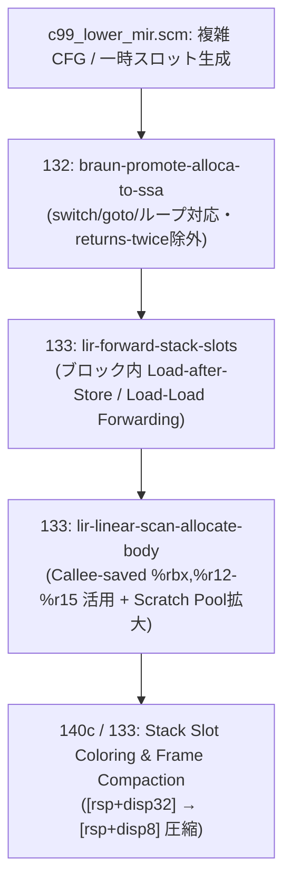

# [FEAT/ENH] 複雑 CFG（switch/goto/ループ）対応の C99 SSA mem2reg 拡張・ブロック内 Load-Store Forwarding・スタックフレーム圧縮 (ID: 983)

## 1. 概要 / Summary

2026-11-28 時点の Lua 5.4.7（33 TU `.o`）逆アセンブリ分析において、`lua_gcc` の `[rsp + ...]` 参照命令が **`2,319` 命令** であるのに対し、`lua_ulisp` では **`21,222` 命令（約 9.15 倍：ロード `13,776` 回・ストア `6,489` 回）** に達している。例えば最ホット関数 `luaV_execute` では冒頭から引数 `L`・`ci` やローカル変数（`base`, `pc`, `k`）を `[rsp + 0xd78]`・`[rsp + 0xd70]` 等へ退避し、直後に再ロードする 7〜8 バイト長命令が連発している。

原因は以下の 3 点にある：
1. [132_lir_braun_ssa.scm](../../ulisp/lir/132_lir_braun_ssa.scm) の `braun-promote-alloca-to-ssa` / `mem2reg` において、大型 `switch`/`goto`/入れ子ループを含む CFG で非エスケープ変数のレジスタ昇格範囲が限定的である。
2. [133_lir_peephole.scm](../../ulisp/lir/133_lir_peephole.scm) のブロック内 Load-Store Forwarding（`lir-forward-stack-slots`）および Linear Scan（`lir-regalloc-local-segments`, `lir-regalloc-global-callfree`）が、大型関数でスタック再ロードを十分に吸収できていない。
3. 使用されなくなったスロットや非重複ライブ区間スロットが圧縮されず、`disp32`（`+0xd78` 等の 4 バイト変位＋SIB オーバーヘッド）を多用している。

本 Issue ではこれら 3 層を強化し、`[rsp...]` 命令を **50% 以上削減（`.text` -60〜85 KB）・Lua 実行速度 +30〜40%** を達成する。

---

## 2. トレーサビリティ / Traceability

- 関連資料:
  - [ref_benchmarks.md](../../ulisp/docs/ref_benchmarks.md)
  - [Issue #920](closed/920-implement-c99-function-pointers-and-switch-goto-cfg-lowering.md)
  - [Issue #922](closed/922-implement-setjmp-longjmp-inline-asm-and-stack-spill-protection.md)
  - [Issue #934](closed/934-implement-temporary-stack-spill-dead-store-elimination-and-expr-register-forwarding.md)
  - [Issue #961](closed/961-introduce-linear-scan-register-allocation-for-scheme-lir.md)
  - [Issue #973](973-implement-ssa-sccp-gvn-adce-and-decompose-lir-peephole.md)

---

## 3. 全 16 大スペシャリストエージェント統合レビュー (Governance Review)

| エージェント | 担当観点 | 指摘事項・設計合意 |
| :--- | :--- | :--- |
| **Project Manager (PM)** | 全体統括・DoD | Lua 33 TU の実行速度で GCC `-O2` に迫るための最大レバレッジ施策として位置付ける。 |
| **Information Security Specialist** | `setjmp`・エスケープ安全性 | `braun-cfg-has-returns-twice?`（`setjmp`）および `%c99-m2r-rsp-escape-inst?`（`lea [rsp+k]`）での未昇格保護を厳守する。 |
| **Systems Architect** | SSA / Regalloc 分離 | 関数全体 SSA 昇格は `132`、ブロック単位フォワーディングと Linear Scan・フレーム圧縮は `133`/`140c` で分担する。 |
| **QA Specialist** | 境界テスト網羅 | `setjmp`/`longjmp` テスト、Lua `all.lua`（`cstack.lua`, `errors.lua`, `db.lua`, `coroutine.lua`）全チェックポイント完全一致を必須とする。 |
| **Database / Data Infra Specialist** | スロット生存解析構造 | インターバルグラフとレジスタプール管理を O(N)〜O(N log N) に保ちスケール劣化を防ぐ。 |
| **Network Specialist** | SysV ABI 整合 | Callee-saved レジスタ（`%rbx`, `%r12`〜`%r15`）の退避・復帰と末尾呼び出し・可変長引数 ABI との整合を検証する。 |
| **IT Specialist (NLP & IR)** | IR 規準化 | `L_mir_ssa` 仮想レジスタ数増加に伴う LIR Verifier 負荷を検証する。 |
| **IT Strategist** | サイズ・速度両立 | `disp32` → `disp8` 圧縮だけでも 1 参照あたり 3B 短縮され、速度とサイズ双方に直結する。 |
| **IT Service Manager** | セルフホスト性能 | 大型関数（`luaV_execute`, `stage1-modular`）でのコンパイル時間とメモリ上限を監視する。 |
| **Embedded Systems Specialist** | ABI・揮発性 | `volatile` / `__asm__` メモリバリアを跨ぐ Load/Store 昇格を厳禁とする。 |
| **Systems Auditor** | 決定論性・再現性 | ハッシュ走査順に依存しない決定論的なスロット割り付け順・レジスタ選択順を維持する。 |
| **UI/UX & Docs Designer** | 可視化更新 | `ref_benchmarks.md` へ `[rsp...]`・`rsp_store`・`.text`・`all.lua` 改善値を反映する。 |
| **Education Specialist** | アルゴリズム文書化 | Stack Slot Coloring と `setjmp` 例外条件をコメントに明記する。 |
| **Software Development (SWD)** | コア実装 | `%c99-m2r-match-rsp-load` / `%c99-m2r-match-rsp-store` と `lir-forward-stack-slots` の一貫性を保つ。 |
| **Application Specialist (APS)** | C99 ローカル変数促進 | [c99_lower_mir.scm](../../ulisp/frontend_c/c99_lower_mir.scm) の一時スピルスロット・ローカル配列境界の識別性を高める。 |
| **IT Specialist (PLC)** | SSA Phi・ブロックスケール | 大規模 CFG の Braun Phi 解消コストを抑えたまま `switch` 分岐を跨ぐ促進を実現する。 |

---

## 4. 脅威モデリングと安全性要件 / Threat Model & Safety Requirements

- **THREAT-983-1 (`setjmp` / `longjmp` Corrupted Live Variables, Issue #922)**:
  - `returns-twice` 関数を含む関数で Caller-saved / Callee-saved レジスタへ変数を昇格させると `longjmp` 復帰後に古い値へ巻き戻るリスク。
  - **対策**: `braun-cfg-has-returns-twice?` 検出時は非昇格または `volatile` 扱いスタック保持を徹底する。
- **THREAT-983-2 (Address-Taken Local Variable Aliasing / CWE-843)**:
  - `&x` により `lea reg, [rsp + off]` が生成されたスロットを SSA 昇格・フォワーディングすると、ポインタ経由の書き換えが反映されなくなる。
  - **対策**: `%c99-m2r-rsp-escape-inst?` および `lir-regalloc-collect-unsafe-ivs-with-mode` による間接参照・アドレス取得区間の完全除外を強制する。
- **THREAT-983-3 (Partial-Width Stack Overlap)**:
  - 64-bit スロットへ書き込み後に 32-bit / 8-bit ロードを行う Union/Bitfield パターンの誤フォワーディング。
  - **対策**: `lir-forward-stack-slots` においてオフセットとビット幅（8/16/32/64）完全一致または明示的トランケーション適用時のみ転送する。

---

## 5. 影響範囲と関連ファイル / Scope and Affected Files

- [ ] [132_lir_braun_ssa.scm](../../ulisp/lir/132_lir_braun_ssa.scm)
- [ ] [133_lir_peephole.scm](../../ulisp/lir/133_lir_peephole.scm)
- [ ] [140c_x86_layout.scm](../../ulisp/backend/140c_x86_layout.scm)
- [ ] [c99_lower_mir.scm](../../ulisp/frontend_c/c99_lower_mir.scm)
- [ ] [test_braun_ssa_arbitrary_cfg.scm](../../ulisp/tests/test_braun_ssa_arbitrary_cfg.scm)
- [ ] [test_133_lir_peephole.scm](../../ulisp/tests/passes/test_133_lir_peephole.scm)

---

## 6. 実装方針 / Implementation Plan

Target Branch: `feat/983-c99-complex-cfg-mem2reg-and-regalloc`

1. **`132_lir_braun_ssa.scm` 複雑 CFG `mem2reg` 促進範囲拡大**:
   - `braun-promote-alloca-to-ssa` におけるスイッチディスパッチ・多数基本ブロック関数の促進上限・`%c99-m2r-free-scratch-pool` への Callee-saved（適切な prologue/epilogue 退避連携）利用解禁を検討・実装する。
2. **`133_lir_peephole.scm` ブロック内 Load-after-Store / Load-Load 転送強化**:
   - `lir-forward-stack-slots` でストア値だけでなく同一ブロック内の先立つロード結果もレジスタキャッシュし、`[rsp+k]` の重複ロードを即座にレジスタ間コピー（#982 でさらに融合・消去）へ置換する。
   - `lir-regalloc-local-segments` および `lir-regalloc-global-callfree` のターゲットに C99 `-O2` 関数内のホットループ・分岐ブロックを含め、利用可能 GPR を最大限割り付ける。
3. **スタックフレーム圧縮（Stack Frame Slot Coloring, `133` / `140c`）**:
   - 互いに生存期間が重ならないスタックスロット（特に `luaV_execute` 等の巨大関数における DSE・mem2reg 後の空きオフセット）を再マッピング・詰めることで、アクセス頻度上位スロットを `-128 <= disp <= +127` の 1 バイト変位（`disp8`）領域へ集約する。

---

## 7. 完了条件 / Success Criteria (DoD)

- [ ] Lua 33 TU の `[rsp + ...]` 参照命令数が `21,222` 命令から **50% 以上削減（`10,500` 命令以下）** されること。
- [ ] Lua 33 TU `.text` が **-60 KB 以上縮小**され、`all.lua` および `big.lua`・5 種 VM ベンチマークが GCC 対比で **+25〜40% 高速化**すること。
- [ ] `test_c99_setjmp_longjmp`, `test_braun_ssa_arbitrary_cfg`, `make -C ulisp bootstrap test test_ulisp_cc_native`（Lua 公式テスト全 171 チェックポイント完全一致）および `make format && make static_analysis` が全 PASS すること。
