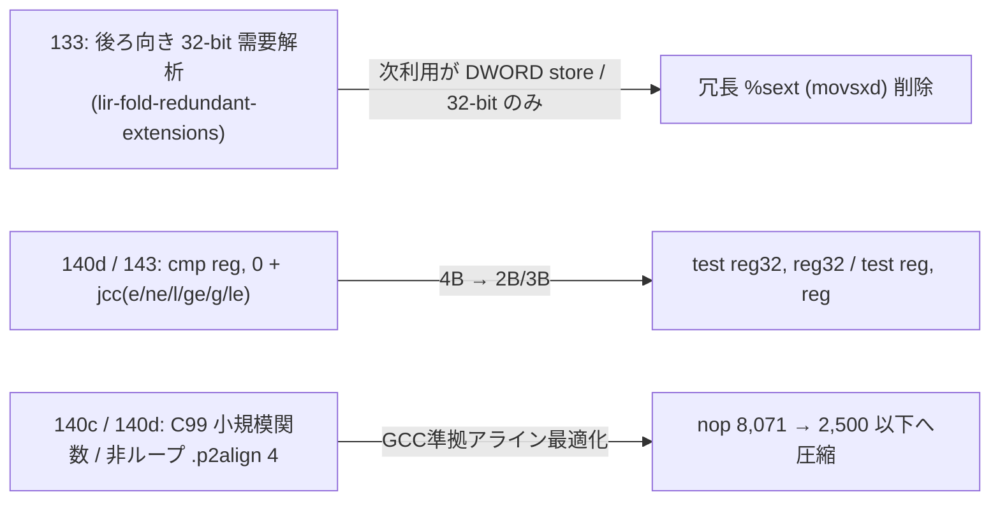

# [FEAT/ENH] C99 32-bit int 窄め最適化（冗長 movsxd 除去）と x86-64 命令選択の小型化（test 置換・アラインメント最適化） (ID: 984)

## 1. 概要 / Summary

2026-11-28 時点の Lua 5.4.7（33 TU `.o`）逆アセンブリ結果では、コードサイズ肥大と I-Cache 非効率を招いている以下の 3 種の低水準命令オーバーヘッドが大量に検出された：

1. **冗長な 32→64bit 符号拡張 (`movsxd`)**: **`5,681` 命令**（全命令の `5.76%`）。`call` の 32-bit 戻り値や `DWORD PTR` ロードに対して `movsxd rax, eax` を挿入した直後、結局 32-bit 値（`DWORD PTR [...]` ストア、下位 32-bit 比較・演算）しか消費していないケースが多発している。
2. **`cmp reg, 0x0` による 4 バイト比較**: **`1,631` 箇所**。x86-64 では `test reg, reg`（3 バイト）または `test reg32, reg32`（2 バイト）で同じ ZF/SF フラグを得られるにもかかわらず、`cmp reg, 0`（`48 83 f8 00` = 4 バイト）が出力されている。
3. **過剰な `.p2align 4` アラインメント `nop` パディング**: **`8,071` 命令（全命令の `8.18%`）**。`lua_gcc`（`2,116` 命令）比で約 3.8 倍の `nop` が挿入されており、小規模関数や分岐先（ループ先頭以外）の `.p2align 4` 抑制により機械語サイズを直接削減できる余地が大きい。

本 Issue では [133_lir_peephole.scm](../../ulisp/lir/133_lir_peephole.scm)（拡張畳み込み）および [140c_x86_layout.scm](../../ulisp/backend/140c_x86_layout.scm) / [140d_x86_emit.scm](../../ulisp/backend/140d_x86_emit.scm) / [143_backend_x86_peephole.scm](../../ulisp/backend/143_backend_x86_peephole.scm) を改善し、`.text` **-20〜30 KB** のコード小型化を達成する。

---

## 2. トレーサビリティ / Traceability

- 関連資料:
  - [ref_benchmarks.md](../../ulisp/docs/ref_benchmarks.md)
  - [Issue #933](closed/933-eliminate-intraprocedural-label-p2align-nop-bloat-and-enable-short-jumps.md)
  - [Issue #935](closed/935-optimize-variable-bit-shift-cl-codegen-and-redundant-sign-zero-extension-folding.md)
  - [Issue #954](closed/954-restrict-p2align-to-loop-headers-and-function-entries-in-scheme-codegen.md)

---

## 3. 全 16 大スペシャリストエージェント統合レビュー (Governance Review)

| エージェント | 担当観点 | 指摘事項・設計合意 |
| :--- | :--- | :--- |
| **Project Manager (PM)** | 全体統括・DoD | 低リスク・高費用対効果のコードサイズ削減施策として、`lua_ulisp` の I-Cache 性能と対 GCC サイズ比を改善する。 |
| **Information Security Specialist** | C 符号拡張セマンティクス | 符号付き 32-bit 値が 64-bit ポインタインデックス・負値比較・割り算に使われる場面で誤って `movsxd` を消さないよう厳格に型・使用幅検査する。 |
| **Systems Architect** | パイプライン配置 | 需要ビット幅伝播（Dead-high-bits 解析）を `133` の拡張畳み込みで行い、`test` 置換・アライン規則を `140d`/`143` に置く。 |
| **QA Specialist** | 差分ファジング検証 | C99 整数・符号付き/符号なし境界テスト（`test_c99_int_lowering`, `test_fuzz_lir`）で 100% 等価性を確認する。 |
| **Database / Data Infra Specialist** | 状態環境設計 | `lir-ext-post-inst-env` の既存抽象ドメインを活用し追加メモリ消費を最小化する。 |
| **Network Specialist** | 外部依存ゼロ確認 | 変更はすべて純粋コンパイラパス内で完結する。 |
| **IT Specialist (NLP & IR)** | IR 定義整合 | 32-bit 専用演算（例：`%cmp32` / `%test32` 相当）を既存の `%sext`/`%trunc`/`%cmp` と整合させる。 |
| **IT Strategist** | サイズ対効果 | #982・#983 と合わせて Lua 33 TU `.text` を GCC（267.8 KB）未満へ押し下げる重要ピースとなる。 |
| **IT Service Manager** | CI・ビルド影響 | 既存 986 Nanopass テスト・3-Stage ブートストラップに回帰なく通過させる。 |
| **Embedded Systems Specialist** | ABI・フラグ差分 | `cmp reg, 0` と `test reg, reg` のフラグ差異（`CF`/`OF` はどちらもクリアだが `AF` 未定義、符号付/無比較命令 `jg`/`jl`/`je`/`jne` 等が同一結果になる条件）を正確に扱う。 |
| **Systems Auditor** | 決定論性検証 | `.p2align` 削減がセルフホスト Stage 2 == Stage 3 ビット一致性を保つか検証する。 |
| **UI/UX & Docs Designer** | レポート更新 | `ref_benchmarks.md` の `movsxd` / `nop` カウントを更新する。 |
| **Education Specialist** | 安全性ドキュメント | 「なぜこの消費命令では上位 32bit が不要か」の判定ルールをコードコメントで明示する。 |
| **Software Development (SWD)** | 実装精密化 | `lir-fold-redundant-extensions`, `lir-ext-try-overwrite-prev`, `emit-x86-asm-inst` を拡張する。 |
| **Application Specialist (APS)** | C99 下位パス連携 | 32-bit `int` 比較のゼロ比較ショートカットを C99 AST→MIR→LIR 経路全体で確認する。 |
| **IT Specialist (PLC)** | ABI 上位ビット規定 | SysV AMD64 C ABI（関数戻り値・引数で caller/callee が上位 32bit に依存し得る境界）を破らないよう関数呼び出し/戻り値で境界保守する。 |

---

## 4. 脅威モデリングと安全性要件 / Threat Model & Safety Requirements

- **THREAT-984-1 (32-to-64 Sign-Extension Truncation Bug / CWE-190 & CWE-681)**:
  - 負の 32-bit `int` 戻り値（例：`-1` = `0x00000000ffffffff` 状態の `%eax`）に対して `movsxd rax, eax` を誤って削除し、後続が 64-bit `cmp rax, -1` や配列添字 `base[idx]` に使用すると不正アドレス・比較偽陽性が発生する。
  - **対策**: 消費命令が **明示的 32-bit 書込（`%store32`/`DWORD`）・32-bit ゼロ拡張（`%trunc 32`）・同レジスタ上書き（killed before 64-bit read）** の場合に限り `movsxd` を除去する（後ろ向き 32-bit 需要のみ追跡）。
- **THREAT-984-2 (`cmp reg, 0` → `test reg, reg` Unsigned Comparison Mismatch)**:
  - `cmp reg, 0` と異なり `test` による比較で符号なし境界や特殊フラグ（`jb`/`ja`/`jae` の意味差異）を使うと誤分岐する。
  - **対策**: 直後の分岐条件が `je`/`jne`/`jz`/`jnz`/`sete`/`setne`（および符号付きゼロ比較 `jl`/`jge`/`jg`/`jle` で 64-bit `test` 互換のもの）に限定して `test` 化する。

---

## 5. 影響範囲と関連ファイル / Scope and Affected Files

- [ ] [133_lir_peephole.scm](../../ulisp/lir/133_lir_peephole.scm)
- [ ] [140c_x86_layout.scm](../../ulisp/backend/140c_x86_layout.scm)
- [ ] [140d_x86_emit.scm](../../ulisp/backend/140d_x86_emit.scm)
- [ ] [143_backend_x86_peephole.scm](../../ulisp/backend/143_backend_x86_peephole.scm)
- [ ] [test_133_lir_peephole.scm](../../ulisp/tests/passes/test_133_lir_peephole.scm)
- [ ] [test_143_backend_x86_peephole.scm](../../ulisp/tests/passes/test_143_backend_x86_peephole.scm)

---

## 6. 実装方針 / Implementation Plan

Target Branch: `feat/984-eliminate-redundant-movsxd-and-compact-x86`

1. **後ろ向き 32-bit 需要ベースの冗長 `movsxd` 除去（`133_lir_peephole.scm`）**:
   - `lir-fold-redundant-extensions` および `lir-ext-try-overwrite-prev` に、定義後レジスタが 64-bit 値として参照されず `DWORD` ストア・32-bit 演算・`call` 前レジスタ上書きのみで消費される場合の `%sext-32` 削除規則を追加する。
   - `mov eax, [mem32]` や 32-bit `call` 直後の `movsxd rax, eax; cmp rax, imm32`（`imm32` 範囲かつ `je`/`jne`/`jl`/`jg`/`jle`/`jge` 条件）を 32-bit 比較 `cmp eax, imm32` に縮退させて `movsxd` を除去する。
2. **`cmp reg, 0` → `test reg, reg` および小即値命令短縮（`140d` / `143`）**:
   - `143_backend_x86_peephole.scm`（`optimize-x86-peephole-insts`）および `140d_x86_emit.scm`（`emit-x86-asm-inst`）で、`cmp reg, 0`（後続 `je`/`jne`/`jl`/`jge`/`jg`/`jle`）を `test reg, reg`（さらに 32-bit ゼロ既知・非符号判定 `je`/`jne` 等では `test reg32, reg32`）へ変換する。
   - `mov reg64, 0` → `xor reg32, reg32` の取りこぼしを補完する。
3. **C99 モードの `.p2align` ポリシー最適化（`140c` / `140d`）**:
   - `emit-c-tu-x86-asm-program` / `emit-x86-asm-function` において、`nop` を過剰発生させる関数境界・非ループラベルへの無条件 `.p2align 4` を整理し（関数境界はサイズ/ホットネス基準または `.p2align 2`/`3`、ループ先頭ラベルのみ 16B アライン等）、`nop` 数を `lua_gcc` 水準（`~2,100` 命令）へ近付ける。

---

## 7. 完了条件 / Success Criteria (DoD)

- [ ] Lua 33 TU の `movsxd` が `5,681` 命令から **40% 以上削減**、`cmp reg, 0` が **`1,631` → ほぼ 0 件**、`nop` が `8,071` → **`3,000` 命令以下**になること。
- [ ] Lua 33 TU `.text` サイズが **-20 KB 以上縮小**されること。
- [ ] `test_c99_int_lowering`, `test_fuzz_lir`, `make -C ulisp bootstrap test test_ulisp_cc_native` および `make format && make static_analysis` が全 PASS すること。
