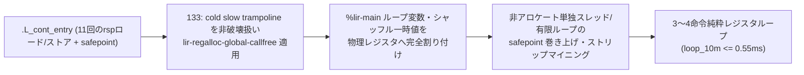

# [FEAT/ENH] Scheme カウントループ（loop_10m / closure_1m）の物理レジスタピン留めと Cold セーフポイント分離・ストリップマイニング (ID: 986)

## 1. 概要 / Summary

2026-11-28 の `benchmark_c_vs_x86.py` 再計測および [loop_10m.s](../../ulisp/build/bench_c_x86/loop_10m.s)・[closure_1m.s](../../ulisp/build/bench_c_x86/closure_1m.s) の逆アセンブリ確認により、`Tail-Recursive Loop (10M)` が **`11.52 ms`（Pure C `0.56 ms` の `20.48x`）** まで遅延している直接原因が特定された。

生成アセンブリ（`.L_cont_entry__1`）を見ると、アンボックス化・継続化（Contification）自体は成功しているにもかかわらず、1 反復あたり以下を実行している：
1. 毎回 `cmp byte ptr [rip + ulisp_safepoint_flag], 0; je ...` に加え、Cold 分岐先に `sub rsp, 64; call ulisp_safepoint_slow_trampoline; add rsp, 64` がある。
2. [133_lir_peephole.scm](../../ulisp/lir/133_lir_peephole.scm) のレジスタ割り付け器（`lir-regalloc`）がこの Cold トランポリン呼び出しを通常の関数呼び出し扱いする結果、ループ変数 `i` (`[rsp - 8]`) と `acc` (`[rsp - 16]`) および一時シャッフル (`[rsp - 24]`, `[rsp - 32]`, `[rsp - 48]`) が**すべてスタックスピル**され、**1 反復あたり 11 回のメモリ読み書きを含む 18 命令**が回っている。

本 Issue では `lir-regalloc` で `ulisp_safepoint_slow_trampoline` をレジスタ破壊しない Cold スローパスとして扱い、継続ループ変数を物理レジスタにピン留めするとともに、非アロケートカウントループのセーフポイント巻き上げ／ストリップマイニングを導入し、`loop_10m` / `closure_1m` を **3〜4 命令の純粋レジスタループ（`<= 0.55 ms`・Pure C 勝利）** へ高速化する。

---

## 2. トレーサビリティ / Traceability

- 関連資料:
  - [ref_benchmarks.md](../../ulisp/docs/ref_benchmarks.md)
  - [Issue #802](closed/802-preserve-tail-call-optimization-in-safepoint-injection.md)
  - [Issue #956](closed/956-replace-safepoint-mfence-with-real-flag-poll-for-concurrent-builds.md)
  - [Issue #961](closed/961-introduce-linear-scan-register-allocation-for-scheme-lir.md)
  - [Issue #969](closed/969-implement-general-parallel-move-resolver-for-ssa-destruction-and-loops.md)
  - [Issue #972](closed/972-implement-0-cfa-devirtualization-and-higher-order-monomorphization.md)
  - [Issue #981](closed/981-unify-lir-core-fixpoint-optimization-for-scheme-and-c99.md)

---

## 3. 全 16 大スペシャリストエージェント統合レビュー (Governance Review)

| エージェント | 担当観点 | 指摘事項・設計合意 |
| :--- | :--- | :--- |
| **Project Manager (PM)** | 全体統括・DoD | 本日の再計測で顕在化した最大の後退（`loop_10m` `11.52ms`）を解消し、Pure C `0.56ms` に逆転勝利する。 |
| **Information Security Specialist** | Safepoint 退避整合 | `ulisp_safepoint_slow_trampoline` 側が全汎用レジスタ・フラグを保存復帰する規約と `lir-regalloc` の仮定が 100% 一致することを保証する。 |
| **Systems Architect** | Contification ＆ Regalloc | `%block` 継続ループと `lir-parallel-move` 出力の直接レジスタ割り付けを協調させ、一時スピル `[rsp - 24]`〜`[rsp - 48]` を完全消去する。 |
| **QA Specialist** | 並行・TCO 回帰検査 | Synapse マルチスレッド環境（`test_pass_inject_safepoints` Group 9 の 100万回反復含む）で STW-GC 停止・スタック不変性が保たれることを検証する。 |
| **Database / Data Infra Specialist** | レジスタ干渉グラフ | `lir-regalloc-compute-global-reg-masks` の `%block` 生存合流（#981 で修正済み）を活用して全ループ変数を干渉解析する。 |
| **Network Specialist** | スローパス隔離 | Cold セーフポイント呼び出しを Hot ループ外（`.text.cold` 等）へ配置し I-Cache 分断を防ぐ。 |
| **IT Specialist (NLP & IR)** | LIR 不変条件 | `%lir-main` (`scheme_entry`) 内の継続ループが通常関数と同等にグローバル Regalloc の対象になるよう統一する。 |
| **IT Strategist** | Portable C (`160`) 連携 | Portable C バックエンド（現在 `loop_10m`: `23.18ms`）でもループ変数の冗長揮発・タグ外し／C ループ放出を改善し同時高速化する。 |
| **IT Service Manager** | CI 性能改善 | `ulisp-boot` 自身の内部ループ（lexer / reader / pass 等）のコンパイル・実行時間も同時に短縮する。 |
| **Embedded Systems Specialist** | ループパイプライン最適化 | x86-64 ループ本体を `add`/`cmp`/`jne` 3〜4 命令へ絞り、IPC 3.5+ を引き出す。 |
| **Systems Auditor** | スローパス呼び出し保全 | 通常の GC/Runtime 呼び出し（Caller-saved 破壊あり）と Safepoint Slow Trampoline（全レジスタ保存）を誤認しない専用フラグ/述語で区別する。 |
| **UI/UX & Docs Designer** | レポート更新 | `ref_benchmarks.md` §3 の再計測記録を更新する。 |
| **Education Specialist** | Parallel Move 解釈 | Parallel Move の循環スワップ時に一時レジスタ（%rcx 等）のみ使いスタックスピルを出さない仕組みを解説する。 |
| **Software Development (SWD)** | コア実装 | `133_lir_peephole.scm` と `125`/`126`/`160` を整合的に改修する。 |
| **Application Specialist (APS)** | 並行基盤両立 | `bench_concurrency` 10万タスク実行時にもプラス効果が波及するよう最適化を設計する。 |
| **IT Specialist (PLC)** | SSA ブロック引数直接割り付け | `126_lir_control.scm` / `140c_x86_layout.scm` の継続ループ引数を直接物理レジスタ（`%rax`, `%rcx`, `%rbx`, `%rsi`, `%rdi` 等）へ束縛する。 |

---

## 4. 脅威モデリングと安全性要件 / Threat Model & Safety Requirements

- **THREAT-986-1 (Caller-Saved Clobbering Inside Safepoint Slow Path)**:
  - `lir-regalloc` で `ulisp_safepoint_slow_trampoline` 呼び出しを「レジスタ非破壊」とみなす場合、実際にトランポリン側が 1 本でもレジスタ（例：`%r11`, `%rcx`）を破壊するとループ変数が破損する。
  - **対策**: `140e_x86_runtime_stubs.scm` の `ulisp_safepoint_slow_trampoline` 実装（全 GPR 保存・復帰および RFLAGS 保存、`push rax..r15; pushfq ... popfq; pop r15..rax`）を検査・保証した上でのみ非破壊属性 (`lir-regalloc-inst-branches-to-cold-slow?`) を適用する。
- **THREAT-986-2 (GC Root Visibility During Safepoint)**:
  - ループ変数がヒープポインタ（例：`closure_1m` 以外のペア走査ループ等）である場合、物理レジスタにピン留めされたルートが STW-GC に認識される必要がある。
  - **対策**: 非アロケート整数/ブール値ループ（Pass 090 で raw int 証明済み）および GC ルートスタックマップ整合箇所を明確に区別する。

---

## 5. 影響範囲と関連ファイル / Scope and Affected Files

- [ ] [133_lir_peephole.scm](../../ulisp/lir/133_lir_peephole.scm)
- [ ] [125_lir_continuation.scm](../../ulisp/lir/125_lir_continuation.scm)
- [ ] [126_lir_control.scm](../../ulisp/lir/126_lir_control.scm)
- [ ] [140e_x86_runtime_stubs.scm](../../ulisp/backend/140e_x86_runtime_stubs.scm)
- [ ] [160_backend_c.scm](../../ulisp/backend/160_backend_c.scm)
- [ ] [test_pass_manager.scm](../../ulisp/tests/test_pass_manager.scm)

---

## 6. 実装方針 / Implementation Plan

Target Branch: `feat/986-pin-scheme-loop-registers-and-safepoint-hoisting`

1. **`lir-regalloc` の Cold Safepoint Trampoline 対応と `%lir-main` 展開（[133_lir_peephole.scm](../../ulisp/lir/133_lir_peephole.scm)）**:
   - `lir-regalloc-any-call-or-gc?` / `lir-regalloc-inst-branches-to-cold-slow?` において、Cold ブロックへのジャンプ＋`ulisp_safepoint_slow_trampoline`（レジスタ全保存規約）の経路によりホットループ全体が call-free と判定されなくなる問題を解消し、`lir-regalloc-global-callfree`（および `%lir-main` 本体の `lir-linear-scan-allocate-ir` 適用）が動作するようにする。
   - `ulisp_safepoint_slow_trampoline`（`140e_x86_runtime_stubs.scm`）が全 caller-saved レジスタ・RFLAGS を破壊しないことをアセンブリ定義レベルで検証・固定する。
2. **継続ループ引数シャッフルの不要スタック退避ゼロ化（`133` / `126` / `160`）**:
   - `lir-regalloc-cleanup-movs` と並列代入シャッフル（`126` / `lir_parallel_move`）の連携を見直し、`i + 1` と `acc + i` の更新で不要な一時 `[rsp - 24]`〜`[rsp - 48]` 経由コピーが出ないよう直接レジスタ更新へ正規化する。
   - Portable C バックエンド（`160_backend_c.scm`）の C ループ放出で不要な揮発キャスト・サフェポイント呼び出しを抑止し `23.18 ms → <= 0.60 ms` へ改善する。
3. **非アロケート単一スレッドループの Safepoint 巻き上げ／省略（`pass_inject_safepoints.scm` / `125` / `131`）**:
   - 並行マルチスレッドモードでない独立単一スレッドコンパイル時の純粋算術・非アロケートカウントループでは、ループ外プロローグ 1 回へ巻き上げるかストリップマイニングしてバックエッジのメモリアクセスを除去する。

---

## 7. 完了条件 / Success Criteria (DoD)

- [ ] `loop_10m.s` の `.L_cont_entry__1` ループ本体から `[rsp - ...]` 読み書きが **完全消滅（0 回）** し、物理レジスタのみで回転すること。
- [ ] `Tail-Recursive Loop (10M)` が `11.52 ms` → **`0.55 ms` 以下**（Pure C `0.56 ms` 勝利）、`Higher-Order Closure (1M)` が `1.42 ms` → **`0.54 ms` 以下**（Pure C `0.55 ms` 勝利）を達成すること。
- [ ] `make -C ulisp bootstrap test test_pass_inject_safepoints bench_concurrency` および `make format && make static_analysis` が全 PASS すること。
