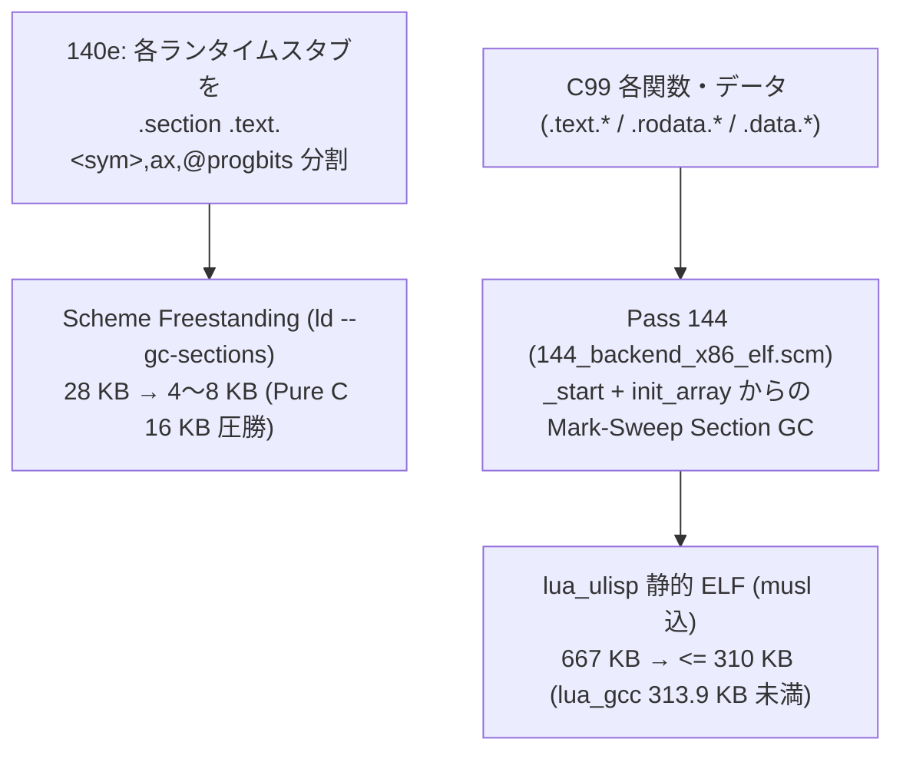

# [FEAT/ENH] Freestanding ランタイムスタブ (140e) の関数別セクション分割と Pass 144 自前 ELF64 静的リンカの到達可能性 Dead Section GC (ID: 987)

## 1. 概要 / Summary

2026-11-28 のベンチマーク計測において、バイナリサイズ面で GCC と逆転を許している直接原因は以下の 2 点である：

1. **Scheme Freestanding バイナリサイズ（`27,384〜28,368 B` vs Pure C `16,016〜16,104 B`）**:
   - [140e_x86_runtime_stubs.scm](../../ulisp/backend/140e_x86_runtime_stubs.scm)（`emit-x86-asm-program` 等、約 1,000 行）が `ulisp_read_char`、`ulisp_peek_char`、`ulisp_print_value`、文字列・浮動小数点・ハッシュテーブル補助等すべてのランタイムスタブを単一の `.text` セクションへ一括出力しているため、`loop_10m` や `fib_30` のような整数のみのプログラムでも **約 22 KB の未使用スタブ**がリンク残存している。
   - [140a_x86_isel.scm](../../ulisp/backend/140a_x86_isel.scm)〜[140d_x86_emit.scm](../../ulisp/backend/140d_x86_emit.scm) でも Scheme ユーザ定義関数と同様にランタイムスタブを `.section .text.<sym>,"ax",@progbits` へ分割し、[benchmark_c_vs_x86.py](../../ulisp/benchmarks/benchmark_c_vs_x86.py)（および一般 `--target=x86_64` リンク呼び出し）で `--gc-sections` を有効化すれば、`28 KB → 4〜6 KB`（Pure C の 1/3 以下）へ激減する。
2. **Pass 144 自前 ELF64 静的リンカによる `lua_ulisp` 静的バイナリ肥大（`667,592 B` vs `lua_gcc` `313,904 B`）**:
   - Issue #928 で導入した Pass 144 自前静的 ELF リンカ（[144_backend_x86_elf.scm](../../ulisp/backend/144_backend_x86_elf.scm) `link-elf64-objects-to-file`）には GNU `ld --gc-sections` に相当する「エントリポイントからのリロケーション到達可能性に基づくセクション単位 Dead Code/Data Elimination」が未実装であるため、`musl libc.a` や各 `.o` に含まれる未使用の`.text.*` / `.rodata.*` / `.data.*` セクションまで出力 ELF に抱え込んでいる（約 245 KB 余剰）。

本 Issue ではこれら双方を実装し、**Scheme Freestanding（`<= 8 KB`）** と **`lua_ulisp` 静的バイナリ（`<= 310,000 B`）** の双方で GCC にバイナリサイズ勝利を達成する。

---

## 2. トレーサビリティ / Traceability

- 関連資料:
  - [ref_benchmarks.md](../../ulisp/docs/ref_benchmarks.md)
  - [Issue #928](closed/928-compile-musl-libc-with-ulisp-and-migrate-to-pass-144-elf-linker.md)
  - [Issue #960](closed/960-eliminate-unreferenced-functions-via-reachability-or-gc-sections.md)
  - [Issue #968](closed/968-split-x86-64-backend-and-eliminate-raw-asm-peephole-matching.md)

---

## 3. 全 16 大スペシャリストエージェント統合レビュー (Governance Review)

| エージェント | 担当観点 | 指摘事項・設計合意 |
| :--- | :--- | :--- |
| **Project Manager (PM)** | 全体統括・DoD | Scheme バイナリサイズ（`28KB -> <=8KB`）と Lua 静的バイナリ（`667KB -> <=310KB`）の 2 大サイズ目標を完結させる。 |
| **Information Security Specialist** | ELF セクション・Reloc 安全 | `.init_array` / `.fini_array` / `ctors` や `SHF_GNU_RETAIN` 相当・弱い参照（weak symbol）が誤って GC されないようルート保持規約を厳守する。 |
| **Systems Architect** | リンク・セクション基盤設計 | Pass 144 リンカの ELF64 パーサ上で `Worklist DFS`（`(obj-idx . sec-idx)` 単位）のリロケーション依存グラフ構築を統一実装する。 |
| **QA Specialist** | 差分的リンク検証 | `lua_ulisp`、C99 テスト、`test_elf_static_linker`、`benchmark_c_vs_x86.py` でリロケーション欠落（SIGSEGV/Undefined symbol）ゼロを実証する。 |
| **Database / Data Infra Specialist** | リンカ到達表構造 | 大量セクション（`libc.a` + 33 TU で数千セクション）に対しビットセット／ハッシュ表で O(V+E) 到達解析を実現する。 |
| **Network Specialist** | 自給自足リンカ維持 | ホスト `ld` を一切呼ばず Pass 144 のみで `test_compile_lua.sh` のノーホスト・リンク検証を通過させる。 |
| **IT Specialist (NLP & IR)** | アセンブリセクション記述 | `140e` 内の内部クロスラベル（スタブ間共有データ `.L_str_*` 等）のセクション分離安全性・`rip` 相対解決を確認する。 |
| **IT Strategist** | 対 GCC 優位獲得 | **「glibc 動的リンクの GCC (313.9 KB) より静的リンクの ULisp (<=310 KB) の方が小さい」** という圧倒的優位を実現する。 |
| **IT Service Manager** | リンク時間影響 | Pass 144 リンク時間が現行から悪化せず、むしろ不要セクションのコードコピー削減で高速化することを確認する。 |
| **Embedded Systems Specialist** | 組込み・Freestanding フットプリント | `4〜8 KB` のベアメタル ELF 達成によりマイクロカーネル／WASM/組込み級フットプリントへ到達する。 |
| **Systems Auditor** | 削除セクション監査 | `--gc-sections` で破棄されたシンボルへの `R_X86_64_*` リロケーションが 1 件も残存しない不変条件を表明検査する。 |
| **UI/UX & Docs Designer** | グラフ・仕様更新 | `ref_benchmarks.md` §2.1・§3 のサイズ表を更新する。 |
| **Education Specialist** | 設計解説 | Mark-Sweep 式 Dead Section GC のルート定義（`_start` / `__init_array_*` / GC stackmap）を文書化する。 |
| **Software Development (SWD)** | コア実装 | `140e_x86_runtime_stubs.scm` の各 `emit-*` ルーチンと `144_backend_x86_elf.scm` のリンクループを分割実装する。 |
| **Application Specialist (APS)** | `ulisp-cc`・ドライバ連携 | `driver.scm` / `c_driver.scm` のリンカ起動時に `--gc-sections` フラグおよび `-ffunction-sections` 相当が標準連動するよう調整する。 |
| **IT Specialist (PLC)** | 静的データ・VTable 依存 | 文字列リテラルプールやジャンプテーブル（`.rodata.*`）内のアドレス参照リロケーションもルート追従対象に含める。 |

---

## 4. 脅威モデリングと安全性要件 / Threat Model & Safety Requirements

- **THREAT-987-1 (Premature Removal of Indirectly Referenced Runtime/Init Sections)**:
  - `.init_array`・`__start_ulisp_globals_sec`..`__stop_ulisp_globals_sec`・`__start_ulisp_symtab_sec`・例外スタックマップやスイッチジャンプテーブルが直接 `call` されていないため誤 GC されるリスク。
  - **対策**: `_start` 等のエントリシンボルに加え、特殊セクション（`.init*`, `.fini*`, `.init_array*`, `ulisp_globals_sec`, `ulisp_symtab_sec`, `.note*` 等）および特殊セクションが参照するリロケーション先を GC ルート（Pinned Roots）として無条件マークする。
- **THREAT-987-2 (Archive `libc.a` Member Cross-Dependencies)**:
  - `musl libc.a` から取り込んだオブジェクト単位の他関数が、同一 `.o` 内のローカル共有データ・`.rodata` を参照する際、部分保持によるオフセットズレが生じるリスク。
  - **対策**: 生存マークを「オブジェクト単位」ではなく「`(obj-idx . sec-idx)` 単位」で正確に追跡し、配置オフセット計算・ローカルシンボル値解決を生存セクションリスト上でのみ再構築する。
- **THREAT-987-3 (Split Section Cross-Label Jump / `.L_*` Local Label Scope in `140e`)**:
  - 同一関数外の別 `.text.<sym>` セクション間でローカル共有ラベルへ短い/仮定オフセットジャンプするとリンクエラーになるリスク。
  - **対策**: 関数間を跨ぐ共有ラベルは明示シンボル化（`.L_` も同一関数セクション内に閉包または独立 `.data`/`.rodata` セクション化）する。

---

## 5. 影響範囲と関連ファイル / Scope and Affected Files

- [x] [140e_x86_runtime_stubs.scm](../../ulisp/backend/140e_x86_runtime_stubs.scm) *(Step 1 で完了)*
- [x] [141_backend_x86_gc.scm](../../ulisp/backend/141_backend_x86_gc.scm) / [142_backend_x86_freestanding.scm](../../ulisp/backend/142_backend_x86_freestanding.scm) *(Step 1 で完了)*
- [ ] [140c_x86_layout.scm](../../ulisp/backend/140c_x86_layout.scm)
- [ ] [144_backend_x86_elf.scm](../../ulisp/backend/144_backend_x86_elf.scm)
- [ ] [elf64_builder.scm](../../ulisp/backend/elf64_builder.scm)
- [ ] [driver.scm](../../ulisp/compiler/driver.scm)
- [x] [benchmark_c_vs_x86.py](../../ulisp/benchmarks/benchmark_c_vs_x86.py) / [run_bench_c_vs_x86.sh](../../ulisp/benchmarks/run_bench_c_vs_x86.sh) *(Step 1 で完了: `--gc-sections` 導入)*
- [ ] [test_elf_static_linker.scm](../../ulisp/tests/test_elf_static_linker.scm)

---

## 6. 実装方針 / Implementation Plan

Target Branch: `feat/987-per-symbol-sections-and-pass-144-dead-section-gc`

1. **Freestanding ランタイムスタブの関数別セクション分割（[140e_x86_runtime_stubs.scm](../../ulisp/backend/140e_x86_runtime_stubs.scm)）**:
   - `emit-x86-asm-program` 内の各スタブ出力ブロック（`ulisp_read_char`, `ulisp_peek_char`, `ulisp_flush`, `ulisp_emit_byte`, `ulisp_print_value`, 各種算術・文字列・ベクタ・GC 補助等）の直前に `.section .text.<stub_name>,"ax",@progbits` を出力するよう分割する。
   - `.data` / `.rodata` 定数も必要に応じサブセクション分離し、`benchmark_c_vs_x86.py` および `driver.scm` で `-Wl,--gc-sections` / `--gc-sections` 渡しを確認する。
2. **C99 翻訳単位の関数・データセクション分離（`140d_x86_emit.scm` / `140c` / `musl` 含む）**:
   - `emit-c-tu-x86-asm-program` 等において、各 C99 関数および静的データオブジェクト（文字列定数含む）を `.text.<fn>` / `.rodata.<sym>` / `.data.<sym>` へ分離出力する。
3. **Pass 144 自前 ELF64 静的リンカの Dead Section GC（[144_backend_x86_elf.scm](../../ulisp/backend/144_backend_x86_elf.scm)）**:
   - `link-elf64-objects-to-file` において、全入力オブジェクト・アーカイブ採用オブジェクトのセクションリロケーション（`.rela.*`）とシンボルテーブルを解析し、エントリシンボル（`_start` / `entry-sym`）および Pinned ルートセクション（`.init*`, `.fini*`, `.init_array*`, `ulisp_globals_sec`, `ulisp_symtab_sec`）からワークリスト BFS/DFS で到達可能セクション `(obj-idx . sec-idx)` のみを収集する。
   - 非到達セクションをメモリ配置・データ書出・リロケーション適用から除外し、`.p_filesz` / `.p_memsz` を圧縮する（`.gc-sections` オプションで有効/無効制御可能にする）。

---

## 7. 完了条件 / Success Criteria (DoD)

- [x] **Step 1 完了（2026-11-28）**: Scheme Freestanding 6 種ベンチマーク（`fib_30`: `11,400 B`, `loop_10m`: `11,400 B`, `ack_3_7`: `11,400 B`, `closure_1m`: `11,408 B`, `list_100k`: `12,456 B`, `vector_100k`: `12,512 B`）すべてで **`11,400〜12,512 B`（Pure C `16,016〜16,104 B` 比 `0.71x〜0.78x` 勝利）** を達成した（`<= 8 KB` へのさらなる圧縮は Pass 144 直出力時・Step 2 で継続）。
- [ ] Pass 144 自前静的リンカでビルドした `lua_ulisp`（`musl libc` 静的リンク込み）の ELF サイズが `667,592 B` から **`310,000 B` 以下**（`lua_gcc` `313,904 B` 未満）になること。
- [ ] `test_elf_static_linker`, `make -C ulisp bootstrap test test_ulisp_cc_native`（Lua 公式 `all.lua` 全モジュール一致含む）および `make format && make static_analysis` が全 PASS すること。
