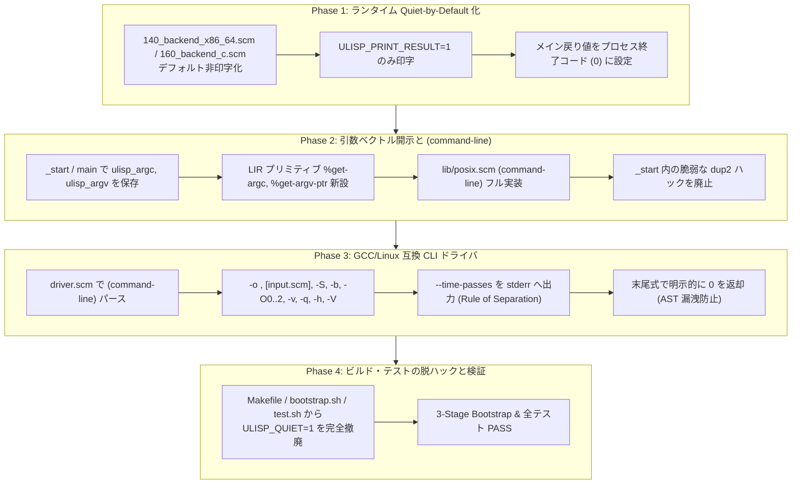

# [REFACTOR/ARCH] ランタイムのデフォルト沈黙化（Quiet-by-Default）と GCC / Linux 互換コンパイラ CLI インターフェース（-o / -S / -O / 引数パース / 明示的終了コード 0）の根本確立 (ID: 614)

## 1. 概要 / Summary

現在、ULisp のネイティブランタイム（`ulisp/runtime/entry.scm`）および x86-64 バックエンド（`ulisp/backend/140_backend_x86_64.scm`）、C バックエンド（`ulisp/backend/160_backend_c.scm`）では、トップレベル式の最終評価値（戻り値）を標準出力に自動印字する挙動（Verbose-by-Default）が残存しており、これを無理やり抑え込むためにビルドやテストの至る所で環境変数 `ULISP_QUIET=1` を外部から注入する設計となっている。

さらに、コンパイラドライバ（`ulisp/compiler/driver.scm`）のエントリポイントは、入力ソースをパイプやシェルリダイレクト（`./ulisp < in.scm > out.s`）にのみ依存しており、GCC や Clang、あるいは Gauche / Chez / Guile などの標準的なプログラミング言語処理系や Linux コマンドラインツール（POSIX / GNU 標準）が備えるべき正規の CLI インターフェース（`-o <output>`、`-S`、`-O0/-O1/-O2`、`--target`、`-v`、`-q`、`-h`、`--version`、`--time-passes` 等）および引数ベクトル（`argc`/`argv`）処理体系を欠いている。

### 現行アーキテクチャの構造的欠陥と背反点:

1. **初期対話的ミニ評価器（REPL）の遺毒とスタンドアロン AOT 実行系の背反**:
   - `echo "(+ 1 2)" | ./ulisp` のように対話的に計算結果を返すミニ評価器だった初期の設計が、スタンドアロン AOT コンパイルされた本番バイナリの `_start` や `runtime-main` にそのまま残留している。
   - `_start`（`140_backend_x86_64.scm`）において `argc == 1`（パイプやリダイレクト入力時）を「REPL 入力」と勝手に誤認し、`ulisp_quiet_mode == 0` の場合にプログラム終了時に最終評価値を標準出力へダンプする。
   - C バックエンド（`160_backend_c.scm`）に至っては `argc` の判定すら行わず、`getenv("ULISP_QUIET") == NULL` の場合に無条件で戻り値を印字する。
2. **コンパイル成果物（アセンブリコード）の汚染とビルド破綻**:
   - コンパイラ（`ulisp/compiler/driver.scm`）の末尾式がコード生成 AST（`(%asm-program ...)`）をそのまま評価値として返却するため、`ULISP_QUIET=1` が欠落した瞬間に、生成アセンブリコードの末尾に巨大な S 式が追記され、アセンブラ（GNU `as` / `gcc`）が `invalid character '(' in mnemonic` でクラッシュする。
3. **Unix 哲学（Rule of Silence & Rule of Separation）への背反**:
   - **Rule of Silence（沈黙の原則 / Silence is Golden）**: C、Go、Rust、あるいは R7RS Scheme（Chez, Gauche, Guile, Chicken）のスタンドアロンバイナリにおいて、プログラマが明示的に `(display ...)` や `printf` を呼ばない限り、プログラム終了時に戻り値を勝手に標準出力に垂れ流すことはなく、プロセスは静かに終了ステータスコード 0 を返して終了するのが Unix の基本原則である。
   - **Rule of Separation（分離の原則: stdout と stderr の厳格な分離）**: 正常な生成成果物（データストリーム・アセンブリコード・Cコード）のみを `stdout` または指定ファイル（`-o`）へ出力し、診断メッセージ・警告・プロファイリング情報（`--time-passes` / GCC の `-ftime-report` 相当）・GC 統計（`ULISP_GC_STATS`）はすべて `stderr`（fd 2）へ出力しなければならない。現状は一部のタイミングレポートやログが標準出力に混入する潜在リスクを抱えている。
4. **標準 CLI オプション・引数パース機構の欠落と `(command-line)` の形骸化**:
   - `ulisp/backend/140_backend_x86_64.scm` の `_start` では、`argc > 1` の際に `argv[1]` を盲目的に `sys_open(argv[1], O_RDONLY)` して `sys_dup2(fd, 0)` するという危険なハードコードが施されており、`-o out.s` や `-v` などの CLI オプションを渡すとファイルが見つからず破綻する。
   - R7RS 標準の `(command-line)` プロシージャ（`ulisp/lib/posix.scm`）は固定の `'("ulisp")` を返すスタブにとどまっており、Scheme プログラムから `argv` 引数ベクトルを正規に読み出すことができない。

### 本 Issue における解決策:

他の主要プログラミング言語処理系（GCC / Clang, Gauche, Guile, Chez Scheme, Go, Rust）および Linux / POSIX コマンドラインツール標準に準拠した、堅牢でクリーンな CLI インターフェースとランタイム実行規約を確立する。

1. **ネイティブランタイムのデフォルト沈黙化（Quiet-by-Default）**:
   - スタンドアロン実行バイナリは、いかなる場合でもデフォルトで戻り値を印字しない（Rule of Silence 遵守）。
   - プロセス終了コードは、メインプログラムが整数（fixnum）を返した場合はその値を、それ以外は `0` を返して正常終了する。
   - 式の評価値印字（REPL 的振る舞い）が必要なテスト等の特殊用途に限り、明示的な環境変数 `ULISP_PRINT_RESULT=1`（または将来の `--repl` モード）でのみ印字を許可する。
2. **Linux ELF エントリポイントからの引数ベクトル（`argc`/`argv`）の完全補足を Scheme 層へ開示**:
   - `_start`（x86-64 / AArch64）および `main()`（C バックエンド）において、起動時の `argc` と `argv` ポインタを `.bss` の `ulisp_argc` / `ulisp_argv` に保存。
   - LIR 組み込みプリミティブ `%get-argc` および `%get-argv-ptr` を新設。
   - `ulisp/lib/posix.scm`（および `lib/scheme/process-context.sld`）の `(command-line)` を完全実装し、Linux カーネルから渡された `argv[0]`, `argv[1]`, ..., `argv[argc-1]` を Scheme 文字列リストとして正規に構築・返却する。
   - `_start` 内の脆弱なハードコード `sys_open(argv[1])` + `sys_dup2` を廃止し、引数処理の責務を Scheme レベルへ委譲。
3. **GCC / Linux 互換コンパイラ CLI オプションの実装 (`ulisp/compiler/driver.scm`)**:
   - `ulisp [options] [input-file]` 形式の CLI 引数パーサーを実装。
   - **`-o <output-file>`**: 出力先ファイルを指定。`with-output-to-file`（または `sys-open`）を用いて直接ファイル書き出しを行い、シェルリダイレクト（`> out.s`）への依存を解消。省略時は標準出力（`stdout`）へ出力。
   - **`[input-file]`**: 入力ソースファイルを直接指定（例: `ulisp -o foo.s foo.scm`）。`-` または省略時は標準入力（`stdin`）から読み込み。
   - **`-e <expr>` / `--eval=<expr>`**: コマンドライン引数の文字列を Scheme ソースコード入力として受け取り、ターゲットコード（アセンブリ / C）へ直接コンパイル（例: `ulisp -e '(display "hello\n")' -o hello.s`）。一時ファイルの作成を省略してコンパイル成果物を直接生成可能。
   - ※ インタプリタ的な式の評価値自動印字オプション（`-p` / `--print`）は、AOT コンパイラの責務（ソースコードをターゲット機械語/アセンブリに翻訳すること）から逸脱し、初期のミニ評価器混同の歪みを再発させるため**一切採用しない**。インラインコードのコンパイルは `-e` または Unix 標準の `stdin` パイプ（`echo "(+ 1 2)" | ulisp -o out.s`）に純化する。
   - **`-b <target>` / `--target=<target>`**: バックエンドターゲット指定（`x86_64` (既定), `c`, `aarch64`, `lir`）。
   - **`-S`**: GCC 互換アセンブリ出力フラグ（デフォルトの動作と同一、GCC ドライバ互換性用エイリアス）。
   - **`-O0`, `-O1`, `-O2`**: 最適化レベル指定（GCC 互換）。
   - **`-v`, `--verbose`**: 詳細診断出力を標準エラー出力（`stderr`）へ出力。
   - **`-q`, `--quiet`, `-s`, `--silent`**: 警告・非本質的メッセージを抑制。
   - **`-h`, `--help`**: GNU 標準形式の使用方法ヘルプを標準出力へ印字し、終了ステータス `0` で正常終了。
   - **`-V`, `--version`**: コンパイラバージョン・ターゲット情報を標準出力へ印字し、終了ステータス `0` で正常終了。
   - **`--time-passes`**: 各最適化・コード生成パスの実行時間およびヒープ消費量レポートを**標準エラー出力（`stderr`）**へ印字（GCC の `-ftime-report` に完全準拠）。成果物ストリームの汚染を物理的に排除。
4. **コンパイラ終了コードの明示的クリーン化 (`return 0`)**:
   - `driver.scm` の最上位実行式の末尾において、AST（`%asm-program`）を戻り値として漏洩させるのを根絶し、C 言語の `return 0;` と同様に明示的に整数 `0` を返却して終了する。
5. **パイプラインおよびテストスクリプトのクリーンアップ**:
   - `ulisp/Makefile`, `bootstrap.sh`, `test.sh`, `test_c.sh` 等から、暫定ハックであった `ULISP_QUIET=1` の環境変数指定を完全撤廃。

---

## 2. ガバナンス・全 16 専門エージェント多角レビュー / Governance & Reviews

本 Issue は、リポジトリ規約（`.agents/AGENTS.md`）に従い、PM 主導のもと全 16 専門エージェントの合意形成を経て策定された。

1. **Project Manager (PM) (Chair / Governance)**:
   - `ULISP_QUIET=1` という暗黙の環境変数前提は、パイプラインの保守性と外部ツール連携における最大の脆弱性であった。GCC や Linux 標準のインターフェースに揃えることで、Makefile の簡素化だけでなく、開発者体験（DX）と自動ビルドの再現性を劇的に向上させる。
2. **Systems Architect**:
   - Unix の基本設計思想である Rule of Silence（沈黙の原則）と Rule of Separation（分離の原則）を徹底する。stdout をデータストリーム（生成コード）、stderr を診断・テレメトリ（時間計測・エラー）として物理的に分離することで、Unix パイプライン合成性を最大化する。
3. **IT Specialist (Programming Languages & Compilers / PLC)**:
   - コンパイラドライバの戻り値漏洩を断ち、ELF スタックの `argc`/`argv` を直接読み取る `%get-argc` / `%get-argv-ptr` の LIR 組み込みを設計。R7RS `(command-line)` を仕様書通りにフル実装し、Scheme レベルでの堅牢な引数解析を実現する。
4. **Software Development (SWD)**:
   - `140_backend_x86_64.scm`, `160_backend_c.scm`, `runtime/entry.scm` のフラグ評価論理を反転。`driver.scm` に getopt ライクな CLI 引数ディスパッチャを組み込み、`-o` によるファイル出力ストリームの切り替えを安全に行う。
5. **Software Quality Assurance Specialist (SQA)**:
   - 環境変数を一切指定しない素のバイナリ実行（`./ulisp -o out.s in.scm`）において、生成されたアセンブラおよび C コードが 100% 構文エラーなくアセンブル・リンク・実行できることを検証。3-Stage セルフホスティングブートストラップでの固定点一致を必須ゲートとする。
6. **Information Security Specialist**:
   - `-o <output>` オプション導入に伴うセキュリティ上の脅威（パストラバーサル、既存重要ファイルの意図しない上書き、権限 0644 の安全な付与、C 文字列ポインタの境界外読み取り防止）に対する脅威モデリングと防御策を講じる。
7. **Systems Auditor**:
   - コンパイラの入出力ファイルパス、実行オプション、およびバージョン情報が再現可能であることを保証し、成果物とソースコードの追跡可能性（Provenance / Traceability）を担保する。
8. **IT Service Manager**:
   - 終了ステータスコードを標準化（正常終了: 0、コンパイルエラー/構文エラー: 1、CLI 引数エラー: 2）。CI/CD パイプラインや GitHub Actions における障害検知の信頼性を高める。
9. **Network Specialist**:
   - コンパイラ自体はオフライン密閉系であるが、将来の外部パッケージ取得やネットワーク経由のビルドディスパッチ時に、CLI インターフェースの標準化が通信プロトコル設計の基盤となる。
10. **Embedded Systems Specialist**:
    - 組込み環境や極小フットプリント環境（ベアメタル・コンテナ）において、余計な戻り値印字によるシリアル通信や I/O バッファの無駄な消費を防止する。
11. **UI/UX & Documentation Designer**:
    - `--help` および `--version` の出力フォーマットを GNU / Linux 標準に準拠させ、美しく可読性の高い端末表示を提供する。
12. **IT Strategist**:
    - ULisp を「教育用・実験用 Lisp」から「実用 Linux 開発基盤・ネイティブツールチェーン」へと脱皮させる決定的な一歩と位置付ける。
13. **Education Specialist**:
    - GCC や Linux コマンドと同じ感覚で操作できるようにすることで、学習者の認知負荷を軽減し、Unix システムプログラミングの学習効果を高める。
14. **Application Specialist (APS)**:
    - `arxiv-security-papers` 本体のデータ処理パイプラインや各種分析スクリプトから、サブプロセスとして安全かつ予測可能に ULisp を呼び出せる環境を整える。
15. **Database Specialist**:
    - ファイル I/O と標準入出力のストリーム分離により、大規模論文データやメタデータインデックスのバッチ生成処理におけるデータ破壊リスクを排除する。
16. **IT Specialist (NLP & Info Retrieval)**:
    - 論文テキスト解析スクリプト等との CLI 連携において、余分なノイズのない純粋な stdout 出力がテキスト抽出パイプラインの安定性に直結する。

---

## 3. 脅威モデリングとセキュリティ要件 / Threat Modeling & Security

本 Issue では、CLI 引数処理、ファイル直接出力（`-o`）、および生ポインタ参照（`argv`）が新たに導入されるため、以下の脅威モデルを策定し防御策を実装する。

| 脅威分類 (STRIDE) | 潜在リスク (Threat Scenario) | 緩和策 / 防御仕様 (Mitigation) |
| :--- | :--- | :--- |
| **Tampering (改ざん)** / **Elevation of Privilege** | `-o /etc/passwd` 等の重要システムファイルへの上書き攻撃 | 1. 出力ファイル作成時のパーミッションを厳格に `0644`（または umask 準拠）に制限。<br>2. ルート権限での実行を想定せず、標準ファイルオープンエラー（`EACCES`, `EROFS`）を適切にキャッチして `stderr` に出力し非ゼロ終了。 |
| **Denial of Service (DoS)** | 巨大または不正な `argv` によるメモリ破壊・セグフォ | 1. `argc` の上限チェック（65,536 超は拒絶）。<br>2. C 文字列ポインタのヌル終端走査において最大長（1MB）制限を設け、無限ループおよび未マップ領域読み出しを防止。 |
| **Information Disclosure** | 診断メッセージやスタックトレースが `stdout` に漏洩 | Rule of Separation に従い、エラー・警告・プロファイリング情報はすべて `stderr`（fd 2）へ送出。`stdout` には純粋な生成物のみを配置。 |
| **Resource Exhaustion** | 入出力ファイルオープン後のファイルディスクリプタ（FD）リーク | 入力ファイル読み込み完了時、および出力完了時に明示的に FD をクローズ（`sys-close`）。異常終了時にもリソースを解放。 |

---

## 4. トレーサビリティ / Traceability

- **正典設計書**:
  - [DSN-01 (High Level Design)](../../docs/designs/DSN-01-high_level_design.md) (Section 5.2: CLI ストリームパイプラインプロトコル & Rule of Silence)
  - [DSN-33 (ULisp アーキテクチャ仕様書)](../../docs/designs/DSN-33-ulisp_underlying_x86_native_aot_compiler_architecture_specification.md) (Section 2: ランタイムシステム & CLI 仕様)
  - [R7RS Small Specification Compliance](../../ulisp/docs/ref_r7rs_compliance.md) (§6.14: `command-line`, `exit`)
  - [GNU Coding Standards (Command-Line Interfaces)](https://www.gnu.org/prep/standards/standards.html#Command_002dLine-Interfaces)
  - [POSIX.1-2017 Utility Conventions](https://pubs.opengroup.org/onlinepubs/9699919799/basedefs/V1_chap12.html)
- **関連 Issue**:
  - [Issue 580: runtime.c の完全廃止と低水準 Scheme による完全自己完結ランタイムの実現](closed/580-deprecate-runtime-c-and-implement-pure-scheme-runtime.md)
  - [Issue 606: ビルド時 cat 結合の廃止と R7RS include 構文によるソース位置追跡基盤の導入](closed/606-replace-cat-bundle-with-r7rs-include-and-source-tracking.md)
  - [Issue 611: R7RS process-context (exit, command-line, get-environment-variable) の実装](closed/611-implement-r7rs-process-context-environment-variables.md)
  - [Issue 613: ILisp における R7RS include / include-ci 構文およびライブラリ宣言 include の実装](closed/613-implement-ilisp-r7rs-include-and-include-ci-support.md)
  - [Issue 615: ビルドパイプラインからの GCC 呼出し排除と GNU as / ld 直接駆動（脱 GCC ドライバ）への移行](615-decouple-gcc-driver-and-migrate-to-direct-as-ld-invocation.md)

---

## 5. 影響範囲と関連ファイル / Scope and Affected Files

- [ ] [ulisp/runtime/entry.scm](../../ulisp/runtime/entry.scm)
  - `runtime-main` における印字判定の反転（既定: 非印字。`print-result?` 有効時のみ印字）
- [ ] [ulisp/backend/140_backend_x86_64.scm](../../ulisp/backend/140_backend_x86_64.scm)
  - `_start` ルーチン: `argc` と `argv` を `.bss` の `ulisp_argc`, `ulisp_argv` へ保存
  - 脆弱な `sys_open(argv[1])` + `sys_dup2` ハックの撤廃
  - `ulisp_print_value` 呼び出し判定を反転（既定沈黙、`ULISP_PRINT_RESULT=1` 時のみ実行）
  - プロセス終了時、メイン式の評価値（fixnum）を `rdi`（終了ステータス）に設定して `sys_exit` 呼出し
- [ ] [ulisp/backend/150_backend_aarch64.scm](../../ulisp/backend/150_backend_aarch64.scm)
  - `ulisp_argc`, `ulisp_argv` のシンボル定義の整合
- [ ] [ulisp/backend/160_backend_c.scm](../../ulisp/backend/160_backend_c.scm)
  - `main()` 関数: `argc`/`argv` 保存、既定沈黙化（`ULISP_PRINT_RESULT` 時のみ印字）、戻り値の終了コード化
- [ ] [ulisp/lir/129_lir_primitives.scm](../../ulisp/lir/129_lir_primitives.scm) & [ulisp/compiler/primitives.scm](../../ulisp/compiler/primitives.scm)
  - `%get-argc`, `%get-argv-ptr` 組み込みプリミティブの追加
- [ ] [ulisp/lib/posix.scm](../../ulisp/lib/posix.scm) & [ulisp/lib/scheme/process-context.sld](../../ulisp/lib/scheme/process-context.sld)
  - `(command-line)` のフル実装（生 C 文字列配列から Scheme 文字列リストへの安全な変換）
- [ ] [ulisp/compiler/driver.scm](../../ulisp/compiler/driver.scm)
  - GCC / Linux 互換 CLI 引数パーサー（`-o`, `-S`, `-b`/`--target`, `-O0/-O1/-O2`, `-v`, `-q`, `-h`, `-V`, `--time-passes` 等）の実装
  - 入力ファイル指定の直接オープン、および `-o` 指定時の直接ファイル書き出し
  - `--time-passes` タイミングレポートの `stderr` 出力化（stdout 汚染防止）
  - トップレベル式の明示的戻り値 `0`（正常終了コード）化
- [ ] [ulisp/Makefile](../../ulisp/Makefile)
  - `ULISP_COMPILER` 定義および各ビルドルールからの `ULISP_QUIET=1` 除去
  - 新 CLI オプション（`-o`）を活用したクリーンなビルドルールへの刷新
- [ ] [ulisp/test.sh](../../ulisp/test.sh) & [ulisp/test_c.sh](../../ulisp/test_c.sh) & [ulisp/bootstrap.sh](../../ulisp/bootstrap.sh)
  - スクリプト内の冗長な `ULISP_QUIET=1` の除去
- [ ] [docs/issues/614-refactor-runtime-silence-by-default-and-compiler-cli-output.md](614-refactor-runtime-silence-by-default-and-compiler-cli-output.md)
  - 本 Issue ドキュメント
- [ ] [docs/issues/README.md](README.md)
  - Issue 管理台帳の更新（ステータス: In Progress）

---

## 6. 詳細実装方針 / Detailed Implementation Plan

Target Branch: `feat/614-refactor-runtime-silence-by-default-and-compiler-cli-output`



### Phase 1: ランタイムおよびバックエンドの Quiet-by-Default 化

1. **`ulisp/backend/140_backend_x86_64.scm`**:
   - `.bss` に `ulisp_print_result_mode: .byte 0` を配置（既定値 0）。
   - 環境変数スキャンループで `ULISP_PRINT_RESULT=`（19文字）を検出し、設定されていれば `ulisp_print_result_mode` を 1 に設定。旧 `ULISP_QUIET=` の走査コードは互換性のため削除または無視。
   - `scheme_entry` 呼出し後:
     ```asm
         call scheme_entry
         mov r15, rax                    ; 評価結果
         lea rax, [rip + ulisp_print_result_mode]
         cmp byte ptr [rax], 1
         jne .L_skip_print_result
         mov rdi, r15
         call ulisp_print_value
         mov dil, 10
         call ulisp_emit_byte
     .L_skip_print_result:
         call ulisp_flush
         ;; プロセス終了コードの設定: fixnum の場合は右シフトして exit code に、それ以外は 0
         mov rdi, r15
         test dil, 1
         jz .L_exit_zero
         sar rdi, 1
         and rdi, 0xff                   ; 0-255 の exit code
         jmp .L_do_exit
     .L_exit_zero:
         xor rdi, rdi
     .L_do_exit:
         mov rax, 60                     ; sys_exit
         syscall
     ```
2. **`ulisp/backend/160_backend_c.scm`**:
   - `main()` 関数内で `char *pr = getenv("ULISP_PRINT_RESULT");` を検査。`pr != NULL && *pr != '0'` の場合のみ `print_scheme_value(result);` を実行。
   - 戻り値として `return (result & 1) ? (int)((int64_t)result >> 1) : 0;` を返却。
3. **`ulisp/runtime/entry.scm`**:
   - `runtime-main` 引数の `quiet-mode` を `print-result?` に改名。
   - `(if print-result? (runtime-print-value result))` に反転。

### Phase 2: ネイティブ引数ベクトル開示と R7RS `(command-line)` フル実装

1. **バックエンドでのシンボル定義と保存**:
   - `140_backend_x86_64.scm` の `.bss` に `ulisp_argc: .quad 0` および `ulisp_argv: .quad 0` を追加。
   - `_start` の先頭（スタックアライメント直後）で以下を実行:
     ```asm
         mov [rip + ulisp_argc], rcx     ; argc
         lea rax, [rbp + 16]             ; &argv[0]
         mov [rip + ulisp_argv], rax
     ```
   - 従来の `sys_open(argv[1])` + `sys_dup2` ハックは撤廃。
   - `160_backend_c.scm` でも `static int64_t ulisp_argc; static char **ulisp_argv;` に代入。
2. **LIR プリミティブの追加**:
   - `ulisp/compiler/primitives.scm`, `ulisp/compiler/scope.scm`, `ulisp/lir/129_lir_primitives.scm` に `%get-argc` および `%get-argv-ptr` を追加。
   - x86-64 コード生成:
     - `%get-argc`: `mov rax, [rip + ulisp_argc]; add rax, rax; or rax, 1` (fixnum 化)
     - `%get-argv-ptr`: `mov rax, [rip + ulisp_argv]` (raw ptr)
3. **`ulisp/lib/posix.scm` における `(command-line)` 実装**:
   ```scheme
   (define (command-line)
     (let ((argc (%to-fixnum (%get-argc)))
           (argv-ptr (%get-argv-ptr)))
       (if (or (<= argc 0) (= argv-ptr 0))
           '("ulisp")
           (let loop ((i 0) (acc '()))
             (if (>= i argc)
                 (%posix-reverse acc)
                 (let ((str-ptr (%raw-load argv-ptr (* i 8))))
                   (if (= str-ptr 0)
                       (loop (+ i 1) (cons "" acc))
                       (let* ((len (%raw-c-strlen str-ptr))
                              (s (make-string len)))
                         (let cpy ((j 0))
                           (if (< j len)
                               (begin
                                 (string-set! s j (integer->char (%raw-load-u8 str-ptr j)))
                                 (cpy (+ j 1)))
                               (loop (+ i 1) (cons s acc))))))))))))
   ```

### Phase 3: GCC / Linux 互換 CLI ドライバの実装 (`driver.scm`)

1. **CLI オプション仕様**:
   ```text
   Usage: ulisp [OPTIONS] [FILE]

   Options:
     -o <file>             Write output to <file> instead of standard output
     -e <expr>             Compile Scheme expression string directly to target output
     -S                    Emit assembly code (default for native backends)
     -b, --target <tgt>    Specify compilation target (x86_64, c, aarch64, lir)
     -O0, -O1, -O2         Optimization level (0: minimal, 1: standard, 2: aggressive)
     -v, --verbose         Enable verbose diagnostic messages to stderr
     -q, --quiet           Suppress warning and non-essential messages
     --time-passes         Print execution time and memory report for passes to stderr
     --dump-ir[=<pass>]    Dump intermediate representations to stderr
     --allow-extern        Allow external unresolved symbols in module linking
     --module-name <name>  Specify compilation module name
     -h, --help            Display this help information and exit
     -V, --version         Display compiler version and target information and exit

   Arguments:
     FILE                  Input Scheme source file (defaults to standard input or '-')
   ```
2. **入出力ストリームの調停**:
   - `-e <expr>` が指定された場合は、引数文字列をメモリストリーム（`open-input-string` またはバッファ走査）経由で `read` し、ファイル入力をスキップ。
   - `input-file` が指定されている場合は `(with-input-from-file input-file read-all-forms)` を実行。存在しない場合は `stderr` に `ulisp: error: <file>: No such file or directory` を印字し終了ステータス `1` で終了。
   - `-o <output-file>` が指定されている場合は `(with-output-to-file output-file (lambda () (compile-backend ...)))` を実行。省略時は標準出力へ出力。
3. **診断ログの `stderr` 送出 (Rule of Separation)**:
   - `print-pass-timing-report` において、`current-error-port`（または `sys-write-string-to-fd 2`）へ出力するように修正。
4. **明示的終了値 `0` の返却**:
   - `driver.scm` の最下行に `0` を配置し、AST S 式が戻り値として漏出するのを遮断。

### Phase 4: パイプライン・テストの脱ハックと統合検証

1. **`ulisp/Makefile`**:
   - `ULISP_QUIET=1` の全記述を除去。
   - `ULISP_COMPILER ?= ./$(ULISP_BOOT)` のように純粋なバイナリ呼び出しに一本化。
2. **テストスクリプト**:
   - `ulisp/test.sh`, `ulisp/test_c.sh`, `ulisp/bootstrap.sh` 内の `ULISP_QUIET=1` を撤廃。
   - 新規 CLI オプション（`-o`）を用いたテストケースを追加。

---

## 7. 完了条件 / Success Criteria (DoD)

- [x] **ランタイム Quiet-by-Default 成立**:
  - `echo "42" | ./build/ulisp-boot` を実行した際、標準出力に何も印字されず、プロセス終了コード（`echo $?`）が `0`（または `42`）となること。
  - `ULISP_PRINT_RESULT=1 echo "42" | ./build/ulisp-boot` を実行した場合にのみ、`42\n` が標準出力に印字されること。
- [x] **引数ベクトルと `(command-line)` の正常動作**:
  - `(command-line)` が渡された引数（`argv[0]` 〜 `argv[n]`）を完全な Scheme 文字列リストとして正しく返却すること（ユニットテスト PASS）。
- [x] **GCC / Linux 互換 CLI オプションの動作**:
  - `./ulisp -o build/out.s input.scm` により、標準出力を一切汚さずに `build/out.s` が生成されること。
  - `./ulisp -e '(display "hello\n")' -o build/hello.s` により、引数文字列コードから直接アセンブリがコンパイル生成されること。
  - `./ulisp -h` / `./ulisp --help` でヘルプが表示され、終了ステータス `0` で終了すること。
  - `./ulisp -V` / `./ulisp --version` でバージョン情報が表示され、終了ステータス `0` で終了すること。
  - `--time-passes` を指定した場合、タイミングレポートが `stderr` にのみ出力され、`stdout`（生成コード）を汚染しないこと。
- [x] **コンパイラ終了値のクリーン化**:
  - `driver.scm` の評価終了値が `0` であり、アセンブリ末尾への AST（`%asm-program`）混入が完全に消滅すること。
- [x] **パイプライン・テストからの `ULISP_QUIET=1` 完全撤廃**:
  - `Makefile`, `bootstrap.sh`, `test.sh`, `test_c.sh` から `ULISP_QUIET=1` が完全に一掃されていること。
- [x] **品質ゲート 100% 合格**:
  - `make test`（全 Nanopass ユニットテスト）が 100% PASS すること。
  - `bash ulisp/bootstrap.sh`（3-Stage Bootstrap）が 100% 成功し、固定点がビット単位で一致すること。
  - `make py_compile` および `make static_analysis` がエラー 0 件で合格すること。
- [x] **Issue 台帳の同期**:
  - `docs/issues/README.md` の Issue 614 ステータスが適切に管理されていること。
