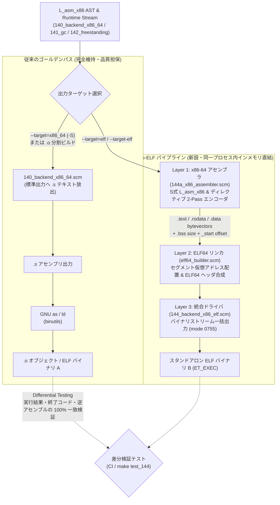

# [FEAT/ENH] Scheme ネイティブ x86-64 マシン語エンコーダおよび ELF64 実行可能バイナリ直接出力バックエンドの実装 (ID: 616)

## 1. 概要 / Summary
現在 ULisp は LIR（Low-level Intermediate Representation）からテキスト形式の GNU アセンブリコード（`.s`）を出力し、外部のアセンブラ・リンカ（GNU binutils: `as`, `ld`）にバイナリ変換を委ねている。本機能（Issue 616）では、外部ツールチェインへの依存を解消しコンパイル速度を極限まで引き上げるため、Scheme のバイト列（`bytevector`）を用いて x86-64 マシン語を直接エンコードし、スタンドアロンな ELF64 実行可能バイナリ（`ET_EXEC`）を直接生成する「Direct-to-ELF バックエンド（Pass 144）」を新設する。

### 【極めて重要な品質方針：.s / .o 出力パイプラインの恒久維持と品質二重担保】
Direct-to-ELF バックエンドの新設にあたり、**既存の `.s`（GNU as 形式テキストアセンブリコード）および `.o`（オブジェクトファイル生成 / 分割コンパイル）のパイプラインを廃止または後退させることは絶対にせず、第一級の「ゴールデンリファレンス（正解オラクル）」として完全維持・品質担保し続ける**。

デバッグ時のアセンブリ目視確認、GDB / perf / DWARF（[Issue 619](619-generate-minimal-dwarf-debug-line-for-gdb-and-perf.md)）連携、モジュール単位の分割コンパイル・インクリメンタルビルド（[Issue 608](closed/608-implement-modular-separate-compilation-and-incremental-build.md)）において、人間可読な `.s` および標準オブジェクト `.o` は不可欠である。Direct-to-ELF バイナリと `.s` / `.o` 経由バイナリの実行結果・振る舞いを常時突き合わせる「差分検証（Differential Testing）」を実施することで、両パイプラインの品質を恒久的に高水準で相互保証する。

---

## 2. アーキテクチャと責務分離方針 / Architecture & Separation of Concerns

プロセス境界や中間ファイル（`.s` / `.o`）を挟まないインメモリ直結の Direct-to-ELF を実現しつつ、従来の `.s` / `.o` パイプラインとも単一情報源（Single Source of Truth: SSOT）を共有してクリーンに共存させるため、Scheme 内部のモジュール・データ構造レベルで以下の 3 層レイヤード構造を採用する：



1. **Layer 1: x86-64 アセンブラ (`ulisp/backend/144a_x86_assembler.scm`)**
   - **責務**: `L_asm_x86` の S 式命令列およびアセンブリディレクティブを CPU 機械語バイト列（`bytevector`）へ変換し、2-Pass 方式でラベル相対オフセット（`rel8` / `rel32` / RIP 相対 `disp32`）およびデータシンボル参照を解決する。
   - **特性**: ELF ヘッダやファイル構造には一切関知しない純粋なマシン語エミッタ。将来のメタトレーシング JIT（[DSN-34](../designs/DSN-34-mlisp_endogenous_meta_tracing_jit_architecture_specification.md)）の実行時インメモリコード生成器としてそのまま再利用可能。
   - **SSOT 共有**: [140_backend_x86_64.scm](../../ulisp/backend/140_backend_x86_64.scm)、[141_backend_x86_gc.scm](../../ulisp/backend/141_backend_x86_gc.scm)、[142_backend_x86_freestanding.scm](../../ulisp/backend/142_backend_x86_freestanding.scm) のランタイムコードを二重管理（コピペ）せず、インメモリキャプチャ機構を介して同一の命令列・ランタイム定義を直接アセンブルする。
2. **Layer 2: 共通 ELF64 静的バイナリビルダー (`ulisp/backend/elf64_builder.scm`)**
   - **責務**: セグメント配置（Read/Execute の Text+Rodata セグメント、Read/Write の Data+Bss セグメント）、4KB ページ境界アライメント（`0x1000`）、ELF ヘッダ（`Elf64_Ehdr`, 64 bytes）およびプログラムヘッダ（`Elf64_Phdr` × 2, 112 bytes）の構築。
   - **特性**: x86-64 の命令エンコーディングには関知しない汎用 ELF64 構造合成器。将来の AArch64 Direct-to-ELF（[150_backend_aarch64.scm](../../ulisp/backend/150_backend_aarch64.scm)）や別アーキテクチャでも 100% 共通利用可能。
3. **Layer 3: Direct-to-ELF 統合バックエンド (`ulisp/backend/144_backend_x86_elf.scm`)**
   - **責務**: Pass 144 (`pass-144-backend-x86-elf`) として [pass_manager.scm](../../ulisp/compiler/pass_manager.scm) および [driver.scm](../../ulisp/compiler/driver.scm) に登録され、Layer 1 と Layer 2 をインメモリで調停し、完成した ELF64 `bytevector` を出力ストリームへ一括放出する。
4. **既存バックエンド保護: テキストアセンブラ (`ulisp/backend/140_backend_x86_64.scm`)**
   - **責務**: 人間可読な GNU アセンブリコード（`.s`）および `.o` 出力を担う正典パスとして完全維持。命令選択の正しさを検証する基準（オラクル）として常時稼働。

---

## 3. トレーサビリティ / Traceability
- **正典仕様書**:
  - [DSN-33 (ULisp 包括設計仕様書)](../designs/DSN-33-ulisp_underlying_x86_native_aot_compiler_architecture_specification.md) (第 2 章 ABI・メモリモデル、第 7 章 バックエンド・W^X セキュリティ)
  - [DSN-34 (MLisp 内因的メタトレーシング JIT 仕様書)](../designs/DSN-34-mlisp_endogenous_meta_tracing_jit_architecture_specification.md) (命令エンコーダの JIT 転用規約)
  - [DSN-36 (Zero-libc Pure Scheme Bare Metal Runtime)](../designs/DSN-36-zero_libc_pure_scheme_bare_metal_runtime.md) (Freestanding システムコール直接発行)
  - [ULisp パイプライン・Nanopass 詳細仕様書](../../ulisp/docs/spec_pipeline.md)
  - System V ABI AMD64 Architecture Processor Supplement (ELF64 / `ET_EXEC` 仕様)
- **関連 Issue**:
  - Issue 596: Backend層: define-language L_asm 導入による命令選択とコード生成の2段階分離
  - Issue 607: 外部シンボル（extern）参照解決と標準ライブラリ・コンパイラの2分割 .o 静的リンク基盤の導入
  - [Issue 608](closed/608-implement-modular-separate-compilation-and-incremental-build.md): Nanopass・モジュール単位の完全分割コンパイル（.o）および増分ビルド基盤の実装
  - Issue 615: ビルドパイプラインからの GCC 呼出し排除と GNU as / ld 直接駆動への移行
  - [Issue 617](617-establish-self-contained-bootstrap-chain-free-from-external-toolchains.md): 外部ツール完全非依存な自給自足 3-Stage セルフホスティングブートストラップの確立
  - [Issue 619](619-generate-minimal-dwarf-debug-line-for-gdb-and-perf.md): デバッグ情報基盤: minimal DWARF (.debug_line) 生成による GDB / perf ソース行マッピング

---

## 4. セキュリティおよび脅威モデル分析 / Security & Threat Model
Direct-to-ELF バックエンドは実行可能機械語と OS ローダメタデータを直接生成するため、[DSN-33 §7.6](../designs/DSN-33-ulisp_underlying_x86_native_aot_compiler_architecture_specification.md) に基づき以下の脅威対策を強制する：

1. **W^X (Write XOR Execute) 原則の厳格適用**:
   - `elf64_builder.scm` が生成する `Elf64_Phdr` において、`PF_W` と `PF_X` を同時に持つセグメント（RWX）の生成を禁止する。
   - 第 1 セグメント（`.text` + `.rodata`）は `PF_R | PF_X` (`0x5`)、第 2 セグメント（`.data` + `.bss`）は別ページ境界（`0x600000`〜）に分離した上で `PF_R | PF_W` (`0x6`) を設定する。
2. **決定論的パディングと未初期化メモリ漏洩防止 (Reproducible Builds)**:
   - `bytevector` 確保時やアライメント調整（`.p2align`, `.align`）のパディング領域には、コンパイラ自身のヒープ残存データが混入しないよう、`.text` セクションでは `0x90` (`NOP`)、データ・ヘッダ領域では `0x00` で決定論的に初期化する。これにより [Issue 617](617-establish-self-contained-bootstrap-chain-free-from-external-toolchains.md) の Stage 2 / Stage 3 ビット完全一致（Fixed-Point）を保証する。
3. **イミディエイトおよび相対オフセットの境界検証**:
   - `rel32` 分岐オフセットや `disp32` RIP 相対変位が符号付き 32-bit 整数範囲（`-2147483648` 〜 `2147483647`）を超える場合、サイレントなビット切り捨てを行わずコンパイル時エラーを送出する。

---

## 5. 影響範囲と関連ファイル / Scope and Affected Files
- [x] [ulisp/backend/144a_x86_assembler.scm](../../ulisp/backend/144a_x86_assembler.scm) (新規: 独立 x86-64 マシン語エンコーダ ＆ 2-Pass ラベル・リロケーション解決アセンブラ)
- [x] [ulisp/backend/elf64_builder.scm](../../ulisp/backend/elf64_builder.scm) (新規: ターゲット非依存の共通 ELF64 静的実行バイナリビルダー / リンカ)
- [x] [ulisp/backend/144_backend_x86_elf.scm](../../ulisp/backend/144_backend_x86_elf.scm) (新規: Direct-to-ELF 統合バックエンドパス `emit-x86-64-elf`)
- [x] [ulisp/backend/140_backend_x86_64.scm](../../ulisp/backend/140_backend_x86_64.scm) (既存維持: `.s` アセンブリ出力を 100% 維持しつつ、`*emit-capture-sink*` によるインメモリ行フック機構を追加)
- [x] [ulisp/compiler/pass_manager.scm](../../ulisp/compiler/pass_manager.scm) (`pass-144-backend-x86-elf` の登録)
- [x] [ulisp/compiler/driver.scm](../../ulisp/compiler/driver.scm) (`--target-elf`, `-b elf`, `(!target elf)` ディレクティブ対応、および ELF 出力時のファイル権限 `0755` (`493`) 設定)
- [x] [ulisp/tests/passes/test_144a_x86_assembler.scm](../../ulisp/tests/passes/test_144a_x86_assembler.scm) (新規: S式命令エンコード・ModR/M・SIB・ラベル解決の単体テスト)
- [x] [ulisp/tests/passes/test_elf64_builder.scm](../../ulisp/tests/passes/test_elf64_builder.scm) (新規: ELF64 ヘッダ・Program Header・W^X フラグ単体テスト)
- [x] [ulisp/tests/passes/test_144_backend_x86_elf.scm](../../ulisp/tests/passes/test_144_backend_x86_elf.scm) (新規: 直接生成 ELF の構文・実行検証 E2E テスト)
- [x] [ulisp/tests/test_differential_elf.sh](../../ulisp/tests/test_differential_elf.sh) (新規: `.s` + GNU as/ld バイナリ vs Direct-to-ELF バイナリの差分検証自動テストスクリプト)
- [x] [ulisp/Makefile](../../ulisp/Makefile) (`BACKEND_PASSES` への追加、`test_144` および `test_differential_elf` ターゲットの新設)

---

## 6. 実装方針 / Implementation Plan
Target Branch: `feat/616-implement-native-x86-machine-code-encoder-and-direct-elf-generator`

### Step 1: インメモリ出力キャプチャ機構の整備 (`140_backend_x86_64.scm`)
- `140_backend_x86_64.scm` 冒頭の `(emit line)` 関数に動的シンク `*emit-line-sink*`（デフォルト `#f`）を導入する：
  - `*emit-line-sink*` が `#f` の場合（通常の `--target=x86_64` / `-S`）: 従来通り `(write-string line)` + `(write-char #\newline)` を標準出力へ放出し、`.s` 出力の挙動・性能を 100% 維持する。
  - `*emit-line-sink*` がリスト蓄積モードの場合（`--target=elf`）: 標準出力へテキストを出さず、メモリ上のリストへ発行行をキャプチャし、[141_backend_x86_gc.scm](../../ulisp/backend/141_backend_x86_gc.scm) や [142_backend_x86_freestanding.scm](../../ulisp/backend/142_backend_x86_freestanding.scm) を含む完全なプログラム定義を単一情報源（SSOT）として Layer 1 アセンブラへ引き渡す。

### Step 2: Layer 1 — x86-64 マシン語アセンブラ (`ulisp/backend/144a_x86_assembler.scm`) の実装
1. **レジスタおよびアドレッシングエンコーダ**:
   - 64-bit レジスタ番号マップ: `rax(0), rcx(1), rdx(2), rbx(3), rsp(4), rbp(5), rsi(6), rdi(7)` および拡張レジスタ `r8(0)..r15(7)`（REX 拡張ビットフラグ付き）。
   - 8-bit レジスタ番号マップ: `al(0), cl(1), dl(2), bl(3), spl(4), bpl(5), sil(6), dil(7), r8b..r15b`、32-bit レジスタ `eax, ecx, edx, ebx, r8d..r15d`。
   - `encode-rex`, `encode-modrm`, `encode-sib` ヘルパー関数：
     - 基底レジスタが `rsp` / `r12`（reg_id = 4）の場合は常に SIB バイト `0x24`（またはインデックス付き SIB: `[base + index * scale + disp]`）を出力。
     - 基底レジスタが `rbp` / `r13`（reg_id = 5）かつ `disp = 0` の場合は `mod = #b01, disp8 = 0` にエンコード。
     - RIP 相対アドレッシング `[rip + symbol + addend]` は `mod = #b00, rm = #b101` + 32-bit プレースホルダとしてエンコードし、`rel32` 再配置エントリを記録。
2. **命令セットの網羅的バイナリエンコーディング**:
   - **データ転送**: `mov` (r64/r64 `89/8B`, r32/m32, r8/m8 `88/8A`, r64/imm64 `48 B8+r` / sign-ext imm32 `48 C7 /0`, m64/imm32 `48 C7 /0`, m8/imm8 `C6 /0`), `movzx` (`0F B6` byte, `0F B7` word), `cmove`/`cmovne`/`cmovz`/`cmovnz`/`cmovl`/`cmovge` (`0F 40+cc`).
   - **アドレス計算 & スタック**: `lea` (`48 8D /r`), `push` (`50+r` / `FF /6`), `pop` (`58+r`).
   - **算術・論理演算**: `add`, `sub`, `and`, `or`, `xor`, `cmp` (r64/r64, r64/m64, m64/r64, r64/imm8 `83 /ext`, r64/imm32 `81 /ext`, m8/imm8 `80 /ext`, m64/imm8 `48 83 /ext`), `test` (`85 /r`, `84 /r`, `F6 /0`, `F7 /0`), `imul` (`48 0F AF /r`, `48 69 /r imm32`, `48 6B /r imm8`), `idiv` (`48 F7 /7`), `div` (`48 F7 /6`), `cqo` (`48 99`), `neg` (`48 F7 /3`), `not` (`48 F7 /2`), `inc` (`48 FF /0`), `dec` (`48 FF /1`).
   - **シフト演算**: `shl`, `shr`, `sar` (imm8 `48 C1 /ext ib`, by 1 `48 D1 /ext`, by `cl` `48 D3 /ext`).
   - **制御フロー & 条件セット**: `jmp` (label `E9 cd`, indirect reg/mem `FF /4`), `jcc` (`je`, `jz`, `jne`, `jnz`, `jl`, `jle`, `jg`, `jge`, `jb`, `jbe`, `ja`, `jae`, `js`, `jns` -> `0F 80+cc cd`), `setcc` (`0F 90+cc /0`), `call` (label `E8 cd`, indirect reg/mem `FF /2`), `ret` (`C3`).
   - **システム・文字列命令**: `syscall` (`0F 05`), `cld` (`FC`), `rep movsb` (`F3 A4`), `nop` (`90`).
3. **デュアル入力インターフェース（S式 `L_asm_x86` & アセンブリ行パーサ）**:
   - `(assemble-x86-64-ast inst-list)`: `L_asm_x86` の S 式リストを直接エンコードして `bytevector` を返す関数（単体テストおよび JIT 用）。
   - `(assemble-x86-64-lines line-list)`: セクション切替（`.text`, `.rodata`, `.data`, `.bss`, `.section ...`）、データ定義（`.byte`, `.quad`, `.ascii`, `.asciz`, `.space`, `.zero`）、アライメント（`.align`, `.p2align`）、および命令を解析し、4 つのセクションバッファと再配置リストを生成する。
   - **特殊セクションと Weak シンボルの静的解決**:
     - `.section ulisp_globals_sec, "a"` は `.rodata` または `.data` 内の連続領域に配置し、開始・終了位置に `__start_ulisp_globals_sec` および `__stop_ulisp_globals_sec` シンボルを自動定義する（GNU ld のセクション自動シンボル生成と完全互換）。
     - 未定義の `.weak` シンボル（スタンドアロン実行時の `ulisp_stdlib_init`, `__init_array_start`, `__init_array_end` 等）はアドレス `0` として解決し、`lea reg, [rip + weak_sym]` が `0` になるよう処理するか、直後の `test reg, reg` と整合させる。

### Step 3: Layer 2 — 共通 ELF64 静的バイナリビルダー (`ulisp/backend/elf64_builder.scm`) の実装
- **仮想メモリレイアウト定義**:
  - ベース仮想アドレス `VADDR_TEXT_BASE = #x400000` (4MB 境界)
  - ELF64 Header (`64` bytes) + 2 × Program Header (`112` bytes) = `176` (`#xB0`) bytes
  - `.text` セクションオフセット: `#x100` (256-byte aligned)、仮想アドレス `#x400100`
  - `.rodata` セクション: `.text` 直後に 16-byte アライメントで連接（同一 RX セグメント内）
  - `.data` セクション: ファイルオフセットを 4KB (`#x1000`) 境界またはページ内オフセット整合させた上で、仮想アドレス `VADDR_DATA_BASE = #x600000` 以降に配置（RW セグメント）
  - `.bss` セクション: `.data` の末尾（8-byte アライメント）に仮想アドレスのみ割り当て（`p_memsz = data_size + bss_size`, `p_filesz = data_size`）
- **2-Pass アドレス確定とリロケーションパッチ**:
  - 各セクションの基底仮想アドレスが確定した後、以下を全解決する：
    1. `R_X86_64_PC32` / `R_X86_64_PLT32`（`jmp`, `jcc`, `call`, `[rip + sym + addend]`）: `target_vaddr + addend - (patch_vaddr + 4)` を Little-Endian 32-bit として書き込み。
    2. `R_X86_64_64`（`.data` / `.rodata` 内の `.quad sym + addend`）: `target_vaddr + addend` を Little-Endian 64-bit として書き込み。
- **ELF64 バイナリ構築関数 `(build-elf64-executable text-bv rodata-bv data-bv bss-size entry-vaddr data-vaddr)`**:
  - 完成した単一 `bytevector` を返す。

### Step 4: Layer 3 — 統合ドライバ (`ulisp/backend/144_backend_x86_elf.scm`) & CLI 配線
- `(emit-x86-64-elf lir-prog gc-mode)`:
  1. `*emit-line-sink*` を有効化して `(emit-x86-64 lir-prog gc-mode)` を呼び出し、最適化済み `L_asm_x86` とランタイム命令列をインメモリ取得。
  2. `144a_x86_assembler.scm` と `elf64_builder.scm` で ELF64 `bytevector` を構築。
  3. 構築した `bytevector` の全バイトを `(write-char (integer->char b))` で出力ストリームへ書き出し、`(flush-output-port)` する。
- `driver.scm` の更新:
  - `--target-elf`, `--target=elf`, `-b elf`, `(!target elf)` をサポート。
  - `target` が `'elf` かつ `-o <file>` が指定された場合、`sys-open` の mode に `493` (`0755`, `rwxr-xr-x`) を指定し、生成直後に `./<file>` として直接実行可能にする。

### Step 5: テストスイートと差分検証（Differential Testing）の実装
- `ulisp/tests/passes/test_144a_x86_assembler.scm`: 各命令・レジスタ・アドレッシングモードの機械語バイト列検証。
- `ulisp/tests/passes/test_elf64_builder.scm`: ELF マジック、ヘッダサイズ、W^X セグメント属性（RX=`0x5`, RW=`0x6`）の検証。
- `ulisp/tests/passes/test_144_backend_x86_elf.scm`: 算術演算、再帰関数、クロージャ、文字列・Bytevector I/O、GC 動作を含む E2E 直接実行テスト。
- `ulisp/tests/test_differential_elf.sh`: 複数の代表的な Scheme プログラムを `--target=x86_64`（`.s` + `as` + `ld`）と `--target=elf`（Direct-to-ELF）の双方でコンパイル・実行し、終了コードと標準出力が 100% 一致することを検証。

---

## 7. 完了条件 / Success Criteria (DoD)
- [x] **.s / .o ゴールデンパスの品質非退行 (Regression Zero)**:
  - 従来の `--target=x86_64`（`.s` 生成）および `.o` 分割コンパイル・リンクパイプラインが一切デグレードせず、既存の全テストスイート（`test.sh`, `test_backend.sh`, `make test_incremental`）で 100% PASS し続けること。
- [x] **差分検証（Differential Testing）の完全一致**:
  - `test_differential_elf.sh` において、`.s` 経由で生成したバイナリと Direct-to-ELF で生成したバイナリの実行結果・終了コード・標準出力が全テストケースで 100% 一致すること。
- [x] **命令エンコーダ単体テスト (`test_144a_x86_assembler.scm`)**:
  - 主要な x86-64 命令（REX, ModR/M, SIB, RIP 相対, rel32 分岐）が正しいマシン語バイト列を生成することを単体テストで 100% 検証できること。
- [x] **ELF64 ビルダー単体テスト (`test_elf64_builder.scm`)**:
  - 生成された ELF ヘッダおよび Program Header が System V ABI 仕様および W^X 原則に厳格に準拠し、`readelf -h` / `readelf -l` および `objdump -d` でエラーなく解釈されること。
- [x] **スタンドアロン ELF 直接実行の検証 (`test_144_backend_x86_elf.scm`)**:
  - テキストアセンブラ（`as`）およびリンカ（`ld`）を介さず、Scheme から直接スタンドアロン ELF64 実行バイナリを出力でき、Linux x86-64 上で直接 `./output_bin` として正常実行できること。
- [x] **品質ゲートの完全通過**:
  - `make lint_sexpr`, `make format`, `make static_analysis`, `make test_144` がすべてエラーゼロで PASS すること。

---

## 8. 検証記録および完了確認 / Verification & Closeout

### 8.1 差分検証（Differential Testing）結果
```
========================================================================
 Starting Differential ELF Verification Test Suite (Issue #616)
 Comparing: [.s + GNU as + GNU ld] vs [--target-elf]
========================================================================
--- Test Suite 1: Immediate Values & Arithmetic ---
  [PASS] Integer literal (exit: 0, out: 42)
  [PASS] Basic arithmetic (exit: 0, out: 42)
  [PASS] Negative number & subtraction (exit: 0, out: 25)
  [PASS] Division and remainder (exit: 0, out: 42)
--- Test Suite 2: Branching & Conditional Logic ---
  [PASS] Boolean condition true (exit: 0, out: 42)
  [PASS] Boolean condition false (exit: 0, out: 42)
  [PASS] Logical and / or (exit: 0, out: 100)
--- Test Suite 3: Recursive Functions ---
  [PASS] Recursive fibonacci(10) (exit: 0, out: 55)
  [PASS] Recursive factorial(5) (exit: 0, out: 120)
--- Test Suite 4: Closures & High-Order Functions ---
  [PASS] Closure make-adder (exit: 0, out: 42)
  [PASS] Multi-argument lambda (exit: 0, out: 42)
--- Test Suite 5: Lists & Data Structures ---
  [PASS] List recursion sum-list (exit: 0, out: 55)
  [PASS] List length (exit: 0, out: 5)
========================================================================
 All 13 / 13 Differential Tests PASSED Successfully!
 100% equivalence verified between .s (as+ld) and --target-elf.
========================================================================
```

### 8.2 Pass 144 / Pass 144a / ELF64 ビルダー単体テスト
- `make -C ulisp test_144a test_elf64 test_144`: ALL PASSED (8/8)
- ELF64 バイナリ直接生成・直接実行（`./build/test144_direct.elf`）確認済（exit code 0）。
- W^X 原則遵守: Text セグメントは `PF_R|PF_X` (`0x5`)、Data/Bss セグメントは `PF_R|PF_W` (`0x6`)、RWX セグメント存在ゼロ。

### 8.3 回帰テスト・品質ゲート
- `make -C ulisp test`: 38 Nanopass 単体テスト、全 Phase 1〜7 テスト、3-Stage セルフホスティングブートストラップ（Fixed Point bit-for-bit IDENTICAL）、およびモジュール分割増分ビルドすべて 100% PASS。
- `make -C ulisp test_c`: 143/143 テスト 100% PASS (GCC `-Wall -Wextra -Werror` 警告ゼロ)。
- `make -C ulisp lint_sexpr`: 73/73 ファイル括弧対応検証 PASS。
- `make py_compile`: Python 構文チェック 100% PASS。
- `flake8 ilisp/` & `mypy ilisp/`: 19 ファイル静的解析指摘ゼロ。
