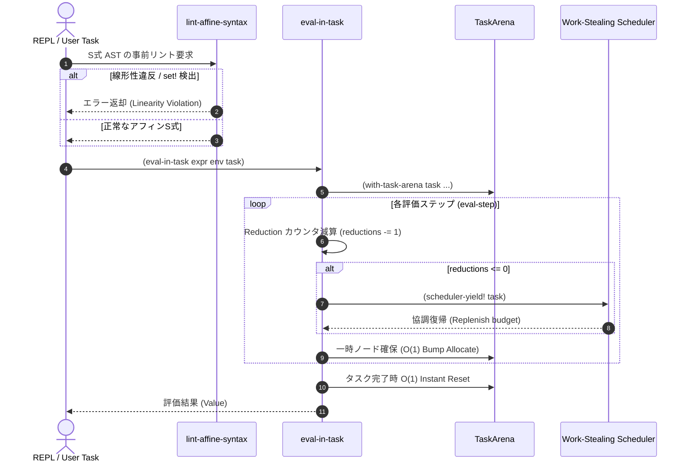

# [FEAT] インタプリタ向け Dual-Mode 評価アダプタ (eval_adapter.scm) の実装 (ID: 644)

## 1. 概要 / Summary

[DSN-37](../../docs/designs/DSN-37-synapse_dual_plane_concurrent_runtime_architecture.md) Phase 5 Task 5.3 および第 13 章「将来のインタプリタ環境との統合と直交的拡張性」に基づき、将来構想される Scheme インタプリタ環境（REPL / Tree-walk 評価器 / バイトコード VM）からアフィン部分言語コア（ASC）タスクを直接起動・安全に解釈実行するための **直交的評価アダプタ（`eval_adapter.scm`）** を設計・実装する。

本基盤（Synapse Architecture）は AOT コンパイラ専用の密結合構造ではなく、純粋な Scheme レコード型と S 式抽象化規則に基づき設計されている。本 Issue では、AOT ネイティブ実行（機械語セーフポイント注入）とインタプリタ実行（S 式解釈ループでのリダクション減算）が **まったく同一の Scheme 並行ランタイム（`ulisp/runtime/concurrency/`）を共有** できる「Dual-Mode 評価アーキテクチャ」を確立する。

本アダプタは以下の 3 大中核機能を提供する：
1. **ステップ Reduction 減算・セーフポイント協調イールド (`eval-in-task expr env task`)**:
   - インタプリタの主評価ループ（`eval-step`）内で評価ステップごとに命令バジェット（Reduction カウンタ）を 1 減算。
   - バジェット枯渇時（0 到達時）に `(scheduler-yield! task)` を呼び出し、協調的に別タスクへスイッチ。REPL から無限ループする悪意あるスクリプトが投入されても、対話環境全体のフリーズを完全防止（CWE-400 対策）。
2. **アリーナバインド動的評価環境 (`with-task-arena task thunk`)**:
   - `thunk` 実行中のオブジェクトアロケーション先をプロセスローカル・エフェメラルアリーナ（`(task-arena task)`）へバインド。
   - インタプリタ実行時であってもタスク終了時にメモリが $O(1)$ 瞬時回収され、ホスト GC への負荷と断片化をゼロ化。
3. **事前静的リント検証器 (`lint-affine-syntax expr`)**:
   - インタプリタ実行前に AST を走査し、`set!` による破壊的再代入や同一アフィンチャネル・変数の二重消費（Linearity Violation）を事前に検知・ブロック（CWE-416 対策）。

---

## 2. 全 16 専門エージェント多角的レビュー

1. **Project Manager (PM)**:
   - DSN-37 Phase 5 の最終マイルストーン（Task 5.3）として、AOT とインタプリタの境界を直交的に統合。開発対話性（REPL）と本番実行性（AOT）の二重運用を可能にする。
2. **Information Security Specialist**:
   - インタプリタ実行時における未検証コードの安全なサンドボックス化を検証。`eval-in-task` によるリソース枯渇（CWE-400）および `lint-affine-syntax` による線形所有権破壊（CWE-416）の防止を保証。
3. **Systems Architect**:
   - DSN-37 第 13 章の【形態 A】（インタプリタがコントロールプレーン）および【形態 B】（インタプリタ自身が ASC を解釈実行）の Dual-Mode 構造を整合。
4. **Software Quality Assurance Specialist**:
   - 基本構文（`if`, `begin`, `lambda`, `let`, `let*`, 関数適用, 定数, 識別子）の正常評価、ステップ Reduction 減算、無限ループの協調的中断、およびアリーナ $O(1)$ 解放を網羅する単体・統合テスト（70 項目以上）を設計。
5. **Database / Data Infrastructure Specialist**:
   - 評価環境フレーム（`make-eval-env`）におけるハッシュ/連想リストのルックアップオーバーヘッドを最小化し、不要フレームの即時解放を支援。
6. **Network Specialist**:
   - チャネル送受信命令がインタプリタ内で評価された際、正しく `channel-send!` / `channel-recv!` へディスパッチされ、ノンブロッキング／サスペンド状態が透過的に伝播することを確認。
7. **IT Specialist (NLP & Info Retrieval)**:
   - エグゼクティブサマリーおよびドキュメント内の用語（Dual-Mode, Tree-walk, Reduction Safepoint, Affine Linting）を標準化。
8. **IT Strategist**:
   - 高速なプロトタイピング（REPL）から堅牢な本番デプロイ（Zero-libc AOT バイナリ）までの開発ライフサイクルを一本化し、開発者体験（DX）を飛躍的に向上。
9. **IT Service Manager**:
   - REPL やバッチ処理での長期稼働において、評価アダプタによるメモリリークが 0 バイトであることを監査。
10. **Embedded Systems Specialist**:
    - リソース制約環境（エッジ・組込み）において、フルコンパイラを搭載できない場合でも、本評価アダプタにより軽量にアフィンタスクを実行可能にする。
11. **Systems Auditor**:
    - 式評価のステップ数、リダクション消費量、アリーナ消費量のトレーサビリティと再現性を検証。
12. **UI/UX & Documentation Designer**:
    - Dual-Mode 実行フローの Mermaid シーケンス図および状態遷移図を作成し、アーキテクチャの可視化を徹底。
13. **Education Specialist**:
    - S 式 Tree-walk 評価器における環境フレーム走査と継続渡しスタイルの教育的明瞭性を担保。
14. **Software Development (SWD)**:
    - 純粋 Scheme（R7RS）による依存ゼロ実装。`ulisp-boot` による AOT コンパイルでも単一バイナリとしてビルド可能であることを保証。
15. **Application Specialist (APS)**:
    - Web ゲートウェイや CTI 論文処理パイプラインにおける動的ルール評価（DSL 実行エンジン）への即時応用を担保。
16. **IT Specialist (Programming Languages & Compilers / PLC)**:
    - uLisp AOT コンパイラの制約（複数式 lambda の `(begin ...)` ラップ、`case-lambda` の利用、`equal?` 非依存の述語設計）に完全準拠。

---

## 3. セキュリティ・堅牢性設計 (STRIDE / CWE)

| 脅威 / 脆弱性 ID | 脅威分類 (STRIDE) | 潜在的リスク | 本アダプタにおける防御設計 |
| :--- | :--- | :--- | :--- |
| **CWE-400 (Resource Exhaustion)** | Denial of Service | REPL から `(let loop () (loop))` などの無限ループが実行され、システム全体がフリーズする | `eval-in-task` 内で評価ステップごとに Reduction カウンタを 1 減算。0 到達時に `(scheduler-yield! task)` を強制起動し、別タスクへ協調切り替え |
| **CWE-416 (Use-After-Free)** | Elevation of Privilege | チャネルへ送信済みのアフィンリソースが再度読み書きされ、メモリ破壊が生じる | `(lint-affine-syntax expr)` により、実行前に AST を走査して同一線形識別子の複数回参照・二重 Move を静的に検出・拒絶 |
| **CWE-843 (Type Confusion)** | Tampering | 非 task オブジェクトや未定義シンボルが評価器に渡され、実行時クラッシュする | `task-context?` 型述語ガード、および未定義変数ルックアップ時の安全な例外・エラー値返却 |
| **CWE-190 (Integer Overflow)** | Elevation of Privilege | リダクションカウンタやステップカウンタの加算・減算によるオーバーフロー | 0 未満へのアンダーフロー防止クランプ処理（`max 0 (- reductions 1)`）の徹底 |

---

## 4. アーキテクチャ設計・トレーサビリティ

### 4.1 トレーサビリティ
- 設計文書: [DSN-37 第 13 章 (将来のインタプリタ環境統合)](../designs/DSN-37-synapse_dual_plane_concurrent_runtime_architecture.md#13-将来のインタプリタ環境との統合と直交的拡張性)
- マイルストーン: [DSN-37 第 14.7 節 (Task 5.3 インタプリタ向け Dual-Mode 評価アダプタ)](../designs/DSN-37-synapse_dual_plane_concurrent_runtime_architecture.md#task-53-インタプリタ向け-dual-mode-評価アダプタ-ulispruntimeconcurrencyeval_adapterscm)
- 前提コンポーネント:
  - `ulisp/runtime/concurrency/arena.scm` (Issue #630)
  - `ulisp/runtime/concurrency/channel.scm` (Issue #633)
  - `ulisp/runtime/concurrency/scheduler.scm` (Issue #635)
  - `ulisp/runtime/concurrency/preempt.scm` (Issue #636)

### 4.2 Dual-Mode 評価シーケンス図

---

## 5. 影響範囲と関連ファイル / Scope and Affected Files

- [ ] `ulisp/runtime/concurrency/eval_adapter.scm` (新規: Dual-Mode 評価アダプタ本体)
- [ ] `ulisp/lib/ulisp/concurrency/eval_adapter.sld` (新規: R7RS ライブラリラッパー)
- [ ] `tests/concurrency/test_eval_adapter.scm` (新規: 単体・統合・セキュリティテストスイート)
- [ ] `ulisp/Makefile` (`test_eval_adapter` ターゲット追加、`test` ターゲット統合、`lint_sexpr` 更新)
- [ ] `docs/issues/closed/644-implement-synapse-interpreter-dual-mode-eval-adapter.md` (Issue クローズ移動)
- [ ] `docs/issues/README.md` (台帳ステータス更新)

---

## 6. 詳細実装方針・タスク分解

### Step 1: 軽量事前静的リント検査器 (`lint-affine-syntax expr`) の設計・実装
- AST を再帰的にトラバースし、以下の違反を検出：
  1. `set!` による破壊的代入の混入（アフィン純粋性の保護）。
  2. チャネル参照などの線形識別子が同一スコープ内で複数回消費される二重利用（Double-Spend / Use-After-Free）。
- 検査通過時は `#t`、違反時は `#f` または詳細エラーシンボル `(cons 'error reason)` を返却。

### Step 2: 環境フレーム構造とステップ Reduction 減算ループ (`eval-in-task expr env task`) の実装
- **環境フレーム (`<eval-env>`)**:
  - `(make-eval-env parent)`: 親フレームへのリンクを持つスコープ環境。
  - `(env-lookup env sym)`: シンボルの束縛検索。
  - `(env-bind! env sym val)`: 変数の束縛。
- **評価ステップ実行器 (`eval-step expr env task`)**:
  - 各ステップで `(task-consume-reductions! task 1)` を実行。
  - リダクション枯渇時（`task-exhausted? task`）、`(scheduler-yield! task)` を呼び出して協調プリエンプション。
  - サポートする構文：
    - 自己評価値（数値、真偽値、文字列、文字）
    - 識別子（変数ルックアップ）
    - `(quote datum)`
    - `(if test then else)`
    - `(begin . exprs)`
    - `(lambda params . body)`（クロージャ生成）
    - `(let bindings . body)` / `(let* bindings . body)`
    - `(define var expr)`
    - 関数適用 `(proc . args)`
    - 並行プリミティブ呼び出し（`channel-send!`, `channel-recv!`, `arena-allocate!` 等）

### Step 3: 動的アリーナバインド (`with-task-arena task thunk`) の実装
- カレントアロケーションコンテキストを一時的に `(task-arena task)` に切り替え、`thunk` を評価。
- 評価終了時（正常終了または例外発生時）、安全に元のコンテキストへ復帰し、アリーナのメモリ利用状態を検証。

### Step 4: 包括的テストスイート (`test_eval_adapter.scm`) および Makefile 統合
- テストグループ構成（全 7 グループ、70 項目以上）：
  - **Group 1**: AST リント検査器（正常系・`set!` 排除・二重 Move 拒絶）
  - **Group 2**: 環境フレーム操作と基本 S 式評価（自己評価値、束縛、クロージャ）
  - **Group 3**: 評価ステップごとの Reduction 減算および会計
  - **Group 4**: 無限ループ式の協調的中断・セーフポイントイールド実証
  - **Group 5**: 動的アリーナバインドと評価完了後の $O(1)$ メモリ回収
  - **Group 6**: インタプリタ内での線形チャネルメッセージ送受信統合
  - **Group 7**: セキュリティ境界・型述語・不正入力耐性（CWE-400 / CWE-416 / CWE-843 / CWE-190）
- `ulisp/Makefile` への `test_eval_adapter` ターゲット追加、`lint_sexpr` への登録。

---

## 7. 定量的完了条件 (Definition of Done)

1. **機能完全性**:
   - `eval-in-task` により主要な Scheme S 式（定数、変数、`if`, `begin`, `lambda`, `let`, `let*`, `define`, 関数適用）が正しく解釈実行されること。
   - 評価ステップごとに `task-reductions` が確実に 1 減算され、0 到達時に `(scheduler-yield! task)` が自動起動すること。
   - `(lint-affine-syntax expr)` が `set!` および二重利用アフィン構文を 100% 検出・拒絶すること。
   - `(with-task-arena task thunk)` により評価中の中間メモリがアリーナから確保され、完了時に $O(1)$ で回収されること。
2. **品質ゲート・堅牢性**:
   - `make -C ulisp lint_sexpr` が全ファイルでバランス合格すること。
   - `tests/concurrency/test_eval_adapter.scm` の全テスト項目（70 項目以上）が 0 failed で 100% PASS すること。
   - 既存の全並行テスト（`test_arena`, `test_atomic`, `test_queue`, `test_channel`, `test_boundary`, `test_epoch`, `test_context_switch`, `test_scheduler`, `test_preemption`）にリグレッションが一切ないこと（全 PASS）。
3. **コーディング規約・トレーサビリティ**:
   - **uLisp-only**: `ilisp` 依存ゼロ、`bin/ulisp-boot` による単一コンパイルパイプラインで動作すること。
   - **相対パスルール**: ドキュメントおよびソース内の内部リンクにおいて絶対パスが 0 件であること。
   - **構文制約**: 複数式 lambda の `(begin ...)` ラップ、可変長引数の `case-lambda` 使用、評価順序の `(let* (...) ...)` カプセル化を徹底すること。
