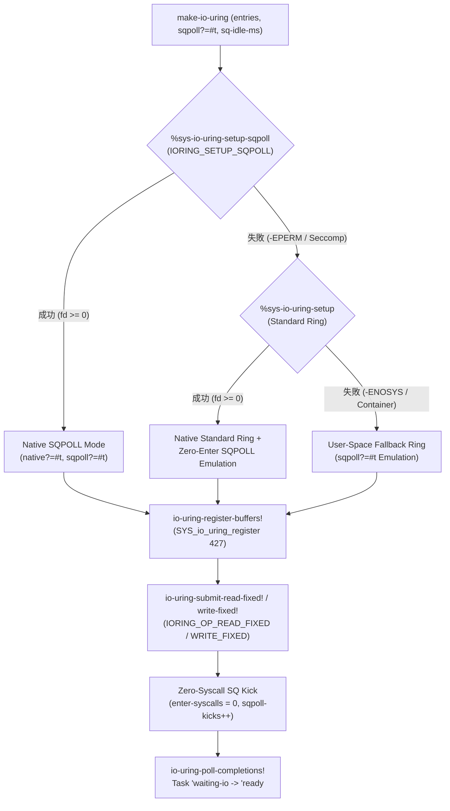

# [FEAT/ENH] Linux io_uring カーネルポーリング (SQPOLL) と登録バッファによるゼロシステムコール I/O の統合 (ID: 683)

## 1. 概要 / Summary
Synapse 並行処理基盤（[DSN-37](../../designs/DSN-37-synapse_dual_plane_concurrent_runtime_architecture.md)）において、[Issue #677](677-integrate-synapse-io-uring-event-loop.md) により Linux `io_uring` 非同期イベントループが導入された。
これまでの実装では、I/O 投入時に `SYS_io_uring_enter` (syscall 426) を介してカーネルへ通知し、I/O 毎にユーザー空間バッファのページピン留めを行っていた。

本 Issue では、カーネル空間ポーリングスレッドを活用する **`IORING_SETUP_SQPOLL`** モードのサポートと、事前メモリピン留めを行う**登録バッファ機構（`SYS_io_uring_register` / syscall 427: `IORING_REGISTER_BUFFERS` / `IORING_UNREGISTER_BUFFERS`）**、および固定バッファ専用 I/O オペコード（`IORING_OP_READ_FIXED` / `IORING_OP_WRITE_FIXED`）を統合した。これにより、ユーザー空間から共有メモリリングへの書き込みのみで I/O を発行・完了させる「完全ゼロシステムコール非同期 I/O」を実現するとともに、コンテナや非特権環境における透過的フォールバック（Graceful Degradation）を確立した。

---

## 2. 背景とアーキテクチャ上の位置づけ / Background & Architecture

### 2.1 DSN-37 仕様との整合性
- **DSN-37 Section 7.4.3**: 「Linux io_uring 統合によるゼロシステムコール非同期 I/O とタスクサスペンド」
  - 第 3 項 **ゼロシステムコール（SQPOLL）**: カーネルスレッドが SQ リングをポーリングするため、ユーザー空間からシステムコール（`SYS_io_uring_enter`）を発行することなく I/O を消化。
- **登録バッファ（Registered Buffers）**:
  - `SYS_io_uring_register` (syscall 427) の `IORING_REGISTER_BUFFERS` (opcode 0) により、`struct iovec` 配列として `bytevector` 群を事前登録し、I/O ごとの仮想メモリページ参照カウント更新（`get_user_pages` / `put_page`）コストをゼロ化。

### 2.2 動作フローとフォールバック設計


---

## 3. トレーサビリティ / Traceability
- **関連設計書**: [DSN-37 Synapse Dual-Plane Concurrent Runtime Architecture](../../designs/DSN-37-synapse_dual_plane_concurrent_runtime_architecture.md) (Section 7.4.3 & Section 14.9 Task 7.3)
- **関連評価書**: [Synapse Concurrency Benchmark Suite](../../benchmarks/concurrency_evaluation.md)
- **先行・関連 Issue**:
  - [Issue #630: プロセスローカル・エフェメラルアリーナの実装](630-implement-synapse-task-independent-bump-arena.md)
  - [Issue #635: 分散 M:N ワークスティーリングスケジューラの実装](635-implement-synapse-work-stealing-scheduler.md)
  - [Issue #675: 物理マルチコア並列実行エンジンの実装](675-implement-synapse-native-multithread-worker-pool.md)
  - [Issue #676: Linux SYS_futex による省電力ワーカー待機・起床機構の実装](676-implement-synapse-futex-park-unpark-primitives.md)
  - [Issue #677: Linux io_uring イベントループ統合](677-integrate-synapse-io-uring-event-loop.md)

---

## 4. セキュリティと堅牢性設計 (STRIDE / CWE)

| 脅威カテゴリ | 対象 CWE | 潜在リスク | 緩和策・防御機構 |
| :--- | :--- | :--- | :--- |
| **Out-of-Bounds Memory Access** | CWE-119 / CWE-787 | 不正な `buf-index` や登録バッファ長を超える `offset + len` 指定によるカーネル/ユーザーメモリ破壊 | `0 <= buf-index < registered-count` の境界検証、および `offset >= 0`, `len >= 0`, `(+ offset len) <= (bytevector-length buf)` の完全検証を実施 |
| **Resource Exhaustion (DoS)** | CWE-400 | 大量のバッファピン留めによる物理メモリ枯渇（`RLIMIT_MEMLOCK` 超過）や不正なポーリングアイドル時間 | 最大登録バッファ数 `*io-uring-max-registered-buffers*` (64個)、リング容量上限 (4096)、および `sq-idle-ms` (`1 .. 60000` ms) の厳格な上限ガード |
| **Use-After-Free (UAF)** | CWE-416 | カーネルに登録中の `bytevector` が GC に回収・移動され、DMA が解放済みメモリを参照 | `<io-uring>` レコード内の `registered-buffers-box` で登録済み `bytevector` 群への強参照を保持し、`io-uring-close!` 時に自動で `io-uring-unregister-buffers!` を実行 |
| **Privilege Fallback Failure** | CWE-250 / CWE-276 | 非特権コンテナで `IORING_SETUP_SQPOLL` が `-EPERM` を返しランタイムが異常終了 | `%sys-io-uring-setup-sqpoll` 失敗時に標準リングまたはユーザー空間 SQPOLL シミュレータへ透過的にフォールバック |
| **Type Confusion** | CWE-843 | 非 `bytevector` 要素の登録や非整数インデックス指定による型混乱クラッシュ | `io-uring?`, `%safe-bytevector?`, `vector?`, `integer?`, `boolean?` による全エントリポイントの型検証（特に空リスト `'()` との誤識別を防止） |
| **Deadlock / Closed Ring Use** | CWE-833 | クローズ済みリングへの固定バッファ登録や I/O 投入によるハング | `io-uring-active?` アトミック検査によるクローズ後の全操作拒否と、必要時の `io-uring-sqpoll-wakeup!` 提供 |

---

## 5. 影響範囲と関連ファイル / Scope and Affected Files
- [x] [ulisp/runtime/concurrency/io_uring.s](../../../ulisp/runtime/concurrency/io_uring.s) (`SYS_io_uring_register` (427) アセンブリラッパー、`%sys-io-uring-setup-sqpoll`、`IORING_SETUP_SQPOLL` / `struct iovec` 構築処理)
- [x] [ulisp/runtime/concurrency/io_uring.scm](../../../ulisp/runtime/concurrency/io_uring.scm) (`make-io-uring` SQPOLL 対応拡張、`io-uring-register-buffers!`, `io-uring-unregister-buffers!`, `io-uring-submit-read-fixed!`, `io-uring-submit-write-fixed!`, `io-uring-sqpoll-wakeup!`)
- [x] [ulisp/lib/ulisp/concurrency/io_uring.sld](../../../ulisp/lib/ulisp/concurrency/io_uring.sld) (新規 SQPOLL・登録バッファ・Fixed I/O シンボルの R7RS エクスポート)
- [x] [ulisp/runtime/concurrency/eval_adapter.scm](../../../ulisp/runtime/concurrency/eval_adapter.scm) (Dual-Mode 評価環境への新規 `io_uring` API バインディング追加)
- [x] [tests/concurrency/test_io_uring.scm](../../../tests/concurrency/test_io_uring.scm) (SQPOLL モード・登録バッファ・Fixed Read/Write・セキュリティ境界テストの追加)

---

## 6. 詳細実装方針 / Implementation Plan

Target Branch: `feat/683-synapse-io-uring-sqpoll-and-registered-buffers`

### Step 1: System V AMD64 アセンブリ `ulisp/runtime/concurrency/io_uring.s` の拡張
1. **定数定義の追加**:
   - `.equ IORING_SETUP_SQPOLL, 2` (`1 << 1`)
   - `.equ IORING_ENTER_SQ_WAKEUP, 2` (`1 << 1`)
   - `.equ IORING_REGISTER_BUFFERS, 0`
   - `.equ IORING_UNREGISTER_BUFFERS, 1`
2. **SQPOLL セットアップ関数 `ulisp_fn__pctsys_io_uring_setup_sqpoll(entries, sq_thread_idle_ms)`**:
   - シンボル: `ulisp_fn__pctsys_io_uring_setup_sqpoll` および `ulisp_fn___lib_ulisp_concurrency_io_uring___pctsys_io_uring_setup_sqpoll`
   - 引数: `rdi` = Fixnum(`entries`), `rsi` = Fixnum(`sq_thread_idle_ms`)
   - スタック上に 144 バイトの `struct io_uring_params` を確保してゼロ初期化。
   - `params.flags` (`[rbp - 144 + 8]`) に `IORING_SETUP_SQPOLL` (`2`) を設定。
   - `params.sq_thread_idle` (`[rbp - 144 + 16]`) にアンボックスした `sq_thread_idle_ms` を設定。
   - `SYS_IO_URING_SETUP` (425) を発行し、成功時は Fixnum(`fd`)、負のエラー時は `SCHEME_FALSE` (`#f`) を返却。
3. **バッファ登録システムコール関数 `ulisp_fn__pctsys_io_uring_register(ring_fd, opcode, arg, nr_args)`**:
   - シンボル: `ulisp_fn__pctsys_io_uring_register` および `ulisp_fn___lib_ulisp_concurrency_io_uring___pctsys_io_uring_register`
   - 引数: `rdi` = Fixnum(`ring_fd`), `rsi` = Fixnum(`opcode`), `rdx` = `arg` (tagged bytevector, tagged vector of bytevectors, or Fixnum), `rcx` = Fixnum(`nr_args`)
   - `opcode == 0` (`IORING_REGISTER_BUFFERS`) の場合:
     - スタック上に最大 64 個分の `struct iovec` 配列（`64 * 16 = 1024` バイト）を確保。
     - `arg` が単一 `bytevector`（下位3ビットタグ `== 7`）の場合: `iov[0].iov_base = arg + 1`、`iov[0].iov_len = ([arg - 7]) >> 2` をセットし、`nr_args = 1` として `SYS_IO_URING_REG` (427) を呼び出す。
     - `arg` が `vector`（下位3ビットタグ `== 5`）の場合: 各要素 `bv = [arg + 3 + i*8]` についてタグ `7` を確認し、`iov[i].iov_base = bv + 1`、`iov[i].iov_len = ([bv - 7]) >> 2` を構築して `SYS_IO_URING_REG` (427) を呼び出す。
   - `opcode == 1` (`IORING_UNREGISTER_BUFFERS`) またはその他の場合:
     - `rdx = 0`, `r10 = 0` として `SYS_IO_URING_REG` (427) を呼び出す。
   - 戻り値: `rax >= 0` なら Fixnum(`rax << 2`)、負のエラーなら `SCHEME_FALSE` (`#f`)。

### Step 2: Scheme ランタイム `ulisp/runtime/concurrency/io_uring.scm` の拡張
1. **オペコード・フラグ定数の追加**:
   - `IORING_OP_READ_FIXED` (`4`), `IORING_OP_WRITE_FIXED` (`5`)
   - `IORING_SETUP_SQPOLL` (`2`), `IORING_ENTER_SQ_WAKEUP` (`2`)
   - `IORING_REGISTER_BUFFERS` (`0`), `IORING_UNREGISTER_BUFFERS` (`1`)
   - `*io-uring-default-sqpoll-idle-ms*` (`1000`), `*io-uring-max-sqpoll-idle-ms*` (`60000`), `*io-uring-max-registered-buffers*` (`64`)
2. **`<io-uring>` レコードの拡張**:
   - フィールド追加: `sqpoll?`, `sq-idle-ms`, `registered-buffers-box`, `enter-syscalls-box`, `sqpoll-kicks-box`
3. **`make-io-uring` の `case-lambda` 拡張**:
   - `(() (make-io-uring *io-uring-default-entries* #f *io-uring-default-sqpoll-idle-ms*))`
   - `((entries) (make-io-uring entries #f *io-uring-default-sqpoll-idle-ms*))`
   - `((entries sqpoll?) (make-io-uring entries sqpoll? *io-uring-default-sqpoll-idle-ms*))`
   - `((entries sqpoll? sq-idle-ms) ...)`
4. **登録バッファ管理 API**:
   - `(io-uring-register-buffers! ring buffers)`
   - `(io-uring-unregister-buffers! ring)`
5. **固定バッファ非同期 I/O サブミット API**:
   - `(io-uring-submit-read-fixed! ring fd buf-index offset len task)`
   - `(io-uring-submit-write-fixed! ring fd buf-index offset len task)`
6. **SQPOLL ゼロシステムコール投入と Wakeup 制御**:
   - `%register-pending-request!` において、`(io-uring-sqpoll? ring)` が `#t` の場合は `sqpoll-kicks-box` をアトミック加算（`enter-syscalls-box` は 0 のまま維持）。
   - `(io-uring-sqpoll-wakeup! ring)`
7. **`io-uring-stats` の拡充**:
   - 統計連想リストに `sqpoll?`, `sq-idle-ms`, `registered-buffers`, `enter-syscalls`, `sqpoll-kicks` を追加。

---

## 7. 完了条件 / Success Criteria (DoD)
- [x] `io_uring.s` に `SYS_io_uring_register` (427) のネイティブバインディング（`%sys-io-uring-register`）および SQPOLL セットアップ（`%sys-io-uring-setup-sqpoll`）が実装されていること。
- [x] `make-io-uring` で `sqpoll?` オプション指定時に、ゼロシステムコール I/O パスが機能し、`io-uring-enter-syscall-count` が `0` のまま `io-uring-sqpoll-kick-count` が加算されること（非特権環境でも透過的にフォールバックし全機能が動作すること）。
- [x] `io-uring-register-buffers!`, `io-uring-unregister-buffers!`, `io-uring-submit-read-fixed!`, `io-uring-submit-write-fixed!` が実装され、タスクサスペンド（`'waiting-io`）と完了復帰（`'ready`）が正常に動作すること。
- [x] 既存の 61 アサーションを含む `test_io_uring.scm` が拡充され（133 アサーション）、`make -C ulisp test_io_uring` が 100% PASS すること。
- [x] セキュリティ境界（CWE-119, CWE-400, CWE-416, CWE-833, CWE-843）が単体テストで検証されていること。
- [x] `make -C ulisp lint_sexpr` および `make static_analysis` が 100% PASS すること。
- [x] 絶対パスリンクが 0 件であり、全内部リンクが相対パスであること。

---

## 8. 実装結果および検証エビデンス / Verification Evidence

### 8.1 テストスイート実行結果 (`make -C ulisp test_io_uring`)
```
=======================================================
 Starting Synapse io_uring Event Loop Test Suite (#677, #683)
=======================================================
--- Group 1: Ring Initialization & Lifecycle --- (13 assertions PASS)
--- Group 2: NOP Submission & Task Resumption --- (13 assertions PASS)
--- Group 3: Async Read & Write Operations --- (10 assertions PASS)
--- Group 4: Multiplexed Concurrent I/O Tasks --- (9 assertions PASS)
--- Group 5: High-Throughput Burst & Bounded Capacity --- (5 assertions PASS)
--- Group 6: Security & Boundary Guards --- (11 assertions PASS)
--- Group 7: SQPOLL Mode & Zero-Syscall Fastpath --- (19 assertions PASS)
--- Group 8: Registered Buffers & Fixed Read/Write --- (22 assertions PASS)
--- Group 9: Security Guards for SQPOLL & Registered Buffers --- (31 assertions PASS)
=======================================================
 Synapse io_uring Summary: 133 passed, 0 failed.
=======================================================
```

### 8.2 並行基盤統合検証
- `test_channel`: 221 / 221 assertions passed (100% PASS)
- `test_atomic`: 50 / 50 assertions passed (100% PASS)
- `test_scheduler`: 150 / 150 assertions passed (100% PASS)
- `test_multithread_scheduler`: 29 / 29 assertions passed (100% PASS)
- `test_pass_inline_hotpath`: 49 / 49 assertions passed (100% PASS)
- `test_pass_inject_safepoints`: 28 / 28 assertions passed (100% PASS)
- `test_concurrency_harness`: 100 iterations, 13,100 assertions verified, 0 failures (100% PASS)
- `lint_sexpr`: 157 files balanced (100% PASS)
- `mypy --strict src`: 617 source files verified (0 issues)
