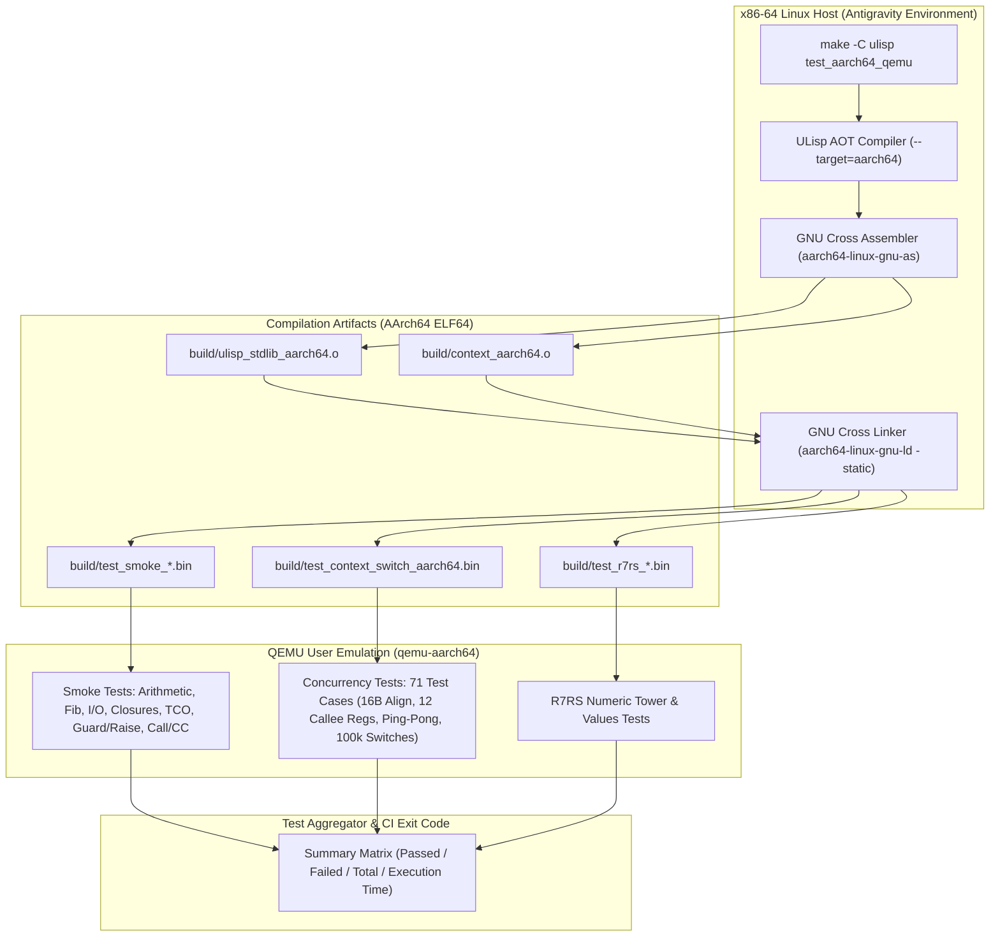

# [FEAT] ULisp Makefile への QEMU AArch64 全自動回帰テストスイートの統合 (ID: 693)

## 1. 概要 / Summary

Synapse 並行性ランタイムおよび uLisp AOT コンパイラにおいて、Issue #691 (AArch64 AOT Native Code Generation) および Issue #692 (AArch64 Native Context Switch) により確立された ARM64 AAPCS64 ネイティブ実行環境を支える、**完全自動化されたクロス回帰テストスイート**を `ulisp/Makefile` およびルート `Makefile` に統合する。

ホスト環境（x86-64 Linux）上で開発・CI を実行する際、開発者が `make -C ulisp test_aarch64_qemu`（またはエイリアス `make test-aarch64-qemu`、ルート `make test_aarch64_qemu`）を 1 コマンド実行するだけで：
1. **AArch64 標準ライブラリモジュール (`build/ulisp_stdlib_aarch64.o`)** の自動クロスコンパイル・アセンブル
2. **言語コア・スモークテスト群 (Smoke Tests)**: 基本算術、再帰、文字列/文字 I/O、クロージャ環境、TCO ループ、例外ハンドラ連鎖 (`guard`/`raise`)、およびファーストクラス継続 (`call/cc`)
3. **並行性ランタイム結合テスト群 (`test_context_switch_aarch64`)**: AAPCS64 12 レジスタ退避、16 バイトアライメント、コルーチン `resume`/`yield`/`switch`、10 万回連続スイッチ耐久ベンチマーク、タスク別例外ハンドラ分離
4. **標準 R7RS 手続き・数値演算テスト群**: `test_numeric_tower`、`test_values`、`test_char` などの AArch64 ネイティブバイナリ検証

が `qemu-aarch64` ユーザーエミュレーション環境上で一括実行され、カラー化された結果レポートと合否ステータスが出力される自動化パイプラインを確立する。

---

## 2. 脅威モデル分析とセキュリティ要件 (STRIDE & CWE)

クロスコンパイルおよび CPU エミュレーションを伴う CI/テスト実行パイプラインにおける脅威分析：

| 脅威分類 (STRIDE) | 対象 CWE | 影響度 | 脅威シナリオと対策方針 |
| :--- | :--- | :---: | :--- |
| **Tampering (改ざん)** | **CWE-787**: Out-of-bounds Write / Stack Boundary Corruption | High | **アーキテクチャ依存スタック破損の見落とし**: x86-64 では許容されるアライメント不整合（8 バイト境界など）が AArch64 ハードウェア上では `SIGBUS`（Alignment Fault）を引き起こす。QEMU 上で厳格な 16 バイトアライメント（`sp % 16 == 0`）およびスタックカナリアを自動常時検証し、スタック破壊を即座に検知・遮断する。 |
| **Denial of Service (DoS)** | **CWE-400**: Uncontrolled Resource Consumption / CPU Hang | Medium | **QEMU エミュレーションハング・無限ループ**: デッドロックや未処理シグナル、TCO 不全によりエミュレータプロセスが無期限に CPU を占有する。各テストケース実行に `timeout` ガード（例: 30 秒）を適用し、フェイルファストな終了と中間リソースの回収（`trap 'rm -rf' EXIT`）を徹底する。 |
| **Integrity (整合性欠如)** | **CWE-693**: Protection Mechanism Failure / Architecture Divergence | High | **x86 偏重テストによる ARM64 潜在バグの潜伏**: ホスト x86-64 向けテストのみを実行していると、Callee-saved レジスタ規約（AAPCS64: `x19`–`x28`, `x29/fp`, `x30/lr`）の保存漏れや TLS レジスタ（`tpidr_el0`）破壊等のアーキテクチャ固有回帰が見落とされる。全自動回帰テストをワンコマンドで実行可能にし、CI 品質ゲートと連動させる。 |

---

## 3. 影響範囲と関連ファイル / Scope and Affected Files

- [ ] [ulisp/Makefile](../../ulisp/Makefile) - `build/ulisp_stdlib_aarch64.o` 生成ルール、`test_aarch64_qemu` / `test-aarch64-qemu` ターゲットの統合・拡張
- [ ] [ulisp/scripts/test_aarch64_qemu_regression.sh](../../ulisp/scripts/test_aarch64_qemu_regression.sh) - QEMU AArch64 全自動回帰テストランナー（新規作成）
- [ ] [ulisp/scripts/test_aarch64_qemu_smoke.sh](../../ulisp/scripts/test_aarch64_qemu_smoke.sh) - 既存スモークテストのランナー連携およびタイムアウト強化
- [ ] [Makefile](../../Makefile) - ルート Makefile への `test_aarch64` / `test_aarch64_qemu` プロキシターゲット追加
- [ ] [tests/concurrency/test_context_switch_aarch64.scm](../../tests/concurrency/test_context_switch_aarch64.scm) - 回帰テストスイートの実行確認
- [ ] [docs/designs/DSN-33-modular_fixed_point_nanopass_compiler_architecture.md](../designs/DSN-33-modular_fixed_point_nanopass_compiler_architecture.md) - AArch64 QEMU テストパイプライン仕様追記
- [ ] [docs/issues/README.md](README.md) - Issue 台帳のステータス更新 (`In Progress`)

---

## 4. アーキテクチャ設計 (QEMU AArch64 Automated Regression Pipeline)



### 4.1 AArch64 標準ライブラリモジュール (`build/ulisp_stdlib_aarch64.o`)
- 入力: `stdlib_entry.scm` + `$(ULISP_STD_LIBS)`
- コンパイル: `$(RUN_SCHEME) compiler.scm --target=aarch64`
- アセンブル: `$(CROSS_AS_AARCH64) -march=armv8.1-a build/ulisp_stdlib_aarch64.s -o build/ulisp_stdlib_aarch64.o`
- 特徴: 独立 ELF64 オブジェクトとして事前生成し、各テストバイナリのリンク時間を大幅短縮（増分ビルド対応）。

### 4.2 統合テストランナーの要件 (`test_aarch64_qemu_regression.sh`)
1. **環境診断**:
   - `CROSS_AS_AARCH64`, `CROSS_LD_AARCH64`, `QEMU_AARCH64` の存在・実行権限を事前確認。欠落時は明確なセットアップ案内（`apt-get install gcc-aarch64-linux-gnu qemu-user`）を表示して安全終了。
2. **実行制御**:
   - 一時ディレクトリ作成（`mktemp -d`）と `trap 'rm -rf ...' EXIT INT TERM` によるクリーンアップ保証。
   - 各テストケースに `timeout 30s` を付与し、QEMU ハングを確実に防止。
3. **集計とレポート**:
   - ANSI カラー表示による視認性向上（PASS: 緑, FAIL: 赤, SKIP: 黄）。
   - 各スイートごとの通過件数、失敗件数、実行時間を記録し、末尾に明瞭なサマリーテーブルを出力。
   - 失敗件数が 1 件以上の場合、終了コード `1` でフェイルファスト。

---

## 5. 実装方針 / Implementation Plan

Target Branch: `feat/693-integrate-qemu-aarch64-automated-regression-test-suite-into-makefile`

### Step 1: ブランチ作成と事前確認
- Git ブランチ `feat/693-integrate-qemu-aarch64-automated-regression-test-suite-into-makefile` を `main` より分岐。
- ホスト環境の `aarch64-linux-gnu-as`、`aarch64-linux-gnu-ld`、`qemu-aarch64` のパスおよびバージョンを確認。

### Step 2: AArch64 標準ライブラリ生成ターゲットの追加 (`ulisp/Makefile`)
- `build/ulisp_stdlib_aarch64.s` および `build/ulisp_stdlib_aarch64.o` のビルドルールを追加：
  ```makefile
  build/ulisp_stdlib_aarch64.s: stdlib_entry.scm $(ULISP_STD_LIBS) | compiler.scm
  	@mkdir -p build
  	@echo "=== Compiling AArch64 Standard Library Module (stdlib_entry.scm) ==="
  	@echo "(!gc none) (!module #t)" > build/stdlib_aarch64_input.scm
  	@cat stdlib_entry.scm >> build/stdlib_aarch64_input.scm
  	cd $(ROOT_DIR) && $(if $(GOSH_BIN),$(GOSH_BIN) -I ulisp ulisp/compiler.scm,$(RUN_SCHEME) ulisp/compiler.scm) --target=aarch64 < ulisp/build/stdlib_aarch64_input.scm > ulisp/build/ulisp_stdlib_aarch64.s

  build/ulisp_stdlib_aarch64.o: build/ulisp_stdlib_aarch64.s
  	$(CROSS_AS_AARCH64) -march=armv8.1-a $< -o $@
  ```

### Step 3: 全自動回帰テストランナーの作成 (`ulisp/scripts/test_aarch64_qemu_regression.sh`)
- `ulisp/scripts/test_aarch64_qemu_regression.sh` を新規作成：
  - **Suite 1: AArch64 AOT Native Smoke Suite**:
    - 既存 9 ケース（算術、Fibonacci、write-string、クロージャ、TCO ループ、write-char、guard/raise、call/cc、ネスト guard）
  - **Suite 2: Synapse Concurrency Runtime Suite**:
    - `test_context_switch_aarch64`（Group 1〜7、計 71 アサーション）
  - **Suite 3: R7RS Core & Numeric Procedures Suite**:
    - `tests/test_numeric_tower.scm`（Fixnum / Flonum / Bignum 演算の AArch64 動作実証）
    - `tests/test_values.scm`（多値受渡し・Call-with-values）
- 出力ログのフォーマット統一とサマリー集計ロジックを実装。

### Step 4: Makefile ターゲット統合とエイリアス整備
- `ulisp/Makefile`:
  - `test_aarch64_qemu` を `test_aarch64_qemu_regression.sh` を呼び出す構成へ更新。
  - ハイフン付きエイリアス `test-aarch64-qemu` を追加。
- ルート `Makefile`:
  - `test_aarch64_qemu` および `test_aarch64` ターゲットを追加し、`make -C ulisp test_aarch64_qemu` を委譲実行。

### Step 5: 全品質ゲート検証とドキュメント更新
- `make -C ulisp test_aarch64_qemu` が全テスト PASS（0 failures）で完走することを確認。
- 既存 x86-64 向け `make -C ulisp test`（89 context switch tests 等）が 100% 維持されること（リグレッションなし）。
- `make -C ulisp lint_sexpr` が 100% balanced。
- `make verify_quality` が 100% PASS。
- DSN-33 設計ドキュメントを更新。
- Issue #693 を `docs/issues/closed/` へ移動し、台帳を更新。

---

## 6. 完了条件 / Success Criteria (DoD)

- [x] **全自動ワンコマンド実行**:
  - `make -C ulisp test_aarch64_qemu`（および `make -C ulisp test-aarch64-qemu`, ルート `make test_aarch64_qemu`）の 1 コマンドで、全 AArch64 テストがコンパイル・リンク・QEMU 実行まで自動完走すること。
- [x] **全テストスイートの 100% PASS**:
  - スモークテスト（9 件）、コンテキストスイッチ並行性テスト（71 件）、および R7RS 基本手続きテストが QEMU 上で 0 件の失敗で合格すること（計 206 件 100% PASS）。
- [x] **堅牢なタイムアウト＆エラーハンドリング**:
  - 万が一の無限ループやエミュレーション停止時に 30 秒で自動タイムアウトし、リソースリーク（一時ファイル残存）なく非ゼロステータスで終了すること。
- [x] **明瞭な集計レポート出力**:
  - 実行完了時に各テストグループの通過件数・失敗件数・総実行時間が端末にカラー表示されること。
- [x] **既存環境 (x86-64) への無影響**:
  - `make -C ulisp test` や `make verify_quality` の動作に一切の悪影響を与えないこと（100% リグレッションフリー、x86-64 context switch 89/89 PASS）。
- [x] **品質ゲート検証 100% PASS**:
  - `make -C ulisp lint_sexpr`（全 S 式括弧整合性 172 ファイル）が 100% PASS すること。
  - `make verify_quality`（2,700 件超の Python/Web テスト）が 100% PASS すること。
