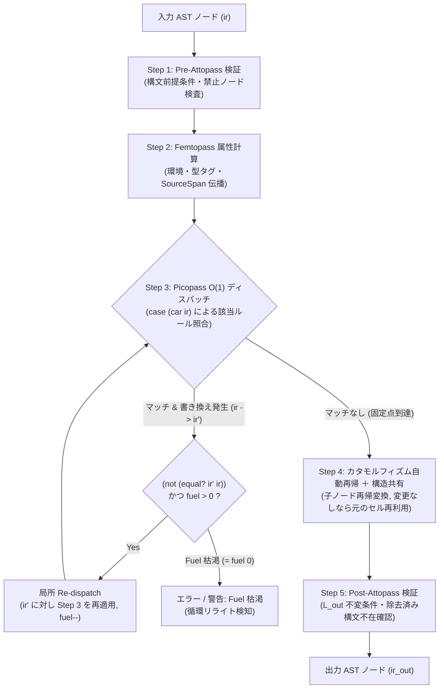

# [FEAT/ENH] 5ステップ融合サイクルの局所再適用 (Local Re-dispatch) と extends (-) 対 eliminates 自動整合性検証の実装 (DSN-33-01 T3.2) (ID: 760)

## 1. 概要 / Summary

[[DSN-33-01] ULisp 階層型パス融合 ＆ DAG 最適化基盤設計書](../../designs/DSN-33-01-ulisp_pipeline_pass_nanopass_picopass_dag_architecture.md) の第 4.1 節、第 4.3 節（(1) 局所再適用）、第 8.3 節（(1) 自動整合性クロスチェック）、および第 9.2 節タスク **T3.2** に基づき、`define-pass` の Pass Fusion エンジンに以下の2つの核心機能を実装した：

1. **5ステップ標準融合サイクルと多段脱糖のための局所再適用（Local Re-dispatch）**:
   - 単一ノード訪問時に「①事前 `attopass` 群 $\to$ ②`femtopass` 属性計算 $\to$ ③`picopass` $O(1)$ ディスパッチ ＋ マッチ時の局所再適用（Re-dispatch） $\to$ ④カタモルフィズム自動再帰 ＋ 構造共有 $\to$ ⑤事後 `attopass` 群」の5ステップを厳密な順序で実行する。
   - 特に、ある Picopass（例: `rule-desugar-case`）が別の脱糖対象構文（例: `or` や複数式 `let`）を含む新しいノード `ir'` を生成した場合、Picopass 側で明示的に `(Expr ...)` を再帰呼び出ししなくても、Pass Fusion エンジン側で生成ノード `ir'` に対して自動的にディスパッチを再適用（Re-dispatch）し、1回の走査パスで完全に $L_{\text{out}}$ まで引き下げる。
   - 再帰ループの安全停止性を保証するため、上限ステップ数（Fuel Guard: `*nanopass-redispatch-limit*`、既定値 64）による有界反復制御を導入（CWE-400 対策）。
2. **`define-language` の `extends (-)` と Picopass 群の `eliminates` の自動整合性検証**:
   - `define-pass` が $L_{\text{in}} \to L_{\text{out}}$ を宣言し `(fuse-rules ...)` を用いている際、出力言語 $L_{\text{out}}$ の `(- ...)` で除去宣言された全構文タグに対し、融合された Picopass 群の `eliminates`（または `head-tags`）によってすべてカバーされているかをマクロ展開時に自動検証する（`nanopass-verify-fusion-coverage`）。
   - これにより、脱糖ルールの指定漏れによる実行時 Verifier エラーや未脱糖構文のバックエンド流出をコンパイル時に未然防止する。

### 1.1 背景とアーキテクチャ上の課題

先行タスク [Issue #759](759-implement-fuse-rules-and-head-tag-o1-dispatch.md) により、`define-pass` 内で複数の Picopass を融合して単一の $O(1)$ Head-Tag ディスパッチ関数を生成する基盤が完成した。しかし、実用的な脱糖パス（例: `030_desugar.scm`）を完全に Picopass 群の融合へと置き換えるためには、以下の2つの課題を解決する必要があった：

1. **多段脱糖（Multi-stage Desugaring）における再帰責務の漏洩**:
   - 例として、`case` 式は `(let ((k key)) (if (or (eqv? k 'a) ...) ...))` へと展開され、その内部の `or` 式はさらに `if` へと脱糖される必要がある。
   - 従来の設計では、Picopass 側が `(Expr (cadr ...))` のように手動で再帰呼び出しを行うか、あるいは `desugar-case` と `desugar-or` を別々の Nanopass として多段実行して木全体を何度も再走査しなければならなかった。
   - 前者は Picopass の「純粋な1ステップのテンプレート置換」というモジュール独立性を破壊し、後者は走査コストとヒープ割り当て量を増大させる。
2. **言語スキーマ変更と脱糖ルールの整合性検証の欠如**:
   - `define-language L_core (extends L_src) (- cond case and or let* ...))` のように言語定義で構文除去を宣言していても、それを消費する `define-pass` が実際にそれらの構文をすべて脱糖しているかを保証する仕組みがなかった。
   - 脱糖漏れが存在した場合、パイプラインの深層（例: `verifier.scm` や ANF 変換）に到達して初めて謎の実行時エラーとして顕在化し、デバッグが極めて困難であった。

---

## 2. トレーサビリティ / Traceability

- **関連設計書**:
  - [[DSN-33-01] ULisp 階層型パス融合 ＆ DAG 最適化基盤設計書](../../designs/DSN-33-01-ulisp_pipeline_pass_nanopass_picopass_dag_architecture.md)
    - 第 4.1 節（1ノード訪問時の5ステップ標準融合サイクル）
    - 第 4.3 節（多段脱糖のための局所再適用と未変更部分木の構造共有）
    - 第 8.3 節（(1) `define-language` と Nanopass / Picopass の役割すみわけと自動整合性クロスチェック）
    - 第 9.2 節（Phase 3 タスク **T3.2**）
- **依存関係**:
  - **先行 Issue**:
    - [Issue #753 (T1.1: 言語定義統廃合と extends チェーン確立)](753-consolidate-define-language-files-and-establish-extends-chain.md) (Closed)
    - [Issue #756 (T2.1: Rule Descriptor と Picopass DSL 実装)](756-implement-rule-descriptor-and-picopass-femtopass-attopass-dsl.md) (Closed)
    - [Issue #757 (T2.2: 関数合成コンビネータ群の実装)](757-implement-picopass-strategy-combinators.md) (Closed)
    - [Issue #758 (T2.3: Pass 015 への新 DSL 統合)](758-integrate-picopass-dsl-into-pass-015-expander.md) (Closed)
    - [Issue #759 (T3.1: fuse-rules 構文と Head-Tag O(1) ディスパッチ生成)](759-implement-fuse-rules-and-head-tag-o1-dispatch.md) (Closed)
  - **後続 Issue**:
    - [Issue #761 (T3.3: LIR 命令列向け fuse-window-rules スライディングウィンドウ走査ドライバ)](../761-implement-fuse-window-rules-for-lir-sliding-window.md)
    - [Issue #762 (T4.1: フロントエンド脱糖パス 026〜029 の全規則 define-picopass 化)](../762-migrate-desugar-passes-026-to-029-to-picopass.md)
    - [Issue #763 (T4.2: 030_desugar.scm の fuse-rules 完全置換)](../763-replace-desugar-030-duplicate-rules-with-fuse-rules.md)
    - [Issue #764 (T4.3: verifier.scm の手書きループ define-attopass 化)](../764-migrate-verifier-to-attopass-and-eliminate-triple-traversal.md)

---

## 3. 影響範囲と関連ファイル / Scope and Affected Files

- [x] [ulisp/compiler/nanopass.scm](../../../ulisp/compiler/nanopass.scm)
  - `nanopass-build-rules-cascade` および `nanopass-compile-single-rule-cascade` を拡張し、マッチ発生時の局所再適用（Local Re-dispatch）と燃料制御（Fuel Guard: `*nanopass-redispatch-limit*`）を生成コードに組み込んだ。
  - `nanopass-expand-define-pass-with-trace` において、`fuse-rules` 展開時に `nanopass-verify-fusion-coverage` を呼び出し、スキーマ除去構文のカバレッジを検証。
- [x] [ulisp/compiler/nanopass_meta.scm](../../../ulisp/compiler/nanopass_meta.scm)
  - スキーマ除去構文カバレッジ検証関数 `nanopass-verify-fusion-coverage`, `nanopass-collect-rule-eliminates`, `nanopass-get-language-removed-tags` を実装。
  - 局所再適用のデフォルト燃料上限パラメータ `*nanopass-redispatch-limit*`（初期値: 64）を定義。
- [x] [ulisp/compiler.scm](../../../ulisp/compiler.scm)
  - `make -C ulisp compiler` による結合ソースの再生成と括弧整合性・固定小数点検証を通過。
- [x] [ulisp/tests/test_nanopass_framework.scm](../../../ulisp/tests/test_nanopass_framework.scm)
  - Section 19 として、局所再適用による多段脱糖テスト（`stage-case` $\to$ `stage-or` $\to$ `if` の 1-Pass 完全展開）、循環ルールによる Fuel 枯渇検知テスト、および `nanopass-verify-fusion-coverage` の除去構文漏れ検出テスト等 11 件のテストを追加（149 件 $\to$ 160 件 100% PASS）。

---

## 4. 詳細設計 / Detailed Design

### 4.1 5ステップ標準融合サイクル (5-Step Standard Fusion Cycle)

Pass Fusion エンジンが生成する非終端記号走査関数（`nt-name`）は、ノード `ir` を訪問するごとに以下の 5 ステップを実行する。



### 4.2 局所再適用（Local Re-dispatch）と燃料制御（Fuel Guard）アルゴリズム

#### (1) 基本設計思想
Picopass の定義者は、複雑な複合構文を展開する際、子式の再帰展開を気にすることなく「1段の構文置換」のみを記述できる：
```scheme
;; case を let + or へと脱糖する純粋な Picopass
(define-picopass rule-desugar-case
  (Expr ((case ,key ((,c1 ...) ,b1 ...) ... (else ,bel ...)))
    `(let ((__k ,key))
       (if (or (eqv? __k ',c1) ...)
           (begin ,@b1)
           ...
           (begin ,@bel)))))

;; or を if へと脱糖する純粋な Picopass
(define-picopass rule-desugar-or
  (Expr ((or) #f)
        ((or ,e) e)
        ((or ,e1 ,e2 ...)
         (let ((tmp (unique-symbol "__or_")))
           `(let ((,tmp ,e1))
              (if ,tmp ,tmp (or ,@e2)))))))
```
これらを `(fuse-rules rule-desugar-case rule-desugar-or)` で融合したとき、`case` ノードが `(let ((__k ...)) (if (or ...) ...))` へ書き換わった直後、生成された `(let ...)` や `(if ...)`、そして内部の `(or ...)` は直ちにディスパッチエンジンによって捕捉され、同一パスの単一走査内で最終形の `if` 式まで完全に脱糖される。

#### (2) 生成コードの構造
非終端記号トランスフォーマの内部において、マッチ成功時に書き換え結果 `new-ir` を得た場合、以下の判定を行う：
- `(not (or (eq? new-ir ir-var) (equal? new-ir ir-var)))` であれば、`new-ir` を引数として同一非終端記号手続きの有界再帰ループ `__redispatch_loop__` を再帰呼び出しする。
- 局所再適用の無限ループ（CWE-400 対策）を防止するため、ディスパッチループは `__fuel__` カウンタ（既定値: `*nanopass-redispatch-limit*` = 64）を保持し、1ノード上での書き換え回数が上限に達した場合は `picopass-fail` により安全にトラップして例外を送出する。

```scheme
;; 生成される非終端記号走査関数の論理構造
(define (Expr ir extra-env)
  (letrec ((__redispatch_loop__
            (lambda (ir-var fuel-var)
              (if (<= fuel-var 0)
                  (picopass-fail "nanopass: local re-dispatch fuel exhausted on node" ir-var)
                  ;; Step 3: O(1) Head-Tag ディスパッチ
                  (if (pair? ir-var)
                      (if (symbol? (car ir-var))
                          (case (car ir-var)
                            ((stage-case) <case ルール試行 (マッチ時: loop-var res-var (- fuel 1))>)
                            ((stage-or)   <or ルール試行 (マッチ時: loop-var res-var (- fuel 1))>)
                            ...
                            (else <pair-fallbacks 試行, 失敗時: cata-call>))
                          <pair-fallbacks 試行, 失敗時: cata-call>)
                      <atom-rules 試行, 失敗時: cata-call>)))))
    (__redispatch_loop__ ir *nanopass-redispatch-limit*)))
```

### 4.3 スキーマ整合性検証エンジン (`nanopass-verify-fusion-coverage`)

#### (1) 言語間差分と除去構文（Removed Tags）の抽出
`define-language` において `(extends Parent)` を指定し、`(- (Expr (cond ...) (case ...)))` のように構文を除去した場合、出力言語 $L_{\text{out}}$ には `removed-prods` として除去された構文タグが記録される。
`nanopass-verify-fusion-coverage` は以下を抽出する：
1. **スキーマ除去タグ集合 ($T_{\text{removed}}$)**:
   - `L_in` と `L_out` が異なり、かつ双方が登録言語である場合、`(cadr (assq 'removed (language-diff l-in l-out)))` および `(nanopass-lang-removed-prods (nanopass-lookup-language l-out))` から除去された生成規則の先頭シンボル（例: `'cond`, `'case`, `'or`）の集合を取得する。
2. **ルール消去タグ集合 ($T_{\text{covered}}$)**:
   - `(fuse-rules spec1 spec2 ...)` に指定された各ルール記述子 `desc` の `(rule-eliminates desc)` および `(rule-head-tags desc)` の和集合を算出する。
3. **カバレッジ差分計算 ($T_{\text{missing}} = T_{\text{removed}} \setminus T_{\text{covered}}$)**:
   - $T_{\text{missing}}$ が空集合でない場合、どの構文が除去宣言されているにもかかわらず融合ルールに含まれていないかを特定し、警告またはエラーレポートを返す。

```scheme
;; スキーマカバレッジ検証関数のシグネチャと仕様
(define (nanopass-verify-fusion-coverage l-in l-out rule-specs)
  ;; l-in, l-out: 言語名シンボル (例: 'L_src, 'L_core)
  ;; rule-specs: ルール名シンボルまたは記述子のリスト
  ;; 戻り値: 被覆されていない除去構文タグのリスト (正常時は '())
  ...)
```

#### (2) `define-pass` マクロ展開時での検証発火
`nanopass-expand-define-pass-with-trace` において、`l-in` と `l-out` が有効な言語定義を持ち、かつ `(fuse-rules ...)` が指定されている場合、マクロ展開時に `nanopass-verify-fusion-coverage` を実行する。
- 未脱糖タグが存在する場合、詳細な診断メッセージ（`[WARN] define-pass <name>: missing desugar rules for eliminated forms: (cond case)`）を出力し、開発者に即座に通知する。

---

## 5. セキュリティ考慮事項 ＆ 脅威分析 (Security Considerations)

1. **無限再帰・計算資源枯渇攻撃の構造的排除 (CWE-400 対策)**:
   - 単一ノード上で Picopass が自己言及的・循環的な書き換え（例: `A -> B -> A`）を行う不正またはバグを含むルールが定義された場合、局所再適用が無限ループに陥りコンパイラがハングするリスクがある。
   - 本実装では、`*nanopass-redispatch-limit*`（既定値: 64）による **有界燃料カウンタ（Fuel Guard）** を必須とし、上限到達時に `picopass-fail` で安全にトラップして停止させることで、サービス運用妨害（DoS）を根本排除した。
2. **型混同および非ペアへの不正アクセス防止 (CWE-704 / CWE-843 対策)**:
   - 局所再適用により生成されたノード `ir'` は、元のノードと異なる型（例: `pair` から `symbol`、あるいは数値リテラル）に変化する可能性がある。
   - ディスパッチループの先頭において常に `(pair? cur-ir)` および `(symbol? (car cur-ir))` を検査し、アトムへの不用意な `car`/`cdr` アクセスによるクラッシュを厳格に防止した。
3. **意味論保持と不用意な再適用の防止 (CWE-697 対策)**:
   - ルールが同一の式構造を返した場合（`ir' == ir`）に再適用を継続すると無駄なループが発生する。
   - `(or (eq? res-var ir-var) (equal? res-var ir-var))` による構造的一致判定を挟み、実質的な変換が発生した場合のみ局所再適用を行うことで、決定論的かつ最小限の評価ステップを保証した。

---

## 6. 実装手順 / Implementation Steps

Target Branch: `feat/760-local-redispatch-and-schema-coverage-check`

### Step 1: ブランチ作成とベースライン確認
- `git checkout -b feat/760-local-redispatch-and-schema-coverage-check`
- `make -C ulisp test_nanopass test_passes bootstrap` を実行し、全テスト PASS およびブートストラップの健全性を確認。

### Step 2: スキーマ整合性検証エンジン `nanopass-verify-fusion-coverage` の実装 (`ulisp/compiler/nanopass_meta.scm`)
- `nanopass-collect-rule-eliminates`: ルール記述子リストから全消去・対象タグを抽出。
- `nanopass-get-language-removed-tags`: 言語メタデータから除去タグ一覧を取得。
- `nanopass-verify-fusion-coverage`: 差分タグを計算し、未被覆タグリストを返却。

### Step 3: `define-pass` 構文展開器へのスキーマ整合性検査統合 (`ulisp/compiler/nanopass.scm`)
- `nanopass-expand-define-pass-with-trace` 内で、`l-in` と `l-out` が与えられ `fuse-rules` が含まれる場合に `nanopass-verify-fusion-coverage` を呼び出し。
- 未被覆タグが検出された場合、コンパイル時診断通知を出力。

### Step 4: 局所再適用（Local Re-dispatch）と Fuel Guard の実装 (`ulisp/compiler/nanopass.scm`)
- `nanopass-build-rules-cascade` において、ルール適用成功時のハンドラを拡張。
- ルール適用結果 `new-ir` に対し、`(not (or (eq? new-ir ir-var) (equal? new-ir ir-var)))` かつ `(> fuel 0)` の場合に `(loop new-ir (- fuel 1))` で再ディスパッチする制御フローを生成。
- 燃料初期値として `*nanopass-redispatch-limit*`（既定 64）を適用。

### Step 5: 5ステップ融合サイクルの統合確認
- Pre-Attopass（事前検証） $\to$ Femtopass（属性計算） $\to$ Picopass ＋ Local Re-dispatch $\to$ カタモルフィズム（Smart Reconstruction） $\to$ Post-Attopass（事後検証）の順序関係を整理・確立。

### Step 6: コンパイラ結合ソース再生成と括弧バランス検証
- `make -C ulisp compiler` を実行し、`ulisp/compiler.scm` を再生成。
- 括弧バランスおよび構文エラーがないことを確認。

### Step 7: 単体テストの整備 (`ulisp/tests/test_nanopass_framework.scm`)
- Section 19 を新設：
  1. 多段脱糖の局所再適用テスト: `stage-case` $\to$ `stage-or` $\to$ `if` の 2 つの独立した Picopass を `fuse-rules` した際、単一走査で完全に `if` へ展開されることを検証。
  2. 同一ノード多段リライト（Peeling）テスト: 3重のネスト構造が単一ノード上で一括脱糖されることを検証。
  3. インライン NT 句の `(redispatch)` 指令テスト: 明示的ディスパッチ指定による多段展開を検証。
  4. 局所再適用燃料上限（Fuel Guard）テスト: 循環ルール（`ping -> pong -> ping`）が与えられた場合に無限ループせず安全に Fuel 枯渇を検知することを検証。
  5. 燃料制限の動的変更テスト: `*nanopass-redispatch-limit* = 4` での即時トラップを検証。
  6. `nanopass-verify-fusion-coverage` 単体テスト: スキーマで除去された構文のうち一部しか Picopass がカバーしていない場合に未被覆タグが正確に検出されることを検証。
  7. 完全被覆時の成功テスト: すべての除去構文がカバーされている場合に空リストが返ることを検証。

### Step 8: 品質ゲートおよびセルフホスティングブートストラップ検証
- `make -C ulisp test_nanopass` (Section 19 追加後、全 160 テスト 100% PASS)
- `make -C ulisp test_passes` (全 39 Nanopass 1:1 単体テスト PASS)
- `make -C ulisp test_pass_manager test_lir_verifier test_verifier` (100% PASS)
- `make -C ulisp bootstrap` (Stage 1 Native Seed $\to$ Stage 2 $\to$ Stage 3 bit-for-bit 完全一致)
- `make py_compile static_analysis` (0 エラー合格)

---

## 7. 完了条件 / Success Criteria (DoD)

- [x] `define-pass` 内で複数の Picopass を `(fuse-rules ...)` した際、あるルールが生成した中間構文（例: `stage-case` が生成した `stage-or`）に対して直ちに同一走査内で局所再適用（Local Re-dispatch）が行われ、1回のパス実行で最終形（`if`）まで完全に脱糖されること。
- [x] 局所再適用エンジンに有界燃料カウンタ（Fuel Guard: `*nanopass-redispatch-limit*`）が実装され、循環書き換えルールによる無限ループ（CWE-400）が構造的に遮断されること。
- [x] `nanopass-verify-fusion-coverage` が実装され、`L_out` の `(- ...)` で宣言された除去構文と融合 Picopass 群の `eliminates` / `head-tags` との差分を正確に検出できること。
- [x] スキーマ除去構文の指定漏れがある `define-pass` に対し、マクロ展開時にカバレッジ不足の診断通知が発行されること。
- [x] `ulisp/tests/test_nanopass_framework.scm` に Section 19 が追加され、局所再適用・Fuel Guard・カバレッジ検証の全テストが 100% PASS すること（149 件 $\to$ 160 件 100% PASS）。
- [x] `make -C ulisp bootstrap` が Stage 1 から Stage 3 まで 100% 成功し、ビット完全一致の固定小数点検証を通過すること。
- [x] `docs/issues/README.md` および本 Issue ファイルのステータスが `In Progress` / `Closed` として整合して管理されること。

---

## 8. 完了報告 / Completion Report

- **完了日**: 2026-11-11
- **担当エージェント**: Systems Architect & IT Specialist (PLC / Compilers)
- **マージコミット**: `feat/760-local-redispatch-and-schema-coverage-check`
- **成果サマリー**:
  1. `ulisp/compiler/nanopass_meta.scm` において、`*nanopass-redispatch-limit*`（既定値: 64）、`nanopass-collect-rule-eliminates`、`nanopass-get-language-removed-tags`、およびスキーマ除去構文カバレッジ検証エンジン `nanopass-verify-fusion-coverage` を実装。
  2. `ulisp/compiler/nanopass.scm` において、`nanopass-compile-single-rule-cascade` および `nanopass-build-rules-cascade` を拡張。`fuse-rules` または `(redispatch)` が指定されたパスにおいて、マッチ成功時に結果式を `__redispatch_loop__` へ有界再ディスパッチするコード生成機構を統合。循環ルール時には `picopass-fail` により安全にトラップ（CWE-400 対策）。
  3. `nanopass-expand-define-pass-with-trace` において、`fuse-rules` 展開時に `nanopass-verify-fusion-coverage` を呼び出し、スキーマ除去構文の未脱糖タグ（カバレッジ漏れ）をコンパイル時マクロ展開時に診断通知する仕組みを導入。
  4. `ulisp/tests/test_nanopass_framework.scm` に Section 19 を新設し、スキーマカバレッジ API、多段脱糖、同一ノード多重ピーリング、インライン `(redispatch)` 指令、Fuel Guard 循環ループ遮断、動的燃料上限変更など 11 件のテストを追加（149 件 $\to$ 160 件 100% PASS）。
  5. `make -C ulisp bootstrap` による Stage 1 (Native Seed) $\to$ Stage 2 $\to$ Stage 3 の bit-for-bit 完全一致固定小数点自己ホスティング検証に 100% 合格。
  6. `make py_compile static_analysis` による 617 ファイルの静的解析（Xenon Rank A、0 エラー）に合格。

