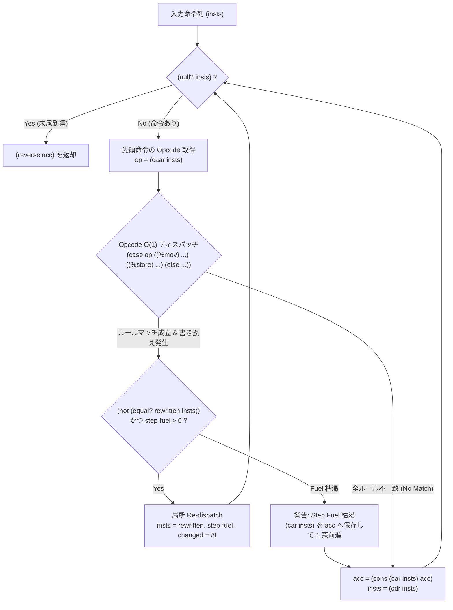

# [FEAT/ENH] LIR 命令列向け fuse-window-rules スライディングウィンドウ走査および収束ドライバの実装 (DSN-33-01 T3.3) (ID: 761)

## 1. 概要 / Summary

[[DSN-33-01] ULisp 階層型パス融合 ＆ DAG 最適化基盤設計書](../../designs/DSN-33-01-ulisp_pipeline_pass_nanopass_picopass_dag_architecture.md) の第 2.3 節、第 4.4 節（走査ドライバの二大系統）、第 6.3 節（LIR スライディングウィンドウ・依存融合）、および第 9.2 節タスク **T3.3** に基づき、低レベル中間表現（LIR）の線形命令列に対するスライディングウィンドウ走査および有界不動点収束ドライバ **`fuse-window-rules`** を実装した。

現在、LIR 分岐融合（`128_lir_branch_fusion.scm`）、LIR ピープホール最適化（`133_lir_peephole.scm`）、および x86-64 バックエンドピープホール（`143_backend_x86_peephole.scm`）は、それぞれ各パス内部で独自に手書きされた `let loop ((rest insts) (acc '()))` と深い `car`/`cadr`/`caddr` ネストによって実装されていた。これにより、パス間で同様の窓進行・命令再構築ループが重複し、命令パターンの追加や検証のコストが増大していた。

本 Issue により、S式構文木（AST / Term DAG）に対する再帰カタモルフィズム走査ドライバ `fuse-rules`（`fuse-tree-rules`）と対をなす、**線形命令列のための第2の標準走査ドライバ `fuse-window-rules`** が Nanopass コンパイラ基盤に正式導入された。これにより、`define-picopass` で記述された独立な命令窓変換ルール群（`InstWindow`）を単一の $O(1)$ Opcode Head-Tag ディスパッチ走査へと自動融合し、後続の LIR パス Picopass 化（[Issue #767](../767-migrate-lir-peephole-to-picopass-and-dependency-dag.md)）への決定的な足がかりを確立した。

### 1.1 背景とアーキテクチャ上の課題

#### (1) 構文木カタモルフィズムと線形命令列走査の根本的差異
- **構文木走査 (`fuse-rules`)**: 式や文などの階層的ノード構造（`Expr`, `Call`, `Binding` 等）をボトムアップ／トップダウンで再帰的にトラバースし、子ノードの自動カタモルフィズム再帰と未変更部分木の構造共有（Smart Reconstruction）を行う。
- **線形命令列走査 (`fuse-window-rules`)**: 基本ブロック内の命令列 `(inst_1 inst_2 inst_3 ...)` に対し、隣接する 1〜4 命令の窓幅（Window Width）で局所パターンを照合・置換する。子ノードという概念は存在せず、「置換後の命令列サフィックスに対する局所再ディスパッチ」と「非マッチ時の 1 命令確定・前進（Window Advance）」が基本動作となる。

#### (2) 局所再適用（Local Re-dispatch）と有界不動点収束（Bounded Fixpoint）の必要性
- ある命令窓ルール（例: 自己代入消去 `((%mov ,r ,r) . ,rest) => rest`）が発火して命令が削除されると、それまで離れていた前後の命令（例: `%store` と `%load`）が新たに隣接し、第2のルール（Store-Reload Forwarding）の発火条件を満たす場合がある。
- したがって、窓進行ドライバは以下の2層の収束制御を必要とする：
  1. **局所再適用 (Local Re-dispatch)**: 現在位置でルールが発火した際、置換結果のサフィックスに対して直ちに再度マッチを試行する。
  2. **有界不動点反復 (Bounded Fixpoint Loop)**: 命令列全体を走査して 1 回でもルールの発火（`changed?`）があった場合、固定点に達するまで最大反復回数（`*nanopass-window-fixpoint-limit*`、既定値 16）まで反復を繰り返す（CWE-400 対策）。

#### (3) デュアルモード入力処理（Dual-mode Input Handling）
- パス実行時、テストケースや部分最適化では平坦な命令リスト `((%mov %rax %rax) (%add %rax 1))` を直接走査したい一方、コンパイラ本番パイプラインではプログラム全体 `(%lir-program (strings ,se) (stackmaps ,sm) (%lir-functions ,f ...) ,m)` が渡される。
- `fuse-window-rules` は、入力が `%lir-program` であるかを自動検出し、各関数宣言（`%lir-function`）の `body` およびメインブロック（`%lir-main`）の `body` にスライディングウィンドウ走査を自動適用して全体を透過的に再構築する機能を内蔵する。

---

## 2. トレーサビリティ / Traceability

- **関連設計書**:
  - [[DSN-33-01] ULisp 階層型パス融合 ＆ DAG 最適化基盤設計書](../../designs/DSN-33-01-ulisp_pipeline_pass_nanopass_picopass_dag_architecture.md)
    - 第 2.3 節（Pass 粒度の4層構造と責務境界）
    - 第 4.4 節（走査ドライバの二大系統: 構文木 `fuse-rules` と線形命令列 `fuse-window-rules`）
    - 第 6.3 節（3. LIR スライディングウィンドウ・依存融合: `fuse-window-rules`）
    - 第 9.2 節（Phase 3 タスク **T3.3**）
- **依存関係**:
  - **先行 Issue**:
    - [Issue #756](756-implement-rule-descriptor-and-picopass-femtopass-attopass-dsl.md) (T2.1: 第一級 Rule Descriptor と Picopass DSL 実装) (Closed)
    - [Issue #757](757-implement-picopass-strategy-combinators.md) (T2.2: Picopass 関数合成コンビネータ群の実装) (Closed)
    - [Issue #758](758-integrate-picopass-dsl-into-pass-015-expander.md) (T2.3: Pass 015 先行 DSL 展開器への pico/femto/atto 構文統合) (Closed)
    - [Issue #759](759-implement-fuse-rules-and-head-tag-o1-dispatch.md) (T3.1: fuse-rules 構文と Head-Tag O(1) ディスパッチ生成エンジンの実装) (Closed)
    - [Issue #760](760-implement-local-redispatch-and-extends-eliminates-validation.md) (T3.2: 5ステップ融合サイクルの局所再適用と extends (-) 対 eliminates 自動整合性検証) (Closed)
  - **後続 Issue**:
    - [Issue #767](../767-migrate-lir-peephole-to-picopass-and-dependency-dag.md) (T5.3: 128/133 LIR ピープホールの Picopass 化と基本ブロック内データ依存 DAG 走査の導入)
    - [Issue #765](../765-implement-rule-dependency-dag-and-femtopass-cache-invalidation.md) (T5.1: ルール依存関係 DAG 自動構築・独立ルール自動 Fusion・Femtopass キャッシュ維持)

---

## 3. 影響範囲と関連ファイル / Scope and Affected Files

- [x] [ulisp/compiler/nanopass.scm](../../../ulisp/compiler/nanopass.scm)
  - `define-pass` 構文パーサーおよび展開器（`nanopass-expand-define-pass-with-trace`）を拡張し、`(fuse-window-rules ...)` 節の解釈とスライディングウィンドウ走査コードのインライン生成をサポート。
  - 重複パターン変数（例: `((%mov ,r ,r) . ,rest)`）を純粋関数型アキュムレータで自動線形化・ガード生成する `nanopass-linearize-pattern` を実装。
  - `fuse-window-rules` を `fuse-rules` と同様にホスト/インタプリタ用ダミーマクロとして登録。
- [x] [ulisp/compiler/nanopass_meta.scm](../../../ulisp/compiler/nanopass_meta.scm)
  - 線形命令列スライディングウィンドウ走査コア関数 `nanopass-sliding-window-pass` の実装。
  - 有界反復固定点収束ドライバ `nanopass-sliding-window-fixpoint` および燃料制御パラメータ `*nanopass-window-fixpoint-limit*`（初期値: 16）、`*nanopass-window-step-limit*`（初期値: 1024）の実装。
  - `%lir-program`, `%lir-function`, `%lir-main` および平坦命令列のマルチグラニュラリティ入力を判別・展開・再構築するラッパー関数 `nanopass-wrap-window-rules-input` の実装。
- [x] [ulisp/compiler.scm](../../../ulisp/compiler.scm)
  - `make -C ulisp compiler` による再生成、括弧整合性・3-Stage セルフホスティング固定点検証の通過。
- [x] [ulisp/tests/test_nanopass_framework.scm](../../../ulisp/tests/test_nanopass_framework.scm)
  - Section 20 として、`fuse-window-rules` の単体テスト群を新規追加（単一命令削除、2〜3命令融合、固定点収束、未マッチ時の窓進行、デュアルモード `%lir-program` 走査、燃料上限検知等 16 件追加、全 176 件 PASS）。

---

## 4. 詳細設計 / Detailed Design

### 4.1 `fuse-window-rules` 構文仕様と Picopass `InstWindow` 規約

Picopass 定義者は、線形命令列の窓パターンマッチングを `InstWindow` 非終端記号を用いて宣言的に記述する：

```scheme
;; 1. 単一の冗長代入を削除する Picopass
(define-picopass rule-lir-self-mov-elim
  (InstWindow
    (((%mov ,r ,r) . ,rest) rest)))

;; 2. 直前の store からの reload を register move に置き換える Picopass
(define-picopass rule-lir-store-load-forward
  (InstWindow
    (((%store %rsp ,off ,src) (%load ,dst %rsp ,off) . ,rest)
     (if (equal? dst src)
         (cons `(%store %rsp ,off ,src) rest)
         (cons `(%store %rsp ,off ,src) (cons `(%mov ,dst ,src) rest))))))

;; 3. 0 加算の削除
(define-picopass rule-lir-zero-add-elim
  (InstWindow
    (((%add ,r 0) . ,rest) rest)
    (((%raw-add ,r 0) . ,rest) rest)))
```

そして、`define-pass` においてこれらを `fuse-window-rules` で束ねる：

```scheme
(define-pass lir-peephole-pass : L_lir_raw (lir) -> L_lir_canonical ()
  (entry InstructionList) ; or Program
  (fuse-window-rules
    rule-lir-self-mov-elim
    rule-lir-store-load-forward
    rule-lir-zero-add-elim))
```

### 4.2 スライディングウィンドウ走査アルゴリズム (Sliding Window Algorithm)

スライディングウィンドウ走査器は、以下のフローで動作する：



#### (1) Opcode Head-Tag による $O(1)$ ディスパッチ
- `nanopass-window-rule-head-symbol` は `((%mov ,r ,r) . ,rest)` のような窓パターンに対して内側の先頭シンボル `%mov` を抽出する。
- `fuse-window-rules` は、束ねられた全 Picopass の窓パターンを先頭オペコード（`%mov`, `%store`, `%add` 等）ごとにバケット分類し、`insts` の先頭命令 `(caar insts)` に対する `case` ディスパッチを生成する。
- 該当オペコードを持たない命令は即座に `else` 節へフォールスルーし、無駄なパターンマッチングを回避する。

#### (2) 局所再適用（Local Re-dispatch）
- パターンがマッチして新しい命令列サフィックス `rewritten` が得られた場合、直ちにその `rewritten` に対して再度ディスパッチを試みる。
- これにより、例えば `((%mov ,r ,r) . ,rest)` で先頭の不要代入が消えた直後、続く命令が即座に最適化対象となる。

#### (3) 窓の進行（Window Advance）
- どのルールもマッチしなかった場合、先頭の1命令 `(car insts)` を確定させてアキュムレータ `acc` に `cons` し、残りの命令列 `(cdr insts)` へと窓を 1 つ進める。
- 命令列の末尾に達した時点で `(reverse acc)` を返す。

### 4.3 有界固定点反復（Bounded Fixpoint Iteration）と燃料制御

- **燃料制御パラメータ**:
  - `*nanopass-window-fixpoint-limit*`: 外側の全パス反復上限（既定値: 16）。
  - `*nanopass-window-step-limit*`: 局所再適用のステップ上限（既定値: 1024）。
- **固定点反復ループ**:
  ```scheme
  (define (nanopass-sliding-window-fixpoint try-match-proc insts)
    (let loop ((cur insts) (iterations *nanopass-window-fixpoint-limit*))
      (if (<= iterations 0)
          cur
          (let* ((res (nanopass-sliding-window-pass try-match-proc cur))
                 (next (car res))
                 (changed? (cdr res)))
            (if (or (not changed?) (equal? cur next))
                next
                (loop next (- iterations 1)))))))
  ```
- 走査中に 1 度でもルールが発火した（`changed? = #t`）場合、次回のパスを走査する。変更がなかったか、最大反復回数に達した時点で停止する。

### 4.4 デュアルモード入力処理（Dual-mode Input Handling）

`nanopass-wrap-window-rules-input` は、入力 `ir` の形式に応じて適切に処理を分岐する：

1. **`%lir-program` 形式**:
   ```scheme
   (and (pair? ir) (eq? (car ir) '%lir-program))
   ```
   - 第4要素の `%lir-functions`（`(cons '%lir-functions f-list)`）の各関数定義：
     `(%lir-function lbl (params x) (frame-size fs) (body inst ...))`
     から `inst ...` を抽出し、スライディングウィンドウ固定点最適化を適用して再構築。
   - 第5要素の `%lir-main`：
     `(%lir-main (frame-size fs) (body inst ...))`
     から `inst ...` を抽出し、同様にスライディングウィンドウ固定点最適化を適用して再構築。
   - 変更後の関数群・メインブロックを元の `strings`, `stackmaps` と結合して完全な `%lir-program` を返す。
2. **平坦な命令リスト形式**:
   ```scheme
   (list? ir)
   ```
   - そのまま `nanopass-sliding-window-fixpoint` に渡し、最適化された命令リストを返す。

---

## 5. セキュリティ考慮事項 / Security Considerations

- **CWE-400 (Uncontrolled Resource Consumption / CPU 枯渇防止)**:
  - 相互に命令を書き換え合う Picopass ルール（例: ルール A が `(%w-ping x)` を `(%w-pong x)` に変換し、ルール B がそれを逆変換するような循環ルール）が存在した場合の無限コンパイルループを防止する。
  - 外側ループは `*nanopass-window-fixpoint-limit*`（16回）、局所再適用は `*nanopass-window-step-limit*`（1024回）の二重燃料ガードによって、安全に停止することを保証する。
- **CWE-704 / CWE-843 (型・構造の誤認防止)**:
  - 命令列内に不正な形式（アトム、空リスト、不完全な命令形式）が混入していた場合でも、`pair?` および `symbol?` 検査によってクラッシュせず、安全にフォールスルーまたはエラー報告を行う。
- **トレーサビリティと観測性**:
  - `*nanopass-trace*` が有効な場合、最適化前後の命令列 diff を `nanopass-display-ast-diff` を通じて可視化可能にする。

---

## 6. 実装手順 / Implementation Steps

Target Branch: `feat/761-implement-fuse-window-rules`

- [x] **Step 1: Feature ブランチ作成と作業環境準備**
  - `feat/761-implement-fuse-window-rules` ブランチを作成し、現在の `main` から分岐。
- [x] **Step 2: スライディングウィンドウ走査コアの実装 (`ulisp/compiler/nanopass_meta.scm`)**
  - パラメータ `*nanopass-window-fixpoint-limit*`（16）および `*nanopass-window-step-limit*`（1024）を定義。
  - スライディングウィンドウ反復関数 `nanopass-sliding-window-pass` を実装。
  - 有界固定点反復関数 `nanopass-sliding-window-fixpoint` を実装。
  - デュアルモード入力ラッパー `nanopass-wrap-window-rules-input` を実装。
- [x] **Step 3: `define-pass` への `fuse-window-rules` 構文統合 (`ulisp/compiler/nanopass.scm`)**
  - `nanopass-extract-all-pass-rule-specs` に `fuse-window-rules` を追加。
  - `nanopass-expand-define-pass-with-trace` において、`(fuse-window-rules ...)` が指定された場合に、束ねられた Picopass 群を展開・結合し、Opcode $O(1)$ ディスパッチを持つウィンドウ走査器手続きを生成。
  - 重複パターン変数の純粋関数型線形化器 `nanopass-linearize-pattern` を実装。
  - ホスト用ダミーマクロ `(define-macro (fuse-window-rules . args) ...)` を登録。
- [x] **Step 4: コンパイラ統合とセルフホスト再生成 (`ulisp/compiler.scm`)**
  - `make -C ulisp compiler` を実行し、結合ソースを再生成。
  - S式の括弧整合性および Scheme コンパイラでのコンパイル・ロード確認。
- [x] **Step 5: 単体テストスイートの拡充 (`ulisp/tests/test_nanopass_framework.scm`)**
  - Section 20 として、`fuse-window-rules` の単体テスト群を新規追加（16件追加、全 176 件 PASS）：
    1. 単一命令消去（自己代入 `%mov %rax %rax` 消去）
    2. 2命令融合（`%store` 直後の同一オフセット `%load` $\to$ 冗長リロード消去）
    3. 2命令融合（`%store` 直後の同一オフセット `%load` $\to$ レジスタ `%mov` 転送）
    4. 複数パターン消去（`%add` および `%raw-add` の 0 加算消去）
    5. 3命令融合（ロード＋加算＋ストアの `%inc-mem` 融合）
    6. 未マッチ命令の順序維持と窓前進
    7. 固定点多段収束（中間 `%mov` 消去により新たに隣接した `%store`/`%load` の融合）
    8. インライン NT 節での `(fuse-window-rules ...)` 適用
    9. `%lir-program` に対する複数関数＋メインブロックの一括走査・再構築
    10. `%lir-program` の `strings` および `stackmaps` 保持検証
    11. `f1` および `f2` の各関数ボディ最適化検証
    12. メインブロックボディ最適化検証
    13. 単一 `%lir-function` ノード入力への適用
    14. 単一 `%lir-main` ノード入力への適用
    15. 循環ルールに対する Fuel Guard 枯渇・安全停止確認（CWE-400 対策）
    16. 窓燃料上限の安全復帰確認
- [x] **Step 6: 品質ゲートおよび 3-Stage セルフホスティング固定点検証**
  - `make -C ulisp test_nanopass` を実行し全 176 件 PASS を確認。
  - `make -C ulisp test_passes` を実行し既存 LIR パス等へのリグレッション皆無を確認（全 147 件 PASS）。
  - `make -C ulisp bootstrap` を実行し、Stage 2 と Stage 3 の bit-for-bit IDENTICAL 一致および実行スモークテスト（42）PASS を確認。
  - `make py_compile` および `make static_analysis` の 0 件エラーを確認（全 617 ファイル PASS）。
- [x] **Step 7: 台帳更新とコミット (`git-workflow`)**
  - `docs/issues/closed/761-implement-fuse-window-rules-for-lir-sliding-window.md` の完了チェック。
  - Conventional Commit 形式でコミット。

---

## 7. 完了条件 / Success Criteria (DoD)

1. [x] **構文の完全性**: `(define-pass pass-name ... (fuse-window-rules r1 r2 ...))` 構文が正常に展開され、実行可能な Scheme 手続きが生成されること。
2. [x] **$O(1)$ Opcode Head-Tag ディスパッチ**: ウィンドウルールの先頭命令オペコード（`caar insts`）に基づき、`case` ディスパッチによる高速なルール分岐が行われること。
3. [x] **局所再適用と窓前進**: ルールマッチ時は置換後サフィックスへの局所再適用が行われ、非マッチ時は先頭命令を保持して 1 命令ずつ安全に窓が進むこと。
4. [x] **有界固定点収束**: `*nanopass-window-fixpoint-limit*`（16回）の範囲内で変更がなくなるまで自動反復し、多段最適化が 1 パスで完全に収束すること。
5. [x] **デュアルモード対応**: 平坦な命令列 `((%mov ...) ...)` および完全な `%lir-program` の双方が自動判別され、正しく最適化・再構築されること。
6. [x] **テスト品質**: `ulisp/tests/test_nanopass_framework.scm` の Section 20 において追加したテスト群を含む全テスト（176件）が 100% PASS すること。
7. [x] **セルフホスト整合性**: `make -C ulisp bootstrap` による 3-Stage セルフホスティングブートストラップが完全一致し、Python 静的解析・リンターが 100% PASS すること。
