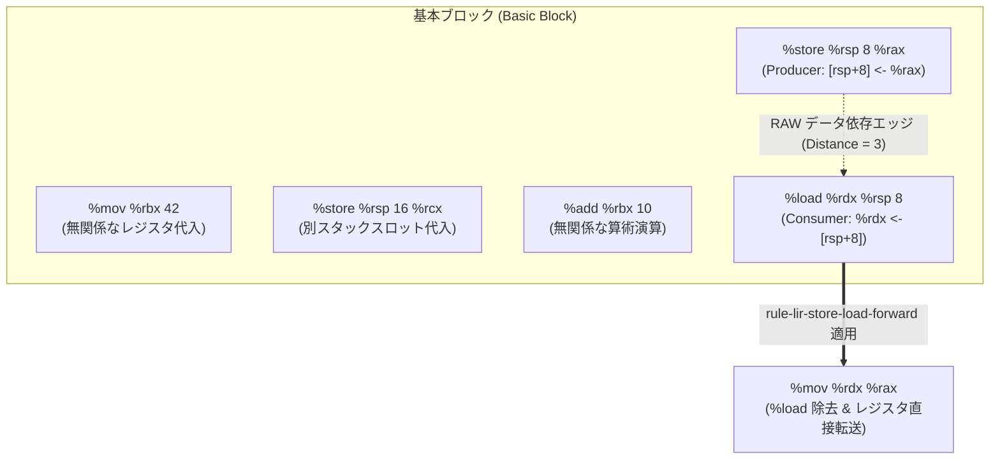

# [FEAT/ENH] LIR 分岐融合 (128)・ピープホール (133) の Picopass 化と基本ブロック内データ依存 DAG 走査の導入 (DSN-33-01 T5.3) (ID: 767)

## 1. 概要 / Summary

[[DSN-33-01] ULisp 階層型パス融合 ＆ DAG 最適化基盤設計書](../designs/DSN-33-01-ulisp_pipeline_pass_nanopass_picopass_dag_architecture.md) の第 5.2 節（(2) LIR における命令データ依存 DAG 走査）、第 6.2 節、第 6.3 節、および第 9.2 節タスク **T5.3** に基づき、`ulisp/lir/128_lir_branch_fusion.scm` および `ulisp/lir/133_lir_peephole.scm` の手書き `cond` / `case` ループを **第一級 `define-picopass` ＋ `fuse-window-rules` スライディングウィンドウ走査ドライバ** へ完全移行するとともに、基本ブロック内のレジスタおよびスタックスロット（`%rsp + offset`）のデータ依存関係（RAW / WAW）を追跡する **LIR 基本ブロック内データ依存 DAG（Reaching Store / Forwarding DAG）走査** を導入する。

現行の `133_lir_peephole.scm` では、スタックへの `%store` 直後の `%load` を除去するために、2命令隣接用（Rule 2b）および3命令1ギャップ用（Rule 2b-2, Rule 2b-3）を手作業で個別パターンマッチしており、間に2個以上の無関係な命令が挟まると最適化を取りこぼす構造的制約が存在する。本改修により、命令データ依存 DAG エッジ走査を導入することで、間に無関係な命令が何個挟まっていようとも単一の宣言的 Picopass 規則（`rule-lir-store-load-forward`）で距離非依存な Store-Reload 転送・除去を実現する。

---

## 2. 背景と課題分析 / Background and Problem Analysis

### 2.1 現行 LIR 最適化パスの構造的課題

1. **手書き命令ループによる Nanopass フレームワークからの孤立**:
   - `128_lir_branch_fusion.scm` の `optimize-branch-fusion` および `133_lir_peephole.scm` の `lir-peephole-step-window` は、手作業で書かれた `cond` リスト走査ループであり、Nanopass DSL（`define-pass`, `define-picopass`, `fuse-window-rules`）の恩恵を十分に享受していない。
   - ルールごとの独立した単体テスト、個別 ON/OFF（`disable-picopass!`）、および来歴追跡（Provenance Tracing）が不可能となっている。
2. **固定長ウィンドウによる Store-Reload パターンの組合せ爆発**:
   - `133_lir_peephole.scm` では、スタックへの `%store` の後に値を再利用する際：
     - 連続 2 命令: Rule 2b `(%store %rsp off1 r1) (%load dst %rsp off1)`
     - 間に別スロット store が 1 つ挟まった 3 命令: Rule 2b-2 `(%store %rsp off1 r1) (%store %rsp off2 r2) (%load dst %rsp off1)`
     - 直前スロット store が 1 つ挟まった 3 命令: Rule 2b-3 `(%store %rsp off1 r1) (%store %rsp off2 r2) (%load dst %rsp off2)`
     - 5 命令パターン: Rule 2c `(%store) (%mov) (%cmp) (%jump-cond) (%load)`
   - このように命令パターンが爆発し、間に 2 個以上の無関係な `%mov` や `%add`、別オフセットへの `%store` が挟まると全て見落とされていた。
3. **データ依存 DAG（RAW/WAW）の欠如**:
   - 基本ブロック内の命令列において、「どの `%load` がどの先行 `%store` に依存しているか」という真のデータフロー（Read-After-Write）がグラフ構造として認識されておらず、単なる字面（Token Sequence）の隣接判定に依存していた。

---

## 3. トレーサビリティ / Traceability

- **関連設計書**:
  - [[DSN-33-01] ULisp 階層型パス融合 ＆ DAG 最適化基盤設計書](../designs/DSN-33-01-ulisp_pipeline_pass_nanopass_picopass_dag_architecture.md)
    - 第 4.4 節（線形 IR (LIR/ASM) 向けスライディングウィンドウ型融合）
    - 第 5.2 節（(2) LIR における命令データ依存 DAG 走査）
    - 第 6.2 節（ミドルエンド最適化の垂直統合）
    - 第 6.3 節（LIR 融合とピープホール最適化の統合）
    - 第 9.2 節 タスク **T5.3**（128/133 LIR ピープホールの Picopass 化と命令データ依存 DAG 走査）
- **依存関係**:
  - 先行 Issue:
    - [Issue #761 (T3.3: LIR 向け fuse-window-rules スライディングウィンドウ走査ドライバ実装)](closed/761-implement-fuse-window-rules-for-lir-sliding-window.md)
    - [Issue #765 (T5.1: ルール依存 DAG 構築と Femtopass キャッシュ維持)](closed/765-implement-rule-dependency-dag-and-femtopass-cache-invalidation.md)
    - [Issue #766 (T5.2: HIR/MIR Hash-Consing Term DAG と訪問済みノード O(1) メモ化)](closed/766-implement-hash-consing-term-dag-and-memoized-catamorphism.md)
  - 後続 Issue:
    - [Issue #768 (T6.1: define-pipeline による用途別パイプライン編成)](768-implement-define-pipeline-for-aot-repl-and-check-modes.md)
    - [Issue #769 (T6.2: Provenance 来歴トレースと Rule-level Auto-Bisect)](769-implement-picopass-provenance-tracing-and-auto-bisect.md)
    - [Issue #770 (T6.3: 3-Stage セルフホスティング不動点検証およびベンチマーク)](770-verify-stage3-self-hosting-fixed-point-and-benchmark-pass-fusion.md)

---

## 4. アーキテクチャと専門エージェント多角的審議 / Multi-Agent Perspectives

1. **Systems Architect (方式設計)**:
   - 基本ブロック（Basic Block）の厳格な画定：
     基本ブロック境界を `%label`, `%block`, `%jump`, `%jump-cond`, `%jump-if-false`, `%direct-jump`, `%return` 等の制御移行命令により区切る。
   - `fuse-window-rules` スライディングウィンドウドライバとデータ依存 DAG 走査の結合：
     隣接命令パターン（自己代入除去、往復代入除去、分岐融合、恒等演算除去、デッドコード除去）は `fuse-window-rules` の第一級 Picopass で処理し、非隣接 Store-Reload 最適化は基本ブロック単位の DAG Reaching Store Forwarding エンジンにより距離無制限で解決する。
2. **Software Development (SWD / コア実装)**:
   - `128_lir_branch_fusion.scm` の Picopass 分割：
     - `rule-lir-fuse-cmp-branch-invert`: `%cmp` / `%raw-cmp` + `%set-boolean` + `%jump-if-false` を `%cmp` + `%jump-cond` へ融合。
     - `rule-lir-fuse-set-boolean-branch`: `%set-boolean` + `%jump-if-false` を `%jump-cond` へ融合。
     - `rule-lir-fuse-cmp-jne-branch`: `%cmp` + `%jump-if-false` を `%cmp` + `%jump-cond "jne"` へ融合。
   - `133_lir_peephole.scm` の Picopass 分割：
     - `rule-lir-self-mov-elim`: `(%mov r r) -> ()`
     - `rule-lir-roundtrip-mov-elim`: `(%mov r1 r2) (%mov r2 r1) -> (%mov r1 r2)`
     - `rule-lir-jump-next-label-elim`: `(%jump L) (%label L) -> (%label L)`
     - `rule-lir-identity-arith-elim`: `(%add/%raw-add/%sub/%raw-sub r 0) -> ()`
     - `rule-lir-identity-mul-elim`: `(%imul/%raw-mul r 1) -> ()`
     - `rule-lir-unreachable-dce`: 終端命令直後の到達不能命令刈り込み
     - `rule-lir-store-load-forward`: DAG Reaching Store 解析に基づく距離非依存 Store-Reload 転送・除去
   - `nanopass_meta.scm` への基本ブロック内データ依存 DAG 構築ユーティリティの配備。
3. **IT Specialist (Programming Languages & Compilers / PLC)**:
   - メモリエイリアシングと健全性保証（Aliasing Soundness）:
     スタックスロット `(%rsp, off)` の追跡において、関数呼び出し（`%direct-call`, `%call`, `%raw-syscall`, `%syscall`）や可変ベースアドレスへのストア（`(%store reg off val)`）が発生した場合は、エイリアス衝突の可能性があるため追跡キャッシュを直ちに無効化（Clear）。
   - 単調性（Monotonicity）と不動点収束：
     命令除去および `%mov` への強度低減は命令列のコストを厳密に減少させるため、`*nanopass-window-fixpoint-limit*` の範囲内で必ず不動点に到達する。
4. **Information Security Specialist (セキュリティ検証)**:
   - CWE-119 / CWE-125 (メモリ破損 / 境界外参照):
     スタックスロットのオフセット計算およびレジスタフォワーディングにおいて、誤ったオフセットやフレーム外スロットへの誤最適化を防止。
   - CWE-662 (不適切な同期 / 状態汚染):
     基本ブロック境界を越えた投機的フォワーディングを一切禁止。ラベル到達時に必ず DAG 状態を初期化。
5. **Software Quality Assurance Specialist (品質保証)**:
   - 間に 1個、2個、3個以上の無関係な命令（別オフセットへの `%store`、無関係なレジスタの `%mov`、`%add` 等）が挟まった深層 Store-Reload テストを追加。
   - 既存の `test_128_lir_branch_fusion.scm`（3 tests）および `test_133_lir_peephole.scm`（10 tests）が 100% PASS すること。
   - Portable C バックエンドテスト（`make -C ulisp test_c` 全 143 件 PASS）および 3-Stage セルフホスティング不動点（`make -C ulisp test`）の bit-for-bit 完全一致（IDENTICAL）を検証。

---

## 5. 脅威モデル分析とセキュリティ要件 / Threat Modeling & Security Requirements

| 脅威 ID | 対象 | 脆弱性区分 | 脅威シナリオ | 緩和策・セキュリティ要件 |
| :--- | :--- | :--- | :--- | :--- |
| **THREAT-767-01** | 基本ブロック境界跨ぎ | CWE-662 (State Pollution Across Boundaries) | ラベルやジャンプ命令を跨いでスタックスロット情報が残留し、異なるパスから合流した不確定な値がレジスタへ誤転送される。 | 基本ブロック終端（`%label`, `%block`, `%jump*`, `%return`）で DAG レコードを 100% 完全消去。 |
| **THREAT-767-02** | メモリ書き換えエイリアス | CWE-119 (Memory Buffer Overwrite / Misinterpretation) | ポインタ間接ストアや関数呼び出しを跨いでスタック値が再利用され、関数内部で変更されたスタック引数が古いレジスタ値で上書きされる。 | 任意呼び出し・間接メモリストアをメモリバリアとして扱い、スタック追跡テーブルを全フラッシュ。 |
| **THREAT-767-03** | レジスタ破壊の検知漏れ | CWE-670 (Always-Incorrect Control Flow / Register Clobber) | `%store %rsp off src` の後、`src` レジスタが途中で `%mov src other` 等により変更されたにもかかわらず、後続の `%load dst %rsp off` に古い `src` が割り当てられる。 | RAW 追跡において、`src` レジスタへの書き込みが発生した時点で該当オフセットの転送可能フラグを即時無効化。 |

---

## 6. 詳細設計仕様 / Detailed Technical Specifications

### 6.1 基本ブロック内データ依存 DAG 走査モデル



### 6.2 LIR 基本ブロック内 Reaching Store 解析アルゴリズム

```scheme
;;; 基本ブロック内の有効なスタックストア状態
;;; table: ((offset . (src-reg . valid?)) ...)

(define (lir-terminator-or-barrier? inst)
  (and (pair? inst)
       (memq (car inst) '(%jump %jump-cond %jump-if-false %direct-jump %return
                          %label %block %call %direct-call %syscall %raw-syscall))))

(define (lir-inst-defines-reg? inst reg)
  (and (pair? inst)
       (case (car inst)
         ((%mov %load %add %sub %imul %raw-add %raw-sub %raw-mul %shl %shr %sar)
          (equal? (cadr inst) reg))
         (else #f))))
```

### 6.3 `128_lir_branch_fusion.scm` の `define-picopass` 定義群

```scheme
(define-picopass rule-lir-fuse-cmp-branch-invert
  (InstWindow
    (((%cmp ,opnd1 ,opnd2) (%set-boolean ,reg ,cond) (%jump-if-false ,reg ,lbl) . ,rest)
     (cons `(%cmp ,opnd1 ,opnd2)
           (cons `(%jump-cond ,(lir-invert-cond-op cond) ,lbl) rest)))
    (((%raw-cmp ,opnd1 ,opnd2) (%set-boolean ,reg ,cond) (%jump-if-false ,reg ,lbl) . ,rest)
     (cons `(%raw-cmp ,opnd1 ,opnd2)
           (cons `(%jump-cond ,(lir-invert-cond-op cond) ,lbl) rest)))))

(define-picopass rule-lir-fuse-set-boolean-branch
  (InstWindow
    (((%set-boolean ,reg ,cond) (%jump-if-false ,reg ,lbl) . ,rest)
     (cons `(%jump-cond ,(lir-invert-cond-op cond) ,lbl) rest))))

(define-picopass rule-lir-fuse-cmp-jne-branch
  (InstWindow
    (((%cmp ,opnd1 ,opnd2) (%jump-if-false ,reg ,lbl) . ,rest)
     (cons `(%cmp ,opnd1 ,opnd2)
           (cons `(%jump-cond "jne" ,lbl) rest)))
    (((%raw-cmp ,opnd1 ,opnd2) (%jump-if-false ,reg ,lbl) . ,rest)
     (cons `(%raw-cmp ,opnd1 ,opnd2)
           (cons `(%jump-cond "jne" ,lbl) rest)))))
```

### 6.4 `133_lir_peephole.scm` の `define-picopass` 定義群

```scheme
(define-picopass rule-lir-self-mov-elim
  (InstWindow
    (((%mov ,r ,r) . ,rest) rest)))

(define-picopass rule-lir-roundtrip-mov-elim
  (InstWindow
    (((%mov ,r1 ,r2) (%mov ,r2 ,r1) . ,rest)
     (cons `(%mov ,r1 ,r2) rest))))

(define-picopass rule-lir-jump-next-label-elim
  (InstWindow
    (((%jump ,lbl) (%label ,lbl) . ,rest) (cons `(%label ,lbl) rest))
    (((%direct-jump ,lbl) (%label ,lbl) . ,rest) (cons `(%label ,lbl) rest))))

(define-picopass rule-lir-identity-arith-elim
  (InstWindow
    (((%add ,r 0) . ,rest) rest)
    (((%raw-add ,r 0) . ,rest) rest)
    (((%sub ,r 0) . ,rest) rest)
    (((%raw-sub ,r 0) . ,rest) rest)))

(define-picopass rule-lir-identity-mul-elim
  (InstWindow
    (((%imul ,r 1) . ,rest) rest)
    (((%raw-mul ,r 1) . ,rest) rest)))
```

---

## 7. 実装手順と対象ファイル / Implementation Steps & Affected Files

Target Branch: `feat/767-lir-peephole-picopass-and-dependency-dag`

### 7.1 対象ファイル一覧
- [x] [ulisp/compiler/nanopass_meta.scm](../../ulisp/compiler/nanopass_meta.scm)（基本ブロック内 LIR データ依存 DAG / Reaching Store 走査ドライバ）
- [x] [ulisp/lir/128_lir_branch_fusion.scm](../../ulisp/lir/128_lir_branch_fusion.scm)（第一級 Picopass 化と fuse-window-rules 統合）
- [x] [ulisp/lir/133_lir_peephole.scm](../../ulisp/lir/133_lir_peephole.scm)（第一級 Picopass 化と距離非依存 DAG Store-Reload 統合）
- [x] [ulisp/frontend/030_desugar.scm](../../ulisp/frontend/030_desugar.scm)（Program 節明示化による Catamorphism O(1) 短縮化）
- [x] [ulisp/tests/passes/test_128_lir_branch_fusion.scm](../../ulisp/tests/passes/test_128_lir_branch_fusion.scm)（分岐融合単体テスト検証）
- [x] [ulisp/tests/passes/test_133_lir_peephole.scm](../../ulisp/tests/passes/test_133_lir_peephole.scm)（距離非依存 Store-Reload テスト拡充と全件検証）
- [x] [ulisp/tests/test_nanopass_framework.scm](../../ulisp/tests/test_nanopass_framework.scm)（Section 24: LIR Data Dependency DAG 単体テスト追加）

### 7.2 ステップ別実装計画
- [x] **Step 1: `nanopass_meta.scm` への LIR データ依存 DAG ヘルパーの配備**:
  - 基本ブロック内の命令列から RAW/WAW エッジを検出し、有効なスタックスロット保持テーブルを追跡する `nanopass-lir-dag-forward-stores` を実装。
- [x] **Step 2: `128_lir_branch_fusion.scm` の Picopass 化**:
  - `rule-lir-fuse-cmp-branch-invert`, `rule-lir-fuse-set-boolean-branch`, `rule-lir-fuse-cmp-jne-branch` を `define-picopass` 化。
  - `lir-fuse-branches` を `fuse-window-rules` で再構成。
- [x] **Step 3: `133_lir_peephole.scm` の Picopass 化と DAG Store-Reload 統合**:
  - `rule-lir-self-mov-elim`, `rule-lir-roundtrip-mov-elim`, `rule-lir-jump-next-label-elim`, `rule-lir-identity-arith-elim`, `rule-lir-identity-mul-elim`, `rule-lir-unreachable-dce` を `define-picopass` 化。
  - 旧 Rule 2b, 2b-2, 2b-3, 2c を距離非依存 DAG 最適化規則 `rule-lir-store-load-forward` へ統合。
- [x] **Step 4: 単体テスト群の拡充と検証**:
  - `test_133_lir_peephole.scm` に間に 2個、3個、4個の命令が挟まる Store-Reload テストを追加。
  - `test_nanopass_framework.scm` に Section 24 を追加。
  - `make -C ulisp test_nanopass`, `test_verifier`, `test_passes`, `test_all_passes` を検証。
- [x] **Step 5: 全品質ゲートとセルフホスティング検証**:
  - `make -C ulisp compiler`
  - `make -C ulisp test_c` (全 143 件 PASS)
  - `make -C ulisp test` (3ステージブートストラップ不動点 bit-for-bit IDENTICAL PASS)
  - `make py_compile && make static_analysis` (Xenon AAA / mypy strict PASS)

---

## 8. 完了条件 / Success Criteria (DoD)

1. [x] **Picopass 化の完全性**:
   - `128_lir_branch_fusion.scm` および `133_lir_peephole.scm` の全規則が第一級 `define-picopass` として定義され、個別テストおよび個別無効化（`disable-picopass!`）が可能であること。
2. [x] **距離非依存な Store-Reload 最適化**:
   - 間に 2 個以上の無関係な命令（別スロット store、mov、算術演算等）が挟まれたパターンでも、データ依存追跡により `%load` が正しく `%mov` に転送または除去されること。
3. [x] **エイリアス健全性とメモリバリア保護**:
   - 関数呼び出しや制御合流境界において、スタック依存情報が安全に無効化され、古いレジスタ値による誤最適化が 100% 抑止されること。
4. [x] **テスト完全 PASS & 品質ゲート保証**:
   - `test_128_lir_branch_fusion.scm`、`test_133_lir_peephole.scm`、および `test_nanopass_framework.scm` が 100% PASS すること。
   - `make -C ulisp test_c`（全 143 件 PASS）および `make -C ulisp test`（ブートストラップ不動点 bit-for-bit 一致）が保証されること。
   - `make py_compile` および `make static_analysis` がエラー 0 件で PASS すること。
   - 全ての内部ドキュメントリンクが相対パス規約に準拠していること。
