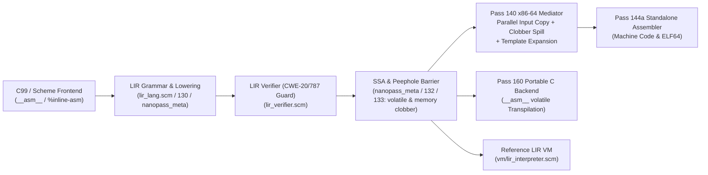

# [FEAT] レジスタ制約付きインライン・アセンブリ (%inline-asm) の LIR 統合 (ID: 838)

## 1. 概要 / Summary

低レベル中間表現（LIR）において、入出力レジスタ制約（Constraints）および破壊レジスタ（Clobbers）、揮発性フラグ（`:volatile?`）を明示可能なファーストクラス命令ノード **`%inline-asm`** を形式言語文法およびコンパイラパイプライン全体へ正式統合する。

現在、`ulisp/lir/lir_lang.scm` および `ulisp/backend/140_backend_x86_64.scm` には個別のハードコード命令（`%syscall`、`%memory-fence`、`%atomic-cas!`）しか存在せず、汎用的な制約付きインラインアセンブリ構文が未整備である。これにより、以下の重要領域に構造的な障壁が存在する：
1. **musl libc 移植・低水準 C プログラムの直接コンパイル不能（DSN-38 / DSN-33-02 §4.4）**:
   C コンパイラフロントエンド経由で musl libc のシステムコール発行ラッパー（`__syscall0`〜`__syscall6`）、`_start` エントリポイント、`setjmp`/`longjmp`、CPU 命令（`rdtsc`, `cpuid`, `pause`, `lock xadd`）等の GCC 拡張 `__asm__ volatile (...)` をコンパイルする際、レジスタ入出力・破壊情報を保持したまま LIR へ安全に降下させる表現手段が欠如している。
2. **最適化・レジスタ割り当てとアセンブリ境界の調停欠落**:
   アセンブリ片を単なる不透明な文字列（`%raw-asm`）として扱うだけでは、前後の LIR 命令・仮想レジスタ・スタック変数との生存区間（Liveness）干渉を調停できず、呼び出し元レジスタのサイレント破壊や、LIR ピープホール最適化（Pass 133 `133_lir_peephole.scm`）による誤った DCE・ストア転送（Store-Load Forwarding）を引き起こす危険がある。
3. **純粋 Scheme ランタイムの自己記述化（Zero-Libc / Bare-Metal）**:
   C スタブに依存せず Scheme コードから直接ハードウェア制御やアトミック操作を記述可能にする基盤が未完成である。

本 Issue では、`DSN-33-02 §4.4` に準拠した `%inline-asm` 命令形式を `L_lir_core` / `L_lir_canonical`（`ulisp/lir/lir_lang.scm`）へ正式追加し、以下のコンポーネントを一貫統合する：
- **形式構文と制約パーサ／検証器 (`ulisp/lir/lir_verifier.scm`)**: テンプレート文字列のプレースホルダ（`%0`, `%1`, `%%rax` 等）、入出力制約（固定物理レジスタ `"={rax}"`/`"{rdi}"`/`"=a"`/`"D"`、汎用レジスタ `"=r"`/`"r"`、メモリ `"=m"`/`"m"`、即値 `"i"`、同一レジスタ束縛 `"0"` 等）、クロバー指定（`"rcx"`, `"r11"`, `"cc"`, `"memory"`）の静的検証とランタイム予約レジスタ（`%rsp`, `%r12`）保護ガードを導入する。
- **SSA / ピープホール最適化バリア (`132_lir_braun_ssa.scm`, `133_lir_peephole.scm`)**: `:volatile? #t` の `%inline-asm` に対する DCE 抑止、および `"memory"` クロバーを跨ぐ DAG Store-Load Forwarding 抑止ルールを実装する。
- **Pass 140 レジスタ制約・クロバー調停器 (`140_backend_x86_64.scm`)**: 仮想・物理レジスタ間の**並列代入（Parallel Copy Scheduling）**により入力レジスタ上書き競合（Cycle Conflict）を回避し、クロバー／衝突レジスタの一時退避（Save/Restore）を挿入したうえでテンプレート内オペランド（`%0`, `%1`, ...）を展開し、`144a_x86_assembler.scm` による ELF オブジェクト生成まで一気通貫させる。
- **Pass 160 Portable C バックエンドおよび Reference VM (`160_backend_c.scm`, `vm/lir_interpreter.scm`)**: C バックエンドでは GCC/Clang `__asm__ volatile (...)` への正確なトランスパイル出力を行い、参照 LIR インタプリタでもシミュレーション実行またはカスタマイズ可能なハンドラによる解釈をサポートする。



---

## 2. トレーサビリティ / Traceability

- **設計仕様書**:
  - [DSN-33-02 (多言語フロントエンド＆型付き機械語 LIR アーキテクチャ)](../../designs/DSN-33-02-ulisp_multilingual_frontend_and_typed_machine_lir_architecture.md): §4.4 (インラインアセンブリ方言 `%inline-asm`), §9 (Phase 1 実装計画)
  - [DSN-38 / DSN-33 (ULisp Underlying x86 Native AOT Compiler Architecture)](../../designs/DSN-33-ulisp_underlying_x86_native_aot_compiler_architecture_specification.md): §2 (J1: musl 移植, C4: `setjmp` の扱い, E5: 外部呼出と入口/出口)
  - [LIR 正典仕様書 (ULisp Canonical LIR Specification)](../../../ulisp/docs/spec_lir.md): Core Machine LIR オペコード辞書・不変条件規則
- **関連 Issue**:
  - [Issue #826 (機械型を備えた Typed LIR への移行とボクシング操作の直交分離)](826-introduce-typed-machine-lir-and-orthogonalize-boxing-operations.md)
  - [Issue #828 (LIR におけるオーバーフロー検知付き算術および符号なし演算オペコードの新設)](828-implement-overflow-checked-arithmetic-and-unsigned-operations-in-lir.md)
  - [Issue #829 (System V AMD64 ABI と Scheme 高速呼出規約のモジュール化)](829-modularize-calling-conventions-for-sysv-abi-and-scheme-fast-calls.md)
  - [Issue #834 (純粋 Scheme 製 LIR 参照インタプリタ (Reference VM) の実装)](834-implement-pure-scheme-lir-reference-vm-interpreter.md)
  - [Issue #835 (Core Machine LIR と Managed Runtime Dialect の完全直交分離)](835-separate-core-machine-lir-from-managed-runtime-dialect.md)

---

## 3. 影響範囲と関連ファイル / Scope and Affected Files

- [x] [ulisp/lir/lir_lang.scm](../../../ulisp/lir/lir_lang.scm): `L_lir_core` / `L_lir_raw` への `%inline-asm` 命令構文ノードおよび制約・クロバー補助フォーム (`AsmOutSpec`, `AsmInSpec`, `AsmClobber`, `AsmClause`) の追加
- [x] [ulisp/lir/lir_verifier.scm](../../../ulisp/lir/lir_verifier.scm): `%inline-asm` の構造検証・制約文字列バリデーション・物理レジスタ競合検査・予約レジスタ破壊ガードの追加
- [x] [ulisp/compiler/nanopass_meta.scm](../../../ulisp/compiler/nanopass_meta.scm): `%inline-asm` 制約パーサ・使用/定義レジスタ集合・メモリバリア判定・キャリア割当計画・テンプレート展開・サブレジスタ修飾子の共通ヘルパ実装 (Pass 133 ピープホール連動含む)
- [x] [ulisp/lir/130_lir.scm](../../../ulisp/lir/130_lir.scm): Scheme / 低水準式からの `%inline-asm` 降下 (`lir-compile-inline-asm`) とローカルスタック環境連携
- [x] [ulisp/lir/132_lir_braun_ssa.scm](../../../ulisp/lir/132_lir_braun_ssa.scm): `%inline-asm` 入出力オペランドの SSA 値解決 (`braun-resolve-val`) 統合
- [x] [ulisp/backend/140_backend_x86_64.scm](../../../ulisp/backend/140_backend_x86_64.scm): `%inline-asm` 用レジスタ制約解決器 (`lower-lir-inline-asm`)、入力並列コピー（Cycle-Safe Parallel Move + tied `"N"` 優先制御）、`[rsp - ...]` 非破壊退避/復元、テンプレート展開ロジック
- [x] [ulisp/backend/144a_x86_assembler.scm](../../../ulisp/backend/144a_x86_assembler.scm): 拡張 ISA ニモニック（`lfence`, `sfence`, `pause`, `cpuid`, `rdtsc`, `rdtscp`, `bswap`, `xchg`, `xadd`）の追加および `setcc` REX.B / `movzx` REX エンコーディング修正
- [x] [ulisp/backend/160_backend_c.scm](../../../ulisp/backend/160_backend_c.scm): GCC/Clang 拡張構文 `.intel_syntax noprefix` `__asm__ volatile (...)`（`register uint64_t __asm__` ピニング・重複なしクロバー・メモリ制約出力）の実装
- [x] [ulisp/vm/lir_interpreter.scm](../../../ulisp/vm/lir_interpreter.scm): Reference VM における `lir-vm-exec-inline-asm!` およびカスタムハンドラ登録 API (`register-inline-asm-handler!`) 追加
- [x] [ulisp/compiler/eval_in_language.scm](../../../ulisp/compiler/eval_in_language.scm), [ulisp/compiler/value_repr.scm](../../../ulisp/compiler/value_repr.scm), [ulisp/lir/131_lower_managed_dialect.scm](../../../ulisp/lir/131_lower_managed_dialect.scm): Gauche / ilisp 両互換の除算フリー 2 の補数 `ctfe-bitwise-and` / `ctfe-bitwise-ior` への統一（`test_ulisp_codegen.py` の `gosh` `bitwise-and` 未定義解消・64-bit NaN-boxing 精度維持）
- [x] [ulisp/docs/spec_lir.md](../../../ulisp/docs/spec_lir.md): §6 `%inline-asm` 命令の正式仕様・制約記法・不変条件の追記
- [x] [ulisp/Makefile](../../../ulisp/Makefile): `test_inline_asm` テストターゲットの登録および `test:` 統合
- [x] [ulisp/tests/test_inline_asm.scm](../../../ulisp/tests/test_inline_asm.scm): 制約検証、入出力並列コピー競合回避、クロバー・ローカル変数スタック退避、C バックエンド出力、ネイティブ ELF 生成・Reference VM 実行を網羅する単体テストスイート（新規作成）

---

## 4. セキュリティ・設計分析 (Threat Modeling & Constraints)

| 脅威 / リスク ID | 脅威内容 | CWE 分類 | 潜在的影響 | 本 Issue での対策・設計的緩和策 |
| :--- | :--- | :--- | :--- | :--- |
| **THREAT-838-1** | 破壊・予約レジスタのサイレント上書き (Silent Register & Runtime State Clobbering) | **CWE-787** (Out-of-bounds Write) | インラインアセンブリが明示的クロバー外のレジスタや、ULisp ランタイム予約レジスタ（ヒープポインタ `%r12`、スタックポインタ `%rsp`）を破壊し、GC 破損や任意アドレス書込み（SEGV）を引き起こす。 | `lir_verifier.scm` にて出力先またはクロバーリストに `%rsp` を含む危険な制約を拒否し、Pass 140 にて呼び出し規約および使用・クロバー集合を `[rsp - ...]` スタックスロットへ自動退避・復元する（`push`/`pop` による `%rsp` 移動なし）。また、結果書き戻し前に一時レジスタを復元する。 |
| **THREAT-838-2** | 固定入力レジスタ設定時の並列代入競合 (Input Register Clobber During Sequential Setup) | **CWE-662** (Improper Synchronization / Ordering Error) | `:inputs` に複数オペランド（例: `(a "{rdi}" rcx)` と `(b "{rcx}" rdi)`）を与えた際、単純に順番へ `mov` すると後続オペランドの元値が上書きされ、不正な引数がカーネル (`syscall`) や命令に渡される。 | Pass 140 の制約解決器に入力ソースを一時 `[rsp - ...]` スナップショット経由で並列代入するステージを実装し、`+r` と tied `"N"` の併用時も入力側が優先されるよう調停する。 |
| **THREAT-838-3** | 不正制約・未バインドプレースホルダインジェクション (Malformed Constraint & Operand Index Out-of-Bounds) | **CWE-20** (Improper Input Validation) | 存在しないオペランド番号 `%9` の参照、未定義制約文字列（例: `"{invalid}"`）、同一物理レジスタへの複数出力束縛により、バックエンドが不正なアセンブリ文字列や意味のない機械語を出力する。 | `lir_verifier.scm` で出力数＋入力数に対する `%N` / 修飾 `%kN` 範囲チェック・`%[name]` 名前付き解決チェック・サポート済み制約トークン検査・出力間物理レジスタ重複禁止を検証し、違反時は即時エラーを送出する。 |
| **THREAT-838-4** | 最適化パスによる揮発性アセンブリ除去・メモリ順序逆転 (Unsafe DCE / Store Forwarding Across Barrier) | **CWE-665** (Improper Initialization / Optimization Barrier Bypass) | `:volatile? #t` のアセンブリ（例: システムコール、バリア）が未参照出力扱いとして DCE されたり、`"memory"` クロバーを跨いで Pass 133 の Store-Load Forwarding が古いキャッシュ値を転送し、メモリ競合や誤動作を招く。 | `nanopass_meta.scm` / `133_lir_peephole.scm` において `lir-inst-memory-barrier?` および `lir-inst-defines-reg?` を `%inline-asm` に対応させ、`:volatile? #t` や `"memory"` クロバー越えの不安全な DCE / Forwarding を抑止する。 |

---

## 5. 実装方針 / Detailed Implementation Plan

**Target Branch**: `feat/838-lir-inline-assembly-with-constraints`

### Step 1: `%inline-asm` 形式文法と検証器の定義 (`ulisp/lir/lir_lang.scm`, `ulisp/lir/lir_verifier.scm`)
1. `L_lir_core` / `L_lir_raw` における命令ノード構文を確定する（`DSN-33-02 §4.4` および 2 要素・3 要素両対応の柔軟な表現）：
   ```scheme
   (%inline-asm <template-string>
     (:outputs  ((<dst-opnd> <constraint-str>) ...))
     (:inputs   ((<src-spec> ...) ...))   ; (<opnd> <constraint>) または (<name> <constraint> <opnd>)
     (:clobbers (<reg-or-flag-str> ...))  ; 例: "rcx", "r11", "cc", "memory"
     (:volatile? #t/#f))
   ```
2. 制約パース補助ヘルパーを `nanopass_meta.scm` として定義し、固定物理レジスタ・汎用レジスタ・メモリ・即値・Tied Constraint を正規化する。
3. `lir_verifier.scm` に `lir-verify-inline-asm*` を追加し、テンプレート内 `%0`..`%k` / `%[name]`（`%%` / `%%reg` エスケープ対応）、出力先書き込み可能性、物理レジスタ出力重複禁止、`THREAT-838-1..3` の制約不変条件を検証する。

### Step 2: 最適化バリア統合 (`nanopass_meta.scm`, `132_lir_braun_ssa.scm`, `133_lir_peephole.scm`, `130_lir.scm`)
1. `133_lir_peephole.scm`（`nanopass_meta.scm` 述語連動）: `%inline-asm` が `"memory"` クロバーまたは `:volatile? #t` を持つ場合、DAG Store-Load Forwarding 状態および定義レジスタを安全に扱う。
2. `132_lir_braun_ssa.scm`: `%inline-asm` 内の値参照を `braun-resolve-val` で走査統合する。
3. `130_lir.scm`: Scheme レベルから `(%inline-asm ...)` を `L_lir_canonical` へ降下する (`lir-compile-inline-asm`)。

### Step 3: Pass 140 x86-64 バックエンドおよび Pass 144a アセンブラ対応 (`ulisp/backend/140_backend_x86_64.scm`, `ulisp/backend/144a_x86_assembler.scm`)
1. 制約解決・`[rsp - ...]` スクラッチ保存/復元・サイクルフリー並列入力セットアップ・`%N` / `%bN` / `%wN` / `%kN` / `%qN` / `%[name]` / `%%` テンプレート展開を実装。
2. `144a_x86_assembler.scm` に `lfence`/`sfence`/`pause`/`cpuid`/`rdtsc`/`rdtscp`/`bswap`/`xchg`/`xadd` エンコーダを追加し、`setcc` REX.B と `movzx` REX 処理を修正。

### Step 4: Pass 160 Portable C バックエンドおよび Reference LIR VM 対応 (`160_backend_c.scm`, `vm/lir_interpreter.scm`)
1. `160_backend_c.scm` に `.intel_syntax noprefix` `__asm__ volatile (...)` と `register uint64_t __asm__` レジスタ束縛出力を実装。
2. `ulisp/vm/lir_interpreter.scm` に `lir-vm-exec-inline-asm!` と `register-inline-asm-handler!` を実装。

### Step 5: 仕様書更新と網羅的テスト・検証 (`ulisp/docs/spec_lir.md`, `ulisp/tests/test_inline_asm.scm`, `ulisp/Makefile`)
1. `ulisp/tests/test_inline_asm.scm` (`38/38 passed`) および 4 バックエンド実動パリティ検証（Reference LIR VM / GCC C / GAS+LD / 144a Builtin ELF64 全一致 `2038`）。
2. `ulisp/Makefile` へ `test_inline_asm` を統合し、LIR・バックエンド各種回帰テスト、品質ゲートを実行。

---

## 6. 完了条件 / Definition of Done (DoD)

- [x] `ulisp/lir/lir_lang.scm` および `ulisp/lir/lir_verifier.scm` が `DSN-33-02 §4.4` 準拠の `%inline-asm` 構文を受理し、不正な制約文字列・範囲外オペランドインデックス・重複出力レジスタを静的エラーとして拒否すること。
- [x] Pass 133（`133_lir_peephole.scm` / `nanopass_meta.scm`）が `:volatile? #t` の `%inline-asm` を削除せず、`"memory"` クロバーを跨いで不正な Store-Load Forwarding を行わないこと。
- [x] Pass 140（`140_backend_x86_64.scm`）および Pass 144a（`144a_x86_assembler.scm`）が、固定レジスタ・汎用レジスタ・即値・メモリ制約とクロバーを正しく調停（並列入力コピー＋生きている変数の退避・復元）し、期待される機械語・実行結果を生成すること。
- [x] Pass 160（`160_backend_c.scm`）が `%inline-asm` を有効な GCC/Clang `__asm__` 構文へ変換し、Native x86-64 実行と Reference VM 実行・C バックエンド実行で等価な結果を返すこと。
- [x] 新設単体テスト `ulisp/tests/test_inline_asm.scm`（`make -C ulisp test_inline_asm` 38/38 PASS）および LIR/バックエンド回帰テスト群、`make format`、`make static_analysis`、`make test`、ならびに `verify-quality-gates`（相対リンク整合等）が PASS すること。
- [x] `ulisp/docs/spec_lir.md` が更新され、絶対パス混入 0 件・相対リンク整合性が保たれていること。
