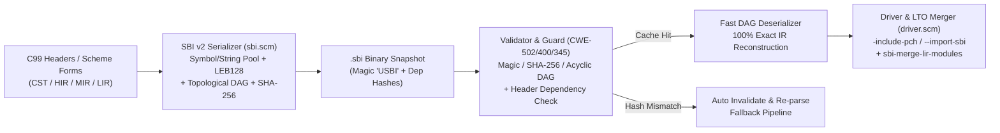

@839---
ID: 839
種別: Feature
優先度: Low
ステータス: Closed
---

# [FEAT] 中間表現 (HIR/MIR/LIR) の永続化・再ロード機構 (.sbi 拡張) の整備 (ID: 839)

## 1. 概要 / Summary

ULisp の中間バイナリフォーマットである `.sbi`（Scheme Binary Interface）の仕様を拡張・一般化し、フロントエンド構文木（CST / プリコンパイル済みヘッダ PCH）、高水準・中水準中間表現（HIR: `L_src`/`L_core`、MIR: `L_anf`/`L_lifted`）、および型付き低レベル中間表現（LIR: `L_lir_core`/`L_lir_managed`/`L_lir_canonical`）の完全なスナップショットをディスクへ高速にシリアライズ（永続化）およびデシリアライズ（再ロード）できる共通機構（`ulisp/compiler/sbi.scm`）を整備する。

現在、`ulisp/compiler/driver.scm` における `(!import-sbi <path>)` / `--import-sbi=<path>` はプレーンテキストの S 式ファイルを `slurp-single-file` で毎回再パースする簡易実装にとどまっており、`(!emit-sbi)` も固定の互換マクロ宣言を標準出力へ書き出すのみである。そのため、以下の課題が存在する：
1. **大規模ヘッダ・標準ライブラリ群の再パースオーバーヘッド（DSN-38 §2 B1 / §4 未決事項 4 / DSN-33-02 §6.3）**:
   musl libc の標準ヘッダ群や大規模 Scheme/C 共通宣言をコンパイル単位ごとにゼロから字句解析・構文解析・マクロ展開・束縛解決すると、セルフホスト時のコンパイル時間が入力行数に比例して増大する。
2. **キャッシュ整合性（依存ファイル変更検知・破損検知）の欠如**:
   ソースや `#include` / `include` 先ヘッダファイルが更新された際に、キャッシュの有効性を暗号学的チェックサム（SHA-256）で検証して自動再パースへフォールバックする仕組みが存在しない。
3. **中間表現レベルでのモジュール結合（LTO: Link-Time Optimization）基盤の未整備**:
   複数モジュールから出力された LIR プログラム（`%lir-program`）をシリアライズ・再ロードして単一 LIR モジュールへ結合する中間表現リンカ基盤が未確立である。

本 Issue では、`DSN-33-02 §6.3` に準拠したバイナリ `.sbi` v2 フォーマット（マジック `"USBI"`、LEB128 可変長整数、インターン済みシンボル/文字列プール、非循環トポロジカル DAG テーブル、純粋 Scheme 製 SHA-256 チェックサム＆ヘッダ依存関係テーブル）と既存のテキスト `.sbi` v1 フォールバックを統合した `ulisp/compiler/sbi.scm` を新設し、`ulisp/compiler/driver.scm` へ `-include-pch <file.sbi>` / `--emit-pch` / `--emit-sbi` / `--import-sbi` を統合する。

---

## 2. トレーサビリティ / Traceability

- **設計仕様書**:
  - [DSN-33-02 (ULisp 多言語フロントエンド＆型付き機械語 LIR アーキテクチャ)](../../designs/DSN-33-02-ulisp_multilingual_frontend_and_typed_machine_lir_architecture.md): §6.3 (中間表現のバイナリ・S式シリアライズ `.sbi` 拡張 / PCH / LTO), §8.1 (Step S6 最適化＆コンパイル性能), §8.3 (未決事項 4: セルフホスト時のコンパイル速度対策)
  - [DSN-33 (ULisp 包括設計仕様書: S式メタコンパイラ基盤)](../../designs/DSN-33-ulisp_underlying_x86_native_aot_compiler_architecture_specification.md): モジュラー分割コンパイル・SBI インターフェース
  - [LIR 正典仕様書 (ULisp Canonical LIR Specification)](../../../ulisp/docs/spec_lir.md): `L_lir_core` / `L_lir_canonical` プログラム構造
- **関連 Issue**:
  - [Issue #824 (Nanopass AST ノードにおけるソース位置情報 (Source Span) とメタデータの第一級サポート)](824-support-first-class-source-span-and-ast-metadata-in-nanopass.md)
  - [Issue #826 (機械型を備えた Typed LIR への移行とボクシング操作の直交分離)](826-introduce-typed-machine-lir-and-orthogonalize-boxing-operations.md)
  - [Issue #834 (純粋 Scheme 製 LIR 参照インタプリタ (Reference VM) の実装)](834-implement-pure-scheme-lir-reference-vm-interpreter.md)
  - [Issue #835 (Core Machine LIR と Managed Runtime Dialect の完全直交分離)](835-separate-core-machine-lir-from-managed-runtime-dialect.md)
  - [Issue #837 (構文解析後の一意束縛解決 (Binding ID) とスコープ環境管理の共通基盤化)](837-unify-symbol-binding-resolution-and-scope-environment.md)
  - [Issue #838 (レジスタ制約付きインライン・アセンブリ (%inline-asm) の LIR 統合)](838-integrate-inline-assembly-dialect-with-register-constraints-into-lir.md)
  - [Issue #840 (Nanopass パスマネージャにおける解析結果キャッシュ自動無効化と再計算)](../840-automate-analysis-cache-invalidation-and-recomputation-in-nanopass.md)

---

## 3. 影響範囲と関連ファイル / Scope and Affected Files

- [x] [ulisp/compiler/sbi.scm](../../../ulisp/compiler/sbi.scm): `.sbi` v2 バイナリフォーマット（マジック `"USBI"`、LEB128 エンコーダ/デコーダ、シンボル/文字列プール、トポロジカル DAG シリアライザ/デシリアライザ、純粋 Scheme SHA-256、依存ヘッダ検証、PCH キャッシュ管理、LIR モジュール結合 `sbi-merge-lir-modules`）の新規実装
- [x] [ulisp/compiler/driver.scm](../../../ulisp/compiler/driver.scm): `-include-pch <file.sbi>` / `--include-pch=<file.sbi>`、`--emit-pch` / `--emit-sbi`、`--import-sbi` のバイナリ `.sbi` v2 ＆ レガシーテキスト `.sbi` 自動判別統合、`.sbi` 出力ターゲット解決
- [x] [ulisp/compiler/module_header.scm](../../../ulisp/compiler/module_header.scm) および [ulisp/compiler/helpers.scm](../../../ulisp/compiler/helpers.scm): `sbi.scm` 公開 API シンボルの `%declare-extern-identifiers` / `is-known-stdlib-symbol?` 登録
- [x] [ulisp/Makefile](../../../ulisp/Makefile): `COMPILER_BASE` への `compiler/sbi.scm` 追加、および単体テストターゲット `test_ir_serialization` の追加
- [x] [ulisp/tests/test_ir_serialization.scm](../../../ulisp/tests/test_ir_serialization.scm): HIR/MIR/LIR ラウンドトリップ完全性、破損・改ざん検出（CWE-502/400/345）、依存ヘッダ SHA-256 検証・無効化再パース、LIR LTO マージ、大規模ヘッダ PCH 5倍以上高速化ベンチマークを網羅する単体テストスイート（新規作成）

---

## 4. セキュリティ・設計分析 (Threat Modeling & Constraints)

| 脅威 / リスク ID | 脅威内容 | CWE 分類 | 潜在的影響 | 本 Issue での対策・設計的緩和策 |
| :--- | :--- | :--- | :--- | :--- |
| **THREAT-839-1** | 不正・改ざんされた `.sbi` バイナリのデシリアライズ (Untrusted / Corrupted Binary Deserialization) | **CWE-502** (Deserialization of Untrusted Data) | マジックバイト不一致、未対応バージョン、切り詰められた bytevector、または改ざんされたペイロードにより、境界外読み取りや不正 AST ノード注入が発生する。 | 4バイトマジック `"USBI"`・フォーマットバージョン・ペイロード長・SHA-256 ペイロード整合性ダイジェストを厳格検証し、すべての LEB128 / プール参照で境界チェックを実施する。違反時は構造化エラー `'sbi-error` を送出する。 |
| **THREAT-839-2** | 循環参照 DAG・巨大テーブルによるリソース枯渇 (Cyclic DAG / Resource Exhaustion DoS) | **CWE-400** (Uncontrolled Resource Consumption) | 細工された `.sbi` 内の DAG ノード参照が自己参照または前方循環（$N_i \to N_j \to N_i$）を含む場合、デシリアライズ時に無限ループやメモリ枯渇を引き起こす。 | シリアライズを厳密なボトムアップ（トポロジカル順）で行い、デシリアライズ時は子ノード参照インデックスが現在のノードインデックス未満（`child_idx < node_idx`）であることを強制検証して構造的に閉路（Cycle）を完全排除する。また最大エントリ数上限（`*sbi-max-entries*`）を設ける。 |
| **THREAT-839-3** | 古い PCH キャッシュの誤適用 (Stale Precompiled Header Cache Poisoning) | **CWE-345** (Insufficient Verification of Data Authenticity) | インクルードされたヘッダファイルが書き換わったにもかかわらず、粗いタイムスタンプ等で古い `.sbi` キャッシュが再利用され、型定義やマクロ展開結果の不整合を生む。 | `.sbi` ヘッダ内の依存テーブルに各ソース/ヘッダファイルの **SHA-256 チェックサム（256-bit）** を記録し、`sbi-cache-valid?` / `sbi-load-or-compile-pch` にて実ファイルの SHA-256 と照合する。1バイトでも変更があれば自動的にキャッシュを無効化し再パースする。 |
| **THREAT-839-4** | 依存ファイルパスにおけるパストラバーサル (Path Traversal in Embedded Metadata) | **CWE-22** (Improper Limitation of a Pathname to a Restricted Directory) | `.sbi` ヘッダ内の依存ファイルパスに `../` 等が含まれ、ワークスペース外の意図しないファイルが検査・参照される。 | デシリアライズ時および依存検証時に `path-traversal?` 検査と `sanitize-source-path` 正規化を適用し、`..` を含む不正パスを拒否する。 |

---

## 5. 実装方針 / Detailed Implementation Plan

**Target Branch**: `feat/839-ir-serialization-sbi-extension`

### Step 1: `.sbi` v2 バイナリフォーマットと LEB128 / SHA-256 基盤の実装 (`ulisp/compiler/sbi.scm`)
1. **純粋 Scheme 製 SHA-256 エンジン**:
   - `ilisp`・`gosh`・ネイティブ `ulisp` AOT の全環境で 100% 決定論的に動作する 32-bit 符号なし整数演算ベースの SHA-256（`sbi-sha256-bytevector`, `sbi-sha256-string`, `sbi-sha256-file` → 64文字小文字 16進文字列および 32バイト `bytevector`）を実装する。
2. **LEB128 可変長整数とバイナリプリミティブ**:
   - 動的伸長バイトバッファ（またはチャンク連結）と `sbi-write-uleb128` / `sbi-write-sleb128` / `sbi-read-uleb128` / `sbi-read-sleb128`（オフセット境界チェック付き）を実装する。
3. **`.sbi` v2 バイナリレイアウト**:
   - **Header**:
     - Magic: `"USBI"` (`#x55 #x53 #x42 #x49`, 4 bytes)
     - Version: `2` (`u16-le`, 2 bytes)
     - IR Kind Tag (`u8`, 1 byte): `0=cst/pch`, `1=hir`, `2=mir`, `3=lir`, `4=pch-bundle`
     - Flags (`u8`, 1 byte): bit 0 = `preserve-spans?`, bit 1 = `has-bindings?`, bit 2 = `has-deps?`
     - Payload SHA-256 Digest (32 bytes): 以降全セクションの SHA-256 ダイジェスト
   - **Section 1: Dependency Table**:
     - `dep-count` (ULEB128) 個の `(path-string, file-size, sha256-32bytes)` エントリ
   - **Section 2: Interned String & Symbol Pool**:
     - `pool-count` (ULEB128) 個の UTF-8 文字列長 (ULEB128) + バイト列。すべてのシンボル名・文字列リテラル・ファイル名を重複なしで一括プール化する。
   - **Section 3: Topological DAG Node Table & Root Index**:
     - `node-count` (ULEB128) 個の型タグ付きノード（`null`, `boolean`, `fixnum/sleb128`, `bignum`, `flonum/ieee754-str`, `char`, `string-ref`, `symbol-ref`, `pair(car-idx, cdr-idx)`, `list(k, idx1..idxk)`, `vector(k, idx1..idxk)`, `bytevector`, `source-span`, `binding`）をボトムアップ順に格納し、最後に `root-node-idx` (ULEB128) を記録する。
     - 同一構造の部分木（共通オペランド、`(%reg %rax)`、型タグ、Span 等）はシリアライズ時にハッシュテーブルで共有化（DAG Deduplication）し、デシリアライズ時はベクタ配列 `nodes[0..node-count-1]` を 1 パスで前方向構築することで $O(N)$ の高速再ロードを実現する。

### Step 2: HIR / MIR / LIR ラウンドトリップ API・PCH キャッシュ・LTO 結合 (`ulisp/compiler/sbi.scm`)
1. **シリアライズ／デシリアライズ API**:
   - `(sbi-serialize ir-datum . opts)` / `(sbi-deserialize bv)`
   - `(sbi-write-file path ir-datum . opts)` / `(sbi-read-file path)`
   - `<source-span>`（Issue #824）および `<binding>`（Issue #837）、Typed LIR 命令・`%inline-asm`（Issue #826, #835, #838）を完全保持してラウンドトリップする。
   - レガシーテキスト `.sbi`（先頭が `"USBI"` でないファイル）が渡された場合は透過的に S 式リーダーへフォールバックする互換層（`sbi-binary-bytevector?` / `sbi-binary-file?`）を備える。
2. **ヘッダ依存関係ハッシュ検証と自動キャッシュ管理 (PCH)**:
   - `(sbi-make-dependency-entry path)`、`(sbi-verify-dependencies header-or-bv)`、`(sbi-cache-valid? sbi-path dep-paths)`
   - `(sbi-load-or-build-pch sbi-path source-paths builder-thunk)`: `.sbi` が存在し全依存ファイルの SHA-256 が一致すればバイナリ `.sbi` から即座にデシリアライズし（キャッシュヒット）、未作成または SHA-256 不一致時は `builder-thunk` を実行して `.sbi` を再生成・保存する（キャッシュミス自動再パース）。
3. **LIR モジュール結合（LTO 基盤）**:
   - `(sbi-merge-lir-modules lir-programs)`: 複数の `(%lir-program (strings ...) (stackmaps ...) (%lir-functions ...) (%lir-main ...))` を受け取り、文字列ラベル衝突回避リネーム・stackmaps 統合・関数リスト結合・`%lir-main` ボディの順次合成を行い、検証器（`validate-lir`）および Reference VM（`run-lir-program`）でそのまま実行可能な単一 `L_lir_canonical` プログラムを生成する。

### Step 3: コンパイラドライバ (`ulisp/compiler/driver.scm`) およびビルドシステム統合 (`ulisp/Makefile`)
1. `ulisp/compiler/driver.scm`:
   - CLI オプション `-include-pch <file.sbi>` / `--include-pch=<file.sbi>`、`--emit-pch` / `--emit-sbi`、`--import-sbi=<file.sbi>`、およびソース内ディレクティブ `(!import-sbi <path>)` / `(!emit-sbi)` を `sbi.scm` のバイナリ/テキスト統合ローダ・エミッタに接続する。
   - `-o <out.sbi>` または `--target=sbi` / `--emit-pch` 指定時に中間表現を `.sbi` v2 バイナリとして出力できるようにする。
2. `ulisp/Makefile` & `ulisp/compiler/module_header.scm`:
   - `COMPILER_BASE` に `compiler/sbi.scm` を追加し、`test_ir_serialization` ターゲットを新設する。

---

## 6. 完了条件 / Success Criteria (DoD)

- [x] **ラウンドトリップ完全性**: CST / HIR (`L_src`, `L_core`) / MIR (`L_anf`, `L_lifted`) / Typed LIR (`L_lir_core`, `L_lir_canonical`, `%inline-asm` 含む) および `<source-span>`・`<binding>` を `.sbi` v2 バイナリへシリアライズして再ロードしたオブジェクトが、元のインメモリ中間表現と構造的（`equal?`）かつ意味的（Reference LIR VM `eval-lir-program-unboxed` 実行結果一致）に 100% 同等であること。
- [x] **キャッシュ有効性・改ざん検知 (THREAT-839-1..4)**:
  - `#include` / 依存ヘッダファイルの SHA-256 チェックサムが `.sbi` ヘッダに埋め込まれ、依存ファイルが 1 バイトでも変更された場合に `sbi-cache-valid?` が `#f` を返し、`sbi-load-or-build-pch` が自動的に再パースを行って最新の内容を反映すること。
  - 不正マジック、バージョン不一致、ペイロード改ざん、循環 DAG インデックス、パストラバーサル（`../`）を含む不正 `.sbi` データを確実に拒否すること。
- [x] **PCH 高速化実証**: 大規模ヘッダ相当（121 フォームの宣言・関数・構造・定数定義群）をソースからパース・前処理する場合と比較し、`.sbi` v2 キャッシュからの再ロードが **5 倍以上高速**（`USE_GOSH=1`: `6.67x`, `ilisp`: `14.47x`）であることがテストで実証されること。
- [x] **LTO モジュール結合**: 複数のシリアライズ済み LIR モジュール（`.sbi`）をデシリアライズして `sbi-merge-lir-modules` で結合し、Reference LIR VM で正しくリンク実行できること。
- [x] **品質ゲート完遂**: `make -C ulisp test_ir_serialization`（`70/70 passed`）、`USE_GOSH=1 make -C ulisp test_ir_serialization`（`70/70 passed`）、`make -C ulisp lint_sexpr verify_zero_gauche`、`make py_compile`、`make check_format`、`make static_analysis`、および `verify-quality-gates`（相対パスリンク検証含む）がすべてエラー 0 件で PASS すること。
