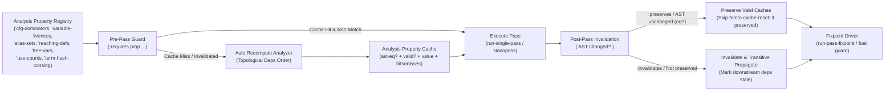

# [FEAT] Nanopass パスマネージャにおける解析結果キャッシュ自動無効化と再計算 (ID: 840)

## 1. 概要 / Summary

ULisp コンパイラの統合パスマネージャ（`ulisp/compiler/pass_manager.scm`）および Nanopass DSL 展開器（`ulisp/compiler/nanopass.scm` / `ulisp/compiler/nanopass_meta.scm`）を拡張し、各パスが要求する解析情報（`:requires` / `requires`）、変更後も維持する解析情報（`:preserves` / `preserves`）、および破壊・無効化する解析情報（`:invalidates` / `invalidates`）を宣言的契約として定義できるようにする。

現状の実装には以下の構造的課題が存在する：
1. **パス単位の解析契約メタデータの不在**: `make-pass-descriptor`（10要素レコード）および `define-pass` は言語スキーマ境界（`in-lang` / `out-lang`）と先行パス依存（`prerequisites`）のみを保持しており、パスの実行前後にどの解析プロパティ（CFG 支配木、生存区間、別名/エスケープ情報、到達定義、自由変数集合、使用回数、Term Hash-Consing）が有効・無効化されるかを表現できない。
2. **無差別なキャッシュ破棄と再計算駆動の欠如**: `run-single-pass` は毎パス境界で `femto-cache-reset!` を無条件に呼び出して属性キャッシュを全破棄する一方、パスマネージャレベルの解析結果キャッシュおよび依存関係に基づく自動再計算ドライバ（Lazy / On-demand Analysis Recomputation）を持たない。
3. **不動点反復最適化ループにおけるキャッシュ整合性リスク**: ピープホール最適化や定数伝播・CFG 簡約などの反復最適化ループ（Fixpoint Iteration）を回す際、AST/LIR が書き換わったにもかかわらず古い解析結果（Liveness や Dominators 等）が残存すると誤変換を招き、逆に毎回すべてを手動再計算するとコンパイル性能が劣化する。

本 Issue では、解析プロパティレジストリ・選択的無効化＆推移的無効化（Transitive Invalidation）・要求時自動再計算・有界不動点反復ドライバ（`run-pass-fixpoint`）を整備する。

---

## 2. トレーサビリティ / Traceability

- **設計仕様書**:
  - [DSN-33-01 (ULisp 階層型パス融合 ＆ DAG 最適化基盤設計書)](../../designs/DSN-33-01-ulisp_pipeline_pass_nanopass_picopass_dag_architecture.md): §5.1 (パス・ルール依存関係 DAG と解析キャッシュ維持 / Invalidation Tracking)
  - [DSN-33-02 (ULisp 多言語フロントエンド＆型付き機械語 LIR アーキテクチャ)](../../designs/DSN-33-02-ulisp_multilingual_frontend_and_typed_machine_lir_architecture.md): §6.1 (Braun SSA ＆ 任意 CFG 最適化基盤), §8.1 (Step S6 最適化＆コンパイル性能)
  - [DSN-33 (ULisp 包括設計仕様書: S式メタコンパイラ基盤)](../../designs/DSN-33-ulisp_underlying_x86_native_aot_compiler_architecture_specification.md): §2.6 (統一 Pass Manager 基盤)
- **関連 Issue**:
  - [Issue #765 (T5.1: ルール依存関係 DAG 自動構築・Femtopass 解析キャッシュ維持)](765-implement-rule-dependency-dag-and-femtopass-cache-invalidation.md)
  - [Issue #813 (fuse-rules 後順融合モードと Femtopass 解析キャッシュ実接続)](813-implement-fuse-rules-post-order-and-connect-femtopass-cache.md)
  - [Issue #827 (Pass 132 Braun SSA の任意 CFG 汎用対応化)](827-generalize-pass-132-braun-ssa-for-arbitrary-cfg-and-goto.md)
  - [Issue #839 (中間表現 HIR/MIR/LIR の永続化・再ロード機構 .sbi 拡張)](839-implement-ir-serialization-and-deserialization-sbi-extension.md)

---

## 3. 影響範囲と関連ファイル / Scope and Affected Files

- [x] [ulisp/compiler/pass_manager.scm](../../../ulisp/compiler/pass_manager.scm): 解析プロパティレジストリ、解析キャッシュテーブル、パス契約メタデータ管理、要求時自動再計算、パス前後での選択的・推移的無効化、`:preserves` に連動した Femtopass 維持、および有界不動点反復ドライバ（`run-pass-fixpoint`）の実装
- [x] [ulisp/compiler/nanopass.scm](../../../ulisp/compiler/nanopass.scm): `define-pass` / `trace-define-pass` 構文における `:requires` / `:preserves` / `:invalidates`（およびキーワード無し節形式・キーワードオプション形式）の解析と展開時・実行時契約登録および単独呼び出しフックの追加
- [x] [ulisp/compiler/nanopass_meta.scm](../../../ulisp/compiler/nanopass_meta.scm): パス解析契約テーブル（`*pass-analysis-contracts*`, `*pass-proc-analysis-contracts*`）および事前・事後フック（`*nanopass-pre-pass-analysis-hook*`, `*nanopass-post-pass-analysis-hook*`）の追加
- [x] [ulisp/compiler/dataflow.scm](../../../ulisp/compiler/dataflow.scm): 既存データフロー解決基盤を参照しつつ、標準解析プロパティ群（`cfg-dominators`, `variable-liveness`, `reaching-defs`, `alias-sets`, `free-vars`, `use-counts`, `femto-attrs`, `term-hash-consing`）の計算アダプタを [ulisp/compiler/pass_manager.scm](../../../ulisp/compiler/pass_manager.scm) 側に統合
- [x] [ulisp/compiler/module_header.scm](../../../ulisp/compiler/module_header.scm) および [ulisp/Makefile](../../../ulisp/Makefile): 新規公開 API シンボルの外部宣言登録および単体テストターゲット `test_pass_manager_cache_invalidation` の追加
- [x] [ulisp/tests/test_pass_manager_cache_invalidation.scm](../../../ulisp/tests/test_pass_manager_cache_invalidation.scm): 解析プロパティ登録、要求時再計算、`:preserves` ヒット維持、`:invalidates` および推移的依存無効化、`AST eq?` 無変更保持、循環依存検知（THREAT-840-2）、Femtopass キャッシュ維持、および不動点反復最適化での古キャッシュ抑止（THREAT-840-1）を検証する単体テスト（新規作成・85 件 PASS）

---

## 4. セキュリティ・設計分析 / Threat Modeling & Constraints

| 脅威 / リスク ID | 脅威内容 | CWE 分類 | 潜在的影響 | 本 Issue での対策・設計的緩和策 |
| :--- | :--- | :--- | :--- | :--- |
| **THREAT-840-1** | 古い解析キャッシュの誤参照による誤コンパイル (Stale Analysis Cache Miscompilation) | **CWE-345** (Insufficient Verification of Data Authenticity) | 変換パスが IR を変更（例：命令削除、変数合流、分岐書き換え）したにもかかわらず、古い生存区間・支配関係・別名集合キャッシュが後続パスで誤再利用され、不正な最適化やメモリ破壊コードが生成される。 | 1. デフォルト安全側（Fail-Safe）方針を採用し、出力 IR が入力と異なる（`(not (eq? output-ast input-ast))`）場合、`:preserves` に `'all` または該当プロパティ名が明示されない限り関連解析キャッシュを自動無効化する。 2. キャッシュエントリに構築元 `ast` 参照（および `ast` バージョン世代番号）を紐付け、`require-analysis` 時に現在の AST と不整合な古いエントリを拒否して自動再計算する。 |
| **THREAT-840-2** | 解析プロパティ間の循環依存・不動点ループ発散による DoS (Cyclic Analysis Dependency / Unbounded Fixpoint) | **CWE-400** (Uncontrolled Resource Consumption) | 解析 $A$ が解析 $B$ に依存し解析 $B$ が解析 $A$ に依存する場合、あるいは反復最適化パスが無限に収束しない場合、再計算ループが停止せずコンパイラがハング／スタック枯渇する。 | 1. `require-analysis` 実行中に訪問中スタック（`visiting`）を検査し、循環依存を検出した時点で構造化エラー `'analysis-cycle-error` を送出する（また `register-analysis-property!` 時の DAG 検証も提供する）。 2. `run-pass-fixpoint` に最大反復上限（`*pass-fixpoint-max-iterations*`、デフォルト安全値設定可能）と進行判定（`equal?` / `eq?` 比較）を強制し、上限到達時は安全停止する。 |
| **THREAT-840-3** | パイプライン実行・テスト間のキャッシュ汚染 (Cross-Pipeline Cache Contamination) | **CWE-665** (Improper Initialization) | あるコンパイル単位や失敗パスで生成された解析キャッシュが別パイプライン実行（`run-pass-pipeline`, `run-named-pipeline`）やテストケースへ残留し、誤った解析値が返される。 | `run-pass-pipeline`、`run-named-pipeline`、`reset-pipeline-options!`、`init-default-pass-registry!` の各初期化境界で `reset-analysis-cache!` を確実に実行する。 |

---

## 5. 実装方針 / Detailed Implementation Plan

**Target Branch**: `feat/840-nanopass-analysis-cache-invalidation`

### Step 1: 解析プロパティレジストリと依存 DAG・キャッシュ基盤 (`ulisp/compiler/pass_manager.scm` & `ulisp/compiler/dataflow.scm`)
1. **解析プロパティ記述子（Analysis Descriptor）**:
   - Record: `(list 'analysis-descriptor name compute-fn depends-on tags doc)`
   - API:
     - `(register-analysis-property! name compute-fn . opts)`: `depends-on`（前提となる他解析プロパティのリスト）、`tags`（対応する構文タグ等）を登録し、既存エントリは安全に上書き。
     - `(lookup-analysis-property name)` / `(analysis-property-registered? name)`
     - `(reset-analysis-properties!)` / `(init-default-analysis-properties!)`
   - 標準解析プロパティ識別子（`'cfg-dominators`, `'variable-liveness`, `'alias-sets`, `'reaching-defs`, `'free-vars`, `'use-counts`, `'term-hash-consing`, `'femto-attrs`）の定義と、既存 `dataflow.scm` / `040_analysis.scm` / `120_alias_escape.scm` と連携する計算アダプタの登録（未登録時は柔軟にオーバーライド可能）。
2. **解析キャッシュマネージャ（Analysis Cache State）**:
   - Cache Entry: `(list name valid? value ast generation hit-count recompute-count)`
   - Statistics: `*analysis-cache-stats*`（`hits`, `misses`, `invalidations`, `recomputations`, `preserved-skips`）を `(analysis-cache-stats)` / `(reset-analysis-cache!)` で取得・初期化可能にする。
   - **要求時自動再計算（`require-analysis`）**:
     - `(require-analysis prop-name ast)` を実装。
     - キャッシュが有効（`valid? = #t`）かつ（`ast-match` が整合する）場合は `compute-fn` を呼ばず即座にキャッシュ値を返却（`hits` 加算）。
     - 無効または未計算の場合、`depends-on` にある親解析を訪問中リスト `visiting` 付きでトポロジカル順に再帰解決し（循環時は即座に `error` / `raise`）、`compute-fn` を 1 回だけ実行して結果をキャッシュに格納する（`misses`・`recomputations` 加算）。
     - 補助 API: `(analysis-valid? prop-name)`, `(get-analysis-result prop-name)`, `(analysis-all-valid)`。
   - **選択的・推移的無効化（`invalidate-analysis!` / `invalidate-analyses-after-pass!`）**:
     - `(invalidate-analysis! prop-name)`: 指定プロパティを無効化（`valid? = #f`）するとともに、全登録解析の `depends-on` を逆引きして直接・間接に依存する下流プロパティもすべて推移的（Transitively）に無効化する（循環安全 `visited` ガード付き）。
     - `(invalidate-all-analyses!)`: 全キャッシュを一括無効化。

### Step 2: パス契約メタデータ拡張 (`ulisp/compiler/pass_manager.scm` & `ulisp/compiler/nanopass.scm`)
1. **`pass_manager.scm` の契約拡張**:
   - 既存の `make-pass-descriptor`（10引数）との後方互換性を 100% 維持しつつ、可変長または専用契約レジストリ `*pass-analysis-contracts*` およびアクセサを整備する：
     - `(set-pass-analysis-contract! pass-id requires preserves invalidates)`
     - `(pass-requires-analyses pass-id-or-desc)`（要求プロパティリスト `'()` 等）
     - `(pass-preserves-analyses pass-id-or-desc)`（維持プロパティリスト `'()`, `'(all)`, または `(cfg-dominators ...)`）
     - `(pass-invalidates-analyses pass-id-or-desc)`（明示的無効化プロパティリスト、または `'all`）
   - `make-pass-descriptor` は第11引数以降（あるいは alist オプション / 後続登録）も受け付けられる柔軟な形か、`set-pass-analysis-contract!` + `pass-requires-analyses` / `pass-preserves-analyses` / `pass-invalidates-analyses` の統一アクセサを提供し、既存の `test_pass_manager.scm` 等すべての呼び出しが一切壊れないことを保証する。
2. **`nanopass.scm` (`define-pass` / `trace-define-pass`) の拡張**:
   - `nanopass-expand-define-pass-with-trace`（L775〜L927）において、以下の節（キーワードあり・なし両対応）を認識・抽出し、展開コードの先頭または登録フックで `set-pass-analysis-contract!` を自動発行する：
     - `(:requires (p1 p2 ...))` または `(requires p1 p2 ...)`
     - `(:preserves (p1 p2 ...))` または `(preserves p1 p2 ...)`（`'all` も許容）
     - `(:invalidates (p1 p2 ...))` または `(invalidates p1 p2 ...)`
   - これにより、`define-pass` を用いたフロントエンド／MIR／LIR パスが、`(:preserves (cfg-dominators))` / `(:invalidates (variable-liveness alias-sets))` / `(:requires (variable-liveness))` を直接構文上に宣言でき、実行前後に `pass_manager.scm` と自動連動する。

### Step 3: パス実行エンジン・Femtopass キャッシュ連携・Fixpoint ドライバ (`ulisp/compiler/pass_manager.scm` & `ulisp/compiler/nanopass_meta.scm`)
1. **`run-single-pass` の解析契約駆動化**:
   - **Pre-Pass Phase**: パスの `pass-requires-analyses` に列挙された各解析プロパティ $P$ に対し `(require-analysis P input-ast)` を自動実行し、未計算または前パスで無効化された解析結果を直前で自動再計算する（得られた解析バンドルをコンテキスト `*current-pass-analyses*` から `(current-analysis P)` で参照可能にする）。
   - **Femtopass / Hash-Cons キャッシュの選択的維持**:
     - 現在 `run-single-pass`（L606, L612）は `femto-cache-reset!` を無条件呼び出ししているが、パス契約の `preserves` に `'femto-attrs` または `'all` が含まれる場合、あるいは後続で `femto` のタグ整合を維持したまま継続する場合は `femto-cache-reset!` をスキップするオプション経路を用意し、それ以外の従来パスでは安全のため従来通りリセットまたはタグ選択無効化を行う。
   - **Post-Pass Phase**: 出力 `output-ast` を得た後、契約と構造変化に基づき `invalidate-analyses-after-pass!` を実行する：
     - `invalidates` が `'all` の場合は全無効化。
     - `(eq? output-ast input-ast)`（または不変変化なし）かつ `invalidates` が明示されていない場合は、既定の計算済み解析キャッシュを維持する（IR 無変更パスによる無駄な破棄を回避）。
     - AST が変化（`not (eq? output-ast input-ast)`）した場合：
       - `preserves` に `'all` が含まれていれば、`invalidates` に明示されたプロパティ（およびその依存先）のみ無効化。
       - そうでなければ、計算済み解析のうち `preserves` に含まれないすべて（および `invalidates` 明示分と依存先）を無効化する（CWE-345 Fail-Safe）。
     - 更新後の `output-ast` に対して維持されたキャッシュの `ast` 参照を安全に同期する。
2. **`run-pass-pipeline` / `run-named-pipeline` / `run-pass-fixpoint`**:
   - パイプライン開始時に `(reset-analysis-cache!)` を呼ぶ（既存のテスト用手動実行時は設定によりリセット・維持を選択できる API も用意）。
   - **Fixpoint 反復ドライバ `(run-pass-fixpoint pass-ids initial-ast . opts)`** を新設する：
     - 指定された最適化パス群を不動点（`equal?` / `eq?` で IR が変化しなくなる）まで反復適用し、各ステップで `run-single-pass` を通じて `:requires` / `:preserves` / `:invalidates` 契約を厳格に評価する。
     - 途中で IR を変化させたパスが解析を無効化した場合、次イテレーションまたは次パスの直前で自動再計算が走るため、古い解析に基づく誤変換が起こらず、逆に IR 不変（または `:preserves` 明示）時は再計算をスキップする。
     - 最大反復上限（`max-iters`）により無限ループ（CWE-400）を確実に防止する。
3. **既存パイプラインパスへの契約付与 (`init-default-pass-registry!`)**:
   - `pass-050-cp0`, `pass-060-lvn`, `pass-080-annotator`, `pass-120-alias-escape`, `pass-128-lir-branch-fusion`, `pass-133-lir-peephole` 等に対し、適切な既定契約（例：`pass-133-lir-peephole` 等）や `dataflow.scm` 由来の解析登録との整合を設定し、既存テストの動作を 100% 維持する。

### Step 4: ビルド統合 (`ulisp/Makefile`, `ulisp/compiler/module_header.scm`) と単体テスト作成 (`ulisp/tests/test_pass_manager_cache_invalidation.scm`)
1. `ulisp/compiler/module_header.scm`: 新規公開シンボル群を `%declare-extern-identifiers` へ登録し、コンパイラ自己ビルド時の未定義シンボルフリーを保証する。
2. `ulisp/Makefile`: `test_pass_manager_cache_invalidation` ターゲットを新設し、`test:` 依存対象へ追加する。
3. `ulisp/tests/test_pass_manager_cache_invalidation.scm` に以下のテストグループを実装する：
   - **Group 1**: 解析プロパティ登録・要求・ヒット/ミス計測（`(require-analysis ...)` 初回のみ計算、2回目以降キャッシュヒット）
   - **Group 2**: `:preserves` / AST 無変更時の解析キャッシュ維持と `:invalidates` / 未保存変更による自動無効化・直前自動再計算
   - **Group 3**: 解析プロパティ間依存 (`depends-on`) のトポロジカル計算と推移的無効化（例：`reaching-defs` 無効化に伴い下流解析も自動無効化・再計算）、および循環依存エラー検出（**THREAT-840-2**）
   - **Group 4**: `define-pass` 構文での `(:requires ...)`, `(:preserves ...)`, `(:invalidates ...)` 宣言と展開時自動契約登録・実行連携、および `femto` キャッシュ選択維持検証
   - **Group 5**: CFG ピープホール＋生存区間／定数伝播の反復最適化ループ（`run-pass-fixpoint`）において、古い解析情報参照による誤最適化を防ぎつつ不要な再計算を回避することの実証テスト（**THREAT-840-1**）

---

## 6. 完了条件 / Success Criteria (DoD)

- [x] **契約宣言の実装**: `define-pass`（`nanopass.scm`）および `pass_manager.scm` の双方で `requires` / `preserves` / `invalidates` の宣言・取得・実行連携が機能すること。
- [x] **自動無効化と遅延再計算**: パスによって解析プロパティが無効化された後、そのプロパティを要求（`:requires`）する後続パスの直前で計算ルーチンが自動再実行（再計算回数カウンタ増加で確認）され、逆に `:preserves` 指定パスや AST 無変更パスでは再計算がスキップされる（キャッシュヒット増加で確認）こと。
- [x] **推移的無効化とセキュリティ緩和 (THREAT-840-1..3)**: 上流解析の無効化が依存グラフに沿って下流解析へ自動波及すること、AST 変更時に `:preserves` 未指定解析が Fail-Safe に無効化されること、循環依存および過剰反復が安全に停止・拒否されること。
- [x] **Fixpoint 反復最適化の健全性**: 複数パスを組み合わせた `run-pass-fixpoint` ループにおいて、途中のコード変換後に古い解析キャッシュへ依存するバグが完全に抑止され、最終最適化 IR が意味的に正しい（構造一致・反復収束で確認）こと。
- [x] **全品質ゲート PASS**:
  - `make -C ulisp test_pass_manager_cache_invalidation` および `USE_GOSH=1 make -C ulisp test_pass_manager_cache_invalidation` が全件 PASS すること。
  - `make -C ulisp test_pass_manager`, `make -C ulisp test_dataflow`, `make -C ulisp test_passes`, `make -C ulisp compiler.scm`, `make -C ulisp lint_sexpr`, `make -C ulisp verify_zero_gauche` がすべて PASS すること。
  - `make py_compile`, `make check_format`, `make static_analysis`, およびドキュメント内相対パスリンク検証がすべてエラー 0 件で PASS すること。
