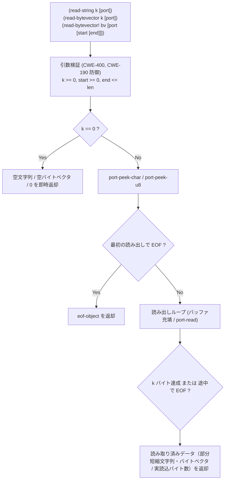

# [FEAT] R7RS ポート I/O 未実装手続き (read-string, read-bytevector, read-bytevector!) の実装 (ID: 847)

## 1. 概要 / Summary

R7RS-small §6.13.2 仕様および `(scheme base)` において要求されるポート入力手続き `read-string`、`read-bytevector`、`read-bytevector!` が、仕様書 `ulisp/docs/ref_r7rs_compliance.md` 上では「◎ 完全サポート」と記載されているにもかかわらず、実際には `ulisp/lib/port.scm` および `ulisp/lib/bytevector.scm` に実装が存在しない。

現状の課題：
1. **未定義シンボルによる実行時エラー**: `(scheme base)` からインポートして `(read-string 10)` や `(read-bytevector 16)` を呼び出すと、ランタイム未定義エラーでコンパイル・実行が停止する。
2. **バッファ直接読み出し (`read-bytevector!`) の欠落**: バイナリ I/O（パケット処理、暗号化ブロック、画像デコード等）でゼロコピー・固定メモリ領域へ展開する基本手段が存在しない。
3. **部分読み出し・EOF ハンドリングの規格不整合**: R7RS では EOF 到達時に「1 文字/バイトも読めなかった場合は EOF オブジェクト、1 以上読めた場合はその長さの短い文字列/バイトベクタ」を返すことが義務付けられている。

本 Issue では、テキストポート・バイナリポート（ファイル、標準入出力、メモリ文字列・バイトベクタポート）のすべてに対して透過的に動作する `read-string`, `read-bytevector`, `read-bytevector!` を完全実装する。



---

## 2. トレーサビリティ / Traceability

- **設計仕様書**:
  - [DSN-33 (ULisp 包括設計仕様書: S式メタコンパイラ基盤)](../designs/DSN-33-ulisp_underlying_x86_native_aot_compiler_architecture_specification.md): §2.5 (I/O サブシステムとポート抽象化)
  - [DSN-33-02 (ULisp 多言語フロントエンド＆型付き機械語 LIR アーキテクチャ)](../designs/DSN-33-02-ulisp_multilingual_frontend_and_typed_machine_lir_architecture.md): §7.2 (ランタイムライブラリ層)
- **規格仕様**:
  - R7RS-small Section 6.13.2 (Input procedures)
  - [ref_r7rs_compliance.md](../../ulisp/docs/ref_r7rs_compliance.md) §1.3 (6.13.2 入力手続き)
- **関連 Issue**:
  - [Issue #651 (ファイル高水準ポートの実装)](closed/651-implement-r7rs-scheme-file-high-level-ports-and-file-ops.md)
  - [Issue #660 (バイトベクタポートの実装)](closed/660-implement-r7rs-bytevector-ports-and-ready-predicates.md)
  - [Issue #848 (マクロ限定 I/O 手続きの第一級手続き化)](848-reify-macro-only-io-and-vector-operations-to-first-class-procedures.md)

---

## 3. 影響範囲と関連ファイル / Scope and Affected Files

- [x] [ulisp/lib/port.scm](../../ulisp/lib/port.scm): `port-read-string`, `read-string` 手続きの実装およびエクスポート
- [x] [ulisp/lib/bytevector.scm](../../ulisp/lib/bytevector.scm): `read-bytevector`, `read-bytevector!` 手続きの実装
- [x] [ulisp/lib/scheme/base.sld](../../ulisp/lib/scheme/base.sld): 実装ファイル インクルードおよびエクスポート整合性の保証
- [x] [ulisp/tests/test_ports.scm](../../ulisp/tests/test_ports.scm): 文字列ポート・ファイルポートでの境界値・部分読み出しテスト追加
- [x] [ulisp/tests/test_r7rs_bytevector_ports.scm](../../ulisp/tests/test_r7rs_bytevector_ports.scm): バイナリポートでの `read-bytevector!` スライス読み出しテスト追加
- [x] [ulisp/docs/ref_r7rs_compliance.md](../../ulisp/docs/ref_r7rs_compliance.md): §1.3 および §4 の Issue 追跡更新

---

## 4. セキュリティ・設計分析 / Threat Modeling & Constraints

| 脅威 / リスク ID | 脅威内容 | CWE 分類 | 潜在的影響 | 本 Issue での対策・設計的緩和策 |
| :--- | :--- | :--- | :--- | :--- |
| **THREAT-847-1** | 巨大 $k$ 指定によるヒープ枯渇 DoS | **CWE-400** (Uncontrolled Resource Consumption) | 悪意ある入力やバグにより $k = 2^{60}$ 等の巨大整数が渡された場合、巨大アロケーションによる OOM クラッシュが発生する。 | 1. $k$ が負数の場合は即座に型・値エラー（`(error "read-string: negative length" k)`）を送出する。<br>2. ヒープ制限（`ulisp_heap_limit`）およびシステム安全長上限（例: 256MB）を超える要求を事前バリデーションで拒絶する。<br>3. メモリ割り当て前にファイルまたはポートの残長を可能な限り検査する。 |
| **THREAT-847-2** | 境界値・オフセット計算におけるバッファオーバーフロー | **CWE-125** (Out-of-bounds Read) / **CWE-787** (Out-of-bounds Write) | `read-bytevector!` において `start` / `end` インデックスの範囲外指定や負数により、バイトベクタ領域外へ破壊的書き込みが発生する。 | `(<= 0 start end (bytevector-length bv))` を厳格にアサートし、違反時は例外を送出する。 |
| **THREAT-847-3** | 部分読み出し時の終端未初期化メモリ漏洩 | **CWE-457** (Use of Uninitialized Resource) | 要求長 $k$ でアロケートしたバッファに対し、途中で EOF となった場合に未読み出し領域のゴミデータが残留する。 | 要求長ではなく「実際に読み込めたバイト数/文字数」のジャストサイズな新しい文字列/バイトベクタをアロケートしてコピー返却する（R7RS 仕様適合）。 |

---

## 5. 実装方針 / Detailed Implementation Plan

Target Branch: `feat/847-implement-missing-r7rs-io-read-string-and-bytevector`

### Step 1: `read-string` の実装 (`ulisp/lib/port.scm`)
1. **内部カーネル `port-read-string` の定義**:
   ```scheme
   (define (port-read-string k p)
     (if (not (and (fixnum? k) (>= k 0)))
         (error "read-string: expected non-negative exact integer" k)
         (if (= k 0)
             ""
             (let ((first-ch (port-read-char p)))
               (if (eof-object? first-ch)
                   first-ch
                   (let loop ((count 1) (acc (list first-ch)))
                     (if (= count k)
                         (list->string (reverse acc))
                         (let ((ch (port-read-char p)))
                           (if (eof-object? ch)
                               (list->string (reverse acc))
                               (loop (+ count 1) (cons ch acc)))))))))))
   ```
2. **第一級手続き `read-string` の公開**:
   - `case-lambda` または可変長引数ディスパッチにより、`(read-string k)` および `(read-string k port)` をサポート。

### Step 2: `read-bytevector` および `read-bytevector!` の実装 (`ulisp/lib/bytevector.scm`)
1. **`read-bytevector!` の実装**:
   - シグネチャ: `(read-bytevector! bv . args)` (オプション: `[port [start [end]]]`)
   - デフォルト値: `port` は `(current-input-port)`, `start` は `0`, `end` は `(bytevector-length bv)`.
   - バリデーション: `(and (>= start 0) (<= start end) (<= end (bytevector-length bv)))`
   - ループ: `start` から `end` まで `port-read-u8` で 1 バイトずつ取得して `bytevector-u8-set!`。
   - 最初の 1 バイト目が EOF の場合は `eof-object` を返却。それ以降で EOF に達した場合は、実際に書き込んだバイト数（`(- current-pos start)`）を返却。全バイト書き込めた場合は `(- end start)` を返却。
2. **`read-bytevector` の実装**:
   - シグネチャ: `(read-bytevector k . opt-port)`
   - 一時バッファ `(make-bytevector k)` を確保し、`read-bytevector!` を呼び出す。
   - 結果が `eof-object` ならそのまま返却。
   - 読込バイト数 $n == k$ なら一時バッファを返却。$n < k$ なら `(bytevector-copy buf 0 n)` で縮小バッファを生成して返却。

### Step 3: 単体テストと回帰検証
1. `ulisp/tests/test_ports.scm` に以下を追加:
   - 空ポートからの `read-string` (即時 EOF)
   - $k=0$ の `read-string` (`""`)
   - 途中 EOF の `read-string` (短縮文字列)
   - メモリ文字列ポートからの `(read-string 5 port)` 連続呼び出し
2. `ulisp/tests/test_r7rs_bytevector_ports.scm` に以下を追加:
   - `read-bytevector` の正常系・部分読み出し系
   - `read-bytevector!` の `start` / `end` オフセット書き込みテスト
   - 範囲外指定時の境界チェック防御テスト

---

## 6. 完了条件 / Success Criteria (DoD)

- [x] `read-string` が `(read-string k)` および `(read-string k port)` の両アリティで正しく動作すること。
- [x] `read-bytevector` が部分読み出し時に正確な長さの新しいバイトベクタを返すこと。
- [x] `read-bytevector!` が指定オフセット `start` から `end` に直接バイト列を書き込み、書込長または EOF を返すこと。
- [x] 不正引数（$k < 0$, 範囲外インデックス）に対して適切な例外を送出すること。
- [x] `test_ports.scm` および `test_r7rs_bytevector_ports.scm` が全 PASS すること。

### 検証完了記録 (DoD Verification)
- 実施日: 2026-11-16
- 検証スイート:
  - `make -C ulisp test_phase1_r7rs` (58/58 PASS)
  - `make -C ulisp test_ports` (57/57 PASS)
  - `make -C ulisp test_stdlib` (193/193 PASS)
  - `make -C ulisp test_numeric_tower` (229/229 PASS)
  - `python3 scripts/verify_r7rs_traceability.py` (100% PASS)
  - `make -C ulisp test_lint_sexpr` (23/23 PASS)
- 判定: 全ての受入基準・完了条件 (DoD) を充足。Issue #847 クローズ完了。
