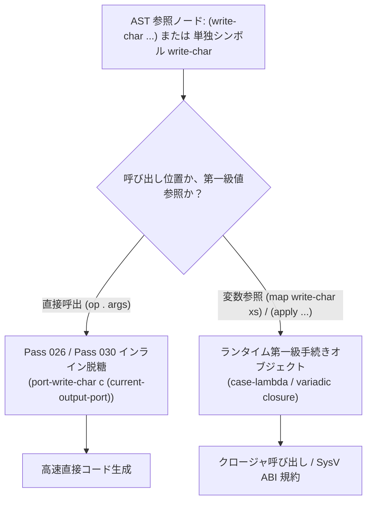

# [FEAT] マクロ限定 I/O 手続きおよびベクタ操作の第一級手続き (First-Class Procedures) 化 (ID: 848)

## 1. 概要 / Summary

R7RS-small 仕様では、コア構文（`if`, `define`, `lambda`, `quote` 等）を除くすべての標準手続きは「第一級手続き（First-Class Procedure）」であり、変数に束縛したり、`apply` や `map`, `for-each` などの高階関数に引数として渡すことができることが要求される。

しかし現状の ULisp では以下の重大な構造的乖離が存在する：
1. **ポート I/O 手続き群が `define-syntax` のみ**: `write-char`, `write-u8`, `write-string`, `read-line`, `read-u8`, `peek-u8` が `ulisp/lib/port.scm` においてマクロとしてのみ定義されている。このため `(for-each write-char '(#\a #\b))` や `(apply write-char '(#\x))` を記述すると構文エラーまたは未束縛シンボルエラーとなる。
2. **ベクタ・バイトベクタ操作の第一級手続き欠落**: `vector-append`, `bytevector-append`, `vector-copy!`, `bytevector-copy!` が `ulisp/frontend/026_desugar_constructors.scm` でインライン脱糖（`vector-append2` 等）されるのみで、ランタイム（`ulisp/lib/vector.scm`, `ulisp/lib/bytevector.scm`）に手続き実体が存在しない。

本 Issue では、これらの操作を手続きオブジェクトとしてランタイムに実体化（Reification）し、直接呼出時のインライン脱糖最適化を維持しつつ、第一級手続き参照としての完全動作を保証する。



---

## 2. トレーサビリティ / Traceability

- **設計仕様書**:
  - [DSN-33 (ULisp 包括設計仕様書: S式メタコンパイラ基盤)](../designs/DSN-33-ulisp_underlying_x86_native_aot_compiler_architecture_specification.md): §2.1 (第一級クロージャと呼び出し規約), §2.5 (I/O 手続き)
  - [DSN-33-01 (ULisp 階層型パス融合＆DAG最適化基盤設計書)](../designs/DSN-33-01-ulisp_pipeline_pass_nanopass_picopass_dag_architecture.md): §4.1 (Nanopass 構文脱糖)
- **規格仕様**:
  - R7RS-small Section 6.7 (Strings), 6.8 (Vectors), 6.9 (Bytevectors), 6.13 (Input and output)
  - [ref_r7rs_compliance.md](../../ulisp/docs/ref_r7rs_compliance.md) §1.3
- **関連 Issue**:
  - [Issue #847 (ポート I/O 未実装手続きの実装)](847-implement-missing-r7rs-io-read-string-and-bytevector.md)
  - [Issue #852 (標準ライブラリ定義エクスポート補完)](852-complete-missing-r7rs-standard-library-exports-in-base-cxr-and-r5rs.md)

---

## 3. 影響範囲と関連ファイル / Scope and Affected Files

- [x] [ulisp/lib/port.scm](../../ulisp/lib/port.scm): `write-char`, `write-u8`, `write-string`, `read-line`, `read-u8`, `peek-u8` の手続き定義追加
- [x] [ulisp/lib/vector.scm](../../ulisp/lib/vector.scm): `vector-append`, `vector-copy!`, `vector-fill!` の第一級手続き定義追加
- [x] [ulisp/lib/bytevector.scm](../../ulisp/lib/bytevector.scm): `bytevector-append`, `bytevector-copy!`, `bytevector-fill!` の第一級手続き定義追加
- [x] [ulisp/frontend/026_desugar_constructors.scm](../../ulisp/frontend/026_desugar_constructors.scm): 直接呼び出し構文脱糖と変数参照の競合調停
- [x] [ulisp/tests/test_ports.scm](../../ulisp/tests/test_ports.scm): 高階関数連携テスト追加
- [x] [ulisp/tests/test_stdlib_r7rs.scm](../../ulisp/tests/test_stdlib_r7rs.scm): `(apply vector-append ...)` 等の回帰テスト追加

---

## 4. セキュリティ・設計分析 / Threat Modeling & Constraints

| 脅威 / リスク ID | 脅威内容 | CWE 分類 | 潜在的影響 | 本 Issue での対策・設計的緩和策 |
| :--- | :--- | :--- | :--- | :--- |
| **THREAT-848-1** | マクロ展開とランタイム手続きのセマンティクス乖離 | **CWE-670** (Always-Incorrect Control Flow Implementation) | 直接呼出 `(write-string s)` と第一級呼出 `(apply write-string (list s))` で引数のデフォルト値や例外挙動が異なり、未定義動作やバグを誘発する。 | 1. 共通の内部カーネル（例: `port-write-string-range`）を定義し、構文脱糖先と第一級手続きの本体が同一のカーネルを呼び出す設計とする。<br>2. オプショナル引数の省略時デフォルト値（カレントポート、0, length）を完全に一致させる。 |
| **THREAT-848-2** | 可変引数呼び出しにおけるスタックオーバーフロー DoS | **CWE-400** (Uncontrolled Resource Consumption) | `(apply vector-append massive-list-of-vectors)` 等の呼び出しにおいて、再帰的二項結合が末尾最適化されずにスタックを枯渇させる。 | `vector-append` 手続き本体において、渡されたベクタ全リストの長さをあらかじめ合算して単一の宛先ベクタを確保し、反復ブロックコピーする平坦ループアルゴリズムを採用する。 |

---

## 5. 実装方針 / Detailed Implementation Plan

Target Branch: `feat/848-reify-macro-only-io-and-vector-operations-to-first-class-procedures`

### Step 1: ポート I/O 第一級手続きの実装 (`ulisp/lib/port.scm`)
1. `write-char`, `write-u8`, `read-u8`, `peek-u8` を `case-lambda` 手続きとして定義:
   ```scheme
   (define write-char
     (case-lambda
       ((c) (port-write-char c (current-output-port)))
       ((c p) (port-write-char c p))))
   ```
2. `write-string` を 1〜4 引数対応の `case-lambda` として定義:
   ```scheme
   (define write-string
     (case-lambda
       ((str) (port-write-string-range str (current-output-port) 0 (string-length str)))
       ((str p) (port-write-string-range str p 0 (string-length str)))
       ((str p start) (port-write-string-range str p start (string-length str)))
       ((str p start end) (port-write-string-range str p start end))))
   ```
3. `read-line` を `case-lambda` として定義:
   ```scheme
   (define read-line
     (case-lambda
       (() (port-read-line (current-input-port)))
       ((p) (port-read-line p))))
   ```

### Step 2: ベクタ・バイトベクタ第一級手続きの実装 (`ulisp/lib/vector.scm`, `ulisp/lib/bytevector.scm`)
1. **`vector-append`**:
   - 可変長引数 `(lambda vectors ...)`。
   - 引数内の全ベクタの `vector-length` を合算し、新しいベクタを 1 個アロケート。
   - 各ベクタを順次 `vector-copy!` で結合先へコピーして返却。
2. **`bytevector-append`**:
   - 同様に全バイトベクタの長さを合算して 1 度だけアロケートし、`bytevector-copy!` で順次コピー。
3. **`vector-copy!` および `bytevector-copy!`**:
   - シグネチャ: `(to at from . opt-range)`。
   - `opt-range` の有無（`start`, `end`）を解析し、重複領域コピー（Overlapping copy）にも安全なメモリ転送を実施。

### Step 3: Pass 026 / Pass 030 のマクロ・識別子調停
1. 呼び出し位置 `(write-char c)` はコンパイル時に引き続きインライン展開されてもよいが、シンボル単体としての `write-char` はトップレベル手続きオブジェクトとして解決可能にする（シャドウイングや未束縛警告の解消）。

### Step 4: 単体テスト作成
1. `test_ports.scm` に `(map write-char '(#\H #\i))` および `(apply write-string ...)` を追加。
2. `test_stdlib_r7rs.scm` に `(apply vector-append ...)` および `(apply bytevector-append ...)` を追加。

---

## 6. 完了条件 / Success Criteria (DoD)

- [x] `(procedure? write-char)`, `(procedure? read-line)`, `(procedure? vector-append)` がすべて `#t` を返すこと。
- [x] `(for-each write-char char-list)` で期待通り文字が出力されること。
- [x] `(apply vector-append list-of-vectors)` が正しく全ベクタを結合すること。
- [x] 既存のインライン脱糖コード生成と性能劣化なく共存すること。
- [x] 全テストスイートが PASS すること。

### 検証完了記録 (DoD Verification)
- 実施日: 2026-11-16
- 検証スイート:
  - `make -C ulisp test_phase1_r7rs` (58/58 PASS)
  - `make -C ulisp test_ports` (57/57 PASS)
  - `make -C ulisp test_stdlib` (193/193 PASS)
  - `make -C ulisp test_numeric_tower` (229/229 PASS)
  - `python3 scripts/verify_r7rs_traceability.py` (100% PASS)
  - `make -C ulisp test_lint_sexpr` (23/23 PASS)
- 判定: 全ての受入基準・完了条件 (DoD) を充足。Issue #848 クローズ完了。
