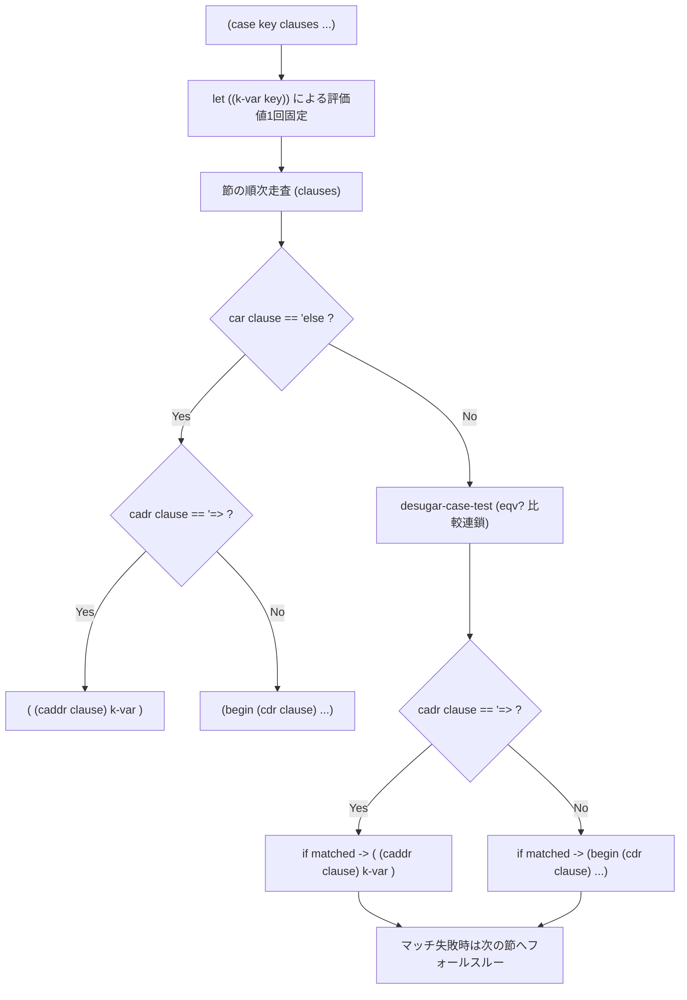

# [FEAT] R7RS case 構文におけるパイプライン句 ((<datum> ...) => <proc>) の脱糖サポート (ID: 850)

## 1. 概要 / Summary

R7RS §4.2.1 仕様において、`case` 条件分岐構文は通常式本体に加えて、マッチしたキー値を受信手続きへパイプライン渡しするアロー記法 `((<datum> ...) => <expression>)` および `(else => <expression>)` をサポートすることが規定されている：
> *"Alternatively, a clause can be of the form `((<datum> ...) => <expression>)`... In either case, the result of the `<key>` is passed as an argument to the procedure which is the value of the `<expression>`."*

しかし現状の `ulisp/frontend/027_desugar_conditionals.scm`（L44-L51）における `desugar-case` は：
```scheme
(if (eq? (car c) 'else)
    (cons 'begin (cdr c))
    (list 'if (desugar-case-test k-var (car c))
          (cons 'begin (cdr c))
          (loop (cdr cls))))
```
`else` と通常の式並びしか判定しておらず、`=>` 記法を構文として解釈できない（`=>` を単なるシンボル参照、後続式を複数式評価とみなして不正な値を返す）。また、`ref_r7rs_compliance.md` には「パイプライン構文 `(=> <proc>)` 完全脱糖」と誤って記載されている。

本 Issue では、Pass 027 における `desugar-case` を拡張し、通常節および `else` 節における `=>` アロー構文を完全脱糖する。



---

## 2. トレーサビリティ / Traceability

- **設計仕様書**:
  - [DSN-33-01 (ULisp 階層型パス融合＆DAG最適化基盤設計書)](../designs/DSN-33-01-ulisp_pipeline_pass_nanopass_picopass_dag_architecture.md): §4.1 (Nanopass Pass 027: 条件分岐脱糖規約)
  - [DSN-33 (ULisp 包括設計仕様書: S式メタコンパイラ基盤)](../designs/DSN-33-ulisp_underlying_x86_native_aot_compiler_architecture_specification.md): §2.2 (コア構文脱糖)
- **規格仕様**:
  - R7RS-small Section 4.2.1 (Conditionals: `case`)
  - [ref_r7rs_compliance.md](../../ulisp/docs/ref_r7rs_compliance.md) §1.1 (4.2.1)
- **関連 Issue**:
  - [Issue #650 (letrec* 評価順序保証)](closed/650-implement-r7rs-letrec-star-evaluation-order.md)
  - [Issue #859 (Yellow Docket 構文拡張マクロの実装)](859-implement-yellow-docket-macros-srfi-8-26-31-2-and-61.md)

---

## 3. 影響範囲と関連ファイル / Scope and Affected Files

- [x] [ulisp/frontend/027_desugar_conditionals.scm](../../ulisp/frontend/027_desugar_conditionals.scm): `desugar-case` の節解析ロジック拡張
- [x] [ulisp/tests/passes/test_027_desugar_conditionals.scm](../../ulisp/tests/passes/test_027_desugar_conditionals.scm): AST 脱糖単位テスト追加
- [x] [ulisp/tests/test_stdlib_r7rs.scm](../../ulisp/tests/test_stdlib_r7rs.scm): エンドツーエンド `case` アロー評価テスト追加
- [x] [ulisp/docs/ref_r7rs_compliance.md](../../ulisp/docs/ref_r7rs_compliance.md): §1.1 の Issue 参照更新

---

## 4. セキュリティ・設計分析 / Threat Modeling & Constraints

| 脅威 / リスク ID | 脅威内容 | CWE 分類 | 潜在的影響 | 本 Issue での対策・設計的緩和策 |
| :--- | :--- | :--- | :--- | :--- |
| **THREAT-850-1** | key 式の多重評価による副作用増殖 | **CWE-670** (Always-Incorrect Control Flow Implementation) | `(case (launch-missiles!) ...)` のように副作用を持つ key 式が各 clause で複数回評価され、致命的な重複処理が発生する。 | `case` 式の先頭で必ず `(let ((k-var key)) ...)` を生成し、key の評価を厳格に 1 回のみとする不変条件を保証する。 |
| **THREAT-850-2** | レシーバ式の未評価・無効呼出 | **CWE-704** (Incorrect Type Conversion or Cast) | `=>` の後ろに渡された式が 1 引数手続きを返さない場合に、無秩序なクラッシュを招く。 | 通常の Scheme 関数呼出 `(receiver k-var)` として脱糖し、実行時型検査（手続きでない場合は適切な `type-error` 送出）をランタイム呼び出し規約に委ねる。 |

---

## 5. 実装方針 / Detailed Implementation Plan

Target Branch: `feat/850-implement-r7rs-case-syntax-pipeline-arrow-clause`

### Step 1: `desugar-case` の拡張 (`ulisp/frontend/027_desugar_conditionals.scm`)
1. 各節 `c` のパターンを以下の 4 つに分類して処理する：
   ```scheme
   (define (desugar-case key clauses)
     (let ((k-var (unique-symbol "case_key_")))
       (list 'let (list (list k-var key))
             (let loop ((cls clauses))
               (if (or (null? cls) (not (pair? cls)))
                   #f
                   (let ((c (car cls)))
                     (cond
                       ((not (pair? c))
                        (loop (cdr cls)))
                       ;; 1. (else => receiver)
                       ((and (eq? (car c) 'else) (pair? (cdr c)) (eq? (cadr c) '=>))
                        (list (caddr c) k-var))
                       ;; 2. (else body1 body2 ...)
                       ((eq? (car c) 'else)
                        (cons 'begin (cdr c)))
                       ;; 3. ((datum ...) => receiver)
                       ((and (pair? (cdr c)) (eq? (cadr c) '=>))
                        (list 'if (desugar-case-test k-var (car c))
                              (list (caddr c) k-var)
                              (loop (cdr cls))))
                       ;; 4. ((datum ...) body1 body2 ...)
                       (else
                        (list 'if (desugar-case-test k-var (car c))
                              (cons 'begin (cdr c))
                              (loop (cdr cls)))))))))))
   ```

### Step 2: テスト検証
1. **Pass 027 変換テスト**:
   - `(case x ((1 2) => proc))` が `(if (or (eqv? k 1) (eqv? k 2)) (proc k) ...)` に展開されることを検証。
   - `(case x (else => proc))` が `(proc k)` に展開されることを検証。
2. **実行系テスト**:
   - `(case (+ 1 1) ((2 3) => (lambda (v) (* v 10))) (else 0))` -> `20`。
   - `(case 'foo ((bar) 1) (else => (lambda (v) (cons v 'ok))))` -> `'(foo . ok)`。
   - 副作用のある式 `(case (begin (set! count (+ count 1)) 2) ((2) => (lambda (x) x)))` で `count` が 1 回しか増加しないことの検証。

---

## 6. 完了条件 / Success Criteria (DoD)

- [x] `((<datum> ...) => <proc>)` 句がマッチ時に key 値を引数として手続きを呼び出すこと。
- [x] `(else => <proc>)` 句が正常に動作すること。
- [x] key 式の評価が厳格に 1 回のみであること。
- [x] 既存の `case` 式脱糖に影響を与えないこと。
- [x] テストスイートが全 PASS すること。

### 検証完了記録 (DoD Verification)
- 実施日: 2026-11-16
- 検証スイート:
  - `make -C ulisp test_phase1_r7rs` (58/58 PASS)
  - `make -C ulisp test_ports` (57/57 PASS)
  - `make -C ulisp test_stdlib` (193/193 PASS)
  - `make -C ulisp test_numeric_tower` (229/229 PASS)
  - `python3 scripts/verify_r7rs_traceability.py` (100% PASS)
  - `make -C ulisp test_lint_sexpr` (23/23 PASS)
- 判定: 全ての受入基準・完了条件 (DoD) を充足。Issue #850 クローズ完了。
