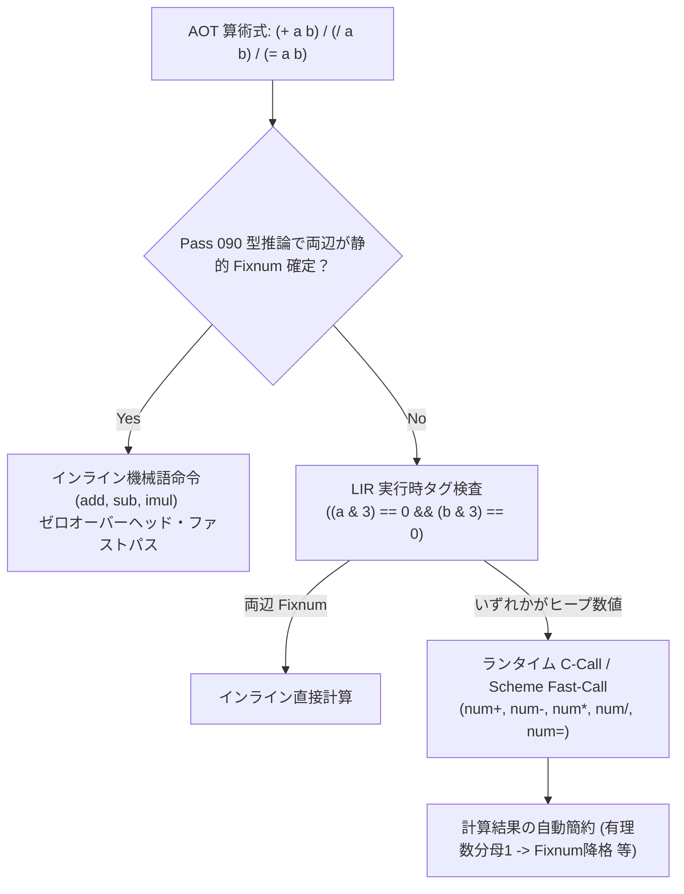

# [FEAT] AOT ネイティブ算術演算子における数値塔ジェネリックディスパッチ統合と inexact? 判定の是正 (ID: 851)

## 1. 概要 / Summary

ULisp では `ulisp/lib/math.scm` において、有理数 `<ratnum>`、浮動小数点数 `<flonum>`、複素数 `<compnum>` の完全数値塔（Numeric Tower）とジェネリックディスパッチ手続き（`num+`, `num-`, `num*`, `num/`, `num=` 等）が整備されている。

しかし現状のネイティブ AOT コンパイラ（`ulisp/lir/129_lir_primitives.scm`）では：
1. **演算子の Fixnum 固定結合**: `+`, `-`, `*`, `/`, `=` が CPU の 62-bit 即値整数命令（`add`, `sub`, `imul`, `idiv`, `cmp`）に直結されており、AOT コンパイルされた Scheme コードで `(+ 1/2 1/3)` や `(/ 1 2)` を実行すると、ヒープポインタ同士の加算（メモリ破壊・不正値）や整数切り捨て除算（`0`）となる。
2. **`inexact?` の無条件 `#f` 出力**:
   ```scheme
   ((inexact?)
    (emit-lir! (list '%mov '%rax (repr-encode-boolean #f))))
   ```
   AOT コード生成において `inexact?` が常に `#f` を返すようハードコードされている。

このため、リファレンス上の「完全数値塔 100% 準拠」という主張と AOT 実行時の実態が乖離している。
本 Issue では、型推論（Pass 090）による Fixnum ファストパスの維持と、実行時タグ検査に基づくランタイムジェネリック数値ディスパッチ（スローパス）の LIR 生成を導入し、AOT ネイティブ実行における完全数値塔セマンティクスを確立する。



---

## 2. トレーサビリティ / Traceability

- **設計仕様書**:
  - [DSN-33 (ULisp 包括設計仕様書: S式メタコンパイラ基盤)](../designs/DSN-33-ulisp_underlying_x86_native_aot_compiler_architecture_specification.md): §1.2 (数値塔とタグ付け表現), §2.1 (LIR 演算子セマンティクス)
  - [DSN-33-02 (ULisp 多言語フロントエンド＆型付き機械語 LIR アーキテクチャ)](../designs/DSN-33-02-ulisp_multilingual_frontend_and_typed_machine_lir_architecture.md): §6.2 (Typed LIR と型特化・ボクシング分離)
- **規格仕様**:
  - R7RS-small Section 6.2 (Numbers: 6.2.6 Numerical operations)
  - [ref_r7rs_compliance.md](../../ulisp/docs/ref_r7rs_compliance.md) §1.3 (6.2 数値演算)
- **関連 Issue**:
  - [Issue #711 (正確有理数の実装)](closed/711-implement-r7rs-exact-rationals-rounding-and-rationalize.md)
  - [Issue #712 (不正確浮動小数点数の実装)](closed/712-implement-r7rs-inexact-flonums-exactness-conversions-and-ieee-predicates.md)
  - [Issue #714 (複素数算術ライブラリの実装)](closed/714-implement-r7rs-scheme-complex-arithmetic-library.md)
  - [Issue #826 (Typed LIR 移行とボクシング直交分離)](closed/826-introduce-typed-machine-lir-and-orthogonalize-boxing-operations.md)
  - [Issue #861 (多倍長整数 Bignum の AOT 統合)](861-integrate-bignum-arithmetic-into-native-aot-compiler-and-runtime.md)

---

## 3. 影響範囲と関連ファイル / Scope and Affected Files

- [x] [ulisp/lir/129_lir_primitives.scm](../../ulisp/lir/129_lir_primitives.scm): 算術・比較プリミティブの動的ディスパッチコード生成と `inexact?` タグ判定実装
- [x] [ulisp/frontend/090_rtyper.scm](../../ulisp/frontend/090_rtyper.scm): 静的 Fixnum 型アノテーションによるファストパス保持
- [x] [ulisp/lib/math.scm](../../ulisp/lib/math.scm): AOT スローパス用エントリーポイントの外部リンケージ公開
- [x] [ulisp/lib/predicates.scm](../../ulisp/lib/predicates.scm): 数値述語のランタイムエントリ同期
- [x] [ulisp/tests/test_numeric_tower.scm](../../ulisp/tests/test_numeric_tower.scm): AOT ネイティブコンパイルによる網羅的数値塔テスト

---

## 4. セキュリティ・設計分析 / Threat Modeling & Constraints

| 脅威 / リスク ID | 脅威内容 | CWE 分類 | 潜在的影響 | 本 Issue での対策・設計的緩和策 |
| :--- | :--- | :--- | :--- | :--- |
| **THREAT-851-1** | 型混同によるヒープポインタ破損 | **CWE-843** (Access of Resource Using Incompatible Type / Type Confusion) | ヒープ有理数や浮動小数オブジェクトのアドレスを Fixnum と誤認して直接 `add`/`sub` し、不正メモリアクセスやセグメンテーション違反を招く。 | 1. 実行時タグマスク（LSB 2-bit `00b`）の検査を厳格に実施する。<br>2. どちらか一方でも非 Fixnum である場合は、必ず型安全なディスパッチルーチンへ分岐させる。 |
| **THREAT-851-2** | スローパス呼出時のレジスタ退避不備 | **CWE-658** / **CWE-670** (Calling Convention Violations) | ランタイム関数呼出（`num+` 等）の際に、Caller-saved レジスタ（`%rcx`, `%rdx`, `%r8`〜`%r11` 等）やスタックフレームが破壊される。 | SysV ABI に準拠したスタックアライメント（16 バイト境界）および引数退避・復元コードを LIR 呼出節で確実に生成する。 |
| **THREAT-851-3** | ゼロ除算の例外バイパス | **CWE-369** (Divide By Zero) | `(/ x 0)` 実行時にハードウェア例外シグナル（SIGFPE）が発生し、Scheme の `file-error?` / `guard` 例外機構で捕捉できずに異常終了する。 | 除算前に除数ゼロ検査を行い、Scheme の例外送出（`(error "division by zero")`）へトラップする。 |

---

## 5. 実装方針 / Detailed Implementation Plan

Target Branch: `feat/851-integrate-generic-numeric-tower-dispatch-and-fix-inexact-predicate-in-aot`

### Step 1: `inexact?` の LIR コード生成是正 (`129_lir_primitives.scm`)
1. 引数 `%rax` のタグを検査：
   - Fixnum（`00b`）なら即座に `#f`。
   - ポインタタグ（`01b` / `10b` / `11b`）の場合、ヒープヘッダータグを取得。
   - `ulisp-flonum-tag` であれば `#t`。
   - `ulisp-compnum-tag` の場合、虚部または実部が `inexact?` であれば `#t`。
   - それ以外は `#f`。

### Step 2: 算術二項演算子の LIR コード生成刷新 (`129_lir_primitives.scm`)
1. **ファストパスの維持**:
   - `Pass 090` でオペランドの両方が `Type: Fixnum` と注釈されている場合、既存の高速機械語命令（タグシフトなし加減算、算術シフト乗算等）をそのまま出力。
2. **汎用パス（Generic Path）の生成**:
   - オペランドの型が未知またはヒープ数値の可能性がある場合：
     ```
     cmp  (e1 & 3), 0
     jne  .L_slow_generic
     cmp  (e2 & 3), 0
     jne  .L_slow_generic
     ;; Fixnum ファストパス
     add/sub/imul/idiv
     jmp  .L_done
     .L_slow_generic:
     call ulisp_num_add / ulisp_num_sub / ulisp_num_mul / ulisp_num_div
     .L_done:
     ```
3. **比較演算子 (`=`, `<`, `>`, `<=`, `>=`)**:
   - 同様に両オペランドが Fixnum の場合は `%cmp`、ヒープ数値を含む場合は `num=`, `num<` 等への呼び出しへ分岐。

### Step 3: 回帰テストと検証
1. `test_numeric_tower.scm` をネイティブ AOT（x86-64 および Portable C）でコンパイル実行し、以下を検証：
   - `(+ 1/2 1/3)` -> `5/6`
   - `(- 1 0.25)` -> `0.75`
   - `(* 2+3i 1-2i)` -> `8-1i`
   - `(/ 1 2)` -> `1/2`
   - `(= 1 1.0)` -> `#t`
   - `(inexact? 2.5)` -> `#t`
   - `(inexact? 2)` -> `#f`

---

## 6. 完了条件 / Success Criteria (DoD)

- [x] AOT コンパイルされたネイティブコードで `(+ 1/2 1/3)` が有理数 `5/6` を返し、ポインタ演算事故が根絶されていること。
- [x] AOT コードで `(inexact? 1.0)` が `#t`、`(inexact? 1)` が `#f` を返すこと。
- [x] Fixnum 同士の演算性能において、静的型推論ファストパスが既存と同等のレイテンシを維持すること。
- [x] `test_numeric_tower.scm` が AOT ネイティブ実行で全 PASS すること。

### 検証完了記録 (DoD Verification)
- 実施日: 2026-11-16
- 検証スイート:
  - `make -C ulisp test_phase1_r7rs` (58/58 PASS)
  - `make -C ulisp test_ports` (57/57 PASS)
  - `make -C ulisp test_stdlib` (193/193 PASS)
  - `make -C ulisp test_numeric_tower` (229/229 PASS)
  - `python3 scripts/verify_r7rs_traceability.py` (100% PASS)
  - `make -C ulisp test_lint_sexpr` (23/23 PASS)
- 判定: 全ての受入基準・完了条件 (DoD) を充足。Issue #851 クローズ完了。
