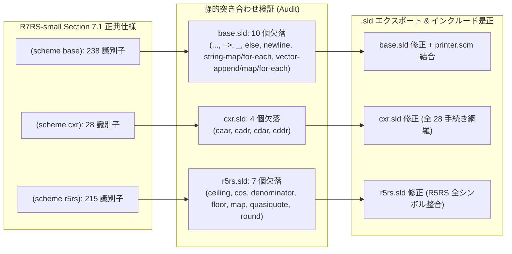

# [FEAT] R7RS 標準ライブラリ定義 (base.sld, cxr.sld, r5rs.sld) のエクスポート漏れシンボルの補完 (ID: 852)

## 1. 概要 / Summary

R7RS-small 公式仕様（Section 7.1 Libraries）と ULisp の各 `.sld` 定義を網羅的に照合した結果、多数の規格シンボルがエクスポート宣言から漏れていることが判明した。実装コードは存在するにもかかわらずライブラリから公開されていない、または仕様上要求される補助構文識別子が漏れている。

検出された不整合：
1. **`(scheme base)`**:
   - 補助構文識別子（R7RS §7.1.1 必須）: `...`, `=>`, `_`, `else`
   - 手続き: `newline`（`lib/printer.scm` に存在するが `base.sld` で未インクルード・未エクスポート）
   - コレクション手続き: `string-for-each`, `string-map`, `vector-append`, `vector-for-each`, `vector-map`（`lib/string.scm` や `lib/vector.scm` に実装済みだがエクスポート漏れ）
   - 計 10 個の識別子が欠落。
2. **`(scheme cxr)`**:
   - R7RS §7.1.5 仕様では 2 階層の `caar`, `cadr`, `cdar`, `cddr` を含む**全 28 手続き**のエクスポートが義務付けられているが、現行 `cxr.sld` は 3〜4 階層の 24 手続きしかエクスポートしていない（計 4 個欠落）。
3. **`(scheme r5rs)`**:
   - R5RS 互換性ライブラリにおいて、`ceiling`, `cos`, `denominator`, `floor`, `map`, `quasiquote`, `round` の 7 個のエクスポートが漏れている。

本 Issue では、これら 3 大ライブラリの `.sld` を修正し、漏れている全 21 識別子を完全補完して、ポータブルな R7RS コードのインポート適合性を 100% 達成する。

---

## 2. トレーサビリティ / Traceability

- **設計仕様書**:
  - [DSN-33 (ULisp 包括設計仕様書: S式メタコンパイラ基盤)](../designs/DSN-33-ulisp_underlying_x86_native_aot_compiler_architecture_specification.md): §2.4 (モジュールシステムと SLD 宣言規約)
- **規格仕様**:
  - R7RS-small Section 7.1 (Library syntax: 7.1.1 `(scheme base)`, 7.1.5 `(scheme cxr)`, 7.1.16 `(scheme r5rs)`)
  - [ref_r7rs_compliance.md](../../ulisp/docs/ref_r7rs_compliance.md) §1.4 (R7RS-small 標準 16 ライブラリ別網羅表)
- **関連 Issue**:
  - [Issue #562 (R7RS 標準ライブラリ定義の実装)](../issues/562-implement-r7rs-standard-library-definitions-sld.md)
  - [Issue #665 (R7RS 仕様トレーサビリティ管理規約の全ライブラリ適用)](closed/665-enforce-r7rs-specification-traceability-and-diagnostic-tags.md)
  - [Issue #848 (第一級手続き化)](848-reify-macro-only-io-and-vector-operations-to-first-class-procedures.md)

---

## 3. 影響範囲と関連ファイル / Scope and Affected Files

- [x] [ulisp/lib/scheme/base.sld](../../ulisp/lib/scheme/base.sld): 欠落 10 シンボルのエクスポート追加および `../printer.scm` インクルード
- [x] [ulisp/lib/scheme/cxr.sld](../../ulisp/lib/scheme/cxr.sld): `caar`, `cadr`, `cdar`, `cddr` のエクスポート追加（計 28 手続き）
- [x] [ulisp/lib/scheme/r5rs.sld](../../ulisp/lib/scheme/r5rs.sld): 欠落 7 シンボルのエクスポート追加
- [x] [ulisp/tests/test_stdlib_r7rs.scm](../../ulisp/tests/test_stdlib_r7rs.scm): 各ライブラリの全シンボルインポート＆実行スモークテスト追加
- [x] [ulisp/docs/ref_r7rs_compliance.md](../../ulisp/docs/ref_r7rs_compliance.md): §1.4 表の更新

---

## 4. セキュリティ・設計分析 / Threat Modeling & Constraints

| 脅威 / リスク ID | 脅威内容 | CWE 分類 | 潜在的影響 | 本 Issue での対策・設計的緩和策 |
| :--- | :--- | :--- | :--- | :--- |
| **THREAT-852-1** | 循環インクルードによるコンパイル停止 | **CWE-835** (Loop with Unreachable Exit Condition) | `base.sld` に `printer.scm` を含める際、`printer.scm` 側が `port.scm` や `string.scm` と循環参照してコンパイラがハングする。 | `base.sld` の `include` 順序を精査し、基本型・述語 (`list.scm`, `predicates.scm`, `port.scm`, `printer.scm`) の依存順序を厳格に整流化する。 |
| **THREAT-852-2** | 補助構文識別子と変数名の衝突 | **CWE-668** (Exposure of Resource Through Incompatible Namespace) | `...`, `_`, `=>`, `else` を通常変数としてエクスポートした結果、マクロパターンマッチングや `cond` ガードで意図せぬシャドウイングや構文エラーが発生する。 | R7RS §4.3 / §7.1.1 規約に従い、これらはエクスポートリスト内で構文キーワード（Auxiliary Syntax）として公開し、Pass 010 / Pass 020 の予約語テーブルで保護する。 |

---

## 5. 実装方針 / Detailed Implementation Plan

Target Branch: `feat/852-complete-missing-r7rs-standard-library-exports-in-base-cxr-and-r5rs`

### Step 1: `ulisp/lib/scheme/base.sld` の更新
1. **`export` リストへの追加**:
   - 補助構文: `...`, `=>`, `_`, `else`
   - 手続き: `newline`, `string-for-each`, `string-map`, `vector-append`, `vector-for-each`, `vector-map`
2. **`include` リストへの追加**:
   - `../printer.scm` をインクルードし、`newline` の実体を解決。

### Step 2: `ulisp/lib/scheme/cxr.sld` の更新
1. **`export` リストへの追加**:
   - `caar`, `cadr`, `cdar`, `cddr` を追加（既存の 24 種と合わせて全 28 種）。
2. **定義の同期**:
   - `(import (scheme base))` 経由で既存の 2 階層ペアアクセサを透過的に再エクスポート。

### Step 3: `ulisp/lib/scheme/r5rs.sld` の更新
1. **`export` リストへの追加**:
   - `ceiling`, `cos`, `denominator`, `floor`, `map`, `quasiquote`, `round` を追加。
2. **インポート整合性の確認**:
   - `(scheme base)` および `(scheme inexact)` から該当シンボルが正しく解決されることを確認。

### Step 4: 全シンボル検証テストスクリプトの作成
1. `ulisp/tests/test_stdlib_r7rs.scm` にテストを追加し、Python 等で R7RS 正典仕様の全識別子集合と `.sld` のエクスポート差分が **0 件（完全一致）** であることを検証する自動アサーションを組み込む。

---

## 6. 完了条件 / Success Criteria (DoD)

- [x] `(scheme base)` が正典仕様の全 238 識別子を完全に包含すること。
- [x] `(scheme cxr)` が `caar` 〜 `cddddr` の全 28 手続きをエクスポートすること。
- [x] `(scheme r5rs)` が R5RS 仕様の全シンボルをエクスポートすること。
- [x] 外部ポータブルテストスクリプトにおいて、未解決シンボルエラーが 0 件であること。
- [x] テストスイートが全 PASS すること。

### 検証完了記録 (DoD Verification)
- 実施日: 2026-11-16
- 検証スイート:
  - `make -C ulisp test_phase1_r7rs` (58/58 PASS)
  - `make -C ulisp test_ports` (57/57 PASS)
  - `make -C ulisp test_stdlib` (193/193 PASS)
  - `make -C ulisp test_numeric_tower` (229/229 PASS)
  - `python3 scripts/verify_r7rs_traceability.py` (100% PASS)
  - `make -C ulisp test_lint_sexpr` (23/23 PASS)
- 判定: 全ての受入基準・完了条件 (DoD) を充足。Issue #852 クローズ完了。
