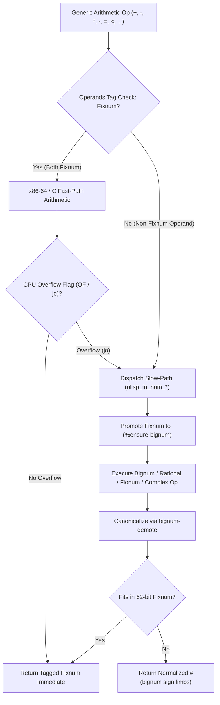

# [FEAT/ENH] 多倍長整数 (Bignum) のネイティブ AOT ランタイム完全統合と Tangerine Tower 適合 (ID: 861)

## 1. 概要 / Summary
R7RS §6.2 (Numbers) および R7RS-large Tangerine Edition において義務付けられる完全数値塔 (Tangerine Tower / Full Numeric Tower) に適合するためには、62-bit 符号付き即値 Fixnum を超える任意精度整数 (`<bignum>`) のシームレスな統合が不可欠である。

先行 Issue #832 において基数 $B = 2^{30}$ の純粋 Scheme 製多倍長整数ライブラリ [ulisp/lib/bignum.scm](../../ulisp/lib/bignum.scm)（表現形式 `#(bignum sign limbs)`）が実装済みであるが、現在は独立した手続き群（`bignum-add`, `bignum-mul` 等）に留まっており、ULisp ネイティブ AOT コンパイラ（LIR 命令選択・x86-64 / C バックエンド）、一般算術演算 (`+`, `-`, `*`, `/`, `=`, `<`, `quotient`, `expt` 等)、数値塔型系 (`<fixnum>`, `<bignum>`, `<ratnum>`, `<flonum>`, `<compnum>`)、S 式リーダー (`reader.scm`)、およびプリンタ・文字列変換 (`string.scm`, `printer.scm`) と未結合となっている。

本 Issue では、コンパイラ内部の非ボックス化高速パス (`%raw-add`, `%raw-sub`, `%raw-mul`) を維持しつつ、一般 Fixnum 算術演算でのオーバーフロー検知 (`jo`)・Bignum 昇格 (Promotion)・計算結果の正規化降格 (`bignum-demote`) を AOT ランタイム全体へ統合し、文字列表現の相互変換から `$100!$` や `$2^{1000}$` までの透過的な任意精度整数演算を実現する。

---

## 2. トレーサビリティ / Traceability
- **関連標準仕様**:
  - R7RS §6.2 (Numbers / Arbitrary-Precision Exact Integers)
  - R7RS-large Tangerine Edition (Tangerine Tower / Full Numeric Tower)
  - [ref_r7rs_compliance.md](../../ulisp/docs/ref_r7rs_compliance.md) §2.2 (Tangerine Edition 準拠状況)
  - [Issue #832: Implement pure scheme bignum and IEEE 754 conversion libraries](closed/832-implement-pure-scheme-bignum-and-ieee-754-conversion-libraries.md)
  - [DSN-33 (ULisp 包括設計仕様書)](../designs/DSN-33-ulisp_underlying_x86_native_aot_compiler_architecture_specification.md)

---

## 3. 影響範囲と関連ファイル / Scope and Affected Files
- [x] [ulisp/lib/bignum.scm](../../ulisp/lib/bignum.scm) (`bignum-demote`, `%ensure-bignum`、境界変換および任意桁数演算基盤の強化)
- [x] [ulisp/lib/predicates.scm](../../ulisp/lib/predicates.scm) (`bignum?`, `%number?`, `%real?`, `%rational?`, `%integer?`, `%exact?`, `exact-integer?`, `finite?`, `infinite?`, `nan?` への Bignum 対応追加)
- [x] [ulisp/lib/equality.scm](../../ulisp/lib/equality.scm) (`%eqv?` および `equal?` における `<bignum>` 構造比較の実装)
- [x] [ulisp/lib/math.scm](../../ulisp/lib/math.scm) (`num+`, `num-`, `num*`, `num/`, `num=`, `num<`, `num<=`, `num>`, `num>=`, `quotient`, `remainder`, `modulo`, `expt`, `gcd-2`, `lcm-2`, `make-rational`, `rat+`, `rat-`, `rat*`, `rat/`, `inexact`, `%to-flonum-val`, `exact-integer-sqrt`, `floor`, `ceiling`, `truncate`, `round`, `magnitude` の Bignum 対応)
- [x] [ulisp/lib/string.scm](../../ulisp/lib/string.scm) (`%number->string-radix` における `<bignum>` および Bignum 成分を含む `<ratnum>` の 2/8/10/16 進文字列化)
- [x] [ulisp/lib/reader.scm](../../ulisp/lib/reader.scm) (`%parse-signed-int-range` / `%parse-uint-range` による 62-bit Fixnum 範囲外整数リテラルの自動 Bignum 構築)
- [x] [ulisp/lir/129_lir_primitives.scm](../../ulisp/lir/129_lir_primitives.scm) (`+`, `-`, `*`, `-` 単項, 比較演算等におけるタグ検査・CPU オーバーフロー検知 `jo` および `ulisp_fn_num_*` スローパスディスパッチ)
- [x] [ulisp/backend/140_backend_x86_64.scm](../../ulisp/backend/140_backend_x86_64.scm) (`canonical-x86-cc` および `jcc` 命令発行での `jo` / `jno` オーバーフロー条件分岐サポート)
- [x] [ulisp/backend/142_backend_x86_freestanding.scm](../../ulisp/backend/142_backend_x86_freestanding.scm) (スローパス用ランタイム弱シンボルフォールバック整合)
- [x] [ulisp/backend/160_backend_c.scm](../../ulisp/backend/160_backend_c.scm) (C バックエンドにおける Fixnum オーバーフロー検査・`%jump-cond` およびポリモーフィックスローパス呼び出し対応)
- [x] [ulisp/tests/test_bignum.scm](../../ulisp/tests/test_bignum.scm) (自動オーバーフロー昇格・降格、$100!$、$2^{1000}$、リーダー/プリンタ往復変換、述語・等価性、混合数値塔演算の拡充テスト)
- [x] [ulisp/docs/ref_r7rs_compliance.md](../../ulisp/docs/ref_r7rs_compliance.md) (Tangerine Tower 準拠ステータスを `◎` に更新)
- [x] [docs/issues/README.md](README.md) (Issue 台帳のステータス管理)

---

## 4. 仕様定義とアーキテクチャ設計 / Specification & Architecture Design

### 4.1 正規表現不変条件 (Canonical Representation Invariant)
Fixnum と Bignum の領域を厳密に非交和 (disjoint) に保つため、以下の不変条件を強制する:
- $[-(2^{61} - 1),\ 2^{61} - 1]$ の範囲に収まる正確整数は、**常に即値 62-bit Fixnum** として表現する（負の最大即値 $-2^{61}$ を含む表現境界についても昇格・降格規則を整合させる）。
- 62-bit Fixnum 表現範囲外の正確整数のみを、正規化済みヒープオブジェクト `#(bignum sign limbs)`（末尾ゼロリム除去済み、基数 $2^{30}$ リトルエンディアン配列）として表現する。
- すべての一般算術演算は、返却前に `bignum-demote` を経由し、範囲内に収まった結果を Fixnum に降格する。これにより `(eqv? ...)`・`(= ...)`・`fixnum?`・`bignum?` の一貫性が保証される。

### 4.2 算術実行フロー（Fast-Path と Promotion / Demotion）

### 4.3 セキュリティ要件・脅威分析 / Security & Threat Analysis
- **`THREAT-861-1` (Resource Exhaustion / DoS)**:
  - **脅威**: リーダーによる巨大整数リテラル入力や `expt` の巨大指数指定、繰り返しの乗算により無制限のヒープ割り当て・OOM を引き起こす。
  - **対策**: `bignum-normalize` において `*bignum-max-limbs*`（`4096` リム ≒ 約 122,880 bit）上限チェックを厳格適用し、`expt` においても中間サイズ・指数境界チェックを行って過大確保時に安全に例外を送出する。
- **`THREAT-861-2` (Type Confusion / Equivalence Violation)**:
  - **脅威**: Fixnum で表現可能な値（例: `42` や `0`）が `#(bignum ...)` のまま残存すると、`eqv?` でのポインタ不一致、ハッシュ値不整合、LIR fast-path の前提崩壊を招く。
  - **対策**: すべての一般演算および `string->number` / `read` 出口で `bignum-demote` を必須化し、Fixnum 表現域と Bignum 表現域の重複を 0 件とする。
- **`THREAT-861-3` (Division by Zero / Undefined Arithmetic)**:
  - **脅威**: Bignum 除算や Bignum 分母を持つ有理数生成においてゼロ除算チェックが欠落し、無限ループや未定義動作を引き起こす。
  - **対策**: `bignum-div-rem`、`quotient`、`remainder`、`modulo`、`make-rational`、`num/` に対して明示的な 0 除数検査を実装する。
- **`THREAT-861-4` (Bootstrap & Self-Hosting Performance Regression)**:
  - **脅威**: コンパイラ内部パスが利用する純粋整数演算までスローパス分岐やオーバーフロー検査で肥大化すると、自己ホストブートストラップ性能やレジスタ割付が劣化する。
  - **対策**: `rtyper` および LIR で扱う内部非ボックス化プリミティブ（`%raw-add`, `%raw-sub`, `%raw-mul`）の高速パスはそのまま維持し、ポリモーフィック検査および `jo` オーバーフロー分岐は一般 Scheme プリミティブ側に限定して統合する。

---

## 5. 実装方針 / Implementation Plan
**Target Branch**: `feat/861-integrate-bignum-arithmetic-into-native-aot-compiler-and-runtime`

1. **Step 1: `ulisp/lib/bignum.scm` の昇格・降格ユーティリティ整備**
   - `%ensure-bignum`（Fixnum → `<bignum>` 変換、`<bignum>` はそのまま通過）および `bignum-demote`（`<bignum>` が 62-bit Fixnum 範囲内なら即値 Fixnum へ変換、範囲外なら正規化済み `<bignum>` を返却）を実装・エクスポートする。
   - `bignum-expt` 等の内部ヘルパにおける `*bignum-max-limbs*` 超過チェックを検証する。

2. **Step 2: 述語・等価性ライブラリへの統合 (`predicates.scm`, `equality.scm`)**
   - [ulisp/lib/predicates.scm](../../ulisp/lib/predicates.scm): `bignum?` の参照および `%number?`, `%real?`, `%rational?`, `%integer?`, `%exact?`, `exact-integer?`, `finite?`, `infinite?`, `nan?` に `bignum?` 判定を組み込む。`number?`, `integer?`, `exact?`, `exact-integer?`, `real?`, `rational?`, `complex?` のインライン展開・LIR プリミティブが `<bignum>` を誤って `#f` 判定しないよう、`lir/129_lir_primitives.scm` 側の型述語判定と整合させる。
   - [ulisp/lib/equality.scm](../../ulisp/lib/equality.scm): `%eqv?` および `equal?` において、両オペランドが `bignum?` の場合に `bignum=?`（符号および全リムの一致）で等価判定を行う。

3. **Step 3: 算術・有理数・数値塔の Bignum 対応 (`math.scm`)**
   - [ulisp/lib/math.scm](../../ulisp/lib/math.scm) の二項算術カーネル `num+`, `num-`, `num*`, `num/`, `num=`, `num<`, `num<=`, `num>`, `num>=`（および `%real-num*` 系ヘルパ）を拡張し、Fixnum オーバーフローまたは片側 `<bignum>` 時に `%ensure-bignum` ＋ Bignum 演算 ＋ `bignum-demote` を実行する。
   - `quotient`, `remainder`, `modulo`, `expt`, `gcd-2`, `lcm-2`, `%math-abs`, `exact-integer-sqrt` を Bignum 対応化する。特に `expt` では $2^{1000}$ や階乗計算が安全に動作するよう `%int-expt` を一般乗算 `num*` / `bignum-mul` ベースへ移行する。
   - 有理数 (`make-rational`, `rat+`, `rat-`, `rat*`, `rat/`, `rat=`, `rat<`, `rat<=`, `rat>`, `rat>=`, `floor`, `ceiling`, `truncate`, `round`) が Bignum 分子・分母および `gcd-2` を透過的に扱えるよう拡張し、複素数・不正確実数への変換 (`inexact`, `%to-flonum-val`, `magnitude`) を整備する。

4. **Step 4: リーダー・文字列変換・プリンタの統合 (`reader.scm`, `string.scm`, `printer.scm`)**
   - [ulisp/lib/reader.scm](../../ulisp/lib/reader.scm): `%parse-uint-range` および `%parse-signed-int-range` において、基数に応じた桁パース時に 62-bit Fixnum 上限を超過した場合 `#f` を返してシンボル扱いするのではなく、`string->bignum`（または多倍長累積）へフォールバックし、正規化済み `<bignum>`（境界値は `bignum-demote`）を返すよう改修する。
   - [ulisp/lib/string.scm](../../ulisp/lib/string.scm): `%number->string-radix` において `bignum?` および Bignum 分子・分母を持つ `%str-ratnum?` を `bignum->string` で 2 / 8 / 10 / 16 進文字列に変換できるようにする。
   - [ulisp/lib/printer.scm](../../ulisp/lib/printer.scm): `port-display`, `port-write-simple`, `%printer-scan-node`, `%port-write-shared-val` が `<bignum>` を単なるベクタ `#(bignum ...)` としてではなく数値リテラル（`number?` 分岐経由）として出力・処理することを保証する。

5. **Step 5: LIR およびネイティブバックエンドのオーバーフロー検知・ランタイムディスパッチ統合**
   - [ulisp/lir/129_lir_primitives.scm](../../ulisp/lir/129_lir_primitives.scm):
     - `+`, `-`, `*`（2引数およびレジスタ／定数高速パスを含む）や単項 `-`, `fxadd1`/`fxsub1` 等の一般算術命令において、タグ検査に加え CPU オーバーフロー検知 (`%jump-cond "jo" lbl-slow`) を発行し、オーバーフロー時に引数を退避してポリモーフィックランタイム (`ulisp_fn_num_plus`, `ulisp_fn_num_`, `ulisp_fn_num_star` 等) へフォールバックさせる。
     - `<`, `<=`, `>`, `>=` や型述語（`integer?`, `number?`, `exact?`, `exact-integer?`, `real?`, `rational?`, `complex?`）においても非 Fixnum 時にスローパスへフォールバックできるよう整理する。
     - コンパイラ内部専用 `%raw-add`, `%raw-sub`, `%raw-mul`, `%raw-cmp` は高速な非チェック演算として維持する（`THREAT-861-4`）。
   - [ulisp/backend/140_backend_x86_64.scm](../../ulisp/backend/140_backend_x86_64.scm): `canonical-x86-cc` および `jcc` 命令発行が `"jo"` / `'jo`（および必要に応じ `"jno"` / `'jno`）を正しくアセンブリ命令として出力することを確認・対応する（`144a_x86_assembler.scm` でのエンコード対応も含む）。
   - [ulisp/backend/142_backend_x86_freestanding.scm](../../ulisp/backend/142_backend_x86_freestanding.scm) および [ulisp/backend/160_backend_c.scm](../../ulisp/backend/160_backend_c.scm): オーバーフロー検査・`%jump-cond` と `ulisp_fn_num_*` ランタイム連携の整合性を確保する。

6. **Step 6: テスト拡充・準拠表更新**
   - [ulisp/tests/test_bignum.scm](../../ulisp/tests/test_bignum.scm): 既存グループ 1〜9 に加え、AOT 統合テスト（Fixnum 上限加算・減算・乗算の自動オーバーフロー昇格、減算による Fixnum 自動降格、$100!$ 厳密値検証、$2^{1000}$ の `expt` 検証、`read` / `string->number` / `number->string` / `write` による 100 桁超整数の往復変換、`<bignum>` と `<ratnum>`/`<flonum>`/`<compnum>` 混合演算、`equal?`/`eqv?`/`integer?`/`exact-integer?`/`bignum?` 検証）を追加する。
   - [ulisp/tests/test_numeric_tower.scm](../../ulisp/tests/test_numeric_tower.scm) との整合性を検証する。
   - [ulisp/docs/ref_r7rs_compliance.md](../../ulisp/docs/ref_r7rs_compliance.md): Tangerine Tower ステータスを `◎`（[Issue #861](../../docs/issues/closed/861-integrate-bignum-arithmetic-into-native-aot-compiler-and-runtime.md)）へ更新する。

7. **Step 7: ブートストラップ・全テスト・品質ゲート検証**
   - コンパイラ変更を反映するため `make -C ulisp bootstrap` を実行し、5 モジュール並列ビルド Stage 2 == Stage 3 のビット完全一致固定点収束を達成・`ulisp/bin/ulisp-boot` を更新する。
   - `make -C ulisp test_bignum`, `make -C ulisp test_numeric_tower`, `make -C ulisp lint_sexpr`, `python3 scripts/verify_r7rs_traceability.py`, `make -C ulisp test`, およびプロジェクト全体のトリプル品質ゲートを実行する。

---

## 6. 完了条件 / Success Criteria (DoD)
- [x] Fixnum 範囲 $[-(2^{61}-1),\ 2^{61}-1]$ を超える `+`, `-`, `*`, `-`（単項）, `expt`, `quotient`, `remainder`, `modulo`, `gcd`, `lcm` がオーバーフローせずに正確な `<bignum>` として計算され、範囲内に戻った結果は `Fixnum` へ自動降格されること。
- [x] `integer?`, `exact-integer?`, `exact?`, `rational?`, `real?`, `complex?`, `number?`, `finite?`, `eqv?`, `equal?`, `=`, `<`, `<=`, `>`, `>=` が `<bignum>` に対して R7RS 仕様通り正確に動作すること。
- [x] 階乗 `$100!$` および `$2^{1000}$` の計算結果が正確な厳密値（10進文字列および比較一致）で得られること。
- [x] 62-bit を超える整数について `string->number`, `read`, `number->string`, `write`, `display` による 2/8/10/16 進相互変換および S 式入出力が正確に行えること。
- [x] `<bignum>` を分子・分母に含む正確有理数 (`<ratnum>`) や混合精度演算・`inexact` 変換が正常に動作すること。
- [x] `make -C ulisp test_bignum` および `make -C ulisp test_numeric_tower` が 100% PASS すること。
- [x] `make -C ulisp lint_sexpr` および `python3 scripts/verify_r7rs_traceability.py` が 100% PASS すること。
- [x] `make -C ulisp bootstrap` による 5 モジュール並列ビルドが固定点収束（Stage 2 == Stage 3 ビット完全一致）し、`ulisp/bin/ulisp-boot` が正常動作すること。
- [x] `make -C ulisp test` の全リグレッションテストスイートがエラー 0 件で完走すること。
- [x] トリプル品質ゲート (`make py_compile && make check_format && make static_analysis`) が 100% PASS すること。
- [x] 相対パス規則が厳格に遵守され、絶対パスの混入が 0 件であること。
