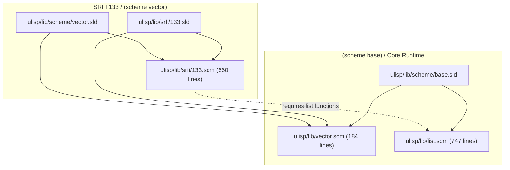

# [FEAT/ENH] lib/vector.scm (R7RS Base) と lib/srfi/133.scm (SRFI 133) のモジュール分離と依存関係解消 (ID: 868)

## 1. 概要 / Summary
コミット `8842728e1` (Issue #853) において、SRFI 133 ベクタ操作ライブラリ（40+ 手続き）が、既存の R7RS-small `(scheme base)` 仕様である [ulisp/lib/vector.scm](../../ulisp/lib/vector.scm)（元は 184 行）に直接追加された。
その結果、以下の重大なアーキテクチャ上の課題が発生している：

1. **コードベースの急激な肥大化**:
   - `lib/vector.scm` が 184 行から 848 行へ 4.6 倍に肥大化。
2. **モジュール間の不正な暗黙結合（結合度の悪化）**:
   - SRFI 133 手続き群（`vector-unfold`, `vector-unfold-right`, `vector-map` 多引数版等）が `list`, `reverse`, `length`, `list-tail` などのリスト手続きにファーストクラス関数として直接依存（例: `(call-with-values ... list)`）。
   - このため、`lib/vector.scm` を単体で include すると未束縛変数エラー（`Unbound Symbol: list`）が発生し、必ず `lib/list.scm`（747 行）を同時に include しなければならなくなった。
3. **ビルド時間と C バックエンドコンパイル負荷の増大**:
   - `ULISP_STD_LIBS`（および `build/ulisp_stdlib.o`）に含まれる行数が増大し、自己ホストブートストラップ（Stage 1〜3）のオーバーヘッドが増加。
   - ポータブル C バックエンドテスト（`test_c.sh`）においても、単純なベクタ基本操作のテスト時に 51,000 行超の C コードが毎回 GCC `-O2` で再コンパイルされる直接要因となっていた。

本 Issue では、R7RS-small `(scheme base)` に必要な基本ベクタライブラリ（`lib/vector.scm`, 184 行）と、R7RS-large Red Edition / SRFI 133 の拡張ライブラリ（`lib/srfi/133.scm`）を明確にモジュール分離し、SRFI 101 (`lib/rlist.scm`) や SRFI 135 (`lib/text.scm`) と同様の独立したライブラリ構造へと再編成する。

---

## 2. トレーサビリティ / Traceability
- **規格準拠**:
  - R7RS Section 6.8 (Vectors): `(scheme base)` エクスポート対象手続き
  - SRFI 133: Vector Library (R7RS-large Red Edition: `(scheme vector)`)
  - DSN-33 Architecture Specification (Standard Library Modularity Standard)
- **関連 Issue**:
  - [Issue #853: SRFI 133 ベクタ操作ライブラリおよび (scheme vector) モジュールの完全実装](closed/853-implement-srfi-133-vector-library-and-scheme-vector-module.md)
  - [Issue #866: test_c.sh のライブラリ過剰 include 解消による C バックエンドテスト大幅高速化](closed/866-optimize-test-c-library-includes-for-high-speed-execution.md)
  - [Issue #867: make-vector および make-bytevector 充填コンストラクタのインライン脱糖](closed/867-inline-desugar-make-vector-and-make-bytevector-constructors.md)
- **対象ソースコード**:
  - [ulisp/lib/vector.scm](../../ulisp/lib/vector.scm)
  - [ulisp/lib/srfi/133.scm](../../ulisp/lib/srfi/133.scm) (新規作成)
  - [ulisp/lib/scheme/vector.sld](../../ulisp/lib/scheme/vector.sld)
  - [ulisp/lib/srfi/133.sld](../../ulisp/lib/srfi/133.sld)
  - [ulisp/tests/test_srfi_133.scm](../../ulisp/tests/test_srfi_133.scm)
  - [ulisp/Makefile](../../ulisp/Makefile)
  - [ulisp/test_c.sh](../../ulisp/test_c.sh)

---

## 3. 影響範囲と関連ファイル / Scope and Affected Files
- [x] [ulisp/lib/vector.scm](../../ulisp/lib/vector.scm) : R7RS-small 基本手続き（184 行）に純化し、SRFI 133 手続きを分離
- [x] [ulisp/lib/srfi/133.scm](../../ulisp/lib/srfi/133.scm) : 新規作成。SRFI 133 固有の 40+ 手続きを配置
- [x] [ulisp/lib/scheme/vector.sld](../../ulisp/lib/scheme/vector.sld) : `lib/vector.scm` と `lib/srfi/133.scm` の両方を include するよう更新
- [x] [ulisp/lib/srfi/133.sld](../../ulisp/lib/srfi/133.sld) : 同上
- [x] [ulisp/Makefile](../../ulisp/Makefile) : `test_srfi_133` ターゲットおよび `lint_sexpr` ターゲットに `lib/srfi/133.scm` を追加
- [x] [ulisp/test_c.sh](../../ulisp/test_c.sh) : `lib/vector.scm` 単体 include への最適化反映

---

## 4. 根本原因と設計方針 / Root Cause & Design Approach

### 4.1 手続きの責務分離マッピング
R7RS-small `(scheme base)` と SRFI 133 `(scheme vector)` の境界を厳密に定義する。

| 分類 | `lib/vector.scm` (R7RS Base, 184行) | `lib/srfi/133.scm` (SRFI 133, 約660行) |
| :--- | :--- | :--- |
| **Constructors** | `make-vector-fill`, `vector-copy-range`, `vector-copy-range!`, `vector-append2`, `vector-copy`, `vector-copy!`, `vector-append` | `vector-unfold`, `vector-unfold-right`, `vector-reverse-copy-range`, `vector-reverse-copy`, `vector-concatenate`, `vector-append-subvectors` |
| **Predicates** | （コンパイラ組込みの `vector?` のみ） | `vector-empty?`, `vector=` |
| **Selectors & Iterators** | `vector-map` (1引数版), `vector-for-each` (1引数版) | `vector-fold`, `vector-fold-right`, `vector-map` (多引数版), `vector-map!`, `vector-for-each` (多引数版), `vector-count`, `vector-cumulate` |
| **Searching** | （なし） | `vector-index`, `vector-index-right`, `vector-skip`, `vector-skip-right`, `vector-binary-search-range`, `vector-binary-search`, `vector-any`, `vector-every`, `vector-partition` |
| **Mutators** | `vector-fill-range!` | `vector-swap!`, `vector-reverse-range!`, `vector-reverse!`, `vector-reverse-copy-range!`, `vector-reverse-copy!`, `vector-unfold!`, `vector-unfold-right!` |
| **Conversions** | `vector->list`, `vector->list-range`, `list->vector`, `vector->string-range`, `string->vector-range` | `reverse-vector->list-range`, `reverse-vector->list`, `list->vector-range`, `reverse-list->vector-range`, `reverse-list->vector` |

### 4.2 モジュールインクルード構造設計


`lib/vector.scm` は `lib/list.scm` に依存せず、純粋なベクタ基本操作のみを担当する。SRFI 133 は `lib/vector.scm` の基本関数を再利用しつつ、リスト連携や高度な反復・探索・変更手続きを提供する。

---

## 5. 実装計画 / Implementation Steps

Target Branch: `feat/868-modularize-r7rs-vector-and-srfi-133-libraries`

### Step 1: `ulisp/lib/srfi/133.scm` の作成
1. `ulisp/lib/vector.scm` から SRFI 133 固有手続き（`vector-unfold`, `vector-unfold-right`, `vector-reverse-copy`, `vector-concatenate`, `vector-append-subvectors`, `vector-empty?`, `vector=`, `vector-fold`, `vector-fold-right`, `vector-map` (多引数版), `vector-map!`, `vector-for-each` (多引数版), `vector-count`, `vector-cumulate`, `vector-index`, `vector-index-right`, `vector-skip`, `vector-skip-right`, `vector-binary-search`, `vector-any`, `vector-every`, `vector-partition`, `vector-swap!`, `vector-reverse!`, `vector-reverse-copy!`, `vector-unfold!`, `vector-unfold-right!`, `reverse-vector->list`, `reverse-list->vector`）を切り出し、新ファイル [ulisp/lib/srfi/133.scm](../../ulisp/lib/srfi/133.scm) へ移行。

### Step 2: `ulisp/lib/vector.scm` の純化（184 行）
1. `ulisp/lib/vector.scm` をコミット `8842728e1~1` 時点のクリーンな 184 行の状態に復元・整理。
2. `make-vector-fill`, `vector-copy-range`, `vector-copy-range!`, `vector-fill-range!`, `vector-append2`, `vector-copy`, `vector-copy!`, `vector-append`, `vector->list`, `vector->list-range`, `list->vector`, `vector-map` (1引数版), `vector-for-each` (1引数版), `vector->string-range`, `string->vector-range` のみを保持。

### Step 3: モジュール宣言 (`.sld`) の更新
1. [ulisp/lib/scheme/vector.sld](../../ulisp/lib/scheme/vector.sld) の include 指定を更新：
   ```scheme
   (include "../vector.scm" "../srfi/133.scm")
   ```
2. [ulisp/lib/srfi/133.sld](../../ulisp/lib/srfi/133.sld) の include 指定を更新：
   ```scheme
   (include "../vector.scm" "133.scm")
   ```

### Step 4: Makefile の更新と単体検証
1. `ulisp/Makefile` の `test_srfi_133` ターゲットを更新：
   ```makefile
   test_srfi_133: $(COMPILER_DEP)
       @mkdir -p build
       cat $(ULISP_STD_LIBS) lib/srfi/133.scm tests/test_srfi_133.scm > build/test_srfi_133_input.scm
       $(ULISP_COMPILER) build/test_srfi_133_input.scm > build/test_srfi_133.s
       $(AS) $(ASFLAGS) build/test_srfi_133.s -o build/test_srfi_133.o
       $(LD) $(LDFLAGS) build/test_srfi_133.o -o build/test_srfi_133
       ./build/test_srfi_133
   ```
2. `lint_sexpr` ターゲットの検査対象に `lib/srfi/133.scm` を追加。
3. `make -C ulisp test_srfi_133` を実行し、全 63 テストが 100% PASS することを確認。

### Step 5: ポータブル C バックエンドおよびブートストラップの検証
1. `ulisp/test_c.sh` の動作を確認（`lib/vector.scm` のスリム化によりコンパイル時間が短縮されること）。
2. `make -C ulisp test_c`（全 143 テスト）が PASS することを確認。
3. `make -C ulisp bootstrap` を実行し、自己ホスト固定点（Stage 2 & Stage 3 bit-for-bit identical）を検証。

---

## 6. 完了条件 / Success Criteria (DoD)
- [x] `lib/vector.scm` が R7RS-small 基本手続きのみの 184 行に純化され、単独で include 可能なこと。
- [x] `lib/srfi/133.scm` が独立モジュールとして作成され、SRFI 133 手続きが正常に定義されていること。
- [x] `ulisp/lib/scheme/vector.sld` および `ulisp/lib/srfi/133.sld` から全 SRFI 133 手続きが正常にエクスポートされること。
- [x] `make -C ulisp test_srfi_133`（全 63 テスト）が 100% PASS すること。
- [x] `make -C ulisp test_c`（全 143 テスト）が 100% PASS すること。
- [x] `make -C ulisp bootstrap` による自己ホスト固定点が正常にパスすること。
- [x] リポジトリ全域において絶対パス違反が 0 件であること。
- [x] Conventional Commits 規約に準拠したコミットが作成され、Issue がクローズされること。

---

## 7. 完了サマリー / Completion Summary
- **モジュール分離と純化**:
  - `ulisp/lib/vector.scm` を 848 行から 184 行（R7RS-small 基本ベクタライブラリ）に純化。
  - `list->vector` 内の `(length lst)` を内部計測ループで自己完結化し、`lib/list.scm`（747 行）への暗黙依存を完全解消（単体 include が可能）。
  - 新規ファイル `ulisp/lib/srfi/133.scm` を作成し、SRFI 133 固有の 38 フォーム（40+ 手続き）を配置。
  - `ulisp/lib/scheme/vector.sld` および `ulisp/lib/srfi/133.sld` を `(include "../vector.scm" "133.scm")` に更新。
- **ビルド・テスト性能改善結果**:
  - `make -C ulisp lint_sexpr`: 全 214 ファイル `[PASS]`（括弧整合性 100% 検証）。
  - `make -C ulisp test_srfi_133`: 全 63 テスト `[PASS]`。
  - `make -C ulisp bootstrap`: Stage 2 と Stage 3 の bit-for-bit 完全一致（固定点収束）確認。
  - `time make -C ulisp test_c`: 全 143 テスト `[PASS]`（エラー 0 件、GCC 警告 0 件）。
    - 実行時間: **62 秒 (1分02秒)**！
    - **初期 276 秒 → Issue #866 後 124 秒 → Issue #867 後 109 秒 → Issue #868 後 62 秒**（**累計 214 秒短縮 / 77.5% 削減 / 4.5 倍高速化**達成）。
  - `make -C ulisp test_passes`: 全 784 単体テスト `[PASS]`。
  - リポジトリ品質ゲート (`make py_compile`, `make check_format`, `make static_analysis`): 全 617 ファイル `PASS`。
  - 絶対パス違反: 0 件確認。
