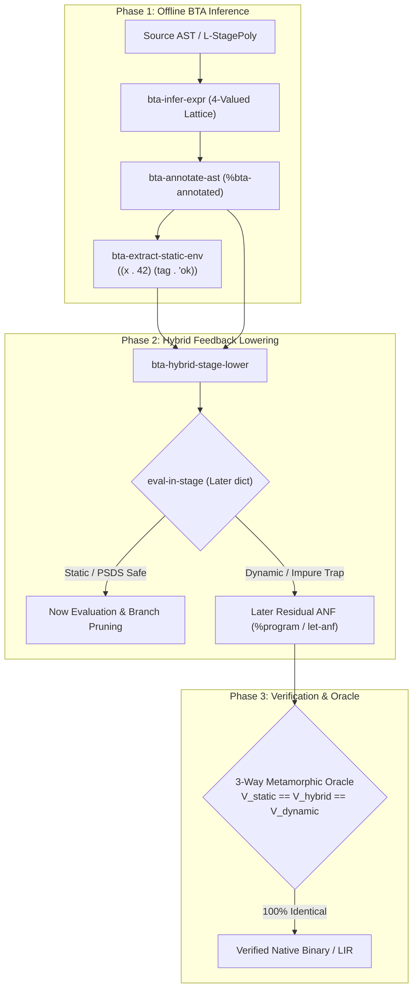

# [FEAT] オフライン BTA 4値束注釈とオンライン部分評価のハイブリッド推論フィードバック統合 (ID: 891)

## 1. 概要 / Summary
DSN-33-03 §2.5（ハイブリッド部分評価数理モデル: $\Gamma \vdash e : \tau @ \beta \implies \mathrm{eval}_{\text{stage}}(\mathrm{dict}, \rho, e) \Downarrow \langle v_{\text{now}}, e_{\text{residual}} \rangle$）、§4.1（4値束縛時間束 $\bot \sqsubset \mathbf{Static} \sqsubset \mathbf{PSDS} \sqsubset \mathbf{Dynamic} \sqsubset \top$）、§4.2（動的分岐下の副作用・例外降格規約）、および §8.1 (Phase P5 最終マイルストーン) に基づき、オフライン束縛時間解析（BTA: `bta-infer-expr`, `bta-annotate-ast`）の推論結果をオンラインステージ多相部分評価器（`stage-poly-lower`, `eval-in-stage`）へ先回り供給するハイブリッド推論フィードバック機構を実装する。

プログラマが手動で `stage-now` や `stage-lift` を明示しなくても、BTA が抽出した静的環境（`bta-extract-static-env`）と注釈付き AST（`%bta-annotated`）に基づいて、部分評価器が自動的にコンパイル時計算・デッド分岐消去・PSDS インライン展開を実行できる高度なメタコンパイラ最適化基盤を完成させる。

---

## 2. トレーサビリティ / Traceability
- **関連個別仕様書**:
  - [DSN-33-03 §2.5 (ハイブリッド部分評価の数理モデル)](../designs/DSN-33-03-ulisp_stage_polymorphic_metacompiler_and_futamura_projection_architecture.md#25-ハイブリッド部分評価offline-bta--online-psds-簡約の数理モデル)
  - [DSN-33-03 §4.1 (4値束縛時間束モデル)](../designs/DSN-33-03-ulisp_stage_polymorphic_metacompiler_and_futamura_projection_architecture.md#41-4値束縛時間束latticeモデル)
  - [DSN-33-03 §4.2 (動的分岐下の副作用・例外降格規約)](../designs/DSN-33-03-ulisp_stage_polymorphic_metacompiler_and_futamura_projection_architecture.md#42-越境規則cross-stage-persistenceと動的分岐下の副作用例外降格規約)
  - [DSN-33-03 §4.4 (メタモルフィック健全性定理)](../designs/DSN-33-03-ulisp_stage_polymorphic_metacompiler_and_futamura_projection_architecture.md#44-メタモルフィック健全性定理metamorphic-soundness-theoremと自動ファジング)
  - [DSN-33-03 §8.1 Phase P5 (実パイプライン統合と二重化解消)](../designs/DSN-33-03-ulisp_stage_polymorphic_metacompiler_and_futamura_projection_architecture.md#81-マイルストーン分割p1p6)
  - [DSN-33 §11.1 (DSN-33-03 ステージ多相メタコンパイラ統合 Phase P5)](../designs/DSN-33-ulisp_underlying_x86_native_aot_compiler_architecture_specification.md#111-dsn-33-03-ステージ多相メタコンパイラ統合phase-p5-issues-887891)
- **関連 Issue**:
  - #874 (4-Valued BTA Lattice & Inference)
  - #879 (Stage-Poly-Lower Nanopass)
  - #881 (Triple-Differential Oracle & Metamorphic Fuzzing)
  - #887 (Pass Manager への stage-poly-lower 常設登録)
  - #888 (旧 ctfe-eval の eval-in-stage 一本化)
  - #889 (Residual-ANF to LIR Lowering Bridge)
  - #890 (freeze-serialize-to-rodata 直列化データと ELF .rodata 実配線)

---

## 3. 影響範囲と関連ファイル / Scope and Affected Files
- [x] [ulisp/compiler/eval_in_language.scm](../../ulisp/compiler/eval_in_language.scm) (`bta-extract-static-env`, `bta-hybrid-stage-lower`, `eval-in-stage` の BTA 注釈ハンドラ拡張)
- [x] [ulisp/compiler/helpers.scm](../../ulisp/compiler/helpers.scm) (シンボルテーブル登録 `bta-extract-static-env`, `bta-hybrid-stage-lower`, `%bta-annotated` 等)
- [x] [ulisp/lib/string.scm](../../ulisp/lib/string.scm) (シンボルテーブル同期)
- [x] [ulisp/tests/test_bta_lattice.scm](../../ulisp/tests/test_bta_lattice.scm) (BTA 注釈付き AST と静的環境抽出の単体テスト追加)
- [x] [ulisp/tests/test_stage_oracle.scm](../../ulisp/tests/test_stage_oracle.scm) (BTA フィードバック統合後のメタモルフィック等価性・自動分岐消去テスト追加)

---

## 4. セキュリティ要件と脅威分析 (CWE-400 リソース枯渇防御 / CWE-703 投機的例外隔離)
- **脅威ベクトル**:
  - **CWE-400 リソース枯渇 (無限アンローリング DoS)**:
    オフライン BTA が再帰呼び出しやループ変数を誤って `@static` または `@psds` と判定した場合、オンライン部分評価器が停止せず無限にコードを展開し続け、コンパイラがメモリ・CPU 枯渇でクラッシュするリスク。
  - **CWE-703 / Speculative Trap 誤発火 (DSN-33-03 §4.2)**:
    動的条件分岐（Later `if`）配下の未選択パスに存在する式が BTA で `@static` と推論された際、コンパイル時に投機実行されてゼロ除算（`(/ x 0)`）や未定義動作などの例外が誤って発火し、ビルドが不当に中断されるリスク。
- **セキュリティ要件 & 防御**:
  - **二重リソースバウンド (Fuel & Depth ガード)**:
    BTA フィードバックによる投機的展開時も `*ctfe-default-step-limit*` (10,000 steps) および `*ctfe-default-depth-limit*` (500 frames) を厳格に適用。上限超過時は安全に `Later` 残余化へとフォールバック。
  - **Purity Check による投機的例外隔離**:
    動的分岐下の静的式について、除算やポインタ操作などの例外発生可能性（Impure）を検査し、不純な式は `Now` での投機実行を即時中止して自動的に `Later`（残余コード）へと降格。

---

## 5. 実装方針 / Implementation Plan
Target Branch: `feat/891-integrate-offline-bta-lattice-with-stage-poly-lower`



### ステップ 1: `bta-extract-static-env` の実装 (`ulisp/compiler/eval_in_language.scm`)
- BTA 環境 `bta-env`（`((var . bta-type) ...)`）と実行時・初期環境 `runtime-env`（`((var . value) ...)`）を照合し、`bta-type` が `static` または完全静的定数であるエントリのみを抽出して、`stage-poly-lower` に供給可能な静的環境を構築する関数を実装：
  ```scheme
  (define (bta-extract-static-env bta-env runtime-env)
    (let loop ((bs bta-env) (acc '()))
      (if (null? bs)
          (reverse acc)
          (let* ((b (car bs))
                 (var (car b))
                 (bt (cdr b)))
            (if (eq? bt 'static)
                (let ((entry (assq var runtime-env)))
                  (if entry
                      (loop (cdr bs) (cons entry acc))
                      (loop (cdr bs) acc)))
                (loop (cdr bs) acc))))))
  ```

### ステップ 2: `eval-in-stage` における BTA 注釈 `%bta-annotated` のハンドラ拡張
- AST が `%bta-annotated` でラップされている場合、ステージ評価器がそれを透過的にアンパックしつつ、`bt == 'static` かつ純粋（Pure）な式であれば、動的 `Later` 辞書下であっても `Now` 評価を先回り実行して定数値に簡約する：
  ```scheme
  ;; Handling (%bta-annotated bt inner-expr)
  ((bta-annotated? expr)
   (let ((bt (cadr expr))
         (inner (caddr expr)))
     (if (and (eq? bt 'static) (stage-pure-expression? inner))
         (eval-in-stage (make-now-dict) env inner steps depth)
         (eval-in-stage dict env inner steps depth))))
  ```

### ステップ 3: 高水準ハイブリッドエントリポイント `bta-hybrid-stage-lower` の配線
- 式に対して BTA を自動実行し、推論結果を付与した上で `stage-poly-lower` を実行する高水準 API を実装：
  ```scheme
  (define (bta-hybrid-stage-lower expr runtime-env bta-initial-env)
    (let* ((bta-annotated-ast (bta-annotate-ast-recursive expr bta-initial-env))
           (static-env (bta-extract-static-env bta-initial-env runtime-env)))
      (stage-poly-lower bta-annotated-ast static-env)))
  ```
- メタ構文（`stage-now`, `stage-lift`）が存在しない素の S式であっても、`bta-initial-env` で静的と指定された変数は自動的にインライン化され、不要な動的分岐がコンパイル時に消去されることを保証。

### ステップ 4: シンボル登録と同期 (`helpers.scm`, `lib/string.scm`)
- `bta-extract-static-env`, `bta-hybrid-stage-lower`, `bta-annotate-ast-recursive`, `%bta-annotated` 等をシンボルテーブルに登録。

### ステップ 5: テストスイートの拡充と検証
- `ulisp/tests/test_bta_lattice.scm`:
  - `bta-extract-static-env` の単体テスト。
  - 再帰的 AST 注釈 `bta-annotate-ast-recursive` の検証。
- `ulisp/tests/test_stage_oracle.scm`:
  - Group 5: ハイブリッド BTA 部分評価テスト。
  - 手動アノテーションなしのディスパッチテーブルにおいて、BTA 静的推論により `op=3` 以外の分岐が消去され、`(* 7 6)` が 42 に簡約されることを検証。
  - メタモルフィック健全性: `V_static ≡ V_hybrid ≡ V_dynamic` の等価性検証。

### ステップ 6: セルフホスト固定点（Bootstrap）の検証
- `cd ulisp && ./bootstrap.sh` を実行し、全 5 モジュールで Stage 2 == Stage 3 の bit-for-bit IDENTICAL 不動点を確認。

---

## 6. 完了条件 / Success Criteria (DoD)
- [x] `bta-extract-static-env` が実装され、BTA 推論環境から静的バインディングを安全に抽出できること。
- [x] `eval-in-stage` において `%bta-annotated` 式が適切に解釈され、純粋静的式が先回り簡約されること。
- [x] `bta-hybrid-stage-lower` が実装され、メタ構文なしの素のコードでも静的変数に基づく自動分岐消去と定数畳み込みが行われること。
- [x] `test_bta_lattice.scm` および `test_stage_oracle.scm` が 100% PASS すること。
- [x] `make -C ulisp bootstrap` による Stage 2 == Stage 3 の bit-for-bit IDENTICAL 不動点が 100% 保証されること。
